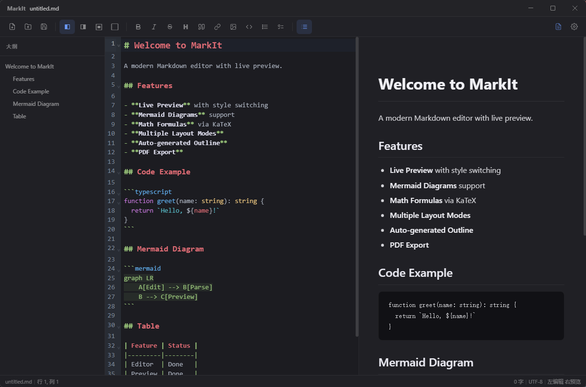

<p align="center">
  
</p>

<h1 align="center">MarkIt</h1>

<p align="center">
  一款轻量、精致的本地 Markdown 编辑器<br>
  实时预览 · Mermaid 图表 · 多标签页 · 多主题 · PDF 导出
</p>

<p align="center">
  
  
  
  
  
</p>

---

## 功能说明

### 编辑与文件操作

- 支持 `.md` / `.markdown` / `.txt` 文件，UTF-8 读写
- 打开文件支持多选，一次打开多个标签页；重复打开同一文件会直接激活已有标签
- 保存（`Ctrl+S`）、另存为（`Ctrl+Shift+S`）、刷新（`F5` / `Ctrl+R`）
- 刷新时若本地有未保存修改，会提示「放弃本地修改载入磁盘」或「保存并覆盖磁盘」
- 一键在系统文件管理器中定位当前文件（未保存的新建文档不可用）
- 支持双击 `.md` 文件、右键「使用 MarkIt 打开」及命令行传参打开；重复启动时会把文件转发给已运行实例
- 关闭标签页、关闭窗口前都会检查未保存修改，逐个确认保存 / 放弃 / 取消

### 多标签页

- 每个标签独立保留文档内容、撤销历史、光标位置与滚动位置
- 标签页显示未保存标记（圆点），支持中键关闭、横向滚轮翻动
- `Ctrl+Tab` / `Ctrl+Shift+Tab` 循环切换，`Ctrl+1` ~ `Ctrl+9` 直达第 N 个标签
- 新建的空白标签会被复用，避免堆积空标签；打开文件时会替换未编辑的欢迎页

### 编辑体验

- 基于 CodeMirror 6：Markdown 语法高亮、行号、活动行高亮、代码块多语言高亮
- 括号匹配、自动缩进、代码折叠、多光标 / 矩形选择
- 顶部格式化工具栏：加粗、斜体、删除线、标题、引用、链接、图片、代码块、无序列表、任务列表
- 状态栏实时显示文件名、行列号、字数、编码、布局模式与缩放比例

### 实时预览与布局

- 四种布局：左编辑右预览 / 左预览右编辑 / 仅编辑 / 仅预览，`Ctrl+\` 循环切换
- 双栏模式下可拖拽分隔条调整比例，比例会被记住
- 编辑区与预览区滚动双向同步
- 预览内容宽度支持「固定宽度」与「自适应」两种模式，固定宽度可调节

### Mermaid 图表

- 自动渲染流程图、序列图、类图、状态图、ER 图、甘特图、旅程图、时间线、思维导图、饼图、Git 分支图、象限图、XY 图、桑基图、雷达图、矩形树图、块图、分组图、需求图、架构图、看板、C4 系列等
- 代码块语言标记兼容大小写与 `-beta` / `-v2` 后缀，不要求写成 `mermaid`：

| 类别 | 可用语言标记 |
|------|--------------|
| 流程图 | `mermaid`、`mmd`、`flowchart`、`flow`、`graph` |
| 时序 / 类 / 状态 / ER | `sequence`、`sequenceDiagram`、`class`、`classDiagram`、`state`、`stateDiagram`、`stateDiagram-v2`、`er`、`erDiagram` |
| 计划与时间 | `gantt`、`journey`、`timeline` |
| 思维导图 / 统计 | `mindmap`、`pie`、`gitGraph`、`quadrantChart` |
| 数据图表 | `xychart` / `xychart-beta`、`sankey` / `sankey-beta`、`radar` / `radar-beta`、`treemap` / `treemap-beta` |
| 其他 | `block` / `block-beta`、`packet` / `packet-beta`、`requirementDiagram`、`architecture` / `architecture-beta`、`kanban`、`info`、`C4Context` / `C4Container` / `C4Component` / `C4Dynamic` / `C4Deployment` |

- 图表编辑后即时重新渲染
- 渲染后的图表支持缩放查看：`−` / `百分比` / `＋` 按钮（25%–400%，点击百分比恢复 100%），也支持 `Ctrl/Cmd + 滚轮` 缩放，超出区域可滚动查看
- 图表可下载为 SVG 或 PNG（通过系统保存对话框），PNG 按 2 倍分辨率导出并按当前主题填充背景
- 渲染失败时保留原始代码块，并在下方显示「图表渲染失败（语言标记）：原因」提示；完整错误信息可在提示上悬浮查看

### 自动大纲

- 根据标题自动生成层级大纲，代码块内的 `#` 不会被误识别
- 点击大纲项跳转到对应章节并同步滚动预览
- 大纲面板可显示 / 隐藏（`Ctrl+Shift+O`），宽度可拖拽调整（160–500px）

### 主题与预览样式

- 浅色 / 深色 / 跟随系统三种主题，编辑器、预览区和界面组件同步切换
- 内置 GitHub、Dark、Academic、Minimal 四套预览样式，每套都提供亮色与暗色版本
- 支持导入本地 CSS 作为自定义预览样式（当前运行期间可用）

### PDF 导出

- `Ctrl+P` 打开导出对话框，支持 A4 / Letter 纸张
- 导出时保留预览样式与已渲染的 Mermaid 图表，带页面背景打印

### 会话恢复

- 退出应用或自动更新重启后，自动恢复上次打开的标签页
- 恢复内容包括标签顺序、当前激活标签、每个标签的光标位置，以及**未保存的新建文档内容**
- 文件类标签恢复时优先读取磁盘上的最新内容；文件已在外部被删除时回退到会话中保存的内容
- 会话在编辑时自动保存，并在关闭窗口、从提示卡片或设置页安装更新前强制落盘

### 自动更新

- 接入 apphub 应用管理平台，启动约 3 秒后静默检测新版本
- 设置页可手动检查更新并查看状态
- 支持下载进度与速度展示、重启安装；更新重启后自动恢复原文档
- 平台标记为强制更新的版本会自动下载并阻断旧版本继续使用（不提供「稍后」）

### 窗口与交互

- 无边框毛玻璃窗口（Windows 使用 Acrylic，macOS 使用 vibrancy），标签页合并到标题栏
- 记住窗口大小、位置与最大化状态，下次启动恢复；多显示器切换后自动校正位置
- 整窗缩放：`Ctrl/Cmd + =` 放大、`Ctrl/Cmd + -` 缩小、`Ctrl/Cmd + 0` 恢复 100%（50%–300%）
- VS Code 风格滚动条：固定宽度占位、悬停 / 滚动 / 拖动分级高亮
- 拖拽标题栏空白区域移动窗口

## 截图



## 快速开始

### 环境要求

- Node.js >= 22
- npm >= 9

### 安装依赖

```bash
npm install
```

### 开发模式

```bash
npm run dev
```

### 构建打包

```bash
# Windows
npm run build:win

# macOS
npm run build:mac

# Linux
npm run build:linux
```

### 多平台自动发版（GitHub Actions）

[.github/workflows/release.yml](.github/workflows/release.yml) 会在 Windows / macOS / Linux 三个原生 runner 上并行构建，把三个平台的产物上传到 apphub 的同一个草稿版本，经人工审批后统一发布。

触发方式：

- 推送 `v*` 标签（版本号取自标签，如 `v1.4.0`）
- 在 Actions 页面手动运行 `Release`，可指定版本号、更新说明、强制更新与换包

首次使用前需配置：

1. 仓库 **Settings → Secrets and variables → Actions** 添加：`APPHUB_USERNAME`、`APPHUB_PASSWORD`、`APPHUB_SIGN_SECRET`
2. 仓库 **Settings → Environments** 新建 `release`，添加 **Required reviewers**（发布确认门；未配置时发布会直接执行）

产物约定：

| 平台 | 架构 | 上传到 apphub | 同时保留 |
|---|---|---|---|
| Windows | x64 | NSIS 安装包 + blockmap | — |
| macOS | universal | zip（自动更新只认 zip） | dmg（首次安装用） |
| Linux | x64 | AppImage + blockmap | deb |

发版 CLI 已收进 [scripts/release/apphub.mjs](scripts/release/apphub.mjs)，CI 使用的无凭据配置为 [.apphub-release.ci.json](.apphub-release.ci.json)。本地发版仍可使用仓库根目录下被 gitignore 的 `.apphub-release.json`。

注意事项：

- **macOS 签名**：当前未配置 Apple Developer 证书与公证，未签名应用会被 Gatekeeper 拦截，Squirrel.Mac 也不会执行自动更新；启用签名前 macOS 只能手动安装。
- **Linux 自动更新**：仅 AppImage 支持，deb 供手动安装；`snap` 已从默认 target 移除。
- **首次多平台发布后**：请确认 `verify` 对 `macos` / `linux` 均返回通过，以验证 apphub 更新端点的平台支持。

## 技术栈

| 技术 | 用途 |
|------|------|
| [Electron](https://www.electronjs.org/) 39 | 跨平台桌面框架 |
| [Vue 3](https://vuejs.org/) + [Pinia](https://pinia.vuejs.org/) | 响应式 UI + 状态管理 |
| [CodeMirror 6](https://codemirror.net/) | 代码编辑器引擎 |
| [markdown-it](https://github.com/markdown-it/markdown-it) | Markdown 解析 |
| [Mermaid](https://mermaid.js.org/) | 图表渲染 |
| [TypeScript](https://www.typescriptlang.org/) | 类型安全 |
| [electron-vite](https://electron-vite.org/) | 构建工具 |

## 项目结构

```
mark-it/
├── src/
│   ├── main/                          # Electron 主进程
│   │   ├── index.ts                   # 窗口管理、IPC、文件操作、PDF 导出、会话读写
│   │   └── updater.ts                 # apphub 自动更新
│   ├── preload/                       # 预加载脚本
│   │   └── index.ts                   # contextBridge API
│   ├── shared/                        # 主进程与渲染进程共用的纯类型
│   │   ├── update-types.ts            # 更新状态
│   │   └── session-types.ts           # 会话（标签页）数据
│   └── renderer/                      # Vue 渲染进程
│       └── src/
│           ├── components/
│           │   ├── layout/            # TitleBar, TabBar, Toolbar, StatusBar, SplitPane
│           │   ├── editor/            # CodeMirror 编辑器与格式化工具栏
│           │   ├── preview/           # Markdown 预览、Mermaid 渲染与图表查看器
│           │   ├── outline/           # 自动大纲面板
│           │   ├── settings/          # 设置对话框
│           │   └── export/            # PDF 导出对话框
│           ├── stores/                # Pinia 状态管理
│           │   ├── app.ts             # 布局、主题、缩放等全局状态
│           │   ├── documents.ts       # 多标签文档与会话恢复
│           │   ├── editor.ts          # 当前编辑器状态
│           │   └── style.ts           # 预览样式
│           ├── composables/           # 组合式函数（文件、会话、快捷键、滚动同步等）
│           ├── utils/                 # Mermaid 代码块识别等工具
│           ├── styles/preview/        # 内置预览样式 CSS
│           └── types/                 # TypeScript 类型定义
├── build/                             # 应用图标资源
├── electron-builder.yml               # 打包配置
└── electron.vite.config.ts            # 构建配置
```

## 快捷键

| 快捷键 | 功能 |
|--------|------|
| `Ctrl+N` | 新建标签页 |
| `Ctrl+O` | 打开文件（支持多选） |
| `Ctrl+S` | 保存文件 |
| `Ctrl+Shift+S` | 另存为 |
| `Ctrl+W` | 关闭当前标签页 |
| `Ctrl+Tab` / `Ctrl+Shift+Tab` | 切换标签页 |
| `Ctrl+1` ~ `Ctrl+9` | 跳到第 N 个标签页 |
| `F5` / `Ctrl+R` | 刷新（重新读取磁盘上的文件） |
| `Ctrl+B` | 加粗 |
| `Ctrl+I` | 斜体 |
| `Ctrl+K` | 插入链接 |
| `Ctrl+Shift+K` | 插入代码块 |
| `Ctrl+Shift+O` | 切换大纲面板 |
| `Ctrl+\` | 循环切换布局 |
| `Ctrl+P` | 导出 PDF |
| `Ctrl+,` | 打开 / 关闭设置 |
| `Ctrl+=` / `Ctrl+-` / `Ctrl+0` | 整窗放大 / 缩小 / 恢复 100% |
| `Ctrl` / `Cmd` + 滚轮 | 缩放 Mermaid 图表 |

## 关于

本项目从架构设计到代码实现，均由 [Claude](https://www.anthropic.com/claude) 完成开发。

## License

[MIT](LICENSE)
