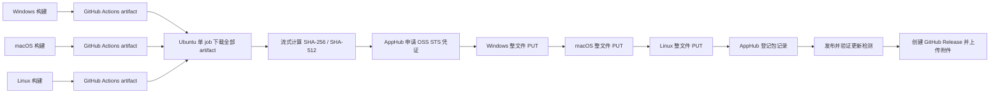
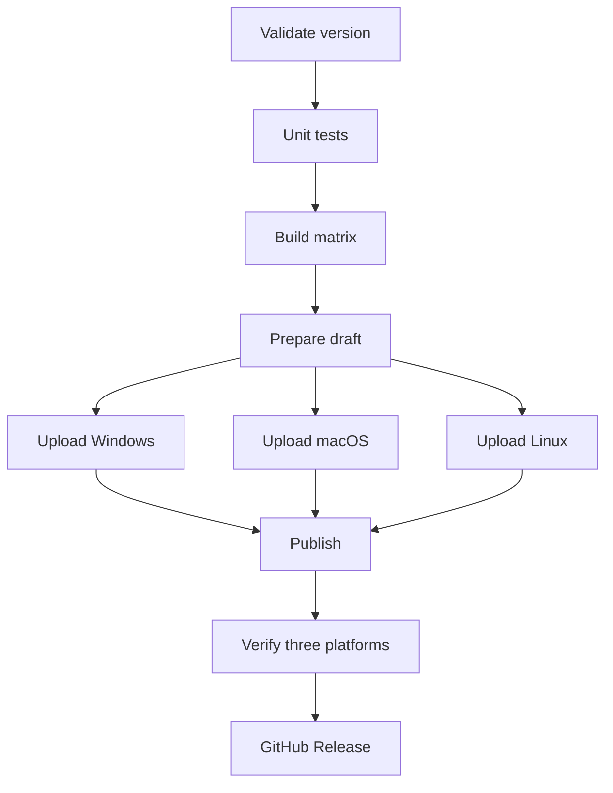
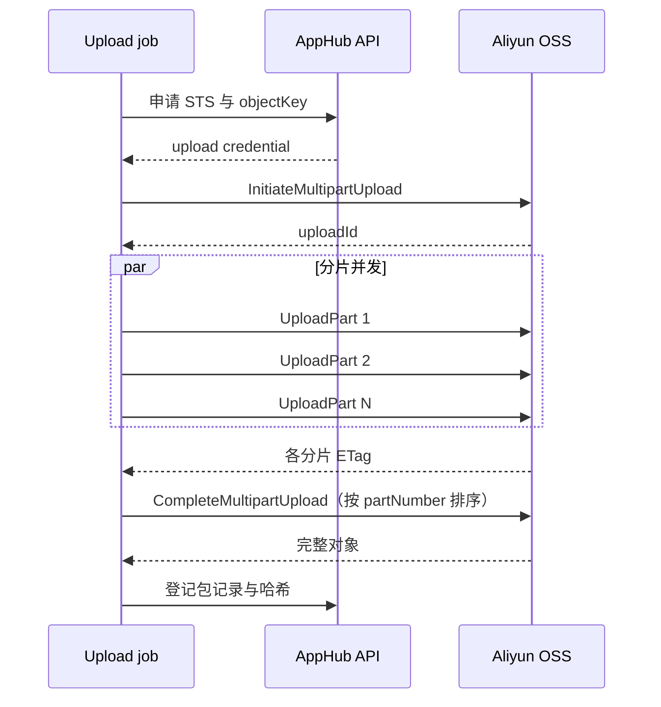

# AppHub 发布上传链路优化

> **当前状态：已实施。** 阶段 1（三平台并行上传）和阶段 2（OSS 分片上传）已落地并通过真实 Beta 验证；阶段 3（网络路径优化）按需评估。当前发版采用 `prepare` + 三平台并行 `upload` 矩阵，并通过仓库适配层提供 OSS multipart 并行分片、进度、分片重试和中止。`1.6.0-beta.9` 已验证约 245 MiB 的最大真实样本；超过 500 MiB 的样本与 Abort 真实失败路径仍待验证。
>
> 文档定位：记录 `.github/workflows/release.yml` 中三平台安装包上传到 AppHub 的链路设计、实现边界与验收结果。操作手册见 [构建与发布](./构建与发布.md) 与 [GitHub Actions 发版说明](./github-release.md)。
>
> 最后核对：2026-11-12。

## 1. 结论摘要

1. 当前上传不是经过 AppHub 服务端中转，而是由单台 GitHub Actions Ubuntu runner 直接向阿里云 OSS 整文件 `PUT`。
2. 改造前，三平台在同一个 job 内顺序上传，Windows 完成后才开始 macOS，最后上传 Linux；任一平台失败会阻塞后续步骤。
3. 改造前上传没有分片、单分片重试、传输超时、进度心跳或断点续传，因此慢连接和连接停滞在日志中表现完全相同。
4. 第一阶段已把三个平台拆成并行矩阵任务。该方案只改工作流，不触碰会自更新的 `scripts/release/apphub.mjs`，可缩短总等待时间并隔离平台故障。
5. 第二阶段已通过 `scripts/release/apphub-upload.mjs` 和 `scripts/release/oss-multipart.mjs` 提供 OSS multipart，支持多分片并行、进度、重试与中止，不修改 `apphub.mjs` 技能快照。
6. 若分片并行后跨境链路的吞吐仍无改善，再评估国内自托管 runner 或 OSS 传输加速；不应先假设分片一定能解决线路质量问题。
7. `1.6.0-beta.9` 已完成三平台并行、同文件多分片并行、实时进度、包登记、发布和三平台 `verify` 的真实回归。当前最大样本约 245 MiB，尚不能据此宣称超过 500 MiB 已得到验证。

## 2. 问题与观测

### 2.1 改造前链路（问题基线）



对应实现：

- 构建任务通过 `actions/upload-artifact` 上传产物。
- 改造前，单个 `draft` job 通过 `actions/download-artifact` 下载全部三平台产物。
- `scripts/release/apphub.mjs upload` 顺序执行哈希、STS 申请、OSS 直传和包记录登记。
- 三个平台分别对应三个连续 step；macOS 使用约 516 MB 的 universal zip。

### 2.2 本次样本

2026-11-11 的 Beta 发版运行 `42980002132` 提供了以下样本：

| 指标                 |       Windows |         macOS |         Linux |
| -------------------- | ------------: | ------------: | ------------: |
| GitHub artifact 大小 | 134,805,141 B | 515,642,118 B | 302,153,334 B |
| 上传目标             |      OSS 直传 |      OSS 直传 |      OSS 直传 |
| 执行顺序             |          第 1 |          第 2 |          第 3 |

同次运行中，全部 artifact 下载耗时约 22 秒；Windows 在 07:37:23 取得 STS 凭证后，
整文件 `PUT` 再未输出任何进度，直到 08:07:04 被 30 分钟级 job 超时取消，静默持续约
29 分 41 秒。这个现象不能单独证明连接已经断开，因为现有实现本来就没有可区分“持续传输”
和“连接停滞”的心跳或字节进度。

### 2.3 根因分解

| 问题                                          | 影响                                                 | 优先级 |
| --------------------------------------------- | ---------------------------------------------------- | ------ |
| GitHub 海外托管机直连国内 OSS，链路质量不可控 | 单连接吞吐低、抖动大，失败时难以归因                 | P0     |
| 整文件单次 `PUT`                              | 无法并行、无法按片重试，也没有可展示的传输进度       | P0     |
| 三平台串行                                    | 总耗时接近三个上传耗时之和，前一个平台阻塞后两个平台 | P1     |
| 无传输心跳和分阶段日志                        | 无法区分慢速、停滞和进程异常，只能等待 job 超时      | P1     |
| 无单请求超时与自动重试                        | 失败通常以整 job 超时收场，恢复成本高                | P1     |
| macOS universal 产物较大                      | 放大跨境链路问题，是当前最大单文件                   | P2     |
| artifact 在 GitHub 存储与 OSS 各存一份        | 存在额外存储和下载成本，但本次下载不是主要瓶颈       | P3     |

## 3. 目标与非目标

### 3.1 目标

1. 三平台上传互不阻塞，单平台失败不会把其他平台的上传进度一并浪费。
2. 大文件上传支持多分片并行，并在日志中持续输出可验证的进度。
3. 单分片失败可以重试，连接停滞可以在有限时间内被发现并终止。
4. 上传完成后校验哈希和 AppHub 包记录；STS 允许读取时再校验 OSS 对象大小，无读取权限时记录降级警告，再进入发布阶段。
5. 保持 Beta / stable 通道、版本校验、STS 临时凭证和 GitHub Release 现有语义不变。
6. 遵守 `rules/release.md`：本地不修改 `scripts/release/apphub.mjs`。

### 3.2 非目标

- 不改变 AppHub 更新检测协议、版本规则或通道语义。
- 不改变安装包格式、自动更新逻辑或 GitHub Release 附件集合。
- 不通过服务器代理把全部安装包流量经过 `appcenter.witice.top`。
- 不以 GitHub Release 作为 AppHub 上传源；当前 AppHub CLI 没有该契约。
- 不在本设计中优化 Electron 构建和压缩耗时。

## 4. 方案比较

| 方案                          | 预期收益                                       | 成本与风险                                                  | 结论                         |
| ----------------------------- | ---------------------------------------------- | ----------------------------------------------------------- | ---------------------------- |
| 保持现状                      | 无                                             | 继续串行等待，故障不可观测                                  | 不采用                       |
| 三平台拆成并行矩阵任务        | 总墙钟时间从串行相加降为最长平台耗时；故障隔离 | 只改工作流，风险低；单个大文件仍受线路限制                  | 第一阶段采用                 |
| OSS multipart 多分片并行      | 提高单文件吞吐；按片重试；可显示真实百分比     | 需 AppHub 上游或受控适配层支持，必须验证 STS 权限和对象合并 | 第二阶段采用                 |
| 国内自托管 runner             | 可能显著改善到 OSS 的跨境链路                  | 需要长期维护 runner、补丁、凭据和执行环境安全               | 分片后仍慢时采用             |
| OSS 传输加速                  | 可能改善跨境链路                               | 需 bucket 开启传输加速并修改客户端 endpoint                 | 作为 runner 方案的替代项评估 |
| AppHub 服务端代理或拉取源 URL | 客户端无需直连 OSS                             | 服务端带宽成本高，当前协议不支持                            | 另立服务端需求               |

推荐顺序：工作流并行化 → multipart 并行分片 → 根据真实测速决定国内 runner 或传输加速。

## 5. 目标架构

### 5.1 流水线拆分



职责调整：

- `prepare`：校验版本、生成或读取更新说明、创建或复用 AppHub draft；只执行一次。
- `upload`：使用 `strategy.matrix` 并行执行；每个 job 只下载本平台 artifact，并上传本平台安装包。
- `publish`：仅在三个 upload job 全部成功后运行。
- `verify`：保持三平台更新检测验证。
- `github-release`：保持现有 prerelease 判断和附件上传逻辑。

`prepare` 必须把 `version`、`config`、`channel` 和 `notes` 作为 job outputs 传给后续任务，避免每个矩阵任务重复创建版本或重复计算说明。

### 5.2 工作流骨架

```yaml
prepare:
  needs: [validate, build]
  outputs:
    notes: ${{ steps.notes.outputs.notes }}

upload:
  needs: [validate, prepare]
  strategy:
    fail-fast: false
    max-parallel: 3
    matrix:
      include:
        - name: windows-x64
          platform: windows
          arch: x64
          artifact: windows-x64
        - name: macos-universal
          platform: macos
          arch: universal
          artifact: macos-universal
        - name: linux-x64
          platform: linux
          arch: x64
          artifact: linux-x64
  steps:
    - uses: actions/download-artifact@v8
      with:
        name: ${{ matrix.artifact }}
        path: dist
    - run: node scripts/release/apphub-upload.mjs upload ... --multipart auto

publish:
  needs: [validate, prepare, upload]
```

阶段 1 只改 workflow，仍直接调用原 `apphub.mjs upload`。当前实际入口已升级为
`apphub-upload.mjs`：小文件或 `multipart=off` 委托原 CLI，大文件走仓库适配层并保持原有包登记语义。

### 5.3 重跑语义

1. 重跑整个工作流时，`create-version` 应继续复用同一版本下的 draft。
2. 重跑勾选 `--replace` 时，已成功登记的平台执行替换；尚无包记录的平台按新增登记，避免部分平台先成功、其余平台因替换目标不存在而再次失败。
3. 发布前仍要求三个平台包记录同时存在，不能因矩阵并行而降低完整性校验。
4. 如果 `prepare` 已创建 draft 而所有上传均失败，保留 draft 供修复后重跑，不自动删除。

## 6. OSS multipart 并行分片设计

### 6.1 可以并行，但必须成组提交

同一 OSS 对象可以使用一次 multipart upload。创建会话后，不同 `partNumber` 的
`UploadPart` 请求可以同时发出，每个请求只传输自己的字节范围，不要求按分片顺序完成；全部
分片成功后再按 `partNumber` 升序携带各自 `ETag` 调用 `CompleteMultipartUpload` 合并为完整
对象。



并行上传能减少高延迟、丢包或单连接吞吐受限带来的总耗时，但收益受 runner 上行带宽、OSS
endpoint 连接能力、TLS / 签名计算和进程内存共同约束，不会随并发数线性增长。首轮以 4
并发作为基线，在同一发布机、同一文件和同一时段对比 4 / 8 / 16 并发，选择吞吐达到平台期且
失败率不升高的配置。并行度、分片大小和重试策略必须统一管理，不能只提高并发而不限制资源。

`1.6.0-beta.9` 的真实发版结果如下：

| 产物               |       大小（字节） | 分片数 | 并发度 |
| ------------------ | -----------------: | -----: | -----: |
| Windows EXE        |        134,913,737 |      9 |      4 |
| macOS Universal ZIP |       257,061,588 |     16 |      4 |
| Linux AppImage     |        169,526,561 |     11 |      4 |

三个大文件均输出实时百分比、速度和 ETA，并在所有分片完成后由 Complete 正确合并。同目录的 blockmap
均小于启用阈值，继续走单次 `PUT`。分片完成顺序不受限制，提交时统一按 `partNumber` 升序生成
Complete 请求。

### 6.2 推荐参数

| 参数       |          初始值 | 说明                                       |
| ---------- | --------------: | ------------------------------------------ |
| 启用阈值   |          64 MiB | 小文件继续单 PUT，避免不必要复杂度         |
| 分片大小   |          16 MiB | 当前 135–516 MB 文件的折中值，可按测速调整 |
| 并发度     |               4 | 首轮保守值，后续在 4–8 之间基于实测选择    |
| 单分片超时 |           90 秒 | 无字节进展超过阈值即中断该分片             |
| 单分片重试 |            3 次 | 指数退避并加入随机抖动                     |
| 总尝试上限 | 由 job 超时兜底 | 防止持续重试掩盖线路故障                   |
| 进度间隔   |     5% 或 15 秒 | 以先到者为准，输出已传字节、速度和 ETA     |

实际分片大小还需要满足 OSS 对分片数量、单片大小和服务端策略的限制。真实 Beta 验收必须校验 STS 临时凭证具备初始化、上传分片、完成和中止 multipart upload 的权限。

### 6.3 上传流程

1. 流式计算 SHA-256 和 SHA-512，不整文件读入内存。
2. 向 AppHub 申请目标对象的 STS 凭证。
3. 根据文件大小生成分片计划；小文件走兼容的单 `PUT`。
4. 初始化 multipart upload，获得 `uploadId`。
5. 使用固定并发池上传分片；每个任务记录 `partNumber`、字节范围和 `ETag`。
6. 单个分片失败时只重试该分片；不可恢复时中止整个 multipart upload。
7. 所有分片完成后按 `partNumber` 升序提交。
8. 通过 `HEAD` 或 AppHub 返回信息校验对象大小；必要时重新读取并校验哈希。
9. 调用 AppHub 登记包记录，成功后结束。

### 6.4 断点与幂等边界

- 第一阶段先在单次 job 内实现分片级重试，不承诺跨 job 断点续传。
- 完整跨 job 恢复需要持久化 `uploadId`、对象键、已完成分片及 `ETag`，并处理凭证过期和会话清理，复杂度明显更高。
- 未完成的 multipart upload 应有生命周期清理策略，避免长期占用 OSS 存储。
- 重跑时如果无法安全续接旧会话，应创建一个新的 multipart upload；不得把未完成的 `uploadId` 登记为有效包。

## 7. AppHub CLI 约束与落地边界

`rules/release.md` 明确要求不得修改 `scripts/release/apphub.mjs`，因为它是会自更新的技能快照。因此：

1. 第一阶段的并行矩阵只改 `.github/workflows/release.yml`。
2. 第二阶段的 multipart 能力优先由 AppHub CLI 上游发布，本仓库升级技能快照后使用，不在本地打补丁。
3. 若上游无法及时支持，使用[仓库自有 OSS 分片上传适配层](./AppHub%20OSS分片上传.md)；适配层只扩展文件传输，继续复用 AppHub 的认证、版本、登记、发布和验证接口。
4. 无论采用上游 CLI 还是适配层，都必须保持相同命令语义、通道配置和输出字段，避免 release workflow 形成两套不可验证的发布路径。

建议向上游 CLI 提供的接口形态：

```text
apphub.mjs upload \
  --multipart auto \
  --part-size 16MiB \
  --concurrency 4 \
  --retry 3 \
  --progress 15s
```

默认行为应保持兼容；multipart 只对超过阈值的文件启用。

## 8. 可观测性与错误处理

### 8.1 日志

每个平台至少输出：

- 平台、文件名、文件大小；
- 哈希阶段是否完成；
- STS 获取时间；
- 当前传输模式（single / multipart）；
- 已完成分片数、已传字节、百分比、平均速度和 ETA；
- 最终对象大小、登记结果和总耗时。

示例：

```text
[macos] multipart 18/33 parts, 281.2/515.6 MiB (54.5%), 2.8 MiB/s, ETA 01:24
```

进度日志只输出聚合状态，不输出 STS token、AccessKey、Authorization 或签名串。

### 8.2 失败分类

| 阶段         | 可识别错误              | 处理                                  |
| ------------ | ----------------------- | ------------------------------------- |
| AppHub API   | 登录、签名、版本不存在  | 立即失败，不重试文件传输              |
| STS          | 权限不足、凭证过期      | 重新申请一次，仍失败则终止            |
| 单分片       | 网络中断、5xx、超时     | 指数退避重试                          |
| Complete     | ETag 缺失、分片列表非法 | 不登记包记录，报告中止                |
| Package 登记 | 平台槽位冲突            | 按 `--replace` 或版本状态给出明确提示 |
| 验证         | 更新端点未返回目标版本  | 阻止 GitHub Release 阶段              |

### 8.3 Job 超时

- 每个上传 job 单独设置超时，避免一个平台耗尽整个上传阶段的预算。
- 首版建议单平台 30 分钟，并在真实 p95 数据稳定后收紧。
- multipart 模式下，连接停滞主要由“单分片无进展超时”发现，而不是等待整个 job 到期。

## 9. 安全要求

1. STS 临时凭证只在 runner 环境和单次上传进程内存在，不写入文件、artifact、日志或命令输出。
2. 继续使用 GitHub Actions Secrets，不在 workflow、文档或测试中保存真实账号和签名密钥。
3. 每个上传任务只申请本平台对象所需的最小权限和必要时长。
4. 并发上传不得复用同一个 multipart upload 会话写不同文件。
5. 上传结束后释放文件句柄和网络连接，失败时尽量执行 AbortMultipartUpload。
6. 保留现有“发版凭据不得打包进 app.asar”的校验。

## 10. 实施拆分

### 阶段 1：工作流并行化（已完成）

1. 已将现有 `draft` 拆为 `prepare` 和 `upload` matrix。
2. 每个上传 job 只下载对应 artifact；阶段 1 使用原 `apphub.mjs upload`，当前入口为 `apphub-upload.mjs`。
3. 已设置 `fail-fast: false`，保证一个平台失败时其他平台仍可完成。
4. `publish` 已改为等待全部 upload jobs 成功。
5. `1.6.0-beta.9` 已完成真实回归：三平台构建与上传、包记录、发布、三平台 `verify` 和 GitHub Release 均成功。

### 阶段 2：仓库适配层 multipart 与进度（已完成并通过真实 Beta 验证）

1. [x] 通过 `scripts/release/apphub-upload.mjs` 和 `scripts/release/oss-multipart.mjs` 提供分片计划、并发上传、重试、进度和中止，不修改技能快照。
2. [x] 增加分片边界、Complete 排序、单分片重试、Abort、签名子资源和凭据脱敏测试。
3. [x] workflow 提供 `multipart=auto|off`，默认 `auto`。
4. [x] 真实 Beta STS 已证明初始化、UploadPart 和 Complete 可用，凭证有效期覆盖本轮最慢平台上传。
5. [x] HEAD 返回 403 时按设计记录警告并跳过只读大小复核，不影响后续包登记。
6. [x] AppHub 包登记、替换、发布和三平台 `verify` 均成功。
7. [x] 同版本重跑和 `replace` 流程已按现有发版规则验证。
8. [ ] 超过 500 MiB 的产物尚未验证；当前真实最大样本约 245 MiB。
9. [ ] Abort 权限和失败中止路径尚未真实触发验证；目前只有自动化 mock 覆盖。

### 阶段 3：网络路径优化

仅在阶段 1、2 完成后仍不满足目标时执行：

1. 对比 GitHub 托管 runner、国内自托管 runner 和 OSS 传输加速的真实吞吐。
2. 如果采用自托管 runner，补齐 runner 隔离、更新、磁盘清理和凭据保护方案。
3. 不以降低哈希、证书或发布验证强度换取速度。

## 11. 测试与验收

### 11.1 功能验证

- 三平台分别只有对应 artifact 被下载和上传。
- Windows、macOS、Linux 包均登记成功，包记录中的平台和架构正确。
- `publish` 只在三个平台全部成功后执行。
- `verify` 对三平台均返回目标版本。
- GitHub Release 仍带正确的 prerelease 标记，附件集合不减少。
- stable 和 Beta 配置都能使用同一工作流模板。

### 11.2 故障注入

- 人为中断单个分片连接，确认只重试该分片。
- 让某个分片持续无响应，确认在超时阈值附近报告故障。
- 模拟 AppHub 登记失败，确认不会进入发布阶段。
- 模拟一个平台失败，确认另外两个平台仍完成且 job 状态清晰。
- 重跑已部分成功的版本，确认不会重复创建版本或产生不可解释的包记录。
- 校验对象最终大小和 SHA-256 / SHA-512，阻止损坏产物登记。

### 11.3 性能验收

以相同发版机器、相同文件和相同通道记录基线，至少比较 3 次 Beta 发布：

| 指标           | 验收要求                                                                  |
| -------------- | ------------------------------------------------------------------------- |
| 总上传墙钟时间 | 并行矩阵相对串行基线显著下降，首版目标是不超过最长单平台上传时间加 2 分钟 |
| 单平台上传     | multipart 相对单 PUT 基线提升；若未提升，记录并转入线路优化评估           |
| 无进度静默     | 正常运行中不超过 30 秒；停滞在单分片超时阈值内被识别                      |
| 失败定位       | 日志能明确指出平台、阶段、分片和重试次数                                  |
| 完整性         | 三平台包记录、大小、哈希和更新检测全部通过                                |

性能结论必须基于同一时段的多次真实运行，不能仅凭一次快跑判断已经稳定。

### 11.4 `1.6.0-beta.9` 真实验收记录

2026-11-11 的 [Beta 发版工作流](https://github.com/Harley-xk/mark-it/actions/runs/42992882874)
已完成以下真实验收：

- Windows、macOS、Linux 三个构建和上传矩阵任务全部成功，总等待时间不再串联三个平台的构建与上传。
- 三个大文件分别按 9、16、11 个分片、4 并发上传，均持续输出百分比、速度和 ETA；Complete 全部成功。
- blockmap 均低于阈值，走单次 `PUT`，验证了同一版本内单次上传与 multipart 混合使用。
- STS 已证明初始化、UploadPart 和 Complete 可用；HEAD 返回 403 后记录警告并跳过只读大小复核。
- AppHub 包登记、替换、发布和三平台 `verify` 均成功，同版本重跑与 `replace` 流程可用。
- [GitHub Release](https://github.com/Harley-xk/mark-it/releases/tag/v1.6.0-beta.9) 已发布，标记为 prerelease 且不是 draft。
- Beta 更新接口返回 `1.6.0-beta.9`。

当前真实最大样本为 257,061,588 字节（约 245.2 MiB）。超过 500 MiB 的产物、Abort 权限及失败中止路径
仍待验证；AppHub CLI 上游也尚未合并原生 multipart。

## 12. 回退方案

1. 工作流并行化导致发布编排异常时，可临时恢复现有单 `draft` job，不影响已发布版本。
2. multipart 出现兼容性问题时，将 workflow 的 multipart 模式切为 `off`，回退到原 CLI 单 PUT；不能在未验证时直接删除已上传对象。
3. 若 upload 已失败但 `prepare` 已创建 draft，保留 draft 供诊断和重跑，不自动标记发布。
4. 已创建 AppHub 版本或 GitHub Release 时，按现有发版规则修复说明或包记录，不回退版本号并重复发布同一节点。

## 13. 待确认事项

1. Abort 权限及失败中止路径尚未真实触发验证；超过 500 MiB 的产物也仍需专门验收。
2. AppHub CLI 上游尚未合并原生 multipart；合并后应迁移到上游参数并移除仓库适配层。
3. GitHub 托管 runner 的实测吞吐是否足以在分片后满足目标，还是必须引入国内 runner。
4. 是否需要跨 workflow 重跑恢复未完成上传；若需要，应单独设计会话持久化和清理。
5. 未完成 multipart upload 的 OSS 生命周期规则由客户端 Abort、AppHub 服务端清理还是 bucket 生命周期负责。
