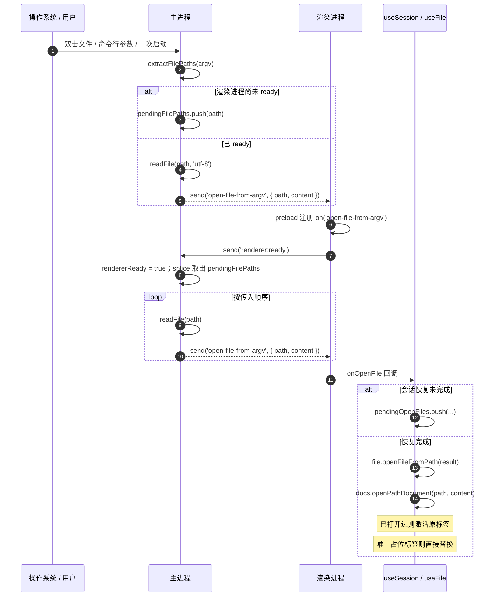
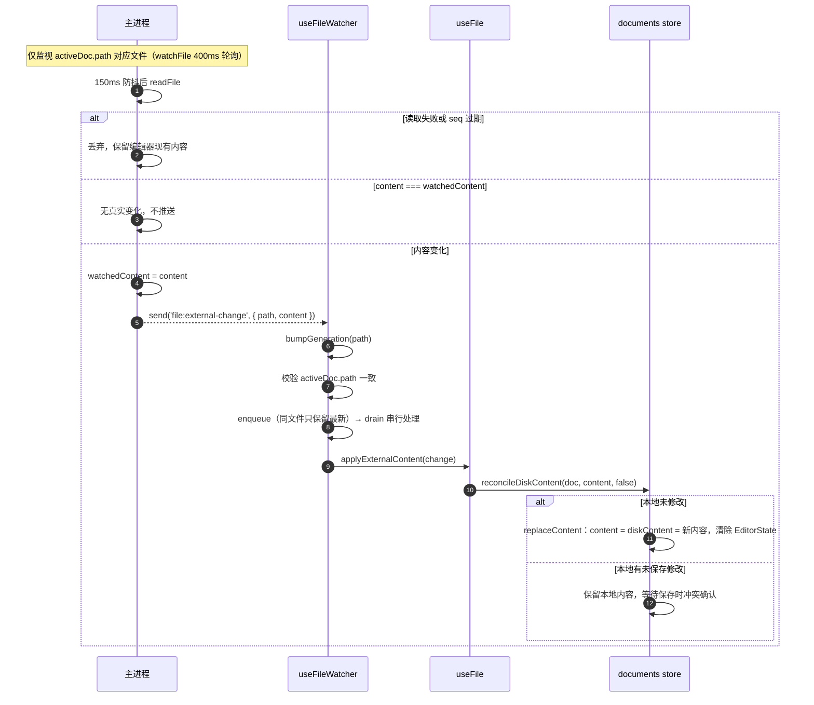
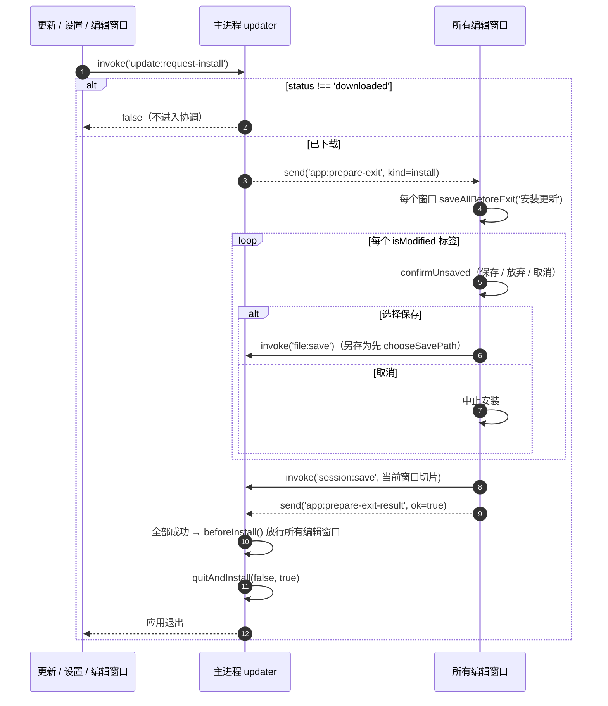
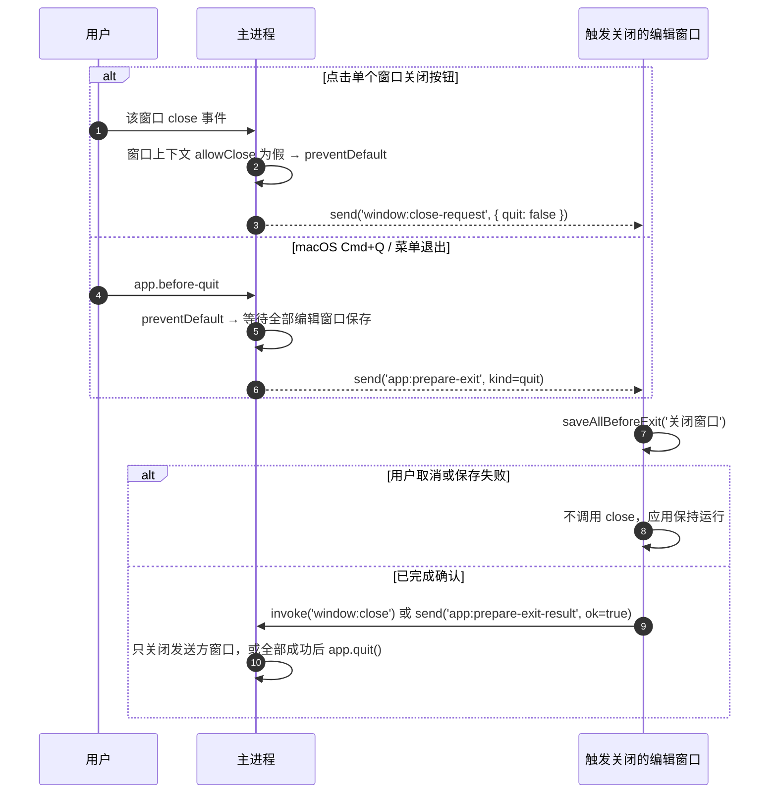

# IPC 接口与进程契约

> **文档定位**：MarkIt（v1.5.0，2026-11-10 基线同步）主进程、预加载与渲染进程之间的完整通信契约参考。面向新增 IPC、排查跨进程问题、评审安全边界的维护者。
> 本文以代码为准，通道名、参数顺序与默认值均逐字核对自源码；实现变动时请同步更新本文。
> 多窗口基线：编辑窗口可多实例，所有编辑器相关通道按 IPC 发送方定位具体窗口；设置与更新窗口仍是全局工具窗口。窗口角色与标签迁移见[多窗口架构](./多窗口架构.md)。

## 1. IPC 设计原则

### 1.1 进程边界

| 进程     | 目录                              | 能力                                                                       |
| -------- | --------------------------------- | -------------------------------------------------------------------------- |
| 主进程   | [`src/main`](../src/main)         | Node / Electron 全部能力：文件读写、窗口、对话框、协议、PDF 打印、自动更新 |
| 预加载   | [`src/preload`](../src/preload)   | 唯一允许同时接触 `ipcRenderer` 与页面 `window` 的层，只做白名单转发        |
| 渲染进程 | [`src/renderer`](../src/renderer) | 视为纯 Web 环境，**禁止 `import 'electron'`**，只能调用 `window.api`       |
| 共享类型 | [`src/shared`](../src/shared)     | 跨进程 **纯类型**，不得引入运行时依赖                                      |

渲染进程拿不到 Node 能力，因此凡是读盘、写盘、弹系统对话框、打开外部程序、退出安装，都必须由主进程执行。

### 1.2 contextBridge 白名单

[`src/preload/index.ts`](../src/preload/index.ts) 用 `contextBridge.exposeInMainWorld` 只暴露一个对象：

| 全局对象     | 内容                                  | 状态     |
| ------------ | ------------------------------------- | -------- |
| `window.api` | 业务白名单方法（本文第 3 节全部通道） | 推荐使用 |

`window.electron`（`@electron-toolkit/preload` 的通用 `electronAPI`）没有调用方，已移除；不得重新暴露通用 `ipcRenderer` / `process`。

`api.platform` 是静态值（`process.platform`），不经过 IPC；其余方法均对应一条通道。

### 1.3 三处同步

新增或修改 IPC 必须同时改三处，任何一处缺失都会造成「调用无响应」或「类型通过但运行时失败」：

| 顺序 | 位置                                                                                 | 职责                                                                                     |
| ---- | ------------------------------------------------------------------------------------ | ---------------------------------------------------------------------------------------- |
| 1    | 主进程 `registerHandle` / `registerOn`（[`ipc-guard.ts`](../src/main/ipc-guard.ts)） | 校验调用来源、注册通道、校验入参、执行副作用、返回结果                                   |
| 2    | [`src/preload/index.ts`](../src/preload/index.ts)                                    | `ipcRenderer.invoke`（请求-响应）或 `ipcRenderer.send` / `ipcRenderer.on`（单向 / 事件） |
| 3    | [`src/preload/index.d.ts`](../src/preload/index.d.ts)                                | `Window.api: ExposedAPI` 类型契约                                                        |

第 3 处当前通过 `export type ExposedAPI = typeof api` 从 preload 的 `api` 对象自动派生，因此**不需要手写方法签名**；但仍必须保证 preload 的方法名、参数顺序、返回值与主进程一致，并在 preload 中显式标注返回类型（`ipcRenderer.invoke` 的返回值默认是 `any`，不标注会丢失类型检查）。

### 1.4 共享类型放 `src/shared`

只有**纯类型**可以放进 `src/shared`，因为该目录同时被主进程（Node 环境）和渲染进程（浏览器环境）引用：

- [`src/shared/session-types.ts`](../src/shared/session-types.ts)：`SessionTab`、`SessionData`、`SessionWindow`、`SessionFile`
- [`src/shared/history-types.ts`](../src/shared/history-types.ts)：`EditorHistoryEntries`、`EditorHistoryFile`
- [`src/shared/window-types.ts`](../src/shared/window-types.ts)：编辑器窗口上下文、标签迁移、退出 / 安装协调
- [`src/shared/update-types.ts`](../src/shared/update-types.ts)：`UpdateStatus`、`UpdateProgress`、`UpdateState`
- [`src/shared/file-types.ts`](../src/shared/file-types.ts)：`FileReadResult`
- [`src/shared/pdf-types.ts`](../src/shared/pdf-types.ts)：`PdfExportOptions`、`PdfPageSize`、`PdfMargin`
- [`src/shared/integration-types.ts`](../src/shared/integration-types.ts)：`VSCodeVariant`、`VSCodeInstallation`、`IntegrationResult`、`VSCodeIntegrationConfig`

不得在 `src/shared` 中引入 `electron`、`node:*`、Vue、Pinia 等运行时依赖。

## 2. 通道总览

| 方向                                  | 数量   | 说明                                                             |
| ------------------------------------- | ------ | ---------------------------------------------------------------- |
| renderer → main `invoke`（请求-响应） | 36     | 文件 5、对话框 3、窗口 11、系统 1、会话 2、历史 2、导出 1、更新 8、集成 3 |
| renderer → main `send`（单向）        | 7      | 就绪、窗口关闭、迁移确认 / 拒绝、拖拽开始 / 结束、退出协调       |
| main → renderer `send`（事件推送）    | 11     | 见 3.8                                                           |
| **合计**                              | **54** | 全部经 `window.api` 白名单暴露                                   |

> 计数口径：按 `registerHandle` / `registerOn` / `webContents.send` 中实际出现的通道名去重统计。`window:zoom-changed` 在两个位置发送但只算一个通道。

## 3. 完整通道清单

方向缩写：**R→M invoke** = 渲染进程请求主进程并等待返回；**R→M send** = 渲染进程单向通知；**M→R send** = 主进程主动推送。

### 3.1 文件

| 通道名        | 方向       | preload 方法              | 参数                              | 返回值                                                           | 主进程处理位置                                  | 备注                                                                                     |
| ------------- | ---------- | ------------------------- | --------------------------------- | ---------------------------------------------------------------- | ----------------------------------------------- | ---------------------------------------------------------------------------------------- |
| `file:save`   | R→M invoke | `saveFile(path, content)` | `path: string`, `content: string` | `Promise<boolean>`（写盘成功恒为 `true`，失败则 Promise reject） | [`src/main/index.ts:523`](../src/main/index.ts) | 写盘后若目标是当前监视文件，同步 `watchedContent`，避免外部变更回环                      |
| `file:read`   | R→M invoke | `readFile(path)`          | `path: string`                    | `Promise<{ path: string; content: string } \| null>`             | [`src/main/index.ts:530`](../src/main/index.ts) | 读取失败只记录 `console.error` 并返回 `null`，不抛给渲染进程                             |
| `file:watch`  | R→M invoke | `watchFile(path)`         | `path: string \| null`            | `Promise<boolean>`（恒为 `true`）                                | [`src/main/index.ts:541`](../src/main/index.ts) | **只监视当前活跃标签的文件**；传 `null` 或空串取消监视；内部用 `fs.watchFile` 400ms 轮询 |
| `file:reveal` | R→M invoke | `showItemInFolder(path)`  | `path: string`                    | `Promise<boolean>`                                               | [`src/main/index.ts:547`](../src/main/index.ts) | 文件存在则 `shell.showItemInFolder`；文件已删除则打开父目录；父目录也不存在返回 `false`  |
| `file:sync-open-paths` | R→M invoke | `syncOpenFiles(paths)` | `paths: string[]` | `Promise<boolean>` | [`src/main/index.ts`](../src/main/index.ts) | 按编辑窗口同步当前打开文件索引；仅用于常规打开去重与窗口路由，不缓存内容 |

### 3.2 对话框

| 通道名             | 方向       | preload 方法                           | 参数                                                                | 返回值                                         | 主进程处理位置                              | 备注                                                                                                  |
| ------------------ | ---------- | -------------------------------------- | ------------------------------------------------------------------- | ---------------------------------------------- | ------------------------------------------- | ----------------------------------------------------------------------------------------------------- |
| `dialog:openFiles` | R→M invoke | `openFiles()`                          | 无                                                                  | `Promise<{ path: string; content: string }[]>` | [`src/main/index.ts`](../src/main/index.ts) | 多选；过滤 `md` / `markdown` / `txt`；用户取消返回 `[]`；单个文件读取失败会被跳过                     |
| `dialog:savePath`  | R→M invoke | `chooseSavePath(defaultFileName?)`     | `defaultFileName?: string`                                          | `Promise<string \| null>`                      | [`src/main/index.ts`](../src/main/index.ts) | **只选择路径，不写盘**；默认文件名清洗非法字符；取消返回 `null`；调用方确认无重复标签后走 `file:save` |
| `dialog:saveImage` | R→M invoke | `saveImage(fileName, data, extension)` | `fileName: string`, `data: Uint8Array`, `extension: 'svg' \| 'png'` | `Promise<string \| null>`                      | [`src/main/index.ts`](../src/main/index.ts) | 预览区 Mermaid 图表下载；写 `Buffer.from(data)`；取消返回 `null`                                      |

### 3.3 窗口与系统

| 通道名                    | 方向       | preload 方法            | 参数                                   | 返回值             | 主进程处理位置                                  | 备注                                                                                                                                                                                    |
| ------------------------- | ---------- | ----------------------- | -------------------------------------- | ------------------ | ----------------------------------------------- | --------------------------------------------------------------------------------------------------------------------------------------------------------------------------------------- |
| `window:get-context`      | R→M invoke | `getWindowContext()`    | 无                                     | `Promise<EditorWindowContext \| null>` | [`src/main/index.ts`](../src/main/index.ts) | 返回当前编辑窗口稳定 ID 与待确认 `pendingTransferId`；只接受编辑窗口                                      |
| `window:create`           | R→M invoke | `createWindow()`        | 无                                     | `Promise<boolean>` | [`src/main/index.ts`](../src/main/index.ts) | 从调用窗口附近创建新的空白编辑窗口；只接受编辑窗口                                                        |
| `window:move-tab-to-new`  | R→M invoke | `moveTabToNewWindow(payload)` | `TabTransferPayload`              | `Promise<TabTransferResult \| null>` | [`src/main/index.ts`](../src/main/index.ts) | 校验 `SessionTab` 后写入目标窗口切片并创建窗口；源窗口等待确认                                          |
| `window:move-tab-to-target` | R→M invoke | `moveTabToTargetWindow(payload, options?)` | `TabTransferPayload`, `TabDropOptions?` | `Promise<TabTransferResult \| null>` | [`src/main/index.ts`](../src/main/index.ts) | 按屏幕指针命中其他窗口；`forceNew` 跳过命中，并在光标所在显示器新建窗口                                |
| `window:move-tab-to-window` | R→M invoke | `moveTabToWindow(payload, id)` | `TabTransferPayload`, `windowId: string` | `Promise<TabTransferResult \| null>` | [`src/main/index.ts`](../src/main/index.ts) | 显式迁入指定编辑窗口                                                                                  |
| `window:list`             | R→M invoke | `listEditorWindows()`   | 无                                     | `Promise<EditorWindowSummary[]>` | [`src/main/index.ts`](../src/main/index.ts) | 返回其他编辑窗口，供右键迁移菜单使用                                                                      |
| `window:take-pending-transfer` | R→M invoke | `takePendingTabTransfer()` | 无                             | `Promise<TabTransferPayload \| null>` | [`src/main/index.ts`](../src/main/index.ts) | 新目标窗口读取启动阶段的迁移载荷与编辑历史                                                              |
| `window:ack-tab-transfer` | R→M send | `ackTabTransfer(id)` | `transferId: string` | 无 | [`src/main/index.ts`](../src/main/index.ts) | 目标窗口接收成功后解析源端等待中的迁移 invoke                                                          |
| `window:reject-tab-transfer` | R→M send | `rejectTabTransfer(id)` | `transferId: string` | 无 | [`src/main/index.ts`](../src/main/index.ts) | 目标拒绝迁移（例如同一路径已打开），源标签保持                                                     |
| `window:tab-drag-start` | R→M send | `startTabDrag(name)` | `tabName: string` | 无 | [`src/main/index.ts`](../src/main/index.ts) | 开始拖拽；主进程轮询光标并广播目标窗口高亮                                                              |
| `window:tab-drag-end` | R→M send | `endTabDrag()` | 无 | 无 | [`src/main/index.ts`](../src/main/index.ts) | 结束拖拽并清除所有目标高亮                                                                                |
| `window:close`            | R→M invoke | `close(quit?)`          | `quit?: boolean`（兼容保留）          | `Promise<boolean>` | [`src/main/index.ts`](../src/main/index.ts) | 只置发送方窗口 `allowClose = true` 并关闭该窗口；调用前必须已完成未保存内容确认                            |
| `window:is-fullscreen`    | R→M invoke | `isFullscreen()`        | 无                                     | `Promise<boolean>` | [`src/main/index.ts`](../src/main/index.ts) | 返回发送方窗口的全屏状态；只接受编辑窗口                                                                  |
| `window:get-zoom`         | R→M invoke | `getZoom()`             | 无                                     | `Promise<number>`  | [`src/main/index.ts`](../src/main/index.ts) | 返回发送方窗口上下文的缩放比例（1 = 100%）                                                              |
| `window:set-native-theme` | R→M invoke | `setNativeTheme(theme)` | `theme: 'light' \| 'dark' \| 'system'` | `Promise<void>`    | [`src/main/index.ts`](../src/main/index.ts) | 写入全局 `nativeTheme.themeSource`；允许任意编辑窗口和设置窗口调用                                      |
| `shell:openExternal`      | R→M invoke | `openExternal(url)`     | `url: string`                          | `Promise<boolean>` | [`src/main/index.ts:553`](../src/main/index.ts) | 仅放行 `http` / `https` / `mailto`；`file:` 转为定位文件；其余协议忽略并返回 `false`                                                                                                    |

### 3.3.1 设置窗口

| 通道            | 方向       | preload 方法      | 参数 | 返回               | 主进程处理位置                              | 备注                                               |
| --------------- | ---------- | ----------------- | ---- | ------------------ | ------------------------------------------- | -------------------------------------------------- |
| `settings:open` | R→M invoke | `settings.open()` | 无   | `Promise<boolean>` | [`src/main/index.ts`](../src/main/index.ts) | 只接受编辑器窗口调用；打开或聚焦全局单实例设置窗口 |

设置窗口是受控应用页面，可使用主题同步、VSCode 集成和更新回退通道。安装更新通过 `update:request-install` 发起，由主进程协调所有编辑窗口；设置窗口不能绕过保存确认。完整边界见[独立设置窗口](./独立设置窗口.md)。

### 3.4 会话

| 通道名         | 方向       | preload 方法         | 参数                                        | 返回值                         | 主进程处理位置                                  | 备注                                             |
| -------------- | ---------- | -------------------- | ------------------------------------------- | ------------------------------ | ----------------------------------------------- | ------------------------------------------------ |
| `session:load` | R→M invoke | `session.load()`     | 无                                          | `Promise<SessionData \| null>` | [`src/main/index.ts`](../src/main/index.ts) | 按发送方返回对应编辑窗口的 `SessionData` 切片      |
| `session:save` | R→M invoke | `session.save(data)` | `data: SessionData`（主进程签名 `unknown`） | `Promise<boolean>`             | [`src/main/index.ts`](../src/main/index.ts) | 校验并更新发送方窗口切片，聚合后原子写盘           |
| `history:load` | R→M invoke | `history.load()`     | 无                                          | `Promise<EditorHistoryEntries>` | [`src/main/index.ts`](../src/main/index.ts) | 返回当前窗口的 `historyId → EditorState JSON` 映射 |
| `history:save` | R→M invoke | `history.save(entries)` | `EditorHistoryEntries`                   | `Promise<boolean>`             | [`src/main/index.ts`](../src/main/index.ts) | 限制单条 4 MiB / 单窗口 32 MiB 后串行原子写盘     |

### 3.5 导出

| 通道名       | 方向       | preload 方法               | 参数                                                                                                                                           | 返回值                    | 主进程处理位置                              | 备注                                                                                                                                                              |
| ------------ | ---------- | -------------------------- | ---------------------------------------------------------------------------------------------------------------------------------------------- | ------------------------- | ------------------------------------------- | ----------------------------------------------------------------------------------------------------------------------------------------------------------------- |
| `export:pdf` | R→M invoke | `exportPdf(html, options)` | `html: string`；`options: PdfExportOptions`（`pageSize`、`margin`、`showPageNumbers`、`showToc`、`showFrontmatter`、`fileName`、`sourcePath`） | `Promise<string \| null>` | [`src/main/index.ts`](../src/main/index.ts) | 渲染进程生成自包含 HTML；主进程用隐藏 `BrowserWindow` 等待图片加载后 `printToPDF`；`margins` / 页码 / 默认文件名均已生效；取消返回 `null`；`finally` 销毁隐藏窗口 |

### 3.6 更新

| 通道名                      | 方向       | preload 方法                | 参数      | 返回值                 | 主进程处理位置                                      | 备注                                                                                                                                                      |
| --------------------------- | ---------- | --------------------------- | --------- | ---------------------- | --------------------------------------------------- | --------------------------------------------------------------------------------------------------------------------------------------------------------- |
| `update:get-state`          | R→M invoke | `update.getState()`         | 无        | `Promise<UpdateState>` | [`src/main/updater.ts:456`](../src/main/updater.ts) | 读取主进程内存中的当前状态（含 `currentChannel` / `betaUpdatesEnabled` / `latestChannel`）                                                                |
| `update:check`              | R→M invoke | `update.check()`            | 无        | `Promise<UpdateState>` | [`src/main/updater.ts:457`](../src/main/updater.ts) | `disabled` / `checking` / `downloading` 直接返回现状；开启 Beta 时同时比较两个通道；404 按「无更新」容错                                                  |
| `update:download`           | R→M invoke | `update.download()`         | 无        | `Promise<UpdateState>` | [`src/main/updater.ts:458`](../src/main/updater.ts) | 仅在 `available` / `error` 状态执行，其余原样返回                                                                                                         |
| `update:set-beta-enabled`   | R→M invoke | `update.setBetaEnabled(v)`  | `boolean` | `Promise<UpdateState>` | [`src/main/updater.ts:459`](../src/main/updater.ts) | 持久化「接收 Beta 版更新」；检测中记录待补检、下载中不打断，其余状态清除旧提示并立即重新检测                                                              |
| `update:rollback-to-stable` | R→M invoke | `update.rollbackToStable()` | 无        | `Promise<UpdateState>` | [`src/main/updater.ts`](../src/main/updater.ts)     | 允许任意编辑窗口与设置窗口调用；关闭 Beta 后直接检测 stable 当前版本，并要求其严格低于当前 Beta；不接受目标版本或 URL                                      |
| `update:install`            | R→M invoke | `update.install()`          | 无        | `Promise<boolean>`     | [`src/main/updater.ts`](../src/main/updater.ts) | 与 `update:request-install` 共用统一协调；仅在 `downloaded` 状态执行；所有编辑窗口保存成功后才 `quitAndInstall`                                          |
| `update:open-window`        | R→M invoke | `update.openWindow()`       | 无        | `Promise<void>`        | [`src/main/updater.ts:470`](../src/main/updater.ts) | 打开或聚焦单例「更新详情」窗口（560×680，无边框）                                                                                                         |
| `update:close-window`       | R→M send   | `update.closeWindow()`      | 无        | 无返回值               | [`src/main/updater.ts`](../src/main/updater.ts) | 只关闭更新详情窗口自身；其他窗口调用被忽略                                                                    |
| `update:request-install`    | R→M invoke | `update.requestInstall()`   | 无        | `Promise<boolean>`     | [`src/main/updater.ts`](../src/main/updater.ts) | 接受编辑窗口、设置窗口或更新窗口请求；由主进程协调全部编辑窗口保存后安装                                         |

### 3.7 VSCode 编辑器集成

| 通道名                         | 方向       | preload 方法                     | 参数               | 返回值                          | 主进程处理位置                                               | 备注                                                                   |
| ------------------------------ | ---------- | -------------------------------- | ------------------ | ------------------------------- | ------------------------------------------------------------ | ---------------------------------------------------------------------- |
| `integration:detect-vscode`    | R→M invoke | `integration.detectVSCode()`     | 无                 | `Promise<VSCodeInstallation[]>` | [`vscode-integration.ts`](../src/main/vscode-integration.ts) | 每次调用重新扫描；不持久化布尔状态；允许编辑窗口与设置窗口调用         |
| `integration:install-vscode`   | R→M invoke | `integration.installVSCode(v)`   | `v: VSCodeVariant` | `Promise<IntegrationResult>`    | [`vscode-integration.ts`](../src/main/vscode-integration.ts) | 只接受 `stable` / `insiders`；扩展目录由主进程推断，渲染进程不能传路径 |
| `integration:uninstall-vscode` | R→M invoke | `integration.uninstallVSCode(v)` | `v: VSCodeVariant` | `Promise<IntegrationResult>`    | [`vscode-integration.ts`](../src/main/vscode-integration.ts) | 只删除固定 `harley-xk.markit-open-*` 目录；允许编辑窗口与设置窗口调用  |

### 3.8 事件推送（main → renderer）

| 通道名                   | 方向     | preload 方法                  | 载荷                                   | 触发时机                                      | 发送位置                                                                        | 备注                                                                                                |
| ------------------------ | -------- | ----------------------------- | -------------------------------------- | --------------------------------------------- | ------------------------------------------------------------------------------- | --------------------------------------------------------------------------------------------------- |
| `open-file-from-argv`    | M→R send | `onOpenFile(cb)`              | `{ path: string; content: string }`    | 启动命令行参数 / 二次启动 / macOS `open-file` | [`src/main/index.ts:211`](../src/main/index.ts)                                 | 渲染进程未就绪时先排队；VSCode 扩展与 Finder 共用同一队列                                           |
| `renderer:ready`         | R→M send | `onOpenFile` 内部自动发送     | 无                                     | 渲染进程首次注册 `open-file-from-argv` 监听后 | [`src/main/index.ts`](../src/main/index.ts)                                     | 每个页面只发送一次；主进程只置发送方窗口的 `rendererReady` 并放行该窗口队列                     |
| `file:external-change`   | M→R send | `onExternalFileChange(cb)`    | `{ path: string; content: string }`    | 监视文件内容真实变化                          | [`src/main/index.ts:255`](../src/main/index.ts)                                 | 只在内容与 `watchedContent` 不同时发送；**返回取消监听函数**                                        |
| `window:zoom-changed`    | M→R send | `onZoomChange(cb)`            | `number`（缩放比例）                   | 应用缩放、页面加载完成恢复缩放                | [`src/main/index.ts:160`](../src/main/index.ts)、[`:437`](../src/main/index.ts) | 页面重载会重置缩放，`did-finish-load` 后重发                                                        |
| `window:fullscreen`      | M→R send | `onFullscreenChange(cb)`      | `boolean`                              | 进入 / 退出全屏                               | [`src/main/index.ts:374`](../src/main/index.ts)                                 | 标题栏据此移除两侧留白                                                                              |
| `window:close-request`   | M→R send | `onCloseRequest(cb)`          | `{ quit: boolean }`                    | 编辑窗口 `close` 事件被拦截时                  | [`src/main/index.ts`](../src/main/index.ts)                                     | 只发送给触发关闭的编辑窗口；应用退出统一走 `app:prepare-exit`                                      |
| `shortcut:close-tab`     | M→R send | `onCloseTabShortcut(cb)`      | 无                                     | macOS `Cmd+W` 被 `before-input-event` 拦截    | [`src/main/index.ts:353`](../src/main/index.ts)                                 | 仅 macOS；其他平台由渲染进程键盘处理                                                                |
| `cursor-pos`             | M→R send | `onCursorPos(cb)`             | `{ x: number; y: number }`（页面坐标） | 每 300ms 轮询一次，窗口不可见时跳过           | [`src/main/index.ts:739`](../src/main/index.ts)                                 | 用于滚动条悬停状态自愈（标题栏拖拽区不派发鼠标事件）                                                |
| `update:state`           | M→R send | `update.onState(cb)`          | `UpdateState`                          | 更新状态任意变化                              | [`src/main/updater.ts`](../src/main/updater.ts)                                 | **广播给所有窗口**（所有编辑窗口 + 更新窗口 + 设置窗口）                                            |
| `window:receive-tab-transfer`  | M→R send | `onReceiveTabTransfer(cb)`  | `TabTransferPayload`                   | 已有编辑窗口接收实时标签迁移                  | [`src/main/index.ts`](../src/main/index.ts)                                     | 目标插入成功后通过 `window:ack-tab-transfer` 确认                                                    |
| `window:tab-drag-target`       | M→R send | `onTabDragTarget(cb)`       | `TabDragTargetState`                    | 跨窗口拖拽光标命中目标窗口 / 离开              | [`src/main/index.ts`](../src/main/index.ts)                                     | 只有命中窗口 `active=true`；覆盖层只做视觉提示，`pointer-events: none`                               |
| `app:prepare-exit`             | M→R send | `onPrepareExit(cb)`         | `ExitPreparationRequest`               | 应用退出 / 安装更新前                         | [`src/main/index.ts`](../src/main/index.ts)                                     | 发送给所有已就绪编辑窗口；每个窗口保存后回报                                                        |
| `app:prepare-exit-result`      | R→M send | `completePrepareExit(id, ok)` | `{ requestId: string; ok: boolean }` | 单个编辑窗口完成保存协调                      | [`src/main/index.ts`](../src/main/index.ts)                                     | 任一 `ok=false` 即中止退出 / 安装                                                                   |

> 生命周期：所有 `on*` / `update.on*` 方法都返回取消函数（`() => ipcRenderer.removeListener(...)`）。调用方应在 `onUnmounted` 或模块级 dispose 中调用，避免 HMR / 重复挂载时监听累积。`onOpenFile` 额外承担发送 `renderer:ready` 的职责，但只在当前页面**首次注册**时发送；注销函数只移除监听，重复注册不会再次放行排队文件。页面重载会重新执行 preload，标志随之复位。

## 4. 入参与返回类型

### 4.1 共享类型

**SessionData / SessionTab**（[`src/shared/session-types.ts`](../src/shared/session-types.ts)）：

| 类型          | 字段                   | 说明                                        |
| ------------- | ---------------------- | ------------------------------------------- |
| `SessionTab`  | `path: string \| null` | 文件绝对路径；从未保存过的新建文档为 `null` |
|               | `name: string`         | 标签显示名                                  |
|               | `content: string`      | 关闭时的内容（统一 LF，可能含未保存内容）   |
|               | `isModified: boolean`  | 是否有未保存修改                            |
|               | `cursorLine: number`   | 1 基光标行                                  |
|               | `cursorCol: number`    | 1 基光标列                                  |
|               | `eol?: '\n' \| '\r\n'` | 原文件换行符；旧会话缺失时按 LF 处理        |
|               | `bom?: boolean`        | 原文件是否带 UTF-8 BOM；旧会话按 false 处理 |
| `SessionData` | `tabs: SessionTab[]`   | 全部标签，顺序即标签栏顺序                  |
|               | `activeIndex: number`  | 激活标签在 `tabs` 中的下标                  |

**TabTransferPayload**（[`src/shared/window-types.ts`](../src/shared/window-types.ts)）：

| 字段 | 类型 | 说明 |
| --- | --- | --- |
| `transferId` | `string` | 单次迁移 ID，由源窗口生成 |
| `tab` | `SessionTab` | 文档内容、路径、光标、布局与滚动位置 |
| `editorStateJson?` | `unknown` | CodeMirror `EditorState` JSON，含 `historyField`；源端与主进程均限制为 4 MiB，超限时省略 |

`TabDropOptions.forceNew`：指针仍在源窗口内容区但已离开标题栏时设为 `true`，跳过“命中背后其他窗口”并强制在光标所在显示器创建新窗口。

**UpdateState**（[`src/shared/update-types.ts`](../src/shared/update-types.ts)）：

| 字段             | 类型             | 说明                                                                                                      |
| ---------------- | ---------------- | --------------------------------------------------------------------------------------------------------- |
| `status`         | `UpdateStatus`   | `disabled` / `idle` / `checking` / `available` / `not-available` / `downloading` / `downloaded` / `error` |
| `currentVersion` | `string`         | 当前应用版本（来自 `app.getVersion()`）                                                                   |
| `latestVersion?` | `string`         | 平台返回的最新版本                                                                                        |
| `notes?`         | `string`         | 更新说明；已剔除首行 `[force]` 标记                                                                       |
| `forceUpdate`    | `boolean`        | 是否强制更新（平台在 releaseNotes 首行前置 `[force]`）                                                    |
| `progress?`      | `UpdateProgress` | `percent` / `bytesPerSecond` / `transferred` / `total`                                                    |
| `error?`         | `string`         | 失败原因                                                                                                  |

### 4.2 内联对象类型

| 结构                | 出现通道                                                                                 | 字段                                                                                                                                                                           |
| ------------------- | ---------------------------------------------------------------------------------------- | ------------------------------------------------------------------------------------------------------------------------------------------------------------------------------ |
| `{ path, content }` | `dialog:openFiles` 返回、`file:read` 返回、`open-file-from-argv`、`file:external-change` | `path: string`、`content: string`                                                                                                                                              |
| 图片保存参数        | `dialog:saveImage`                                                                       | `fileName: string`、`data: Uint8Array`、`extension: 'svg' \| 'png'`                                                                                                            |
| PDF 选项            | `export:pdf`                                                                             | `PdfExportOptions`（[`src/shared/pdf-types.ts`](../src/shared/pdf-types.ts)）：`pageSize`、`margin`、`showPageNumbers`、`showToc`、`showFrontmatter`、`fileName`、`sourcePath` |
| 文件读取结果        | `dialog:openFiles` 返回、`file:read` 返回、`open-file-from-argv`、`file:external-change` | `FileReadResult`（[`src/shared/file-types.ts`](../src/shared/file-types.ts)）：`path`、`content`                                                                               |

> `PdfExportOptions` 与 `FileReadResult` 都放在 `src/shared`，preload、主进程与渲染进程共用同一份声明，不再维护内联重复类型。新增字段时改共享类型即可，类型检查会覆盖三处调用。

## 5. 关键契约与约束

### 5.1 文件监视

1. 主进程同一时刻**只监视一个文件**，即渲染进程当前活跃标签对应的磁盘文件；`watchedFilePath` 是唯一事实来源。
2. `file:watch` 传入 `null`（或空串）取消监视；卸载 `useFileWatcher` 时也会主动取消。
3. 使用 `fs.watchFile` 轮询（400ms）而非 `fs.watch`：Windows 上「写临时文件再重命名」会让 `fs.watch` 丢失目标。
4. 监视事件先做 150ms 短防抖，避免读到其他程序尚未写完的中间内容。
5. 读取后比对 `content === watchedContent`，相同则**不推送**；应用自身 `file:save` 写盘时会同步 `watchedContent`（另存为也走 `file:save`），因此**保存不会产生回环事件**。
6. 读取期间切换了监视目标（`watchSeq` 变化）或路径已不匹配时，丢弃过期结果。
7. 渲染进程侧还有两道防线：`useFileWatcher` 的 `switchSeq`（切换标签序号）与 `generations`（每个文件的代次），丢弃晚到的旧读取结果。

### 5.2 外部变更的应用语义

`file:external-change` 只表示「磁盘内容与主进程已知版本不同」，渲染进程按 [`useFile.applyExternalContent`](../src/renderer/src/composables/useFile.ts) → `reconcileDiskContent` 处理：

| 情形                                             | 行为                                                    |
| ------------------------------------------------ | ------------------------------------------------------- |
| 磁盘内容与编辑器内容一致（比较时忽略 CRLF 差异） | 只同步 `diskContent`（`markSaved`），不标记修改         |
| 磁盘内容与 `diskContent` 一致                    | 没有外部变化，忽略                                      |
| 本地未修改                                       | 直接 `replaceContent`，并删除该标签缓存的 `EditorState` |
| 本地有未保存修改（被动刷新）                     | 静默保留本地内容，不打断编辑；等到保存时再弹冲突确认    |
| 本地有未保存修改（手动 F5）                      | 立即弹出「覆盖磁盘 / 载入磁盘 / 取消」，可查看逐行 diff |

### 5.3 链接与导航

1. 渲染进程**不得直接导航**到外部地址；预览中的链接点击统一走 `shell:openExternal` 或 `file:reveal`。
2. 仅 `http` / `https` / `mailto` 放行给系统默认程序；`file:` 转为在文件管理器中定位；`ftp`、`tel`、`javascript:` 等其余协议一律忽略。
3. 主进程还有兜底：`setWindowOpenHandler` 一律拒绝新窗口并转交系统打开；`will-navigate` 对非应用自身页面地址 `preventDefault` 后转交系统打开，避免编辑窗口被导航走导致界面丢失。
4. 页内锚点（`#heading-N`）保留浏览器原生跳转，不经过主进程。

### 5.4 `markit-file://` 协议

- 仅用于预览本地图片：`markit-file://local/?p=<encodeURIComponent(绝对路径)>`。
- 主进程按**图片扩展名白名单**校验：`png|jpe?g|gif|webp|bmp|svg|avif|ico|tiff?`；非图片返回 `415`，缺路径返回 `400`。
- 不得放宽为任意文件读取通道；路径来自 Markdown 内容，属于不可信输入。
- 该协议在 `app.whenReady()` 前通过 `registerSchemesAsPrivileged` 声明为 `standard` / `secure` / `supportFetchAPI` / `stream` / `bypassCSP`。

### 5.5 更新安装顺序

1. `update:install` 与 `update:request-install` 只在 `status === 'downloaded'` 时进入统一协调，否则返回 `false`。
2. 安装前主进程向所有编辑窗口发送 `app:prepare-exit(kind=install)`；每个窗口逐个确认并保存自己的文档，再 `flushSession()`。
3. 任一编辑窗口取消或保存失败，主进程中止安装；工具窗口不能绕过协调。
4. 全部成功后主进程调用 `beforeInstall()` 放行所有编辑窗口的关闭守卫，再调用 `quitAndInstall()`。
5. 单窗口关闭走 `window:close-request → window:close`；应用退出 / 安装走 `app:prepare-exit → app:prepare-exit-result`。

### 5.6 会话读写容错

| 场景                               | 行为                                                                                                                       |
| ---------------------------------- | -------------------------------------------------------------------------------------------------------------------------- |
| `session.json` 不存在              | `session:load` 返回 `null`                                                                                                 |
| JSON 解析失败 / 读取异常           | 记录 `console.error`，返回 `null`                                                                                          |
| 顶层不是对象 / `tabs` 非数组       | `parseSessionData` 返回 `null`，保持现有标签页                                                                             |
| 单个 tab 字段缺失或类型不符        | 逐字段兜底：`path` 非字符串转 `null`、`content` 非字符串丢弃该 tab、`cursor*` 取正数、`eol` 取 `\n` / `\r\n`、`bom` 取布尔 |
| `tabs` 为空数组                    | 返回 `null`，不替换标签                                                                                                    |
| `activeIndex` 越界 / 非数字        | 收敛到 `0..tabs.length - 1`                                                                                                |
| 写入失败                           | 记录 `console.error`，返回 `false`；渲染进程在状态栏显示「会话保存失败」                                                   |
| 渲染进程恢复时 `tabs` 非数组或为空 | 保持现有标签页不变                                                                                                         |
| 恢复时某个 `path` 读取失败         | 回退使用会话中保存的 `content`                                                                                             |
| 恢复时 `path` 读取成功             | **以磁盘内容为准**覆盖会话内容，并同步磁盘当前的行尾 / BOM 策略                                                            |

### 5.7 启动就绪与排队

- 主进程在每个编辑窗口上下文中维护 `rendererReady`，表示该窗口是否已注册 `open-file-from-argv` 监听；不能用 `webContents.isLoading()` 判断（`did-finish-load` 触发时它仍可能为 `true`）。
- 每个窗口 `did-start-loading` 时只重置自己的 `rendererReady`，页面重载后重新等待该窗口的 `renderer:ready`。
- 渲染进程还有一个独立队列：会话恢复完成前收到的命令行文件先缓存，恢复完成后再打开，避免被 `restoreSession` 整体替换掉。
- macOS 必须在 `app.whenReady()` 之前注册 `open-file`，将 Finder / LaunchServices 投递的路径放入同一队列；首个路径或首窗未就绪时也不得丢弃。

### 5.8 IPC 调用来源校验

所有通道统一经 [`src/main/ipc-guard.ts`](../src/main/ipc-guard.ts) 的 `registerHandle` / `registerOn` 注册：

| 校验项                | 规则                                                                                                                         |
| --------------------- | ---------------------------------------------------------------------------------------------------------------------------- |
| 页面来源              | `event.senderFrame.url` 必须是应用自身页面（开发模式按 `ELECTRON_RENDERER_URL` 的 origin 比较，打包后比较 `renderer/` 目录） |
| 拒绝行为              | `invoke` 通道抛出 `Untrusted IPC sender`；`send` 通道记录 `console.warn` 后忽略                                              |
| 窗口控制通道          | `window:*` 只接受编辑窗口；按发送方定位上下文，工具窗口无法借 `window:close` 绕过关闭守卫                                   |
| `update:close-window` | 只关闭更新详情窗口自身，其他窗口调用被忽略                                                                                   |

新增通道必须使用这两个封装，不要直接调用 `ipcMain.handle` / `ipcMain.on`。

## 6. 关键链路

### 6.1 打开文件（含 `renderer:ready` 排队）

### 6.2 外部文件变更

### 6.3 多窗口安装协调

### 6.4 关闭窗口与退出应用

> `allowClose` 属于每个编辑窗口上下文，在 `createEditorWindow()` 中初始化：macOS 关闭窗口后进程驻留，Dock 重新开窗的新窗口必须重新走关闭守卫。

## 7. 新增 IPC 操作清单

- [ ] **先确认必要性**：能用现有通道组合完成就不新增；新增通道需在设计文档中说明用途与安全边界。
- [ ] **命名**：`模块:动作`，全小写，动作用连字符（如 `file:read`、`window:get-zoom`）。
- [ ] **主进程注册**：文件 / 窗口 / 会话类放 [`src/main/index.ts`](../src/main/index.ts)，更新类放 [`src/main/updater.ts`](../src/main/updater.ts)；用 `registerHandle`（需要返回值）/ `registerOn`（单向通知）注册，自动带上来源校验。
- [ ] **入参校验**：所有来自渲染进程的参数都视为不可信，校验类型、扩展名、路径与协议白名单；不得放宽 `markit-file` 的图片白名单。
- [ ] **preload 转发**：在 [`src/preload/index.ts`](../src/preload/index.ts) 的 `api` 对象中添加方法；请求-响应用 `ipcRenderer.invoke`，单向用 `ipcRenderer.send`；**显式标注返回类型**，不要依赖 `any`。
- [ ] **事件监听**：返回取消函数（参照 `onExternalFileChange`），并在 `onUnmounted` 中调用，避免 HMR 或重复挂载导致监听累积。
- [ ] **类型契约**：跨进程共享的纯类型放 `src/shared/`；`src/preload/index.d.ts` 通过 `ExposedAPI` 自动派生，无需手写方法，但需确认 `Window` 声明仍生效。
- [ ] **窗口存活判断**：发送事件前检查 `win && !win.isDestroyed()`；高频定时器在窗口不可见时跳过发送。
- [ ] **渲染进程规范**：只调用 `window.api`，禁止 `import 'electron'`，不得重新暴露通用 `window.electron` / `ipcRenderer`。
- [ ] **文档同步**：更新本文第 3 节通道表与第 4 节类型表。
- [ ] **验证**：`npm run lint` + `npm run typecheck`；涉及主进程 / 窗口 / IPC 的改动必须 `npm run dev` 实际启动验证，并在交付说明中写清验证方式。

## 8. 相关文件

| 文件                                                                                                  | 职责                                                                                        |
| ----------------------------------------------------------------------------------------------------- | ------------------------------------------------------------------------------------------- |
| [`src/main/index.ts`](../src/main/index.ts)                                                           | 窗口生命周期、文件读写与监视、`markit-file` 协议、PDF 导出、窗口 / 文件 / 会话 / 对话框 IPC |
| [`src/main/vscode-integration.ts`](../src/main/vscode-integration.ts)                                 | VSCode 检测、扩展安装 / 卸载、启动配置同步与安全路径校验                                    |
| [`src/shared/integration-types.ts`](../src/shared/integration-types.ts)                               | VSCode 集成共享纯类型                                                                       |
| [`src/main/updater.ts`](../src/main/updater.ts)                                                       | `electron-updater` 初始化、`update:*` 通道、状态广播、更新详情窗口                          |
| [`src/preload/index.ts`](../src/preload/index.ts)                                                     | `window.api` 白名单与所有 `ipcRenderer` 调用                                                |
| [`src/preload/index.d.ts`](../src/preload/index.d.ts)                                                 | `Window.api: ExposedAPI` 类型声明                                                           |
| [`src/shared/session-types.ts`](../src/shared/session-types.ts)                                       | `SessionTab`、`SessionData`                                                                 |
| [`src/shared/update-types.ts`](../src/shared/update-types.ts)                                         | `UpdateStatus`、`UpdateProgress`、`UpdateState`                                             |
| [`src/renderer/src/composables/useFile.ts`](../src/renderer/src/composables/useFile.ts)               | 文件打开 / 保存 / 冲突协调 / 外部变更应用                                                   |
| [`src/renderer/src/composables/useFileWatcher.ts`](../src/renderer/src/composables/useFileWatcher.ts) | 活跃文件监视切换、代次校验、变更串行处理                                                    |
| [`src/renderer/src/composables/useSession.ts`](../src/renderer/src/composables/useSession.ts)         | 会话快照、恢复、防抖保存、启动文件排队                                                      |
| [`src/renderer/src/stores/update.ts`](../src/renderer/src/stores/update.ts)                           | 主进程更新状态镜像与操作封装                                                                |
| [`src/renderer/src/App.vue`](../src/renderer/src/App.vue)                                             | 关闭窗口 / 安装更新前处理未保存内容                                                         |
| [`src/renderer/src/update/UpdateWindow.vue`](../src/renderer/src/update/UpdateWindow.vue)             | 更新详情窗口，调用 `update:request-install`                                                 |
| [`CLAUDE.md`](../CLAUDE.md)                                                                           | 项目架构与 IPC 三处同步约定                                                                 |
| [`rules/code-style.md`](../rules/code-style.md)                                                       | IPC 命名、进程边界与日志规范                                                                |
