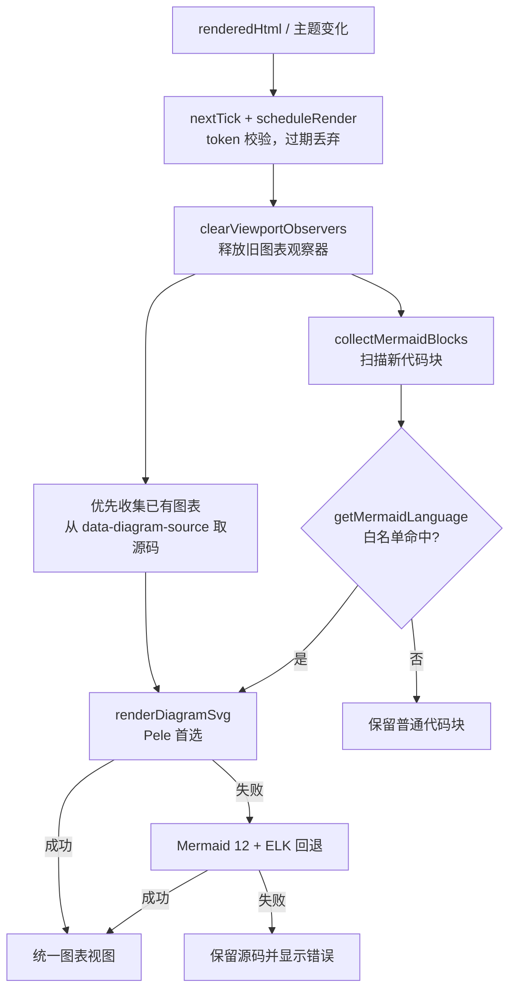
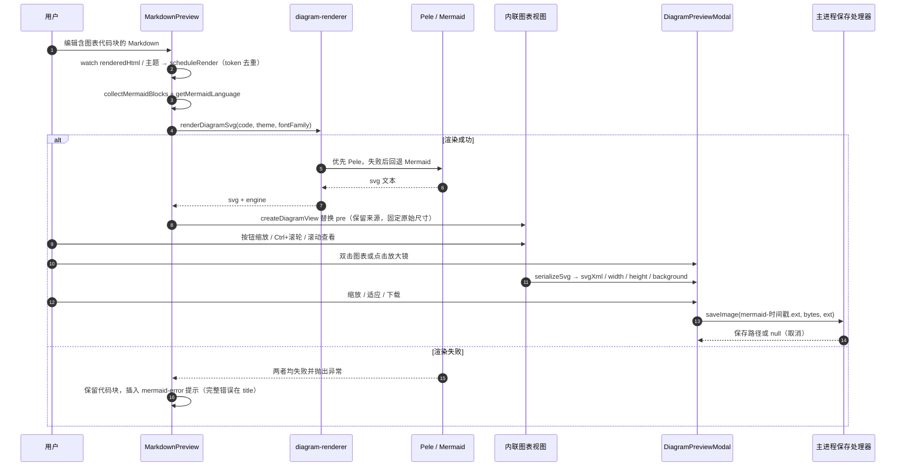

# Mermaid 图表与导出

本文说明 MarkIt 预览区如何识别、渲染、交互与导出 Mermaid 图表，覆盖代码块语言标记白名单、「代码块 → 渲染 → 缩放/弹窗/下载」的完整链路，以及渲染失败时的降级表现。文中参数、常量、类名均以当前源码为准；与 README 描述不一致处以源码为准（见第 2.3 节）。

相关实现主要分布在 `src/renderer/src/utils/`、`src/renderer/src/components/preview/` 与 `src/renderer/src/App.vue`。

## 1. 设计目标

1. **不强制使用 `mermaid` 标记**：Mermaid 本身会根据代码内容判断图表类型，因此常见的图表名（`flowchart`、`sequenceDiagram`、`stateDiagram-v2` 等）都应被识别，降低写作时的记忆负担。
2. **宽容的语言标记匹配**：忽略大小写、忽略 Mermaid 文档中常见的 `-beta` / `-v2` 版本后缀，使 `xychart-beta`、`sankey-beta`、`stateDiagram-v2` 这类写法无需改写即可渲染。
3. **失败不吞内容**：渲染失败时保留原始代码块，只在下方追加一行可读的错误提示，用户可以直接在原位置修改语法。
4. **图表可读、可放大、可带走**：内联视图支持缩放与滚动查看，支持双击打开弹窗看大图，并可直接导出 SVG / PNG。

## 2. 语言标记白名单

### 2.1 归一化规则

识别逻辑位于 [mermaid.ts](../src/renderer/src/utils/mermaid.ts)：

| 步骤       | 实现                                                          | 说明                                                                           |
| ---------- | ------------------------------------------------------------- | ------------------------------------------------------------------------------ |
| 提取标记   | 遍历元素的 `classList`，取以 `language-` 开头的类名并截断前缀 | markdown-it 把代码块渲染为 `<pre><code class="language-xxx">`                  |
| 小写化     | `language.toLowerCase()`                                      | 因此 `SequenceDiagram`、`FlowChart` 均可识别                                   |
| 去版本后缀 | 正则替换掉结尾的版本后缀（忽略大小写）                        | 只处理**一个**后缀，且仅 `beta` / `v2`                                         |
| 集合匹配   | `MERMAID_LANGUAGES.has(normalized)`                           | 32 项固定集合，见 2.2                                                          |
| C4 正则    | `/^c4[a-z]*$/`                                                | 覆盖 `C4Context`、`C4Container`、`C4Component`、`C4Dynamic`、`C4Deployment` 等 |

版本后缀的正则定义为 `VERSION_SUFFIX`，写法为 `-(?:beta|v2)$` 并带 `i` 标志；匹配成功后整段后缀被删除。因为只锚定结尾且只允许单个后缀，`stateDiagram-v2` 会变成 `statediagram`，而 `flow-v3`、`xychart-beta2` 不满足条件，会被当作普通代码块。

归一化示例：

| 原始标记          | 归一化结果        | 是否识别             |
| ----------------- | ----------------- | -------------------- |
| `SequenceDiagram` | `sequencediagram` | 是                   |
| `stateDiagram-v2` | `statediagram`    | 是                   |
| `xychart-beta`    | `xychart`         | 是                   |
| `C4Container`     | `c4container`     | 是（C4 正则）        |
| `xychart-beta2`   | `xychart-beta2`   | 否（后缀不匹配）     |
| `flow-v3`         | `flow-v3`         | 否（只支持 `-v2`）   |
| `javascript`      | `javascript`      | 否，按普通代码块处理 |

需要注意：`getMermaidLanguage()` 返回的是**原始**标记（未归一化），因此错误提示中可能出现 `stateDiagram-v2` 这样的写法，便于用户对照源码定位。

### 2.2 完整白名单（共 32 项 + C4 正则族）

下表与 [mermaid.ts](../src/renderer/src/utils/mermaid.ts) 中 `MERMAID_LANGUAGES` 逐项一致（均为归一化后的小写形式）：

| 类别                                               | 可用语言标记                                                                                             |
| -------------------------------------------------- | -------------------------------------------------------------------------------------------------------- |
| 通用                                               | `mermaid`、`mmd`                                                                                         |
| 流程图                                             | `flowchart`、`flow`、`graph`                                                                             |
| 时序 / 类 / 状态 / ER                              | `sequence`、`sequencediagram`、`class`、`classdiagram`、`state`、`statediagram`、`er`、`erdiagram`       |
| 计划与时间                                         | `gantt`、`journey`、`timeline`                                                                           |
| 思维导图 / 饼图 / Git 分支                         | `mindmap`、`pie`、`gitgraph`                                                                             |
| 象限 / XY / 桑基 / 雷达 / 矩形树                   | `quadrantchart`、`xychart`、`sankey`、`radar`、`treemap`                                                 |
| 块图 / 分组图 / 数据包 / 需求 / 架构 / 看板 / 信息 | `block`、`blockdiagram`、`packet`、`requirement`、`requirementdiagram`、`architecture`、`kanban`、`info` |
| C4 系列（正则匹配）                                | `C4Context`、`C4Container`、`C4Component`、`C4Dynamic`、`C4Deployment` 及其他 `c4+小写字母` 组合         |

计数：通用 2 + 流程图 3 + 时序类 8 + 计划 3 + 思维导图类 3 + 数据图表 5 + 其他 8 = **32 项**；C4 由正则补充，不占集合条目。

### 2.3 与 README 的差异

README 的语言标记表是面向用户的摘要，未列全：缺少 `blockdiagram`、`requirement`（单数形式）等集合成员。实现以 `MERMAID_LANGUAGES` 为准；修改白名单时必须同步本文件第 2.2 节，README 可保持摘要粒度。

## 3. 渲染管线

### 3.1 触发与串行化

渲染入口在 [MarkdownPreview.vue](../src/renderer/src/components/preview/MarkdownPreview.vue)：

1. `renderedHtml` 是 `computed`：`parseFrontmatter` → `renderFrontmatterTable` → `markdown-it` 渲染，结果通过 `v-html` 写入预览区。
2. `watch(renderedHtml)` 调用 `scheduleRender()`；函数内部先 `nextTick()` 等 DOM 落地，再把任务追加到 `renderChain` 这条 Promise 链上。
3. 每次调度都会递增 `renderToken`，链上任务执行前比对 token，**过期的渲染直接丢弃**——编辑时预览内容会被反复替换，并发的 `mermaid.render` 会争用 Mermaid 内部状态，因此必须串行且可丢弃。
4. `renderDiagrams()` 首先 `clearViewportObservers()` 释放上一批 `ResizeObserver`；已有图表按保存的源码重绘，新代码块继续走语言识别。
5. `watch([isDark, currentCss])` 在主题或预览样式变化时再次调度渲染，修复切换主题后图表仍保留旧颜色的问题。

### 3.2 管线流程



代码块必须满足 `<code>` 的父节点是 `<pre>` 才会被替换（`parent.tagName !== 'PRE'` 时跳过），避免误伤行内代码。

### 3.3 渲染器选择与初始化参数

共享入口位于 [diagram-renderer.ts](../src/renderer/src/utils/diagram-renderer.ts)：

1. 等待 `document.fonts.ready`。
2. 优先调用 Pele `render()`；Pele 覆盖 Mermaid 12.1 的内置图表类型，使用自身布局与 SVG 输出。
3. Pele 失败时记录 `console.warn`，再初始化并调用 Mermaid。
4. Mermaid 初始化与渲染由模块级 Promise 链串行化，避免预览与 PDF 并发争用全局状态。

Mermaid 只作为回退，使用 [diagram-theme.ts](../src/renderer/src/utils/diagram-theme.ts) 的统一配置：

| 参数            | 取值                    | 原因                                                                            |
| --------------- | ----------------------- | ------------------------------------------------------------------------------- |
| `theme`         | `'base'`                | 由 MarkIt 的深浅 token 统一覆盖，而不是依赖 Mermaid 固定主题                    |
| `look`          | `'neo'`                 | 使用新版圆角、字体和间距视觉                                                    |
| `layout`        | `'elk'`                 | 复杂分支、子图和跨层连线的布局优于 Dagre                                        |
| `htmlLabels`    | `false`                 | 标签输出为 SVG `<text>`，保证 PNG、SVG 与 PDF 导出稳定                          |
| `securityLevel` | `'loose'`               | 保持当前标签 HTML 与图表链接行为                                                |
| `themeVariables`| 深浅 token 生成         | 节点、子图、时序、ER、饼图、雷达图等共享颜色                                    |
| 各图表 `useMaxWidth` | `false`            | 由 MarkIt 统一处理自然尺寸、宽度适应和缩放                                      |
| `themeCSS`      | 统一字号、圆角与线宽    | 文本 600 字重、节点 12px 圆角、边标签 8px 圆角与 1px 描边                        |

Pele 的主题通过 `--pele-*` CSS 变量注入：

- `--pele-bg` / `--pele-fg` / `--pele-muted` / `--pele-line`
- `--pele-surface` / `--pele-surface-alt` / `--pele-border`
- `--pele-accent` / `--pele-critical`
- `--pele-font` / `--pele-font-mono` / `--pele-radius`
- `--pele-series-1` ～ `--pele-series-8`

PDF 导出使用同一入口和浅色 token，详见 [PDF导出.md](PDF导出.md)。完整设计见[图表渲染升级方案](./图表渲染升级方案.md)。

### 3.4 DOM 替换与原始尺寸

`createDiagramView(svgText, source, language, theme, fontFamily, engine)` 生成的层级：

- `div.mermaid-diagram`：外层容器，保存原始源码、语言和渲染引擎，悬停时显示工具栏
  - `div.mermaid-toolbar`：缩放、弹窗、下载按钮
  - `div.mermaid-viewport`：`overflow: auto`，只在宽度超出时横向滚动
    - `div.mermaid-canvas`：承载 `CSS zoom` 缩放与 Pele CSS 变量
      - `svg`：Pele 或 Mermaid 输出，宽高被固定为原始尺寸

渲染器输出的 `<svg>` 放进 flex 容器前会读取 `viewBox`，把宽高固定为图表**原始尺寸**（同时写 `style.width/height` 并设置 `max-width: none`），再由自动适应逻辑按容器宽度缩放；只有缩放后仍然超出时才出现横向滚动条。纵向尺寸不再参与自动缩小，长图由整个预览页滚动查看。

内联视图的横向定位由 CSS 决定（[App.vue](../src/renderer/src/App.vue)）：`.mermaid-viewport` 用 `justify-content: flex-start`，`.mermaid-canvas` 用 `margin: 0 auto`——图比容器窄时居中，超出时回落到左对齐，保证左侧内容可以滚动到。

## 4. 错误处理

### 4.1 提示文案的生成

`formatMermaidError(error)`（[mermaid.ts](../src/renderer/src/utils/mermaid.ts)）把异常压缩成一行：

1. 取 `error.message`（非 `Error` 时 `String(error)`），按行切分、`trim`、丢弃空行。
2. 全部为空 → 返回 `未知错误`。
3. 取第一行并去掉行尾冒号；再用 `/got '([^']+)'/` 捕获 token，拼成 `首行（got 'xxx'）`。

Mermaid 的语法错误通常是「Parse error on line N: + 源码行 + 指示符 + Expecting ...」，因此只保留错误行与 got 到的 token；**完整错误信息写入提示元素的 `title`**，鼠标悬浮即可查看。

最终提示文本为：

```text
图表渲染失败（<原始语言标记>）：<formatMermaidError 结果>
```

语言标记缺失时回退为 `mermaid`。

### 4.2 降级行为

- 渲染失败的 `<pre><code>` **原样保留**，提示元素通过 `insertAdjacentElement('afterend', ...)` 插到代码块之后，用户可对照提示直接修改源码。
- Pele 失败时自动回退 Mermaid；两者都失败时保留源码并显示错误提示，不再静默。
- 主题变化重绘已有图表时，若重新渲染失败，旧图表保留并在其后显示“图表重新渲染失败”提示。
- 错误提示的样式分两层：
  - 基础样式（[App.vue](../src/renderer/src/App.vue)）：`margin: 8px 0 1.2em`、`padding: 8px 12px`、`font-size: 12px`、`white-space: pre-wrap`、`word-break: break-word`；深色主题为琥珀色 `#d97706` + 8% 透明背景 + 25% 透明边框，浅色主题为 `#b45309` + 6% 背景 + 20% 边框。
  - 预览主题覆盖：`github.css` 与 `github-light.css` 定义了 `.markdown-body .mermaid-error` 的前景色与底色（偏红色系），因此在其他预览主题下提示颜色会不同；`academic`、`minimal` 与自定义样式未覆盖，沿用基础样式。

## 5. 内联图表交互

工具栏按钮顺序：`−`（缩小）、百分比标签、`＋`（放大）、放大镜图标（弹窗预览）、`SVG`、`PNG`。工具栏默认 `opacity: 0` 且 `pointer-events: none`，悬停图表或键盘聚焦时显示，避免遮挡图表内容。

### 5.1 缩放

| 项         | 值                                                                                           |
| ---------- | -------------------------------------------------------------------------------------------- |
| 缩放范围   | `MIN_SCALE = 0.25` ~ `MAX_SCALE = 4`（25%–400%）                                             |
| 步进       | `ZOOM_STEP = 1.25`，放大 ×1.25，缩小 ÷1.25                                                   |
| 实现方式   | 对 `.mermaid-canvas` 设置 CSS `zoom`，不改变 SVG 自身尺寸                                    |
| 百分比标签 | 显示 `Math.round(scale * 100)%`，点击后**退出自动适应并恢复 100%**（`title="恢复原始大小"`） |

### 5.2 自动适应容器

- 初始 `scale = 1`、`autoFit = true`。
- 通过 `ResizeObserver` 观察 `.mermaid-viewport`，容器尺寸变化（窗口缩放、侧栏折叠、预览宽度切换）时重新适应。
- `fitScale = min(1, (可用宽 - 4) / 自然宽)`，只按宽度缩小，不再按 `70vh` 高度压缩；`FIT_GUTTER = 4` 用于吃掉取整误差。
- 需要缩到 60% 以下时停在 `MIN_FIT_SCALE = 0.6`，剩余部分交给滚动条，避免缩小到不可读。
- 用户一旦手动缩放（按钮、滚轮、点击百分比）即 `autoFit = false`，之后调整窗口不再覆盖用户选择。

### 5.3 滚轮与双击

- **Ctrl/Cmd + 滚轮**：`passive: false` 监听 `wheel`，`deltaY < 0` 放大、否则缩小，一步一个 `ZOOM_STEP`；同时 `preventDefault()`，避免触发整窗缩放。普通滚轮不拦截，交给预览区滚动。
- **双击**：仅当双击目标位于 `<svg>` 内时触发，打开弹窗预览；`.mermaid-viewport` 的 `title` 为「双击放大预览」。
- 图宽超出视口时 `.mermaid-viewport` 自身横向滚动；纵向长图随页面滚动。

## 6. 弹窗预览

组件：[DiagramPreviewModal.vue](../src/renderer/src/components/preview/DiagramPreviewModal.vue)，通过 `<Teleport to="body">` 挂到 `body`，`z-index: 2000`。

### 6.1 打开方式

1. 工具栏放大镜图标（`title="弹窗预览（可缩放 / 滚动 / 下载）"`）；
2. 双击图表。

两种方式都调用 `openDiagramPreview(svgEl)`：先用 `serializeSvg()` 取得 `xml / width / height`，再带上当前主题背景色（深色 `#1e1e24`、浅色 `#ffffff`）打开弹窗。因此弹窗展示的是**序列化后的静态 SVG**（以 `` + Blob URL 呈现），而不是原 DOM 节点。

### 6.2 面板与操作

弹窗尺寸 `width: min(1200px, 94vw)`、`height: min(820px, 88vh)`；顶部为标题「图表预览」与按钮组：`−`、百分比、`＋`、`适应`、`SVG`、`PNG`、`✕`。

| 操作            | 行为                                                                                                            |
| --------------- | --------------------------------------------------------------------------------------------------------------- |
| 缩放按钮        | 与内联一致的 25%–400%、步进 ×1.25                                                                               |
| 点击百分比      | 恢复 100%                                                                                                       |
| 适应窗口        | `min(1, (视口宽 - 48) / 图宽, (视口高 - 48) / 图高)`，并把滚动位置复位到左上角；小图保持 100% 不放大            |
| Ctrl/Cmd + 滚轮 | 以鼠标位置为锚点缩放：先记录鼠标处的内容坐标，缩放后按比例回填 `scrollLeft/scrollTop`，使鼠标指向的内容保持不动 |
| 普通滚轮        | 交给视口滚动                                                                                                    |
| 溢出判定        | `图宽 × 缩放 > 视口宽 - 8` 或高同理；溢出时容器从「居中」切换为「左上对齐」，保证整张图都能滚动到               |
| 关闭            | `✕` 按钮、点击遮罩空白处（`@mousedown.self`）、`Esc`（弹窗打开期间以捕获阶段监听 `window`）                     |
| 底部提示        | 「滚轮滚动 · Ctrl/Cmd + 滚轮缩放 · Esc 关闭」                                                                   |

Blob URL 在关闭、内容变化与组件卸载时 `revokeObjectURL`，避免泄漏。

### 6.3 与内联视图的差异

| 维度     | 内联视图                         | 弹窗预览                                      |
| -------- | -------------------------------- | --------------------------------------------- |
| 内容载体 | 真实 SVG DOM，可直接查询与序列化 | 序列化后的 SVG 经 Blob URL 以 `` 显示    |
| 初始缩放 | 自动适应（下限 60%）             | 打开时先置 100%，再 `fitToWindow`（下限 25%） |
| 缩放锚点 | 无，围绕画布原点                 | Ctrl/Cmd + 滚轮以鼠标位置为锚点               |
| 适应按钮 | 无，随容器自动重新适应           | 有「适应」按钮，手动触发                      |
| 工具栏   | 悬停才显示                       | 常驻标题栏                                    |
| 下载     | 从 DOM 中现取 `<svg>`            | 直接使用打开时序列化的 `svgXml` 与宽高        |

## 7. 图表导出

导出逻辑集中在 [diagram-export.ts](../src/renderer/src/utils/diagram-export.ts)，内联工具栏与弹窗共用。

### 7.1 serializeSvg

1. `cloneNode(true)` 克隆节点，避免改动页面上的图表。
2. 从 `viewBox` 解析宽高：`width = viewBox[2] || clientWidth || 800`，`height = viewBox[3] || clientHeight || 600`（作为缺失时的兜底）。
3. 补齐 `xmlns` 与 `xmlns:xlink` 命名空间，写入固定的 `width` / `height` 属性。
4. 清空 `style.maxWidth`——Mermaid 注入的 `max-width` 只服务于页面内自适应，单独查看或导出时会把图压窄。
5. 用 `XMLSerializer` 输出字符串。

### 7.2 svgToPng

1. 先 `serializeSvg` 得到字符串与尺寸。
2. `Blob(type: image/svg+xml;charset=utf-8)` → `URL.createObjectURL` → 载入 `Image`，加载失败抛 `SVG 图片加载失败`。
3. 创建 2 倍分辨率画布：`max(1, ceil(width × 2))` / `max(1, ceil(height × 2))`。
4. 用主题背景色 `fillRect` 铺底（SVG 本身透明，不铺底会得到透明 PNG），再 `drawImage` 铺满画布。
5. `canvas.toBlob(..., 'image/png')`，失败抛 `PNG 编码失败`；返回 `Uint8Array`。
6. `finally` 中 `revokeObjectURL`。

`htmlLabels: false` 是这条链路成立的前提：若标签使用 `foreignObject`，画布会被标记为污染，`toBlob` 可能抛安全错误或得到空白图。

### 7.3 保存流程

`saveDiagram(svgEl, extension, background, fileName?)`：

- 默认文件名 `mermaid-<Date.now()>.<ext>`，由调用方决定是否覆盖；当前内联与弹窗两处都使用默认值，即**时间戳文件名**，不含文档名或图表标题。
- SVG 分支：序列化文本 → `TextEncoder` 编码 → `window.api.saveImage(fileName, bytes, 'svg')`。
- PNG 分支：`svgToPng` → `window.api.saveImage(fileName, bytes, 'png')`。
- 主进程 `dialog:saveImage`（[src/main/index.ts](../src/main/index.ts)）弹出系统保存对话框，`defaultPath` 为传入文件名，过滤器按扩展名生成（`SVG` / `PNG`）；用户取消返回 `null`。
- 渲染进程对 `null` 不做任何提示（静默返回），只有真正的异常才 `console.error('Failed to export diagram:', err)`。

弹窗侧不走 `saveDiagram`，而是直接调用 `window.api.saveImage`（SVG 用已序列化文本，PNG 用 `svgXmlToPng`），文件名规则与默认值一致。

## 8. 主题与背景色

图表使用 `getDiagramTheme(isDark)` 返回的 token：

| token        | 深色       | 浅色       | 用途                         |
| ------------ | ---------- | ---------- | ---------------------------- |
| `background` | `#0d1117`  | `#ffffff`  | 画布、边标签与导出铺底       |
| `surface`    | `#123252`  | `#eef4ff`  | 节点、任务和主要图元         |
| `surfaceAlt` | `#1a2d45`  | `#e2eaf8`  | 子图、表头、分区             |
| `border`     | `#38536f`  | `#c7d2e3`  | 节点与子图边框               |
| `foreground` | `#e6edf3`  | `#1f2937`  | 标题与正文                   |
| `line`       | `#8b9bb4`  | `#7b8798`  | 连线、箭头、坐标轴           |
| `accent`     | `#58a6ff`  | `#2563eb`  | 强调色                       |
| `critical`   | `#f85149`  | `#dc2626`  | 高风险、失败、关键任务       |
| `series`     | 8 色序列   | 8 色序列   | 饼图、雷达图、桑基图等系列色 |

图表视图背景、PNG 铺底和弹窗背景都使用同一个 `background`。主题切换后已有图表按保存的源码自动重绘，不沿用旧颜色。弹窗遮罩仍由弹窗组件按深浅色控制。

`resolvedTheme` 已经把「跟随系统」解析成具体的 `light` / `dark`，因此三种主题设置下都能得到确定的取值。预览区的容器背景由预览样式 CSS 决定（例如 `github.css` 的 `.mermaid-diagram` 背景），与导出铺底用的 `#1e1e24` 并非同一色值——导出图不会带上预览主题的圆角与内边距。

## 9. 失败与边界

| 场景                   | 当前表现                                                       | 说明                                                                            |
| ---------------------- | -------------------------------------------------------------- | ------------------------------------------------------------------------------- |
| 语法错误               | 保留代码块 + 下方提示，完整错误在 `title`                      | 见第 4 节                                                                       |
| 图表类型不支持         | 先尝试 Pele，再回退 Mermaid；两者都失败才显示错误              | 白名单命中但内容无法解析时按失败处理                                            |
| 渲染模块动态导入失败   | 保留源码 + 错误提示                                            | Pele 失败会记录 warn；Mermaid 最终失败会进入现有错误链路                        |
| 极大图表               | 宽度低于 60% 时停止缩小并横向滚动；纵向自然展开；弹窗可缩到 25% | 不做分页或截断                                                                  |
| 超大 PNG               | 画布按 2 倍尺寸创建，未做上限校验                              | 极端尺寸可能受浏览器画布上限/内存限制，`toBlob` 返回 `null` 时抛 `PNG 编码失败` |
| SVG 缺少 `viewBox`     | 依次回退 `clientWidth/clientHeight`，再回退 800×600            | 元素不可见时 `clientWidth` 为 0，最终落到默认值                                 |
| 用户取消保存           | `saveImage` 返回 `null`，静默返回                              | 不关闭任何界面，不报错                                                          |
| 写盘失败               | 主进程 `writeFile` 抛错，渲染进程 catch 后 `console.error`     | 无弹窗提示                                                                      |
| 图表尺寸测量不到       | `fitToViewport` 在 `clientWidth <= 0` 时直接返回，等观察器回调 | 预览区隐藏（如 `edit-only` 布局）时不会误缩放                                   |

## 10. 端到端时序



## 11. 相关文件

| 文件                                                                                                                          | 职责                                                                  |
| ----------------------------------------------------------------------------------------------------------------------------- | --------------------------------------------------------------------- |
| [src/renderer/src/utils/mermaid.ts](../src/renderer/src/utils/mermaid.ts)                                                     | 语言白名单、归一化、代码块收集、错误文案压缩                          |
| [src/renderer/src/utils/diagram-theme.ts](../src/renderer/src/utils/diagram-theme.ts)                                         | 深浅主题 token、Mermaid 配置与 Pele CSS 变量映射                      |
| [src/renderer/src/utils/diagram-renderer.ts](../src/renderer/src/utils/diagram-renderer.ts)                                   | Pele 首选、Mermaid 回退与串行化渲染                                   |
| [src/renderer/src/utils/diagram-export.ts](../src/renderer/src/utils/diagram-export.ts)                                       | SVG 序列化、2 倍 PNG 生成、系统保存对话框调用                         |
| [src/renderer/src/components/preview/MarkdownPreview.vue](../src/renderer/src/components/preview/MarkdownPreview.vue)         | 渲染调度、主题重绘、内联图表视图与缩放、错误提示、弹窗入口            |
| [src/renderer/src/components/preview/DiagramPreviewModal.vue](../src/renderer/src/components/preview/DiagramPreviewModal.vue) | 大图弹窗的缩放、适应窗口、下载与关闭                                  |
| [src/renderer/src/App.vue](../src/renderer/src/App.vue)                                                                       | `.mermaid-diagram` / `.mermaid-toolbar` / `.mermaid-error` 等全局样式 |
| [src/renderer/src/styles/preview/](../src/renderer/src/styles/preview)                                                        | 各预览主题对图表容器与错误提示的配色覆盖                              |
| [src/main/index.ts](../src/main/index.ts)                                                                                     | `dialog:saveImage` 保存对话框与写盘                                   |
| [src/preload/index.ts](../src/preload/index.ts)                                                                               | `saveImage` 的 IPC 暴露                                               |
| [src/renderer/src/composables/usePdfExport.ts](../src/renderer/src/composables/usePdfExport.ts)                               | PDF 管线复用共享渲染器与浅色 token                                    |
