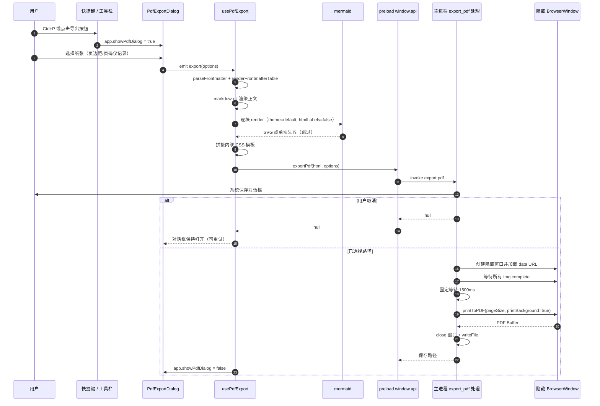

# PDF 导出

本文说明 MarkIt 的 PDF 导出能力：入口、对话框选项、渲染管线、主进程打印流程、与预览管线的同步点、打印样式约定，以及**当前尚未生效的选项与已知限制**。文中结论均按当前代码核实，凡 README 描述与实现不一致处，以本文与源码为准。

## 1. 入口与交互

| 入口            | 位置                                                                               | 行为                                                                                                                                                                              |
| --------------- | ---------------------------------------------------------------------------------- | --------------------------------------------------------------------------------------------------------------------------------------------------------------------------------- |
| 快捷键 `Ctrl+P` | [useKeyboardShortcuts.ts](../src/renderer/src/composables/useKeyboardShortcuts.ts) | `isCtrl(e) && !e.shiftKey && e.key === 'p'` 时 `preventDefault()` 并置 `app.showPdfDialog = true`                                                                                 |
| 工具栏按钮      | [Toolbar.vue](../src/renderer/src/components/layout/Toolbar.vue)                   | 按钮 `title="导出 PDF (Ctrl+P)"`，点击同样置 `app.showPdfDialog = true`                                                                                                           |
| 对话框          | [PdfExportDialog.vue](../src/renderer/src/components/export/PdfExportDialog.vue)   | 在 [AppLayout.vue](../src/renderer/src/components/layout/AppLayout.vue) 中挂载，`@export` 交由 `usePdfExport().exportPdf` 执行，异常处 `console.error('PDF export failed:', err)` |

对话框的显示由 Pinia 的 `app.showPdfDialog` 直接控制（组件内部读取 store），`AppLayout` 额外传入的 `:visible` 并未在组件中声明为 prop，属于无效属性，不影响行为。

导出内容取自**当前编辑器内存中的内容**（`editorStore.content`），不读取磁盘文件，因此未保存的修改也会进入 PDF。

## 2. 对话框选项

| 选项     | 控件                      | 默认值     | 可取值                         | 是否真正生效                       |
| -------- | ------------------------- | ---------- | ------------------------------ | ---------------------------------- |
| 纸张大小 | `<select>`                | `A4`       | `A4` / `Letter`                | 生效（传给 `printToPDF.pageSize`） |
| 页边距   | `<select>`                | `standard` | `narrow` / `standard` / `wide` | **未生效**（仅传参，主进程未使用） |
| 显示页码 | `<input type="checkbox">` | 勾选       | 布尔                           | **未生效**（仅传参，主进程未使用） |

- 点「导出」时 `emit('export', { pageSize, margin, showPageNumbers })`；点「取消」、右上角关闭按钮、点击遮罩空白处均 `emit('close')`，只关闭对话框。
- **没有文件名输入项**：主进程弹出系统保存对话框时未设置 `defaultPath`，文件名完全由用户在保存对话框中决定。
- 导出期间不显示加载态：`usePdfExport` 内部维护 `exporting`，但对话框未绑定它，「导出」按钮也不会禁用，重复点击会重复弹出保存对话框。
- 对话框只在**导出成功**（`window.api.exportPdf` 返回非空路径）时关闭；用户取消保存时对话框保持打开，可修改选项后重试。

与类型定义的关系：[types/index.ts](../src/renderer/src/types/index.ts) 中定义了 `PdfExportOptions`（含 `showToc`、`fileName`），但全仓库没有任何引用，实际链路使用的是对话框与 IPC 中各自内联的 `{ pageSize, margin, showPageNumbers }` 类型。详见第 7 节。

## 3. 渲染管线

### 3.1 渲染进程（usePdfExport）

[usePdfExport.ts](../src/renderer/src/composables/usePdfExport.ts) 在组合式函数创建时初始化一个独立的 `MarkdownIt` 实例（`html: true, linkify: true, breaks: true`），并安装与预览相同的本地图片规则：

1. `parseFrontmatter(editor.content)` 拆分出 frontmatter 条目与正文；
2. `renderFrontmatterTable(entries)` 生成「文档信息」表格 HTML，与正文渲染结果拼接；
3. `renderMermaidToSvg(htmlBody)`：把 HTML 放进临时的 `div`，用 `collectMermaidBlocks` 找出 Mermaid 代码块，逐块 `mermaid.render` 后用居中的 `div` 替换 `<pre>`；
4. 套入内联的 HTML 模板（`<!DOCTYPE html>` + `<style>` + `<body>`），所有 CSS 内联，不引用外部资源；
5. `window.api.exportPdf(html, options)` → preload `invoke('export:pdf')`。

PDF 侧的 Mermaid 初始化参数固定为 `startOnLoad: false`、`theme: 'default'`、`securityLevel: 'loose'`、`htmlLabels: false`，并且**每次导出都会重新 `initialize`**（与预览按主题缓存初始化不同）。单块渲染失败时直接跳过（`catch {}`），该代码块以原始文本留在 PDF 中，不会出现预览里的错误提示。

### 3.2 主进程（export:pdf）

[src/main/index.ts](../src/main/index.ts) 中的 `ipcMain.handle('export:pdf')` 流程：

1. `dialog.showSaveDialog(mainWindow!, { filters: [{ name: 'PDF', extensions: ['pdf'] }] })`；用户取消（`canceled` 或无路径）时返回 `null`。
2. 创建 `BrowserWindow({ width: 800, height: 1100, show: false, webPreferences: { sandbox: false } })`。
3. `loadURL('data:text/html;charset=utf-8,' + encodeURIComponent(html))` 加载自包含页面。
4. `executeJavaScript` 注入一段 Promise，等待 `document.images` 中所有图片：已 `complete` 的直接放行，否则监听一次 `load` 或 `error`——**加载失败也 resolve**，坏图不会让导出挂死。
5. 额外固定等待 `1500ms`，覆盖布局、SVG 与字体的迟到绘制。
6. `printToPDF({ pageSize, printBackground: true })`，其中 `pageSize` 经 `{ A4: 'A4', Letter: 'Letter' }` 映射，未知值回退 `A4`。
7. `pdfWin.close()`，`writeFile(result.filePath, pdf)`，返回保存路径。

### 3.3 端到端时序

## 4. 与预览管线的同步点

预览与 PDF 是两条独立构建的 markdown-it 管线，[CLAUDE.md](../CLAUDE.md) 要求修改渲染行为时两处同步。当前对齐情况：

| 同步点           | 预览（MarkdownPreview.vue）                                                                          | PDF（usePdfExport.ts）                              | 一致性                              |
| ---------------- | ---------------------------------------------------------------------------------------------------- | --------------------------------------------------- | ----------------------------------- |
| frontmatter      | `parseFrontmatter` + `renderFrontmatterTable`，渲染为「文档信息」表格                                | 同左                                                | 一致                                |
| 本地图片         | `installLocalImageRule` + `resolveImageSrc`，相对路径转 `markit-file://local/?p=<绝对路径>`          | 同左                                                | 一致                                |
| Mermaid 识别     | `collectMermaidBlocks` / 白名单                                                                      | 同左，复用同一模块                                  | 一致                                |
| Mermaid 主题     | 跟随深/浅色（`dark` / `default`）                                                                    | 固定 `default`（浅色）                              | 不一致（PDF 恒为浅色）              |
| Mermaid 失败     | 保留代码块 + `mermaid-error` 提示                                                                    | 跳过，代码块保持原文                                | 不一致（PDF 无提示）                |
| 标题锚点         | 额外 core rule 注入 `heading-0..N`                                                                   | 无                                                  | 不一致（PDF 没有页内锚点）          |
| 链接处理         | `handlePreviewLinkClick` 分流：外链走 `shell:openExternal`，本地文件在资源管理器中定位，其余协议忽略 | 无任何点击拦截，`href` 原样输出                     | 不一致                              |
| markdown-it 选项 | `html`、`linkify`、`typographer`、`breaks`                                                           | `html`、`linkify`、`breaks`（**无 `typographer`**） | 轻微不一致（引号/破折号排版不转换） |
| 预览样式         | 由 `styleStore` 注入当前主题 CSS                                                                     | 固定内置浅色模板，不使用任何预览主题 CSS            | 不一致                              |

PDF 中链接的具体行为：markdown-it 输出的 `<a href>` 原样保留，模板仅设置颜色 `#0366d6`。相对路径链接不会被转成绝对路径（只有图片经过 `installLocalImageRule` 改写），`file:` 链接也不会被改写；导出后链接是否可点击、点击后打开什么，取决于 PDF 阅读器本身，与预览的分流逻辑无关。因此**不要指望 PDF 内的相对链接可以跳转**。

## 5. 打印样式约定

样式全部内联在 `usePdfExport` 的模板字符串中，属于固定的**浅色打印样式**，与当前界面主题、预览样式（GitHub / Dark / Academic / Minimal）无关：

| 元素         | 约定                                                                                                                                         |
| ------------ | -------------------------------------------------------------------------------------------------------------------------------------------- |
| `body`       | 字体栈 `-apple-system, BlinkMacSystemFont, 'Segoe UI', system-ui, sans-serif`；前景色 `#222`；行高 `1.7`；`padding: 40px`；`max-width: 100%` |
| `h1`         | `2em`，底部 1px `#ddd` 分隔线，`padding-bottom: 0.3em`                                                                                       |
| `h2`         | `1.5em`，底部 1px `#eee` 分隔线，`padding-bottom: 0.2em`                                                                                     |
| `h3`         | `1.25em`                                                                                                                                     |
| 行内 `code`  | 背景 `#f4f4f4`，`padding: 0.15em 0.4em`，圆角 `3px`，字号 `0.9em`                                                                            |
| `pre`        | 背景 `#f8f8f8`，1px `#e0e0e0` 边框，圆角 `6px`，`padding: 14px 18px`，`overflow-x: auto`                                                     |
| `pre code`   | 透明背景、无内边距                                                                                                                           |
| `blockquote` | 左侧 3px `#ddd` 竖线，`padding: 0.5em 1em`，文字 `#666`，上下外边距 `1em`                                                                    |
| `table`      | `width: 100%`、`border-collapse: collapse`、上下外边距 `1em`                                                                                 |
| `th`         | 背景 `#f6f6f6`、`font-weight: 600`、左对齐、`padding: 8px 12px`、1px `#ddd` 边框                                                             |
| `td`         | `padding: 6px 12px`、1px `#ddd` 边框                                                                                                         |
| frontmatter  | `.frontmatter-title` 12px `#666`；`.fm-key` 宽 160px、等宽字体、12px `#555`；`.fm-value` 保留换行并允许断词                                  |
| `img`        | `max-width: 100%`（高度自适应）                                                                                                              |
| `a`          | 仅设置颜色 `#0366d6`，下划线沿用浏览器默认                                                                                                   |
| `svg`        | `max-width: 100%`、`height: auto`，Mermaid 图表由外层 `div` 居中并带 `margin: 1em 0`                                                         |

模板中**没有 `@page` 规则，也没有 `page-break-*` / `break-inside` 约束**，因此长表格、长代码块与大幅图表可能被分页线切开。

## 6. 当前限制与后续改进

以下限制已逐条核对代码，不是猜测。

### 6.1 页边距未生效

- 事实：对话框把 `margin` 传给 `exportPdf` → preload → 主进程，但主进程 `printToPDF` 只读取 `options.pageSize`，`margin` 声明后从未使用。
- 代码位置：`src/main/index.ts` 的 `export:pdf` 处理（`printToPDF` 调用处仅含 `pageSize` 与 `printBackground`）。
- 当前实际边距：仅由模板中 `body { padding: 40px }` 决定，三档选项对导出结果无任何影响。
- 改造建议：在 `printToPDF` 中传入 `margins`（Electron 该字段的单位需按当前 Electron 版本核对），把 `narrow / standard / wide` 映射为三组数值；或保持 `margins` 为空、改由渲染进程按档位设置 `body` 的 padding / `@page` 边距。两条路线二选一，避免两处同时控制边距。

### 6.2 页码未生效

- 事实：`showPageNumbers` 一路传到主进程后未被读取；`printToPDF` 未开启 `displayHeaderFooter`，也没有 `headerTemplate` / `footerTemplate`。
- 代码位置：同上（`src/main/index.ts` 的 `export:pdf`）。
- 改造建议：`showPageNumbers` 为真时传入 `displayHeaderFooter: true` 与只包含页码的 `footerTemplate`（使用 `.pageNumber` / `.totalPages` 类名），为假时保持关闭；注意页眉页脚会占用页边距，需与 6.1 的边距方案一起调整。

### 6.3 `showToc` 与 `fileName` 是未接线的类型

- 事实：`PdfExportOptions`（`src/renderer/src/types/index.ts`）包含 `showToc: boolean` 与 `fileName: string`，但全仓库无任何引用；对话框使用内联类型，也不提供这两个选项；主进程保存对话框未设置 `defaultPath`。
- 改造建议：
  - 目录：在 PDF 的 markdown-it 管线上复用与预览一致的标题遍历（预览通过 core rule 注入 `heading-N` 锚点），收集标题生成目录 HTML 插到正文前，同时为标题写入锚点；`showToc` 决定是否插入。若同时希望 PDF 内目录可跳转，需要与链接处理一并设计。
  - 文件名：让 `fileName` 参与 `showSaveDialog` 的 `defaultPath`（需清洗非法字符），默认值可取自当前文档名（`documents.activeDoc?.name`）而不是固定值。
  - 类型收敛：要么让对话框与 IPC 直接使用 `PdfExportOptions`，要么删除未使用字段，避免类型与实现长期背离。

### 6.4 PDF 不复用预览样式

- 事实：README 写「导出时保留预览样式」，但实现使用固定浅色模板，既不注入 `styleStore` 的 CSS，也不读取 `app.previewWidthMode`；深色主题下导出的仍是浅色 PDF。
- 改造建议：明确产品预期后二选一——(a) 修正 README 表述，说明 PDF 使用独立打印样式；(b) 在模板中注入当前预览 CSS 的浅色版本（深色主题需要另做颜色映射，否则打印效果很差）。

### 6.5 其他实现细节

| 问题                          | 位置                               | 影响                                                            | 建议                                                                                            |
| ----------------------------- | ---------------------------------- | --------------------------------------------------------------- | ----------------------------------------------------------------------------------------------- |
| 隐藏窗口未在 `finally` 中销毁 | `src/main/index.ts` `export:pdf`   | `loadURL` / `printToPDF` 抛错时窗口残留，重复失败会累积隐藏窗口 | 用 `try/finally` 包住并 `pdfWin.destroy()`                                                      |
| `sandbox: false`              | 同上                               | 隐藏窗口运行在较宽松的沙箱配置下                                | 该页面只加载本地生成的 HTML，可评估收紧为默认沙箱                                               |
| 固定 1500ms 等待              | 同上                               | 大文档可能不够、小文档白等；目前无事件依据                      | 改为等待 `document.fonts.ready` 与 `requestAnimationFrame` 稳定后再打印，或把延时做成可配置上限 |
| 无分页控制                    | `usePdfExport` 模板                | 表格、代码块可能被切断                                          | 为 `pre`、`table`、`img` 增加 `break-inside: avoid`，必要时用 `@page` 设置尺寸与边距            |
| `exporting` 未接入 UI         | `usePdfExport` + `PdfExportDialog` | 无进度反馈，可重复触发导出                                      | 按钮绑定 `disabled` 与文案「导出中…」                                                           |
| 对话框 `:visible` 未声明      | `AppLayout.vue`                    | 无效属性，易误导后续维护                                        | 删除该绑定，或改为真正的受控 prop                                                               |

## 7. 失败与取消路径

| 场景                            | 表现                                                                                                                        |
| ------------------------------- | --------------------------------------------------------------------------------------------------------------------------- |
| 用户在系统保存对话框点取消      | 主进程返回 `null`；`exportPdf` 不会关闭对话框，也不报错，可修改选项后重试                                                   |
| `printToPDF` 或写文件抛错       | 异常经 IPC 传到渲染进程，`AppLayout.onExport` 捕获后 `console.error('PDF export failed:', err)`；无界面提示，对话框保持打开 |
| 单个 Mermaid 块渲染失败         | `try/catch` 内跳过，该块在 PDF 中保留为原始代码块，其余图表正常渲染                                                         |
| `mermaid` 动态导入失败          | 整段渲染逻辑静默跳过，所有图表以代码块形式输出                                                                              |
| 图片文件缺失 / 扩展名不在白名单 | `markit-file://` 协议返回错误响应，`img` 触发 `error`，等待逻辑照常 resolve，PDF 中该图位置为空                             |
| 重复点击「导出」                | 没有防重入，会连续弹出保存对话框（见 6.5）                                                                                  |

## 8. 手工验证清单

仓库当前没有测试框架，PDF 属于高风险区域，改动后至少按下列步骤在 `npm run dev` 下验证一次：

1. **基础导出**：打开一篇含标题、段落、列表、表格、代码块、引用、图片的文档，按 `Ctrl+P` 选择 A4 + 标准，确认生成 PDF 且能打开。
2. **分页**：确认长文档跨页正常，观察表格 / 代码块是否被分页线切断（当前预期会切断，属已知限制）。
3. **图片**：相对路径图片在 PDF 中正常显示；故意写一个不存在的路径，确认导出不挂死、其余内容完整。
4. **Mermaid**：流程图、时序图各一张，确认 PDF 中为矢量图且居中；把其中一块改成语法错误，确认只有该块退化为代码块，导出仍成功。
5. **frontmatter**：文首含 `---` 属性的文档，确认首部为「文档信息」表格而非 YAML 原文。
6. **纸张**：切到 Letter 再导出，对比页面尺寸变化（证明 `pageSize` 生效）。
7. **页边距 / 页码**：分别切换三档边距并勾选/取消页码，确认输出**没有变化**——用于回归验证第 6 节限制是否仍存在；若将来实现，应改为确认变化符合预期。
8. **取消路径**：在保存对话框点取消，确认应用不崩溃、对话框仍可继续操作；再次导出选择路径可正常完成。
9. **主题**：分别用深色与浅色主题导出，确认两次结果一致（PDF 固定浅色）。
10. **超长文档**：含多张大图与多个图表的文档，确认 1500ms 等待后图片、图表均已绘制（若出现空白，记录并参考 6.5 的改造建议）。

## 9. 相关文件

| 文件                                                                                                                | 职责                                                             |
| ------------------------------------------------------------------------------------------------------------------- | ---------------------------------------------------------------- |
| [src/renderer/src/components/export/PdfExportDialog.vue](../src/renderer/src/components/export/PdfExportDialog.vue) | 导出选项对话框（纸张 / 页边距 / 页码）与默认值                   |
| [src/renderer/src/composables/usePdfExport.ts](../src/renderer/src/composables/usePdfExport.ts)                     | PDF 渲染管线、Mermaid 转 SVG、内联打印 CSS 模板                  |
| [src/renderer/src/components/layout/AppLayout.vue](../src/renderer/src/components/layout/AppLayout.vue)             | 对话框挂载与 `exportPdf` 调用、异常兜底                          |
| [src/renderer/src/components/layout/Toolbar.vue](../src/renderer/src/components/layout/Toolbar.vue)                 | 工具栏导出入口                                                   |
| [src/renderer/src/composables/useKeyboardShortcuts.ts](../src/renderer/src/composables/useKeyboardShortcuts.ts)     | `Ctrl+P` 快捷键                                                  |
| [src/preload/index.ts](../src/preload/index.ts)                                                                     | `exportPdf` / `saveImage` 的 IPC 暴露与参数类型                  |
| [src/preload/index.d.ts](../src/preload/index.d.ts)                                                                 | `window.api` 类型契约                                            |
| [src/main/index.ts](../src/main/index.ts)                                                                           | `export:pdf`：保存对话框、隐藏窗口、图片等待、`printToPDF`、写盘 |
| [src/renderer/src/utils/frontmatter.ts](../src/renderer/src/utils/frontmatter.ts)                                   | frontmatter 解析与「文档信息」表格生成（预览、PDF 共用）         |
| [src/renderer/src/utils/local-image.ts](../src/renderer/src/utils/local-image.ts)                                   | 本地图片路径解析与 `markit-file://` 改写（预览、PDF 共用）       |
| [src/renderer/src/utils/mermaid.ts](../src/renderer/src/utils/mermaid.ts)                                           | Mermaid 代码块识别（PDF 复用同一白名单）                         |
| [src/renderer/src/types/index.ts](../src/renderer/src/types/index.ts)                                               | `PdfExportOptions` 类型（`showToc` / `fileName` 尚未接线）       |
| [docs/Mermaid图表与导出.md](Mermaid图表与导出.md)                                                                   | 图表识别、交互与导出细节                                         |
