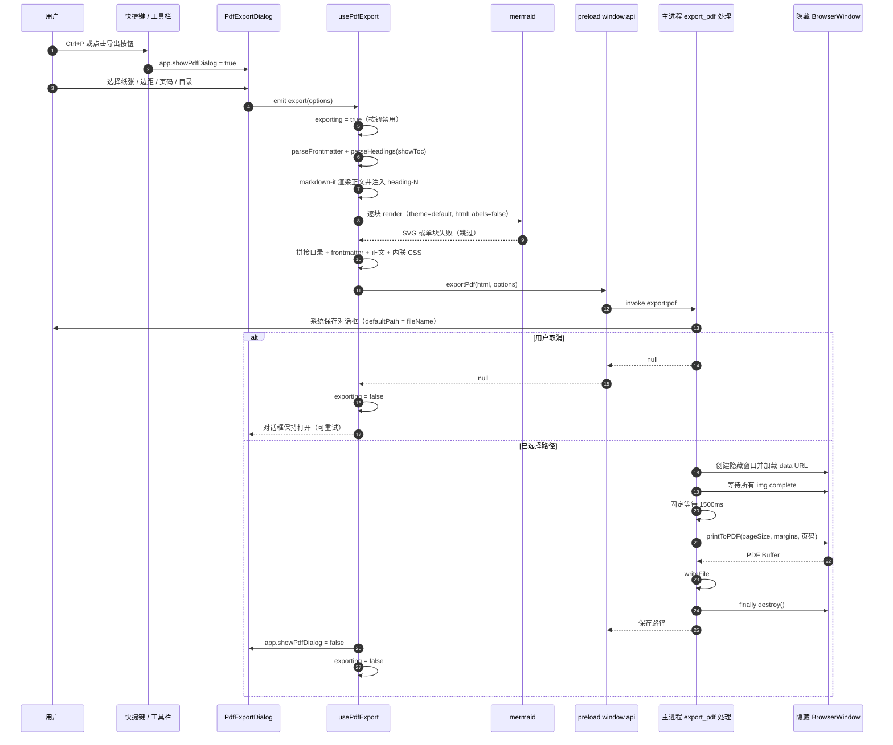

# PDF 导出

本文说明 MarkIt 的 PDF 导出能力：入口、对话框选项、渲染管线、主进程打印流程、与预览管线的同步点、打印样式约定，以及**仍然存在的限制**。文中结论均按当前代码核实，凡 README 描述与实现不一致处，以本文与源码为准。

## 1. 入口与交互

| 入口            | 位置                                                                               | 行为                                                                                                                                                                              |
| --------------- | ---------------------------------------------------------------------------------- | --------------------------------------------------------------------------------------------------------------------------------------------------------------------------------- |
| 快捷键 `Ctrl+P` | [useKeyboardShortcuts.ts](../src/renderer/src/composables/useKeyboardShortcuts.ts) | `isCtrl(e) && !e.shiftKey && e.key === 'p'` 时 `preventDefault()` 并置 `app.showPdfDialog = true`                                                                                 |
| 工具栏按钮      | [Toolbar.vue](../src/renderer/src/components/layout/Toolbar.vue)                   | 按钮 `title="导出 PDF (Ctrl+P)"`，点击同样置 `app.showPdfDialog = true`                                                                                                           |
| 对话框          | [PdfExportDialog.vue](../src/renderer/src/components/export/PdfExportDialog.vue)   | 在 [AppLayout.vue](../src/renderer/src/components/layout/AppLayout.vue) 中挂载，`@export` 交由 `usePdfExport().exportPdf` 执行，异常处 `console.error('PDF export failed:', err)` |

对话框的显示由 Pinia 的 `app.showPdfDialog` 直接控制；`AppLayout` 只额外传入 `exporting`，组件内部不再声明未使用的 `visible` prop。

导出内容取自**当前编辑器内存中的内容**（`editorStore.content`），不读取磁盘文件，因此未保存的修改也会进入 PDF。

导出期间：

- `usePdfExport` 内部置 `exporting = true`，并在函数入口防重入；
- 对话框的「导出」按钮禁用并显示「导出中…」，「取消」与关闭按钮同时禁用，点击遮罩不会关闭；
- 导出完成（成功或取消）后恢复。只在**导出成功**（`window.api.exportPdf` 返回非空路径）时关闭对话框；用户取消保存时对话框保持打开，可修改选项后重试。

对话框底部固定提示「PDF 使用独立的浅色打印样式，不随预览主题变化」，与第 6.1 节的产品约定一致。

## 2. 对话框选项

| 选项         | 控件                      | 默认值     | 可取值                         | 实现                                                                                |
| ------------ | ------------------------- | ---------- | ------------------------------ | ----------------------------------------------------------------------------------- |
| 纸张大小     | `<select>`                | `A4`       | `A4` / `Letter`                | 传给 `printToPDF.pageSize`                                                          |
| 页边距       | `<select>`                | `standard` | `narrow` / `standard` / `wide` | 映射为 `printToPDF.margins`（像素）：40 / 64 / 96                                    |
| 显示页码     | `<input type="checkbox">` | 勾选       | 布尔                           | 开启 `displayHeaderFooter` 并注入页脚模板；关闭时不输出页脚                         |
| 生成目录     | `<input type="checkbox">` | 未勾选     | 布尔                           | 按标题生成目录 HTML 插到正文前，标题带 `heading-N` 锚点                             |
| 默认文件名   | 无输入项                  | 当前文档名 | —                              | 渲染进程按 `activeDoc.name` 派生 `.pdf` 文件名，主进程清洗后作为 `defaultPath`      |

选项类型统一为 [`src/shared/pdf-types.ts`](../src/shared/pdf-types.ts) 的 `PdfExportOptions`，由渲染进程、preload 与主进程共用，不再维护内联重复声明：

```ts
interface PdfExportOptions {
  pageSize: 'A4' | 'Letter'
  margin: 'narrow' | 'standard' | 'wide'
  showPageNumbers: boolean
  showToc: boolean
  fileName: string
}
```

## 3. 渲染管线

### 3.1 渲染进程（usePdfExport）

[usePdfExport.ts](../src/renderer/src/composables/usePdfExport.ts) 在组合式函数创建时初始化一个独立的 `MarkdownIt` 实例（`html: true, linkify: true, breaks: true`），并：

1. 调用 `installHeadingAnchors(md)`：与预览共用同一套 `heading-N` 锚点规则；
2. 安装与预览相同的本地图片规则 `installLocalImageRule`；
3. `parseFrontmatter(editor.content)` 拆分出 frontmatter 条目与正文；
4. `showToc` 为真时用 `parseHeadings(body)` 生成目录（`renderToc`），目录项链接到 `#heading-N`；
5. `renderFrontmatterTable(entries)` 生成「文档信息」表格 HTML；
6. `md.render(body)` 渲染正文，按「目录 → frontmatter 表格 → 正文」拼接；
7. `renderMermaidToSvg(htmlBody)`：把 HTML 放进临时的 `div`，用 `collectMermaidBlocks` 找出 Mermaid 代码块，逐块 `mermaid.render` 后用居中的 `div` 替换 `<pre>`；
8. 套入内联的 HTML 模板（`<!DOCTYPE html>` + `<style>` + `<body>`），所有 CSS 内联，不引用外部资源；
9. `window.api.exportPdf(html, options)` → preload `invoke('export:pdf')`。

PDF 侧的 Mermaid 初始化参数固定为 `startOnLoad: false`、`theme: 'default'`、`securityLevel: 'loose'`、`htmlLabels: false`，并且**每次导出都会重新 `initialize`**（与预览按主题缓存初始化不同）。单块渲染失败时跳过（见 6.2）。

### 3.2 主进程（export:pdf）

[src/main/index.ts](../src/main/index.ts) 中的 `export:pdf` 流程：

1. `dialog.showSaveDialog(mainWindow!, { defaultPath, filters })`：`defaultPath` 由 `options.fileName` 清洗非法字符并补齐 `.pdf`；取消返回 `null`。
2. 创建 `BrowserWindow({ width: 800, height: 1100, show: false, webPreferences: { sandbox: false } })`。
3. `loadURL('data:text/html;charset=utf-8,' + encodeURIComponent(html))` 加载自包含页面。
4. `executeJavaScript` 注入一段 Promise，等待 `document.images` 中所有图片：已 `complete` 的直接放行，否则监听一次 `load` 或 `error`——**加载失败也 resolve**，坏图不会让导出挂死。
5. 额外固定等待 `1500ms`，覆盖布局、SVG 与字体的迟到绘制（上限问题见 6.3）。
6. `printToPDF`：
   - `pageSize` 取 `A4` / `Letter`；
   - `margins` 使用 `marginType: 'custom'`，上下左右按档位取 40 / 64 / 96 像素；开启页码时底部额外增加 18 像素，避免页码压住正文；
   - `displayHeaderFooter` 取 `showPageNumbers`；页脚模板只包含 `.pageNumber` 与 `.totalPages`，页眉模板为空 `<span></span>`；关闭页码时不输出页脚。
7. `writeFile(result.filePath, pdf)`，返回保存路径。
8. **`finally` 中 `pdfWin.destroy()`**：`loadURL` / 打印 / 写盘任一步抛错都不会残留隐藏窗口。

### 3.3 端到端时序



## 4. 与预览管线的同步点

预览与 PDF 是两条独立构建的 markdown-it 管线，[CLAUDE.md](../CLAUDE.md) 要求修改渲染行为时两处同步。当前对齐情况：

| 同步点           | 预览（MarkdownPreview.vue）                                                                          | PDF（usePdfExport.ts）                              | 一致性                              |
| ---------------- | ---------------------------------------------------------------------------------------------------- | --------------------------------------------------- | ----------------------------------- |
| frontmatter      | `parseFrontmatter` + `renderFrontmatterTable`，渲染为「文档信息」表格                                | 同左                                                | 一致                                |
| 本地图片         | `installLocalImageRule` + `resolveImageSrc`，相对路径转 `markit-file://local/?p=<绝对路径>`          | 同左                                                | 一致                                |
| Mermaid 识别     | `collectMermaidBlocks` / 白名单                                                                      | 同左，复用同一模块                                  | 一致                                |
| Mermaid 主题     | 跟随深/浅色（`dark` / `default`）                                                                    | 固定 `default`（浅色）                              | 不一致（PDF 恒为浅色）              |
| Mermaid 失败     | 保留代码块 + `mermaid-error` 提示                                                                    | 跳过，代码块保持原文                                | 不一致（PDF 无提示，见 6.2）        |
| 标题锚点         | `installHeadingAnchors` 注入 `heading-0..N`                                                          | 同左                                                | 一致                                |
| 目录             | 无（由左侧大纲面板承担）                                                                             | `parseHeadings` 生成目录 HTML                       | PDF 独有                            |
| 链接处理         | `handlePreviewLinkClick` 分流：外链走 `shell:openExternal`，本地文件在资源管理器中定位，其余协议忽略 | 无任何点击拦截，`href` 原样输出                     | 不一致                              |
| markdown-it 选项 | `html`、`linkify`、`typographer`、`breaks`                                                           | `html`、`linkify`、`breaks`（**无 `typographer`**） | 轻微不一致（引号/破折号排版不转换） |
| 预览样式         | 由 `styleStore` 注入当前主题 CSS                                                                     | 固定内置浅色模板，不使用任何预览主题 CSS            | 不一致（产品约定，见 6.1）          |

PDF 中链接的具体行为：markdown-it 输出的 `<a href>` 原样保留，模板仅设置颜色 `#0366d6`。相对路径链接不会被转成绝对路径（只有图片经过 `installLocalImageRule` 改写），`file:` 链接也不会被改写；导出后链接是否可点击、点击后打开什么，取决于 PDF 阅读器本身，与预览的分流逻辑无关。因此**不要指望 PDF 内的相对链接可以跳转**；目录锚点在支持页内跳转的阅读器中可直接使用。

## 5. 打印样式约定

样式全部内联在 `usePdfExport` 的模板字符串中，属于固定的**浅色打印样式**，与当前界面主题、预览样式（GitHub / Dark / Academic / Minimal）无关：

| 元素         | 约定                                                                                                                                         |
| ------------ | -------------------------------------------------------------------------------------------------------------------------------------------- |
| `body`       | 字体栈 `-apple-system, BlinkMacSystemFont, 'Segoe UI', system-ui, sans-serif`；前景色 `#222`；行高 `1.7`；`margin: 0; padding: 0`（边距交给 `printToPDF.margins`） |
| `h1`         | `2em`，底部 1px `#ddd` 分隔线，`padding-bottom: 0.3em`                                                                                       |
| `h2`         | `1.5em`，底部 1px `#eee` 分隔线，`padding-bottom: 0.2em`                                                                                     |
| `h3`         | `1.25em`                                                                                                                                     |
| 行内 `code`  | 背景 `#f4f4f4`，`padding: 0.15em 0.4em`，圆角 `3px`，字号 `0.9em`                                                                            |
| `pre`        | 背景 `#f8f8f8`，1px `#e0e0e0` 边框，圆角 `6px`，`padding: 14px 18px`，`overflow-x: auto`                                                     |
| `pre code`   | 透明背景、无内边距                                                                                                                           |
| `blockquote` | 左侧 3px `#ddd` 竖线，`padding: 0.5em 1em`，文字 `#666`，上下外边距 `1em`                                                                    |
| `table`      | `width: 100%`、`border-collapse: collapse`、上下外边距 `1em`                                                                                 |
| `th`         | 背景 `#f6f6f6`、`font-weight: 600`、左对齐、`padding: 8px 12px`、1px `#ddd` 边框                                                             |
| `td`         | `padding: 6px 12px`、1px `#ddd` 边框                                                                                                         |
| frontmatter  | `.frontmatter-title` 12px `#666`；`.fm-key` 宽 160px、等宽字体、12px `#555`；`.fm-value` 保留换行并允许断词                                  |
| 目录         | `.pdf-toc` 生成后分页（`break-after: page`）；标题 18px；h1–h6 按 0 / 16 / 32 / 48 / 64 / 80px 逐级缩进                                     |
| `img`        | `max-width: 100%`（高度自适应）                                                                                                              |
| `a`          | 仅设置颜色 `#0366d6`，下划线沿用浏览器默认                                                                                                   |
| `svg`        | `max-width: 100%`、`height: auto`，Mermaid 图表由外层 `div` 居中并带 `margin: 1em 0`                                                         |

边距只有 `printToPDF.margins` 一个控制点，模板内不再用 `body padding` 重复控制，避免两套边距叠加。模板中**没有 `@page` 规则，也没有 `page-break-*` / `break-inside` 约束**，因此长表格、长代码块与大幅图表可能被分页线切开（见 6.4）。

## 6. 当前限制与后续改进

以下限制已逐条核对代码，不是猜测。

### 6.1 PDF 使用独立浅色打印样式（产品约定）

- 事实：PDF 不注入 `styleStore` 的 CSS，也不读取 `app.previewWidthMode`；深色主题下导出的仍是浅色 PDF。
- 产品决定：保持独立打印样式，避免深色背景在纸张上不可读；界面已在导出对话框中固定提示，README / 文档同步说明。
- 若将来改为「所见即所得」，需要为每套深色预览样式准备浅色打印映射，不能直接注入深色 CSS。

### 6.2 Mermaid 单块失败静默跳过

- 事实：`renderMermaidToSvg` 内单块 `mermaid.render` 失败时 `catch {}`，该代码块以原始文本留在 PDF 中，没有预览里的错误提示。
- 后续：记录错误并在产物中保留可见降级提示（待整改 R-21）。

### 6.3 固定等待 1500ms

- 事实：图片加载完成后仍固定等待 1500ms，不等待 `document.fonts.ready`；长文档可能不足，短文档白等。
- 后续：等待字体与布局稳定，把固定延时改为上限（待整改 R-22）。

### 6.4 无分页控制

- 事实：模板没有 `@page`、`break-inside` / `break-after` 约束（目录的分页除外），长表格、代码块、图表可能被分页线切断。
- 后续：为 `pre` / `table` / `img` / 图表容器增加分页约束（待整改 R-23）。

### 6.5 HTML 经 `data:` URL 加载

- 事实：`encodeURIComponent(html)` 塞入 `data:` URL，没有体积保护；超大文档可能触发 URL 长度 / 内存问题。
- 后续：超大内容改为写临时文件后 `loadFile`，或设置体积上限并提示（待整改 R-24）。

### 6.6 隐藏窗口的沙箱配置

- `sandbox: false`：该页面只加载本地生成的 HTML，但运行在较宽松的沙箱配置下，可评估收紧为默认沙箱。

## 7. 失败与取消路径

| 场景                            | 表现                                                                                                                        |
| ------------------------------- | --------------------------------------------------------------------------------------------------------------------------- |
| 用户在系统保存对话框点取消      | 主进程返回 `null`；`exportPdf` 不会关闭对话框，也不报错，可修改选项后重试                                                   |
| `printToPDF` 或写文件抛错       | 异常经 IPC 传到渲染进程，`AppLayout.onExport` 捕获后 `console.error('PDF export failed:', err)`；无界面提示，对话框保持打开；主进程 `finally` 销毁隐藏窗口 |
| 单个 Mermaid 块渲染失败         | `try/catch` 内跳过，该块在 PDF 中保留为原始代码块，其余图表正常渲染                                                         |
| `mermaid` 动态导入失败          | 整段渲染逻辑静默跳过，所有图表以代码块形式输出                                                                              |
| 图片文件缺失 / 扩展名不在白名单 | `markit-file://` 协议返回错误响应，`img` 触发 `error`，等待逻辑照常 resolve，PDF 中该图位置为空                             |
| 重复点击「导出」                | `usePdfExport` 入口防重入，对话框同时禁用按钮，不会叠加保存对话框                                                           |
| 导出期间点击关闭 / 取消         | 按钮禁用，点击遮罩被忽略，避免对话框状态与导出任务脱节                                                                      |

## 8. 手工验证清单

仓库当前没有测试框架，PDF 属于高风险区域，改动后至少按下列步骤在 `npm run dev` 下验证一次：

1. **基础导出**：打开一篇含标题、段落、列表、表格、代码块、引用、图片的文档，按 `Ctrl+P` 选择 A4 + 标准，确认生成 PDF 且能打开。
2. **分页**：确认长文档跨页正常，观察表格 / 代码块是否被分页线切断（当前预期会切断，属已知限制）。
3. **图片**：相对路径图片在 PDF 中正常显示；故意写一个不存在的路径，确认导出不挂死、其余内容完整。
4. **Mermaid**：流程图、时序图各一张，确认 PDF 中为矢量图且居中；把其中一块改成语法错误，确认只有该块退化为代码块，导出仍成功。
5. **frontmatter**：文首含 `---` 属性的文档，确认首部为「文档信息」表格而非 YAML 原文。
6. **纸张**：切到 Letter 再导出，对比页面尺寸变化。
7. **页边距**：分别用窄 / 标准 / 宽导出，测量正文到纸张边缘的距离，确认三档有可测量差异。
8. **页码**：勾选后每页页脚出现「当前页 / 总页数」，取消后无页脚；页脚不遮挡正文。
9. **目录**：勾选后首屏出现目录并在目录后分页；目录条目点击可跳到对应标题；取消勾选后无目录。
10. **默认文件名**：当前文档为 `示例.md` 时，保存对话框默认文件名为 `示例.pdf`；含非法字符的文档名会被清洗。
11. **加载态 / 防重入**：导出期间「导出」按钮显示「导出中…」且禁用，连续点击不会叠加保存对话框。
12. **取消路径**：在保存对话框点取消，确认应用不崩溃、对话框仍可继续操作；再次导出选择路径可正常完成。
13. **主题**：分别用深色与浅色主题导出，确认两次结果一致（PDF 固定浅色），且对话框有对应提示。
14. **异常恢复**：连续触发 3 次导出失败（例如临时改为无效打印参数），确认进程内不残留隐藏窗口。

## 9. 相关文件

| 文件                                                                                                                | 职责                                                             |
| ------------------------------------------------------------------------------------------------------------------- | ---------------------------------------------------------------- |
| [src/shared/pdf-types.ts](../src/shared/pdf-types.ts)                                                               | `PdfExportOptions` 等跨进程共享类型                              |
| [src/renderer/src/components/export/PdfExportDialog.vue](../src/renderer/src/components/export/PdfExportDialog.vue) | 导出选项对话框（纸张 / 边距 / 页码 / 目录）与加载态              |
| [src/renderer/src/composables/usePdfExport.ts](../src/renderer/src/composables/usePdfExport.ts)                     | PDF 渲染管线、目录生成、Mermaid 转 SVG、内联打印 CSS 模板        |
| [src/renderer/src/utils/headings.ts](../src/renderer/src/utils/headings.ts)                                         | 标题解析与 `heading-N` 锚点（预览 / 大纲 / PDF 共用）            |
| [src/renderer/src/components/layout/AppLayout.vue](../src/renderer/src/components/layout/AppLayout.vue)             | 对话框挂载、`exporting` 绑定与 `exportPdf` 调用、异常兜底        |
| [src/renderer/src/components/layout/Toolbar.vue](../src/renderer/src/components/layout/Toolbar.vue)                 | 工具栏导出入口                                                   |
| [src/renderer/src/composables/useKeyboardShortcuts.ts](../src/renderer/src/composables/useKeyboardShortcuts.ts)     | `Ctrl+P` 快捷键                                                  |
| [src/preload/index.ts](../src/preload/index.ts)                                                                     | `exportPdf` / `saveImage` 的 IPC 暴露与参数类型                  |
| [src/preload/index.d.ts](../src/preload/index.d.ts)                                                                 | `window.api` 类型契约                                            |
| [src/main/index.ts](../src/main/index.ts)                                                                           | `export:pdf`：保存对话框、隐藏窗口、图片等待、`printToPDF`、写盘 |
| [src/renderer/src/utils/frontmatter.ts](../src/renderer/src/utils/frontmatter.ts)                                   | frontmatter 解析与「文档信息」表格生成（预览、PDF 共用）         |
| [src/renderer/src/utils/local-image.ts](../src/renderer/src/utils/local-image.ts)                                   | 本地图片路径解析与 `markit-file://` 改写（预览、PDF 共用）       |
| [src/renderer/src/utils/mermaid.ts](../src/renderer/src/utils/mermaid.ts)                                           | Mermaid 代码块识别（PDF 复用同一白名单）                         |
| [docs/Mermaid图表与导出.md](Mermaid图表与导出.md)                                                                   | 图表识别、交互与导出细节                                         |
