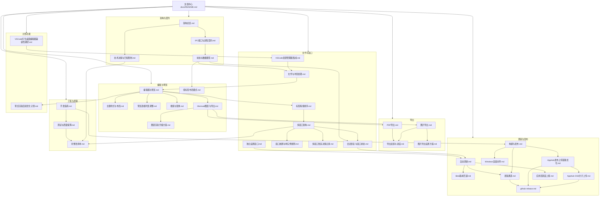

# MarkIt 文档中心

本文档中心是 MarkIt（仓库 `mark-it`）的**全量工程文档入口**，覆盖架构、进程契约、数据模型、核心功能、构建发布、开发规范与质量保障。文档按主题分目录存放，根目录只保留本索引。

- 适用版本：`1.5.0`（stable）/ `1.6.0-beta.11`（beta）
- 适用分支：`develop`（主分支为 `master`）
- 最后核对：2026-11-13
- 文档语言：中文；图表统一使用 Mermaid，不使用 ASCII 字符画

> 文档与代码不一致时，以代码为准；发现偏差请先更新文档，再调整实现（见 [开发指南](./工程与质量/开发指南.md) 的完成定义）。

## 1. 目录结构

| 目录                        | 内容                                                                    | 什么时候看                              |
| --------------------------- | ----------------------------------------------------------------------- | --------------------------------------- |
| [架构与契约](./架构与契约/) | 架构总览、IPC 契约、状态与数据模型、技术决策与已知限制                  | 接手仓库、新增 IPC / 状态、评估设计取舍 |
| [文件与窗口](./文件与窗口/) | 文件读写与冲突、会话恢复、多窗口、窗口放置、设置窗口、标签、VSCode 集成 | 改文件链路、会话、窗口或标签行为        |
| [编辑与预览](./编辑与预览/) | 编辑器、预览管线、主题布局、搜索替换、Mermaid 与图表方案                | 改编辑体验、预览渲染或主题              |
| [导出](./导出/)             | PDF、长图导出、导出反馈与进度、图片导出设置                             | 改任一条导出管线或导出交互              |
| [更新与发布](./更新与发布/) | 自动更新、双通道发版、Beta 回退、构建打包、安装向导、AppHub 上传        | 改更新逻辑或执行发版                    |
| [工程与质量](./工程与质量/) | 开发指南、测试与质量保障、待整改清单                                    | 新人上手、提交前验证、排期整改          |
| [计划功能](./计划功能/)     | 尚未实施的方案与调研稿                                                  | 规划下一步工作、评估新方向              |
| [assets](./assets/)         | 设置页原型 HTML 与截图等文档配图                                        | 查看设计原型或引用配图                  |

## 2. 文档地图

## 3. 按角色阅读

### 3.1 第一次参与本仓库

1. [开发指南](./工程与质量/开发指南.md) —— 环境、命令、目录、编码约定、常见任务手册
2. [架构总览](./架构与契约/架构总览.md) —— 进程模型、模块职责、启动时序、关键数据流
3. [IPC 接口与进程契约](./架构与契约/IPC接口与进程契约.md) —— 渲染进程能做什么、不能做什么
4. [状态与数据模型](./架构与契约/状态与数据模型.md) —— 文档状态放在哪、如何持久化
5. [测试与质量保障](./工程与质量/测试与质量保障.md) —— 改完怎么验证

### 3.2 修改文件读写 / 会话 / 窗口

1. [文件与冲突处理](./文件与窗口/文件与冲突处理.md) —— 打开、保存、监听、冲突判定
2. [会话恢复与窗口状态](./文件与窗口/会话恢复与窗口状态.md) —— 重启恢复、窗口尺寸、缩放、关闭守卫
3. [状态与数据模型](./架构与契约/状态与数据模型.md) —— `diskContent`、会话结构、localStorage 键
4. [窗口放置与单实例规则](./文件与窗口/窗口放置与单实例规则.md) —— 多显示器归属、重复打开、未来窗口的强制检查项

### 3.3 修改预览 / 图表 / 导出 / 设置

1. [编辑器与预览](./编辑与预览/编辑器与预览.md) —— markdown-it 管线、frontmatter、本地图片、链接分流
2. [预览表格列宽调整](./编辑与预览/预览表格列宽调整.md) —— 拖动交互、表标识、列宽存档与 GFM 兼容边界
3. [Mermaid 图表与导出](./编辑与预览/Mermaid图表与导出.md) —— 语言识别、渲染、缩放、SVG/PNG
4. [图表渲染升级方案](./编辑与预览/图表渲染升级方案.md) —— Pele 首选、Mermaid 回退、主题 token 与阶段规划
5. [PDF 导出](./导出/PDF导出.md) —— 自包含 HTML、隐藏窗口打印、当前限制
6. [图片导出](./导出/图片导出.md) —— 当前文档长图、预览主题、隐藏窗口截图与尺寸限制
7. [导出反馈与进度](./导出/导出反馈与进度.md) —— 对话框收束、阶段百分比、IPC 隔离与性能边界
8. [主题样式与布局](./编辑与预览/主题样式与布局.md) —— 预览样式注册、主题解析、布局
9. [独立设置窗口](./文件与窗口/独立设置窗口.md) —— 分类布局、系统窗口按键、跨窗口同步与多窗口预留
10. [窗口放置与单实例规则](./文件与窗口/窗口放置与单实例规则.md) —— 导出选项或预览窗口独立化时必须遵守的放置与复用规则
11. [图片导出设置方案](./导出/图片导出设置方案.md) —— 格式、宽度、倍率、主题、Frontmatter 与设置持久化

### 3.4 修改更新 / 发版

1. [自动更新](./更新与发布/自动更新.md) —— 状态机、apphub、双通道检测、多窗口安装协调
2. [发版通道与 Beta 更新](./更新与发布/发版通道.md) —— 双通道版本规则、发版节点记录、Beta 开关语义
3. [构建与发布](./更新与发布/构建与发布.md) —— 构建产物、打包配置、CI 流水线
4. [Windows 安装向导](./更新与发布/Windows安装向导.md) —— 安装路径、快捷方式选项、静默升级与卸载行为
5. [GitHub Actions 发版说明](./更新与发布/github-release.md) —— apphub CLI 详细操作（存量文档）
6. [AppHub 发布上传链路优化](./更新与发布/AppHub发布上传链路优化.md) —— 并行上传、OSS 分片、macOS 分架构与 GitHub Release 产物命名；分架构流程待下一次 Beta 验证
7. [AppHub OSS 分片上传](./更新与发布/AppHub%20OSS分片上传.md) —— 多分片并行、进度、重试与中止的落地边界和已验证范围
8. [应用活跃度上报](./更新与发布/应用活跃度上报.md) —— 设备活跃口径、事件时机、离线队列、密钥注入与隐私边界

### 3.5 需要理解「为什么这样设计」

1. [技术决策与已知限制](./架构与契约/技术决策与已知限制.md) —— 决策记录与未实现能力
2. [架构总览](./架构与契约/架构总览.md) —— 边界与不变量
3. [多窗口改造决策记录](./文件与窗口/多窗口改造决策记录.md) —— 多窗口改造时的评估、取舍与最终落地结论

### 3.6 需要排期整改

1. [待整改清单](./工程与质量/待整改清单.md) —— P0/P1/P2 分级、验收标准与建议执行批次
2. [测试与质量保障](./工程与质量/测试与质量保障.md) —— 整改后的手工验证矩阵与回归清单

### 3.7 修改标签 / 多窗口

1. [标签拖拽排序](./文件与窗口/标签拖拽排序.md) —— 已实现的窗口内排序交互、数据流与测试
2. [多窗口架构](./文件与窗口/多窗口架构.md) —— 编辑窗口注册表、会话/几何 v2、标签迁移、退出与更新协调
3. [多窗口改造决策记录](./文件与窗口/多窗口改造决策记录.md) —— 改造时的评估、取舍与最终落地结论
4. [窗口放置与单实例规则](./文件与窗口/窗口放置与单实例规则.md) —— 触发窗口所在显示器、已有窗口只激活不移动

### 3.8 修改 Beta 回退

1. [Beta 版本回退到正式版](./更新与发布/Beta版本回退.md) —— 用户主动回退的状态机、IPC 契约、持久化兼容、平台边界与验证要求

### 3.9 修改 VSCode 资源管理器集成

1. [VSCode 资源管理器集成](./文件与窗口/VSCode资源管理器集成.md) —— 右键用 MarkIt 打开、VSCode 检测、扩展安装与卸载、IPC 契约与安全边界
2. [VS Code 衍生桌面编辑器兼容性调研](./计划功能/VSCode衍生桌面编辑器兼容性调研.md) —— Cursor、VSCodium、Windsurf / Devin、Trae、Kiro 的扩展兼容、安装渠道与落地建议

### 3.10 修改搜索与替换

1. [搜索与替换](./编辑与预览/搜索与替换.md) —— 精确匹配口径、编辑区 / 预览区两条高亮链路、循环导航 HUD、替换与已知限制

## 4. 文档清单

### 4.1 架构与契约

| 文档                                                     | 定位                                                       | 主要读者                         |
| -------------------------------------------------------- | ---------------------------------------------------------- | -------------------------------- |
| [架构总览](./架构与契约/架构总览.md)                     | 产品定位、技术栈、进程模型、模块职责、启动时序、关键数据流 | 全体                             |
| [技术决策与已知限制](./架构与契约/技术决策与已知限制.md) | 决策记录（D1–D15）与当前未实现能力                         | 维护者、评审者                   |
| [IPC 接口与进程契约](./架构与契约/IPC接口与进程契约.md)  | 全部 IPC 通道、参数、返回值、事件推送、三处同步清单        | 主进程 / 预加载 / 渲染进程开发者 |
| [状态与数据模型](./架构与契约/状态与数据模型.md)         | Pinia、非响应式 Map、localStorage、userData 文件、共享类型 | 前端开发者                       |

### 4.2 文件与窗口

| 文档                                                          | 定位                                                             | 主要读者                        |
| ------------------------------------------------------------- | ---------------------------------------------------------------- | ------------------------------- |
| [文件与冲突处理](./文件与窗口/文件与冲突处理.md)              | 打开/保存/另存为/刷新、文件监听、冲突矩阵、差异展示、关闭流程    | 文件相关开发者                  |
| [会话恢复与窗口状态](./文件与窗口/会话恢复与窗口状态.md)      | 会话快照与恢复、窗口尺寸、缩放、单实例与关闭守卫                 | 主进程 / 会话相关开发者         |
| [多窗口架构](./文件与窗口/多窗口架构.md)                      | 编辑窗口注册表、会话/几何 v2、标签迁移、退出与更新协调           | 主进程 / 会话 / 更新开发者      |
| [多窗口改造决策记录](./文件与窗口/多窗口改造决策记录.md)      | 多窗口改造时的架构评估、方案比较、最终结论与实施回顾             | 维护者、评审者                  |
| [窗口放置与单实例规则](./文件与窗口/窗口放置与单实例规则.md)  | 多显示器窗口放置、全局单实例复用、导出窗口分类与新增窗口检查清单 | 主进程 / UI / 导出 / 更新开发者 |
| [独立设置窗口](./文件与窗口/独立设置窗口.md)                  | 设置窗口入口、窗口规格、IPC、状态同步、更新安装转交与多窗口预留  | 主进程 / 设置相关开发者         |
| [标签拖拽排序](./文件与窗口/标签拖拽排序.md)                  | 标签排序交互、插入位置计算、store 变更、顺序持久化与测试         | 前端开发者                      |
| [VSCode 资源管理器集成](./文件与窗口/VSCode资源管理器集成.md) | VSCode 检测、右键打开、扩展安装与卸载、IPC 契约与安全边界        | 维护者、主进程 / 设置相关开发者 |

### 4.3 编辑与预览

| 文档                                                    | 定位                                                                  | 主要读者              |
| ------------------------------------------------------- | --------------------------------------------------------------------- | --------------------- |
| [编辑器与预览](./编辑与预览/编辑器与预览.md)            | CodeMirror 集成、工具栏、快捷键、大纲、预览管线、滚动同步             | 编辑器 / 预览开发者   |
| [主题样式与布局](./编辑与预览/主题样式与布局.md)        | 主题解析、预览样式注册、自定义 CSS、布局与标题栏、滚动条              | UI 开发者             |
| [按标签布局模式](./编辑与预览/按标签布局模式.md)        | 布局按标签保存的方案、数据模型、继承规则与兼容处理                    | 状态 / 会话相关开发者 |
| [预览表格列宽调整](./编辑与预览/预览表格列宽调整.md)    | 列宽交互、表标识、比例重分配、存档模型与兼容性边界                    | 预览开发者            |
| [搜索与替换](./编辑与预览/搜索与替换.md)                | 精确匹配口径、搜索上下文、编辑器 / 预览高亮、循环导航 HUD、替换与限制 | 编辑器 / 预览开发者   |
| [Mermaid 图表与导出](./编辑与预览/Mermaid图表与导出.md) | 语言标记白名单、渲染与错误处理、缩放、弹窗、图片导出                  | 预览开发者            |
| [图表渲染升级方案](./编辑与预览/图表渲染升级方案.md)    | Pele 首选、Mermaid 回退、统一主题、尺寸策略与阶段 3 规划              | 预览开发者、维护者    |

### 4.4 导出

| 文档                                           | 定位                                                            | 主要读者                 |
| ---------------------------------------------- | --------------------------------------------------------------- | ------------------------ |
| [PDF 导出](./导出/PDF导出.md)                  | 导出对话框、自包含 HTML、打印流程、限制与改进建议               | 导出开发者               |
| [图片导出](./导出/图片导出.md)                 | 当前文档长图、主题渲染、整页截图、尺寸预算与错误恢复            | 导出开发者               |
| [导出反馈与进度](./导出/导出反馈与进度.md)     | 对话框收束、阶段进度、状态栏呈现、IPC 隔离与性能边界            | 导出 / UI / 主进程开发者 |
| [图片导出设置方案](./导出/图片导出设置方案.md) | 第二版导出设置、页内对话框、持久化、JPEG 与动态宽度的设计与验收 | 导出开发者、产品与评审者 |

### 4.5 更新与发布

| 文档                                                              | 定位                                                               | 主要读者                 |
| ----------------------------------------------------------------- | ------------------------------------------------------------------ | ------------------------ |
| [自动更新](./更新与发布/自动更新.md)                              | 更新状态机、apphub 通道、双通道检测、强制更新、双窗口安装协作      | 更新相关开发者           |
| [发版通道与 Beta 更新](./更新与发布/发版通道.md)                  | 双通道模型、严格单序列版本规则、发版节点记录、客户端 Beta 开关     | 维护者、更新相关开发者   |
| [Beta 版本回退到正式版](./更新与发布/Beta版本回退.md)             | 用户主动回退的状态机、IPC 契约、持久化兼容、平台边界与验证要求     | 维护者、更新相关开发者   |
| [构建与发布](./更新与发布/构建与发布.md)                          | 命令、构建架构、打包配置、产物命名、CI 流水线                      | 维护者、发版者           |
| [Windows 安装向导](./更新与发布/Windows安装向导.md)               | 交互式安装流程、安装路径与快捷方式选项、静默升级、自定义 NSIS 脚本 | 维护者、发版者           |
| [GitHub Actions 发版说明](./更新与发布/github-release.md)         | apphub CLI 详细操作、Secrets、故障排查（存量文档）                 | 发版者                   |
| [AppHub 发布上传链路优化](./更新与发布/AppHub发布上传链路优化.md) | 并行上传、OSS 分片、macOS 分架构、GitHub Release 产物命名          | 维护者、发版与 CI 开发者 |
| [AppHub OSS 分片上传](./更新与发布/AppHub%20OSS分片上传.md)       | 多分片并行、进度、重试、中止、权限边界与已验证范围                 | 维护者、发版与 CI 开发者 |
| [应用活跃度上报](./更新与发布/应用活跃度上报.md)                  | 设备活跃口径、事件时机、离线队列、密钥注入、重试与隐私边界         | 主进程与发版开发者       |

### 4.6 工程与质量

| 文档                                             | 定位                                                               | 主要读者             |
| ------------------------------------------------ | ------------------------------------------------------------------ | -------------------- |
| [开发指南](./工程与质量/开发指南.md)             | 环境、目录速查、编码约定、常见任务操作手册、DoD                    | 新成员、全体开发者   |
| [测试与质量保障](./工程与质量/测试与质量保障.md) | 当前测试状态、手工验证矩阵、发版回归清单、Vitest / Playwright 分工 | 全体开发者           |
| [待整改清单](./工程与质量/待整改清单.md)         | P0/P1/P2 问题、影响、位置、验收标准与执行批次                      | 维护者、排期与评审者 |

### 4.7 计划功能

| 文档                                                                             | 定位                                                                     | 主要读者                   |
| -------------------------------------------------------------------------------- | ------------------------------------------------------------------------ | -------------------------- |
| [VS Code 衍生桌面编辑器兼容性调研](./计划功能/VSCode衍生桌面编辑器兼容性调研.md) | Top 5 衍生编辑器调研、扩展机制、兼容矩阵、VSIX / Open VSX 方案与验证计划 | 维护者、产品与兼容性验证者 |
| [预览渲染后续优化计划](./计划功能/预览渲染后续优化计划.md)                       | 增量渲染与 Worker 渲染的背景、方案比较、阶段拆分与前置条件               | 预览开发者、维护者         |

## 5. 阅读约定

1. **代码引用**：文档中的路径均为相对仓库根目录的链接；关键实现标注函数名或模块名，避免行号漂移。
2. **现状 vs 设计**：文档描述的是**当前代码行为**；未实现或未生效的能力会明确标注「限制」，不与设计意图混淆。
3. **品牌写法**：界面、文档、更新提示统一写 `MarkIt`；安装包、可执行文件、快捷方式使用 `productName` 的 `Mark It`（见 [技术决策与已知限制](./架构与契约/技术决策与已知限制.md) 与 `rules/branding.md`）。
4. **改名禁令**：`com.harley.markit`、`mark-it`、`markit-file://`、`markit-*` 存储键、更新端点与 appKey 均不得顺手修改，原因见 `rules/branding.md`。
5. **图表规范**：所有架构图、流程图、时序图、状态机、关系图使用 `mermaid` 代码块。

## 6. 维护方式

- **目录约定**：新增文档放入 `docs/` 下对应主题目录，不直接在 `docs/` 根目录新增文档；跨多个主题的新能力先确定主目录，再在相关文档中互相引用。新增主题目录时同步更新本索引第 1、4 节。
- 所有业务改动：先更新 `docs/`（新能力写设计文档，已有功能改对应功能文档），再写代码（`rules/base.md` 第 4 节）。
- 实现偏离设计：先更新对应文档，再改代码。
- 新增 IPC / 数据结构 / 交互设计：同步更新 [IPC 接口与进程契约](./架构与契约/IPC接口与进程契约.md) 与 [状态与数据模型](./架构与契约/状态与数据模型.md)。
- 新增预览能力：同时检查 [编辑器与预览](./编辑与预览/编辑器与预览.md)、[Mermaid 图表与导出](./编辑与预览/Mermaid图表与导出.md)、[PDF 导出](./导出/PDF导出.md) 与 [图片导出](./导出/图片导出.md)，三条输出管线共享 Markdown 规则但使用各自目标样式。
- 新增任何用户可见 `BrowserWindow`：必须按 [窗口放置与单实例规则](./文件与窗口/窗口放置与单实例规则.md) 明确窗口作用域、触发窗口、重复打开行为与多显示器验收项；页内对话框和隐藏任务窗口也要在功能文档中显式归类。
- 修复问题：在 [待整改清单](./工程与质量/待整改清单.md) 中勾选对应编号，并在提交信息中引用；验收后再更新状态。
- `docs/计划功能/` 存放**尚未实施**的方案与评估稿；实施时改写为正式功能文档，移入对应主题目录，并同步更新本索引与相关功能文档。
- 文档配图统一放在 `docs/assets/`，正文使用相对路径引用。
- 文档不进入安装包（`electron-builder.yml` 已排除 `docs/` 与 `scripts/`）。
