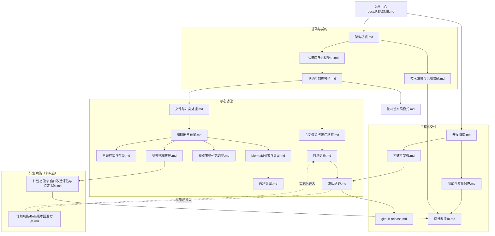

# MarkIt 文档中心

本文档中心是 MarkIt（仓库 `mark-it`）的**全量工程文档入口**，覆盖架构、进程契约、数据模型、核心功能、构建发布、开发规范与质量保障。

- 适用版本：`1.4.1`
- 适用分支：`develop`（主分支为 `master`）
- 最后核对：2026-11-06
- 文档语言：中文；图表统一使用 Mermaid，不使用 ASCII 字符画

> 文档与代码不一致时，以代码为准；发现偏差请先更新文档，再调整实现（见 [开发指南](./开发指南.md) 的完成定义）。

## 1. 文档地图

## 2. 按角色阅读

### 2.1 第一次参与本仓库

1. [开发指南](./开发指南.md) —— 环境、命令、目录、编码约定、常见任务手册
2. [架构总览](./架构总览.md) —— 进程模型、模块职责、启动时序、关键数据流
3. [IPC 接口与进程契约](./IPC接口与进程契约.md) —— 渲染进程能做什么、不能做什么
4. [状态与数据模型](./状态与数据模型.md) —— 文档状态放在哪、如何持久化
5. [测试与质量保障](./测试与质量保障.md) —— 改完怎么验证

### 2.2 修改文件读写 / 会话 / 窗口

1. [文件与冲突处理](./文件与冲突处理.md) —— 打开、保存、监听、冲突判定
2. [会话恢复与窗口状态](./会话恢复与窗口状态.md) —— 重启恢复、窗口尺寸、缩放、关闭守卫
3. [状态与数据模型](./状态与数据模型.md) —— `diskContent`、会话结构、localStorage 键

### 2.3 修改预览 / 图表 / 导出

1. [编辑器与预览](./编辑器与预览.md) —— markdown-it 管线、frontmatter、本地图片、链接分流
2. [预览表格列宽调整](./预览表格列宽调整.md) —— 拖动交互、表标识、列宽存档与 GFM 兼容边界
3. [Mermaid 图表与导出](./Mermaid图表与导出.md) —— 语言识别、渲染、缩放、SVG/PNG
4. [PDF 导出](./PDF导出.md) —— 自包含 HTML、隐藏窗口打印、当前限制
5. [主题样式与布局](./主题样式与布局.md) —— 预览样式注册、主题解析、布局

### 2.4 修改更新 / 发版

1. [自动更新](./自动更新.md) —— 状态机、apphub、双通道检测、双窗口安装流程
2. [发版通道与 Beta 更新](./发版通道.md) —— 双通道版本规则、发版节点记录、Beta 开关语义
3. [构建与发布](./构建与发布.md) —— 构建产物、打包配置、CI 流水线
4. [GitHub Actions 发版说明](./github-release.md) —— apphub CLI 详细操作（存量文档）

### 2.5 需要理解「为什么这样设计」

1. [技术决策与已知限制](./技术决策与已知限制.md) —— 决策记录与未实现能力
2. [架构总览](./架构总览.md) —— 边界与不变量

### 2.6 需要排期整改

1. [待整改清单](./待整改清单.md) —— P0/P1/P2 分级、验收标准与建议执行批次
2. [测试与质量保障](./测试与质量保障.md) —— 整改后的手工验证矩阵与回归清单

### 2.7 修改标签 / 规划多窗口

1. [标签拖拽排序](./标签拖拽排序.md) —— 已实现的窗口内排序交互、数据流与测试
2. [多窗口改造评估与待定事项](./计划功能/多窗口改造评估与待定事项.md) —— 多窗口目标架构、会话 v2、拖出协议、同步适配与未决事项

### 2.8 规划 Beta 回退

1. [Beta 版本回退到正式版方案](./计划功能/Beta版本回退方案.md) —— Beta 用户主动回退的可行性、状态机、IPC 契约、规则边界与测试计划

## 3. 文档清单

| 文档                                           | 定位                                                               | 主要读者                         |
| ---------------------------------------------- | ------------------------------------------------------------------ | -------------------------------- |
| [架构总览](./架构总览.md)                      | 产品定位、技术栈、进程模型、模块职责、启动时序、关键数据流         | 全体                             |
| [技术决策与已知限制](./技术决策与已知限制.md)  | 决策记录（D1–D13）与当前未实现能力                                 | 维护者、评审者                   |
| [IPC 接口与进程契约](./IPC接口与进程契约.md)   | 全部 IPC 通道、参数、返回值、事件推送、三处同步清单                | 主进程 / 预加载 / 渲染进程开发者 |
| [状态与数据模型](./状态与数据模型.md)          | Pinia、非响应式 Map、localStorage、userData 文件、共享类型         | 前端开发者                       |
| [文件与冲突处理](./文件与冲突处理.md)          | 打开/保存/另存为/刷新、文件监听、冲突矩阵、差异展示、关闭流程      | 文件相关开发者                   |
| [会话恢复与窗口状态](./会话恢复与窗口状态.md)  | 会话快照与恢复、窗口尺寸、缩放、单实例与关闭守卫                   | 主进程 / 会话相关开发者          |
| [编辑器与预览](./编辑器与预览.md)              | CodeMirror 集成、工具栏、快捷键、大纲、预览管线、滚动同步          | 编辑器 / 预览开发者              |
| [主题样式与布局](./主题样式与布局.md)          | 主题解析、预览样式注册、自定义 CSS、布局与标题栏、滚动条           | UI 开发者                        |
| [按标签布局模式](./按标签布局模式.md)          | 布局按标签保存的方案、数据模型、继承规则与兼容处理                 | 状态 / 会话相关开发者            |
| [Mermaid 图表与导出](./Mermaid图表与导出.md)   | 语言标记白名单、渲染与错误处理、缩放、弹窗、图片导出               | 预览开发者                       |
| [预览表格列宽调整](./预览表格列宽调整.md)      | 列宽交互、表标识、比例重分配、存档模型与兼容性边界                 | 预览开发者                       |
| [标签拖拽排序](./标签拖拽排序.md)              | 标签排序交互、插入位置计算、store 变更、顺序持久化与测试           | 前端开发者                       |
| [多窗口改造评估与待定事项](./计划功能/多窗口改造评估与待定事项.md) | 多窗口目标架构、会话 v2、拖出协议、同步适配、未决事项与建议（计划功能） | 维护者、评审者                   |
| [Beta 版本回退到正式版方案](./计划功能/Beta版本回退方案.md) | Beta 用户主动回退的可行性、状态机、IPC 契约、规则边界与测试计划（计划功能） | 维护者、更新相关开发者           |
| [PDF 导出](./PDF导出.md)                       | 导出对话框、自包含 HTML、打印流程、限制与改进建议                  | 导出开发者                       |
| [自动更新](./自动更新.md)                      | 更新状态机、apphub 通道、双通道检测、强制更新、双窗口安装协作      | 更新相关开发者                   |
| [发版通道与 Beta 更新](./发版通道.md)          | 双通道模型、严格单序列版本规则、发版节点记录、客户端 Beta 开关     | 维护者、更新相关开发者           |
| [构建与发布](./构建与发布.md)                  | 命令、构建架构、打包配置、产物命名、CI 流水线                      | 维护者、发版者                   |
| [GitHub Actions 发版说明](./github-release.md) | apphub CLI 详细操作、Secrets、故障排查（存量文档）                 | 发版者                           |
| [开发指南](./开发指南.md)                      | 环境、目录速查、编码约定、常见任务操作手册、DoD                    | 新成员、全体开发者               |
| [测试与质量保障](./测试与质量保障.md)          | 当前测试状态、手工验证矩阵、发版回归清单、Vitest / Playwright 分工 | 全体开发者                       |
| [待整改清单](./待整改清单.md)                  | P0/P1/P2 问题、影响、位置、验收标准与执行批次                      | 维护者、排期与评审者             |

## 4. 阅读约定

1. **代码引用**：文档中的路径均为相对仓库根目录的链接；关键实现标注函数名或模块名，避免行号漂移。
2. **现状 vs 设计**：文档描述的是**当前代码行为**；未实现或未生效的能力会明确标注「限制」，不与设计意图混淆。
3. **品牌写法**：界面、文档、更新提示统一写 `MarkIt`；安装包、可执行文件、快捷方式使用 `productName` 的 `Mark It`（见 [技术决策与已知限制](./技术决策与已知限制.md) 与 `rules/branding.md`）。
4. **改名禁令**：`com.harley.markit`、`mark-it`、`markit-file://`、`markit-*` 存储键、更新端点与 appKey 均不得顺手修改，原因见 `rules/branding.md`。
5. **图表规范**：所有架构图、流程图、时序图、状态机、关系图使用 `mermaid` 代码块。

## 5. 维护方式

- 所有业务改动：先更新 `docs/`（新能力写设计文档，已有功能改对应功能文档），再写代码（`rules/base.md` 第 4 节）。
- 实现偏离设计：先更新对应文档，再改代码。
- 新增 IPC / 数据结构 / 交互设计：同步更新 [IPC 接口与进程契约](./IPC接口与进程契约.md) 与 [状态与数据模型](./状态与数据模型.md)。
- 新增预览能力：同时检查 [编辑器与预览](./编辑器与预览.md)、[Mermaid 图表与导出](./Mermaid图表与导出.md) 与 [PDF 导出](./PDF导出.md)，预览与 PDF 是两条独立管线。
- 修复问题：在 [待整改清单](./待整改清单.md) 中勾选对应编号，并在提交信息中引用；验收后再更新状态。
- `docs/计划功能/` 存放**尚未实施**的方案与评估稿；实施时改写为正式功能文档并移回 `docs/`，同步更新本索引与相关功能文档。
- 文档不进入安装包（`electron-builder.yml` 已排除 `docs/` 与 `scripts/`）。
