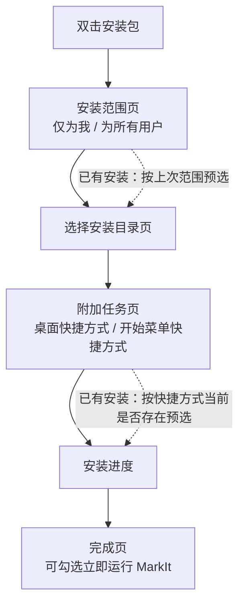

# Windows 安装向导

> 文档定位：说明 MarkIt Windows 安装包（NSIS）的交互式安装流程、安装路径与快捷方式选项、静默升级行为和自定义脚本实现。面向构建、发版与维护安装包的维护者。
> 相关配置见 [`electron-builder.yml`](../electron-builder.yml)，自定义脚本见 [`build/installer.nsh`](../build/installer.nsh)，整体打包说明见 [构建与发布](./构建与发布.md)。

## 1. 背景与目标

早期安装包沿用 electron-builder 的 **one-click** 模式：双击安装包后不经任何询问，直接安装到 `%LOCALAPPDATA%\Programs\Mark It`，并强制创建桌面快捷方式。用户既无法选择安装路径，也无法决定是否创建桌面 / 开始菜单快捷方式。

现在改为**交互式安装向导**（assisted installer），目标如下：

| 目标                        | 实现方式                                                                 |
| --------------------------- | ------------------------------------------------------------------------ |
| 可选安装路径                | `nsis.oneClick: false` + `nsis.allowToChangeInstallationDirectory: true` |
| 可选安装范围                | 保留 electron-builder 自带的「仅为我安装 / 为所有用户安装」页            |
| 可选桌面 / 开始菜单快捷方式 | `build/installer.nsh` 自定义「附加任务」页                               |
| 不破坏自动更新              | 静默升级路径按升级前的实际状态重建快捷方式，见第 3 节                    |
| 不改品牌与更新契约          | `appId`、`productName`、更新端点、`markit-*` 键均保持不变                |

不适用范围：macOS（dmg / zip）与 Linux（AppImage / deb）的安装方式不变；不提供「安装完成后迁移目录」能力。

## 2. 安装流程



- 安装范围页由 electron-builder 提供（`perMachine` 未固定时自动出现）。选择「为所有用户安装」会触发 UAC 提权，默认安装目录随之变为 `Program Files`。
- 选择安装目录页会校验目录末尾是否包含应用子目录；留空或只选父目录时，安装程序会自动追加 `Mark It` 子目录。
- 附加任务页的两个复选框默认勾选；已有安装时按快捷方式**当前是否存在**预选，用户此前的删除操作会被尊重。
- 完成页保留「运行 MarkIt」选项（`nsis.runAfterFinish` 默认开启）。

## 3. 快捷方式策略

| 场景                                  | 行为                                                                                                 |
| ------------------------------------- | ---------------------------------------------------------------------------------------------------- |
| 全新安装（交互）                      | 「桌面快捷方式」「开始菜单快捷方式」默认勾选，按用户选择创建                                         |
| 覆盖安装 / 重装（交互）               | 按快捷方式当前是否存在决定默认值；取消勾选会删除同名快捷方式                                         |
| 首次静默安装（`installer.exe /S`）    | 无交互页面，默认创建两种快捷方式（与旧版 one-click 行为一致）                                        |
| 静默升级（自动更新 / `/S --updated`） | 在卸载旧版本**之前**记录快捷方式是否存在，安装完成后按记录重建；用户此前删除的快捷方式不会被重新创建 |
| 卸载                                  | 删除安装程序创建的桌面与开始菜单快捷方式；带 `--keep-shortcuts` 参数时跳过删除（升级流程使用）       |
| 安装包带 `--no-desktop-shortcut` 参数 | 即使勾选也不创建桌面快捷方式（保留 electron-builder 原语义）                                         |

快捷方式名称沿用 `nsis.shortcutName`（即 `productName`：`Mark It`），不读取或改写任何 `markit-*` 持久化键。

## 4. 实现

### 4.1 electron-builder 配置

```yaml
nsis:
  oneClick: false
  allowToChangeInstallationDirectory: true
  allowElevation: true
  # 快捷方式由 build/installer.nsh 按用户勾选创建，关闭内置创建
  createDesktopShortcut: false
  createStartMenuShortcut: false
  include: installer.nsh
```

- `createDesktopShortcut` / `createStartMenuShortcut` 设为 `false` 会向 NSIS 注入 `DO_NOT_CREATE_DESKTOP_SHORTCUT` / `DO_NOT_CREATE_START_MENU_SHORTCUT`，同时关闭 electron-builder 内置的**创建**与内置卸载器的**删除**逻辑；两部分都改由自定义脚本接管，避免卸载残留。
- `include` 相对于 `directories.buildResources`（即 `build/`）解析。
- 不设置 `perMachine`：保留安装范围选择页。若将来固定为 `perMachine: true/false`，该页会消失，但安装路径与快捷方式页不受影响。

### 4.2 自定义脚本 `build/installer.nsh`

脚本通过 electron-builder 提供的四个宏接入安装生命周期：

| 宏                         | 时机                      | 职责                                                                   |
| -------------------------- | ------------------------- | ---------------------------------------------------------------------- |
| `customInit`               | `.onInit`，卸载旧版本之前 | 读取注册表判断是否存在旧安装，记录两种快捷方式的当前存在状态作为默认值 |
| `customPageAfterChangeDir` | 安装目录页之后            | 插入自定义「附加任务」页（`nsDialogs` 复选框）                         |
| `customInstall`            | 文件复制与注册表写入之后  | 按勾选结果创建或删除快捷方式，并刷新资源管理器                         |
| `customUnInstall`          | 卸载器删除文件之前        | 非 `--keep-shortcuts` 时删除快捷方式与空的开始菜单目录                 |

实现要点：

1. **不重复实现 electron-builder 的内置宏**：内置 `addDesktopLink` / `addStartMenuLink` 在编译期按配置决定是否创建，无法感知运行时勾选，因此改为关闭内置行为后自行创建。
2. **静默升级取升级前状态**：`customInit` 在旧版本卸载之前执行，此时用 `${FileExists}` 检查 `$newDesktopLink` / `$newStartMenuLink`，结果保存在脚本变量中；静默升级不显示页面，直接复用该状态。
3. **卸载对称**：`customUnInstall` 使用卸载器 `setLinkVars` 计算出的 `$oldDesktopLink` / `$oldStartMenuLink` 删除同名快捷方式，并清理注册表中记录的 `MenuDirectory`（当前未配置菜单目录时为无操作）。
4. **编码**：脚本含中文界面文案，文件必须保存为 **UTF-8 with BOM**；NSIS 3 依据 BOM 判断 UTF-8 源文件，缺少 BOM 会按系统 ANSI 代码页解析导致乱码。
5. **页面在自动更新时跳过**：页面创建函数检测到 `${isUpdated}` 时直接 `Abort`，与 electron-builder 对安装目录页的处理保持一致。

### 4.3 与自动更新的关系

- electron-updater 调用 NSIS 安装包时使用静默参数，不显示任何页面；`customInit` 与 `customInstall` 仍会执行，因此升级后快捷方式状态与升级前一致。
- 旧的 `mark-it-ev-updater` 缓存目录、`publish.url`、`appId` 均不受本次改动影响。
- 差异更新（`.blockmap`）只替换应用文件，不改变安装器脚本；快捷方式逻辑随版本安装包更新。

## 5. 验证方式

| ID    | 验证项             | 操作步骤                                                                                     | 预期结果                                                                             |
| ----- | ------------------ | -------------------------------------------------------------------------------------------- | ------------------------------------------------------------------------------------ |
| MV-39 | 交互安装与路径选择 | 运行 `mark-it-<版本>-setup.exe`；在安装范围页选「仅为我」；目录页改为 `D:\tmp\MarkItInstall` | 无 UAC；安装到指定目录；应用可启动；快捷方式按勾选创建                               |
| MV-40 | 快捷方式勾选       | 分别测试：a) 全勾选；b) 只勾开始菜单；c) 全不勾选；每次安装后检查桌面与开始菜单              | 与勾选完全一致；全不勾选时仍可从安装目录或开始菜单搜索启动                           |
| MV-41 | 静默升级保持状态   | 安装时只勾开始菜单；用新版本安装包执行 `setup.exe /S`；再手动删除开始菜单快捷方式后重复一次  | 第一次静默升级不新增桌面快捷方式；手动删除后再次静默升级不会重新创建被删除的快捷方式 |
| MV-42 | 卸载清理           | 安装后执行卸载（保留快捷方式与删除快捷方式两种前置状态）；检查桌面、开始菜单与安装目录       | 快捷方式被清理，安装目录无残留；用户数据目录按既有规则保留                           |

构建侧最低要求：`npm run build:win` 成功生成安装包（验证 NSIS 脚本可编译），并按上表执行一次交互安装与卸载。

## 6. 已知限制

1. 自定义页面文案固定为中文，与 `nsis.installerLanguages: zh_CN` 一致；若将来新增安装语言，需要把文案迁移到 `LangString`。
2. 快捷方式状态通过「升级前文件是否存在」推断，不额外写入注册表标记；用户在升级过程中手动创建 / 删除快捷方式属于边缘场景，以升级开始时的状态为准。
3. 「取消勾选即删除同名快捷方式」按名称匹配，若用户把指向其他程序的快捷方式改成 `Mark It.lnk`，覆盖安装时会被删除，属于可接受的约定。
