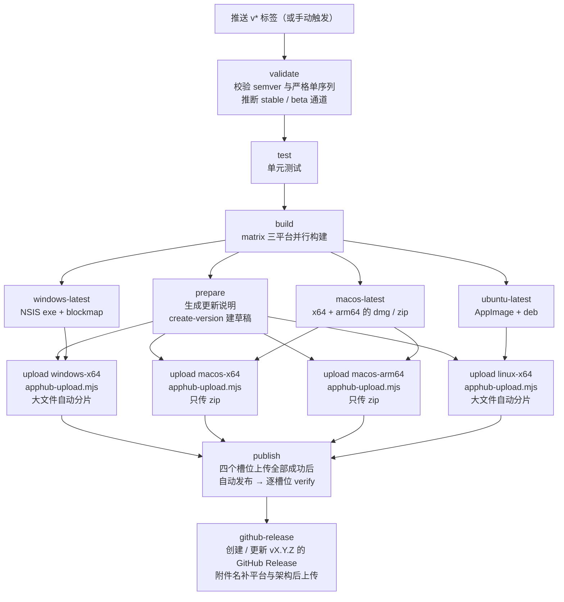

# GitHub Actions 发版说明

本文档说明 Mark It 如何通过 GitHub Actions 完成 Windows / macOS / Linux 三平台并行打包与并行上传 apphub、自动发布验证，并把同一批产物同步到对应版本的 GitHub Release。

适用仓库：[Harley-xk/mark-it](https://github.com/Harley-xk/mark-it)

## 1. 总体流程



发布没有人工审批环节：草稿上传完成后立即对客户端可见；GitHub Release 在 apphub 发布并验证通过后生成。`prepare` 只执行一次且不下载产物；四个 `upload` job（Windows x64、macOS x64、macOS arm64、Linux x64）使用 `fail-fast: false` 并行运行，某个平台失败不会取消其他槽位，但 `publish` 仍要求四个槽位全部成功。上传默认使用 `multipart=auto`，超过 64 MiB 的安装包和 blockmap 走 OSS 分片；单次上传兼容问题可显式切换为 `multipart=off`。

## 2. 前置条件

- 仓库 Actions 已启用（公开仓库默认启用）
- 仓库 Secrets 已配置：
  - `APPHUB_USERNAME`
  - `APPHUB_PASSWORD`
  - `APPHUB_SIGN_SECRET`

Secrets 只在 workflow 运行时注入，不写入仓库文件。

## 3. 推荐发版步骤（标签触发）

```bash
# 1. 切到主分支并同步
git checkout master
git pull origin master

# 2. 更新版本号（只改 package.json / package-lock.json，不自动建 tag）
npm version 1.4.0 --no-git-tag-version

# 3. 提交版本变更
git add package.json package-lock.json
git commit -m "chore(release): 发布 1.4.0"

# 4. 打 tag 并推送，触发 workflow
git tag v1.4.0
git push origin master v1.4.0
```

版本号必须是 semver：`MAJOR.MINOR.PATCH`，可带 `-beta.1` 后缀。通道由版本号自动推断：含 `-` 走 `beta`，否则走 `stable`。版本号必须满足严格单序列（任何新版本大于所有已发布版本），规则与发版节点见 [发版通道与 Beta 更新](./发版通道.md)。

推送 tag 后：

- 版本号 = tag 去掉 `v` 前缀
- 更新说明自动生成：取**上一个同通道 tag** 到当前提交之间的 commit 标题（过滤 `chore(release)`）；没有 tag 时退回到上一个 `chore(release)` 提交；再没有则取最近 10 条
- 构建完成后自动发布，无需任何确认

### 3.0 Beta 发版

beta 与正式版走同一条流水线，只是通道与配置不同：

```bash
node scripts/release/channel-state.mjs status   # 确认两个通道的节点

npm version 1.6.0-beta.1 --no-git-tag-version
git add package.json package-lock.json
git commit -m "chore(release): 发布 1.6.0-beta.1"
git tag v1.6.0-beta.1
git push origin master v1.6.0-beta.1
```

发布规则：

1. beta 的 base 必须严格大于最后一个正式版：`1.5.0` 之后只能从 `1.5.1-beta.1` 或 `1.6.0-beta.1` 开始；
2. 同一 base 内递增 `beta.N`；换 base 从 `beta.1` 重新开始；
3. beta 线打开期间不能再发更低的正式版；紧急修复进 beta 线并尽快发布正式版；
4. beta 版本的 GitHub Release 自动标记为 prerelease，不会被当作 latest。

> **注意**：自动生成的是 commit 标题，含技术细节，只能作为素材。正式发版前必须按 [3.1 更新说明撰写规则](#31-更新说明撰写规则) 提炼，并通过第 4 节手动触发传入 `notes`；不要在说明未整理的情况下直接推送 tag 发布。

### 3.1 更新说明撰写规则

更新说明面向**最终用户**，不是提交日志。自动生成的 commit 标题只作为素材，**不得直接对外发布**。

**按通道收集**：beta 的说明只覆盖上一次 beta 之后的改动；正式版的说明必须覆盖自上一次正式版以来的**全部**用户可感知变化，天然包含其间所有 beta 的提交，不能只写最后一个 beta 的增量。

1. **范围按「是否对用户有价值」确定**：不局限于可见的界面变化——新增能力、交互与行为变化、性能 / 稳定性 / 兼容性等体验改善、影响使用的问题修复都应写入；纯内部且对用户没有价值的清理可以不写。**技术实现细节一律不写**：文件名、函数名、模块名、IPC 通道名、依赖版本、CI 与重构实现等，具体见下一条。
2. **去除技术细节**：不出现文件名、函数名、模块名、IPC 通道名、整改编号（如 `R-06`）、依赖版本、构建参数等实现信息；用用户能理解的产品语言描述结果。
3. **合并同类项**：同一功能的多个提交合并为一条；一次发版控制在 3–8 条，每条一句话，以「新增 / 优化 / 修复」开头。
4. **修复类写清影响**：说明用户此前遇到什么现象、现在如何，不描述内部原因与实现方式。
5. **不承诺未验证的能力**：尚未人工验收的改动（如整改清单中 🟡 状态的条目）不得写成已完成的卖点；平台限制（macOS 未签名、Linux deb 不自更新等）不在更新说明中重复。
6. **与 GitHub Release 保持一致**：`notes` 同时用于 apphub 更新弹窗与 GitHub Release 正文，需为纯文本，不使用 Markdown 标题、链接与代码块（客户端按纯文本渲染，见 [自动更新 · 更新说明的渲染方式](./自动更新.md#92-更新说明的渲染方式)）。

**推荐流程**：

```bash
# 1. 整理素材：上一版发布提交到当前 HEAD 的提交标题
git log --oneline --no-merges <上一个发布提交>..HEAD

# 2. 按上述规则提炼为 3–8 条用户语言

# 3. 手动触发发版并传入 notes（不要依赖自动生成后直接发布）
gh workflow run release.yml --ref master \
  -f version=1.5.0 \
  -f notes="- 新增：……
- 优化：……
- 修复：……"
```

示例（素材 → 可发布的更新说明）：

| 提交标题（素材，不直接发布）                                         | 更新说明（用户语言）                                       |
| -------------------------------------------------------------------- | ---------------------------------------------------------- |
| `fix(app): 完成 P2 整改，增强 PDF 健壮性并引入测试体系（R-21~R-31）` | `修复：PDF 长文档分页、图片与图表渲染更稳定`               |
| `feat(preview): 对齐 GitHub 渲染规范并新增代码高亮`                  | `优化：预览渲染对齐 GitHub 规范，代码块新增语法高亮`       |
| `feat(file): 文件变更被动刷新，保存时检测冲突并展示差异`             | `新增：文件被外部修改时自动刷新，保存前提示冲突并对比差异` |

## 4. 手动触发

适用于不想打 tag、或想自定义更新说明的场景；更新说明必须按 [3.1 更新说明撰写规则](#31-更新说明撰写规则) 提炼后传入。

网页：Actions → `Release` → Run workflow，填写参数。

命令行：

```bash
gh workflow run release.yml --ref master \
  -f version=1.4.0 \
  -f multipart=auto \
  -f notes="- 新增格式工具栏
- 修复标签页残留"
```

参数说明：

| 参数        | 必填           | 说明                                                                   |
| ----------- | -------------- | ---------------------------------------------------------------------- |
| `version`   | 是（手动触发） | 手动触发时必填；标签触发时取标签名去掉 `v`                             |
| `notes`     | 否             | 更新说明；留空按第 3 节自动生成，自动结果仅作素材，发布前须按 3.1 提炼 |
| `force`     | 否             | `true` 标记为强制更新                                                  |
| `replace`   | 否             | `true` 时替换已存在的平台包，仅用于重跑同一版本                        |
| `multipart` | 否             | OSS 上传模式；默认 `auto`（大文件分片），`off` 时全部回退单次 `PUT`    |

无需传通道参数：`validate` 阶段根据版本号是否含预发布后缀选择 `stable` / `beta`，并自动切换到对应的发版配置 `.apphub-release.ci.json` / `.apphub-release.beta.ci.json`。

`multipart=auto` 按单个文件大小判断：超过阈值的安装包或 blockmap 使用分片，否则委托原 `apphub.mjs upload` 单次上传。大文件遇到权限、分片或完成失败时直接失败，不会自动降级；确认兼容问题后重新运行时显式选择 `multipart=off`。

## 5. 流水线阶段与产物

| 平台            | Runner           | 构建命令                                              | 上传到 apphub               | 上传到 GitHub Release                    |
| --------------- | ---------------- | ----------------------------------------------------- | --------------------------- | ---------------------------------------- |
| Windows x64     | `windows-latest` | `npm run build:win`                                 | `*-setup.exe` + `.blockmap` | `*-windows-x64-setup.exe` + `.blockmap`               |
| macOS x64       | `macos-latest`   | `npm run build && electron-builder --mac --x64`     | `*-x64.zip` + `.blockmap`   | `*-macos-x64.dmg`、`*-macos-x64.zip` + `.blockmap`    |
| macOS arm64     | `macos-latest`   | `npm run build && electron-builder --mac --arm64`   | `*-arm64.zip` + `.blockmap` | `*-macos-arm64.dmg`、`*-macos-arm64.zip` + `.blockmap` |
| Linux x64       | `ubuntu-latest`  | `npm run build && electron-builder --linux`         | `*.AppImage` + `.blockmap`  | `*-linux-x64.AppImage` + `.blockmap`、`*-linux-x64.deb` |

说明：

- `build` 阶段的 workflow artifact 仍保留 14 天，作为构建缓存与排障副本；GitHub Release 附件是长期分发的正式产物。
- CI 的 macOS 构建任务用 `npx electron-builder --mac --x64 --arm64` 一次产出两套 dmg / zip；上传阶段拆成 `macos-x64` 与 `macos-arm64` 两个独立 job，分别登记到 apphub 的对应架构槽位。
- macOS 自动更新（Squirrel.Mac）只接受 zip，dmg 仅用于首次安装；更新平台只上传 zip，dmg 只进入 GitHub Release。
- apphub 要求 macOS 包名与登记架构一致：`arm64` 包必须包含 `arm64`，`x64` 包不得包含 `arm64`；当前 `${arch}` 命名满足该约束。
- 平台级 `latest-mac.yml` 会聚合 x64 与 arm64 条目，electron-updater ≥ 6.8.8 按本机架构筛选；本项目依赖下限已固定为 6.8.8。
- Linux 只有 AppImage 支持自动更新，deb 供手动安装。
- `snap` 已从默认 target 移除（GitHub 托管 runner 无 snapcraft）。
- GitHub Release 的正文复用 `prepare` 阶段生成的更新说明；`1.4.0-beta.1` 这类带后缀的版本会标记为 prerelease，不会被当作 latest。
- 四个平台 / 架构槽位的安装包由独立 `upload` job 并行上传；每个 job 只下载并处理对应的 workflow artifact。
- 上传入口为 `scripts/release/apphub-upload.mjs`，默认 `multipart=auto`；macOS zip 等大文件会显示分片、字节进度、速度和 ETA。
- GitHub Release 附件在上传前统一重命名为 `<name>-<version>-<platform>-<arch>.<ext>`，方便用户手动选择；apphub 侧仍使用 electron-builder 原始文件名。
- `multipart=off` 只回退文件传输方式，不改变 AppHub 认证、版本、包登记、发布与验证接口，也不会删除已上传对象。
- beta 版本的产物路径、上传平台与命名规则与正式版完全一致，只是写入 `beta` 通道；客户端是否接收由用户开关决定（见 [发版通道与 Beta 更新](./发版通道.md)）。

## 6. 安全约束

发版凭据（`.apphub-release.json`）**绝不能打进安装包**。项目通过两层防护：

1. [electron-builder.yml](../electron-builder.yml) 的 `files` 排除：

   ```yaml
   - '!.apphub-release*.json'
   - '!scripts'
   - '!scripts/**'
   - '!docs'
   - '!docs/**'
   - '!rules'
   - '!rules/**'
   - '!CLAUDE.md'
   ```

2. workflow 在每个平台构建后检查 `app.asar`，发现 `apphub-release` 或 `signSecret` 立即失败，阻断上传。扫描按 `find -print0` 逐条处理并引用路径，避免 macOS 产物路径中的空格（`Mark It.app`）导致漏检。

本地新增其他含密钥的文件时，务必同步加入 `files` 排除，或放进已被排除的目录。

## 7. 日常操作

### 查看运行

```bash
gh run list --workflow=release.yml
gh run watch
gh run view <run-id> --log
```

### 查看双通道发版节点

```bash
node scripts/release/channel-state.mjs status
```

输出两个通道各自的最后节点、自那以后的提交数与建议的下一个版本。发版前先跑一次，确认没有漏收录的提交：

```bash
# 校验版本是否满足严格单序列
node scripts/release/channel-state.mjs validate --version 1.6.0-beta.2

# 查看某个通道的上一个节点（更新说明收集起点）
node scripts/release/channel-state.mjs previous-tag --channel beta --version 1.6.0-beta.2
```

如果某个 tag 已创建但发布被放弃，必须先删除该 tag，再发下一个版本；否则下一个版本会从失败的 tag 开始收集，漏掉这段提交：

```bash
git tag -d v1.6.0-beta.3
git push origin :refs/tags/v1.6.0-beta.3
```

### GitHub Release 产物同步

`github-release` 任务在 apphub 发布并验证通过后执行，行为如下：

- 标签触发：Release 使用已推送的 `vX.Y.Z` tag
- 手动触发且尚无 tag：自动在当次运行的提交上补建 `vX.Y.Z` tag 后再建 Release
- Release 已存在（重跑）：刷新标题与更新说明，并用 `--clobber` 覆盖同名附件
- 附件为当次四套平台 / 架构产物（Windows x64、macOS x64、macOS arm64、Linux x64 的 exe / dmg / zip / AppImage / deb 及 blockmap）
- 附件名在上传前统一补上平台与架构，例如 `mark-it-1.6.0-macos-arm64.zip`、`mark-it-1.6.0-windows-x64-setup.exe`

该任务只使用 workflow 内置的 `GITHUB_TOKEN`（job 级 `permissions: contents: write`），不需要额外 Secrets。

### 重跑同一版本

同一版本已有草稿时会自动复用；如果平台包槽位已存在，会报 `300400002`。重新触发时勾选 `replace`：

```bash
gh workflow run release.yml --ref master \
  -f version=1.4.0 \
  -f replace=true \
  -f multipart=auto
```

**注意**：替换已发布版本的包只影响新下载 / 新安装；已安装客户端按版本号判断，不会重新下载。

### 修改已发布版本的说明或强制标记

```bash
# 读取本地 .apphub-release.json（含凭据）
node scripts/release/apphub.mjs update-version \
  --version 1.4.0 \
  --notes "- 新的更新说明" \
  --force true
```

若使用 `.apphub-release.ci.json`，需同时用环境变量 `APPHUB_USERNAME` / `APPHUB_PASSWORD` / `APPHUB_SIGN_SECRET` 提供凭据。

### 下线版本

```bash
node scripts/release/apphub.mjs offline --version 1.4.0
```

下线是终态操作：客户端会回退看到次新的已发布版本，执行前请确认。

### 撤回已发布平台包

```bash
node scripts/release/apphub.mjs remove-package --version 1.4.0 --platform windows --arch x64
```

该平台会回退到更早的有包版本；执行前请确认。

## 8. 本地发版（备用）

CI 不可用时仍可在本机发版。本地使用仓库根目录下被 gitignore 的 `.apphub-release.json`（含凭据），不要提交。

本地发 beta 需要把配置里的 `channel` 改为 `beta`（另存为 `.apphub-release.beta.json` 并通过 `--config` 指定，或临时修改后改回）。`upload` 子命令只读配置里的 channel，不支持 `--channel`，只改命令行参数会导致安装包被上传到 stable。

```bash
# 连通性自检
node scripts/release/apphub.mjs status

# 构建
npm run build:win

# 建草稿
node scripts/release/apphub.mjs create-version \
  --version 1.4.0 --title "v1.4.0" --notes="- 更新说明"

# 上传；默认 multipart=auto，超过 64 MiB 自动分片
node scripts/release/apphub-upload.mjs upload \
  --version 1.4.0 --platform windows --arch x64 \
  --file dist/mark-it-1.4.0-setup.exe \
  --blockmap dist/mark-it-1.4.0-setup.exe.blockmap \
  --multipart auto

# 发布
node scripts/release/apphub.mjs publish --version 1.4.0

# 验证
node scripts/release/apphub.mjs verify \
  --expect 1.4.0 --platform windows --arch x64
```

macOS / Linux 本地构建分别使用 `npm run build:mac`、`npm run build:linux`，上传参数按第 5 节产物约定替换。

macOS 本地发版需要两个架构分别上传；`npm run build:mac` 只产出当前主机架构，建议直接执行：

```bash
# 同时产出 Intel 与 Apple Silicon 包
npm run build && npx electron-builder --mac --x64 --arm64

# 分别登记到 apphub 的对应槽位（zip 用于更新，dmg 只随 GitHub Release 分发）
node scripts/release/apphub-upload.mjs upload \
  --version 1.6.0 --platform macos --arch x64 \
  --file dist/mark-it-1.6.0-x64.zip \
  --blockmap dist/mark-it-1.6.0-x64.zip.blockmap \
  --multipart auto

node scripts/release/apphub-upload.mjs upload \
  --version 1.6.0 --platform macos --arch arm64 \
  --file dist/mark-it-1.6.0-arm64.zip \
  --blockmap dist/mark-it-1.6.0-arm64.zip.blockmap \
  --multipart auto
```

## 9. Secrets 配置与轮换

网页：仓库 Settings → Secrets and variables → Actions → New repository secret。

命令行：

```bash
gh secret set APPHUB_USERNAME --repo Harley-xk/mark-it
gh secret set APPHUB_PASSWORD --repo Harley-xk/mark-it
gh secret set APPHUB_SIGN_SECRET --repo Harley-xk/mark-it
```

命令会提示输入值（不会回显）。轮换 apphub 账号密码后，重新执行以上命令覆盖即可，无需改代码。

## 10. 平台限制

- **macOS 签名**：当前未配置 Apple Developer 证书与公证。未签名应用会被 Gatekeeper 拦截，Squirrel.Mac 也不会执行自动更新；启用签名前 macOS 只能手动安装。
- **macOS 架构**：x64 与 arm64 分别打包、分别上传。apphub 要求包名与登记架构一致（arm64 包含 `arm64`，x64 不含 `arm64`），dmg / zip 均由 `${arch}` 命名；平台级 `latest-mac.yml` 聚合两种架构，客户端需要 electron-updater ≥ 6.8.8 才能按本机架构筛选。
- **Linux 自动更新**：仅 AppImage 支持；deb 供手动安装。
- **Windows**：未配置代码签名证书，安装时可能出现 SmartScreen 提示；自动更新与 blockmap 差分正常。
- **首次多平台发布**：需确认 `verify` 对 `windows x64`、`macos x64`、`macos arm64`、`linux x64` 均返回通过，以验证 apphub 更新端点的平台与架构支持。

## 11. 故障排查

| 现象 / 错误码                              | 含义                                 | 处理                                                                            |
| ------------------------------------------ | ------------------------------------ | ------------------------------------------------------------------------------- |
| `401 签名校验失败`                         | 签名密钥缺失或错误                   | 检查 `APPHUB_SIGN_SECRET`                                                       |
| `401` 且重登仍失败                         | 账号或权限问题                       | 核对 `APPHUB_USERNAME` / `APPHUB_PASSWORD`                                      |
| `300300002`                                | 版本号非 semver                      | 修正版本号后重跑                                                                |
| `300300003`                                | 通道内版本号重复                     | 草稿会自动复用；已发布则递增版本号                                              |
| `validate` 提示版本不大于已发布版本        | 违反严格单序列，或想复用已存在版本号 | 按 [发版通道](./发版通道.md) 递增版本；同版本重跑用 `replace`，不要改版本号绕过 |
| `validate` 提示 beta base 不大于最后正式版 | beta 版本号选错了 base               | 改用大于最后一个正式版的 base，例如 `1.5.1-beta.1`                              |
| `300300005`                                | 发布校验失败（无可用包）             | 至少一个非 web 平台 upload 成功后再发布                                         |
| `300400002`                                | 平台 / 架构槽位重复                  | 重跑时勾选 `replace`                                                            |
| `300400003`                                | 框架产物缺失                         | 检查 electron sha512 与 `latest.yml` 是否一致                                   |
| `300400007`                                | `--replace` 指向的槽位不存在         | 适配入口会自动按新增包继续；`multipart=off` 时去掉 `replace` 后重跑              |
| multipart 初始化 / 分片 / 完成返回 403     | STS 缺少 OSS multipart 权限          | 核对服务端最小权限；确认兼容问题后显式使用 `multipart=off` 重跑                 |
| multipart 分片持续无进展                   | 跨境链路停滞或连接质量差             | 查看分片号与重试日志；必要时以 `multipart=off` 对照，或进入线路优化评估         |
| `verify` 返回无更新                        | 发布未生效 / 通道停用                | 核对版本状态与通道状态后重验                                                    |
| macOS 发布提示包名架构不符                 | 文件名缺少 `arm64`，或 x64 包误含 `arm64` | 确认 dmg / zip 使用 `${arch}` 命名，x64 与 arm64 分别上传                  |
| 构建失败                                   | 依赖、签名或平台工具问题             | 查看对应 matrix job 日志；mac/linux 首次运行重点关注                            |

## 12. 相关文件

| 文件                                                                      | 作用                                                                   |
| ------------------------------------------------------------------------- | ---------------------------------------------------------------------- |
| [.github/workflows/release.yml](../.github/workflows/release.yml)         | 三平台构建、四槽位并行上传 apphub、发布验证、同步 GitHub Release       |
| [scripts/release/apphub.mjs](../scripts/release/apphub.mjs)               | apphub 上游 CLI 技能快照（零依赖，不得修改）                           |
| [scripts/release/apphub-upload.mjs](../scripts/release/apphub-upload.mjs) | 上传适配入口：单次 / 分片选择、STS、包登记                             |
| [scripts/release/oss-multipart.mjs](../scripts/release/oss-multipart.mjs) | OSS 分片计划、签名、并发、重试、进度、完成与中止                       |
| [scripts/release/channel-state.mjs](../scripts/release/channel-state.mjs) | 双通道发版节点查询、版本校验与建议                                     |
| [.apphub-release.ci.json](../.apphub-release.ci.json)                     | CI 使用的 stable 无凭据配置（baseUrl / appKey / channel）              |
| [.apphub-release.beta.ci.json](../.apphub-release.beta.ci.json)           | CI 使用的 beta 无凭据配置                                              |
| [docs/发版通道.md](./发版通道.md)                                         | 双通道模型、版本号规则、发版节点与 Beta 开关语义                       |
| [docs/AppHub发布上传链路优化.md](./AppHub发布上传链路优化.md)             | 并行上传、macOS 分架构与 GitHub Release 产物命名                       |
| [docs/AppHub OSS分片上传.md](./AppHub%20OSS分片上传.md)                   | OSS 分片上传适配层边界、协议与验收记录                                 |
| [electron-builder.yml](../electron-builder.yml)                           | 三平台打包配置与凭据文件排除                                           |
| `.apphub-release.json`                                                    | 本地发版凭据（gitignore，不提交）                                      |
