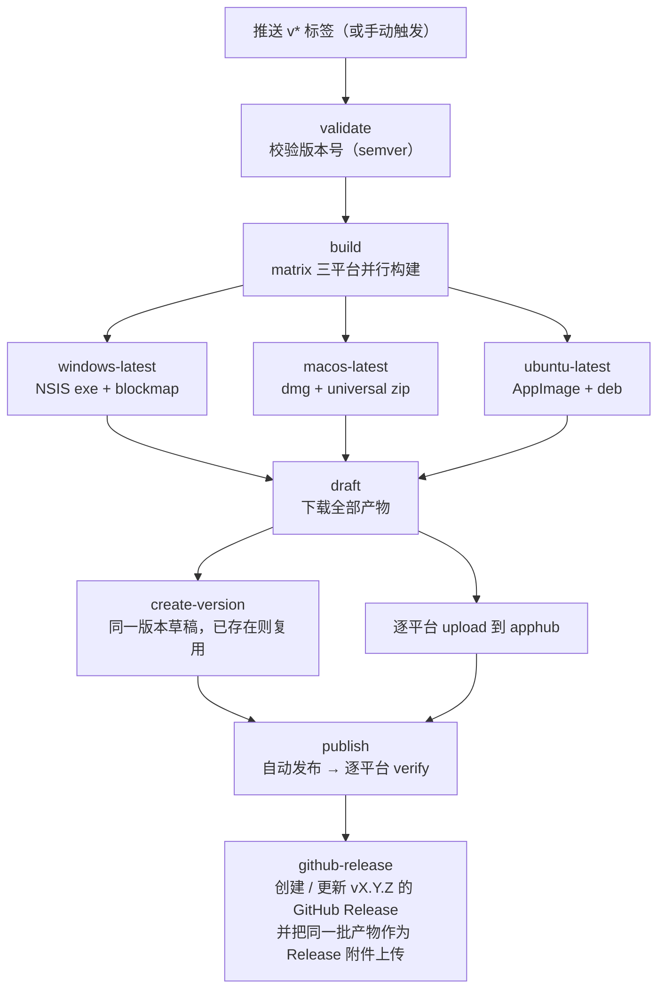

# GitHub Actions 发版说明

本文档说明 Mark It 如何通过 GitHub Actions 完成 Windows / macOS / Linux 三平台并行打包、上传 apphub 自动发布，并把同一批产物同步到对应版本的 GitHub Release。

适用仓库：[Harley-xk/mark-it](https://github.com/Harley-xk/mark-it)

## 1. 总体流程



发布没有人工审批环节：草稿上传完成后立即对客户端可见；GitHub Release 在 apphub 发布并验证通过后生成。

## 2. 前置条件

- 仓库 Actions 已启用（公开仓库默认启用）
- 仓库 Secrets 已配置：
  - `APPHUB_USERNAME`
  - `APPHUB_PASSWORD`
  - `APPHUB_SIGN_SECRET`

Secrets 只在 workflow 运行时注入，不写入仓库文件。

## 3. 推荐发版步骤（标签触发）

```bash
# 1. 切到主分支并同步
git checkout master
git pull origin master

# 2. 更新版本号（只改 package.json / package-lock.json，不自动建 tag）
npm version 1.4.0 --no-git-tag-version

# 3. 提交版本变更
git add package.json package-lock.json
git commit -m "chore(release): 发布 1.4.0"

# 4. 打 tag 并推送，触发 workflow
git tag v1.4.0
git push origin master v1.4.0
```

版本号必须是 semver：`MAJOR.MINOR.PATCH`，可带 `-beta.1` 后缀。

推送 tag 后：

- 版本号 = tag 去掉 `v` 前缀
- 更新说明自动生成：取上一个 tag 到当前提交之间的 commit 标题（过滤 `chore(release)`）；没有 tag 时退回到上一个 `chore(release)` 提交；再没有则取最近 10 条
- 构建完成后自动发布，无需任何确认

## 4. 手动触发

适用于不想打 tag、或想自定义更新说明的场景。

网页：Actions → `Release` → Run workflow，填写参数。

命令行：

```bash
gh workflow run release.yml --ref master \
  -f version=1.4.0 \
  -f notes="- 新增格式工具栏
- 修复标签页残留"
```

参数说明：

| 参数      | 必填           | 说明                                            |
| --------- | -------------- | ----------------------------------------------- |
| `version` | 是（手动触发） | 手动触发时必填；标签触发时取标签名去掉 `v`      |
| `notes`   | 否             | 更新说明，留空则按第 3 节规则自动生成           |
| `force`   | 否             | `true` 标记为强制更新                           |
| `replace` | 否             | `true` 时替换已存在的平台包，仅用于重跑同一版本 |

## 5. 流水线阶段与产物

| 平台            | Runner           | 构建命令                                              | 上传到 apphub               | 上传到 GitHub Release                    |
| --------------- | ---------------- | ----------------------------------------------------- | --------------------------- | ---------------------------------------- |
| Windows x64     | `windows-latest` | `npm run build:win`                                   | `*-setup.exe` + `.blockmap` | `*-setup.exe` + `.blockmap`              |
| macOS universal | `macos-latest`   | `npm run build && electron-builder --mac --universal` | `*-universal.zip`           | `.dmg` + `*-universal.zip` + `.blockmap` |
| Linux x64       | `ubuntu-latest`  | `npm run build && electron-builder --linux`           | `*.AppImage` + `.blockmap`  | `*.AppImage` + `.blockmap` + `.deb`      |

说明：

- `build` 阶段的 workflow artifact 仍保留 14 天，作为构建缓存与排障副本；GitHub Release 附件是长期分发的正式产物。
- macOS 自动更新（Squirrel.Mac）只接受 zip，dmg 仅用于首次安装。
- Linux 只有 AppImage 支持自动更新，deb 供手动安装。
- `snap` 已从默认 target 移除（GitHub 托管 runner 无 snapcraft）。
- GitHub Release 的正文复用 `draft` 阶段生成的更新说明；`1.4.0-beta.1` 这类带后缀的版本会标记为 prerelease，不会被当作 latest。

## 6. 安全约束

发版凭据（`.apphub-release.json`）**绝不能打进安装包**。项目通过两层防护：

1. [electron-builder.yml](../electron-builder.yml) 的 `files` 排除：

   ```yaml
   - '!.apphub-release*.json'
   - '!scripts'
   - '!scripts/**'
   ```

2. workflow 在每个平台构建后检查 `app.asar`，发现 `apphub-release` 或 `signSecret` 立即失败，阻断上传。

本地新增其他含密钥的文件时，务必同步加入 `files` 排除，或放进已被排除的目录。

## 7. 日常操作

### 查看运行

```bash
gh run list --workflow=release.yml
gh run watch
gh run view <run-id> --log
```

### GitHub Release 产物同步

`github-release` 任务在 apphub 发布并验证通过后执行，行为如下：

- 标签触发：Release 使用已推送的 `vX.Y.Z` tag
- 手动触发且尚无 tag：自动在当次运行的提交上补建 `vX.Y.Z` tag 后再建 Release
- Release 已存在（重跑）：刷新标题与更新说明，并用 `--clobber` 覆盖同名附件
- 附件为当次三平台全部产物（exe / dmg / zip / AppImage / deb 及 blockmap）

该任务只使用 workflow 内置的 `GITHUB_TOKEN`（job 级 `permissions: contents: write`），不需要额外 Secrets。

### 重跑同一版本

同一版本已有草稿时会自动复用；如果平台包槽位已存在，会报 `300400002`。重新触发时勾选 `replace`：

```bash
gh workflow run release.yml --ref master \
  -f version=1.4.0 \
  -f replace=true
```

**注意**：替换已发布版本的包只影响新下载 / 新安装；已安装客户端按版本号判断，不会重新下载。

### 修改已发布版本的说明或强制标记

```bash
# 读取本地 .apphub-release.json（含凭据）
node scripts/release/apphub.mjs update-version \
  --version 1.4.0 \
  --notes "- 新的更新说明" \
  --force true
```

若使用 `.apphub-release.ci.json`，需同时用环境变量 `APPHUB_USERNAME` / `APPHUB_PASSWORD` / `APPHUB_SIGN_SECRET` 提供凭据。

### 下线版本

```bash
node scripts/release/apphub.mjs offline --version 1.4.0
```

下线是终态操作：客户端会回退看到次新的已发布版本，执行前请确认。

### 撤回已发布平台包

```bash
node scripts/release/apphub.mjs remove-package --version 1.4.0 --platform windows --arch x64
```

该平台会回退到更早的有包版本；执行前请确认。

## 8. 本地发版（备用）

CI 不可用时仍可在本机发版。本地使用仓库根目录下被 gitignore 的 `.apphub-release.json`（含凭据），不要提交。

```bash
# 连通性自检
node scripts/release/apphub.mjs status

# 构建
npm run build:win

# 建草稿
node scripts/release/apphub.mjs create-version \
  --version 1.4.0 --title "v1.4.0" --notes="- 更新说明"

# 上传
node scripts/release/apphub.mjs upload \
  --version 1.4.0 --platform windows --arch x64 \
  --file dist/mark-it-1.4.0-setup.exe \
  --blockmap dist/mark-it-1.4.0-setup.exe.blockmap

# 发布
node scripts/release/apphub.mjs publish --version 1.4.0

# 验证
node scripts/release/apphub.mjs verify \
  --expect 1.4.0 --platform windows --arch x64
```

macOS / Linux 本地构建分别使用 `npm run build:mac`、`npm run build:linux`，上传参数按第 5 节产物约定替换。

## 9. Secrets 配置与轮换

网页：仓库 Settings → Secrets and variables → Actions → New repository secret。

命令行：

```bash
gh secret set APPHUB_USERNAME --repo Harley-xk/mark-it
gh secret set APPHUB_PASSWORD --repo Harley-xk/mark-it
gh secret set APPHUB_SIGN_SECRET --repo Harley-xk/mark-it
```

命令会提示输入值（不会回显）。轮换 apphub 账号密码后，重新执行以上命令覆盖即可，无需改代码。

## 10. 平台限制

- **macOS 签名**：当前未配置 Apple Developer 证书与公证。未签名应用会被 Gatekeeper 拦截，Squirrel.Mac 也不会执行自动更新；启用签名前 macOS 只能手动安装。
- **Linux 自动更新**：仅 AppImage 支持；deb 供手动安装。
- **Windows**：未配置代码签名证书，安装时可能出现 SmartScreen 提示；自动更新与 blockmap 差分正常。
- **首次多平台发布**：需确认 `verify` 对 `macos` / `linux` 均返回通过，以验证 apphub 更新端点的平台支持。

## 11. 故障排查

| 现象 / 错误码       | 含义                         | 处理                                                 |
| ------------------- | ---------------------------- | ---------------------------------------------------- |
| `401 签名校验失败`  | 签名密钥缺失或错误           | 检查 `APPHUB_SIGN_SECRET`                            |
| `401` 且重登仍失败  | 账号或权限问题               | 核对 `APPHUB_USERNAME` / `APPHUB_PASSWORD`           |
| `300300002`         | 版本号非 semver              | 修正版本号后重跑                                     |
| `300300003`         | 通道内版本号重复             | 草稿会自动复用；已发布则递增版本号                   |
| `300300005`         | 发布校验失败（无可用包）     | 至少一个非 web 平台 upload 成功后再发布              |
| `300400002`         | 平台 / 架构槽位重复          | 重跑时勾选 `replace`                                 |
| `300400003`         | 框架产物缺失                 | 检查 electron sha512 与 `latest.yml` 是否一致        |
| `300400007`         | `--replace` 指向的槽位不存在 | 去掉 `replace`，按新增包重传                         |
| `verify` 返回无更新 | 发布未生效 / 通道停用        | 核对版本状态与通道状态后重验                         |
| 构建失败            | 依赖、签名或平台工具问题     | 查看对应 matrix job 日志；mac/linux 首次运行重点关注 |

## 12. 相关文件

| 文件                                                              | 作用                                                               |
| ----------------------------------------------------------------- | ------------------------------------------------------------------ |
| [.github/workflows/release.yml](../.github/workflows/release.yml) | 三平台构建、上传 apphub、发布验证、同步 GitHub Release 的 workflow |
| [scripts/release/apphub.mjs](../scripts/release/apphub.mjs)       | apphub 发版 CLI（零依赖）                                          |
| [.apphub-release.ci.json](../.apphub-release.ci.json)             | CI 使用的无凭据配置（baseUrl / appKey / channel）                  |
| [electron-builder.yml](../electron-builder.yml)                   | 三平台打包配置与凭据文件排除                                       |
| `.apphub-release.json`                                            | 本地发版凭据（gitignore，不提交）                                  |
