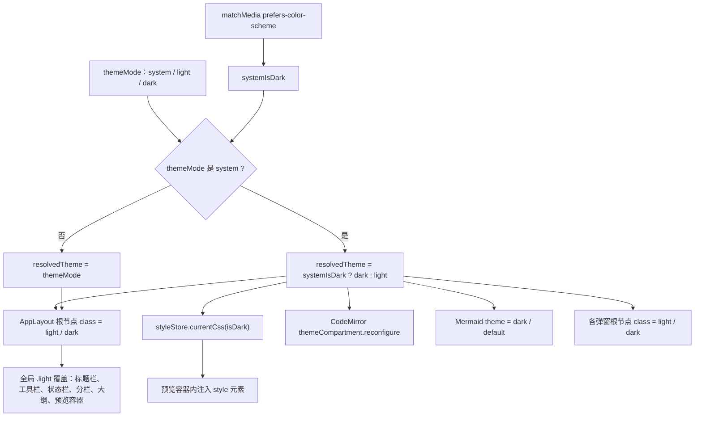

# 主题样式与布局

> 本文描述 MarkIt 的主题解析与切换、预览样式注册表、自定义 CSS 导入、全局滚动条与组件样式、四种布局模式、大纲面板、标题栏与窗口按钮、整窗缩放和标签栏交互。所有数值与行为均取自当前代码。
>
> - 适用版本：`1.4.1`
> - 最后核对：2026-11-04
> - 相关文档：[文档中心](./README.md)、[编辑器与预览](./编辑器与预览.md)

## 1. 主题模型

### 1.1 ThemeMode 与 resolvedTheme

类型定义在 [types/index.ts](../src/renderer/src/types/index.ts)：

```ts
export type ThemeMode = 'light' | 'dark' | 'system'
```

状态在 [stores/app.ts](../src/renderer/src/stores/app.ts)：

| 字段            | 说明                                                                                 |
| --------------- | ------------------------------------------------------------------------------------ |
| `themeMode`     | 用户选择，三选一，默认 `system`                                                      |
| `systemIsDark`  | 由 `matchMedia('(prefers-color-scheme: dark)')` 初始化，并监听 `change` 事件持续更新 |
| `resolvedTheme` | `computed<'light' \| 'dark'>`：`system` 时取系统结果，否则直接用 `themeMode`         |

切换入口是设置对话框的「外观」三项（跟随系统 / 浅色 / 深色），调用 `app.setThemeMode(mode)`。store 还导出了 `cycleTheme()`（system → light → dark 循环），但当前没有任何界面或快捷键调用它。

### 1.2 持久化

| localStorage 键 | 写入时机           | 读取规则                                                |
| --------------- | ------------------ | ------------------------------------------------------- |
| `markit-theme`  | `watch(themeMode)` | 仅接受 `light` / `dark` / `system`，其它值回落 `system` |

主题只持久化用户选择，不持久化解析结果；系统主题变化时无需写盘。`markit-*` 前缀为项目约定，不得改名（见 `rules/branding.md`）。

### 1.3 class 挂载范围

主题不是通过 `document.documentElement` 切换的，而是挂在布局根节点：

- [AppLayout.vue](../src/renderer/src/components/layout/AppLayout.vue)：`<div class="app-layout" :class="[app.resolvedTheme]">`；
- 所有全局浅色覆盖写作 `.light .xxx` / `:global(.light) .xxx`，依赖 `.app-layout.light` 作为祖先；
- 基础配色本身是深色，`.light` 只做覆盖，因此 `dark` class 存在但没有对应的全局规则；
- 弹窗组件（设置、PDF 导出、确认对话框、更新提示）各自把 `resolvedTheme` 加到自己的根节点，因为它们是 `Teleport` 到 `body` 的，不在 `.app-layout` 内部；
- 标签右键菜单同样 Teleport 到 `body`，单独用 `:class="{ light: app.resolvedTheme === 'light' }"`。

### 1.4 主题解析与样式应用流程



主题变化影响的链路：全局 UI 覆盖（含滚动条配色）、预览主题 CSS、CodeMirror 语法高亮、Mermaid 渲染主题，以及各弹窗自身的深浅色 class。其中全局覆盖与弹窗都依赖 `.light` 类，滚动条配色通过 `.light` 后代选择器切换。

## 2. 预览样式注册表

### 2.1 PreviewStyle 结构

```ts
export interface PreviewStyle {
  id: string
  name: string
  css: string
  isBuiltin: boolean
}
```

`css` 是整份样式文本，通过 Vite 的 `?raw` 导入，不是 `<link>` 外链。

### 2.2 内置四套 × 深浅两版

[stores/style.ts](../src/renderer/src/stores/style.ts) 用 8 个 `?raw` 导入组装两个数组：

| id         | 名称     | 深色文件                                                        | 浅色文件                                                                    |
| ---------- | -------- | --------------------------------------------------------------- | --------------------------------------------------------------------------- |
| `github`   | GitHub   | [github.css](../src/renderer/src/styles/preview/github.css)     | [github-light.css](../src/renderer/src/styles/preview/github-light.css)     |
| `dark`     | Dark     | [dark.css](../src/renderer/src/styles/preview/dark.css)         | [dark-light.css](../src/renderer/src/styles/preview/dark-light.css)         |
| `academic` | Academic | [academic.css](../src/renderer/src/styles/preview/academic.css) | [academic-light.css](../src/renderer/src/styles/preview/academic-light.css) |
| `minimal`  | Minimal  | [minimal.css](../src/renderer/src/styles/preview/minimal.css)   | [minimal-light.css](../src/renderer/src/styles/preview/minimal-light.css)   |

即 **4 套样式 × 深 / 浅 = 8 个 CSS 文件**，目录下没有其它预览样式文件。

四套风格差异：

- **GitHub**：最完整的一套，覆盖标题边框、行内代码、代码块、引用、表格、图片、`hr`、Mermaid 容器；
- **Dark**：GitHub 风格的深色变体，浅色文件命名为 `dark-light.css`；
- **Academic**：衬线字体（Georgia / Times New Roman）、正文两端对齐与首行缩进、标题居中；
- **Minimal**：无衬线系统字体、细字重标题、弱化边框，保留最小限度的排版。

### 2.3 id / name 与成对约定

1. 同一套样式的深色与浅色文件共用**同一个 id 和 name**，因此切换深浅色时 `currentStyleId` 不变，自动取对应版本；
2. 文件名约定 `<id>.css` 与 `<id>-light.css`，`dark` 的浅色文件是历史命名 `dark-light.css`，属于既有约定；
3. 所有预览样式选择器都以 `.preview-content` 开头，只作用于预览正文，不污染应用 UI；
4. `id` 是运行时唯一键，自定义样式用 `custom-<时间戳>`，不会与内置 id 冲突。

### 2.4 store 接口

| 方法                    | 行为                                                          |
| ----------------------- | ------------------------------------------------------------- |
| `builtinStyles(isDark)` | 返回对应深浅色版本的内置数组（4 项）                          |
| `allStyles(isDark)`     | 内置数组 + `customStyles`（自定义样式深浅色共用同一份）       |
| `currentStyle(isDark)`  | 按 `currentStyleId` 查找；找不到时回落到内置第一项 `github`   |
| `currentCss(isDark)`    | 返回 `currentStyle().css` 文本                                |
| `setStyle(id)`          | 只改 `currentStyleId`，不校验存在性（由 `currentStyle` 兜底） |
| `addCustomStyle(style)` | 追加到 `customStyles`                                         |
| `removeCustomStyle(id)` | 移除；若移除的是当前样式则切回 `github`                       |

`currentStyleId` 默认 `'github'`，是普通 `ref`，**没有** `localStorage` 持久化，也没有 `watch` 写盘。因此每次启动都回到 GitHub，自定义样式列表同样会清空。

### 2.5 CSS 注入方式

[MarkdownPreview.vue](../src/renderer/src/components/preview/MarkdownPreview.vue) 在预览容器内渲染一个动态 `<style>`：

```html
<component :is="'style'">{{ currentCss }}</component>
<div class="preview-content" :style="contentStyle" v-html="renderedHtml"></div>
```

`currentCss` 是 `computed(() => styleStore.currentCss(isDark))`，主题或样式变化时 Vue 直接更新该 `<style>` 的文本内容，无需重新创建元素。样式是全局作用域，但选择器统一限定在 `.preview-content` 下。

## 3. 自定义预览样式

入口在 [SettingsDialog.vue](../src/renderer/src/components/settings/SettingsDialog.vue) 的「预览样式 → 导入 CSS」：

1. 动态创建 `<input type="file" accept=".css">` 并触发点击；
2. 读取 `input.files[0]`，调用 `file.text()` 取得文本；
3. 名称取文件名去掉 `.css` 后缀（大小写不敏感）；
4. `id` 生成为 `custom-${Date.now()}`；
5. `isBuiltin: false`，通过 `styleStore.addCustomStyle` 追加；
6. 列表项末尾出现删除按钮，调用 `removeCustomStyle`。

现状与限制：

- **只在内存中**：`customStyles` 没有持久化，刷新或重启后丢失，需要重新导入；
- 导入时**不选中**新样式，用户需要再点一次列表项；
- 一份自定义 CSS 同时用于深色与浅色，没有成对机制；
- 导入内容不做校验或清洗，CSS 会原样注入预览容器；
- 删除当前正在使用的自定义样式会回落到 `github`。

## 4. 新增内置预览样式的步骤

1. 在 `src/renderer/src/styles/preview/` 新建 `<id>.css` 与 `<id>-light.css`，所有选择器以 `.preview-content` 开头，只写排版相关规则；
2. 在 [stores/style.ts](../src/renderer/src/stores/style.ts) 顶部用 `?raw` 导入两份文件；
3. 在 `builtinStylesDark` 与 `builtinStylesLight` 两个数组中各追加一项，**id 与 name 保持一致**，`isBuiltin: true`；
4. 不需要改 `SettingsDialog`：列表由 `allStyles(isDark)` 驱动，自动出现；
5. 自测：深浅色各切换一次、预览宽度 fixed/auto 各看一次、Mermaid 图表与 frontmatter 表格不被样式破坏。

注意：frontmatter 文档信息表的样式写在 [App.vue](../src/renderer/src/App.vue) 的全局样式中，不由预览主题控制；新增主题若想让表格风格统一，需要自行在主题 CSS 里补充 `.frontmatter-table` 规则，但当前四套主题都没有这样做。

## 5. CSS 与全局样式

### 5.1 没有 CSS 变量层

主窗口**没有**设计令牌 / CSS 变量体系：颜色、间距、圆角都直接写在各组件的 `<style>` 与预览 CSS 中，深浅色通过 `.light` 祖先选择器覆盖。仓库里唯一的 CSS 变量出现在独立的更新详情窗口 [update/UpdateWindow.vue](../src/renderer/src/update/UpdateWindow.vue)，它用 `--bg`、`--card`、`--text`、`--accent` 等局部变量管理自己的一套配色，与主窗口互不影响。

因此修改主题时不要指望「改变量即可全局生效」，需要同时检查组件私有样式与全局覆盖两处。

### 5.2 滚动条

全局规则在 [App.vue](../src/renderer/src/App.vue)：

| 项                             | 深色                                       | 浅色               |
| ------------------------------ | ------------------------------------------ | ------------------ |
| 宽 / 高                        | `12px`（横竖一致，始终占位，避免内容抖动） | 同左               |
| 轨道                           | 透明                                       | 透明               |
| 默认滑块                       | `rgba(255,255,255,0.14)`                   | `rgba(0,0,0,0.14)` |
| `.sb-active` / `.sb-scrolling` | `rgba(255,255,255,0.3)`                    | `rgba(0,0,0,0.3)`  |
| `.sb-active` 拖动中            | `rgba(255,255,255,0.5)`                    | `rgba(0,0,0,0.5)`  |

`sb-active` / `sb-scrolling` 由 [useScrollbarState.ts](../src/renderer/src/composables/useScrollbarState.ts) 维护（App 级只安装一次）：

1. `mousemove` 命中测试：`elementFromPoint` 后向上查找「overflow 为 auto/scroll 且内容超出」的容器，给它加 `sb-active`；
2. `scroll` 捕获阶段给滚动容器加 `sb-scrolling`，1 秒后移除；
3. 主进程每 300ms 推送一次真实光标位置（`cursor-pos`），用于自愈「鼠标进入 `-webkit-app-region: drag` 区域后渲染进程收不到事件导致状态卡住」；
4. 窗口失焦、鼠标离开窗口时清除。

不使用 CSS `:hover` 正是为了规避上述拖拽区收不到鼠标事件的问题。

### 5.3 frontmatter 文档信息表

样式在 App.vue 全局段，选择器以 `.preview-content .frontmatter-*` 限定：

- 标题「文档信息」：12px、加字距、弱化颜色、`user-select: none`；
- 表格：100% 宽、`border-collapse: collapse`、13px；
- 表头：淡蓝底（深色 `rgba(108,155,255,0.08)`，浅色 `rgba(59,130,246,0.06)`）；
- 键列：固定 160px、等宽字体、蓝色系；
- 值列：`white-space: pre-wrap` + `word-break: break-word`，保留块标量换行。

### 5.4 Mermaid 工具栏与错误提示

- 图表包装：`.mermaid-diagram` 相对定位；`.mermaid-viewport` 为 `max-height: 70vh` 的可滚动容器；`.mermaid-canvas` 用 `margin: 0 auto` 居中；
- 工具栏：绝对定位右上角，默认 `opacity: 0` 且 `pointer-events: none`，悬停图表或工具栏内获得焦点时显示；
- 按钮：`−` / 缩放百分比 / `＋` / 弹窗预览 / `SVG` / `PNG`，深色半透明底、浅色白底；
- 错误提示：`.mermaid-error` 琥珀色（`#d97706`）文字与淡琥珀底，浅色下为 `#b45309`，原始代码块保留在上方。

Mermaid 的渲染、缩放与导出细节见[编辑器与预览](./编辑器与预览.md)的预览管线一节，本文只描述样式。

## 6. 布局模式

### 6.1 四种模式

`LayoutMode` 定义在 [types/index.ts](../src/renderer/src/types/index.ts)，由 `app.layoutMode` 驱动 [AppLayout.vue](../src/renderer/src/components/layout/AppLayout.vue)：

| 模式           | 左栏   | 右栏   | 分栏组件           | 工具栏提示    |
| -------------- | ------ | ------ | ------------------ | ------------- |
| `edit-left`    | 编辑区 | 预览   | 使用 `SplitPane`   | 左编辑 右预览 |
| `edit-right`   | 预览   | 编辑区 | 使用 `SplitPane`   | 左预览 右编辑 |
| `edit-only`    | —      | —      | 不使用，编辑区占满 | 仅编辑        |
| `preview-only` | —      | —      | 不使用，预览占满   | 仅预览        |

`isSplitMode` 为前两种模式；大纲面板在所有模式下都位于 `SplitPane` 外层左侧，因此四种布局都能显示大纲。切换布局时编辑器或预览组件会真正卸载 / 挂载，撤销历史与滚动位置依赖缓存恢复。

### 6.2 cycleLayout

```ts
const modes: LayoutMode[] = ['edit-left', 'edit-right', 'edit-only', 'preview-only']
```

`cycleLayout()` 取当前下标 +1 并对 4 取模，循环顺序固定为「左编辑右预览 → 左预览右编辑 → 仅编辑 → 仅预览 → 回到起点」。快捷键为 Ctrl/Cmd+\，工具栏则用四个图标按钮直接 `setLayoutMode`。

### 6.3 SplitPane 拖拽

[SplitPane.vue](../src/renderer/src/components/layout/SplitPane.vue)：

- 通过 `:ratio` 接收分栏比例，左栏 `flex: ratio`，右栏 `flex: 1 - ratio`；
- 分隔条 `pointerdown` 时 `setPointerCapture`，移动过程中按 `(clientX - rect.left) / rect.width` 计算比例；
- 比例夹取到 **0.3 – 0.7**，避免拖出不可用的窄栏；
- 松开 `pointerup` 结束拖拽；
- 分隔条视觉宽度 1px，悬停 / 拖拽时变 2px 并变蓝；用 `::after` 向左右各扩 3px 作为实际命中区；
- 比例通过 `update:ratio` 事件写回 `app.splitRatio`，并由 store 的 `watch` 写入 `markit-split-ratio`（读取时同样夹取 0.3–0.7，默认 0.5）。

## 7. 大纲面板

[OutlinePanel.vue](../src/renderer/src/components/outline/OutlinePanel.vue)：

| 项       | 行为                                                                                                            |
| -------- | --------------------------------------------------------------------------------------------------------------- |
| 显隐     | `app.showOutline`，工具栏按钮或 Ctrl/Cmd+Shift+O；持久化键 `markit-show-outline`（`'1'` / `'0'`，默认显示）     |
| 默认宽度 | 220px                                                                                                           |
| 宽度范围 | 160 – 500px                                                                                                     |
| 宽高     | 高度撑满主区域，标题栏 40px，正文独立纵向滚动                                                                   |
| 拖拽     | 右侧 5px 热区 `pointerdown` 捕获指针，按 `clientX - panel.left` 计算宽度并四舍五入后实时写入 `app.outlineWidth` |
| 持久化   | `markit-outline-width`，读取时 `loadClampedNumber` 夹取到 160–500                                               |
| 层级缩进 | 每级 16px，基础 12px                                                                                            |
| 空态     | 「暂无大纲」                                                                                                    |

拖拽期间给面板加 `resizing` 类并对子元素 `user-select: none`，避免选中文字；拖拽热区悬停 / 拖动时显示蓝色。

## 8. 标题栏与窗口按钮

### 8.1 窗口创建参数

[src/main/index.ts](../src/main/index.ts) 的 `createWindow()` 按平台分支：

| 平台            | 配置                                                                                                                  | 效果                                                                            |
| --------------- | --------------------------------------------------------------------------------------------------------------------- | ------------------------------------------------------------------------------- |
| macOS           | `titleBarStyle: 'hidden'`、`trafficLightPosition: { x: 16, y: 12 }`，**不设** `frame: false`                          | 保留窗口边框以显示交通灯，交通灯与 36px 标题栏垂直居中                          |
| Windows / Linux | `frame: false`、`titleBarStyle: 'hidden'`、`titleBarOverlay: { color: '#00000000', symbolColor: '#888', height: 36 }` | 无边框，系统最小化 / 最大化 / 关闭按钮以 overlay 绘制在右上角，透明底、灰色符号 |

窗口另有 `minWidth: 800`、`minHeight: 600`、`show: false`（等 ready-to-show 再显示）、`autoHideMenuBar: true`，以及 `vibrancy: 'under-window'` / `backgroundMaterial: 'acrylic'` 的毛玻璃背景。

### 8.2 标题栏留位

[TitleBar.vue](../src/renderer/src/components/layout/TitleBar.vue) 高 36px，根节点带平台 class（`win32` / `darwin` / `linux`）：

| 状态            | 左内边距             | 右内边距                                  |
| --------------- | -------------------- | ----------------------------------------- |
| 默认（Windows） | 8px                  | 140px（给系统窗口按钮 overlay 留位）      |
| `.linux`        | 8px                  | 0                                         |
| `.darwin`       | 88px（给交通灯留位） | 0                                         |
| `.fullscreen`   | 8px                  | 8px（全屏时系统按钮不可见，移除两侧预留） |

全屏状态来自 `window.api.isFullscreen()` 与 `window.api.onFullscreenChange(...)` 推送。

### 8.3 拖动区域

- 标题栏整体 `-webkit-app-region: drag`、`user-select: none`；
- 标签项、关闭按钮、新建按钮、右键菜单都声明 `no-drag`，保证可点击；
- `TabBar` 右侧的 `.drag-space` 保留 `drag`，标签很少时也能拖动窗口；
- 工具栏（42px）与编辑区工具栏（34px）为 `no-drag`。

## 9. 整窗缩放

缩放由主进程维护，渲染进程只展示：

| 项           | 值                                                                                                                                               |
| ------------ | ------------------------------------------------------------------------------------------------------------------------------------------------ |
| 范围         | 50% – 300%（`MIN_ZOOM_FACTOR = 0.5`、`MAX_ZOOM_FACTOR = 3`）                                                                                     |
| 步长         | 10%（`ZOOM_STEP = 0.1`）                                                                                                                         |
| 归一化       | 四舍五入到 10% 步长后夹取范围                                                                                                                    |
| 快捷键       | Ctrl/Cmd+= 或 +、Ctrl/Cmd+- 或 _、Ctrl/Cmd+0 恢复 100%                                                                                           |
| 持久化       | `userData/window-state.json` 的 `zoomFactor` 字段，与窗口尺寸 / 位置 / 最大化一起保存                                                            |
| 恢复         | 创建窗口时读取；`did-finish-load` 后重新 `setZoomFactor`（页面重载会重置），并推送 `window:zoom-changed`                                         |
| 渲染进程同步 | [useWindowZoom.ts](../src/renderer/src/composables/useWindowZoom.ts)：挂载时 `getZoom()` 拉取一次，之后监听 `onZoomChange` 更新 `app.zoomFactor` |
| 状态栏       | `zoomPercent = Math.round(zoomFactor * 100)`，**仅当不等于 100 时**显示「缩放 N%」，悬停提示 Ctrl/Cmd+0                                          |

缩放通过 `webContents.setZoomFactor` 作用于整个页面，编辑器、预览、状态栏一起缩放。

## 10. 标签栏

[TabBar.vue](../src/renderer/src/components/layout/TabBar.vue) 位于标题栏内：

| 交互         | 实现                                                                                                                                      |
| ------------ | ----------------------------------------------------------------------------------------------------------------------------------------- |
| 标签尺寸     | 高 30px，宽 `min-width: 100px`、`max-width: 200px`，超出省略号                                                                            |
| 激活态       | `.active` 提高背景亮度 / 浅色下变白底，底部与标题栏贴合（顶部圆角）                                                                       |
| 未保存标识   | `doc.isModified` 为真时显示 6px 蓝色圆点 `.tab-dot`，标题为「未保存」                                                                     |
| 关闭按钮     | 18px 圆形，悬停或激活标签时 `opacity: 1`，点击 `stop` 后 `file.closeTab(id)`                                                              |
| 中键关闭     | `mousedown` 时 `button === 1` 且 `preventDefault` 后关闭该标签                                                                            |
| 横向滚轮     | `wheel` 时若纵向滚动为主且标签条可横向滚动，把 `deltaY` 加到 `scrollLeft`，隐藏原生滚动条                                                 |
| 激活标签可见 | `revealActiveTab` 按容器与标签的 `getBoundingClientRect` 计算左右边界并翻动 `scrollLeft`（留 6px 边距），标签增删或切换后 `nextTick` 执行 |
| 新建         | 右侧 `+` 按钮或 Ctrl/Cmd+N                                                                                                                |
| 拖动窗口     | 标签条之后的 `.drag-space` 为 `drag` 区域                                                                                                 |

### 10.1 右键菜单

- 在标签上 `contextmenu` 打开，坐标取 `clientX / clientY`；
- 菜单 `Teleport to="body"`（标题栏是拖动区，菜单需要独立定位），`position: fixed`、`z-index: 3000`；
- 打开后 `nextTick` 做视口夹取：距四边至少 6px，避免被裁；
- 菜单项：关闭、关闭其他（标签数 > 1 可用）、关闭左侧（下标 > 0 可用）、关闭右侧（下标 < 末位可用），中间有分隔线；
- 关闭时机：点击菜单外（捕获阶段 `mousedown`）、Esc、窗口失焦、窗口尺寸变化。

### 10.2 批量关闭

`runMenuAction` 计算目标 id 列表后调用 `file.closeTabs(ids, keepId)`：

1. 若当前激活标签在待关闭列表中，先把激活标签切到右键选中的标签，避免关闭过程中激活项来回跳；
2. 按列表顺序逐个 `closeOne`：有未保存修改时逐个确认，用户取消或保存失败即停止，后续标签保持打开；
3. 全部关闭后若已无标签，调用 `window.api.close()` 关闭主窗口（未保存内容已在此前确认）。

## 11. 尺寸与约束汇总

| 对象           | 约束                                                               |
| -------------- | ------------------------------------------------------------------ |
| 主窗口         | 最小 800 × 600；默认 1280 × 800；尺寸 / 位置 / 最大化 / 缩放持久化 |
| 标题栏         | 固定 36px                                                          |
| 标签           | 高 30px，宽 100 – 200px                                            |
| 顶部工具栏     | 固定 42px                                                          |
| 编辑区工具栏   | 固定 34px                                                          |
| 状态栏         | 固定 26px                                                          |
| 大纲面板       | 宽 160 – 500px，默认 220px，用户可拖拽                             |
| 分栏比例       | 0.3 – 0.7，默认 0.5                                                |
| 预览正文宽度   | fixed 模式 400 – 1600px（步长 20，默认 800）；auto 模式无上限      |
| 整窗缩放       | 50% – 300%，步长 10%                                               |
| Mermaid 视口   | `max-height: 70vh`，超出滚动                                       |
| 预览容器内边距 | `32px 40px`                                                        |
| 滚动条         | 固定 12px 占位                                                     |

## 12. 相关文件

| 文件                                                                                                                  | 说明                                                           |
| --------------------------------------------------------------------------------------------------------------------- | -------------------------------------------------------------- |
| [src/renderer/src/stores/app.ts](../src/renderer/src/stores/app.ts)                                                   | 主题、布局、大纲、预览宽度、缩放比例的持久化状态               |
| [src/renderer/src/stores/style.ts](../src/renderer/src/stores/style.ts)                                               | 预览样式注册表与自定义样式                                     |
| [src/renderer/src/styles/preview/](../src/renderer/src/styles/preview/)                                               | 4 套 × 深浅共 8 个预览 CSS                                     |
| [src/renderer/src/App.vue](../src/renderer/src/App.vue)                                                               | 全局重置、滚动条、frontmatter 表、Mermaid 工具栏与错误提示样式 |
| [src/renderer/src/components/layout/AppLayout.vue](../src/renderer/src/components/layout/AppLayout.vue)               | 主题 class、布局分支、浅色全局覆盖                             |
| [src/renderer/src/components/layout/SplitPane.vue](../src/renderer/src/components/layout/SplitPane.vue)               | 分栏拖拽与比例夹取                                             |
| [src/renderer/src/components/layout/TitleBar.vue](../src/renderer/src/components/layout/TitleBar.vue)                 | 36px 标题栏与平台留位                                          |
| [src/renderer/src/components/layout/TabBar.vue](../src/renderer/src/components/layout/TabBar.vue)                     | 标签、滚轮、中键、右键菜单                                     |
| [src/renderer/src/components/layout/Toolbar.vue](../src/renderer/src/components/layout/Toolbar.vue)                   | 顶部工具栏与布局切换入口                                       |
| [src/renderer/src/components/layout/StatusBar.vue](../src/renderer/src/components/layout/StatusBar.vue)               | 状态栏展示                                                     |
| [src/renderer/src/components/outline/OutlinePanel.vue](../src/renderer/src/components/outline/OutlinePanel.vue)       | 大纲面板与宽度拖拽                                             |
| [src/renderer/src/components/settings/SettingsDialog.vue](../src/renderer/src/components/settings/SettingsDialog.vue) | 主题选项、样式列表、CSS 导入、预览宽度                         |
| [src/renderer/src/composables/useScrollbarState.ts](../src/renderer/src/composables/useScrollbarState.ts)             | 滚动条状态类维护                                               |
| [src/renderer/src/composables/useWindowZoom.ts](../src/renderer/src/composables/useWindowZoom.ts)                     | 缩放比例同步到 store                                           |
| [src/renderer/src/types/index.ts](../src/renderer/src/types/index.ts)                                                 | `ThemeMode`、`LayoutMode`、`PreviewStyle` 等类型               |
| [src/main/index.ts](../src/main/index.ts)                                                                             | 窗口创建、titleBarOverlay、缩放、光标位置推送                  |
