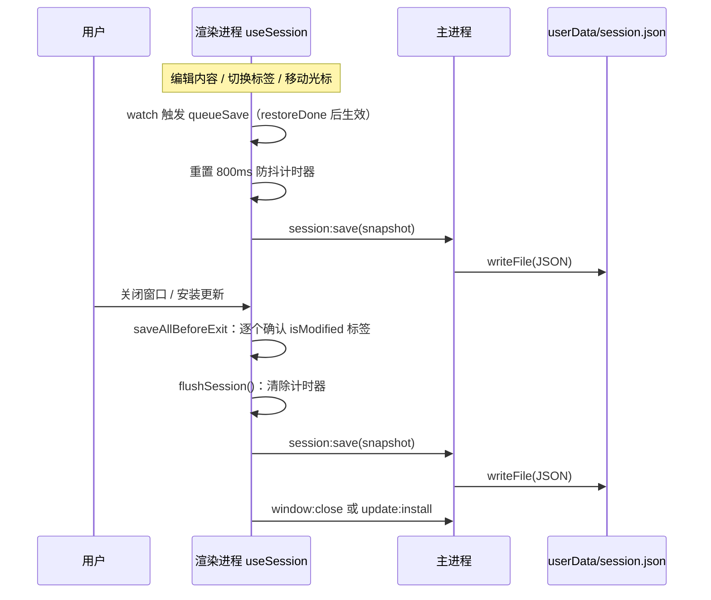
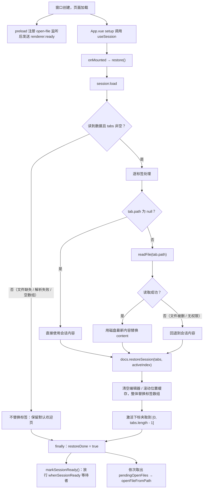
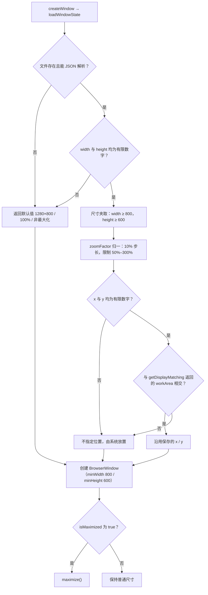
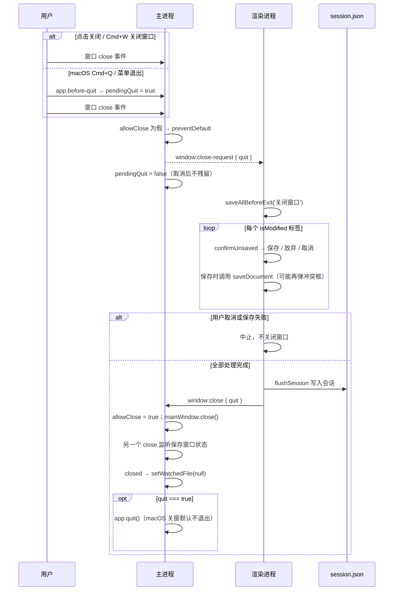
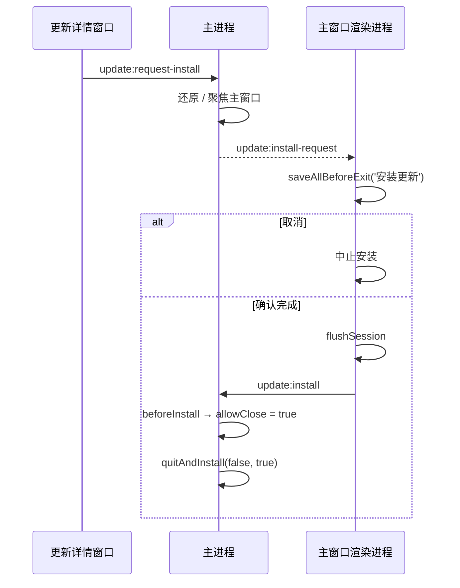

# 会话恢复与窗口状态

> **文档定位**：本文描述 MarkIt 关闭后再次启动（含自动更新重启）时如何恢复上次打开的标签页与窗口几何状态，以及整窗缩放、单实例转发、关闭守卫这些与「窗口生命周期」相关的机制。会话数据存于 `userData/session.json`，窗口状态存于 `userData/window-state.json`，两者互不依赖；主题、布局等偏好则走 `localStorage` 的 `markit-*` 键（见 [`app.ts`](../src/renderer/src/stores/app.ts)），不在本文范围。
>
> 涉及代码：[`useSession.ts`](../src/renderer/src/composables/useSession.ts)、[`session-ready.ts`](../src/renderer/src/composables/session-ready.ts)、[`session-types.ts`](../src/shared/session-types.ts)、[`documents.ts`](../src/renderer/src/stores/documents.ts)、[`src/main/index.ts`](../src/main/index.ts)、[`App.vue`](../src/renderer/src/App.vue)。
>
> **开发模式隔离**：`app.isPackaged === false` 时主进程把 `userData` 切换到 `mark-it-dev` 目录，调试实例与正式版互不共享单实例锁、会话与窗口状态，可以同时运行。

## 1. 会话目标

- **退出后恢复**：用户关闭窗口再打开，上次的标签页、未保存内容、光标位置、激活项都应还原。
- **自动更新重启后恢复**：`electron-updater` 安装新版本会退出并重启应用，重启后同样恢复，避免更新打断写作。
- **不意外覆盖用户操作**：启动时用户可能立刻打开文件，恢复逻辑必须与这些操作串行，不能把刚打开的文档冲掉。

## 2. 数据结构

类型定义在 [`src/shared/session-types.ts`](../src/shared/session-types.ts)，主进程与渲染进程共用（纯类型，无运行时依赖）：

```ts
interface SessionTab {
  path: string | null // 文件路径；从未保存过的新建文档为 null
  name: string // 标签显示名（未保存文档为 untitled.md / untitled-2.md 等）
  content: string // 保存时刻的编辑器内容（含未保存修改，统一 LF）
  isModified: boolean // 保存时刻的修改标记
  cursorLine: number // 1 基行号
  cursorCol: number // 1 基列号
  eol?: '\n' | '\r\n' // 原文件换行符；旧会话缺失时按 LF
  bom?: boolean // 原文件是否带 UTF-8 BOM；旧会话按 false
}

interface SessionData {
  tabs: SessionTab[]
  activeIndex: number // 激活标签在 tabs 中的下标
}
```

补充说明：

- `activeIndex` 由 `docs.docs.findIndex(doc => doc.id === activeId)` 得到，`findIndex` 返回 `-1` 时取 `0`（`Math.max(..., 0)`）。
- 会话是「快照」而非「日志」：每次写入都完整序列化全部标签，不做增量合并。
- 主进程 `session:save` 直接 `writeFile` 覆盖，没有临时文件重命名；写入失败记录 `console.error` 并返回 `false`。渲染进程会检查返回值：失败时在状态栏显示「会话保存失败」（悬停提示下次启动可能无法恢复标签页），成功后自动清除；下一次防抖写入仍会重试覆盖。
- 主进程 `session:load` 使用 [`session-store.ts`](../src/main/session-store.ts) 的 `parseSessionData` 做运行时校验：顶层不是对象、`tabs` 不是数组或为空时返回 `null`；单个 tab 缺字段 / 类型不符时逐字段兜底（非字符串 `content` 丢弃该 tab，`path` 非字符串转 `null`，`cursor*` 取正数，`activeIndex` 夹取到合法范围），损坏的 `session.json` 不会让恢复崩溃。

## 3. 会话保存时机

[`useSession.ts`](../src/renderer/src/composables/useSession.ts) 是模块级单例（重复调用返回同一实例，避免 HMR 或重复初始化重复注册监听）。

### 3.1 编辑 / 激活变化的 800ms 防抖

- 两个 `watch` 触发 `queueSave()`：
  1. 标签数组投影 `[id, path, name, content, isModified, cursorLine, cursorCol]`；
  2. `docs.activeId`。
- `queueSave()` 先清除上一个计时器，再设 800ms 定时器；到点执行 `session:save`。连续输入时只在停顿 800ms 后写一次。
- `restoreDone` 为假时 `queueSave()` 直接返回：恢复过程中的状态变化不写入，避免用「恢复前的空标签」覆盖已有会话。

### 3.2 关闭窗口 / 安装更新前立即写入

`flush()` 的行为：

1. `restoreDone` 为假时直接返回（此时没有可写的稳定状态）；
2. 清除防抖计时器；
3. 立即 `await save()`。

调用点有两处，都在 [`App.vue`](../src/renderer/src/App.vue) 的 `saveAllBeforeExit()` 末尾：

| 触发     | 调用链                                                                                                           |
| -------- | ---------------------------------------------------------------------------------------------------------------- |
| 窗口关闭 | 主进程 `close` 守卫 → `window:close-request` → `saveAllBeforeExit('关闭窗口')` → `flushSession()`                |
| 更新安装 | 更新窗口 `requestInstall` → 主进程 `update:install-request` → `saveAllBeforeExit('安装更新')` → `flushSession()` |

`flushSession()` 是导出的便捷函数：`useSession` 尚未初始化时返回 `Promise.resolve()`，否则调用单例的 `flush()`。



## 4. 会话恢复算法

### 4.1 恢复流程



关键点：

- **磁盘优先**：应用关闭期间文件可能被其他程序修改，恢复时对每个有 `path` 的标签调用 `window.api.readFile()`，成功则用磁盘内容，失败才回退会话内容。因此「关闭前未保存的修改」会被磁盘版本覆盖——这正是「文件标签以磁盘为准」的取舍；未保存内容只对没有路径的新建文档完整保留。磁盘内容经 `decodeText()` 归一为 LF，并把磁盘当前的行尾 / BOM 一并写回标签，后续保存按该策略还原。
- **原子替换**：`docs.restoreSession(tabs, activeIndex)` 先清空 `editorStates`、`scrollPositions`、`previewScrollPositions` 三个非响应式 Map，再整体赋值 `docs.value`。旧标签（含启动时的欢迎页）被完全丢弃。
- **索引夹取**：`Math.min(Math.max(Math.floor(activeIndex) || 0, 0), restored.length - 1)`。非法值（`NaN`、负数、超出范围）都会落到合法下标；`tabs` 非空保证至少有一个标签可激活。
- **修改标记沿用会话**：`doc.isModified = tab.isModified`。若会话里标记为已修改，恢复出的标签仍显示修改点；此时 `diskContent` 等于恢复出的内容，直接保存会走「磁盘 == 本地 → 只同步快照」分支，不会写盘（见 [文件与冲突处理 · 冲突判定矩阵](./文件与冲突处理.md)）。
- **光标恢复**：`restoreSession` 清掉了 `EditorState` 缓存，标签首次激活时 [`MarkdownEditor.vue`](../src/renderer/src/components/editor/MarkdownEditor.vue) 会用 `doc.cursorLine` / `doc.cursorCol` 调用 `createState()`，经 `cursorOffset()` 换算成文档偏移并设置选区。1 基行列在换算时会夹取到合法范围。
- **失败兜底**：`session:load` 返回 `null`、JSON 解析失败、结构校验不通过（`tabs` 不是数组或为空）时，都不替换标签，保留 `documents` store 初始化时的欢迎页；`restoreSession` 内部还会对每个 tab 的字段再做一次兜底，避免主进程校验被绕过时崩溃。`finally` 仍会置 `restoreDone` 并放行等待者，绝不能因为恢复失败让应用卡在「永远没就绪」。

### 4.2 恢复后的文件监听

恢复动作发生在 `onMounted`，而 [`useFileWatcher.ts`](../src/renderer/src/composables/useFileWatcher.ts) 的 `watch(activeDoc.path, { immediate: true })` 已在 `setup` 阶段注册：标签被整体替换后 `activeDoc.path` 从 `null` 变为恢复文件的路径，监听自动触发——主进程开始监视该文件，并补读一次磁盘。若补读结果与恢复时读到的内容一致，`watchedContent` 比较会直接吞掉这次事件，不产生多余刷新。

## 5. 恢复期间打开文件的竞态处理

启动阶段存在两层排队，分别对应两个不同的「未就绪」窗口：

| 层         | 位置                | 未就绪条件                                      | 缓存结构           | 放行时机                 |
| ---------- | ------------------- | ----------------------------------------------- | ------------------ | ------------------------ |
| 主进程层   | `src/main/index.ts` | 渲染进程监听尚未注册（`rendererReady = false`） | `pendingFilePaths` | 收到 `renderer:ready`    |
| 渲染进程层 | `useSession.ts`     | 会话恢复尚未完成（`restoreDone = false`）       | `pendingOpenFiles` | `restore()` 的 `finally` |

- 主进程层解决「首次双击文件时页面还没加载完，IPC 发出去会丢失」；详见 [文件与冲突处理 · renderer:ready 排队机制](./文件与冲突处理.md)。
- 渲染进程层解决「恢复会用会话内容整体替换标签，刚打开的文件会被覆盖」：`window.api.onOpenFile` 的回调在 `restoreDone` 为假时把结果压入 `pendingOpenFiles`，恢复完成后再按到达顺序调用 `file.openFileFromPath()`。
- **`whenSessionReady()`**（[`session-ready.ts`](../src/renderer/src/composables/session-ready.ts)）是给「应用内主动打开」用的就绪信号：
  - `markSessionReady()` 在恢复的 `finally` 中调用一次，resolve 全局 Promise；
  - `whenSessionReady()` 返回同一个 Promise，已 resolve 后再 await 立即继续；
  - 使用方：`useFile.openFile()`（Ctrl+O 对话框，读完文件后等待）与 `useFile.openManual()`（打开内置使用手册，等待后再查找/新建）。
- 不等待的路径：`openFileFromPath()` 本身不 await，因为它只由上述两层排队在恢复完成后调用。
- 因此「启动瞬间双击文件」与「启动后立刻 Ctrl+O」都不会与恢复互相覆盖，最终标签集合是「会话标签 + 新打开的文件」。

## 6. 会话不包含什么

| 不保存的内容                         | 原因                                              | 现状                                                                        |
| ------------------------------------ | ------------------------------------------------- | --------------------------------------------------------------------------- |
| 撤销 / 重做历史                      | `EditorState` 体积大且不可序列化                  | `restoreSession` 清空 `editorStates`；恢复后每个标签从当前内容新建状态      |
| 编辑区 / 预览区滚动位置              | 滚动位置存在非响应式 Map 中，仅用于进程内切换标签 | `scrollPositions` / `previewScrollPositions` 在恢复时清空，恢复后从顶部开始 |
| 未保存文档的磁盘路径                 | 新建文档本就没有路径                              | `path` 为 `null`，但**内容会保存**，重启后作为未命名标签恢复                |
| 窗口尺寸、位置、最大化、缩放         | 与文档无关，且需在主进程可用                      | 存在 `window-state.json`（见第 7、8 节）                                    |
| 主题、布局、大纲、分栏比例、预览宽度 | 用户偏好，与具体文档无关                          | `localStorage` 的 `markit-*` 键                                             |
| 更新状态、文件监听目标、对话框状态   | 运行期瞬时状态                                    | 每次启动重新建立                                                            |

## 7. 窗口状态（`window-state.json`）

实现位于 [`src/main/index.ts`](../src/main/index.ts) 的 `loadWindowState()` / `saveWindowState()` / `queueSaveWindowState()`。

### 7.1 字段与默认值

| 字段          | 类型      | 默认值  | 说明                                        |
| ------------- | --------- | ------- | ------------------------------------------- |
| `width`       | `number`  | `1280`  | 普通（非最大化）宽度，读取时下限 800        |
| `height`      | `number`  | `800`   | 普通高度，读取时下限 600                    |
| `x`           | `number?` | 无      | 窗口左上角横坐标；缺失时交给系统默认放置    |
| `y`           | `number?` | 无      | 窗口左上角纵坐标；与 `x` 同时有效才使用     |
| `isMaximized` | `boolean` | `false` | 上次退出时是否最大化                        |
| `zoomFactor`  | `number`  | `1`     | 整窗缩放比例，归一到 10% 步长并限制在 0.5–3 |

### 7.2 读取与校验



要点：

- **显示器拔插校验**：保存的坐标可能落在已断开的显示器上。读取时用 `screen.getDisplayMatching({x, y, width, height}).workArea` 取最匹配显示器的可用区域，只有窗口矩形与 `workArea` 真正相交（四条边都满足重叠）才沿用坐标，否则丢弃 `x` / `y`。
- **尺寸下限双重保障**：读取时夹取到 800×600，创建窗口时再设 `minWidth: 800` / `minHeight: 600`。用户手动缩小也突破不了该下限，写入的值自然合规。
- **非法字段不导致崩溃**：任何解析异常都被 `catch` 捕获，退回默认值并记录 `console.error`。

### 7.3 保存

- **最大化时保存 `normalBounds`**：`mainWindow.getNormalBounds()` 返回还原后的普通尺寸与位置，配合 `isMaximized` 标记，下次启动先按普通尺寸创建再 `maximize()`，还原时不会得到一个全屏大小的「普通窗口」。
- **500ms 防抖**：`resize` 与 `move` 事件调用 `queueSaveWindowState()`，重置 500ms 计时器；连续拖动只写一次。
- **关闭时兜底立即保存**：`mainWindow.on('close', saveWindowState)`，不依赖防抖计时器是否已触发。
- **缩放变化也触发保存**：`applyZoomFactor()` 末尾调用 `queueSaveWindowState()`，保证 `zoomFactor` 与几何信息一起落盘。
- 窗口已销毁时 `saveWindowState()` 直接返回，避免向无效对象取 bounds。

## 8. 整窗缩放

缩放不是 CSS 或页面级 transform，而是主进程对 `webContents` 设置 `zoomFactor`，整个页面（含编辑器、预览、对话框）一起缩放。

| 项目           | 取值 / 行为                                                                                                                                     |
| -------------- | ----------------------------------------------------------------------------------------------------------------------------------------------- |
| 范围           | 50% – 300%（`MIN_ZOOM_FACTOR = 0.5`、`MAX_ZOOM_FACTOR = 3`）                                                                                    |
| 步长           | 10%（`ZOOM_STEP = 0.1`）；`normalizeZoomFactor()` 用 `Math.round(value * 10) / 10` 归一到 10% 网格                                              |
| 快捷键         | `Ctrl/Cmd + =` 或 `Ctrl/Cmd + +` 放大；`Ctrl/Cmd + -` 或 `Ctrl/Cmd + _` 缩小；`Ctrl/Cmd + 0`（不带 Shift）恢复 100%                             |
| macOS          | 使用 `Cmd`；Windows / Linux 使用 `Ctrl`                                                                                                         |
| 拦截位置       | `webContents.on('before-input-event')`：先于页面与菜单快捷键到达，`preventDefault` 后由主进程处理，页面收不到该按键                             |
| 主进程为准     | 模块级 `currentZoomFactor` 是唯一事实来源                                                                                                       |
| 状态广播       | 每次应用后发送 `window:zoom-changed`                                                                                                            |
| 持久化         | 写入 `window-state.json` 的 `zoomFactor`，与窗口几何同文件                                                                                      |
| 页面重载后恢复 | `did-finish-load` 中重新 `setZoomFactor(currentZoomFactor)` 并再次广播（重载会把 `webContents` 的缩放重置为 100%）                              |
| 状态栏展示     | [`StatusBar.vue`](../src/renderer/src/components/layout/StatusBar.vue) 仅在 `zoomPercent !== 100` 时显示「缩放 N%」，提示 `Ctrl/Cmd + 0` 可恢复 |

渲染进程侧（[`useWindowZoom.ts`](../src/renderer/src/composables/useWindowZoom.ts)）只做展示：挂载时订阅 `onZoomChange` 并用 `getZoom()` 取初值，写入 `app.zoomFactor`（`zoomPercent` 为其四舍五入百分比）。渲染进程不维护也不设置缩放，避免与主进程状态分叉。

同一套 `before-input-event` 还承担另一项 macOS 专属职责：拦截 `Cmd+W`（系统菜单默认会关闭窗口并吞掉渲染进程的 keydown），改为发送 `shortcut:close-tab`，由 [`App.vue`](../src/renderer/src/App.vue) 调用 `file.closeTab()` 关闭当前标签页。

## 9. 单实例与平台生命周期

### 9.1 单实例锁与文件转发

- 启动时 `app.requestSingleInstanceLock()`；未拿到锁的实例直接 `app.quit()`，不再创建窗口。
- 已有实例监听 `second-instance`：解析新实例 `argv` 中的文件路径 → 若窗口最小化则 `restore()` → `focus()` → `openFilesAtPaths(filePaths)`。
- 转发路径不受「新实例已退出」影响：路径已随事件传入已有实例；若渲染进程尚未就绪，仍会进入 `pendingFilePaths` 排队。

### 9.2 macOS `activate`

`app.on('activate')`：当 `BrowserWindow.getAllWindows().length === 0` 时重新 `createWindow()`。macOS 用户关闭窗口后应用仍驻留 Dock，点击图标会新建窗口；新渲染进程会重新走一遍会话恢复，因此关闭前 `flushSession()` 写入的标签会回来。

### 9.3 `window-all-closed`

- Windows / Linux：所有窗口关闭后 `app.quit()`。
- macOS：不退出（保持 Dock 图标与菜单），等待 `activate` 重新开窗。

### 9.4 窗口销毁后的清理

`mainWindow.on('closed')` 调用 `setWatchedFile(null)`，取消文件监视，避免 macOS 关闭窗口后仍占用文件句柄。注意 `mainWindow` 变量本身不置空，后续访问都带 `isDestroyed()` 判断。

## 10. 关闭守卫

关闭守卫的目标：**任何会导致应用退出的路径，都必须先让用户处理未保存内容并写一次会话**。

| 组成                             | 位置                                                     | 作用                                                                          |
| -------------------------------- | -------------------------------------------------------- | ----------------------------------------------------------------------------- |
| `allowClose`                     | 主进程模块级标志                                         | 唯一放行开关；为假时 `close` 事件一律 `preventDefault` 并通知渲染进程         |
| `pendingQuit`                    | 主进程模块级标志                                         | 本次关闭是否来自退出应用（`before-quit`）；一次性，随 `window:close-request` 下发 |
| `window:close-request`           | 主进程 → 渲染进程                                        | 请求渲染进程执行保存流程，载荷 `{ quit: boolean }`                             |
| `saveAllBeforeExit(actionLabel)` | [`useExitGuard.ts`](../src/renderer/src/composables/useExitGuard.ts) | 逐个确认 `isModified` 标签 → `flushSession()` → 返回是否可继续；关闭窗口与安装更新共用 |
| `window:close` IPC               | 渲染进程 → 主进程                                        | 置 `allowClose = true` 后调用 `mainWindow.close()`；`quit = true` 时继续 `app.quit()` |
| `beforeInstall`                  | [`updater.ts`](../src/main/updater.ts)                   | 安装前置 `allowClose = true`，避免安装器被关闭守卫卡住                        |

完整时序（关闭窗口 / 退出应用）：



更新安装路径（差异只在于最后一步）：



注意事项：

- **关闭最后一个标签也走放行路径**：`closeTab` / `closeTabs` 在标签清空后调用 `window.api.close()`，此时每个标签已在关闭前单独确认，因此不再触发「保存全部」；`window:close` 会把 `allowClose` 置真。若无标签且无修改，等价于直接关窗。
- **主进程有两个 `close` 监听**：一个保存窗口状态（无条件执行），一个做关闭守卫。二者互不干扰，但改动时不要合并，否则守卫 `preventDefault` 会让状态保存的时机语义变得含糊。
- **`allowClose` / `pendingQuit` 按窗口复位**：`createWindow()` 中会把两者重置为 `false`。macOS 关闭窗口后进程仍驻留，Dock 重新开窗的新窗口必须重新走关闭守卫，不能继承上一次的放行状态。
- **不要在守卫之外 `destroy()` 窗口**：绕过 `close` 事件会跳过未保存确认与会话写入，直接丢数据。

## 11. 高风险改动检查清单

会话恢复与窗口状态在 [`rules/testing.md`](../rules/testing.md) 中属于高风险区域，改动后至少验证：

- [ ] 打开 3 个文件 + 1 个未命名文档并各自输入内容 → 关闭窗口 → 重启，确认标签顺序、激活项、未命名文档内容、光标位置都恢复。
- [ ] 关闭窗口时对某个标签选「取消」，确认窗口不关闭、其余标签不被关闭。
- [ ] macOS：关闭窗口 → 从 Dock 重新打开 → 修改文档 → 关闭，必须重新弹出未保存确认。
- [ ] macOS：`Cmd+Q` → 选择保存 → 应用退出；选择取消 → 应用保持运行且文档不丢。
- [ ] 修改文件后直接退出（不保存）→ 重启，确认文件标签显示磁盘版本（会话内容不覆盖磁盘）。
- [ ] 关闭期间删除某个会话文件 → 重启，确认该标签回退到会话内容而不是崩溃。
- [ ] 把 `session.json` 手工改坏（截断、`tabs` 改成字符串、单个 tab 缺 `content`）→ 重启，确认应用正常启动、不崩溃，损坏部分按默认值兜底。
- [ ] 把 `session.json` 所在目录设为只读（或磁盘写满）→ 触发一次保存，确认状态栏出现「会话保存失败」；恢复可写后再次保存，提示消失。
- [ ] 启动瞬间双击一个 `.md` 文件，确认会话标签与新文件同时存在，且新文件为激活标签。
- [ ] 拖动窗口、最大化后退出 → 重启，确认普通尺寸与最大化状态都正确；拔掉副屏后重启，确认窗口不会出现在屏幕外。
- [ ] 缩放到 150% 后刷新页面（`Ctrl+R` 会触发刷新逻辑，另可用开发工具重载），确认缩放保持 150%。
- [ ] 缩放到上限 / 下限，确认停在 300% / 50%，状态栏百分比正确。
- [ ] 二次启动转发：应用已运行时双击文件，确认已有窗口前置并打开该文件。
- [ ] 更新安装流程：更新窗口点安装 → 主窗口逐标签确认 → 取消时安装中止。

## 12. 相关文件

| 文件                                                                                                                | 职责                                                                                 |
| ------------------------------------------------------------------------------------------------------------------- | ------------------------------------------------------------------------------------ |
| [`src/renderer/src/composables/useSession.ts`](../src/renderer/src/composables/useSession.ts)                       | 会话快照、800ms 防抖、恢复、`flush`、`pendingOpenFiles`                              |
| [`src/renderer/src/composables/session-ready.ts`](../src/renderer/src/composables/session-ready.ts)                 | `whenSessionReady` / `markSessionReady` 就绪信号                                     |
| [`src/shared/session-types.ts`](../src/shared/session-types.ts)                                                     | `SessionData` / `SessionTab` 跨进程类型                                              |
| [`src/renderer/src/stores/documents.ts`](../src/renderer/src/stores/documents.ts)                                   | `restoreSession` 整体替换、索引夹取、缓存清理                                        |
| [`src/renderer/src/components/editor/MarkdownEditor.vue`](../src/renderer/src/components/editor/MarkdownEditor.vue) | 光标恢复（`cursorOffset`）、内容最小化替换                                           |
| [`src/renderer/src/App.vue`](../src/renderer/src/App.vue)                                                           | `saveAllBeforeExit`、`window:close-request`、`update:install-request`                |
| [`src/renderer/src/composables/useWindowZoom.ts`](../src/renderer/src/composables/useWindowZoom.ts)                 | 把主进程缩放比例同步到 store                                                         |
| [`src/renderer/src/components/layout/StatusBar.vue`](../src/renderer/src/components/layout/StatusBar.vue)           | 状态栏缩放百分比展示                                                                 |
| [`src/main/index.ts`](../src/main/index.ts)                                                                         | 会话 IPC、窗口状态读写、缩放拦截、单实例、关闭守卫、`activate` / `window-all-closed` |
| [`src/main/updater.ts`](../src/main/updater.ts)                                                                     | 更新状态广播、安装请求转发、`beforeInstall`                                          |
| [`src/preload/index.ts`](../src/preload/index.ts)                                                                   | `session` / `update` / 窗口能力暴露                                                  |
| [`rules/testing.md`](../rules/testing.md)                                                                           | 会话恢复与窗口相关的最低验证要求                                                     |
