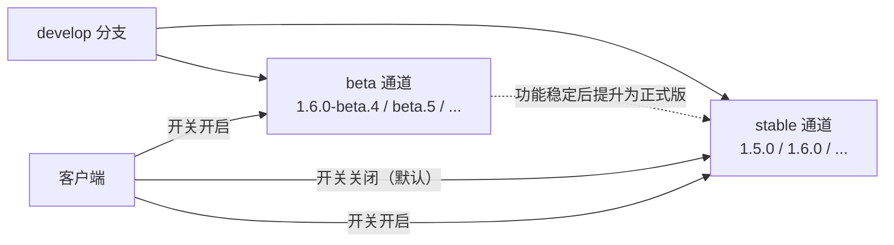
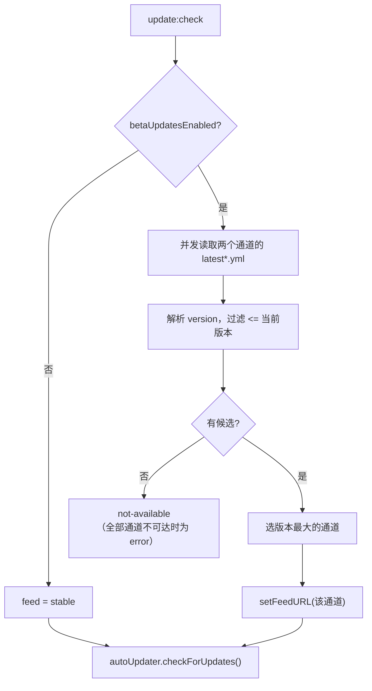

# 发版通道与 Beta 更新

> 文档定位：说明 MarkIt 的 stable / beta 双通道模型、版本号规则、发版节点记录方式，以及客户端的「接收 Beta 版更新」开关。面向维护者与更新相关开发者。客户端运行时机制见 [自动更新](./自动更新.md)，发版操作见 [GitHub Actions 发版说明](./github-release.md) 与 [构建与发布](./构建与发布.md)。

## 1. 通道模型

| 通道     | apphub channel code | 更新端点                                                                      | 用途                           |
| -------- | ------------------- | ----------------------------------------------------------------------------- | ------------------------------ |
| `stable` | `stable`            | `https://appcenter.witice.top/api/update/ah_q100pquj6kxxj9at/stable/electron` | 正式版，按固定节点或必要时发布 |
| `beta`   | `beta`              | `https://appcenter.witice.top/api/update/ah_q100pquj6kxxj9at/beta/electron`   | 小功能高频验证，用户可选接收   |

两个通道各自维护版本列表，互不影响；同一个版本号不会同时出现在两个通道。



## 2. 版本号规则

### 2.1 预发布语义

beta 版本使用 semver 预发布后缀，表示「下一个正式版的预发布版」：

```text
1.6.0-beta.1  <  1.6.0-beta.2  <  1.6.0
```

因此 beta 用户能持续收到 beta，正式版发布后也能自动「升级」到正式版。版本号必须带 `v` 前缀的 tag（`v1.6.0-beta.1`），安装包内的版本号为去掉 `v` 的形式。

### 2.2 严格单序列

**任何新版本（不论通道）都必须大于已发布的全部版本。** 这是本项目的强制约束，由 CI 校验。

| 规则                                                   | 说明                                                                       |
| ------------------------------------------------------ | -------------------------------------------------------------------------- |
| beta 的 base 必须是下一个要发布的正式版                | 纯修复线用 `1.5.1-beta.N`；含功能用 `1.6.0-beta.N`                         |
| beta 的 base 必须严格大于最后一个正式版                | `1.5.0` 之后可以是 `1.5.1-beta.1`，不能是 `1.5.0-beta.1` 或 `1.4.2-beta.1` |
| 同一 base 内 `beta.N` 递增，换 base 时从 `beta.1` 重来 | `1.6.0-beta.1` → `1.6.0-beta.2`；之后 `1.6.1-beta.1`                       |
| 不允许在 beta 线打开时发布更低的正式版                 | 已有 `1.6.0-beta.3` 时不能再发 `1.5.1` 正式版                              |
| 正式版发布时使用 beta 的 base 版本                     | `1.6.0-beta.3` 验证通过后发布 `1.6.0`                                      |

推荐写法是 `-beta.1`（点号），不要用 `-beta-1` 或 `-beta1`。点号是 semver 标准分隔符，`beta.2 < beta.10` 按数字比较。

### 2.3 版本线示例

| 已发布            | 下一个版本的合法选择                    | 说明                                      |
| ----------------- | --------------------------------------- | ----------------------------------------- |
| `1.5.0`（stable） | `1.5.1-beta.1` 或 `1.6.0-beta.1`        | beta 的 base 必须大于 1.5.0               |
| `1.5.1-beta.1`    | `1.5.1-beta.2`、`1.5.1`、`1.6.0-beta.1` | 可以继续 beta、提升为正式版，或换下一条线 |
| `1.5.1`           | `1.6.0-beta.1`、`1.5.2-beta.1`          | 上一条 beta 线已关闭                      |
| `1.6.0-beta.3`    | `1.6.0-beta.4`、`1.6.0`                 | 不能再发 `1.5.2`、`1.5.1` 等更低的正式版  |

### 2.4 紧急修复

严格单序列下，beta 线打开期间不能回头发更低的正式补丁。紧急修复按以下方式处理：

1. 把修复提交进当前 beta 线，发布 `1.6.0-beta.4`；
2. 尽快发布 `1.6.0` 正式版，让正式版用户拿到修复。

如果修复只影响正式版且无法等待，直接把当前 beta base 发布为正式版（可以先回退未稳定的功能）。**不要**为了抢发补丁而破坏版本单调性。

## 3. 发版节点记录

### 3.1 tag 即账本

两个通道都只依赖 git tag 记录发版节点，不维护额外的人工清单：

| 通道     | tag 格式        | 「上一个发版节点」                 |
| -------- | --------------- | ---------------------------------- |
| `stable` | `v1.5.0`        | 版本号最大的、不含预发布后缀的 tag |
| `beta`   | `v1.6.0-beta.2` | 版本号最大的、含预发布后缀的 tag   |

tag 由发版流水线在 `publish` 与 `verify` 成功之后创建（或由维护者在触发前手动创建），因此它天然代表「已发布」。不要用 `git describe` 取全局最新 tag——那会把另一个通道的节点也算进来。

### 3.2 更新说明收集

每个通道只从自己的上一个节点开始收集：

```bash
# beta：上一次 beta 之后的改动
git log v1.6.0-beta.1..HEAD --no-merges --pretty='- %s'

# stable：上一次正式版之后的全部改动（包含其间所有 beta 的提交）
git log v1.5.0..HEAD --no-merges --pretty='- %s'
```

stable 的说明必须覆盖自上一次正式版以来的**全部**用户可感知变化，不能只写最后一个 beta 的增量；beta 的说明只写本次 beta 的增量。自动生成的是 commit 标题，仍需按 [更新说明撰写规则](./github-release.md#31-更新说明撰写规则) 提炼。

### 3.3 发版节点工具

`scripts/release/channel-state.mjs` 是通道状态的唯一计算入口，workflow 与本地都调用它：

```bash
# 查看两个通道各自的最后节点、自那以后的提交数与建议版本
node scripts/release/channel-state.mjs status

# 输出某个通道的上一个节点（排除当前版本）
node scripts/release/channel-state.mjs previous-tag --channel beta --version 1.6.0-beta.3

# 校验版本是否满足严格单序列（CI 的 validate 阶段调用）
node scripts/release/channel-state.mjs validate --version 1.6.0-beta.3

# 输出版本所属通道
node scripts/release/channel-state.mjs channel --version 1.6.0-beta.3
```

`validate` 的校验项：

1. 版本号是合法 semver，且预发布后缀只能是 `-beta.N`；
2. 版本号严格大于所有已发布的 tag（同版本重跑除外）；
3. beta 的 base 严格大于最后一个正式版；
4. 正式版不带预发布后缀。

### 3.4 废弃发布的处理

如果某个 tag 已经创建但发布失败并被放弃，必须删除该 tag 后再发下一个版本，否则下一个版本的说明会从失败的 tag 开始收集，漏掉这段提交：

```bash
git tag -d v1.6.0-beta.3
git push origin :refs/tags/v1.6.0-beta.3
```

tag 删除后，下一次发版会回退到再上一个同通道节点重新收集。

## 4. 客户端 Beta 开关

### 4.1 行为

设置页「关于」区域提供「接收 Beta 版更新」开关，默认关闭。

| 开关 | 检测范围          | 结果                                     |
| ---- | ----------------- | ---------------------------------------- |
| 关闭 | 仅 `stable`       | 只接收正式版                             |
| 开启 | `stable` + `beta` | 接收两个通道中**大于当前版本**的最大版本 |

开关状态按机器持久化，与当前安装的版本通道无关。

### 4.2 双通道选择算法

不能简单地「先查 beta，再查 stable」，否则会漏掉比 beta 更新的正式版（例如当前 `1.5.0-beta.2`、beta 最新 `1.5.0-beta.3`、stable 已发 `1.5.0`）。正确做法是同时取两个通道的最新版本再比较：



实现细节：

1. 读取的元数据文件与 electron-updater 完全相同：Windows `latest.yml`、macOS `latest-mac.yml`、Linux `latest-linux.yml`；URL 追加 `noCache` 查询参数避免 CDN 缓存。
2. 选中通道后仍由 `autoUpdater.checkForUpdates()` 执行正式检测与下载，`[force]`、blockmap 差分、下载进度保持原生行为。
3. `beta` 端点返回 404（通道为空或尚未发布）视为「没有 beta」，不报错，保证首次上线时开关不会把更新检查变成失败。
4. 单个通道读取失败时降级到另一个通道；只有两个通道都不可达才进入 `error`。
5. `update-available` 时把实际命中的通道写入 `latestChannel`，UI 据此展示 Beta 徽标。

### 4.3 边界行为

| 场景                                 | 行为                                                                                       |
| ------------------------------------ | ------------------------------------------------------------------------------------------ |
| 关闭开关时正在运行 beta 版本         | **不回退**（semver 不允许降级）；下一个正式版发布后自动归队，例如 `1.6.0-beta.3` → `1.6.0` |
| 关闭开关时已有 beta 更新提示         | 立即清除提示并按正式版重新检测                                                             |
| 关闭开关时 beta 更新正在下载或已下载 | 不打断当前下载/安装；下一次检测按新偏好执行                                                |
| 开启开关但当前已是更高正式版         | 不会降低到 beta（只比较大于当前版本的候选）                                                |
| beta 通道为空                        | 按「无 beta」处理，只接收正式版                                                            |
| 切换开关时正在检测                   | 持久化偏好，并在本次检测结束后按新偏好再检测一次                                           |

### 4.4 持久化

开关保存在主进程 userData 下的 `update-preference.json`：

```json
{ "betaUpdatesEnabled": false }
```

放在主进程而不是 localStorage 的原因：启动 3 秒后的静默检测发生在渲染进程上报之前，主进程必须能独立读到偏好。文件读取失败、损坏或字段缺失时一律按 `false` 处理。

### 4.5 契约变更

`UpdateState` 新增字段（定义见 `src/shared/update-types.ts`）：

| 字段                 | 类型                         | 说明                                              |
| -------------------- | ---------------------------- | ------------------------------------------------- |
| `currentChannel`     | `'stable' \| 'beta'`         | 当前运行版本所属通道（版本号含预发布后缀即 beta） |
| `betaUpdatesEnabled` | `boolean`                    | 是否接收 Beta 版更新                              |
| `latestChannel`      | `'stable' \| 'beta'`（可选） | 本次提供的更新来自哪个通道；无更新时为空          |

新增 IPC 通道：

| 通道                      | 方向   | 参数      | 返回          | 说明                                       |
| ------------------------- | ------ | --------- | ------------- | ------------------------------------------ |
| `update:set-beta-enabled` | invoke | `boolean` | `UpdateState` | 持久化开关；空闲状态下立即按新偏好重新检测 |

preload 暴露为 `window.api.update.setBetaEnabled(enabled)`。

## 5. 发版流程

### 5.1 发布 beta

```bash
# 1. 确认两个通道的节点与待收录提交
node scripts/release/channel-state.mjs status

# 2. 按 3.1 规则确定版本号，例如 1.6.0-beta.1
# 3. 手动触发（推荐，说明需人工提炼）
gh workflow run release.yml --ref master \
  -f version=1.6.0-beta.1 \
  -f notes="- 新增：……
- 优化：……"
```

流水线会根据版本号自动识别为 beta 通道、使用 `.apphub-release.beta.ci.json`、按 beta 节点收集提交，并把 GitHub Release 标记为 prerelease。

### 5.2 发布正式版

```bash
node scripts/release/channel-state.mjs status
gh workflow run release.yml --ref master \
  -f version=1.6.0 \
  -f notes="- 新增：……"
```

正式版说明必须覆盖自上一个正式版以来的全部改动，包含期间所有 beta 里已经验证过的内容。

### 5.3 首次上线顺序

1. 在 apphub 控制台创建 `beta` 通道（已完成）；
2. 发布一个带 Beta 开关的正式版（例如 `1.5.1`），让稳定用户拿到开关；
3. 之后开始第一条 beta 线（例如 `1.6.0-beta.1`）。

如果先在 beta 通道发布带开关的版本，正式版用户拿不到开关，需要等下一次正式版。

### 5.4 发布方式选择

- 推荐 `workflow_dispatch` 手动触发，便于传入提炼后的更新说明；
- 标签触发仅适用于说明无需人工整理的内部版本；
- 不要用 `--channel` 参数切换通道（`upload` 子命令不支持），统一通过配置文件切换。

## 6. 验证

### 6.1 自动化

```bash
npm test          # 通道选择、版本比较、元数据解析的纯函数用例
npm run lint
npm run typecheck
npm run build     # 涉及 workflow / 配置改动时必须执行
```

### 6.2 手工

更新检测只在打包产物中生效（开发模式 `disabled`）：

1. `npm run build:unpack` 后运行 `dist/win-unpacked/Mark It.exe`；
2. 关闭开关：设置页应只看到正式版更新；
3. 打开开关：应看到两个通道中较新的版本，且版本旁显示 Beta 徽标；
4. 切换到 beta 版本后关闭开关：重启后不应提示降级，等待下一个正式版归队；
5. beta 通道为空时打开开关：应显示「已是最新版本」，不出现错误。

涉及主进程 / IPC 的改动还需按 [测试与质量保障](./测试与质量保障.md) 执行 `npm run dev` 启动验证。

## 7. 相关文件

| 文件                                                                                                                    | 作用                                                  |
| ----------------------------------------------------------------------------------------------------------------------- | ----------------------------------------------------- |
| [`src/main/updater.ts`](../src/main/updater.ts)                                                                         | 双通道检测、偏好持久化、更新 IPC                      |
| [`src/main/update-channel.ts`](../src/main/update-channel.ts)                                                           | 通道文件名、版本解析与比较、候选选择（纯函数）        |
| [`src/shared/update-types.ts`](../src/shared/update-types.ts)                                                           | 更新状态与通道类型                                    |
| [`src/renderer/src/stores/update.ts`](../src/renderer/src/stores/update.ts)                                             | 渲染层状态镜像与开关操作                              |
| [`src/renderer/src/components/settings/SettingsDialog.vue`](../src/renderer/src/components/settings/SettingsDialog.vue) | Beta 开关与版本展示                                   |
| [`scripts/release/channel-state.mjs`](../scripts/release/channel-state.mjs)                                             | 发版节点查询与版本校验                                |
| [`.github/workflows/release.yml`](../.github/workflows/release.yml)                                                     | 按通道构建、发布与同步 GitHub Release                 |
| [`.apphub-release.ci.json`](../.apphub-release.ci.json) / `.apphub-release.beta.ci.json`                                | stable / beta 通道的 CI 发版配置                      |
| [`docs/自动更新.md`](./自动更新.md)                                                                                     | 更新状态机与运行时行为                                |
| [`docs/github-release.md`](./github-release.md)                                                                         | 发版步骤、Secrets 与错误码                            |
| [`rules/release.md`](../rules/release.md)                                                                               | AI 必须遵守的发版规则（版本、节点、操作、客户端契约） |
