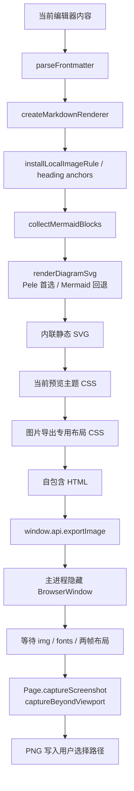

# 图片导出

本文说明 MarkIt 的当前文档长图导出能力，覆盖入口、渲染管线、主进程截图、尺寸限制、错误恢复与验收要求。文中实现契约以源码为准。

## 1. 产品范围

第一版只导出**当前激活文档**，不读取磁盘文件，也不等待用户先保存：

- 输出格式为 PNG。
- 导出一整张长图，不按页拆分。
- 正文渲染在 800 CSS px 宽的内容区，四周保留 32 px 上下、40 px 左右内边距。
- 默认按 2 倍像素密度截图，即画布约 1760 px 宽。
- 默认跟随当前界面深色 / 浅色主题与当前预览样式。
- 保留 Frontmatter 文档信息表、代码高亮、任务列表、表格、引用、本地图片和 Mermaid 图表。
- 不导出工具栏、标签页、大纲、搜索高亮、Mermaid 交互按钮或表格拖拽手柄。
- 保存对话框默认使用当前文档名派生 `.png` 文件名，并定位到文档所在目录；未命名文档回退为 `untitled.png`。
- 第一版不增加快捷键，不提供宽度、格式或主题选择对话框。

## 2. 入口与状态

工具栏在“导出 PDF”旁提供“导出长图”按钮。点击后直接打开系统保存对话框。

导出统一由 `stores/app.ts` 的导出状态驱动：

| 状态         | 界面表现                                           |
| ------------ | -------------------------------------------------- |
| `exporting`  | 状态栏显示“图片导出中…”；工具栏入口禁用并防重入     |
| `success`    | 状态栏显示“图片导出成功”，约 3 秒后回到空闲         |
| `error`      | 状态栏显示“图片导出失败”，约 3 秒后回到空闲         |
| 用户取消保存 | 立即回到空闲，不视为失败                           |

PDF 与图片共用同一套导出状态，同时记录当前导出类型，避免状态栏出现两套重复逻辑。

## 3. 渲染管线

渲染进程负责把 Markdown 变成可直接截图的静态页面：

1. 使用 `createMarkdownRenderer({ typographer: true })`，与预览保持一致。
2. 通过 `installLocalImageRule` 将相对图片路径解析为 `markit-file://`。
3. 将 Frontmatter 渲染为文档信息表。
4. 使用与当前主题一致的 `DiagramThemeTokens` 将 Mermaid 渲染为静态 SVG。
5. 注入当前预览样式和自定义 CSS，再追加图片专用 CSS。
6. 使用固定宽度页面，避免截图结果依赖当前窗口大小。

图片专用 CSS 必须处理以下差异：

- 使用实色背景，深色固定为 `#121218`，浅色固定为 `#ffffff`。
- 代码块改为自动换行，避免横向滚动区域在截图中被裁切。
- 表格单元格允许长内容换行。
- 图片和 SVG 最大宽度不超过正文区域。
- 预览中的交互控件不应进入生成 HTML。

## 4. 主进程截图

`export:image` 与 `export:pdf` 保持相同的保存对话框和临时文件策略：

1. 根据当前文档派生 `.png` 默认路径并打开系统保存对话框。
2. 校验 HTML 体积，当前上限为 64 MB。
3. 将 HTML 写入系统临时目录，使用隐藏 `BrowserWindow` 加载。
4. 等待图片加载、字体就绪、两帧布局完成；固定等待只作兜底。
5. 测量 `.image-export-page` 的实际 CSS 宽高。
6. 根据尺寸预算选择 2 倍或 1 倍截图倍率。
7. 通过 `webContents.debugger` 调用 Chromium `Page.captureScreenshot`，开启 `captureBeyondViewport`，一次截取整页。
8. 写入 PNG，并在 `finally` 中断开调试器、销毁隐藏窗口、删除临时 HTML。

隐藏窗口不加载 preload，不开放 Node / Electron 能力。

## 5. 尺寸与失败边界

单张位图受 Chromium 像素尺寸和内存限制，不能承诺无限长：

- 常规文档优先输出 2 倍图。
- 预计输出高度或总像素超过预算时，自动退回 1 倍。
- 1 倍仍超过限制时中止导出，并在系统错误框中说明图片过长。
- HTML 超过 64 MB 时中止导出。
- 图片缺失、网络图片超时或字体加载失败不应无限阻塞；整页等待有固定兜底时间。

超长文档的自动分块截图与无损拼接不属于第一版范围。

## 6. 失败恢复

| 场景                         | 预期行为                                                       |
| ---------------------------- | -------------------------------------------------------------- |
| 用户在保存对话框取消         | 返回 `null`，状态栏回到空闲                                    |
| 重复点击导出                 | 第二次点击被忽略，不叠加保存对话框                             |
| 页面加载、测量或截图异常     | 状态栏显示失败，系统错误框给出原因，无残留窗口或临时文件       |
| 本地图片不存在               | 图片位置为空，其余内容继续导出                                 |
| Mermaid 单块渲染失败         | 保留原始代码块并输出可见错误提示，其余内容继续导出             |
| 图片尺寸超限                 | 自动降为 1 倍；仍超限时明确失败，不写入残缺文件                 |

## 7. 验证要求

自动验证：

- `npm run lint`
- `npm run typecheck`
- `npm test`
- `npm run build`
- `npm run test:e2e`

图片导出 e2e 至少验证：

1. 通过工具栏触发导出。
2. 系统保存对话框被替换为临时路径。
3. 产物存在且以 PNG 文件签名开头。
4. 读取产物尺寸，确认宽高符合 2 倍输出并包含完整长页。
5. 默认文件名来自当前文档并位于文档目录。

手工验证：

1. 含多级标题、长段落、引用、代码块、表格、任务列表的长文档完整导出，底部内容不缺失。
2. 深色与浅色主题各导出一次，背景和正文配色与预览一致。
3. GitHub、Academic、自定义 CSS 各验证一次。
4. 相对路径图片、网络图片和缺失图片各验证一次。
5. Mermaid 正常图表与语法错误图表各验证一次。
6. 用户取消保存后，状态栏不残留失败提示。
7. PDF 导出仍正常，确认共享导出状态与渲染工具改动没有回归。

## 8. 涉及文件

| 文件 | 职责 |
| --- | --- |
| `src/shared/image-types.ts` | 图片导出跨进程选项 |
| `src/main/image-export.ts` | 截图倍率与尺寸预算纯函数 |
| `src/main/index.ts` | `export:image` 保存对话框、隐藏窗口、截图与清理 |
| `src/preload/index.ts` | `window.api.exportImage` |
| `src/renderer/src/composables/useImageExport.ts` | 当前文档 HTML 组装与静态 Mermaid 渲染 |
| `src/renderer/src/utils/export-markdown.ts` | PDF / 图片共用的导出 Mermaid 渲染 |
| `src/renderer/src/styles/export/image-export.css` | 长图专用背景、换行和内容布局 |
| `src/renderer/src/components/layout/Toolbar.vue` | 导出长图入口 |
| `src/renderer/src/components/layout/StatusBar.vue` | 图片与 PDF 导出状态展示 |
| `src/renderer/src/stores/app.ts` | 统一导出任务状态 |
