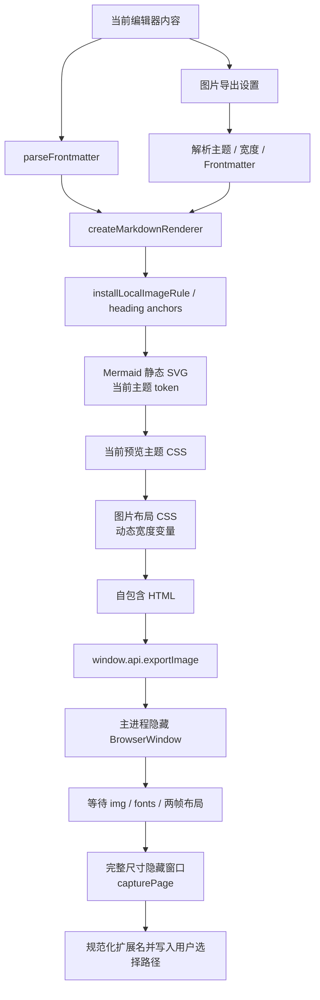

# 图片导出

本文说明 MarkIt 的当前文档长图导出能力，覆盖设置对话框、格式与尺寸、主题渲染、主进程截图、错误恢复和验收要求。文中契约以源码为准。

## 1. 产品范围

图片导出只处理**当前激活文档**，不读取磁盘上的旧版本，也不要求用户先保存：

- 输出一整张长图，不按页拆分。
- 支持 PNG 与 JPEG；JPEG 固定使用高质量 92。
- 正文宽度支持 640 / 800 / 1000 / 1200 px。
- 输出倍率支持 1× / 2×。
- 主题支持跟随当前、固定浅色、固定深色。
- 可选择是否输出 Frontmatter 文档信息表。
- 保留代码高亮、任务列表、表格、引用、本地图片和 Mermaid 图表。
- 不导出工具栏、标签页、大纲、搜索高亮、Mermaid 交互按钮或表格拖拽手柄。
- 默认文件名为当前文档名派生，并定位到文档所在目录；未命名文档回退为 `untitled.png` / `untitled.jpg`。

第二版 P0 的完整设计记录见[图片导出设置方案](./图片导出设置方案.md)。

## 2. 入口与状态

工具栏“导出长图”先打开当前编辑窗口内的设置对话框，确认后再打开系统保存对话框。

导出统一由 `stores/app.ts` 的导出状态驱动：

| 状态         | 界面表现                                                   |
| ------------ | ---------------------------------------------------------- |
| `exporting`  | 状态栏显示阶段、百分比和流动进度条；工具栏入口禁用并防重入 |
| `success`    | 状态栏显示“图片导出成功”，约 3 秒后回到空闲                |
| `error`      | 状态栏显示“图片导出失败”，约 3 秒后回到空闲                |
| 自动降倍率   | 成功提示补充“已自动降至 1×”                                |
| 用户取消保存 | 立即回到空闲，不视为失败                                   |

PDF 与图片共用同一套导出任务状态，同时记录当前导出类型和一次性详情。

导出进度通过带 `requestId` 的 `export:progress` 事件推送，只更新发起任务的编辑窗口。图片导出的事件阶段、长截图限制、状态栏呈现和验证矩阵见[导出反馈与进度](./导出反馈与进度.md)。

### 2.1 设置对话框

设置对话框通过 `Teleport` 挂在当前编辑窗口内，不创建独立 `BrowserWindow`。

对话框行为：

1. 打开时读取上一次确认导出的有效设置。
2. 修改字段不会立即覆盖持久化设置。
3. 点击“导出”时保存设置，对话框收束到状态栏的导出状态锚点后关闭。
4. 点击“取消”、遮罩或关闭按钮不会改变已保存设置。
5. “恢复默认”只重置当前草稿，仍需点击“导出”才持久化。
6. 图片导出进行中时，图片与 PDF 导出入口均不可用。
7. `Ctrl + P` 仍只打开 PDF 导出；第二版没有图片导出快捷键。

### 2.2 窗口形态

1. 系统保存对话框必须以发起导出的编辑窗口作为父窗口，保持跟随当前编辑窗口显示器。
2. 主进程用于加载 HTML、测量尺寸和执行截图的 `BrowserWindow` 是隐藏任务窗口，不面向用户，不参与独立窗口放置或全局单实例规则，但必须在 `finally` 中销毁。
3. 若后续增加图片宽度、倍率、格式、主题、导出预览或进度详情，优先采用当前编辑窗口内的页内对话框。
4. 若后续将图片导出选项或预览做成独立 `BrowserWindow`，必须明确全局单实例或按窗口 / 文档单例的作用域、唯一键与关闭回收规则。
5. 任何独立窗口都不得只依赖 `center: true` 猜测显示器；触发来源必须由 IPC `event.sender` 或鼠标锚点确定。完整要求见[窗口放置与单实例规则](./窗口放置与单实例规则.md)。

## 3. 导出设置

| 设置项               | 合法值                             | 默认值      |
| -------------------- | ---------------------------------- | ----------- |
| `format`             | `'png'` / `'jpeg'`                 | `'png'`     |
| `contentWidth`       | `640` / `800` / `1000` / `1200`    | `800`       |
| `scale`              | `1` / `2`                          | `2`         |
| `theme`              | `'preview'` / `'light'` / `'dark'` | `'preview'` |
| `includeFrontmatter` | `boolean`                          | `true`      |

画布宽度固定为：

```text
canvasWidth = contentWidth + 80
```

左右内边距各 40 px，上下各 32 px。

| 正文宽度 | 画布宽度 | 1× 输出宽度 | 2× 输出宽度 |
| -------- | -------: | ----------: | ----------: |
| 640 px   |   720 px |      720 px |     1440 px |
| 800 px   |   880 px |      880 px |     1760 px |
| 1000 px  |  1080 px |     1080 px |     2160 px |
| 1200 px  |  1280 px |     1280 px |     2560 px |

高度根据实际内容测量，不提供固定值。

### 3.1 设置持久化

设置存储在：

```text
markit-image-export-settings
```

值为 JSON 形式的 `ImageExportSettings`。读写集中在 `stores/export-settings.ts`，并在所有编辑窗口间通过 `storage` 事件同步。

读取时逐字段校验：

- 非对象或损坏 JSON 回退整组默认值；
- 非法枚举和宽度回退对应默认值；
- 合法字段保留，不因单个字段损坏丢弃全部设置。

### 3.2 主题与 Frontmatter

`theme: 'preview'` 时使用当前应用的解析后主题；固定浅色 / 深色只影响本次导出图片，不切换应用界面。

`includeFrontmatter: false` 时：

- 仍调用 `parseFrontmatter` 移除 YAML 头；
- 只渲染正文；
- 不生成 `.frontmatter-block`。

## 4. 渲染管线



渲染进程负责：

1. 使用 `createMarkdownRenderer({ typographer: true })`，与预览保持一致。
2. 通过 `installLocalImageRule` 将相对图片路径解析为 `markit-file://`。
3. 根据设置决定是否输出 Frontmatter 文档信息表。
4. 根据解析后的主题生成预览 CSS、代码高亮配色和 Mermaid `DiagramThemeTokens`。
5. 将正文宽度与画布宽度写入 CSS 自定义变量。
6. 生成固定宽度、实色背景的自包含 HTML。

图片专用 CSS 处理以下差异：

- 深色背景 `#121218`，浅色背景 `#ffffff`；
- 代码块自动换行，避免横向滚动区域被裁切；
- 表格单元格允许长内容换行；
- 图片和 SVG 不超过正文区域；
- 不包含预览交互控件。

## 5. 主进程截图

`export:image` 流程：

1. 校验格式、正文宽度、倍率和 HTML 参数。
2. 根据格式打开 PNG 或 JPEG 保存对话框并派生默认文件名。
3. 校验 HTML 体积，当前上限为 64 MB。
4. 将 HTML 写入系统临时目录，使用隐藏 `BrowserWindow` 加载。
5. 根据所选正文宽度设置隐藏窗口宽度，避免 1000 / 1200 px 页面在过窄视口中错误换行。
6. 等待图片加载、字体就绪和两帧布局完成，固定等待仅作兜底；隐藏窗口设置 `backgroundThrottling: false`，避免后台节流拖慢布局。
7. 以 `.image-export-page` 的实际宽度作为画布宽度，以完整文档高度作为截图高度。
8. 根据尺寸预算选择请求倍率或自动降至 1×。
9. 将隐藏窗口的缩放倍率设为实际倍率，并把内容视口调整为 `画布尺寸 × 实际倍率`，让 `webContents.capturePage()` 一次截取完整长图。
10. 输出尺寸与预期不一致时，以实际像素尺寸校正结果；图像小于预期视口时中止导出，避免生成被裁切的残缺图片。
11. PNG 编码为 `toPNG()`，JPEG 固定使用 `toJPEG(92)`；校正保存路径扩展名后写入文件。
12. 页面加载、尺寸测量和截图调用均有独立超时；任一阶段超时都会中止任务并释放 UI，不允许导出 Promise 永久悬挂。
13. 在 `finally` 中销毁隐藏窗口并删除临时 HTML。

隐藏窗口不加载 preload，不开放 Node / Electron 能力。

进度百分比按准备内容、渲染图表、加载页面、等待图片与字体、测量版面、生成图片、写入文件推进。`capturePage` 是单次 Electron 调用，没有内部字节级进度；停留在“生成图片”阶段时用流动进度条表示任务仍在工作，不伪造截图字节进度。

### 5.1 返回结果

`export:image` 返回 `Promise<ImageExportResult | null>`：

| 字段                         | 说明             |
| ---------------------------- | ---------------- |
| `filePath`                   | 实际保存路径     |
| `format`                     | 实际格式         |
| `requestedScale`             | 用户请求倍率     |
| `appliedScale`               | 实际使用倍率     |
| `pixelWidth` / `pixelHeight` | 实际输出像素尺寸 |

用户取消保存返回 `null`。

### 5.2 文件扩展名

- PNG 默认使用 `.png`；
- JPEG 默认使用 `.jpg`，也接受已有 `.jpeg`；
- 其它图片扩展名会替换为所选格式；
- 无扩展名时自动追加；
- 不允许产生 JPEG 字节配 `.png` 后缀的文件。

## 6. 尺寸与失败边界

单张位图受 Chromium 像素尺寸和内存限制，不能承诺无限长：

- 常规文档优先输出请求倍率；
- 预计输出高度或总像素超过预算时，自动退回 1×；
- 1× 仍超过限制时中止导出并明确提示图片过长；
- HTML 超过 64 MB 时中止导出；
- 图片缺失、网络图片超时或字体失败不应无限阻塞；
- 设置损坏时逐字段回退，不阻止导出。

超长文档的自动分块截图与无损拼接不属于第二版 P0。

## 7. 失败恢复

| 场景                     | 预期行为                                   |
| ------------------------ | ------------------------------------------ |
| 用户取消设置对话框       | 不打开保存对话框，不修改已保存设置         |
| 用户在保存对话框取消     | 返回 `null`，状态栏回到空闲                |
| 重复点击导出             | 第二次触发被忽略，不叠加任务               |
| 页面加载、测量或截图异常 / 超时 | 状态栏失败，系统错误框给出原因，无残留资源 |
| 本地图片不存在           | 图片位置为空，其余内容继续导出             |
| Mermaid 单块失败         | 保留代码块和可见错误提示，其余内容继续     |
| 尺寸超限                 | 自动降为 1×；仍超限时明确失败              |
| 扩展名与格式不一致       | 保存前自动规范扩展名                       |

## 8. 验证要求

自动验证：

- `npm run lint`
- `npm run typecheck`
- `npm test`
- `npm run build`
- `npm run test:e2e`

e2e 至少覆盖：

1. 点击入口后先显示设置对话框。
2. 默认设置正确。
3. 1000 px + 1× 的 PNG 宽度为 1080 px。
4. JPEG 文件签名和扩展名正确。
5. 设置值在下一轮打开时恢复。
6. Frontmatter、主题、取消和状态栏路径。
7. PDF 导出不回归。

手工验证：

1. 640 / 800 / 1000 / 1200 四档宽度。
2. PNG / JPEG 与浅色 / 深色 / 跟随当前主题组合。
3. GitHub、Academic、自定义 CSS。
4. 本地图片、网络图片、缺失图片和 Mermaid。
5. 超长文档自动降倍率及状态栏提示。
6. 确认后对话框收束到状态栏；取消、关闭和遮罩不播放收束动画。
7. 百分比与阶段依次推进；长截图阶段流动动效持续；浅色 / 深色状态栏均清晰。
8. 系统减少动态效果时动画降级；多窗口导出进度互不串扰。

## 9. 涉及文件

| 文件                                                       | 职责                                               |
| ---------------------------------------------------------- | -------------------------------------------------- |
| `src/shared/image-types.ts`                                | 设置、请求与结果跨进程类型                         |
| `src/renderer/src/utils/image-export-settings.ts`          | 默认值、合法范围与设置归一化                       |
| `src/renderer/src/stores/export-settings.ts`               | 设置持久化与跨窗口同步                             |
| `src/renderer/src/components/export/ImageExportDialog.vue` | 导出设置对话框                                     |
| `src/renderer/src/composables/useImageExport.ts`           | 当前文档 HTML 组装与静态 Mermaid 渲染              |
| `src/renderer/src/styles/export/image-export.css`          | 动态宽度、背景、换行与内容布局                     |
| `src/main/image-export.ts`                                 | 倍率、扩展名与结果尺寸纯函数                       |
| `src/main/index.ts`                                        | `export:image` 保存、隐藏窗口、PNG/JPEG 截图与清理 |
| `src/preload/index.ts`                                     | `window.api.exportImage`                           |
| `src/shared/export-types.ts`                               | 导出类型与进度事件共享载荷                         |
| `src/renderer/src/components/layout/Toolbar.vue`           | 导出长图入口                                       |
| `src/renderer/src/components/layout/StatusBar.vue`         | 导出锚点、阶段、百分比、进度条与结果状态           |
| `src/renderer/src/stores/app.ts`                           | 对话框显隐、统一导出状态与单调进度                 |
| `src/renderer/src/composables/useExportDialogCollapse.ts`  | 对话框到状态栏锚点的收束动画                       |
