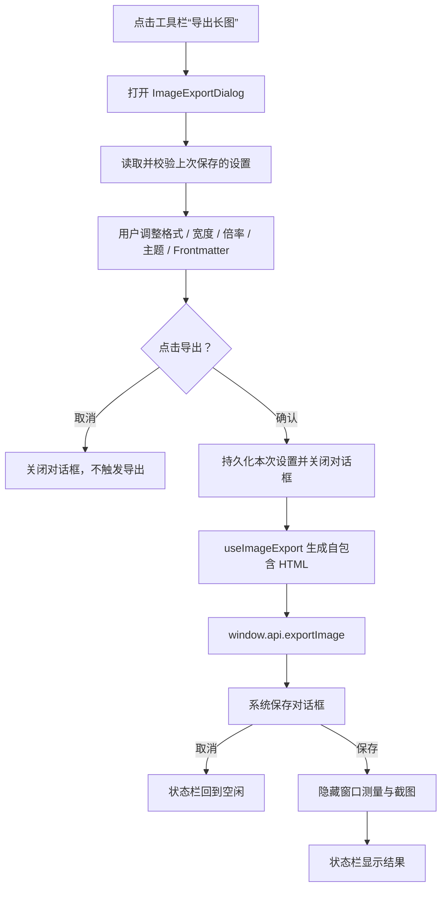

# 图片导出设置第二版方案

> 状态：P0 已实施。本文记录第二版设计、最终契约与验收边界；当前行为同时以[图片导出](./图片导出.md)和源码为准。

## 1. 背景

第一版长图导出固定使用 PNG、正文宽度 800 px、2 倍截图，并跟随当前预览主题。它适合作为快速导出入口，但用户无法针对分享场景选择：

- 文件格式与体积；
- 长图正文宽度；
- 清晰度；
- 浅色或深色版本；
- 是否包含 Frontmatter 文档信息。

第二版为图片导出增加一组可控参数，同时保持“当前文档、一整张长图、主进程隐藏窗口截图”的既有架构。

## 2. 目标与非目标

### 2.1 目标

1. 在真正开始导出前提供页内设置对话框。
2. 支持 PNG / JPEG 两种格式。
3. 支持常用正文宽度和 1× / 2× 清晰度。
4. 支持跟随当前主题、固定浅色、固定深色。
5. 支持选择是否输出 Frontmatter 文档信息表。
6. 记住上一次成功确认的导出设置。
7. 保持当前文档内容、预览样式、Mermaid、本地图片和尺寸预算行为。
8. 不新增独立窗口、IPC 通道或第三方依赖。

### 2.2 非目标

以下能力不进入第二版：

- WebP、GIF、SVG 等额外格式；
- 透明背景；
- JPEG 质量滑杆；
- 自定义内边距；
- 页面头部、页脚、水印或时间戳；
- 导出后的独立预览窗口；
- 超长图片分块截图与无损拼接；
- 在设置页中维护全局图片导出偏好。

## 3. 方案比较

| 方案                      | 做法                                                                     | 优点                                                                | 缺点                                                   | 结论                           |
| ------------------------- | ------------------------------------------------------------------------ | ------------------------------------------------------------------- | ------------------------------------------------------ | ------------------------------ |
| A. 页内设置对话框         | 工具栏打开当前编辑窗口内的 `Teleport` 模态框，确认后再打开系统保存对话框 | 与 PDF 导出一致；天然跟随当前窗口和显示器；无需窗口注册与单实例规则 | 不能在保存前实时预览长图                               | **推荐**                       |
| B. 独立设置窗口           | 新建 `BrowserWindow` 承载设置                                            | 可容纳大型预览                                                      | 需要处理多显示器归属、单实例、焦点、关闭回收和生命周期 | 第二版不采用                   |
| C. 系统保存对话框承载选项 | 尝试把参数塞入系统保存对话框                                             | 步骤少                                                              | Electron 不支持自定义系统保存对话框字段，无法满足      | 不可行                         |
| D. 直接沿用第一版无设置   | 固定 PNG / 800 / 2×                                                      | 操作最少                                                            | 无法满足第二版目标                                     | 保留为默认值，不再作为唯一入口 |

推荐流程：



## 4. 第二版功能集

### 4.1 P0：本版实现

| 设置项   | 选项                       | 默认值                 | 说明                                              |
| -------- | -------------------------- | ---------------------- | ------------------------------------------------- |
| 格式     | PNG / JPEG                 | PNG                    | JPEG 使用固定高质量 92，减少分享体积              |
| 正文宽度 | 640 / 800 / 1000 / 1200 px | 800 px                 | 画布宽度 = 正文宽度 + 左右各 40 px                |
| 输出倍率 | 1× / 2×                    | 2×                     | 超长文档仍可按现有预算自动降为 1×                 |
| 主题     | 跟随当前 / 浅色 / 深色     | 跟随当前               | 同时影响预览样式、代码高亮和 Mermaid              |
| 文档信息 | 输出 / 不输出              | 输出                   | 控制 Frontmatter 文档信息表                       |
| 记住设置 | 自动                       | 开启                   | 记录最后一次确认导出的有效设置                    |
| 恢复默认 | 按钮                       | 不持久化，直到确认导出 | 恢复 PNG / 800 / 2× / 跟随当前 / 输出 Frontmatter |

画布与输出宽度示例：

| 正文宽度 | 标准画布宽度 | 1× 输出宽度 | 2× 输出宽度 |
| -------- | -----------: | ----------: | ----------: |
| 640 px   |       720 px |      720 px |     1440 px |
| 800 px   |       880 px |      880 px |     1760 px |
| 1000 px  |      1080 px |     1080 px |     2160 px |
| 1200 px  |      1280 px |     1280 px |     2560 px |

高度不提供预估值。实际高度取决于图片加载、字体度量、表格换行、代码块换行和 Mermaid 尺寸，应在隐藏窗口中完成布局后测量。

### 4.2 P1：后续可选

- JPEG 质量档位；
- 自定义正文宽度；
- 内边距档位；
- PNG 透明背景；
- 导出尺寸与文件大小的实时预览；
- 文档标题、日期或品牌页脚。

这些选项只有在真实用户需求出现后扩展，避免第二版设置面板过重。

## 5. 对话框设计

新增 `ImageExportDialog.vue`，放在 `src/renderer/src/components/export/`，视觉结构沿用 `PdfExportDialog.vue`：

1. 标题：“导出长图”。
2. 格式：PNG / JPEG 分段按钮。JPEG 选中时提示“高质量，适合聊天和文档分享”。
3. 正文宽度：四档选择。右侧同步显示实际画布宽度。
4. 清晰度：1× / 2× 分段按钮。右侧显示当前预计输出宽度。
5. 主题：跟随当前 / 浅色 / 深色。
6. 复选框：“输出文档信息（YAML Frontmatter）”，默认勾选。
7. 动态摘要：
   - `画布 880 px，2× 输出约 1760 px 宽`
   - `高度根据内容自动计算`
   - `超长文档可能自动降至 1×`
8. 底部操作：左侧“恢复默认”，右侧“取消 / 导出”。

交互约定：

- 点击遮罩或关闭按钮等同于取消。
- 点击“导出”后立即关闭设置对话框，后续进度由状态栏展示。
- 设置对话框打开期间不生成 HTML，也不打开系统保存对话框。
- 只有用户确认导出时才持久化设置；取消或关闭不覆盖上次有效设置。
- 图片导出进行中，工具栏入口和 PDF 导出入口均应禁用。
- `Ctrl + P` 仍只打开 PDF 导出；第二版不增加图片导出快捷键。

## 6. 数据契约

### 6.1 共享类型

扩展 `src/shared/image-types.ts`：

```ts
export type ImageExportFormat = 'png' | 'jpeg'
export type ImageExportTheme = 'preview' | 'light' | 'dark'
export type ImageContentWidth = 640 | 800 | 1000 | 1200

export interface ImageExportSettings {
  format: ImageExportFormat
  contentWidth: ImageContentWidth
  scale: 1 | 2
  theme: ImageExportTheme
  includeFrontmatter: boolean
}

export interface ImageExportOptions extends ImageExportSettings {
  fileName: string
  sourcePath: string | null
}

export interface ImageExportResult {
  filePath: string
  format: ImageExportFormat
  requestedScale: number
  appliedScale: number
  pixelWidth: number
  pixelHeight: number
}
```

`ImageExportSettings` 是可以在界面和 localStorage 之间复用的设置快照；`ImageExportOptions` 是渲染进程传给主进程的完整请求；`ImageExportResult` 用于反馈自动降倍率等实际结果。

### 6.2 默认值

```ts
export const DEFAULT_IMAGE_EXPORT_SETTINGS: ImageExportSettings = {
  format: 'png',
  contentWidth: 800,
  scale: 2,
  theme: 'preview',
  includeFrontmatter: true
}
```

`src/shared/image-types.ts` 继续保持纯类型边界，不新增运行时默认值。默认设置放在 `stores/export-settings.ts` 或独立的纯函数模块中，由对话框、store 和测试共用同一份定义。

### 6.3 localStorage

新增偏好键：

```text
markit-image-export-settings
```

值为 JSON 形式的 `ImageExportSettings`。读写集中在新增的 `stores/export-settings.ts` 中，不在组件内直接操作 localStorage。

读取时逐字段校验，非法字段单独回退默认值：

| 字段                 | 合法值                           | 非法值处理       |
| -------------------- | -------------------------------- | ---------------- |
| `format`             | `'png' \| 'jpeg'`                | 回退 `'png'`     |
| `contentWidth`       | `640 \| 800 \| 1000 \| 1200`     | 回退 `800`       |
| `scale`              | `1 \| 2`                         | 回退 `2`         |
| `theme`              | `'preview' \| 'light' \| 'dark'` | 回退 `'preview'` |
| `includeFrontmatter` | `boolean`                        | 回退 `true`      |

设置属于应用级偏好，在所有编辑窗口间共用。新窗口通过 `storage` 事件同步，不需要跨进程持久化。

### 6.4 界面状态

`stores/app.ts` 增加：

```text
showImageExportDialog: boolean
exportStatusDetail: string
```

`showImageExportDialog` 只表示当前编辑窗口中设置对话框是否打开，不持久化。PDF 与图片设置对话框不得同时打开。

`exportStatusDetail` 用于状态栏补充“已自动降至 1×”等一次性信息，默认空串，不持久化。PDF 导出不需要详情时保持为空。

## 7. 渲染管线变化

### 7.1 主题解析

`useImageExport` 先解析主题：

```text
theme = 'preview'
  ? app.resolvedTheme
  : options.theme
```

随后使用解析后的 `'light' | 'dark'`：

- 选择对应预览样式 CSS；
- 设置 `<body class="light|dark">`；
- 调用 `getDiagramTheme(isDark)`；
- 设置实色背景：浅色 `#ffffff`，深色 `#121218`。

强制主题不得修改用户当前界面主题，只影响本次导出图片。

### 7.2 宽度与画布

固定内边距为左右各 40 px、上下 32 px。页面宽度由正文宽度计算：

```text
canvasWidth = contentWidth + 80
```

推荐通过 CSS 自定义变量传入：

```css
.image-export-page {
  width: var(--image-canvas-width);
  padding: 32px 40px;
}

.image-export-page .preview-content {
  width: var(--image-content-width);
  max-width: var(--image-content-width);
}
```

不直接复用当前预览区的 `previewWidth`，因为预览宽度可能是 `auto` 或 400–1600 之间的任意值；导出必须使用确定、可重复的预设宽度。

### 7.3 Frontmatter

`includeFrontmatter` 为 `false` 时：

- 仍需要调用 `parseFrontmatter` 移除 YAML 头；
- 只渲染 `body`；
- 不生成 `.frontmatter-block`。

该行为应与 PDF 的同名设置保持一致。

## 8. 主进程变化

### 8.1 保存对话框

默认文件名按格式派生：

- PNG → `.png`；
- JPEG → `.jpg`；
- 保存过滤器名称分别为 `PNG`、`JPEG`。

用户手动输入扩展名时需要退出前统一为所选格式，避免把 JPEG 字节写成 `.png`：

1. 已是目标扩展名：保持。
2. 是其它图片扩展名：替换为目标扩展名。
3. 没有扩展名：追加目标扩展名。

建议抽出纯函数 `ensureImageFileExtension(path, format)` 并补单元测试。

### 8.2 截图格式

`Page.captureScreenshot`：

- PNG：`format: 'png'`；
- JPEG：`format: 'jpeg'`，`quality: 92`；
- 两者都保留 `fromSurface`、`captureBeyondViewport` 和当前 `clip.scale`。

JPEG 不支持透明背景。由于导出页面始终绘制实色背景，PNG 与 JPEG 的基础显示一致。

### 8.3 隐藏窗口宽度

当前隐藏窗口固定 900 px 宽。第二版需要按页面画布宽度设置内容宽度：

```text
browserContentWidth = canvasWidth + safetyGutter
```

这样 1200 px 正文不会因隐藏窗口过窄而出现横向滚动或错误换行。截图清晰度仍由 CDP `clip.scale` 决定，不通过放大 BrowserWindow 实现。

### 8.4 返回结果

`export:image` 从 `Promise<string | null>` 改为：

```text
Promise<ImageExportResult | null>
```

取消仍返回 `null`。返回值需要包含：

- 实际保存路径；
- 实际格式；
- 请求倍率与应用倍率；
- 输出像素宽高。

如果 `appliedScale < requestedScale`，`exportStatusDetail` 写入“已自动降至 1×”，状态栏成功提示显示“图片导出成功（已自动降至 1×）”，避免用户误以为仍输出了 2× 图片。该反馈不新增系统弹窗。

## 9. 失败与边界

| 场景                     | 预期行为                                                    |
| ------------------------ | ----------------------------------------------------------- |
| 用户取消设置对话框       | 不打开系统保存对话框，不改变已保存设置                      |
| 用户取消系统保存对话框   | 状态栏回到空闲，不显示失败，设置仍保留                      |
| 损坏的设置 JSON          | 逐字段回退默认值，不阻止导出                                |
| 旧版本没有设置键         | 使用第二版默认值                                            |
| JPEG 路径被输入为 `.png` | 保存前统一为 JPEG 扩展名                                    |
| 2× 超过尺寸预算          | 自动降至 1×，返回实际倍率并在状态栏提示                     |
| 1× 仍超限                | 明确失败，不写入残缺文件                                    |
| 强制浅色但当前是深色     | 只改变导出图片，不切换应用主题                              |
| 当前样式为 Academic      | Mermaid 继续使用衬线字体；切换主题仍使用对应 CSS            |
| 多编辑窗口同时修改设置   | 通过 `storage` 事件同步最后写入的有效值                     |
| 两个窗口同时发起导出     | 各自独立生成 HTML；主进程保存和隐藏窗口生命周期必须互不共享 |

## 10. 验证方案

### 10.1 单元测试

- 设置 JSON 合法 / 损坏 / 部分字段非法时的归一化；
- `deriveImageFileName` 对 PNG、JPEG 的扩展名；
- `ensureImageFileExtension` 对无扩展名、同扩展名、其它图片扩展名和非图片扩展名；
- 尺寸预算与主题无关，继续复用 `resolveImageCaptureScale`；
- 实际倍率降级结果的计算。

### 10.2 e2e

1. 点击“导出长图”先出现设置对话框，不出现系统保存对话框。
2. 默认值符合 PNG / 800 / 2× / 跟随当前 / 输出 Frontmatter。
3. 切换 1000 px + 1× 后，PNG 宽度为 1080 px。
4. 切换 JPEG 后，文件签名和扩展名均为 JPEG。
5. 关闭 Frontmatter 后，产物不含文档信息表。
6. 强制浅色 / 深色时，导出结果与当前应用主题解耦。
7. 取消设置对话框不触发导出。
8. 取消系统保存对话框不显示失败。
9. 重启应用后恢复上次确认的设置。
10. 原有 PDF 导出和默认长图导出不回归。

### 10.3 手工验证

- 640 / 800 / 1000 / 1200 四档宽度分别导出；
- PNG 与 JPEG 分别检查正文、代码、表格和 Mermaid；
- GitHub、Academic、自定义 CSS 与三种主题设置组合检查；
- 超长文档验证自动降倍率和状态栏提示；
- 多编辑窗口并行导出，确认隐藏窗口、临时文件和状态互不串扰。

## 11. 实现文件

| 文件                                                       | 实现职责                                       |
| ---------------------------------------------------------- | ---------------------------------------------- |
| `src/shared/image-types.ts`                                | 格式、宽度、主题、设置、请求与结果跨进程类型   |
| `src/renderer/src/utils/image-export-settings.ts`          | 默认值、合法范围与设置归一化                   |
| `src/renderer/src/stores/export-settings.ts`               | 设置校验、localStorage 读写与跨窗口同步        |
| `src/renderer/src/stores/app.ts`                           | 图片设置对话框显隐状态                         |
| `src/renderer/src/components/export/ImageExportDialog.vue` | 设置表单、摘要与操作按钮                       |
| `src/renderer/src/components/layout/AppLayout.vue`         | 挂载设置对话框并连接导出动作                   |
| `src/renderer/src/components/layout/Toolbar.vue`           | 改为打开设置对话框                             |
| `src/renderer/src/composables/useImageExport.ts`           | 接收设置、解析主题、动态宽度、Frontmatter 开关 |
| `src/renderer/src/styles/export/image-export.css`          | 使用动态宽度变量                               |
| `src/renderer/src/utils/pdf-name.ts`                       | 按 PNG / JPEG 格式派生默认文件名               |
| `src/main/index.ts`                                        | JPEG 截图、动态窗口宽度、扩展名统一、结果返回  |
| `src/main/image-export.ts`                                 | 结果尺寸计算与扩展名相关纯函数                 |
| `src/preload/index.ts`                                     | 扩展 `exportImage` 参数与结果类型              |
| `e2e/app.spec.ts`                                          | 设置对话框和 JPEG/宽度/持久化路径              |
| `docs/IPC接口与进程契约.md`                                | 扩展选项与返回结果                             |
| `docs/状态与数据模型.md`                                   | 新 localStorage 键和对话框状态                 |
| `docs/图片导出.md`                                         | 第二版正式行为与验收说明                       |
| `src/renderer/src/assets/welcome.md`                       | 用户操作说明                                   |

本文件已作为第二版设计记录保留在正式文档目录；面向操作的当前行为以[图片导出](./图片导出.md)为准。
