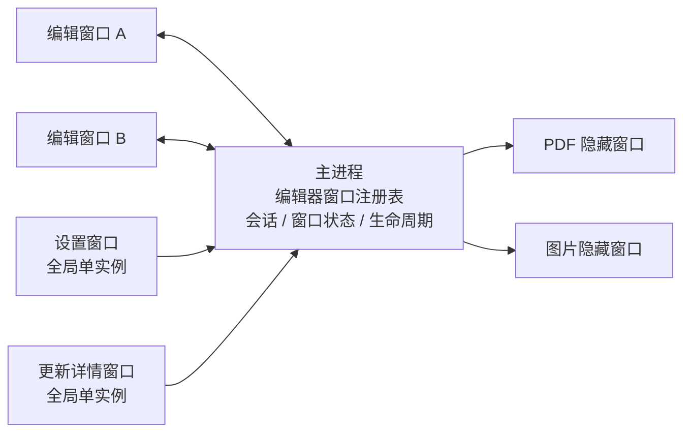
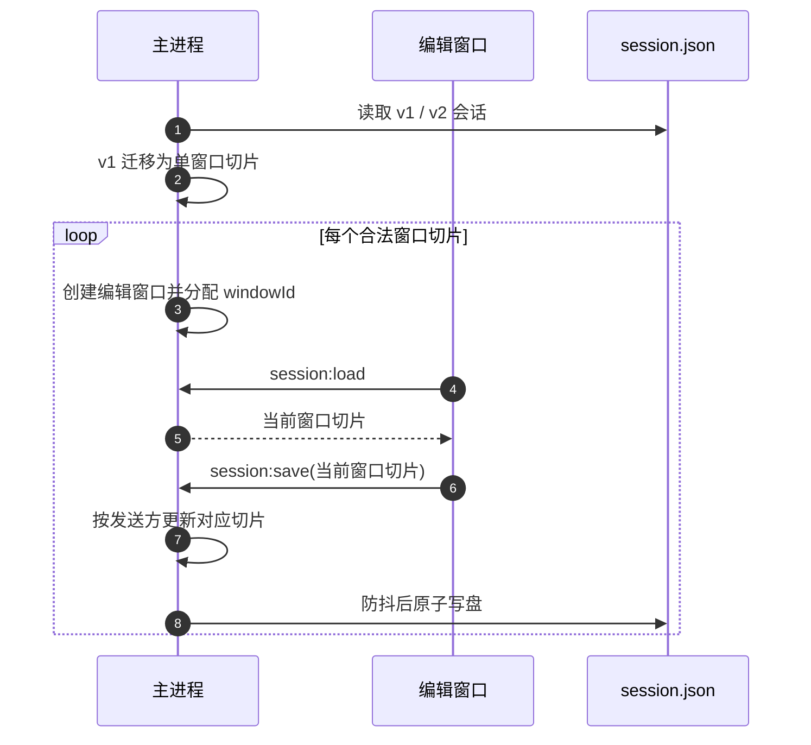
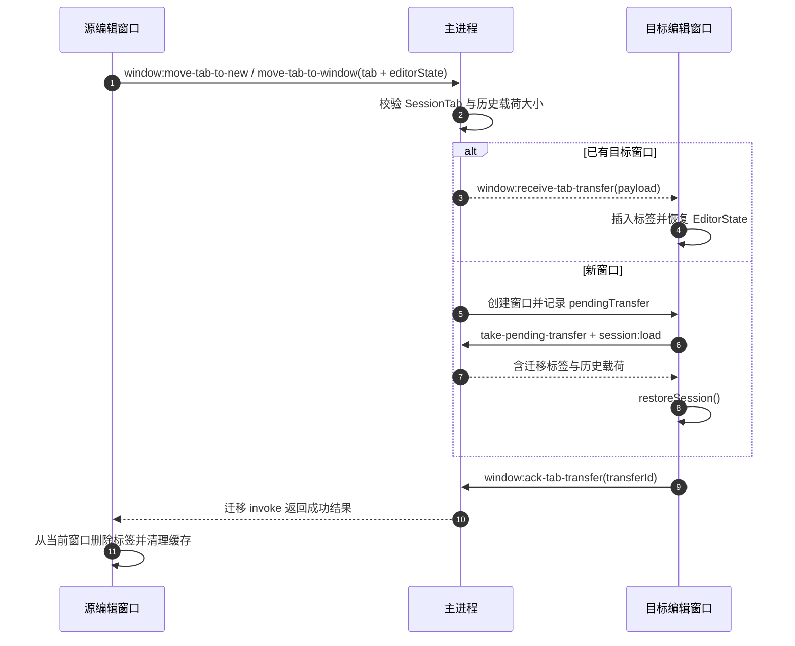
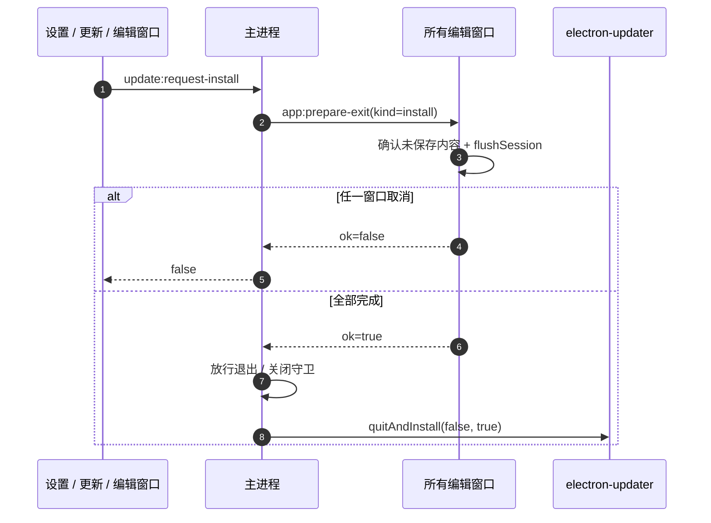

# 多窗口架构

> **当前状态：已实施。** 本文定义 MarkIt 编辑器多窗口的窗口角色、状态归属、会话迁移、标签迁移、生命周期协调与验收边界。
> 当前能力包含新建编辑窗口、单标签或整窗批量迁移、拖入已有窗口、跨窗口与重启后恢复撤销历史、多窗口会话恢复与窗口几何恢复。设置窗口、更新详情窗口保持全局单实例工具窗口，不进入编辑器会话。
> 改造时的方案比较与历史取舍见[多窗口改造决策记录](./多窗口改造决策记录.md)。
> 所有用户可见独立窗口的显示器归属与重复打开规则见[窗口放置与单实例规则](./窗口放置与单实例规则.md)。编辑窗口、设置窗口、更新详情窗口和从设置页新建编辑窗口均已按触发源放置。

## 1. 设计目标

1. 每个编辑窗口是独立的文档宿主，可独立打开、激活、保存、监听、缩放和关闭标签页。
2. 全局偏好与子窗口状态分开：主题、预览样式等继续全局生效；标签、布局、滚动位置和窗口几何按窗口或标签隔离。
3. 设置窗口、更新详情窗口仍是全局工具窗口，不拥有文档，不参与多窗口注册表和标签迁移。
4. 关闭窗口、退出应用和安装更新都必须先处理所有编辑窗口的未保存内容。
5. 会话与窗口状态升级后兼容旧版单窗口文件；损坏数据不得阻止应用启动。

## 2. 窗口角色

| 窗口         | 实例规则           | 是否进入编辑器注册表 | 文档状态               | 生命周期职责                       |
| ------------ | ------------------ | -------------------- | ---------------------- | ---------------------------------- |
| 编辑窗口     | 可多个             | 是                   | 当前窗口自己的标签会话 | 文件监听、缩放、关闭确认、标签迁移 |
| 设置窗口     | 全局单实例         | 否                   | 无                     | 全局偏好、集成、更新与关于         |
| 更新详情窗口 | 全局单实例         | 否                   | 无                     | 展示更新状态，发起下载或安装请求   |
| PDF 隐藏窗口 | 按导出任务临时创建 | 否                   | 无                     | 仅执行 `printToPDF`，结束即销毁    |
| 图片隐藏窗口 | 按导出任务临时创建 | 否                   | 无                     | 仅执行整页截图，结束即销毁         |



### 2.1 窗口放置与单实例

1. 新建编辑窗口按触发编辑窗口所在显示器创建；标签拖拽创建时按光标释放点所在显示器创建。
2. 设置窗口、更新详情窗口等全局工具窗口首次创建时，必须跟随触发动作所在窗口的显示器。
3. 工具窗口已经存在时不得创建第二个，也不得移动到本次触发窗口所在显示器；只能恢复、显示并聚焦已有窗口。
4. 页内导出选项、确认框等不创建独立 `BrowserWindow`，天然属于当前编辑窗口，不参与跨屏放置。
5. PDF / 图片导出使用的隐藏渲染窗口不面向用户，不参与显示器归属规则。
6. 后续新增图片导出选项窗口、导出预览窗口或其他工具窗口时，必须先在设计文档中声明窗口作用域和重复打开行为，并复用统一放置规则。

实现状态：设置窗口与更新详情窗口从 IPC 发送方取得触发窗口，统一按该窗口所在显示器居中创建；已有窗口只恢复并聚焦。设置页“新建窗口”入口也已使用设置窗口作为定位源。目标契约、窗口分类和检查清单见[窗口放置与单实例规则](./窗口放置与单实例规则.md)。

## 3. 主进程窗口注册表

每个编辑窗口由稳定的 `windowId` 标识，运行时以 `webContents.id` 查找上下文：

```ts
interface EditorWindowContext {
  id: string
  win: BrowserWindow
  rendererReady: boolean
  pendingFilePaths: string[]
  watchedFilePath: string | null
  watchedContent: string | null
  watchSeq: number
  zoomFactor: number
  allowClose: boolean
  saveStateTimer: ReturnType<typeof setTimeout> | null
}
```

约束：

1. 所有窗口能力都按 IPC 发送方定位上下文，不再假定只有一个 `mainWindow`。
2. 对话框、保存路径、图片保存和 PDF 导出使用发起请求的窗口作为父窗口。
3. 文件监听、缩放、全屏状态、关闭守卫和窗口几何均按窗口隔离。
4. `second-instance`、Finder / VSCode 文件转发优先使用最后聚焦的编辑窗口；没有编辑窗口时创建新窗口。
5. 单个编辑窗口关闭后清理监听和运行时上下文；仍有其他编辑窗口时同步删除其持久化会话与几何切片。

## 4. 状态归属

| 状态                               | 归属           | 持久化                                                                                                 |
| ---------------------------------- | -------------- | ------------------------------------------------------------------------------------------------------ |
| 标签列表、内容、光标、滚动位置     | 窗口           | `session.json` 的窗口切片                                                                              |
| 每个标签的布局模式、大纲显隐       | 标签           | 随 `SessionTab` 保存                                                                                   |
| 窗口位置、尺寸、最大化、缩放       | 窗口           | `window-state.json` 的窗口切片                                                                         |
| 主题、大纲宽度、分栏比例、预览宽度 | 全局           | `markit-*` localStorage                                                                                |
| 预览样式与自定义 CSS               | 全局           | `markit-preview-style` / `markit-custom-styles`                                                        |
| 更新状态                           | 全局           | 主进程模块状态与更新偏好文件                                                                           |
| 文件监听、对话框、关闭守卫         | 运行期         | 不持久化                                                                                               |
| 撤销历史                           | 标签运行期状态 | 迁移时以受限 JSON 载荷携带；正常退出 / 安装重启时写入独立 `editor-history.json`，不混入 `session.json` |

已打开的编辑窗口通过 `storage` 事件同步全局偏好。设置窗口修改主题、预览样式或预览宽度后，所有编辑窗口和设置窗口自身都会刷新；标签布局与大纲显隐不跨窗口同步。

## 5. 会话 v2

`session.json` 从单份 `SessionData` 升级为窗口切片集合：

```ts
interface SessionFile {
  version: 2
  windows: SessionWindow[]
  lastFocusedWindowId?: string
}

interface SessionWindow {
  id: string
  tabs: SessionTab[]
  activeIndex: number
}
```

`SessionTab` 字段保持不变。迁移规则：

1. 旧版 `{ tabs, activeIndex }` 自动迁移为一个窗口切片，并分配新的稳定 `windowId`。
2. 缺少 `version`、字段类型错误或损坏的窗口切片会被丢弃；至少保留一个合法窗口时继续启动。
3. 没有任何可恢复窗口时创建一个欢迎窗口。
4. 渲染进程仍通过 `session:load` 获取“当前窗口切片”，通过 `session:save` 回写“当前窗口切片”。主进程按 IPC 发送方决定窗口 ID，渲染进程不能指定其他窗口。
5. 主进程聚合所有切片并原子写盘，避免多个窗口直接竞争同一个文件。
6. 用户关闭多个编辑窗口中的一个时，删除该窗口切片；关闭最后一个编辑窗口时保留最后快照，供 macOS 从 Dock 重开或下次启动恢复。
7. 应用退出、重启安装更新时保留全部窗口切片。



## 6. 窗口状态 v2

`window-state.json` 从单窗口对象升级为按窗口 ID 保存的集合：

```ts
interface WindowStateFile {
  version: 2
  windows: Record<string, WindowState>
  lastFocusedWindowId?: string
}
```

旧版单窗口状态迁移给启动时恢复的第一个编辑窗口；新窗口使用默认尺寸，并在源窗口附近错位放置。读取时继续校验尺寸、缩放范围与显示器工作区，避免副屏移除后窗口出现在屏幕外。

## 7. 标签迁移

### 7.1 入口

1. 标签右键菜单“在新窗口中打开”。
2. 标签右键菜单“移动到窗口 N”，直接迁入已有编辑窗口。
3. 标签拖到窗口外释放：落点命中另一个编辑窗口时迁入该窗口，否则创建新窗口。
4. 标签右键菜单“全部标签移动到窗口 N”执行整窗合并；全部成功后源窗口走正常关闭流程。
5. `Ctrl/Cmd + Shift + N` 或设置窗口“工作区”分类创建空白编辑窗口。

### 7.2 迁移握手

源窗口在目标窗口确认接收前不删除标签。迁移载荷包含 `SessionTab` 与可选的 CodeMirror `EditorState` JSON：



失败规则：

1. 目标窗口在 5 秒内未确认时，主进程通知源窗口失败；新建的临时目标窗口被销毁，已有目标窗口保持不变。
2. 源窗口收到失败通知时保留标签，不弹额外错误；用户可重试。
3. 转移的是最后一个标签时，源窗口确认删除后调用 `window:close`，走正常关闭守卫出口。
4. 目标窗口已打开同一磁盘路径时拒绝迁移并保留源标签，避免目标端出现重复标签或静默覆盖。
5. 内容、路径、修改标记、编码、光标、布局、滚动位置与 CodeMirror 撤销/重做历史随标签迁移。
6. 历史 JSON 上限为 4 MiB；超过上限或恢复失败时只迁移文档状态，目标标签从当前内容重建历史，不阻断迁移。
7. 批量迁移按标签顺序串行执行，复用同一迁移握手；任一标签被拒绝时停止后续迁移，已成功的标签保持迁入，剩余标签留在源窗口。

### 7.3 撤销历史持久化

`session.json` 仍只保存轻量文档状态。编辑历史单独写入 `userData/editor-history.json`：

```ts
interface EditorHistoryFile {
  version: 1
  windows: Record<string, Record<string, unknown>>
}
```

- 第一层 key 是稳定 `windowId`，第二层 key 是标签的稳定 `historyId`。
- 每个标签的历史 JSON 上限 4 MiB；单窗口合计上限 32 MiB，超出时按标签顺序保留能够容纳的条目。
- 只在关闭窗口、应用退出、安装更新等 `flushSession()` 路径写入，不在每次 800ms 会话防抖时重复序列化大历史。
- 恢复会话时，先读取当前窗口的历史集合，再与 `SessionTab.historyId` 对应；缺失、损坏或内容版本不一致时从当前文档内容重建。
- 关闭多个窗口中的一个时删除该窗口历史；关闭最后一个窗口或应用退出时保留，供下次启动恢复。
- 应用异常崩溃不保证最后一次历史，最多回到上一次正常 flush 的编辑栈；文档内容仍按既有会话防抖恢复。

### 7.4 指针拖拽、悬浮提示与目标高亮

HTML5 拖放无法跨 `webContents` 持续传递，且离开应用后由系统绘制禁止光标。标签拖拽因此使用 `pointerdown` + pointer capture，并由主进程维护跨窗口可见的悬浮提示：

1. 指针按下并移动超过阈值后进入拖拽，源窗口发送 `window:tab-drag-start`，主进程记录源窗口、标签名与当前界面主题；
2. 主进程创建一个透明、无边框、置顶、不可聚焦且忽略鼠标事件的临时 `BrowserWindow`，内部显示标签文件图标与标题；提示窗使用源窗口的浅色 / 深色主题；
3. 主进程约 60ms 轮询一次系统光标，同时移动悬浮提示并检测目标窗口；提示窗不受源窗口边界裁切，因此拖到其他窗口、桌面或副屏时仍然可见；
4. 命中其他编辑窗口时广播 `window:tab-drag-target`，只有命中的目标窗口显示“松开以移动”覆盖层；
5. 拖拽结束、源窗口关闭、目标切换或 `pointerup` / `pointercancel` 时销毁悬浮提示并广播 `active=false`，不能留下常驻窗口或遮罩；
6. 提示窗和覆盖层都必须忽略鼠标交互，不能拦截源窗口的 pointer capture、目标窗口点击或滚动。

高亮文案使用“松开以移动「标签名」到此窗口”，明确松手后是迁移而不是复制。

释放规则：

- 指针仍在标签条内：仅执行窗口内排序。
- 标题栏下缘保留 28px 纵向吸附区：指针在这个范围内移动时仍按标签条排序处理，ghost 吸附在标题栏，防止拖放标签排序时因轻微下移误建窗口。
- 指针离开标题栏与吸附区后仍在源窗口：强制创建新窗口，不落到工具栏、编辑区或预览区对应的窗口。
- 指针在其他编辑窗口内：迁入该窗口。
- 指针在所有编辑窗口之外：按释放点所在显示器创建新窗口。

新窗口位置使用系统光标的屏幕坐标和 `screen.getDisplayNearestPoint()` 选择显示器，窗口尺寸按该显示器 workArea 夹取；不能继续使用源窗口所在显示器或固定的源窗口错位位置。

### 7.5 跨窗口同文件去重

去重只作用于**常规打开**，不改变显式标签迁移语义：

| 场景                       | 行为                                                                       |
| -------------------------- | -------------------------------------------------------------------------- |
| `Ctrl+O` 选择文件          | 若文件已在任一编辑窗口打开，前置该窗口并激活已有标签，不在当前窗口新增副本 |
| 系统双击 / VSCode / 命令行 | 同上；已有窗口优先于当前最后聚焦窗口                                       |
| 当前窗口已打开             | 激活当前窗口已有标签                                                       |
| 显式拖拽 / 右键迁移        | 仍允许跨窗口移动；只在目标窗口已打开同一路径时拒绝，避免目标重复           |
| 外部磁盘冲突               | 常规去重不改变既有“磁盘优先、保存时冲突确认”流程                           |

渲染进程在标签路径变化和会话恢复完成后通过 `file:sync-open-paths` 同步当前窗口打开的文件路径。主进程按窗口维护路径集合，并使用与文件冲突检测一致的路径归一化规则查找归属窗口。该索引只用于窗口路由，不是文件内容缓存。

## 8. 退出、关闭与更新协调

### 8.1 单个窗口关闭

编辑窗口的 `close` 事件仍由该窗口自己的 `allowClose` 守卫拦截，渲染进程逐个确认未保存标签并 `flushSession()`，随后调用 `window:close`。主进程只关闭发送方窗口；若仍有其他编辑窗口，设置窗口和更新窗口保持打开。

### 8.2 退出应用

`before-quit` 不再依赖某一个主窗口：

1. 主进程阻止默认退出，向所有已就绪编辑窗口发送 `app:prepare-exit`（`kind = quit`）。
2. 每个窗口执行 `saveAllBeforeExit('退出应用')`，逐个确认未保存内容并写入自己的会话切片。
3. 任一窗口取消或保存失败，主进程中止退出，应用保持运行。
4. 全部成功后，主进程放行关闭守卫并再次调用 `app.quit()`。

### 8.3 更新安装

设置窗口、更新详情窗口或任一编辑窗口都可以发起安装请求，但真正安装由主进程统一协调：

1. `update:request-install` 先向所有编辑窗口发送 `app:prepare-exit`（`kind = install`）。
2. 所有窗口完成保存后，主进程放行退出并调用 `quitAndInstall()`。
3. 任一窗口取消时安装中止，更新状态保持不变。
4. 工具窗口不能直接调用底层 `update:install` 绕过协调。



## 9. IPC 增量

| 通道                           | 方向       | preload                                    | 说明                                                        |
| ------------------------------ | ---------- | ------------------------------------------ | ----------------------------------------------------------- |
| `window:get-context`           | R→M invoke | `getWindowContext()`                       | 返回当前窗口 ID 与待确认迁移 ID                             |
| `window:create`                | R→M invoke | `createWindow()`                           | 创建空白编辑窗口                                            |
| `window:move-tab-to-new`       | R→M invoke | `moveTabToNewWindow(payload)`              | 校验并迁移标签，返回目标窗口 ID                             |
| `window:move-tab-to-target`    | R→M invoke | `moveTabToTargetWindow(payload, options?)` | 按当前指针命中已有编辑窗口；`forceNew` 时跳过命中并新建窗口 |
| `window:move-tab-to-window`    | R→M invoke | `moveTabToWindow(payload, windowId)`       | 显式迁入指定编辑窗口                                        |
| `window:list`                  | R→M invoke | `listEditorWindows()`                      | 返回其他可接收标签的编辑窗口                                |
| `window:ack-tab-transfer`      | R→M send   | `ackTabTransfer(id)`                       | 目标窗口完成恢复确认                                        |
| `window:reject-tab-transfer`   | R→M send   | `rejectTabTransfer(id)`                    | 目标窗口拒绝迁移，例如同一路径已打开                        |
| `window:receive-tab-transfer`  | M→R send   | `onReceiveTabTransfer(cb)`                 | 已有目标窗口接收实时标签迁移                                |
| `window:take-pending-transfer` | R→M invoke | `takePendingTabTransfer()`                 | 新目标窗口读取待恢复迁移载荷                                |
| `history:load`                 | R→M invoke | `history.load()`                           | 读取当前窗口全部持久化编辑历史                              |
| `history:save`                 | R→M invoke | `history.save(entries)`                    | 保存当前窗口编辑历史到受限侧车文件                          |
| `window:tab-drag-start`        | R→M send   | `startTabDrag(name)`                       | 开始拖拽并启动目标窗口命中轮询                              |
| `window:tab-drag-end`          | R→M send   | `endTabDrag()`                             | 结束拖拽并清除全部高亮                                      |
| `window:tab-drag-target`       | M→R send   | `onTabDragTarget(cb)`                      | 通知窗口显示 / 隐藏拖放目标覆盖层                           |
| `file:sync-open-paths`         | R→M invoke | `syncOpenFiles(paths)`                     | 同步当前窗口打开的文件路径索引                              |
| `app:prepare-exit`             | M→R send   | `onPrepareExit(cb)`                        | 请求窗口保存全部未保存内容                                  |
| `app:prepare-exit-result`      | R→M send   | `completePrepareExit(id, ok)`              | 回报协调结果                                                |

`session:load` / `session:save`、窗口控制、文件与集成通道保持原名称，但来源校验从“唯一主窗口”改为“任意编辑窗口”。设置窗口只保留偏好、集成和更新相关能力。

## 10. 设置窗口与更新窗口

1. 设置窗口仍是全局单实例，任意编辑窗口都可以打开或聚焦它。
2. 设置窗口新增“工作区 / 窗口与标签”分类，说明全局偏好与窗口独立标签的作用域，并提供“新建窗口”入口。
3. 关闭一个编辑窗口时，只有编辑窗口注册表为空才联动关闭设置与更新工具窗口。
4. 更新状态仍广播给所有窗口；更新详情窗口显示的是全局状态，不绑定某个编辑窗口。
5. 设置和更新窗口关闭自身的能力不得扩展为关闭编辑窗口。

## 11. 当前边界

- 常规打开同一文件仍在当前窗口内去重；不同窗口仍可打开同一文件，沿用磁盘冲突检测。
- 不提供窗口数量上限的 UI；启动恢复最多 8 个合法窗口切片，防止损坏文件创建过多窗口。
- 不引入工作区、目录树、跨窗口标签搜索或独立会话管理面板。
- 批量迁移按标签串行执行，不提供一次 IPC 的原子多标签事务；中途拒绝时保留已迁入部分。
- 撤销历史只在正常 flush 时持久化，不保证崩溃前的最后几秒；历史也不会混入 `session.json`。

## 12. 验证

自动化：

- `npm run lint`
- `npm run typecheck`
- `npm test`
- `npm run build`
- `npm run test:e2e`（依赖构建产物）

手工验证：

1. 在一个窗口打开多个标签，右键“在新窗口中打开”，确认目标窗口只含迁移标签、源窗口标签在确认后消失。
2. 两个窗口分别编辑、保存、缩放和关闭标签；重启后确认所有窗口、标签、激活项、布局与几何恢复。
3. 关闭其中一个窗口，重启确认只恢复仍保留的窗口。
4. 两个窗口都有未保存内容时退出应用，确认依次确认；任一处取消后应用不退出。
5. 两个窗口都有未保存内容时从设置窗口发起安装，确认所有窗口处理完成后才进入安装；取消时保持原状态。
6. 设置窗口修改主题与预览样式，确认所有编辑窗口同步；标签布局不跨窗口同步。
7. 将标签拖到另一个编辑窗口内，确认迁入已有窗口；拖到空白桌面时创建新窗口；拖回源窗口内仅排序。也可以通过右键“移动到窗口 N”验证同一链路。
8. 在源标签输入内容后迁移到新窗口或已有窗口，按 `Ctrl/Cmd+Z` 确认可撤销迁移前输入。
9. 输入若干内容后正常退出并重启，确认编辑区光标与撤销栈都恢复；删除 `editor-history.json` 后重启，文档正常打开但撤销栈从当前内容重建。
10. 使用“全部标签移动到窗口 N”合并两个窗口，确认标签顺序、激活项、历史与目标窗口现有标签共同保留。
11. 打开旧版 v1 `session.json` / `window-state.json`，确认自动迁移且不丢标签。
12. 拖动标签经过另一个编辑窗口，目标窗口显示高亮与“松开移动”提示；离开后消失，松手后标签迁入。
13. 在副屏释放拖拽标签，新窗口必须出现在副屏光标附近，不能回到源窗口显示器。
14. 将标签拖到源窗口工具栏、编辑区或预览区后释放，应创建新窗口；仅在标题栏下缘 28px 吸附区内释放时应继续排序，不创建窗口。
15. 拖出应用窗口时不应出现系统禁止光标；悬浮提示应持续显示标签图标与标题，并在副屏和窗口边缘保持可见。
16. 在窗口 A 打开文件后，从窗口 B 常规打开同一文件，确认窗口 A 被前置且原标签激活，B 不新增副本。
17. 编辑窗口只在副屏时打开设置窗口，首次创建设置窗口必须出现在副屏；已有设置窗口时从主屏再次触发，只激活原窗口且不移动。
18. 更新详情窗口重复多显示器验证；后续图片导出若增加独立选项窗口，也必须在双屏环境执行同样检查。
