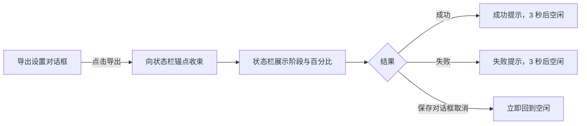
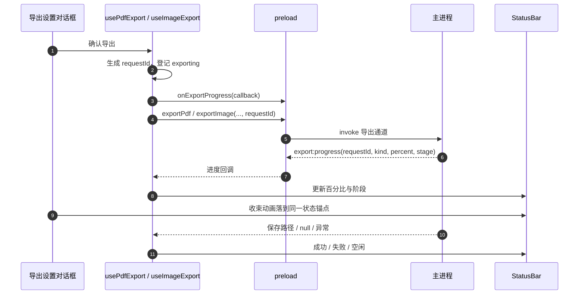

# 导出反馈与进度

本文说明 PDF 与长图导出从确认设置到写入文件的可见反馈。目标是让用户在长文档导出时明确知道任务仍在推进，同时不把 Chromium 无法提供的字节级进度伪装成精确百分比。

## 1. 交互目标

1. 用户在 PDF / 图片导出设置中点击「导出」后，对话框不再直接消失，而是收束到状态栏的导出状态位置。
2. 状态栏在同一位置接管任务反馈，展示导出类型、阶段、百分比和细进度条。
3. 长阶段没有新百分比时，进度条保留内部流动动效，表示任务仍在工作。
4. 成功、失败和用户取消保持现有语义：成功 / 失败约 3 秒后回到空闲，取消保存不视为失败。



## 2. 对话框收束

两个设置对话框共用以下行为：

- 只在点击「导出」确认时播放收束动画。
- 点击取消、关闭按钮或遮罩只关闭对话框，不播放收束。
- 动画读取状态栏中始终存在的 `data-export-status-anchor` 锚点，按两点中心计算位移，并按目标宽度缩放。
- 对话框在动画期间保持挂载，结束后再由父组件关闭，避免动画被 `v-if` 提前中断。
- `prefers-reduced-motion: reduce` 生效时跳过动画，直接关闭对话框。
- 动画时长约 280ms，不使用持久化状态。

状态栏锚点即使处于空闲状态也必须存在；导出开始时状态栏内容在同一锚点内展开，保证收束终点与后续进度位置一致。

## 3. 进度数据流

渲染进程为每次导出生成独立 `requestId`，订阅 `export:progress`，只接收当前窗口、当前任务和当前导出类型的进度。主进程只向发起导出的 `event.sender` 推送事件。



共享载荷为 `ExportProgress`：

```ts
interface ExportProgress {
  requestId: string
  kind: 'pdf' | 'image'
  percent: number
  stage: string
}
```

约束：

- `requestId` 不持久化，任务结束立即退订。
- 渲染进程按 `requestId` 与 `kind` 双重过滤，旧任务或其它窗口的进度不得覆盖当前状态。
- 主进程发送前检查 `event.sender.isDestroyed()`，发送方不存在时直接丢弃。
- store 对百分比做 0–100 夹取并保持单调递增，避免异步事件造成回退。
- 进度文案与百分比只存在于当前编辑窗口的 Pinia 实例中，不进入会话文件。

## 4. 阶段模型

百分比表达已经完成的导出阶段，不表达未知耗时阶段内部的精确比例。图片截取和 PDF 打印期间，状态栏使用持续流动的进度条表示仍在工作。

### 4.1 图片导出

| 百分比 | 阶段           |
| -----: | -------------- |
|     2% | 准备内容       |
|     6% | 渲染图表       |
|    10% | 准备导出       |
|    15% | 加载页面       |
|    30% | 等待图片与字体 |
|    45% | 测量版面       |
|    60% | 生成图片       |
|    85% | 写入文件       |
|   100% | 完成           |

`capturePage` 是一次 Electron 调用，没有可订阅的内部进度。60% 阶段可能停留较久，这是阶段进度的预期行为；不得用定时器伪造截图字节进度。截图调用必须有兜底超时，超时后进入失败状态，不能永久停留在 60%。

### 4.2 PDF 导出

| 百分比 | 阶段           |
| -----: | -------------- |
|     2% | 准备内容       |
|     6% | 渲染图表       |
|    10% | 准备导出       |
|    15% | 加载页面       |
|    30% | 等待图片与字体 |
|    50% | 生成 PDF       |
|    85% | 写入文件       |
|   100% | 完成           |

`printToPDF` 同样是单次长调用，50% 阶段配合流动动效说明任务仍在进行。

## 5. 状态栏呈现

导出进行中时，状态栏显示：

1. 导出类型，例如「图片导出」。
2. 当前百分比，例如 `60%`。
3. 阶段文案，例如「生成图片」。
4. 细进度条；百分比已知部分按比例填充，填充区域保留低对比流动纹理。
5. 长阶段不改变百分比，但流动动画持续，避免界面看起来卡死。

成功状态使用绿色勾选图标和完整结果提示；失败状态使用警示色并说明详情见开发者工具控制台。深色与浅色状态栏都必须保持文字、进度轨道和填充之间的可辨识对比度。

## 6. 性能与限制

- PDF 与图片隐藏窗口均关闭 `backgroundThrottling`，避免窗口隐藏后 `requestAnimationFrame` 与布局等待被后台节流。
- 图片窗口在截图前调整为完整长图视口，并通过窗口缩放倍率保留 1× / 2× 输出；截图使用 `webContents.capturePage()`，不依赖调试器截图。
- `paintWhenInitiallyHidden` 使用 Electron 默认行为；当前不额外覆盖。
- 页面加载、尺寸测量与截图调用均设置兜底超时，保证隐藏窗口异常时会清理资源并把失败返回给状态栏。
- 不采用分块截图拼接。分块会引入接缝、内存峰值和倍率一致性风险，只有实际测量证明单次截图无法满足需求时才重新评估。
- 进度事件只承担用户体验反馈，不改变最终产物、尺寸、格式、临时文件清理或自动降倍率规则。

## 7. 验证要求

必须覆盖：

1. PDF 与图片对话框确认后均收束到状态栏锚点。
2. 取消、关闭按钮和遮罩不播放收束动画。
3. 图片百分比和阶段依次推进，60% 长阶段仍有流动反馈。
4. PDF 百分比和阶段正常推进。
5. 成功、失败、保存取消三条结束路径。
6. 同时打开多个编辑窗口时，进度只出现在发起导出的窗口。
7. 浅色 / 深色主题下状态栏文字、百分比和进度条清晰。
8. 系统开启减少动态效果时，收束与流动动画降级。
9. 导出的 PDF / PNG / JPEG 仍可正常打开，尺寸与格式不回归。

## 8. 相关文件

| 文件                                                       | 职责                                        |
| ---------------------------------------------------------- | ------------------------------------------- |
| `src/shared/export-types.ts`                               | `ExportKind` 与 `ExportProgress` 跨进程类型 |
| `src/preload/index.ts`                                     | 导出请求参数与 `onExportProgress` 订阅      |
| `src/main/index.ts`                                        | 导出阶段推进、发送到发起窗口、关闭后台节流  |
| `src/renderer/src/stores/app.ts`                           | 当前导出百分比、阶段和生命周期              |
| `src/renderer/src/components/layout/StatusBar.vue`         | 稳定锚点、进度条、百分比、阶段与主题样式    |
| `src/renderer/src/composables/useExportDialogCollapse.ts`  | 对话框收束测量、动画与减少动态效果降级      |
| `src/renderer/src/components/export/PdfExportDialog.vue`   | PDF 确认后触发收束                          |
| `src/renderer/src/components/export/ImageExportDialog.vue` | 图片确认后触发收束                          |
