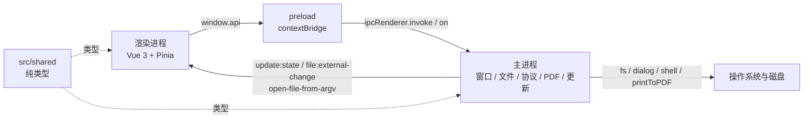

# 开发指南

> 本文面向第一次参与 MarkIt 开发的工程师，目标是把「跑起来、看懂目录、按约定改代码、验证并交付」这条路径讲清楚。
> 功能清单与快捷键不在本文重复，见 [README](../README.md)；测试与手工验证见 [测试与质量保障](./测试与质量保障.md)；强制规则以 [rules/base.md](../rules/base.md) 与 [CLAUDE.md](../CLAUDE.md) 为准。

## 1. 环境准备

### 1.1 版本要求

| 项目     | 要求                                    | 说明                                                 |
| -------- | --------------------------------------- | ---------------------------------------------------- |
| Node.js  | >= 22                                   | 与 Electron 39、electron-vite 5、Vite 7 的工具链匹配 |
| npm      | >= 9                                    | 仓库使用 `package-lock.json`，不要混用 pnpm / yarn   |
| 操作系统 | Windows 10/11、macOS、主流 Linux 发行版 | 三平台都有对应的开发与打包路径                       |

首次进入仓库先确认版本：

```bash
node -v
npm -v
```

### 1.2 平台差异

| 平台    | 开发期表现                                                                                 | 打包 / 更新注意事项                                                                             |
| ------- | ------------------------------------------------------------------------------------------ | ----------------------------------------------------------------------------------------------- |
| Windows | 无边框窗口，`frame: false` + `titleBarOverlay`，Acrylic 背景；文件关联由安装包注册         | 未配置代码签名，安装时可能出现 SmartScreen 提示；NSIS 安装包会注册 `.md` / `.markdown` 关联     |
| macOS   | `titleBarStyle: 'hidden'` 保留交通灯；`Cmd` 系列快捷键；`Cmd+W` 由主进程拦截后转交渲染进程 | 当前未配置 Apple Developer 证书与公证，Gatekeeper 会拦截未签名应用，Squirrel.Mac 不执行自动更新 |
| Linux   | 使用无边框窗口并显示应用图标                                                               | 默认产物为 AppImage + deb；只有 AppImage 支持自动更新，deb 供手动安装                           |

跨平台打包必须在对应原生 runner 上完成，三平台并行构建由 [.github/workflows/release.yml](../.github/workflows/release.yml) 负责，流程见 [github-release.md](./github-release.md)。

### 1.3 依赖镜像

仓库根目录的 [.npmrc](../.npmrc) 已配置 Electron 与 electron-builder 的国内镜像。`npm install` 结束后会自动执行 `postinstall` 中的 `electron-builder install-app-deps`，为 Electron 重新编译原生依赖；如果安装卡在下载 Electron，优先检查镜像与网络，不要手工改 `package-lock.json`。

## 2. 安装与启动

```bash
npm install
npm run dev
```

`npm run dev` 使用 `electron-vite dev` 启动主进程、预加载脚本和渲染进程，并注入 `ELECTRON_RENDERER_URL`。启动后默认显示欢迎页（`src/renderer/src/assets/welcome.md`），首次打开文件会替换这个未编辑的占位标签。

### 2.1 热更新范围

| 改动目录                  | 开发期行为                     | 注意事项                                                                               |
| ------------------------- | ------------------------------ | -------------------------------------------------------------------------------------- |
| `src/renderer/**`         | Vite HMR，Vue 组件热替换       | 模块级单例（会话、确认框、滚动同步）可能保留旧状态，涉及监听注册的改动建议整页刷新验证 |
| `src/main/**`             | 重新构建并重启 Electron 主进程 | 重启会丢失渲染进程内存状态；未保存内容依赖会话恢复，改动主进程前先 `Ctrl+S`            |
| `src/preload/**`          | 重新构建，渲染进程重新加载     | 预加载变更后要确认 `window.api` 的实际暴露面与类型一致                                 |
| `src/shared/**`           | 两端都会重新构建               | 这里只允许纯类型，不允许运行时依赖                                                     |
| `electron.vite.config.ts` | 配置变更后需要重启 dev         | 新增 HTML 入口时尤其要重启并检查两个窗口                                               |

会话保存有 800ms 防抖（`useSession.ts`），主进程重启过快时可能来不及落盘。涉及主进程的改动，先保存当前文档再改代码。

### 2.2 预览已构建产物

```bash
npm run build
npm start
```

`npm start` 只预览 `out/` 中的构建产物，不生成安装包；验证安装包、文件关联、自动更新时必须使用 `npm run build:unpack` 或对应平台的 `build:*`。

## 3. 常用命令

所有命令以 [package.json](../package.json) 为准。单元测试与 e2e 命令已接入：`npm test`（Vitest，纯函数）、`npm run test:e2e`（Playwright，需先 `npm run build`）。

| 命令                     | 实际执行                                    | 用途                                                |
| ------------------------ | ------------------------------------------- | --------------------------------------------------- |
| `npm install`            | 安装依赖并执行 `postinstall`                | 首次准备、依赖变更后                                |
| `npm run dev`            | `electron-vite dev`                         | 日常开发，主进程 / preload / renderer 热更新        |
| `npm run build`          | `npm run typecheck && electron-vite build`  | 类型检查 + 构建到 `out/`，不生成安装包              |
| `npm run build:unpack`   | `npm run build && electron-builder --dir`   | 生成未打包目录，验证打包行为、文件关联之外的能力    |
| `npm run build:win`      | `npm run build && electron-builder --win`   | Windows NSIS 安装包                                 |
| `npm run build:mac`      | `npm run build && electron-builder --mac`   | macOS dmg + zip                                     |
| `npm run build:linux`    | `npm run build && electron-builder --linux` | Linux AppImage + deb                                |
| `npm start`              | `electron-vite preview`                     | 预览 `out/` 构建产物                                |
| `npm run lint`           | `eslint --cache .`                          | ESLint 检查，缓存写入 `.eslintcache`                |
| `npm run format`         | `prettier --write .`                        | 按仓库 Prettier 配置格式化                          |
| `npm test`               | `vitest run`                                | 运行 `src/**/*.spec.ts` 纯函数单元测试              |
| `npm run test:watch`     | `vitest`                                    | 开发期监听模式                                      |
| `npm run test:e2e`       | `playwright test`                           | Electron e2e；需先 `npm run build`                  |
| `npm run typecheck`      | `typecheck:node` + `typecheck:web`          | 主进程与渲染进程双 tsconfig                         |
| `npm run typecheck:node` | `tsc --noEmit -p tsconfig.node.json`        | `src/main`、`src/preload`、`electron.vite.config.*` |
| `npm run typecheck:web`  | `vue-tsc --noEmit -p tsconfig.web.json`     | `src/renderer/src/**` 与 `src/preload/*.d.ts`       |

说明：

1. `tsconfig.json` 只做 project references，真正的编译范围在 `tsconfig.node.json` 与 `tsconfig.web.json`。
2. `build` 已经包含 `typecheck`，但日常改代码仍建议单独跑一次 `typecheck`，报错更直接。
3. `lint` 的配置通过 `eslint-config-prettier` 关闭了与 Prettier 冲突的规则；提交前请执行 `npm run format`，不要依赖 lint 自动排版。

## 4. 工程结构速查



| 目录                               | 一句话职责                                                                                                       | 关键文件                                                                                         |
| ---------------------------------- | ---------------------------------------------------------------------------------------------------------------- | ------------------------------------------------------------------------------------------------ |
| `src/main/`                        | Electron 主进程：窗口与生命周期、单实例锁、文件读写与监听、会话持久化、`markit-file://` 协议、PDF 导出、自动更新 | `index.ts`、`updater.ts`                                                                         |
| `src/preload/`                     | 通过 `contextBridge` 暴露 `window.api`，是渲染进程访问主进程的唯一通道                                           | `index.ts`、`index.d.ts`                                                                         |
| `src/shared/`                      | 主进程与渲染进程共享的**纯类型**，不得引入运行时依赖                                                             | `session-types.ts`、`update-types.ts`                                                            |
| `src/renderer/index.html`          | 主编辑器窗口入口                                                                                                 | 加载 `src/renderer/src/main.ts`                                                                  |
| `src/renderer/update.html`         | 独立「更新详情」窗口入口                                                                                         | 加载 `src/renderer/src/update/main.ts`                                                           |
| `src/renderer/src/components/`     | Vue 组件，按领域拆分                                                                                             | `common/`、`editor/`、`export/`、`layout/`、`outline/`、`preview/`、`settings/`、`update/`       |
| `src/renderer/src/composables/`    | 组合式逻辑：文件、会话、监听、快捷键、滚动同步、PDF、大纲等                                                      | `useFile.ts`、`useFileWatcher.ts`、`useSession.ts`、`useKeyboardShortcuts.ts`、`usePdfExport.ts` |
| `src/renderer/src/stores/`         | Pinia 状态：文档、当前编辑视图、应用设置、预览样式、更新状态                                                     | `documents.ts`、`editor.ts`、`app.ts`、`style.ts`、`update.ts`                                   |
| `src/renderer/src/utils/`          | 可复用的纯逻辑 / DOM 工具                                                                                        | `mermaid.ts`、`local-image.ts`、`frontmatter.ts`、`text-diff.ts`、`diagram-export.ts`            |
| `src/renderer/src/styles/preview/` | 内置预览主题 CSS，深色 / 浅色成对                                                                                | `github.css` + `github-light.css` 等四组                                                         |
| `src/renderer/src/types/`          | 渲染进程类型定义                                                                                                 | `index.ts`                                                                                       |
| `src/renderer/src/update/`         | 更新详情窗口的入口与页面                                                                                         | `main.ts`、`UpdateWindow.vue`                                                                    |
| `src/renderer/src/assets/`         | 内置文档资源                                                                                                     | `welcome.md`（欢迎页 / 使用手册）                                                                |
| `scripts/`                         | 构建辅助与发版脚本                                                                                               | `after-sign.cjs`、`pad-icon.cjs`、`release/apphub.mjs`                                           |
| `build/`                           | 打包图标、macOS entitlements                                                                                     | `icon.ico`、`icon.icns`、`icon.png`、`entitlements.mac.plist`                                    |
| `resources/`                       | 运行时资源，打包时 `asarUnpack`                                                                                  | `icon.png`                                                                                       |
| `docs/`                            | 设计、开发、发版文档；已从安装包排除                                                                             | `github-release.md`、本文、[测试与质量保障](./测试与质量保障.md)                                 |
| `.github/workflows/`               | CI / 发版流水线                                                                                                  | `release.yml`                                                                                    |

根目录还需要认识这几个文件：`electron.vite.config.ts`（三进程构建与两个 HTML 入口）、`electron-builder.yml`（应用 ID、产品名、文件关联、三平台产物、更新端点）、`eslint.config.mjs`、`.prettierrc.yaml`、`.editorconfig`。

## 5. 进程边界与安全规则

1. **渲染进程禁止 `import ... from 'electron'`**。渲染进程只能通过 preload 暴露的 `window.api` 调用主进程；不暴露通用 `ipcRenderer` / `process`。
2. **新增 IPC 必须三处同步**：主进程 `registerHandle` / `registerOn`（[`ipc-guard.ts`](../src/main/ipc-guard.ts)，自动校验调用来源）→ preload 中的 `ipcRenderer.invoke` / `ipcRenderer.on` → `src/preload/index.d.ts` 的类型契约。`ExposedAPI = typeof api` 会自动推导新方法，但仍要跑 `typecheck` 确认调用方类型正确。
3. **`src/shared/` 只放纯类型**，不得引入任何运行时依赖；它同时被主进程 tsconfig 与渲染进程 tsconfig 引用。
4. **`markit-file://` 只用于预览图片**，主进程按图片扩展名白名单读取（`png` / `jpeg` / `gif` / `webp` / `bmp` / `svg` / `avif` / `ico` / `tif` 等）。不得放宽为任意文件读取通道。
5. **外部链接统一走主进程**：`shell:openExternal` 只接受 `http` / `https` / `mailto`；`file://` 走定位逻辑；页内锚点保留原生跳转；其余协议忽略，避免主窗口被导航走。
6. **窗口关闭必须走守卫**：主进程 `close` 事件默认 `preventDefault`，通知渲染进程检查未保存内容；渲染进程确认后调用 `window.api.close()` 放行。不要在未走该流程时直接 `destroy`。
7. **IPC 参数保持可结构化克隆**：不要传函数、类实例、DOM 节点；二进制用 `Uint8Array`（如图片导出）。
8. **不要用打开 `nodeIntegration` 的方式绕过边界**；渲染进程拿不到的能力，新增受控 IPC。

## 6. 编码约定摘要

完整规则见 [rules/code-style.md](../rules/code-style.md)，这里是高频要点。

### 6.1 格式

| 项目        | 约定                            |
| ----------- | ------------------------------- |
| 分号        | 不写（`semi: false`）           |
| 引号        | 单引号（`singleQuote: true`）   |
| 缩进        | 2 空格，禁止 Tab                |
| 尾逗号      | 不保留（`trailingComma: none`） |
| 行宽        | 100 字符（`printWidth: 100`）   |
| 编码 / 换行 | UTF-8、LF、文件末尾保留空行     |

### 6.2 命名

| 对象                     | 风格             | 示例                             |
| ------------------------ | ---------------- | -------------------------------- |
| 变量、函数、参数         | camelCase        | `openFile`、`currentZoomFactor`  |
| 类、接口、类型、Vue 组件 | PascalCase       | `SessionData`、`MarkdownPreview` |
| 常量                     | UPPER_SNAKE_CASE | `LOCAL_FILE_SCHEME`              |
| 对象结构                 | 优先 `interface` | `HeadingItem`、`PreviewStyle`    |
| 联合 / 字面量类型        | `type`           | `LayoutMode`、`ThemeMode`        |
| 组件文件                 | PascalCase       | `EditorToolbar.vue`              |
| Composable               | `useXxx.ts`      | `useScrollSync.ts`               |
| 工具 / store 文件        | kebab-case       | `text-diff.ts`、`local-image.ts` |
| IPC 通道                 | `模块:动作`      | `file:read`、`window:get-zoom`   |

### 6.3 其他约定

1. 纯类型导入一律 `import type`。
2. 日志统一 `console.error` / `console.warn`，错误对象作为后续参数传入；**禁止在业务代码中遗留 `console.log`**。日志文案用简短英文，注释、文档、界面文案用中文。
3. Vue 组件一律 `<script setup lang="ts">`；跨组件共享或需要持久化的状态才进 Pinia。
4. `localStorage` 键统一 `markit-` 前缀，且只在 store 中读写，不在组件里散落。
5. 新增业务源码文件需要文件头注释（作者 `Harley-xk`、创建日期、职责描述）；配置文件、测试文件、样式、类型声明、HTML 入口不需要。
6. 预览主题样式集中在 `src/renderer/src/styles/preview/`，组件私有样式不要污染预览区。

## 7. 常见开发任务操作手册

### 7.1 新增一个 IPC 能力

以新增 `demo:ping` 为例：

1. **主进程**：在 [src/main/index.ts](../src/main/index.ts) 中用 `ipcMain.handle('demo:ping', async (_e, payload) => { ... })` 注册；校验参数、捕获异常并 `console.error`，返回值必须是可序列化数据。如果属于自动更新，放在 [src/main/updater.ts](../src/main/updater.ts)。
2. **preload**：在 [src/preload/index.ts](../src/preload/index.ts) 的 `api` 对象中增加方法，调用 `ipcRenderer.invoke('demo:ping', payload)`；事件类能力用 `ipcRenderer.on` 并返回取消订阅函数。
3. **类型**：`src/preload/index.d.ts` 通过 `ExposedAPI = typeof api` 自动获得新方法；如果新增了全局变量或事件签名，需要同步声明。跑 `npm run typecheck`。
4. **渲染进程**：通过 `window.api.demoPing(...)` 调用，不要 `import 'electron'`；调用逻辑放在 store 或 composable，组件只消费结果。
5. **验证**：`npm run lint`、`npm run typecheck`、`npm run dev`；在 DevTools Console 执行 `await window.api.demoPing()`；涉及文件 / 窗口 / 更新的 IPC 还要按 [测试与质量保障](./测试与质量保障.md) 的高风险项验证。

### 7.2 新增预览渲染能力

预览与 PDF 是**两条独立管线**，任何影响 Markdown 渲染的行为都要两处同步。

1. **抽公共逻辑**：能脱离 DOM 的解析 / 识别逻辑放 `src/renderer/src/utils/`（参考 `frontmatter.ts`、`mermaid.ts`、`local-image.ts`）。
2. **预览管线**：[MarkdownPreview.vue](../src/renderer/src/components/preview/MarkdownPreview.vue)
   - `createMarkdownRenderer(...)`（[markdown.ts](../src/renderer/src/utils/markdown.ts)）的配置与插件；
   - `md.core.ruler.push(...)`（如标题锚点 `heading-N`）；
   - `md.renderer.rules`（如本地图片改写）；
   - `renderedHtml` 计算属性、`renderMermaid`、`resolveHtmlImages`、链接点击分流。
3. **PDF 管线**：[usePdfExport.ts](../src/renderer/src/composables/usePdfExport.ts)
   - `parseFrontmatter` + `renderFrontmatterTable`；
   - `md.render(body)`；
   - `renderMermaidToSvg`；
   - 内联打印 CSS。
4. **必须同步的渲染行为**：frontmatter 表格化、任务列表、代码高亮、本地图片规则、Mermaid 识别与渲染、链接分流（PDF 没有链接点击，但任何影响输出 HTML 的规则仍要评估是否需要同步）。
5. **标题锚点只在预览侧使用**：`heading-N` 必须与 `useOutline` 的生成顺序一致；PDF 不需要锚点，但改动标题渲染时要确认 PDF 的标题样式没有回归。
6. **PDF 样式是独立的**：`usePdfExport` 使用内联打印 CSS，不注入 `styles/preview/` 的预览主题；如果需求是「PDF 保留当前预览样式」，需要先补上样式注入，再验证。
7. **验证**：预览渲染 + PDF 导出（A4 / Letter）各一次，参考 MV-18～MV-25。

### 7.3 新增内置预览样式

1. 在 `src/renderer/src/styles/preview/` 新增一对文件：`foo.css`（深色）与 `foo-light.css`（浅色），选择器统一以 `.markdown-body` 开头（GitHub 规范作用域，便于导入的 GitHub 系 CSS 复用），参考 `github.css` / `github-light.css`。**不要给 `.markdown-body` 设置背景色**：预览背景由容器统一提供，内容元素的背景会被强制透明。
2. 在 [stores/style.ts](../src/renderer/src/stores/style.ts) 中用 `?raw` 导入两份 CSS。
3. 同时登记到 `builtinStylesDark` 与 `builtinStylesLight`，两边的 `id` 与 `name` 必须一致，`isBuiltin: true`；数组顺序就是设置页显示顺序。
4. 当前预览样式的选择只保存在运行期内存中（`currentStyleId` 未持久化），重启会回到 GitHub；主题模式本身通过 `markit-theme` 持久化。新增样式不要自行引入第二套持久化键。
5. **验证**：深色 / 浅色各切一次，检查标题、正文、链接、代码块、表格、引用、frontmatter 表格与 Mermaid 工具栏，参考 MV-38。

### 7.4 新增 Pinia 状态

先判断状态归属：

| 状态类型                                                      | 放置位置                                   |
| ------------------------------------------------------------- | ------------------------------------------ |
| 每个标签的内容、`diskContent`、`isModified`、光标、大纲、字数、布局模式 | `stores/documents.ts`                      |
| 每个标签的 `EditorState`、编辑区 / 预览区滚动位置             | `stores/documents.ts` 内部的非响应式 `Map` |
| 当前激活标签的计算视图（内容、光标、大纲、字数）              | `stores/editor.ts`，不持有文档状态         |
| 主题、布局、大纲显隐 / 宽度、分栏比例、预览宽度、缩放展示     | `stores/app.ts`                            |
| 预览样式列表与当前样式                                        | `stores/style.ts`                          |
| 主进程更新状态的镜像与提示卡片                                | `stores/update.ts`                         |

步骤：

1. 用 `defineStore('name', () => { ... })` 的 setup 写法，`ref` / `computed` / 函数并在末尾 `return`。
2. 需要持久化的状态在 store 内 `watch` 并写入 `markit-*` 键；组件不直接访问 `localStorage`。
3. 大对象、不可序列化对象（`EditorState`、`EditorView`、DOM）不要放进 `ref`；按现有约定使用 `Map` / `shallowRef`。
4. **验证**：`npm run typecheck` + 相关界面手工验证；涉及标签切换的状态还要验证切换后不串档。

### 7.5 新增一个 composable

1. 在 `src/renderer/src/composables/` 新增 `useXxx.ts`，命名 camelCase。
2. 通过 `useDocumentsStore` / `useAppStore` 等获取状态，通过 `window.api` 调用主进程；不要直接 `import 'electron'`。
3. 组合式函数里注册的监听必须在 `onUnmounted` 中注销；如果是全局单例（如 `useSession`、`useConfirmUnsaved`），用模块级变量防重复初始化。
4. 应用级能力在 [App.vue](../src/renderer/src/App.vue) 中调用一次；只在某个组件内使用的，在组件 `setup` 中调用。
5. **验证**：HMR 后检查监听是否重复（例如确认框弹两次、外部变更处理两次），必要时整页刷新或重启 dev 再测。

### 7.6 新增快捷键

先判断应该在哪一层处理：

| 场景                                                        | 位置                                                                               | 做法                                                                                                                 |
| ----------------------------------------------------------- | ---------------------------------------------------------------------------------- | -------------------------------------------------------------------------------------------------------------------- |
| 普通应用快捷键（新建、打开、保存、切换标签、格式化等）      | [useKeyboardShortcuts.ts](../src/renderer/src/composables/useKeyboardShortcuts.ts) | `document.addEventListener('keydown', ...)`，匹配后 `preventDefault()`，调用 `useFile` / store / `applyFormatAction` |
| 被系统菜单或操作系统吞掉的快捷键（macOS `Cmd+W`、整窗缩放） | [src/main/index.ts](../src/main/index.ts) 的 `before-input-event`                  | `event.preventDefault()` 后 `webContents.send('shortcut:xxx')`，preload 暴露 `onXxx`，App.vue 处理                   |
| 编辑器内部快捷键（CodeMirror 命令）                         | `MarkdownEditor.vue` 的 CodeMirror `keymap`                                        | 用 CodeMirror 的 keymap，避免和 document 级监听重复触发                                                              |

约定与注意事项：

1. `Ctrl` / `Cmd` 统一用 `e.ctrlKey || e.metaKey`（现有 `isCtrl`）；但 `Ctrl+Tab` 必须只匹配 `ctrlKey`，否则会拦截 macOS 的 `Cmd+Tab` 应用切换器。
2. 输入框 / 对话框内的按键是否需要屏蔽，按现有交互判断；不要无条件抢占所有按键。
3. 新增快捷键后同步 [README](../README.md) 的快捷键表。
4. **验证**：Windows 用 `Ctrl`、macOS 用 `Cmd` 各测一次；编辑器聚焦、预览聚焦、对话框打开三种状态下都不能误触发。

### 7.7 新增 Mermaid 语言标记

1. 在 [utils/mermaid.ts](../src/renderer/src/utils/mermaid.ts) 的 `MERMAID_LANGUAGES` 中加入小写形式；识别逻辑会自动忽略大小写。
2. `VERSION_SUFFIX` 目前只去掉 `-beta` / `-v2` 后缀；如果新图表使用其他后缀（如 `-v3`），需要扩展该正则。
3. C4 系列由 `/^c4[a-z]*$/` 统一识别，不需要逐个枚举。
4. 预览与 PDF 都通过 `collectMermaidBlocks` 使用同一份识别逻辑，**不要在两处各维护一份列表**。
5. 同步 [README](../README.md) 的 Mermaid 语言标记表。
6. **验证**：预览渲染、缩放、弹窗、SVG / PNG 导出，以及 PDF 导出中的同一图表，参考 MV-18～MV-23。

### 7.8 修改品牌文案

| 场景                                    | 写法                                    | 位置示例                                               |
| --------------------------------------- | --------------------------------------- | ------------------------------------------------------ |
| 界面文案、文档、README、更新提示        | `MarkIt`（无空格）                      | 窗口标题、`welcome.md`、更新窗口标题                   |
| 安装包 / 可执行文件 / 快捷方式 / 卸载项 | `Mark It`（有空格，来自 `productName`） | `electron-builder.yml` 的 `productName`、NSIS 快捷方式 |

规则：

1. 品牌改动只做展示层；不要为了「统一」去改 `appId`、`productName`、npm 包名、更新端点、`markit-file://`、`markit-*` 存储键、apphub `appKey`。
2. 界面文案统一写 `MarkIt`；不要在渲染进程里硬编码新的产品名变体，优先复用现有文案或从已有配置派生。
3. `electron-builder.yml` 中的 `productName`、`copyright`、`afterSign` 脚本里的 `FileDescription` 属于打包元信息，修改前先确认是否影响升级与签名。
4. 不要改 CSS 类名、组件名、IPC 通道名、存储键来「配合品牌」。
5. **验证**：界面文案 + 安装包属性各看一次；升级安装路径不被识别为新应用。

## 8. 调试技巧

### 8.1 DevTools 与日志

- 开发模式下按 `F12` 打开渲染进程 DevTools（`optimizer.watchWindowShortcuts` 注册）；也可以在 `createWindow` 后临时加 `mainWindow.webContents.openDevTools()`，验证完删除。
- 主进程日志直接看运行 `npm run dev` 的终端；渲染进程日志看 DevTools Console。
- 统一用 `console.error('Failed to ...', err)` / `console.warn`，不要留 `console.log`。
- 类型问题优先跑 `npm run typecheck:node` 或 `npm run typecheck:web` 缩小范围。

### 8.2 自动更新在 dev 下不可用

`initAutoUpdater` 在 `is.dev` 时把状态设为 `disabled`，不会发起检测，设置页显示「开发模式，不检测更新」，检查按钮禁用。验证更新 UI / 状态渲染时：

```bash
npm run build:unpack
# Windows 示例
"dist/win-unpacked/Mark It.exe"
```

在打包产物中打开设置页手动检查；能显示 `checking → not-available / available / error` 且不崩溃即可。真实下载与安装只在发版验证时做，不要在日常开发中触发强制更新。

### 8.3 模拟外部文件变更

主进程用 `fs.watchFile` 每 400ms 轮询，并做 150ms 防抖；保存后约 0.5～1 秒内应看到效果。

```bash
# Git Bash
printf '\n外部追加一行\n' >> /d/tmp/markit-verify/demo.md
```

```powershell
# PowerShell
Add-Content -Path 'D:\tmp\markit-verify\demo.md' -Value "`n外部追加一行" -Encoding utf8
```

验证点：

- 当前活跃标签的文件被修改：本地无修改时自动刷新；本地有修改时保留本地内容，保存时弹冲突。
- 非活跃标签：修改后切换过去，`useFileWatcher` 会主动补读一次磁盘。
- 应用自身保存不应触发回环提示（主进程会同步 `watchedContent`）。

### 8.4 验证会话恢复

会话文件位于 Electron `userData` 目录：

| 平台    | 路径                                                 |
| ------- | ---------------------------------------------------- |
| Windows | `%APPDATA%\mark-it\session.json`                     |
| macOS   | `~/Library/Application Support/mark-it/session.json` |
| Linux   | `~/.config/mark-it/session.json`                     |

同目录还有 `window-state.json`（窗口大小、位置、最大化、缩放）。

开发模式（`app.isPackaged === false`）下，主进程会把 `userData` 自动切到 `mark-it-dev` 子目录（如 `%APPDATA%\mark-it-dev`），因此调试实例与已安装的正式版不会共用单实例锁、会话快照与窗口状态，两者可以同时运行。

验证步骤：

1. 打开 2 个文件，新建 1 个空白标签并输入内容（不保存），把光标放到中间某行。
2. 正常关闭窗口，按提示处理未保存文件（新建文档可选择「放弃修改」，内容仍会随会话恢复）。
3. 重新 `npm run dev`，确认标签顺序、激活标签、光标、未保存新文档内容都恢复；文件类标签以磁盘最新内容为准。
4. 想重置会话，退出应用后删除 `session.json`；想重置窗口，删除 `window-state.json`。

### 8.5 检查构建与打包产物

| 产物       | 位置                                                                                               | 检查点                                                                                                          |
| ---------- | -------------------------------------------------------------------------------------------------- | --------------------------------------------------------------------------------------------------------------- |
| 构建输出   | `out/main/index.js`、`out/preload/index.js`、`out/renderer/index.html`、`out/renderer/update.html` | 两个 HTML 入口都存在；preload 路径正确                                                                          |
| 未打包目录 | `dist/win-unpacked` / `dist/mac` / `dist/linux-unpacked`                                           | 启动、文件打开、设置页、退出正常                                                                                |
| 安装包     | `dist/*.exe`、`dist/*.dmg`、`dist/*.AppImage`、`dist/*.deb`                                        | 安装 / 卸载、快捷方式、文件关联、更新包                                                                         |
| app.asar   | 未打包目录下的 `resources/app.asar`                                                                | 不含 `docs/`、`scripts/`、`.apphub-release*.json` 等非运行文件（以 `electron-builder.yml` 的 `files` 排除为准） |

可以用 `npx @electron/asar list <app.asar>` 列出内容，确认敏感文件没有被打进安装包。发版流程与产物约定见 [github-release.md](./github-release.md)。

## 9. 完成定义（DoD）

任何代码改动视为完成，必须同时满足：

1. `npm run lint` 通过。
2. `npm run typecheck` 通过（主进程 + 渲染进程双 tsconfig）。
3. `npm test` 通过；修改 `src/renderer/src/utils/**` 纯函数时同步补 / 改 `*.spec.ts`。
4. 涉及 `electron.vite.config.ts`、`electron-builder.yml`、`.github/workflows/**` 的改动，额外执行 `npm run build`（或对应平台 `build:*`）。
5. 涉及主进程 / 窗口管理 / IPC / 文件读写 / 自动更新 的改动，必须 `npm run dev` 实际启动验证，并在交付说明中写清验证方式与覆盖的 MV 项。
6. 实现偏离设计，或涉及接口 / 数据模型变更的，先更新 `docs/` 设计与本文档，再改代码。
7. 涉及用户可见行为变更的，除同步 `docs/` 外，还必须更新内置使用手册 [`src/renderer/src/assets/welcome.md`](../src/renderer/src/assets/welcome.md)（工具栏「使用手册」），并在交付说明中写明改了哪些条目。
8. 修改 `src/preload/**`、`src/shared/**`、`src/renderer/src/utils/**` 属于底座改动，必须跑**全量** lint + typecheck + test，不能只看当前文件。
9. 仓库没有 pre-commit 钩子，以上命令由提交者自行运行，不要假设钩子兜底。

## 10. 提交信息规范

格式：

```text
<type>(<scope>): 内容概述
```

| 字段     | 约定                                                                                                                                                  |
| -------- | ----------------------------------------------------------------------------------------------------------------------------------------------------- |
| type     | `feat` / `fix` / `refactor` / `perf` / `style` / `docs` / `chore` / `build` / `ci` / `revert`                                                         |
| scope    | 小写模块名：`file` / `preview` / `editor` / `toolbar` / `tabs` / `outline` / `update` / `export` / `session` / `build` / `ci` / `docs` / `release` 等 |
| 内容概述 | 一句话中文说明改动要点                                                                                                                                |

示例：

```text
feat(file): 文件变更被动刷新，保存时检测冲突并展示差异
fix(preview): 预览链接交由系统打开，修复外部链接导致窗口卡死
docs(dev): 补充开发指南与手工验证矩阵
```

约定：

1. 日常开发在 `develop` 分支进行，不新建 `feat/*` 分支；合并到 `master` 前确认 lint / typecheck / 手工验证结果。
2. 一个提交只做一件事；重构、格式化、功能改动不要混在一起。
3. 发布提交沿用 `chore(release): 发布 x.y.z`，版本号只改 `package.json` / `package-lock.json`，流程见 [github-release.md](./github-release.md)。

## 11. 常见坑

| 坑                       | 现象                                            | 正确做法                                                                                                                               |
| ------------------------ | ----------------------------------------------- | -------------------------------------------------------------------------------------------------------------------------------------- |
| CRLF / LF                | 外部修改只差换行符却弹冲突；diff 全是整文件差异 | 统一用 `sameContent`（`useFile.ts`）或 `diffLines` 的归一化逻辑比较，不要直接 `===` 比较磁盘文本                                       |
| 路径大小写 / 斜杠        | Windows 下同一个文件被当成两个标签，或监听不到  | 用 `samePath` / `normalizePath`（渲染进程，正斜杠 + 仅 Windows 小写）、`sameFilePath`（主进程）、`pathKey`（监听）；不要手写字符串比较 |
| `EditorState` 放进 `ref` | 性能骤降、序列化失败、会话写盘报错              | 放 `documents.ts` 内部的 `Map`；外部替换内容时 `replaceContent` 会清理缓存，主题用模块级 `Compartment` 重新配置                        |
| 预览 / PDF 双管线        | 预览正常，PDF 缺 frontmatter 表格、图片或图表   | 两处同步；PDF 还要注意它使用独立打印 CSS，不读取预览主题样式                                                                           |
| PDF 选项                 | 页边距 / 页码在对话框里可选但不生效             | 当前主进程 `printToPDF` 只消费 `pageSize`；要支持 `margin` / `showPageNumbers` 需先补主进程实现与验证                                  |
| 标题锚点                 | 大纲点击跳错位置                                | 预览的 `heading-N` 必须与 `useOutline` 的生成顺序一致；frontmatter 行号要补 `bodyStartLine`                                            |
| 窗口关闭守卫             | 点关闭没反应，或更新安装卡住                    | 主进程 `close` 默认拦截，渲染进程确认后 `window.api.close()`；更新安装前 `beforeInstall` 放行 `allowClose`                             |
| 启动文件打开丢失         | 双击文件只恢复会话，文件没打开                  | 等 `renderer:ready`，不要用 `did-finish-load` / `isLoading()` 判断；会话恢复期间打开文件要 `await whenSessionReady()`                  |
| `fs.watch`               | Windows 上「写临时文件再重命名」后监听丢失      | 保持 `fs.watchFile` 轮询 + 防抖，不要换回 `fs.watch`                                                                                   |
| 协议白名单               | 把 `markit-file://` 当通用文件读取通道          | 只允许图片扩展名；新增类型必须评估泄露风险并同步主进程白名单                                                                           |
| 会话 / 监听单例          | HMR 后确认框弹两次、外部变更处理两次            | 模块级 guard + `onUnmounted` 注销；改完重启 dev 再测                                                                                   |
| Mermaid 并发渲染         | 编辑时图表错乱、渲染结果串台                    | 预览侧串行化渲染（`renderChain` + token），不要在 watcher 里并发 `mermaid.render`                                                      |
| 品牌顺手改名             | 升级被识别为新应用、更新收不到、用户配置丢失    | `appId` / `productName` / 包名 / 更新端点 / 协议 / 存储键 / appKey 一律不动；只改展示文案                                              |
| `console.log`            | 业务代码留下调试输出                            | 用 `console.error` / `console.warn`；提交前全局搜索一次                                                                                |

## 12. 相关文件

| 文件                                                                                                                  | 作用                                                    |
| --------------------------------------------------------------------------------------------------------------------- | ------------------------------------------------------- |
| [README.md](../README.md)                                                                                             | 功能说明、快捷键、技术栈、构建入口                      |
| [CLAUDE.md](../CLAUDE.md)                                                                                             | 仓库架构概览与重要不变量                                |
| [rules/base.md](../rules/base.md)                                                                                     | 最高优先级工作规则：文档先行、文件头注释、DoD、提交规范 |
| [rules/code-style.md](../rules/code-style.md)                                                                         | 格式、命名、进程边界、日志、Vue 约定                    |
| [rules/testing.md](../rules/testing.md)                                                                               | 当前测试状态、手工验证要求、未来框架分工                |
| [rules/branding.md](../rules/branding.md)                                                                             | 品牌标识与不可改名清单                                  |
| [测试与质量保障.md](./测试与质量保障.md)                                                                              | 质量门槛、手工验证矩阵、回归清单、验证记录模板          |
| [github-release.md](./github-release.md)                                                                              | 三平台发版流程与 apphub 操作                            |
| [src/main/index.ts](../src/main/index.ts)                                                                             | 窗口、IPC、文件、协议、PDF、会话                        |
| [src/preload/index.ts](../src/preload/index.ts)                                                                       | `window.api` 暴露面                                     |
| [src/renderer/src/stores/documents.ts](../src/renderer/src/stores/documents.ts)                                       | 多标签文档状态与 `EditorState` 缓存                     |
| [src/renderer/src/composables/useFile.ts](../src/renderer/src/composables/useFile.ts)                                 | 打开、保存、冲突处理、刷新                              |
| [src/renderer/src/composables/useFileWatcher.ts](../src/renderer/src/composables/useFileWatcher.ts)                   | 活跃文件监听与非活跃标签补读                            |
| [src/renderer/src/composables/useSession.ts](../src/renderer/src/composables/useSession.ts)                           | 会话保存与恢复                                          |
| [src/renderer/src/components/preview/MarkdownPreview.vue](../src/renderer/src/components/preview/MarkdownPreview.vue) | 预览管线、Mermaid、frontmatter、链接分流                |
| [src/renderer/src/composables/usePdfExport.ts](../src/renderer/src/composables/usePdfExport.ts)                       | PDF 管线与打印 HTML                                     |
| [electron.vite.config.ts](../electron.vite.config.ts)                                                                 | 三进程构建与两个 HTML 入口                              |
| [electron-builder.yml](../electron-builder.yml)                                                                       | 应用 ID、产品名、文件关联、平台产物、更新端点           |
