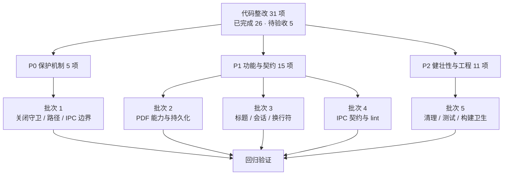

# MarkIt 待整改清单

> 文档定位：把全量文档核实过程中发现的代码、契约与工程问题整理成可跟踪的整改清单，供排期、评审和验收使用。
> 代码基线：MarkIt `1.5.0`（stable `v1.5.0`，beta `v1.6.0-beta.4`），`develop` 分支，核实日期 2026-11-10。
> 2026-11-10 复核：HEAD 为 `cf3d1c4`；`npm test`（16 个文件 / 141 用例）与 `npm run typecheck` 通过。R-01 ~ R-05 仍待人工验收，状态不变。
> 来源：[技术决策与已知限制](./技术决策与已知限制.md)、[IPC 接口与进程契约](./IPC接口与进程契约.md)、[PDF 导出](./PDF导出.md)、[文件与冲突处理](./文件与冲突处理.md)、[会话恢复与窗口状态](./会话恢复与窗口状态.md)、[编辑器与预览](./编辑器与预览.md)、[自动更新](./自动更新.md)。

## 1. 使用说明

### 1.1 优先级

| 优先级 | 含义                                                       | 处理要求                           |
| ------ | ---------------------------------------------------------- | ---------------------------------- |
| P0     | 可能导致数据丢失、绕过未保存保护、跨平台误判或安全边界失效 | 优先修复，合并前必须有手工验证记录 |
| P1     | 用户可见功能未兑现、契约不一致、状态不可靠                 | 排入近期迭代，修复后补回归验证     |
| P2     | 健壮性、死代码、工程卫生与长期质量                         | 可随相关模块改动顺带处理           |

### 1.2 状态与编号

- 编号 `R-xx` 为代码与工程整改项，`PL-xx` 为平台/产品限制。
- 状态取值：⬜ 未开工 / 待决策；🟡 代码已落地、待人工验收；✅ 已整改完成。
- 标 🟡 的条目代码已落地，但尚未按该项验收标准完成人工实测，**不得视为已完成**；✅ 表示代码整改已合入，各节注记中列出的平台 / 打包产物复核仍需按需执行。
- 状态列位于表格中，GFM 的 `- [ ]` 任务列表语法在表格单元格内不生效，因此统一使用图形标记，保证 MarkIt 预览、VS Code、GitHub 等渲染器下都能直观显示。
- 「代码已改」不等于「已完成」，每项都给出「验收标准」，不以「代码已改」代替验收。

### 1.3 整改原则

1. 所有业务改动先在 `docs/` 更新设计或功能文档，再改代码；涉及 IPC、数据结构、交互设计的必须单独成文（`rules/base.md` 第 4 节）。
2. 涉及 `src/preload/**`、`src/shared/**`、`src/renderer/src/utils/**` 的改动，跑全量 `lint` + `typecheck`。
3. 文件、会话、更新、PDF 等高风险区域，按 [测试与质量保障](./测试与质量保障.md) 的手工验证矩阵执行。
4. 不要为了让清单变绿而删除守护逻辑；确属产品决策的项（如 PDF 不复用预览样式）需先确认预期再改。

## 2. 总览

| 分类     | 数量 | 说明                                                |
| -------- | ---- | --------------------------------------------------- |
| P0       | 5    | 数据安全、关闭保护、跨平台路径、IPC 边界            |
| P1       | 15   | PDF、持久化、标题解析、会话、IPC 契约、换行符、lint |
| P2       | 11   | PDF 健壮性、死代码、工程卫生、测试与钩子            |
| 平台限制 | 3    | 签名与自动更新能力，属产品/发布决策                 |

### 2.1 状态分布

| 状态      | 含义                   | 数量 | 条目                                         |
| --------- | ---------------------- | ---- | -------------------------------------------- |
| ✅ 已完成 | 代码整改已合入         | 26   | R-06 ~ R-31                                  |
| 🟡 待验收 | 代码已落地，待人工实测 | 5    | R-01 ~ R-05                                  |
| ⬜ 未开工 | 属产品/发布决策        | 3    | PL-01 ~ PL-03（另有 git 钩子未纳入本次范围） |

## 3. P0 — 数据安全 / 保护机制

| 状态 | 编号 | 问题                                                                                                                        | 影响                                                       | 位置                                                                                                      | 整改建议                                                                                   | 验收标准                                                                                        |
| ---- | ---- | --------------------------------------------------------------------------------------------------------------------------- | ---------------------------------------------------------- | --------------------------------------------------------------------------------------------------------- | ------------------------------------------------------------------------------------------ | ----------------------------------------------------------------------------------------------- |
| 🟡   | R-01 | macOS 关闭窗口后 `allowClose` 保持为 `true`，从 Dock 重新开窗再关闭会跳过未保存确认                                         | 可能直接丢弃未保存内容，且不写会话                         | [`src/main/index.ts`](../src/main/index.ts) `createWindow()`                                              | 在 `createWindow()` 开头与 `rendererReady` 一起复位 `allowClose = false`                   | macOS 关闭窗口 → Dock 重开 → 修改文档 → 点关闭，必须弹出未保存确认                              |
| 🟡   | R-02 | 设置页安装更新只确认当前标签，其他标签的未保存修改不提示；主窗口安装流程会遍历全部标签                                      | 两条安装路径行为不一致，用户可能误以为已全部保存           | [`SettingsDialog.vue`](../src/renderer/src/components/settings/SettingsDialog.vue) `handleUpdateAction`   | 复用 `App.vue` 的 `saveAllBeforeExit()`，统一逐个确认并 `flushSession()`                   | 多标签均有修改时，从设置页安装更新必须逐个确认；取消任一项则中止安装                            |
| 🟡   | R-03 | macOS `Cmd+Q` 触发关闭守卫后，用户处理完保存，应用停留在后台而不退出（需实测确认）                                          | 用户以为已退出，实际仍在运行并持有文件句柄                 | [`src/main/index.ts`](../src/main/index.ts) `close` 处理                                                  | 增加 `before-quit` / “保存后继续退出”标志，确认后调用 `app.quit()` 而不只是关窗            | `Cmd+Q` → 选择保存 → 应用退出；选择取消 → 应用保持运行且文档不丢                                |
| 🟡   | R-04 | 渲染进程 `samePath` 在所有平台强制小写，主进程 `sameFilePath` 仅 Windows 小写；Linux 上 `A.md` 与 `a.md` 会被误判为同一文件 | 可能激活错误标签、覆盖另一个文件或漏判冲突                 | [`documents.ts`](../src/renderer/src/stores/documents.ts)、[`src/main/index.ts`](../src/main/index.ts)    | 统一按 `process.platform === 'win32'` 归一，抽成共享纯函数或用例表                         | Linux 下同时打开 `A.md` 与 `a.md`，必须是两个标签；Windows 下仍视为同一文件                     |
| 🟡   | R-05 | IPC 未校验 sender；`window.electron` 暴露了通用 `ipcRenderer` / `process`，与白名单原则相悖                                 | 任何渲染页面（含未来新增入口）都能调用全部通道，扩大攻击面 | [`src/main/index.ts`](../src/main/index.ts) 各 handler；[`src/preload/index.ts`](../src/preload/index.ts) | 校验 `event.senderFrame.url` 属于应用页面；移除未使用的 `window.electron` 暴露或限制其能力 | 非应用页面调用 IPC 被拒绝；渲染进程仍能完成现有全部功能；`window.electron` 若无调用方则不再暴露 |

> 2026-11-04 更新：R-01 ~ R-05 的代码整改已完成，对应契约见 [IPC 接口与进程契约](./IPC接口与进程契约.md) 与 [会话恢复与窗口状态](./会话恢复与窗口状态.md)。macOS 关闭 / Cmd+Q、Linux 大小写、设置页安装流程与非应用页面调用需按上表人工实测后再更新状态。
>
> 2026-11-05 更新：状态列改用图形标记（⬜ / 🟡 / ✅），避免表格内的 `[ ]` 被误读为「未渲染的 checkbox」；R-01 ~ R-05 标记为 🟡，表示代码已落地、等待人工验收，上表验收标准全部实测通过后再改为 ✅。状态定义见 1.2 与 2.1。

## 4. P1 — 功能承诺未兑现 / 数据一致性

| 状态 | 编号 | 问题                                                                                           | 影响                                                      | 位置                                                                                                                                                     | 整改建议                                                                                                                                 | 验收标准                                                                  |
| ---- | ---- | ---------------------------------------------------------------------------------------------- | --------------------------------------------------------- | -------------------------------------------------------------------------------------------------------------------------------------------------------- | ---------------------------------------------------------------------------------------------------------------------------------------- | ------------------------------------------------------------------------- |
| ✅   | R-06 | PDF 页边距 `margin` 仅传参未生效，实际边距固定为 `body padding: 40px`                          | 三档边距选项无效果，界面承诺与实际不符                    | [`src/main/index.ts`](../src/main/index.ts) `export:pdf`；[`usePdfExport.ts`](../src/renderer/src/composables/usePdfExport.ts)                           | `printToPDF` 传入 `margins`，或按档位设置打印 CSS；两处只保留一种控制方式                                                                | 三档边距导出后 PDF 可测量差异；A4/Letter 均生效                           |
| ✅   | R-07 | PDF 页码 `showPageNumbers` 未生效，未开启 `displayHeaderFooter`                                | 勾选页码无任何效果                                        | [`src/main/index.ts`](../src/main/index.ts) `export:pdf`                                                                                                 | 开启 `displayHeaderFooter`，使用 `.pageNumber` / `.totalPages` 页脚模板；关闭时不输出页脚                                                | 勾选后每页出现页码，取消后无页码；页脚不遮挡正文                          |
| ✅   | R-08 | `PdfExportOptions.showToc` / `fileName` 是无引用死类型，目录与默认文件名均未实现               | 类型误导调用方，后续维护容易以为能力已存在                | [`types/index.ts`](../src/renderer/src/types/index.ts)                                                                                                   | 实现目录生成与 `defaultPath`，或删除字段并收敛为单一导出选项类型                                                                         | 要么界面可生成目录/带默认文件名，要么类型中不再出现这两个字段             |
| ✅   | R-09 | PDF 使用独立浅色打印样式，不复用预览主题；深色主题仍导出浅色                                   | 用户可能期望「所见即所得」；README 已修正描述             | [`usePdfExport.ts`](../src/renderer/src/composables/usePdfExport.ts)                                                                                     | 产品确认：保持独立打印样式并明确说明，或注入浅色版预览 CSS                                                                               | 产品预期写进文档与界面提示；若实现样式注入，深色/浅色主题导出结果符合约定 |
| ✅   | R-10 | PDF 隐藏 `BrowserWindow` 异常时未销毁                                                          | `loadURL` / `printToPDF` 抛错会残留隐藏窗口，重复失败累积 | [`src/main/index.ts`](../src/main/index.ts) `export:pdf`                                                                                                 | 用 `try/finally` 包住并 `pdfWin.destroy()`                                                                                               | 构造打印异常后进程内不残留隐藏窗口；连续失败 3 次无窗口累积               |
| ✅   | R-11 | `exporting` 未接入对话框，无加载态、无防重入                                                   | 可重复弹保存框，用户不知道导出是否在进行                  | [`usePdfExport.ts`](../src/renderer/src/composables/usePdfExport.ts)；[`PdfExportDialog.vue`](../src/renderer/src/components/export/PdfExportDialog.vue) | 绑定 `disabled` 与「导出中…」文案，导出完成或取消后恢复                                                                                  | 导出期间按钮禁用；重复点击不会叠加保存框                                  |
| ✅   | R-12 | 预览样式选择与自定义 CSS 只存内存，重启回到 GitHub，自定义列表清空                             | 用户每次启动都要重新选择/导入                             | [`style.ts`](../src/renderer/src/stores/style.ts)                                                                                                        | 用 `markit-*` 键或独立 JSON 持久化；大 CSS 设体积上限                                                                                    | 选择样式、重启后保持；导入的 CSS 重启后仍可用；超限有提示                 |
| ✅   | R-13 | 大纲只识别 ATX 标题，预览锚点覆盖 Setext 标题，`heading-N` 可能错位，Setext 标题无法在大纲跳转 | 点击大纲可能跳到错误章节，Setext 文档大纲缺失             | [`useOutline.ts`](../src/renderer/src/composables/useOutline.ts)；[`MarkdownPreview.vue`](../src/renderer/src/components/preview/MarkdownPreview.vue)    | 两侧使用同一套标题解析规则（同时支持 ATX 与 Setext，跳过代码块）                                                                         | 含 Setext 与 ATX 混排的文档，大纲条目与预览锚点一一对应，点击均跳转正确   |
| ✅   | R-14 | `session.save` 返回 `false` 被忽略；主进程 `session:load` 不做结构校验                         | 会话写失败无感知；损坏的 `session.json` 可能导致恢复异常  | [`useSession.ts`](../src/renderer/src/composables/useSession.ts)；[`src/main/index.ts`](../src/main/index.ts)                                            | 处理写失败（至少提示并记录）；对 `SessionData` 做运行时校验与字段兜底                                                                    | 只读目录下写会话失败有可观测提示；伪造/截断的会话文件不导致崩溃           |
| ✅   | R-15 | 除 `onExternalFileChange` 外，preload 事件订阅均无注销函数                                     | HMR 或重复挂载会叠加监听，出现重复弹窗/重复处理           | [`src/preload/index.ts`](../src/preload/index.ts)                                                                                                        | 所有 `onXxx` 返回 `off`，调用方在 `onUnmounted` 注销                                                                                     | 连续切换/重挂载后，同一事件只处理一次                                     |
| ✅   | R-16 | `readFile` / `saveFile` / `saveFileAs` / `exportPdf` 返回类型被推导为 `Promise<any>`           | 渲染进程失去返回类型保护，易写出错误字段访问              | [`src/preload/index.ts`](../src/preload/index.ts)                                                                                                        | 显式标注返回类型，与 `ExposedAPI` 契约一致                                                                                               | `tsc` 下这些调用不再为 `any`；契约文档与代码一致                          |
| ✅   | R-17 | `update:install` 受理即返回 `true`，`quitAndInstall` 失败无法反馈                              | 用户点击安装后可能无任何反应，且无法排查                  | [`src/main/updater.ts`](../src/main/updater.ts)                                                                                                          | 至少记录日志；条件允许时改为安装结果事件或状态回传                                                                                       | 安装失败时主进程有日志，更新窗口能显示失败而非静默                        |
| ✅   | R-18 | 换行符策略不统一：未编辑时保存保留 CRLF，编辑后转为 LF；BOM 无专门处理                         | 同一文件多次保存可能产生整文件行尾 diff                   | [`MarkdownEditor.vue`](../src/renderer/src/components/editor/MarkdownEditor.vue)；保存链路                                                               | 明确「统一 LF」或「保持原文件换行符」并落实；BOM 在读取时记录、保存时按策略处理                                                          | CRLF 文件编辑保存后行为符合文档约定；不产生无关行尾 diff                  |
| ✅   | R-19 | 另存为不检查目标路径是否已被其他标签打开                                                       | 两个标签可指向同一文件，监听与冲突判定会混乱              | [`useFile.ts`](../src/renderer/src/composables/useFile.ts)                                                                                               | 另存为后按 `samePath` 检测已有标签，合并/提示用户                                                                                        | 另存为到已打开文件时给出明确处理，不产生重复标签                          |
| ✅   | R-20 | `npm run lint` 存量 82 个错误（scripts 46 + src 36），当前无法作为完成门槛                     | 违反 `rules/base.md` 的 DoD，改动无法用 lint 兜底         | `scripts/**`、`src/**`                                                                                                                                   | 分两批修：先 `scripts` 的 `require()` / 返回类型，再 `src` 的 `explicit-function-return-type`、`any`、`@ts-ignore`、空对象类型、无用转义 | `npm run lint` 退出码为 0（CRLF 警告可另行通过 `.gitattributes` 收敛）    |

> 2026-11-04 更新：R-06 ~ R-20 及 R-25 的代码整改已完成并标记为 ✅；上述条目均**尚未进行人工验证**，验收前需按各条验收标准在 `npm run dev` / 打包产物下复核。
>
> 同日 P2 复核补充：R-06 的页边距实现把 40 / 64 / 96 当作像素传给 `printToPDF.margins`，而 Electron 39 运行时按**英寸**校验，实际导出会报 `margins must be less than or equal to pageSize`。该问题已修正为 0.4 / 0.65 / 0.9 英寸（页脚额外 0.18 英寸），并由 `e2e/app.spec.ts` 的 PDF 用例覆盖。

## 5. P2 — 健壮性 / 清理 / 工程

| 状态 | 编号 | 问题                                                                    | 影响                                            | 位置                                                                                                           | 整改建议                                                                                  | 验收标准                                                              |
| ---- | ---- | ----------------------------------------------------------------------- | ----------------------------------------------- | -------------------------------------------------------------------------------------------------------------- | ----------------------------------------------------------------------------------------- | --------------------------------------------------------------------- |
| ✅   | R-21 | PDF 中 Mermaid 单块失败静默跳过                                         | 用户不知道图为何丢失                            | [`usePdfExport.ts`](../src/renderer/src/composables/usePdfExport.ts)                                           | 记录错误，或在产物中保留可见提示/代码块                                                   | 语法错误的图表在 PDF 中有可识别降级结果，控制台有日志                 |
| ✅   | R-22 | PDF 固定等待 1500ms，不等待 `document.fonts.ready`                      | 长文档可能不足，短文档白等                      | [`src/main/index.ts`](../src/main/index.ts) `export:pdf`                                                       | 等待字体与布局稳定，固定延时改为上限                                                      | 大文档图片/字体完整；导出耗时不因固定等待明显变长                     |
| ✅   | R-23 | 打印模板无 `@page` / `break-inside` 控制                                | 表格、代码块、图表可能被分页线切断              | [`usePdfExport.ts`](../src/renderer/src/composables/usePdfExport.ts)                                           | 为 `pre` / `table` / `img` / 图表容器增加分页约束                                         | 长表格与代码块尽量不被从中切断；必要时允许整块移到下一页              |
| ✅   | R-24 | PDF HTML 经 `encodeURIComponent` 塞入 `data:` URL，无体积保护           | 超大文档可能触发 URL 长度/内存问题              | [`src/main/index.ts`](../src/main/index.ts) `export:pdf`                                                       | 超大内容改为写临时文件后 `loadFile`，或设置体积上限并提示                                 | 含多张大图的长文档可导出；超限时有明确错误提示                        |
| ✅   | R-25 | `PdfExportDialog` 的 `:visible` 是未声明的无效 prop                     | 误导后续维护，以为对话框受控                    | [`AppLayout.vue`](../src/renderer/src/components/layout/AppLayout.vue)                                         | 删除绑定或改为真正的受控 prop                                                             | 组件 props 与实际绑定一致；对话框显示/关闭行为不变                    |
| ✅   | R-26 | `documents.setWordCount`、`editor.setContent` / `setWordCount` 无调用方 | 死代码增加维护成本，易误以为字数由这些入口更新  | [`documents.ts`](../src/renderer/src/stores/documents.ts)；[`editor.ts`](../src/renderer/src/stores/editor.ts) | 删除死代码；若保留则注明唯一调用方或用途                                                  | 全仓库无未使用导出；字数仍由 `updateContent` 正确重算                 |
| ✅   | R-27 | `window:minimize` / `window:maximize` 无调用点；`maximize` 实为切换语义 | 通道与命名误导，增加安全面                      | [`src/main/index.ts`](../src/main/index.ts)                                                                    | 删除未用通道，或改名为 `window:toggle-maximize` 并补调用方                                | 通道清单与文档一致；系统窗口按钮行为不受影响                          |
| ✅   | R-28 | `onOpenFile` 每次注册都会发送 `renderer:ready`                          | 重复调用会重复通知主进程，可能重复放行排队文件  | [`src/preload/index.ts`](../src/preload/index.ts)                                                              | 只发送一次，或由渲染层显式上报就绪                                                        | 多次注册后，排队文件只被放行一次                                      |
| ✅   | R-29 | 自动更新仅在启动 3s 后和手动操作时检查，长时间运行不会周期检测          | 长期不重启的客户端可能长期停留在旧版本          | [`src/main/updater.ts`](../src/main/updater.ts)                                                                | 增加可配置的周期检查（如 4–6 小时），避免与下载冲突                                       | 长时间运行可观察到周期检查；`checking` / `downloading` 状态不重复触发 |
| ✅   | R-30 | 仓库无 `.gitattributes`，`core.autocrlf=true` 导致约 8600 条 CRLF 警告  | lint 噪声掩盖真实问题，跨平台提交易产生行尾差异 | 仓库根目录                                                                                                     | 增加 `.gitattributes`（如 `* text=auto eol=lf`），按需一次性归一                          | `npm run lint` 的 CRLF 警告显著下降；新提交无行尾抖动                 |
| ✅   | R-31 | 原问题为无测试框架、无 git 钩子，质量依赖手工验证；现测试框架已落地，git 钩子仍未配置 | 高风险模块已有纯函数与 e2e 回归；提交前检查仍无钩子兜底 | 工程整体                                                                                                       | 已按 [测试与质量保障](./测试与质量保障.md) 引入 Vitest + Playwright；git 钩子作为独立工程项保留，不在本条验收范围 | 关键纯函数有回归用例；发版前关键路径可自动验证；提交前命令仍需手动执行 |

> 2026-11-04 更新：R-21 ~ R-31（R-25 此前已完成）的代码整改已完成并标记为 ✅。R-21 ~ R-24 需按 [PDF 导出 · 手工验证清单](./PDF导出.md) 复核；R-27 / R-28 需确认 IPC 通道清单与重复注册行为；R-29 可用 `MARKIT_UPDATE_CHECK_INTERVAL_MS` 缩短间隔验证；R-30 的行尾归一与 R-31 的 e2e 需在目标平台复核。git 钩子仍未配置，不属本次范围。
>
> 2026-11-10 更新：R-31 的测试框架部分已复核落地（Vitest 16 个文件 / 141 用例；Playwright e2e 冒烟已接入，需构建后本地执行）；git 钩子仍未配置，作为独立工程项保留，不改变本条 ✅ 状态。

## 6. 平台 / 产品限制（非代码缺陷）

| 状态 | 编号  | 限制                           | 影响                                               | 决策建议                                        |
| ---- | ----- | ------------------------------ | -------------------------------------------------- | ----------------------------------------------- |
| ⬜   | PL-01 | macOS 未签名、未公证           | Gatekeeper 拦截首次安装；Squirrel.Mac 无法自动更新 | 确认是否引入 Apple Developer 证书与公证流程     |
| ⬜   | PL-02 | Windows 未签名                 | 安装时可能出现 SmartScreen 提示                    | 评估代码签名证书成本与用户流失风险              |
| ⬜   | PL-03 | Linux 仅 AppImage 支持自动更新 | deb 用户只能手动升级                               | 在下载页与文档中明确区分；或评估 deb 的更新方案 |

## 7. 建议执行批次

| 批次 | 内容                             | 前置条件                 | 验证重点                                                    |
| ---- | -------------------------------- | ------------------------ | ----------------------------------------------------------- |
| 1    | R-01 ~ R-05（P0）                | 无                       | macOS 关闭/重开/退出、多标签安装、Linux 大小写、IPC sender  |
| 2    | R-06 ~ R-11、R-21 ~ R-24（PDF）  | 确认 R-09 的产品预期     | A4/Letter、边距、页码、长表格分页、图片与 Mermaid、异常恢复 |
| 3    | R-12 ~ R-19（状态与一致性）      | 无                       | 样式持久化、Setext 大纲、会话损坏、监听注销、另存为、换行符 |
| 4    | R-15 ~ R-17、R-20（契约与 lint） | 批次 1 的 IPC 改动先落地 | `npm run lint`、`npm run typecheck`、类型契约、更新安装反馈 |
| 5    | R-25 ~ R-31（清理与工程）        | 无                       | 死代码清理、`.gitattributes`、周期检查、测试框架引入        |

## 8. 相关文档

| 文档                                          | 关联内容                                         |
| --------------------------------------------- | ------------------------------------------------ |
| [技术决策与已知限制](./技术决策与已知限制.md) | D1–D13 决策记录、L1–L23 限制与改进建议           |
| [IPC 接口与进程契约](./IPC接口与进程契约.md)  | 32 条通道、返回类型、监听生命周期、sender 校验   |
| [PDF 导出](./PDF导出.md)                      | 选项接线、目录与文件名、隐藏窗口、剩余分页限制   |
| [文件与冲突处理](./文件与冲突处理.md)         | 冲突矩阵、监听、另存为、换行符策略               |
| [会话恢复与窗口状态](./会话恢复与窗口状态.md) | `allowClose`、会话校验、窗口重建                 |
| [编辑器与预览](./编辑器与预览.md)             | Setext 标题、大纲与锚点一致性                    |
| [自动更新](./自动更新.md)                     | 安装反馈、检查频率、平台限制                     |
| [测试与质量保障](./测试与质量保障.md)         | 手工验证矩阵、Vitest / Playwright 分工与 CI 接入 |
