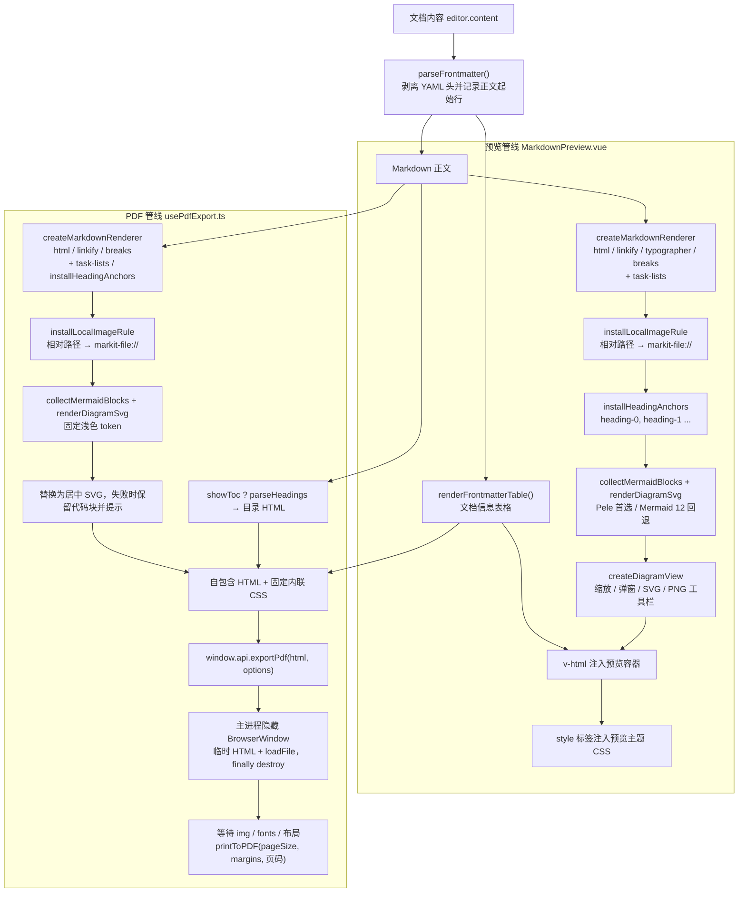

# 技术决策与已知限制

> 文档定位：记录 MarkIt 关键实现取舍的「决策记录（ADR 精简版）」，并汇总在 v1.5.0 源码中已核实的限制与未实现能力。
> 适用读者：准备修改编辑器状态、文件监听、预览 / PDF 管线、窗口生命周期或更新流程的开发者。
> 写作原则：每条决策都能在源码注释或实现中找到依据；每条限制都标注影响、代码位置与建议，不对未验证的行为下结论。

## 1. 决策记录的使用方式

- 编号 `D1`–`D17` 为**已落地**的现状决策，不是提案；修改实现时应同步更新对应条目。
- 每条包含四部分：**背景**（为什么遇到这个问题）、**决策**（现在怎么做）、**备选方案**（当时可以考虑的其他做法及未采用原因）、**后果**（现在必须接受的约束）。
- 触发复核的典型场景：替换编辑器引擎、改用新的文件监听方案、调整预览 / PDF 渲染入口、变更更新渠道或签名策略。
- 已知限制统一编号为 `L1`–`L23`，按主题分组，便于在 issue 或评审中引用。

| 编号 | 主题                                            | 关键代码                                                                                                                                                  |
| ---- | ----------------------------------------------- | --------------------------------------------------------------------------------------------------------------------------------------------------------- |
| D1   | `EditorState` 放在响应式系统之外                | [`documents.ts`](../src/renderer/src/stores/documents.ts)                                                                                                 |
| D2   | 用 `fs.watchFile` 轮询而非 `fs.watch`           | [`src/main/index.ts`](../src/main/index.ts)                                                                                                               |
| D3   | 路径比较统一大小写与斜杠                        | `documents.ts`、`src/main/index.ts`                                                                                                                       |
| D4   | `markit-file://` + 图片扩展名白名单             | `src/main/index.ts`、[`local-image.ts`](../src/renderer/src/utils/local-image.ts)                                                                         |
| D5   | 渲染进程禁用 `electron`，统一走 `contextBridge` | [`src/preload/index.ts`](../src/preload/index.ts)                                                                                                         |
| D6   | 预览与 PDF 各自维护 markdown-it 管线            | [`MarkdownPreview.vue`](../src/renderer/src/components/preview/MarkdownPreview.vue)、[`usePdfExport.ts`](../src/renderer/src/composables/usePdfExport.ts) |
| D7   | Mermaid `htmlLabels: false`                     | 同上两处                                                                                                                                                  |
| D8   | 滚动同步用模块级 registry + 实例注册            | [`useScrollSync.ts`](../src/renderer/src/composables/useScrollSync.ts)                                                                                    |
| D9   | 主进程每 300ms 推送光标坐标                     | `src/main/index.ts`、[`useScrollbarState.ts`](../src/renderer/src/composables/useScrollbarState.ts)                                                       |
| D10  | 开发模式禁用更新、`autoDownload = false`        | [`updater.ts`](../src/main/updater.ts)                                                                                                                    |
| D11  | 单实例锁 + argv 转发 + `renderer:ready` 排队    | `src/main/index.ts`、`src/preload/index.ts`                                                                                                               |
| D12  | 会话恢复磁盘优先、读不到回退会话内容            | [`useSession.ts`](../src/renderer/src/composables/useSession.ts)                                                                                          |
| D13  | 更新采用 stable / beta 双通道，版本严格单序列   | [`updater.ts`](../src/main/updater.ts)、[`update-channel.ts`](../src/main/update-channel.ts)、[`发版通道.md`](./发版通道.md)                              |
| D14  | Beta 仅允许用户主动发起一次性回退               | [`updater.ts`](../src/main/updater.ts)、[`Beta版本回退.md`](./Beta版本回退.md)                                                                            |
| D15  | 图表 Pele 首选、Mermaid 12 回退                 | [`diagram-renderer.ts`](../src/renderer/src/utils/diagram-renderer.ts)、[`图表渲染升级方案.md`](./图表渲染升级方案.md)                                     |

## 2. 决策记录

### D1 把 CodeMirror `EditorState` 放在响应式系统之外的 `Map`

**背景**：`EditorState` 体积大、不可序列化，内部包含不可变的事务与扩展结构。若放进 `ref` / `reactive`，Vue 会为其建立代理，既产生无意义的依赖追踪开销，也容易误用可变操作；而多标签场景又必须保留每个标签的撤销历史、选区与折叠状态。

**决策**：`documents` store 用闭包内的普通 `Map<string, EditorState>` 保存每个标签的编辑器状态，另用两个 `Map` 分别保存编辑区滚动锚点与预览区滚动的像素位置。响应式 `docs` 数组只保存可序列化字段（内容、路径、`diskContent`、光标、字数、大纲）。编辑器视图本身在 `editor` store 中以 `shallowRef<EditorView>` 暴露。

**备选方案**：

- 放入 `ref` / `reactive`：代理开销大，且与 CodeMirror 的不可变模型不匹配。
- 切换标签时按内容重建 `EditorState`：实现简单，但会丢失撤销历史、选区和折叠状态。
- 只维护一个全局 `EditorState`：无法同时保留多个标签的编辑会话。

**后果**：

- 缓存必须手动失效：`removeDocument()` 删除标签时清理三个 `Map`；`replaceContent()`（外部刷新 / 载入磁盘）会删除该标签的 `EditorState`，否则重新激活时显示过期文本。
- 仅预览布局会卸载编辑器组件，卸载前调用 `setEditorState()` 缓存当前状态，重新挂载时恢复撤销历史。
- 因为缓存的 `EditorState` 会跨组件实例复用，主题 `Compartment` 必须定义在模块级，重新挂载后 `reconfigure` 才能生效。

### D2 文件监听使用 `fs.watchFile` 400ms 轮询而非 `fs.watch`

**背景**：编辑器保存文件的常见实现是「写临时文件再重命名」。在 Windows 上，`fs.watch` 监视的是目录项，重命名后目标句柄可能失效，表现为后续修改收不到事件；而 `watchFile` 只关心最终文件的 `stat`，对替换式写入更稳。

**决策**：主进程用 `watchFile(filePath, { interval: 400 })` 监视当前活跃文件；事件到达后再做 150ms 防抖，避免读到其他程序尚未写完的中间内容；读取后用 `watchSeq` 丢弃切换目标后的过期结果，用 `watchedContent` 过滤应用自身保存与无内容变化的 `stat` 抖动；`file:save` 写盘后同步 `watchedContent`，防止监视器回环通知。

**备选方案**：

- `fs.watch`：事件更及时，但在 Windows 的临时文件重命名场景会丢目标，属于已踩过的坑。
- `chokidar`：跨平台封装更完整，但增加依赖与打包体积，当前单文件监听不需要。
- 只保留手动刷新：实现最省，但外部修改无法自动同步，体验差。

**后果**：

- 外部变更感知有约 400–550ms 延迟（轮询间隔 + 防抖）。
- 每 400ms 对单个文件做一次 `stat`，开销可忽略；但如果未来要监视整个工作区，需要重新评估方案。
- 同一时刻只监视一个文件，非活跃标签在切换过去时补读一次（见 `useFileWatcher.refreshPath`）。
- 文件被删除或保存瞬间不可读时，保留编辑器现有内容，等待下一次事件。

### D3 路径比较统一大小写与斜杠

**背景**：Windows 对路径大小写和分隔符不敏感。同一个文件可能以 `D:\docs\a.md`、`d:/docs/a.md` 等不同形式进入应用（双击、命令行、另存为、会话恢复），若直接用字符串比较，会产生重复标签、漏判冲突或监视目标不匹配。

**决策**：渲染进程在 [`utils/path.ts`](../src/renderer/src/utils/path.ts) 提供 `normalizePath` / `samePath(a, b)`：把反斜杠统一为 `/`，仅在 `win32` 下转小写；主进程 `sameFilePath(a, b)` 使用同一套规则。标签去重、外部变更归属判断、保存冲突判断都走这些 helper，不直接使用 `===`。

**备选方案**：

- 主进程用 `fs.realpath` / inode 比较：最准确，但每次比较都要额外 IO 或 IPC。
- 统一 `path.resolve` 后严格比较：在 Windows 上仍受大小写影响。
- 不做归一化：实现简单，但会产生重复标签和错误冲突提示。

**后果**：

- 渲染进程在 POSIX 上也会无条件小写，`A.md` 与 `a.md` 会被视为同一文件（详见 L13）。
- 主进程与渲染进程的归一化规则并不完全一致，跨进程判断同一文件时需注意。
- 所有新增的路径比较必须复用 helper，避免出现第三套规则。

### D4 `markit-file://` 自定义协议 + 图片扩展名白名单

**背景**：开发模式页面来自 `http://localhost`，打包后来自 `file://`；Markdown 中的相对路径图片需要按文档所在目录解析，而渲染进程没有 Node 的 `path` 模块，也无法直接读取本地文件。

**决策**：注册 `markit-file` 为 privileged scheme（`standard`、`secure`、`supportFetchAPI`、`stream`、`bypassCSP`），且必须在 `app ready` 之前调用 `protocol.registerSchemesAsPrivileged`。`protocol.handle` 从查询参数 `p` 取绝对路径，先通过图片扩展名白名单（`png`、`jpg` / `jpeg`、`gif`、`webp`、`bmp`、`svg`、`avif`、`ico`、`tif` / `tiff`），不匹配返回 415，匹配则 `net.fetch(pathToFileURL(...))`。渲染进程的 `local-image.ts` 负责相对路径、`file://`、Windows 盘符与 UNC 的归一化，最终生成 `markit-file://local/?p=<编码后的绝对路径>`。

**备选方案**：

- 关闭 `webSecurity`：能直接加载 `file://`，但会放开同源限制，不可接受。
- 直接使用 `file://`：开发模式（http 页面）与打包模式行为不一致，且受浏览器安全限制。
- 经 IPC 读成 base64 内联：大图会带来内存翻倍与重复传输。
- 放宽为任意文件读取：会把 Markdown 内容变成任意文件读取通道，明确禁止。

**后果**：

- 协议名、查询参数格式与扩展名白名单是持久契约，不得顺手改名或放宽（见 `rules/branding.md`）。
- 任意绝对路径的图片扩展名文件都可以被文档引用，这是「只读图片」的设计边界（见 L7）。
- `bypassCSP: true` 是为图片加载服务，新增其他用途前需要重新评估安全性。
- 相对路径解析在渲染进程实现，主进程只做白名单校验与文件读取，职责边界清晰。

### D5 渲染进程禁止 `import electron`，统一走 `contextBridge`

**背景**：渲染进程应视为纯 Web 环境；开启 `contextIsolation` 后，直接暴露 `ipcRenderer` 会把整个 IPC 面交给页面脚本。项目需要的是**能力白名单**，而不是全量通道。

**决策**：preload 只组装一个业务 `api` 对象，通过 `contextBridge.exposeInMainWorld` 暴露为 `window.api`；`ExposedAPI = typeof api` 作为类型契约，`index.d.ts` 扩展 `Window`。通用 `electronAPI`（`ipcRenderer` / `process`）没有调用方，已移除，避免把全量 IPC 面交给页面。新增 IPC 必须同步主进程 `registerHandle` / `registerOn`、preload 方法、`index.d.ts` 三处，并由 [`ipc-guard.ts`](../src/main/ipc-guard.ts) 校验调用来源。所有应用窗口都设置 `sandbox: false`，preload 依赖 `process.platform`、`process.contextIsolated` 与 `ipcRenderer`。

**备选方案**：

- 开启 `nodeIntegration`：实现最快，但把 Node 能力直接交给页面，安全边界消失。
- 直接暴露 `ipcRenderer`：调用方可以发送任意通道，白名单失去意义。
- `sandbox: true` + 纯 IPC：preload 可用的 Node 能力受限，需要重写现有加载逻辑。

**后果**：

- 每新增一个能力都要改三处，漏改会在类型检查或运行时暴露。
- 多数事件订阅函数没有返回取消函数（只有 `onExternalFileChange` 返回 `off`），重复挂载可能叠加监听。
- `renderer:ready` 由 preload 在 `onOpenFile` 注册监听后隐式发送，属于「注册即握手」的约定，新增窗口时容易忽略。

### D6 预览与 PDF 各自维护一条 markdown-it 管线

**背景**：预览需要交互式图表控件、主题切换、标题锚点与链接分流；PDF 需要自包含的静态 HTML、固定打印样式与可序列化的 Mermaid SVG。两者的输出目标不同，强行共用一条管线会把预览的 DOM 逻辑带进导出流程。

**决策**：两处各自通过共享工厂 `createMarkdownRenderer(...)` 创建渲染器实例：

- 预览：`html` / `linkify` / `typographer` / `breaks` / 任务列表，注入 `heading-N` 锚点核心规则，安装本地图片规则，Mermaid 渲染后包装成带缩放 / 弹窗 / 下载工具栏的 DOM。
- PDF：`html` / `linkify` / `breaks` / 任务列表（无 `typographer`），安装同一套本地图片规则，Mermaid 直接替换为居中 SVG，再拼成带固定内联 CSS 的完整 HTML。

共享的是**工具函数与渲染器工厂**而不是管线实例：`parseFrontmatter` / `renderFrontmatterTable`、`createMarkdownRenderer`、`installLocalImageRule`、`collectMermaidBlocks` / `formatMermaidError`。

**备选方案**：

- 单一渲染模块 + 参数开关：可以减少重复，但预览的交互 DOM 与 PDF 的静态输出会在同一函数里分叉，维护成本未必更低。
- 直接打印预览窗口：会带上工具栏、滚动容器与当前主题，分页和页边距不可控。
- 服务端渲染：本应用没有服务端。

**后果**：

- 修改 frontmatter、本地图片、Mermaid 识别或链接行为时，**必须两处同步**，否则预览与导出结果不一致。
- 目前已经存在有意的差异：PDF 没有 `typographer`、没有标题锚点、没有链接分流、使用固定打印样式（见第 4 节对照表）。
- 两条管线共享工具函数，但仍可能因配置差异产生细微行为不同，评审时需要显式确认。

### D7 Mermaid 使用 `htmlLabels: false`

**背景**：Mermaid 默认 `htmlLabels: true`，节点标签通过 `foreignObject` + HTML 实现。`foreignObject` 在 PDF 打印、SVG 序列化与 Canvas 绘制（SVG → PNG）中表现不稳定，导出的 SVG 通用性也较差。

**决策**：共享 Mermaid 配置固定 `htmlLabels: false`。预览和 PDF 共用 `renderDiagramSvg()`；Pele 失败时才进入 Mermaid 回退。Mermaid 使用 `theme: 'base'`、`look: 'neo'`、`layout: 'elk'` 和统一 `themeVariables`，不再使用 `dark` / `default` 固定主题。

**备选方案**：

- 保留 `htmlLabels: true`，预览端再把图转成 PNG：`foreignObject` 会污染 Canvas，且序列化结果依赖浏览器实现。
- 导出后对 SVG 做后处理，把 `foreignObject` 转成 `text`：实现复杂，覆盖不全。

**后果**：

- 标签只能使用 SVG `<text>` 的能力，复杂 HTML 标签（加粗、换行、局部样式）表现受限。
- Mermaid 是全局单例，共享模块通过模块级 Promise 链串行化 `initialize + render`，避免预览与 PDF 并发争用内部状态。
- 主题或预览样式变化时，预览会按保存的图表源码重新渲染；Mermaid 配置按主题签名决定是否重新 `initialize`。

### D8 滚动同步使用模块级 registry + 实例级注册 / 注销

**背景**：布局切换会在「仅编辑」「仅预览」之间卸载组件；预览还要等 Mermaid 异步渲染完成后才注册滚动容器。新旧实例的挂载 / 卸载顺序不固定，如果注销时无条件清空全局登记，会把另一个实例刚注册的元素一并清掉，表现为「切换一次布局后滚动联动永久失效」。

**决策**：模块级 `scrollRegistry` 保存 `{ editorView, previewEl, isSyncing, suspendCount }`。每个 `useScrollSync()` 实例记录自己注册的 view / element，注销时只有在全局仍指向自己时才清空。同步按 `scrollTop / maxScroll` 的比例双向换算；`isSyncing` 加 `requestAnimationFrame` 解锁，防止两个容器互相触发。程序化恢复滚动位置时调用 `suspendSync()` 获取释放函数，按引用计数屏蔽联动；切换标签时编辑区覆盖到自身恢复完成，预览区一直持有到异步渲染（Mermaid / 图片 / 表格列宽）结束并多等两帧，确保渲染引发的滚动事件不会反向驱动另一侧。

**备选方案**：

- `provide` / `inject` 共享状态：仍需处理挂载顺序，收益有限。
- 事件总线：额外抽象，调试成本更高。
- 全局单例直接覆盖：旧实例卸载时会清掉新实例的登记，正是要避免的问题。

**后果**：

- 每个编辑窗口的渲染进程支持一对编辑器 / 预览容器；多窗口之间不共享该 registry。
- 比例同步对高度分布差异很大的内容只是近似，不保证行级对齐。
- 联动屏蔽是引用计数的显式配对；新增恢复入口必须调用 `suspendSync()` 并在恢复与异步渲染结束后释放，否则重排引发的滚动事件会再次参与比例换算，表现为来回切标签时逐次偏移。

### D9 主进程每 300ms 推送光标坐标，修复滚动条 hover 卡死

**背景**：鼠标移入 `-webkit-app-region: drag` 的标题栏拖拽区或移出窗口后，渲染进程收不到鼠标事件，CSS `:hover` 状态不会更新，滚动条高亮会一直卡住。CSS 无法自愈这类状态。

**决策**：主进程每 300ms 用 `screen.getCursorScreenPoint()` 取真实光标位置，结合 `getContentBounds()` 与 `webContents.getZoomFactor()` 换算成页面坐标，发送 `cursor-pos`；渲染进程 `useScrollbarState` 用 `document.elementFromPoint` 命中最近的滚动容器并切换 `sb-active`。同时保留 `mousemove`（快速响应）、`mouseout`（离开窗口）、`blur`（失焦）与 `scroll`（滚动淡出）事件。

**备选方案**：

- 纯 CSS `:hover`：在拖拽区会卡死，已证伪。
- Pointer Capture：只能覆盖窗口内，窗口外仍收不到事件。
- 平台级鼠标钩子：需要原生模块，跨平台成本高。

**后果**：

- 窗口可见时持续产生 300ms 一次的 IPC，开销小但并非零；窗口不可见时直接返回。
- 坐标必须除以缩放比例，否则缩放后热点会偏移。
- 定时器在应用生命周期内常驻；每次轮询遍历可见编辑窗口，并按各窗口 bounds 与缩放换算坐标。

### D10 开发模式禁用自动更新，`autoDownload = false`

**背景**：开发模式没有可用的安装产物；自动下载会占用带宽并在用户不知情时落盘；强制更新又需要在检测到新版本后立即开始下载。

**决策**：`initAutoUpdater()` 中开发模式把状态置为 `disabled`，且不启动启动检测；生产模式在启动 3 秒后静默 `checkForUpdates()`。`autoDownload = false`、`autoInstallOnAppQuit = true`。下载由用户显式触发（`update:download`）或由 `releaseNotes` 首行的 `[force]` 标记触发；安装由 `update:install` 执行，安装前调用 `beforeInstall()` 放行关闭守卫。

**备选方案**：

- `autoDownload = true`：更新更省一步，但下载时机和带宽不可控。
- 定时轮询检查：当前未实现，只在启动与手动操作时检查。
- 预发布通道：当前固定 `stable`，没有 beta 渠道切换。

**后果**：

- 用户必须主动下载；下载完成后正常退出应用会安装更新（`autoInstallOnAppQuit = true`，见 L17）。
- 开发模式无法端到端验证更新链路，只能构建安装包测试。
- 平台未发布任何版本时接口返回 404，被容错为 `not-available`，不展示错误。

### D11 单实例锁 + argv 文件转发 + `renderer:ready` 排队

**背景**：双击关联文件会启动新的应用进程，必须把文件转交给已运行实例；而启动瞬间文件可能早于渲染进程注册监听，直接发送会丢失。`did-finish-load` 触发时 `webContents.isLoading()` 仍可能为 `true`，不能作为就绪信号。

**决策**：

1. `app.requestSingleInstanceLock()`，未获得锁则退出。
2. `second-instance` 中提取 argv 里**绝对路径**且扩展名为 `.md` / `.markdown` / `.txt` 的参数，选择最后聚焦的编辑窗口（没有则创建）后打开。
3. 每个编辑窗口上下文独立维护 `rendererReady` 与 `pendingFilePaths`；`openFileAtPath()` 在目标窗口未就绪时入队，异步读取后再次检查该窗口状态。
4. preload 在 `onOpenFile` 注册监听后 `send('renderer:ready')`，主进程只放行发送方窗口的队列。
5. 每个窗口 `did-start-loading` 只重置自己的 `rendererReady`，页面重载后重新握手。

**备选方案**：

- 依赖 `did-finish-load`：注释中已说明不可靠（`isLoading()` 仍可能为 `true`）。
- 收到 argv 立即发送：启动期必然丢失。
- 自定义深链协议：需要额外注册系统协议，当前未采用。

**后果**：

- 队列按原始字符串去重，同一文件以不同大小写传入可能重复入队。
- 只接受绝对路径与三种扩展名，相对路径或工作目录参数会被忽略。
- `renderer:ready` 按编辑窗口上下文记录，文件不会跨窗口误投递。

### D12 会话恢复磁盘优先、读不到回退会话内容

**背景**：自动更新会重启应用，用户可能有未保存的新建文档；应用关闭期间磁盘文件可能被外部修改或删除；启动期打开文件与会话恢复存在覆盖竞争。

**决策**：每个编辑窗口切片保存 `SessionData`（`tabs` 与 `activeIndex`），主进程用 `SessionFile v2` 聚合多个窗口。窗口启动时先通过 `window:get-context` 获取稳定 ID，只恢复自己的切片；有路径的标签仍先 `file:read`，成功以磁盘内容覆盖，失败保留会话内容。恢复完成前不写会话，命令行文件先入当前窗口队列；编辑期间 800ms 防抖保存，关闭 / 退出 / 安装前强制落盘。

**备选方案**：

- 只保存路径：实现简单，但未保存的新建文档会丢失。
- 只保存内容、不读磁盘：会覆盖应用关闭期间的外部更新。
- 按标签增量存储：可以减小写入量，但状态合并复杂度高，当前标签数量有限，收益不足。

**后果**：

- 未保存内容以明文 JSON 保存在 `userData/session.json`（见 L10）。
- 恢复不包含撤销历史（见 L9）；滚动位置随会话保存。
- 崩溃或强制结束可能丢失最后 800ms 内的会话变更。
- 会话结构没有版本号，字段演进时需要保持向后兼容或自行迁移。

### D13 更新采用 stable / beta 双通道，版本严格单序列

**背景**：需要高频发布小功能验证，正式版只在必要时或固定节点更新；同时希望用户能自行选择是否接收 Beta，而不是维护两套安装包。

**决策**：

1. apphub 使用 `stable` / `beta` 两个通道；beta 版本使用 semver 预发布 `X.Y.Z-beta.N`，base 必须严格大于最后一个正式版。
2. 所有版本（不论通道）全局单调：任何新版本必须大于已发布的全部版本，由 CI 的 `channel-state.mjs validate` 强制校验。
3. 客户端 Beta 偏好保存到主进程 `userData/update-preference.json`；开启时并行读取两个通道的 `latest*.yml`，选出大于当前版本的最高版本，再交给 electron-updater 执行检测、下载与安装。
4. 发版节点用 git tag 记录（`vX.Y.Z` / `vX.Y.Z-beta.N`），更新说明从**上一个同通道 tag** 开始收集，stable 因此天然覆盖其间所有 beta 提交。
5. CI 根据版本号自动推断通道并切换 `.apphub-release*.ci.json`，不新增手工参数。

**备选方案**：

- beta 使用独立安装包（VS Code Insiders 模式）：隔离彻底，但需要独立 appId、快捷方式与两套安装 / 卸载流程，对单人维护的项目成本过高。
- 服务端聚合双通道：客户端只读一个 feed，但 apphub 当前按通道独立发布，改造成本不在本仓库控制范围内。
- 人工维护发版节点清单：容易遗漏或与 tag 漂移，不如直接从 tag 计算。

**后果**：

- beta 线打开期间不能回头发更低的正式补丁版；紧急修复必须进 beta 线并尽快发布正式版。
- 关闭 Beta 后不会降级，已安装的 beta 版本要等下一个正式版（base 相同）发布后自动归队。
- beta 通道为空时更新端点返回 404，按「没有 beta」处理，不会让开关一开就报错。
- 完整规则与操作步骤见 [发版通道与 Beta 更新](./发版通道.md)。

### D14 只允许用户主动发起一次性 Beta 回退

**背景**：Beta 用户可能装到启动崩溃或核心功能不可用的预发布版本；关闭 Beta 开关按 semver 规则不会降级，过去只能手动下载正式版安装包。

**决策**：

1. 设置页允许当前 Beta 用户显式确认后回退到 stable 当前最新版本，目标版本不能在客户端选择。
2. 回退开始时关闭 Beta 并持久化；使用 electron-updater 的 `allowDowngrade` 仅覆盖本次检测，结束后必须复位。
3. 周期检测、关闭 Beta 和后台检查永远不自动降级；回退不形成常驻降级通道。
4. Windows NSIS 与 Linux AppImage 支持自动回退；macOS 未签名 / 未公证，只保留手动安装路径。

**备选方案**：

- 关闭 Beta 即自动回退：会制造用户未要求的降级，破坏更新预期。
- 提供历史版本列表：扩大下载面与兼容风险，超出「退出当前不稳定 Beta」的需求。
- 不提供回退：普通用户只能手动找安装包，故障恢复成本高。

**后果**：旧正式版需要能安全读取 Beta 期间产生的会话、窗口状态与 localStorage；Beta 线不得引入旧版本无法忽略的持久化格式。实现与验证见 [Beta 版本回退](./Beta版本回退.md)。

### D15 图表使用 Pele 首选、Mermaid 12 回退

**背景**：直接展示 Mermaid 默认主题时，流程图布局松散，饼图、雷达图、XY 图等缺少统一的系列色和字体；Codex 桌面端通过 Pele 或定制 Mermaid + ELK 获得更一致的视觉效果。

**决策**：新增共享 `renderDiagramSvg()`：

1. 优先调用 MIT 许可的 Pele，它支持 Mermaid 12.1 的内置图表类型，并使用自研布局与 SVG 渲染。
2. Pele 失败时自动回退到 Mermaid 12 + ELK + Neo + MarkIt 主题 token。
3. 预览与 PDF 共用该入口，图表主题来自 `getDiagramTheme()`。
4. 阶段 3 的判断节点卡片化、边标签胶囊化和 AST 修复不在当前实现内。

**备选方案**：

- 只升级 Mermaid 12：改造量小，但各类图表的视觉统一程度有限。
- 只使用 Pele：视觉最统一，但少数外部插件或兼容性边界缺少 Mermaid 回退。
- 转换为 Excalidraw / tldraw：可编辑能力强，但运行时和交互复杂度远高于预览需求。

**后果**：

- 首次渲染图表会动态加载 Pele；失败后还会加载 Mermaid，最坏路径加载量更高。
- Pele 的 `themeVariables` 只用于系列色，其他颜色通过 `--pele-*` 变量控制，不能直接套用 Mermaid 主题。
- Pele 与 Mermaid 的节点位置、间距可能不同；主题切换会整体重绘，用户手动缩放状态会回到自动适应。
- 图表内嵌图片与 Javascript 回调不在本次启用范围。

### D16 每个标签保留独立预览层，正文输入做尾部防抖

**背景**：十万字符量级的 Markdown 在每次切换标签时都会整篇重算 `md.render`、重建预览 DOM 并重新渲染全部图表。实测切一次标签的主线程工作约 400–450ms（渲染、HTML 解析、样式重算、布局、图表绘制之和），用户能明显感知卡顿；正文输入时同一套成本还会按字符重复。

**决策**：

1. `MarkdownPreview` 为每个访问过的标签保留一个预览层（`.markit-preview-layer`），最多 3 个，按最近激活时间淘汰；标签关闭时立即释放。
2. 切换标签只切换层的显示状态：非激活层 `transform: translateX(-200%)`，激活层恢复原位。不用 `visibility` / `inert`（实测都会让整层重算样式，约 290ms）也不用 `display`（触发完整布局）。
3. 层是绝对定位，滚动容器高度由 `.preview-spacer` 提供；每次切换、`ResizeObserver` 回调与收尾渲染后同步高度。
4. 正文输入按 150ms 尾部防抖渲染；HTML 另按「文档 id + 内容 + 路径」缓存在模块级 LRU（容量 6），层被淘汰后再次访问可跳过 Markdown 渲染。
5. `renderDiagramSvg` 结果按「主题 + 字体族 + 源码」缓存（容量 32）；每层记录图表主题版本，主题变化后当前层立即重绘、其他层在下次激活时重绘。
6. 多个层会同时包含 `heading-N` 等 id：大纲跳转与页内锚点在 `editorStore.previewContent`（当前激活层）内查找；表格列宽、搜索范围也以激活层为根。非激活层标记 `aria-hidden`，并用 `focusin` 守卫把误入的焦点拉回当前层。
7. 滚动恢复仍等待最新一轮渲染收尾完成，`suspendSync` 窗口语义不变。

**备选方案**：

- 只缓存 HTML 字符串：省掉 `md.render`，但 DOM 重建与布局仍是主要成本（实测重建 117ms、重挂已渲染子树仍需 121ms），收益有限。
- 对整棵预览 DOM 做虚拟滚动：改造量大，且滚动同步按容器比例换算，替换为虚拟列表会改变同步模型。
- 图表视口懒渲染：渲染前后高度不同，会破坏按内容锚点恢复滚动位置的设计。

**后果**：

- 切回已渲染的长文档主线程工作从约 400–450ms 降到约 65ms，其中布局 140ms → 4ms、样式重算 291ms → 32–44ms。
- 正文输入后的预览更新最多延迟 150ms；搜索、表格列宽、图表等收尾逻辑都依赖渲染完成事件，不会读到半旧半新的 DOM。
- 常驻 3 个完整预览 DOM（十万字符文档约 8000 个元素/层），内存随层数有上限；HTML 字符串缓存另占约 0.2MB/文档。
- 隐藏层仍参与文档布局：窗口尺寸变化时全部层都会重排，但内容编辑只影响当前层。

### D17 输入路径只保留一次全文拷贝，解析类工作全部防抖

**背景**：十万字符量级的文档中，每次按键若触发多次全文 `toString`、换行归一化或大纲解析，输入会明显滞后。预览层与大纲此前分别存在「逐键整篇重算」的问题。

**决策**：

1. `updateListener` 在 `docChanged` 时只做一次 `doc.toString()`，结果交给 `documents.updateContent`；这是输入路径上唯一的全文拷贝。
2. `normalizeToLf` 增加快路径：字符串不含 `\r` 时原样返回（编辑器内部只用 LF），避免第二次全文分配。
3. `updateContent` 返回实际写入 store 的字符串，编辑器内容监听器用 `lastEditorContent` 比较，识别自身写入并跳过 `view.state.doc.toString()`。
4. 大纲解析改为 200ms 尾部防抖，切换标签时取消防抖并立即补齐；预览渲染沿用 150ms 尾部防抖；会话保存沿用 800ms 防抖。
5. 字数仍用 `text.replace(/\s/g, '').length` 计算（十万字符约 0.7ms），暂不做增量统计，避免为极小的收益引入 diff 计数的一致性风险。

**备选方案**：

- 把内容同步整体改为防抖：保存、会话、导出都需要最新内容，必须在所有出口强制 flush，容易漏掉导致写盘内容过期。
- 逐键增量统计字数：收益约 0.5ms/键，但需要处理多选区、撤销、外部替换等边界，错误难被发现。

**后果**：

- 单次按键的主线程工作只剩一次全文拷贝与一次字数统计（约 1ms 量级），大纲与预览均在停顿后更新。
- 切换标签时大纲立即刷新，不会显示上一个文档或旧内容的标题。
- 编辑器外部刷新（磁盘变更、载入文件）仍走完整内容比较与替换流程。

## 3. 已知限制与未实现能力

> 下表条目均在 v1.5.0 源码中核实，不是推测。`建议` 只是改进方向，不代表已排期。

### 3.1 导出与预览

| 编号         | 限制                                                | 影响                                                                                                   | 现状代码位置                                                                                                                        | 建议                                                                                             |
| ------------ | --------------------------------------------------- | ------------------------------------------------------------------------------------------------------ | ----------------------------------------------------------------------------------------------------------------------------------- | ------------------------------------------------------------------------------------------------ |
| L1（已修复） | PDF 的「页边距」选项不生效                          | ——                                                                                                     | `printToPDF.margins` 按窄 / 标准 / 宽映射为 40 / 64 / 96 像素，模板 `body` 不再设置 padding（R-06）                                 | 保持单一控制点；新增档位时只改 `PDF_MARGIN_PX`                                                   |
| L2（已修复） | PDF 的「显示页码」选项不生效                        | ——                                                                                                     | `showPageNumbers` 开启 `displayHeaderFooter` 并注入只含 `.pageNumber` / `.totalPages` 的页脚；关闭时不输出（R-07）                  | 页码占用的底部空间与边距联动                                                                     |
| L3（已修复） | `PdfExportOptions.showToc` 与 `fileName` 从未被使用 | ——                                                                                                     | 类型统一到 [`shared/pdf-types.ts`](../src/shared/pdf-types.ts)；对话框提供「生成目录」，默认文件名取当前文档名并清洗（R-08）        | 新增字段时同步共享类型与 [PDF 导出](./PDF导出.md)                                                |
| L4（已修复） | PDF 中 Mermaid 渲染失败会静默丢图                   | ——                                                                                                     | [`usePdfExport.ts`](../src/renderer/src/composables/usePdfExport.ts) 失败时保留代码块、追加 `.mermaid-error` 提示并记录日志（R-21） | 提示样式与预览不同，但降级结果可识别                                                             |
| L5（已修复） | PDF 导出等待策略是「等 `` + 固定 1.5s」        | ——                                                                                                     | 等待 `document.fonts.ready` 与两帧布局，1500ms 仅作兜底；HTML 写入临时文件后 `loadFile`，超过 64MB 明确提示（R-22 / R-24）          | 临时文件在 `finally` 删除；超大内容仍受内存限制                                                  |
| L6（已修复） | 自定义预览 CSS 与当前所选预览样式不持久化           | ——                                                                                                     | `markit-preview-style` / `markit-custom-styles` 持久化；载入时校验字段并丢弃超过 200,000 字符的条目，导入时提示上限（R-12）         | 保持 `markit-*` 前缀；大文件优先考虑独立 JSON                                                    |
| L7           | `markit-file://` 可读取任意绝对路径的图片扩展名文件 | 文档可以引用文档目录之外的图片（只读）。这是为了支持绝对路径图片而保留的设计边界，不是漏洞，但需要明确 | [`src/main/index.ts`](../src/main/index.ts) 协议 handler 的 `IMAGE_FILE_EXTENSION` 白名单                                           | 若未来需要更严格隔离，可增加「仅允许文档目录及其子目录」的可选策略，但要先评估对现有文档的兼容性 |
| L8（已修复） | `PdfExportDialog` 的 `visible` 属性未被组件声明     | ——                                                                                                     | 删除无效绑定；组件只声明 `exporting` prop，显隐由 `app.showPdfDialog` 控制（R-25 提前处理）                                         | 新 prop 必须与组件声明一致                                                                       |

### 3.2 数据与持久化

| 编号           | 限制                                    | 影响                                                                                                             | 现状代码位置                                                                                                                                                          | 建议                                                                                                                                                                                      |
| -------------- | --------------------------------------- | ---------------------------------------------------------------------------------------------------------------- | --------------------------------------------------------------------------------------------------------------------------------------------------------------------- | ----------------------------------------------------------------------------------------------------------------------------------------------------------------------------------------- |
| L9（已修复）   | 撤销历史与会话文件分离                  | 正常退出 / 安装更新后可恢复撤销栈；异常崩溃最多回退到上一次 flush。跨窗口迁移保留历史 | `session.json` 保持轻量；`editor-history.json` 按 `windowId + historyId` 保存受限 `historyField`，单条 4 MiB、单窗口 32 MiB | 不把大历史写入会话文件；损坏或超限时从当前内容重建 |
| L10            | 会话是明文、无版本号、800ms 防抖        | 未保存内容以 JSON 明文落在 `userData/session.json`；崩溃可能丢失最后 800ms；未来字段变更没有迁移入口             | [`useSession.ts`](../src/renderer/src/composables/useSession.ts) 第 7、53–58 行；[`src/main/index.ts`](../src/main/index.ts) 的 `sessionFile`                         | 增加 `version` 字段与迁移函数；如需保护隐私，可改为按用户密钥加密或提供「不保存未保存内容」开关                                                                                           |
| L11            | 只监视当前活跃标签的文件                | 后台标签的外部修改不会实时推送，只有切换过去时补读一次；应用关闭期间完全无监视                                   | [`src/main/index.ts`](../src/main/index.ts) 的 `file:watch` / `setWatchedFile`；[`useFileWatcher.ts`](../src/renderer/src/composables/useFileWatcher.ts) 的路径 watch | 当前设计已用「切换补读」覆盖主要场景；若要实时同步多标签，需要改为多目标监视并控制句柄数量                                                                                                |
| L12（已修复）  | 保存会把 CRLF 统一为 LF；BOM 无专门处理 | ——                                                                                                               | [`utils/text-encoding.ts`](../src/renderer/src/utils/text-encoding.ts) 的 `decodeText` / `encodeText`；`DocumentTab.eol` / `bom` 随会话保存，保存时还原（R-18）       | 保持「内部 LF、写盘还原」策略；新增读写入口必须经过这两个函数                                                                                                                             |
| L13（已修复）  | `samePath` 与 `sameFilePath` 规则不一致 | ——                                                                                                               | 两侧统一为「正斜杠 + 仅在 `win32` 下小写」：[`utils/path.ts`](../src/renderer/src/utils/path.ts)、[`src/main/index.ts`](../src/main/index.ts) `sameFilePath`（R-04）  | 保持同一套规则；新增路径比较时不要手写 `toLowerCase`                                                                                                                                      |

### 3.3 平台与发布

| 编号 | 限制                                 | 影响                                                                                             | 现状代码位置                                                                                                                                   | 建议                                                                                                     |
| ---- | ------------------------------------ | ------------------------------------------------------------------------------------------------ | ---------------------------------------------------------------------------------------------------------------------------------------------- | -------------------------------------------------------------------------------------------------------- |
| L14  | macOS 未签名 / 未公证                | Gatekeeper 会拦截首次打开；Squirrel.Mac 不会执行自动更新，macOS 只能手动安装新版本               | [`electron-builder.yml`](../electron-builder.yml) 的 `mac.notarize: false`；[README](../README.md) 与 [发版说明](./github-release.md) 均有说明 | 配置 Apple Developer 证书、`hardenedRuntime` 与公证流程后再宣称 macOS 支持自动更新                       |
| L15  | Linux 仅 AppImage 支持自动更新       | `deb` 用户收不到更新，只能手动下载安装                                                           | [`electron-builder.yml`](../electron-builder.yml) 的 `linux.target` 为 `AppImage` + `deb`                                                      | 在下载页明确标注；如需 deb 自动更新，需要接入系统包管理器或额外的更新代理                                |
| L16  | Windows 未配置代码签名               | 安装时可能出现 SmartScreen 警告，影响首次安装信任                                                | [`electron-builder.yml`](../electron-builder.yml) 未配置 `win.certificateFile` 等签名项                                                        | 申请代码签名证书并接入 CI；签名后再验证自动更新与 SmartScreen 表现                                       |
| L17  | `autoInstallOnAppQuit = true`        | 更新下载完成后，用户正常退出应用就会安装，不会再确认一次；若此时有未保存内容，依赖关闭守卫先处理 | [`updater.ts`](../src/main/updater.ts) 第 240 行                                                                                               | 明确产品预期；如需「退出时询问是否安装」，改为 `false` 并在退出流程中提示                                |
| L18  | 更新提示的「跳过」只在当前运行期有效 | 用户跳过后，重启应用同一版本仍会再次弹出提示                                                     | [`update.ts`](../src/renderer/src/stores/update.ts) 的 `dismissedVersion` 是内存 `ref`                                                         | 若希望长期跳过，把版本号持久化到 localStorage（使用 `markit-` 前缀），并提供「不再提示此版本」的清晰文案 |

### 3.4 窗口、IPC 与生命周期

| 编号            | 限制                                                      | 影响                                                                                             | 现状代码位置                                                                                                                                   | 建议                                                                            |
| --------------- | --------------------------------------------------------- | ------------------------------------------------------------------------------------------------ | ---------------------------------------------------------------------------------------------------------------------------------------------- | ------------------------------------------------------------------------------- |
| L19（已修复）   | macOS 重新创建窗口时关闭守卫未复位                        | ——                                                                                               | `createEditorWindow()` 为每个窗口创建独立上下文，`allowClose` / `rendererReady` 等状态随窗口初始化                                             | 保持按窗口初始化；新增窗口级状态不得退回模块级单例                              |
| L20（已修复）   | macOS 用 Cmd+Q 退出且存在未保存内容时，保存后应用仍在运行 | ——                                                                                               | `before-quit` 向所有编辑窗口发送 `app:prepare-exit`，全部保存成功后主进程继续 `app.quit()`；安装复用同一协调链路 | 保持「全部窗口保存完成 → 继续退出」链路；不得退回单窗口直接放行                  |
| L21（已修复）   | IPC 不校验发送方；窗口就绪状态曾是全局标志               | 已消除                                                                                           | `ipc-guard` 校验应用页面来源；编辑器能力按发送方查注册表；`rendererReady` / 文件队列按窗口上下文记录                                           | 新增窗口级通道时继续保持按发送方路由                                            |
| L22             | 更新检测存在最长 4 小时间隔                               | 版本发布后，长期运行且未手动检查的实例最多延迟约 4 小时发现                                      | [`updater.ts`](../src/main/updater.ts) 启动 3s 检测 + `setInterval(periodicCheck, 4h)`，间隔可用 `MARKIT_UPDATE_CHECK_INTERVAL_MS` 覆盖        | 如需更快，可在窗口重新获得焦点时触发；周期值已可配置                            |

### 3.5 工程与质量

| 编号 | 限制                             | 影响                                                                                                       | 现状代码位置                                                                                                                                               | 建议                                                                                                |
| ---- | -------------------------------- | ---------------------------------------------------------------------------------------------------------- | ---------------------------------------------------------------------------------------------------------------------------------------------------------- | --------------------------------------------------------------------------------------------------- |
| L23  | 没有 git 钩子；e2e 未接入发版 CI | 单元测试已覆盖纯函数并由 CI 执行，但文件监听、冲突弹窗、系统对话框等仍需手工验证；提交前检查依赖执行者自觉 | [`package.json`](../package.json) 已有 `test` / `test:e2e`；[release.yml](../.github/workflows/release.yml) 的 `test` job 运行 Vitest；`e2e/` 依赖构建产物 | 保持纯函数用例随改动补充；e2e 主路径（打开 / 保存 / 冲突 / 导出）在本地发版前执行；后续评估提交钩子 |

## 4. 图：预览与 PDF 双管线

两条管线的差异清单（修改渲染行为时逐项确认）：

| 环节             | 预览                                            | PDF                        | 是否共享实现         |
| ---------------- | ----------------------------------------------- | -------------------------- | -------------------- |
| markdown-it 配置 | `createMarkdownRenderer({ typographer: true })` | `createMarkdownRenderer()` | 是，`markdown.ts`    |
| frontmatter      | 属性表格                                        | 属性表格                   | 是，`frontmatter.ts` |
| 本地图片         | `markit-file://`                                | `markit-file://`           | 是，`local-image.ts` |
| 标题锚点         | `heading-N`，供大纲跳转                         | `heading-N`，供目录跳转    | 是，`headings.ts`    |
| Mermaid 识别     | 语言白名单                                      | 语言白名单                 | 是，`mermaid.ts`     |
| Mermaid 输出     | 带工具栏的交互容器                              | 居中静态 SVG               | 否                   |
| 链接处理         | 点击分流（外部 / 本地 / 锚点）                  | 静态链接，不拦截           | 否                   |
| 样式来源         | 当前预览主题 CSS                                | 固定内联 CSS               | 否                   |
| 最终输出         | `v-html` DOM                                    | `data:` URL + `printToPDF` | 否                   |

## 5. 相关文件

| 文件                                                                                                                    | 作用                                                            |
| ----------------------------------------------------------------------------------------------------------------------- | --------------------------------------------------------------- |
| [`src/main/index.ts`](../src/main/index.ts)                                                                             | 主进程：窗口、IPC、协议、文件监听、会话读写、PDF 导出、光标推送 |
| [`src/main/updater.ts`](../src/main/updater.ts)                                                                         | 自动更新状态机、更新窗口、安装请求协调                          |
| [`src/preload/index.ts`](../src/preload/index.ts)                                                                       | `window.api` 白名单与 `renderer:ready` 握手                     |
| [`src/shared/session-types.ts`](../src/shared/session-types.ts)                                                         | 会话数据结构                                                    |
| [`src/shared/update-types.ts`](../src/shared/update-types.ts)                                                           | 更新状态数据结构                                                |
| [`src/renderer/src/stores/documents.ts`](../src/renderer/src/stores/documents.ts)                                       | 标签状态、`EditorState` 缓存、会话恢复                          |
| [`src/renderer/src/utils/path.ts`](../src/renderer/src/utils/path.ts)                                                   | `normalizePath` / `samePath`（仅 Windows 忽略大小写）           |
| [`src/renderer/src/composables/useFileWatcher.ts`](../src/renderer/src/composables/useFileWatcher.ts)                   | 活跃文件监视、变更队列、切换补读                                |
| [`src/renderer/src/composables/useFile.ts`](../src/renderer/src/composables/useFile.ts)                                 | 打开 / 保存 / 冲突协调                                          |
| [`src/renderer/src/composables/useSession.ts`](../src/renderer/src/composables/useSession.ts)                           | 会话快照、恢复、落盘                                            |
| [`src/renderer/src/composables/usePdfExport.ts`](../src/renderer/src/composables/usePdfExport.ts)                       | PDF HTML 组装与 Mermaid SVG                                     |
| [`src/renderer/src/components/preview/MarkdownPreview.vue`](../src/renderer/src/components/preview/MarkdownPreview.vue) | 预览管线、标题锚点、Mermaid 交互                                |
| [`src/renderer/src/components/export/PdfExportDialog.vue`](../src/renderer/src/components/export/PdfExportDialog.vue)   | PDF 选项收集                                                    |
| [`src/renderer/src/utils/local-image.ts`](../src/renderer/src/utils/local-image.ts)                                     | 图片路径解析与 `markit-file` URL                                |
| [`src/renderer/src/utils/text-diff.ts`](../src/renderer/src/utils/text-diff.ts)                                         | 冲突逐行差异                                                    |
| [`electron-builder.yml`](../electron-builder.yml)                                                                       | 三平台打包、签名 / 公证、更新端点                               |
| [`package.json`](../package.json)                                                                                       | 依赖版本与脚本（含 `test` / `test:e2e`）                        |
| [架构总览](./架构总览.md)                                                                                               | 进程模型、模块职责、启动时序与数据流                            |
| [IPC 接口与进程契约](./IPC接口与进程契约.md)                                                                            | 通道清单与三处同步约定                                          |
| [GitHub Actions 发版说明](./github-release.md)                                                                          | 三平台构建、apphub 发布与平台限制                               |
