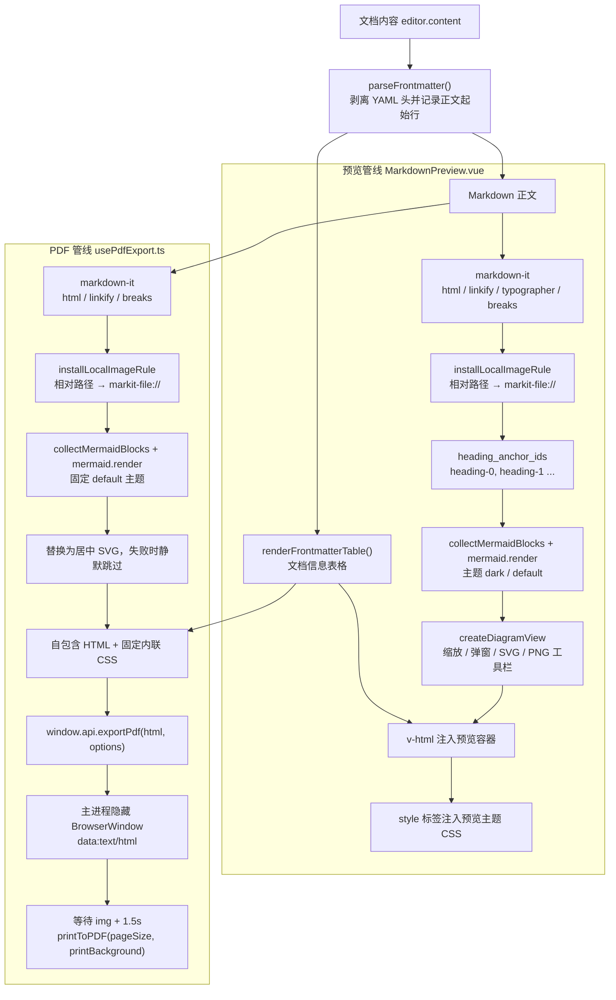

# 技术决策与已知限制

> 文档定位：记录 MarkIt 关键实现取舍的「决策记录（ADR 精简版）」，并汇总在 v1.4.1 源码中已核实的限制与未实现能力。
> 适用读者：准备修改编辑器状态、文件监听、预览 / PDF 管线、窗口生命周期或更新流程的开发者。
> 写作原则：每条决策都能在源码注释或实现中找到依据；每条限制都标注影响、代码位置与建议，不对未验证的行为下结论。

## 1. 决策记录的使用方式

- 编号 `D1`–`D12` 为**已落地**的现状决策，不是提案；修改实现时应同步更新对应条目。
- 每条包含四部分：**背景**（为什么遇到这个问题）、**决策**（现在怎么做）、**备选方案**（当时可以考虑的其他做法及未采用原因）、**后果**（现在必须接受的约束）。
- 触发复核的典型场景：替换编辑器引擎、改用新的文件监听方案、调整预览 / PDF 渲染入口、变更更新渠道或签名策略。
- 已知限制统一编号为 `L1`–`L23`，按主题分组，便于在 issue 或评审中引用。

| 编号 | 主题                                            | 关键代码                                                                                                                                                  |
| ---- | ----------------------------------------------- | --------------------------------------------------------------------------------------------------------------------------------------------------------- |
| D1   | `EditorState` 放在响应式系统之外                | [`documents.ts`](../src/renderer/src/stores/documents.ts)                                                                                                 |
| D2   | 用 `fs.watchFile` 轮询而非 `fs.watch`           | [`src/main/index.ts`](../src/main/index.ts)                                                                                                               |
| D3   | 路径比较统一大小写与斜杠                        | `documents.ts`、`src/main/index.ts`                                                                                                                       |
| D4   | `markit-file://` + 图片扩展名白名单             | `src/main/index.ts`、[`local-image.ts`](../src/renderer/src/utils/local-image.ts)                                                                         |
| D5   | 渲染进程禁用 `electron`，统一走 `contextBridge` | [`src/preload/index.ts`](../src/preload/index.ts)                                                                                                         |
| D6   | 预览与 PDF 各自维护 markdown-it 管线            | [`MarkdownPreview.vue`](../src/renderer/src/components/preview/MarkdownPreview.vue)、[`usePdfExport.ts`](../src/renderer/src/composables/usePdfExport.ts) |
| D7   | Mermaid `htmlLabels: false`                     | 同上两处                                                                                                                                                  |
| D8   | 滚动同步用模块级 registry + 实例注册            | [`useScrollSync.ts`](../src/renderer/src/composables/useScrollSync.ts)                                                                                    |
| D9   | 主进程每 300ms 推送光标坐标                     | `src/main/index.ts`、[`useScrollbarState.ts`](../src/renderer/src/composables/useScrollbarState.ts)                                                       |
| D10  | 开发模式禁用更新、`autoDownload = false`        | [`updater.ts`](../src/main/updater.ts)                                                                                                                    |
| D11  | 单实例锁 + argv 转发 + `renderer:ready` 排队    | `src/main/index.ts`、`src/preload/index.ts`                                                                                                               |
| D12  | 会话恢复磁盘优先、读不到回退会话内容            | [`useSession.ts`](../src/renderer/src/composables/useSession.ts)                                                                                          |

## 2. 决策记录

### D1 把 CodeMirror `EditorState` 放在响应式系统之外的 `Map`

**背景**：`EditorState` 体积大、不可序列化，内部包含不可变的事务与扩展结构。若放进 `ref` / `reactive`，Vue 会为其建立代理，既产生无意义的依赖追踪开销，也容易误用可变操作；而多标签场景又必须保留每个标签的撤销历史、选区与折叠状态。

**决策**：`documents` store 用闭包内的普通 `Map<string, EditorState>` 保存每个标签的编辑器状态，另用两个 `Map` 分别保存编辑区滚动锚点与预览区滚动的像素位置。响应式 `docs` 数组只保存可序列化字段（内容、路径、`diskContent`、光标、字数、大纲）。编辑器视图本身在 `editor` store 中以 `shallowRef<EditorView>` 暴露。

**备选方案**：

- 放入 `ref` / `reactive`：代理开销大，且与 CodeMirror 的不可变模型不匹配。
- 切换标签时按内容重建 `EditorState`：实现简单，但会丢失撤销历史、选区和折叠状态。
- 只维护一个全局 `EditorState`：无法同时保留多个标签的编辑会话。

**后果**：

- 缓存必须手动失效：`removeDocument()` 删除标签时清理三个 `Map`；`replaceContent()`（外部刷新 / 载入磁盘）会删除该标签的 `EditorState`，否则重新激活时显示过期文本。
- 仅预览布局会卸载编辑器组件，卸载前调用 `setEditorState()` 缓存当前状态，重新挂载时恢复撤销历史。
- 因为缓存的 `EditorState` 会跨组件实例复用，主题 `Compartment` 必须定义在模块级，重新挂载后 `reconfigure` 才能生效。

### D2 文件监听使用 `fs.watchFile` 400ms 轮询而非 `fs.watch`

**背景**：编辑器保存文件的常见实现是「写临时文件再重命名」。在 Windows 上，`fs.watch` 监视的是目录项，重命名后目标句柄可能失效，表现为后续修改收不到事件；而 `watchFile` 只关心最终文件的 `stat`，对替换式写入更稳。

**决策**：主进程用 `watchFile(filePath, { interval: 400 })` 监视当前活跃文件；事件到达后再做 150ms 防抖，避免读到其他程序尚未写完的中间内容；读取后用 `watchSeq` 丢弃切换目标后的过期结果，用 `watchedContent` 过滤应用自身保存与无内容变化的 `stat` 抖动；`file:save` 写盘后同步 `watchedContent`，防止监视器回环通知。

**备选方案**：

- `fs.watch`：事件更及时，但在 Windows 的临时文件重命名场景会丢目标，属于已踩过的坑。
- `chokidar`：跨平台封装更完整，但增加依赖与打包体积，当前单文件监听不需要。
- 只保留手动刷新：实现最省，但外部修改无法自动同步，体验差。

**后果**：

- 外部变更感知有约 400–550ms 延迟（轮询间隔 + 防抖）。
- 每 400ms 对单个文件做一次 `stat`，开销可忽略；但如果未来要监视整个工作区，需要重新评估方案。
- 同一时刻只监视一个文件，非活跃标签在切换过去时补读一次（见 `useFileWatcher.refreshPath`）。
- 文件被删除或保存瞬间不可读时，保留编辑器现有内容，等待下一次事件。

### D3 路径比较统一大小写与斜杠

**背景**：Windows 对路径大小写和分隔符不敏感。同一个文件可能以 `D:\docs\a.md`、`d:/docs/a.md` 等不同形式进入应用（双击、命令行、另存为、会话恢复），若直接用字符串比较，会产生重复标签、漏判冲突或监视目标不匹配。

**决策**：渲染进程提供 `samePath(a, b)`：把反斜杠统一为 `/` 并全部小写后比较；主进程提供 `sameFilePath(a, b)`：同样统一斜杠，但仅在 `win32` 下小写。标签去重、外部变更归属判断、保存冲突判断都走这两个 helper，不直接使用 `===`。

**备选方案**：

- 主进程用 `fs.realpath` / inode 比较：最准确，但每次比较都要额外 IO 或 IPC。
- 统一 `path.resolve` 后严格比较：在 Windows 上仍受大小写影响。
- 不做归一化：实现简单，但会产生重复标签和错误冲突提示。

**后果**：

- 渲染进程在 POSIX 上也会无条件小写，`A.md` 与 `a.md` 会被视为同一文件（详见 L13）。
- 主进程与渲染进程的归一化规则并不完全一致，跨进程判断同一文件时需注意。
- 所有新增的路径比较必须复用 helper，避免出现第三套规则。

### D4 `markit-file://` 自定义协议 + 图片扩展名白名单

**背景**：开发模式页面来自 `http://localhost`，打包后来自 `file://`；Markdown 中的相对路径图片需要按文档所在目录解析，而渲染进程没有 Node 的 `path` 模块，也无法直接读取本地文件。

**决策**：注册 `markit-file` 为 privileged scheme（`standard`、`secure`、`supportFetchAPI`、`stream`、`bypassCSP`），且必须在 `app ready` 之前调用 `protocol.registerSchemesAsPrivileged`。`protocol.handle` 从查询参数 `p` 取绝对路径，先通过图片扩展名白名单（`png`、`jpg` / `jpeg`、`gif`、`webp`、`bmp`、`svg`、`avif`、`ico`、`tif` / `tiff`），不匹配返回 415，匹配则 `net.fetch(pathToFileURL(...))`。渲染进程的 `local-image.ts` 负责相对路径、`file://`、Windows 盘符与 UNC 的归一化，最终生成 `markit-file://local/?p=<编码后的绝对路径>`。

**备选方案**：

- 关闭 `webSecurity`：能直接加载 `file://`，但会放开同源限制，不可接受。
- 直接使用 `file://`：开发模式（http 页面）与打包模式行为不一致，且受浏览器安全限制。
- 经 IPC 读成 base64 内联：大图会带来内存翻倍与重复传输。
- 放宽为任意文件读取：会把 Markdown 内容变成任意文件读取通道，明确禁止。

**后果**：

- 协议名、查询参数格式与扩展名白名单是持久契约，不得顺手改名或放宽（见 `rules/branding.md`）。
- 任意绝对路径的图片扩展名文件都可以被文档引用，这是「只读图片」的设计边界（见 L7）。
- `bypassCSP: true` 是为图片加载服务，新增其他用途前需要重新评估安全性。
- 相对路径解析在渲染进程实现，主进程只做白名单校验与文件读取，职责边界清晰。

### D5 渲染进程禁止 `import electron`，统一走 `contextBridge`

**背景**：渲染进程应视为纯 Web 环境；开启 `contextIsolation` 后，直接暴露 `ipcRenderer` 会把整个 IPC 面交给页面脚本。项目需要的是**能力白名单**，而不是全量通道。

**决策**：preload 组装一个业务 `api` 对象，连同 `@electron-toolkit/preload` 的 `electronAPI` 一起通过 `contextBridge.exposeInMainWorld` 暴露为 `window.api` / `window.electron`；`ExposedAPI = typeof api` 作为类型契约，`index.d.ts` 扩展 `Window`。新增 IPC 必须同步主进程 handler、preload 方法、`index.d.ts` 三处。两个窗口都设置 `sandbox: false`，preload 依赖 `process.platform`、`process.contextIsolated` 与 `ipcRenderer`。

**备选方案**：

- 开启 `nodeIntegration`：实现最快，但把 Node 能力直接交给页面，安全边界消失。
- 直接暴露 `ipcRenderer`：调用方可以发送任意通道，白名单失去意义。
- `sandbox: true` + 纯 IPC：preload 可用的 Node 能力受限，需要重写现有加载逻辑。

**后果**：

- 每新增一个能力都要改三处，漏改会在类型检查或运行时暴露。
- 多数事件订阅函数没有返回取消函数（只有 `onExternalFileChange` 返回 `off`），重复挂载可能叠加监听。
- `renderer:ready` 由 preload 在 `onOpenFile` 注册监听后隐式发送，属于「注册即握手」的约定，新增窗口时容易忽略。

### D6 预览与 PDF 各自维护一条 markdown-it 管线

**背景**：预览需要交互式图表控件、主题切换、标题锚点与链接分流；PDF 需要自包含的静态 HTML、固定打印样式与可序列化的 Mermaid SVG。两者的输出目标不同，强行共用一条管线会把预览的 DOM 逻辑带进导出流程。

**决策**：两处各自 `new MarkdownIt(...)`：

- 预览：`html` / `linkify` / `typographer` / `breaks`，注入 `heading-N` 锚点核心规则，安装本地图片规则，Mermaid 渲染后包装成带缩放 / 弹窗 / 下载工具栏的 DOM。
- PDF：`html` / `linkify` / `breaks`（无 `typographer`），安装同一套本地图片规则，Mermaid 直接替换为居中 SVG，再拼成带固定内联 CSS 的完整 HTML。

共享的是**工具函数**而不是管线实例：`parseFrontmatter` / `renderFrontmatterTable`、`installLocalImageRule`、`collectMermaidBlocks` / `formatMermaidError`。

**备选方案**：

- 单一渲染模块 + 参数开关：可以减少重复，但预览的交互 DOM 与 PDF 的静态输出会在同一函数里分叉，维护成本未必更低。
- 直接打印预览窗口：会带上工具栏、滚动容器与当前主题，分页和页边距不可控。
- 服务端渲染：本应用没有服务端。

**后果**：

- 修改 frontmatter、本地图片、Mermaid 识别或链接行为时，**必须两处同步**，否则预览与导出结果不一致。
- 目前已经存在有意的差异：PDF 没有 `typographer`、没有标题锚点、没有链接分流、使用固定打印样式（见第 4 节对照表）。
- 两条管线共享工具函数，但仍可能因配置差异产生细微行为不同，评审时需要显式确认。

### D7 Mermaid 使用 `htmlLabels: false`

**背景**：Mermaid 默认 `htmlLabels: true`，节点标签通过 `foreignObject` + HTML 实现。`foreignObject` 在 PDF 打印、SVG 序列化与 Canvas 绘制（SVG → PNG）中表现不稳定，导出的 SVG 通用性也较差。

**决策**：预览与 PDF 两处都调用 `mermaid.initialize({ htmlLabels: false, ... })`。预览根据当前 `resolvedTheme` 选择 `dark` / `default` 主题，主题变化时重新初始化；PDF 固定 `default` 主题。

**备选方案**：

- 保留 `htmlLabels: true`，预览端再把图转成 PNG：`foreignObject` 会污染 Canvas，且序列化结果依赖浏览器实现。
- 导出后对 SVG 做后处理，把 `foreignObject` 转成 `text`：实现复杂，覆盖不全。

**后果**：

- 标签只能使用 SVG `<text>` 的能力，复杂 HTML 标签（加粗、换行、局部样式）表现受限。
- Mermaid 是全局单例，预览通过 `renderChain` 串行化渲染，避免并发 `mermaid.render` 争用内部状态。
- 主题切换只在 `currentMermaidTheme` 变化时重新 `initialize`，不会每次渲染都重配。

### D8 滚动同步使用模块级 registry + 实例级注册 / 注销

**背景**：布局切换会在「仅编辑」「仅预览」之间卸载组件；预览还要等 Mermaid 异步渲染完成后才注册滚动容器。新旧实例的挂载 / 卸载顺序不固定，如果注销时无条件清空全局登记，会把另一个实例刚注册的元素一并清掉，表现为「切换一次布局后滚动联动永久失效」。

**决策**：模块级 `scrollRegistry` 保存 `{ editorView, previewEl, isSyncing }`。每个 `useScrollSync()` 实例记录自己注册的 view / element，注销时只有在全局仍指向自己时才清空。同步按 `scrollTop / maxScroll` 的比例双向换算；`isSyncing` 加 `requestAnimationFrame` 解锁，防止两个容器互相触发；程序化恢复滚动位置前调用 `suspendSync()` 屏蔽一帧。

**备选方案**：

- `provide` / `inject` 共享状态：仍需处理挂载顺序，收益有限。
- 事件总线：额外抽象，调试成本更高。
- 全局单例直接覆盖：旧实例卸载时会清掉新实例的登记，正是要避免的问题。

**后果**：

- 全局只支持一对编辑器 / 预览容器；未来若支持多窗口分屏预览，需要改为按容器注册。
- 比例同步对高度分布差异很大的内容只是近似，不保证行级对齐。
- `suspendSync()` 只屏蔽一帧，快速连续切换标签时仍有理论竞态。

### D9 主进程每 300ms 推送光标坐标，修复滚动条 hover 卡死

**背景**：鼠标移入 `-webkit-app-region: drag` 的标题栏拖拽区或移出窗口后，渲染进程收不到鼠标事件，CSS `:hover` 状态不会更新，滚动条高亮会一直卡住。CSS 无法自愈这类状态。

**决策**：主进程每 300ms 用 `screen.getCursorScreenPoint()` 取真实光标位置，结合 `getContentBounds()` 与 `webContents.getZoomFactor()` 换算成页面坐标，发送 `cursor-pos`；渲染进程 `useScrollbarState` 用 `document.elementFromPoint` 命中最近的滚动容器并切换 `sb-active`。同时保留 `mousemove`（快速响应）、`mouseout`（离开窗口）、`blur`（失焦）与 `scroll`（滚动淡出）事件。

**备选方案**：

- 纯 CSS `:hover`：在拖拽区会卡死，已证伪。
- Pointer Capture：只能覆盖窗口内，窗口外仍收不到事件。
- 平台级鼠标钩子：需要原生模块，跨平台成本高。

**后果**：

- 窗口可见时持续产生 300ms 一次的 IPC，开销小但并非零；窗口不可见时直接返回。
- 坐标必须除以缩放比例，否则缩放后热点会偏移。
- 定时器在应用生命周期内常驻，没有清理逻辑；当前只有主窗口需要该能力。

### D10 开发模式禁用自动更新，`autoDownload = false`

**背景**：开发模式没有可用的安装产物；自动下载会占用带宽并在用户不知情时落盘；强制更新又需要在检测到新版本后立即开始下载。

**决策**：`initAutoUpdater()` 中开发模式把状态置为 `disabled`，且不启动启动检测；生产模式在启动 3 秒后静默 `checkForUpdates()`。`autoDownload = false`、`autoInstallOnAppQuit = true`。下载由用户显式触发（`update:download`）或由 `releaseNotes` 首行的 `[force]` 标记触发；安装由 `update:install` 执行，安装前调用 `beforeInstall()` 放行关闭守卫。

**备选方案**：

- `autoDownload = true`：更新更省一步，但下载时机和带宽不可控。
- 定时轮询检查：当前未实现，只在启动与手动操作时检查。
- 预发布通道：当前固定 `stable`，没有 beta 渠道切换。

**后果**：

- 用户必须主动下载；下载完成后正常退出应用会安装更新（`autoInstallOnAppQuit = true`，见 L17）。
- 开发模式无法端到端验证更新链路，只能构建安装包测试。
- 平台未发布任何版本时接口返回 404，被容错为 `not-available`，不展示错误。

### D11 单实例锁 + argv 文件转发 + `renderer:ready` 排队

**背景**：双击关联文件会启动新的应用进程，必须把文件转交给已运行实例；而启动瞬间文件可能早于渲染进程注册监听，直接发送会丢失。`did-finish-load` 触发时 `webContents.isLoading()` 仍可能为 `true`，不能作为就绪信号。

**决策**：

1. `app.requestSingleInstanceLock()`，未获得锁则退出。
2. `second-instance` 中提取 argv 里**绝对路径**且扩展名为 `.md` / `.markdown` / `.txt` 的参数，恢复并聚焦窗口后打开。
3. 主进程维护 `rendererReady` 与 `pendingFilePaths`；`openFileAtPath()` 在未就绪时入队，异步读取后再次检查就绪状态。
4. preload 在 `onOpenFile` 注册监听后 `send('renderer:ready')`，主进程收到后置 `rendererReady = true` 并一次性放行队列。
5. `did-start-loading` 重置 `rendererReady = false`，页面重载后重新握手。

**备选方案**：

- 依赖 `did-finish-load`：注释中已说明不可靠（`isLoading()` 仍可能为 `true`）。
- 收到 argv 立即发送：启动期必然丢失。
- 自定义深链协议：需要额外注册系统协议，当前未采用。

**后果**：

- 队列按原始字符串去重，同一文件以不同大小写传入可能重复入队。
- 只接受绝对路径与三种扩展名，相对路径或工作目录参数会被忽略。
- `renderer:ready` 是全局标志而非按 `webContents` 记录，任一窗口发送都会放行主窗口队列（见 L21）。

### D12 会话恢复磁盘优先、读不到回退会话内容

**背景**：自动更新会重启应用，用户可能有未保存的新建文档；应用关闭期间磁盘文件可能被外部修改或删除；启动期打开文件与会话恢复存在覆盖竞争。

**决策**：`SessionData` 保存 `tabs`（`path`、`name`、`content`、`isModified`、`cursorLine`、`cursorCol`）与 `activeIndex`。恢复时对每个有路径的标签先 `file:read`，成功则以磁盘内容覆盖会话内容，失败保留会话内容；`restoreSession()` 清空编辑器 / 滚动缓存后整体替换标签。恢复完成前不写会话（`restoreDone` 门禁），命令行文件先存入 `pendingOpenFiles`；完成后 `markSessionReady()` 并放行。编辑期间 800ms 防抖保存，关闭窗口 / 安装更新前 `flushSession()` 强制落盘。

**备选方案**：

- 只保存路径：实现简单，但未保存的新建文档会丢失。
- 只保存内容、不读磁盘：会覆盖应用关闭期间的外部更新。
- 按标签增量存储：可以减小写入量，但状态合并复杂度高，当前标签数量有限，收益不足。

**后果**：

- 未保存内容以明文 JSON 保存在 `userData/session.json`（见 L10）。
- 恢复不包含撤销历史与滚动位置（见 L9）。
- 崩溃或强制结束可能丢失最后 800ms 内的会话变更。
- 会话结构没有版本号，字段演进时需要保持向后兼容或自行迁移。

## 3. 已知限制与未实现能力

> 下表条目均在 v1.4.1 源码中核实，不是推测。`建议` 只是改进方向，不代表已排期。

### 3.1 导出与预览

| 编号 | 限制                                                | 影响                                                                                                                                  | 现状代码位置                                                                                                                                                                                                                                                                 | 建议                                                                                                                                                 |
| ---- | --------------------------------------------------- | ------------------------------------------------------------------------------------------------------------------------------------- | ---------------------------------------------------------------------------------------------------------------------------------------------------------------------------------------------------------------------------------------------------------------------------- | ---------------------------------------------------------------------------------------------------------------------------------------------------- |
| L1   | PDF 的「页边距」选项不生效                          | 用户在对话框选择的窄 / 标准 / 宽不会影响产物，PDF 始终按默认打印边距输出                                                              | 选项由 [`PdfExportDialog.vue`](../src/renderer/src/components/export/PdfExportDialog.vue) 发出、经 [`preload/index.ts`](../src/preload/index.ts) 透传，但 [`src/main/index.ts`](../src/main/index.ts) 的 `export:pdf` 只把 `pageSize` 与 `printBackground` 传给 `printToPDF` | 在 `printToPDF` 中增加 `margins` 映射（窄 / 标准 / 宽 → 对应数值，单位以当前 Electron 版本文档为准），或在导出 HTML 的 CSS 中按选项设置 `@page` 边距 |
| L2   | PDF 的「显示页码」选项不生效                        | 勾选后产物没有页码；取消勾选也不会有差异                                                                                              | 同上；`printToPDF` 未设置 `displayHeaderFooter`、`headerTemplate`、`footerTemplate`                                                                                                                                                                                          | 勾选时启用 `displayHeaderFooter` 并在 `footerTemplate` 中输出页码；或在 HTML 中自行生成页脚                                                          |
| L3   | `PdfExportOptions.showToc` 与 `fileName` 从未被使用 | 类型上存在「生成目录」「指定文件名」的字段，但对话框不提供、管线不实现，容易误导调用方                                                | [`types/index.ts`](../src/renderer/src/types/index.ts) 第 22–28 行；全仓库无其他引用                                                                                                                                                                                         | 要么实现目录生成与默认文件名，要么删除这两个字段，避免死类型                                                                                         |
| L4   | PDF 中 Mermaid 渲染失败会静默丢图                   | 导出产物缺少图表且没有任何提示，用户难以定位                                                                                          | [`usePdfExport.ts`](../src/renderer/src/composables/usePdfExport.ts) 第 50、54 行的空 `catch` 与「skip failed mermaid blocks」                                                                                                                                               | 与预览一致：导出时在图表位置保留错误提示；至少在返回结果中报告失败数量                                                                               |
| L5   | PDF 导出等待策略是「等 `` + 固定 1.5s」        | 不等待 `document.fonts.ready`，自定义字体可能未就绪；超大文档经 `encodeURIComponent` 塞进 `data:` URL，没有体积保护，失败时无专门提示 | [`src/main/index.ts`](../src/main/index.ts) `export:pdf` 的 `loadURL(data:text/html...)`、图片等待与 `setTimeout(1500)`                                                                                                                                                      | 同时等待 `document.fonts.ready`；用 `loadFile` + 临时文件或 `loadURL` 前做体积检查；把等待改为可观测的完成信号                                       |
| L6   | 自定义预览 CSS 与当前所选预览样式不持久化           | 导入的 CSS 与选中的样式只在当前运行期有效，重启后回到内置 GitHub 样式，需要重新导入                                                   | [`style.ts`](../src/renderer/src/stores/style.ts) 的 `customStyles` / `currentStyleId` 都是内存 `ref`，没有 localStorage 或 IPC 持久化；[`SettingsDialog.vue`](../src/renderer/src/components/settings/SettingsDialog.vue) 的 `handleFileImport` 只调用 `addCustomStyle`     | 把自定义样式与选中 id 持久化到 localStorage（`markit-` 前缀）或 `userData`；CSS 文本较大时优先保存文件路径 / 独立 JSON，并加体积上限                 |
| L7   | `markit-file://` 可读取任意绝对路径的图片扩展名文件 | 文档可以引用文档目录之外的图片（只读）。这是为了支持绝对路径图片而保留的设计边界，不是漏洞，但需要明确                                | [`src/main/index.ts`](../src/main/index.ts) 协议 handler 的 `IMAGE_FILE_EXTENSION` 白名单                                                                                                                                                                                    | 若未来需要更严格隔离，可增加「仅允许文档目录及其子目录」的可选策略，但要先评估对现有文档的兼容性                                                     |
| L8   | `PdfExportDialog` 的 `visible` 属性未被组件声明     | 父组件传入的 `:visible` 不参与渲染，实际显隐来自 `app.showPdfDialog`；两处状态若不同步会出现「传了 prop 但没反应」的困惑              | [`AppLayout.vue`](../src/renderer/src/components/layout/AppLayout.vue) 第 52–53 行；`PdfExportDialog.vue` 只有 `defineEmits`，没有 `defineProps`                                                                                                                             | 改为受控组件（声明 `visible` prop），或删除未使用的绑定，统一由 store 控制                                                                           |

### 3.2 数据与持久化

| 编号 | 限制                                    | 影响                                                                                                                | 现状代码位置                                                                                                                                                                       | 建议                                                                                                              |
| ---- | --------------------------------------- | ------------------------------------------------------------------------------------------------------------------- | ---------------------------------------------------------------------------------------------------------------------------------------------------------------------------------- | ----------------------------------------------------------------------------------------------------------------- |
| L9   | 会话不保存撤销历史与滚动位置            | 重启后撤销栈为空；编辑器与预览区都从顶部开始，长文档需要重新定位                                                    | [`session-types.ts`](../src/shared/session-types.ts) 只有路径 / 内容 / 修改标记 / 光标；`documents.restoreSession()` 会 `clear()` 三个缓存 `Map`                                   | 若需要，可把编辑区滚动锚点（文档偏移）加入 `SessionTab`；撤销历史体积大且与 CodeMirror 内部结构耦合，不建议持久化 |
| L10  | 会话是明文、无版本号、800ms 防抖        | 未保存内容以 JSON 明文落在 `userData/session.json`；崩溃可能丢失最后 800ms；未来字段变更没有迁移入口                | [`useSession.ts`](../src/renderer/src/composables/useSession.ts) 第 7、53–58 行；[`src/main/index.ts`](../src/main/index.ts) 的 `sessionFile`                                      | 增加 `version` 字段与迁移函数；如需保护隐私，可改为按用户密钥加密或提供「不保存未保存内容」开关                   |
| L11  | 只监视当前活跃标签的文件                | 后台标签的外部修改不会实时推送，只有切换过去时补读一次；应用关闭期间完全无监视                                      | [`src/main/index.ts`](../src/main/index.ts) 的 `file:watch` / `setWatchedFile`；[`useFileWatcher.ts`](../src/renderer/src/composables/useFileWatcher.ts) 的路径 watch              | 当前设计已用「切换补读」覆盖主要场景；若要实时同步多标签，需要改为多目标监视并控制句柄数量                        |
| L12  | 保存会把 CRLF 统一为 LF；BOM 无专门处理 | 打开 Windows 换行的文件后保存，行尾会被改写；带 BOM 的文件在编辑器中保留一个零宽字符                                | 编辑器内部使用 `\n`；[`src/main/index.ts`](../src/main/index.ts) 以 UTF-8 字符串读写；[`useFile.ts`](../src/renderer/src/composables/useFile.ts) 的 `sameContent()` 忽略 CRLF 差异 | 如需保持原行尾，记录文件的 `lineEnding` 并在保存时还原；读取时剥离 BOM 并在保存时按原样写回                       |
| L13  | `samePath` 与 `sameFilePath` 规则不一致 | 渲染进程在 POSIX 上也无条件小写，`A.md` 与 `a.md` 会被当成同一文件；主进程仅在 Windows 小写，跨进程判断可能出现分歧 | [`documents.ts`](../src/renderer/src/stores/documents.ts) 第 41–48 行；[`src/main/index.ts`](../src/main/index.ts) 第 231 行 `sameFilePath`                                        | 统一为「仅在 `win32` 下小写」的平台条件判断，或让渲染进程通过主进程获取规范化路径                                 |

### 3.3 平台与发布

| 编号 | 限制                                 | 影响                                                                                             | 现状代码位置                                                                                                                                   | 建议                                                                                                     |
| ---- | ------------------------------------ | ------------------------------------------------------------------------------------------------ | ---------------------------------------------------------------------------------------------------------------------------------------------- | -------------------------------------------------------------------------------------------------------- |
| L14  | macOS 未签名 / 未公证                | Gatekeeper 会拦截首次打开；Squirrel.Mac 不会执行自动更新，macOS 只能手动安装新版本               | [`electron-builder.yml`](../electron-builder.yml) 的 `mac.notarize: false`；[README](../README.md) 与 [发版说明](./github-release.md) 均有说明 | 配置 Apple Developer 证书、`hardenedRuntime` 与公证流程后再宣称 macOS 支持自动更新                       |
| L15  | Linux 仅 AppImage 支持自动更新       | `deb` 用户收不到更新，只能手动下载安装                                                           | [`electron-builder.yml`](../electron-builder.yml) 的 `linux.target` 为 `AppImage` + `deb`                                                      | 在下载页明确标注；如需 deb 自动更新，需要接入系统包管理器或额外的更新代理                                |
| L16  | Windows 未配置代码签名               | 安装时可能出现 SmartScreen 警告，影响首次安装信任                                                | [`electron-builder.yml`](../electron-builder.yml) 未配置 `win.certificateFile` 等签名项                                                        | 申请代码签名证书并接入 CI；签名后再验证自动更新与 SmartScreen 表现                                       |
| L17  | `autoInstallOnAppQuit = true`        | 更新下载完成后，用户正常退出应用就会安装，不会再确认一次；若此时有未保存内容，依赖关闭守卫先处理 | [`updater.ts`](../src/main/updater.ts) 第 240 行                                                                                               | 明确产品预期；如需「退出时询问是否安装」，改为 `false` 并在退出流程中提示                                |
| L18  | 更新提示的「跳过」只在当前运行期有效 | 用户跳过后，重启应用同一版本仍会再次弹出提示                                                     | [`update.ts`](../src/renderer/src/stores/update.ts) 的 `dismissedVersion` 是内存 `ref`                                                         | 若希望长期跳过，把版本号持久化到 localStorage（使用 `markit-` 前缀），并提供「不再提示此版本」的清晰文案 |

### 3.4 窗口、IPC 与生命周期

| 编号 | 限制                                                      | 影响                                                                                                                                                                | 现状代码位置                                                                                                    | 建议                                                                                                      |
| ---- | --------------------------------------------------------- | ------------------------------------------------------------------------------------------------------------------------------------------------------------------- | --------------------------------------------------------------------------------------------------------------- | --------------------------------------------------------------------------------------------------------- |
| L19  | macOS 重新创建窗口时 `allowClose` 未复位                  | 首次关窗后 `allowClose = true` 会一直保留；通过 Dock 重新创建窗口后，再次关闭不会询问未保存内容                                                                     | [`src/main/index.ts`](../src/main/index.ts) 第 41 行声明、第 643 行置位；`createWindow()` 没有重置              | 在 `createWindow()` 开头显式 `allowClose = false`，与 `rendererReady = false` 一起复位                    |
| L20  | macOS 用 Cmd+Q 退出且存在未保存内容时，保存后应用仍在运行 | 关闭守卫会 `preventDefault()` 取消退出；渲染进程保存后调用 `window.api.close()` 只关闭窗口，而 `window-all-closed` 在 macOS 不退出应用；没有 `before-quit` 统一流程 | [`App.vue`](../src/renderer/src/App.vue) 第 65–68 行；[`src/main/index.ts`](../src/main/index.ts) 第 722–726 行 | 增加 `app.on('before-quit')` 协调保存与退出，或让渲染进程在「退出应用」场景调用 `app.quit()` 而不是仅关窗 |
| L21  | IPC 不校验发送方；`renderer:ready` 是全局标志             | 任一渲染窗口（包括更新详情窗口）都能调用文件 / 会话 / PDF 等通道；`renderer:ready` 也没有按 `webContents` 区分                                                      | [`src/main/index.ts`](../src/main/index.ts) 的 `ipcMain.handle` 系列与 `ipcMain.on('renderer:ready')`           | 对敏感通道校验 `event.sender === mainWindow.webContents`；把就绪状态改为按窗口记录                        |
| L22  | 更新只在启动与手动操作时检查                              | 长时间运行的实例不会自动发现新版本，除非用户去设置页手动检查                                                                                                        | [`updater.ts`](../src/main/updater.ts) 只在 `initAutoUpdater()` 中安排一次 3s 检测                              | 如需周期检查，可在窗口重新获得焦点或每隔数小时触发一次，并复用现有状态机                                  |

### 3.5 工程与质量

| 编号 | 限制                                       | 影响                                                                                | 现状代码位置                                                                                                                                                                                      | 建议                                                                                                                          |
| ---- | ------------------------------------------ | ----------------------------------------------------------------------------------- | ------------------------------------------------------------------------------------------------------------------------------------------------------------------------------------------------- | ----------------------------------------------------------------------------------------------------------------------------- |
| L23  | 没有测试框架、没有 git 钩子，CI 也不跑测试 | 文件监听、冲突 diff、Mermaid 识别、PDF 等高风险逻辑只能靠手工验证；回归依赖评审经验 | [`package.json`](../package.json) 无 `test` 脚本；[`rules/testing.md`](../rules/testing.md) 明确当前无 Jest / Vitest / Playwright；[release.yml](../.github/workflows/release.yml) 只有校验与构建 | 按 `rules/testing.md` 引入 Vitest，优先覆盖 `utils/` 与 `shared/` 的纯函数；再补 Playwright 的打开 / 保存 / 冲突 / 导出主路径 |

## 4. 图：预览与 PDF 双管线

两条管线的差异清单（修改渲染行为时逐项确认）：

| 环节             | 预览                                          | PDF                           | 是否共享实现         |
| ---------------- | --------------------------------------------- | ----------------------------- | -------------------- |
| markdown-it 配置 | `html` / `linkify` / `typographer` / `breaks` | `html` / `linkify` / `breaks` | 否，仅共享工具函数   |
| frontmatter      | 属性表格                                      | 属性表格                      | 是，`frontmatter.ts` |
| 本地图片         | `markit-file://`                              | `markit-file://`              | 是，`local-image.ts` |
| 标题锚点         | `heading-N`，供大纲跳转                       | 无                            | 否                   |
| Mermaid 识别     | 语言白名单                                    | 语言白名单                    | 是，`mermaid.ts`     |
| Mermaid 输出     | 带工具栏的交互容器                            | 居中静态 SVG                  | 否                   |
| 链接处理         | 点击分流（外部 / 本地 / 锚点）                | 静态链接，不拦截              | 否                   |
| 样式来源         | 当前预览主题 CSS                              | 固定内联 CSS                  | 否                   |
| 最终输出         | `v-html` DOM                                  | `data:` URL + `printToPDF`    | 否                   |

## 5. 相关文件

| 文件                                                                                                                    | 作用                                                            |
| ----------------------------------------------------------------------------------------------------------------------- | --------------------------------------------------------------- |
| [`src/main/index.ts`](../src/main/index.ts)                                                                             | 主进程：窗口、IPC、协议、文件监听、会话读写、PDF 导出、光标推送 |
| [`src/main/updater.ts`](../src/main/updater.ts)                                                                         | 自动更新状态机、更新窗口、安装请求转交                          |
| [`src/preload/index.ts`](../src/preload/index.ts)                                                                       | `window.api` 白名单与 `renderer:ready` 握手                     |
| [`src/shared/session-types.ts`](../src/shared/session-types.ts)                                                         | 会话数据结构                                                    |
| [`src/shared/update-types.ts`](../src/shared/update-types.ts)                                                           | 更新状态数据结构                                                |
| [`src/renderer/src/stores/documents.ts`](../src/renderer/src/stores/documents.ts)                                       | 标签状态、`EditorState` 缓存、`samePath`、会话恢复              |
| [`src/renderer/src/composables/useFileWatcher.ts`](../src/renderer/src/composables/useFileWatcher.ts)                   | 活跃文件监视、变更队列、切换补读                                |
| [`src/renderer/src/composables/useFile.ts`](../src/renderer/src/composables/useFile.ts)                                 | 打开 / 保存 / 冲突协调                                          |
| [`src/renderer/src/composables/useSession.ts`](../src/renderer/src/composables/useSession.ts)                           | 会话快照、恢复、落盘                                            |
| [`src/renderer/src/composables/usePdfExport.ts`](../src/renderer/src/composables/usePdfExport.ts)                       | PDF HTML 组装与 Mermaid SVG                                     |
| [`src/renderer/src/components/preview/MarkdownPreview.vue`](../src/renderer/src/components/preview/MarkdownPreview.vue) | 预览管线、标题锚点、Mermaid 交互                                |
| [`src/renderer/src/components/export/PdfExportDialog.vue`](../src/renderer/src/components/export/PdfExportDialog.vue)   | PDF 选项收集                                                    |
| [`src/renderer/src/utils/local-image.ts`](../src/renderer/src/utils/local-image.ts)                                     | 图片路径解析与 `markit-file` URL                                |
| [`src/renderer/src/utils/text-diff.ts`](../src/renderer/src/utils/text-diff.ts)                                         | 冲突逐行差异                                                    |
| [`electron-builder.yml`](../electron-builder.yml)                                                                       | 三平台打包、签名 / 公证、更新端点                               |
| [`package.json`](../package.json)                                                                                       | 依赖版本与脚本（无测试脚本）                                    |
| [架构总览](./架构总览.md)                                                                                               | 进程模型、模块职责、启动时序与数据流                            |
| [IPC 接口与进程契约](./IPC接口与进程契约.md)                                                                            | 通道清单与三处同步约定                                          |
| [GitHub Actions 发版说明](./github-release.md)                                                                          | 三平台构建、apphub 发布与平台限制                               |
