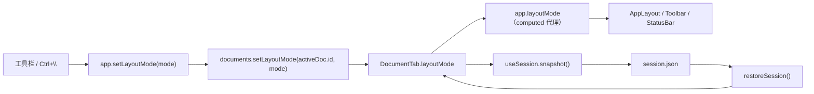

# 按标签布局模式设计

> **文档定位**：本文设计「布局模式按标签保存」的改造方案，说明数据模型、状态流向、迁移兼容与验证方式。实现完成后，行为以本文与 [`状态与数据模型.md`](./状态与数据模型.md)、[`主题样式与布局.md`](./主题样式与布局.md) 为准。
>
> 涉及代码：[`src/shared/session-types.ts`](../src/shared/session-types.ts)、[`src/renderer/src/stores/app.ts`](../src/renderer/src/stores/app.ts)、[`src/renderer/src/stores/documents.ts`](../src/renderer/src/stores/documents.ts)、[`src/renderer/src/utils/layout-mode.ts`](../src/renderer/src/utils/layout-mode.ts)、[`src/renderer/src/composables/useSession.ts`](../src/renderer/src/composables/useSession.ts)、[`src/main/session-store.ts`](../src/main/session-store.ts)。

## 1. 背景与问题

当前 `app.layoutMode` 是渲染进程内的**单一全局值**，由工具栏四个按钮或 `Ctrl/Cmd+\` 修改，并写入 `localStorage` 的 `markit-layout`。多标签场景下：

- 在 A 文档切到「仅预览」阅读后，切到 B 文档仍是「仅预览」，需要手动切回双栏；
- 用户对不同文档的工作意图不同（长文阅读、短文编辑），全局布局无法表达；
- 布局状态与标签无关，但切换标签会卸载 / 挂载编辑器与预览组件，视觉上却保留了上一个标签的布局，容易误以为「标签记住了」。

## 2. 目标与非目标

### 2.1 目标

1. 每个标签独立保存自己的 `LayoutMode`；
2. 切换标签时布局立即跟随该标签，工具栏选中态、状态栏与主区域同步变化；
3. 布局随会话写入 `session.json`，重启 / 更新后恢复；
4. 新建标签继承当前激活标签的布局；没有激活标签时回退到 `markit-layout`；
5. 旧版本会话（`SessionTab` 无布局字段）与非法值都能安全回退。

### 2.2 非目标

- 不改变四种布局的定义与 `cycleLayout` 循环顺序；
- 不把预览主题、分栏比例、大纲显隐改成按标签保存（它们仍是应用级偏好）；
- 不改变 `markit-layout` 键名与品牌约束，只调整其语义；
- 不新增 IPC 通道，会话仍通过既有 `session:load` / `session:save` 传输。

## 3. 方案设计

### 3.1 状态归属

按项目不变量「新增按标签保存的字段必须落到 `documents` store」，布局模式从 `app` 移到 `DocumentTab`：



- `app.layoutMode` 从 `ref` 改为 `computed`：`documents.activeDoc?.layoutMode ?? fallbackLayoutMode`；
- `app.setLayoutMode(mode)` 同时写入兜底值与当前激活标签；
- `app.cycleLayout()` 基于当前 `layoutMode` 计算下一模式；
- `fallbackLayoutMode` 仅在没有激活标签时生效（例如关闭最后一个标签到窗口关闭之间的瞬间），保证读取方永远拿到合法值。

### 3.2 默认值与继承规则

| 场景 | 初始布局 |
| --- | --- |
| 应用启动创建首个标签 | `markit-layout`（缺失 / 非法回退 `edit-left`） |
| 新建标签 / 打开新文件 | 当前激活标签的布局；无激活标签时用 `markit-layout` |
| 恢复会话中的标签 | `SessionTab.layoutMode`；缺失 / 非法时用 `markit-layout` |
| 打开已存在的标签 | 不修改其布局，仅激活 |

`markit-layout` 继续由 `watch(() => app.layoutMode)` 写入，语义调整为「**最近一次使用的布局**」，只作为新标签与旧会话的兜底，不再直接驱动主区域。

### 3.3 会话持久化

`SessionTab` 增加可选字段 `layoutMode?: LayoutMode`：

- 渲染进程写入快照时带上每个标签的布局；
- 主进程 `parseSessionData` 校验枚举，非法值归一为 `undefined`，由渲染进程按 `markit-layout` 回退；
- 字段可选，旧会话文件无需迁移即可加载。

## 4. 数据模型

```ts
// src/shared/session-types.ts
export type LayoutMode = 'edit-left' | 'edit-right' | 'edit-only' | 'preview-only'

export interface SessionTab {
  // ...既有字段
  /** 标签自己的布局模式；缺失（旧会话）时按 markit-layout 回退 */
  layoutMode?: LayoutMode
}

// src/renderer/src/stores/documents.ts
export interface DocumentTab {
  // ...既有字段
  /** 当前标签的布局模式；切换标签时由 app.layoutMode 读取 */
  layoutMode: LayoutMode
}
```

`LayoutMode` 以 `src/shared/` 为唯一定义处（会话类型需要它），`src/renderer/src/types/index.ts` 改为再导出，既有 `import type { LayoutMode } from '../types'` 不变。

新增 [`src/renderer/src/utils/layout-mode.ts`](../src/renderer/src/utils/layout-mode.ts) 收敛枚举校验与 `markit-layout` 读写，供 `app` 与 `documents` 共用，避免两处各写一份合法值判断。主进程不能引用渲染进程工具（进程边界），`session-store.ts` 内保留一份同样的枚举校验。

## 5. 边界与兼容

| 情形 | 行为 |
| --- | --- |
| 旧 `session.json` 无 `layoutMode` | 恢复后使用 `markit-layout` |
| `layoutMode` 为 `'foo'` 等非法值 | 主进程归一为 `undefined`；渲染进程再兜底一次 |
| 会话文件损坏（顶层 / tabs 不合法） | 与现状一致，保留欢迎页 |
| 关闭最后一个标签 | `activeDoc` 为空，`layoutMode` 读兜底值；窗口关闭流程不变 |
| 布局变化时输入内容 | 会话防抖写入的监听字段已包含 `layoutMode`，800ms 内合并保存 |
| 存储写入失败 | 仅影响下次启动的默认布局，不影响当前会话 |

## 6. 影响文件

| 文件 | 改动 |
| --- | --- |
| [`src/shared/session-types.ts`](../src/shared/session-types.ts) | 定义 `LayoutMode`；`SessionTab.layoutMode?` |
| [`src/renderer/src/types/index.ts`](../src/renderer/src/types/index.ts) | 再导出 `LayoutMode` |
| [`src/renderer/src/utils/layout-mode.ts`](../src/renderer/src/utils/layout-mode.ts) | 新增：枚举列表、`isLayoutMode`、`loadSavedLayoutMode`、`saveLayoutMode` |
| [`src/renderer/src/stores/documents.ts`](../src/renderer/src/stores/documents.ts) | `DocumentTab.layoutMode`、`setLayoutMode`、新建 / 恢复时的默认值 |
| [`src/renderer/src/stores/app.ts`](../src/renderer/src/stores/app.ts) | `layoutMode` 改为 computed 代理，写入落到激活标签 |
| [`src/renderer/src/composables/useSession.ts`](../src/renderer/src/composables/useSession.ts) | 快照与监听字段加入 `layoutMode` |
| [`src/main/session-store.ts`](../src/main/session-store.ts) | 校验并归一 `layoutMode` |
| [`src/renderer/src/assets/welcome.md`](../src/renderer/src/assets/welcome.md) | 内置使用手册：多标签、会话恢复、四种布局三处补充按标签记忆 |

## 7. 验证方式

1. `npm run lint`、`npm run typecheck`、`npm test` 全量通过（改动了 `utils/` 与 `shared/`）；
2. `npm run dev` 下：打开两个文档，分别设为「仅预览」「左编辑右预览」，来回切换标签确认布局与工具栏选中态跟随；
3. 新建标签，确认继承当前标签布局；关闭最后一个标签不崩溃；
4. 退出重启，确认各标签布局与激活标签布局恢复；
5. 手工把 `session.json` 的 `layoutMode` 改成非法值后重启，确认回退到 `markit-layout` 且不崩溃；
6. 单元测试覆盖 `isLayoutMode` / `loadSavedLayoutMode` 与 `parseSessionData` 对布局字段的归一。
