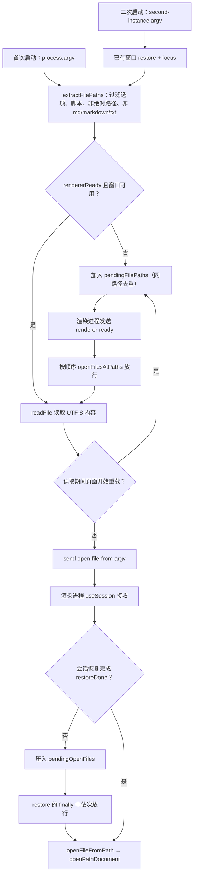
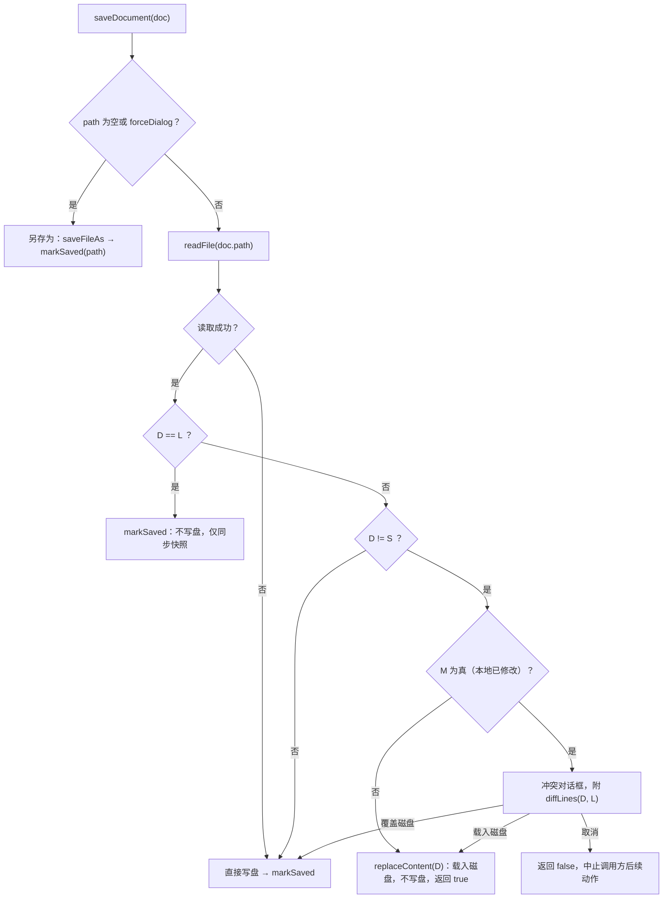
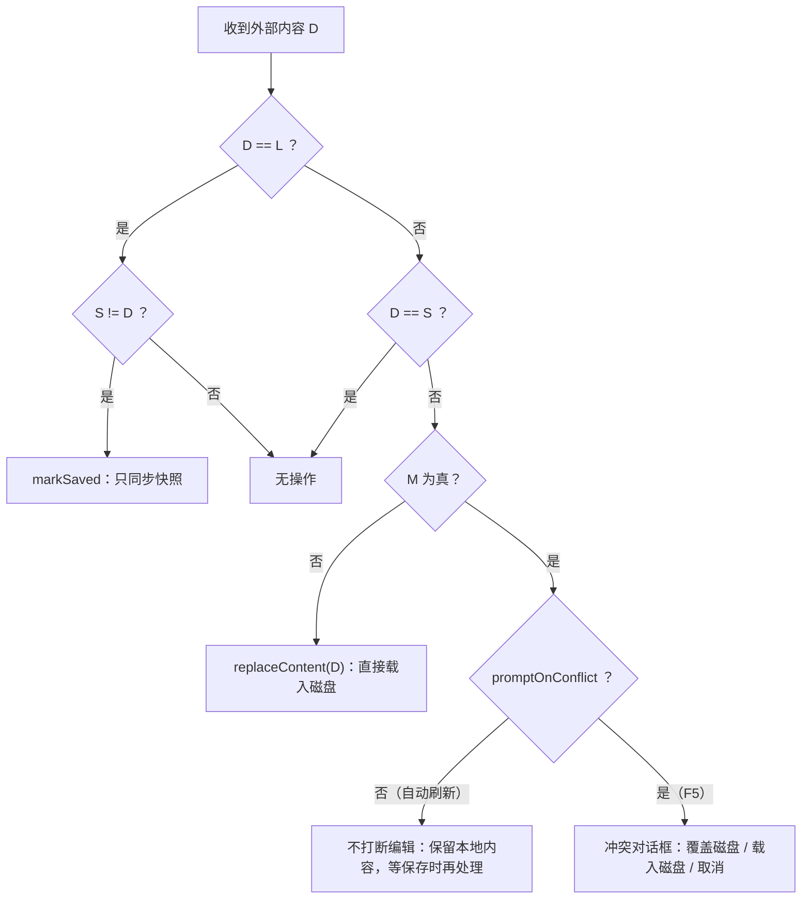
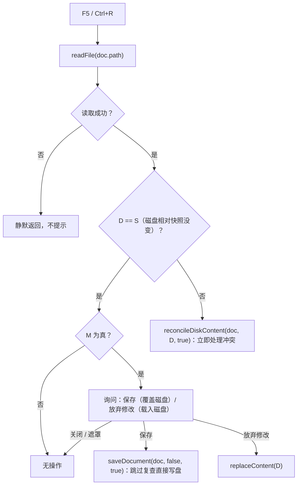
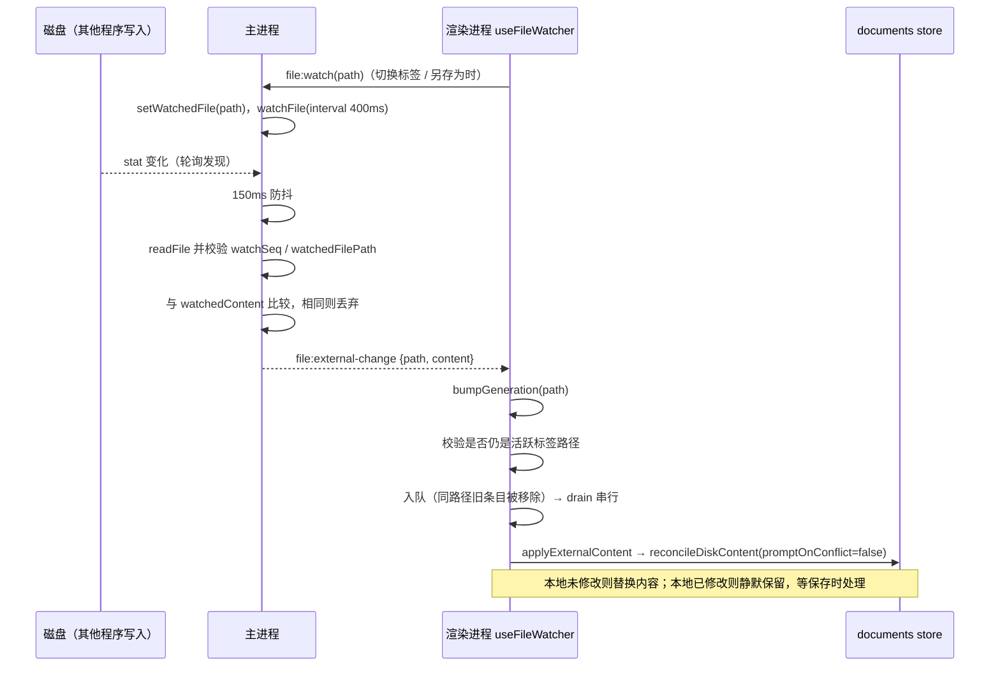
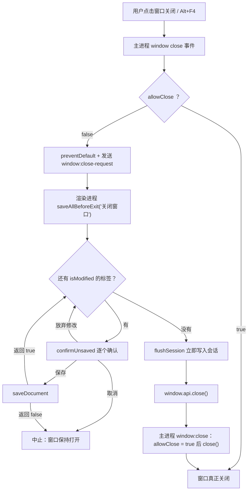

# 文件与冲突处理

> **文档定位**：本文描述 MarkIt 与磁盘文件交互的完整行为——支持哪些文件、文件从哪些入口进入应用、标签页如何打开、保存时如何复核磁盘、外部修改如何被动刷新、以及「本地修改」与「磁盘修改」同时发生时如何判定与呈现冲突。文中每一条分支都对应仓库中的实际实现，修改相关代码时必须同步更新本文。
>
> 涉及代码：[`useFile.ts`](../src/renderer/src/composables/useFile.ts)、[`useFileWatcher.ts`](../src/renderer/src/composables/useFileWatcher.ts)、[`useConfirmUnsaved.ts`](../src/renderer/src/composables/useConfirmUnsaved.ts)、[`text-diff.ts`](../src/renderer/src/utils/text-diff.ts)、[`documents.ts`](../src/renderer/src/stores/documents.ts)、[`src/main/index.ts`](../src/main/index.ts)。

## 1. 支持的文件类型与编码

| 场景                                     | 允许的扩展名                                   | 实现位置                                                                                     |
| ---------------------------------------- | ---------------------------------------------- | -------------------------------------------------------------------------------------------- |
| 应用内「打开文件」对话框                 | `.md`、`.markdown`、`.txt`                     | `dialog:openFiles` 的 `filters`                                                              |
| 系统文件关联（右键「使用 MarkIt 打开」） | `.md`、`.markdown`                             | [`electron-builder.yml`](../electron-builder.yml) 的 `fileAssociations`（`.txt` 未注册关联） |
| 命令行参数 / 二次启动转发                | `.md`、`.markdown`、`.txt`                     | `extractFilePaths()` 的扩展名判断                                                            |
| 「另存为」对话框                         | 过滤器只列出 `.md`，但用户可手动输入其他扩展名 | `dialog:saveFile` 的 `filters`                                                               |

- 所有读写统一按 **UTF-8** 处理：主进程 `readFile(path, 'utf-8')` / `writeFile(path, content, 'utf-8')`。
- 读取失败（文件不存在、权限不足、编码异常等）不会抛到渲染进程：`file:read` 返回 `null`，`dialog:openFiles` 跳过该文件并 `console.error`。
- 主进程不对 `file:read` / `file:save` 再做扩展名校验，扩展名白名单只在前述入口生效。

## 2. 打开文件的全部入口

文件进入应用有三条通道，最终都汇聚到 `docs.openPathDocument(path, content)`：

1. **应用内对话框**：`Ctrl+O`（或工具栏「打开」）→ `window.api.openFiles()` → 主进程 `dialog.showOpenDialog({ properties: ['openFile', 'multiSelections'] })`。
2. **系统文件关联 / 命令行传参**：操作系统把路径放进启动参数，主进程从 `process.argv` 提取。
3. **二次启动转发**：应用已在运行时再次双击文件，新实例通过单实例锁把路径转给已有实例的 `second-instance` 事件。

### 2.1 应用内对话框（Ctrl+O，多选）

- 快捷键在 [`useKeyboardShortcuts.ts`](../src/renderer/src/composables/useKeyboardShortcuts.ts) 中绑定，调用 `file.openFile()`。
- 对话框支持 `multiSelections`；主进程按对话框返回的路径顺序逐个读取，读取成功的文件组成数组返回，读取失败的跳过。
- 用户取消（`canceled`）或没有选中文件时返回空数组，渲染进程直接返回，不产生任何标签变化。
- 打开前会 `await whenSessionReady()`：会话恢复会用会话内容**整体替换**标签数组，若此时打开文件，新标签会被覆盖。

### 2.2 文件关联、右键打开与命令行传参

- 打包后的应用注册了 `.md` / `.markdown` 文件关联（见 `electron-builder.yml`），用户双击或右键「使用 MarkIt 打开」时，系统以「可执行文件 + 文件绝对路径」的形式启动应用。
- 主进程在 `app.whenReady()` 中调用 `openFilesAtPaths(extractFilePaths(process.argv))` 处理首次启动参数。
- `extractFilePaths()` 的过滤规则（逐条）：
  - 跳过以 `-` 开头的选项参数；
  - 跳过字面量 `electron`；
  - 跳过以 `.js` / `.ts` 结尾的入口脚本（electron-vite 开发模式会注入）；
  - 只接受「包含 `:` 或以 `/` 开头」的绝对路径（Windows 盘符、URL 形式的绝对路径、POSIX 绝对路径），相对路径一律忽略；
  - 扩展名必须是 `.md` / `.markdown` / `.txt`（大小写不敏感）。
- 单个文件由 `openFileAtPath()` 读取后通过 `open-file-from-argv` 发送给渲染进程。

### 2.3 二次启动转发

- 主进程启动时调用 `app.requestSingleInstanceLock()`；未拿到锁的实例立即 `app.quit()`。
- 已有实例监听 `second-instance`：从新实例的 `argv` 中提取文件路径，先 `restore()`（若最小化）并 `focus()` 主窗口，再 `openFilesAtPaths(filePaths)`。
- 转发不依赖新实例的窗口状态：即使新实例还没创建窗口就退出，路径也已经通过事件交给已有实例。

### 2.4 `renderer:ready` 排队机制

渲染进程在页面加载完成前无法接收 `open-file-from-argv`，主进程因此维护 `pendingFilePaths` 队列：

- `rendererReady` 初始为 `false`，`webContents` 的 `did-start-loading` 会把它重置为 `false`（页面重载后监听丢失）。
- [`preload/index.ts`](../src/preload/index.ts) 的 `onOpenFile()` 在**注册完监听之后**才 `ipcRenderer.send('renderer:ready')`。不能用 `did-finish-load` 或 `webContents.isLoading()` 判断就绪：Electron 触发 `did-finish-load` 时 `isLoading()` 仍可能为 `true`，此时发送会丢失，表现为「首次双击打开文件只恢复了上次会话、文件没打开」。
- `ipcMain.on('renderer:ready')` 收到信号后置 `rendererReady = true`，并 `splice(0)` 取出全部排队路径，按原顺序逐个 `openFileAtPath()`。
- `openFileAtPath()` 在读取前后各检查一次就绪状态：读取期间页面若开始重载，文件会重新入队（`pendingFilePaths.includes()` 去重），等待下一次 `renderer:ready`。
- 多个文件按传入顺序依次打开；由于每次打开都会激活新标签，**最后一个是最终激活标签**。

> 图中下半段是渲染进程的第二层排队：主进程的 `pendingFilePaths` 解决「页面监听还没注册」，`useSession` 的 `pendingOpenFiles` 解决「会话恢复还没完成」。详见 [会话恢复与窗口状态](./会话恢复与窗口状态.md)。

## 3. 标签页打开规则

打开动作统一走 [`documents.ts`](../src/renderer/src/stores/documents.ts) 的 `openPathDocument(filePath, content)`，规则如下：

| 条件                              | 行为                                                                                |
| --------------------------------- | ----------------------------------------------------------------------------------- |
| 已有标签的 `path` 与目标路径相同  | **激活已有标签**，本次读到的 `content` 被丢弃（不会覆盖标签里可能存在的未保存修改） |
| 只有 1 个标签，且它是「占位标签」 | 移除占位标签，在原位置新建文件标签（不会留下多余的 `untitled` 标签）                |
| 其他情况                          | 追加一个新标签并激活                                                                |

补充规则：

- **路径归一化**：`normalizePath()` 把反斜杠替换为正斜杠，**只在 Windows 下转小写**：Windows 上 `D:\Docs\a.md` 与 `d:/docs/A.MD` 是同一个文件，Linux 上 `A.md` 与 `a.md` 必须视为两个文件。实现位于 [`src/renderer/src/utils/path.ts`](../src/renderer/src/utils/path.ts)（[`samePath`](../src/renderer/src/utils/path.ts) 同源），与主进程 `sameFilePath` 使用同一套规则，文件监听、外部变更匹配、标签去重都复用它。
- **占位标签定义**：`path === null && !isModified`，即启动时的欢迎页或未编辑过的空白页。占位标签只在「当前仅有这一个标签」时才会被替换，避免误删用户正在编辑的内容。
- **多选激活规则**（`useFile.openFile`）：
  1. 打开前记录现有标签 id 集合 `before`；
  2. 逐个 `openPathDocument`，得到 `opened`；
  3. `fresh` = `opened` 中 id 不在 `before` 里的标签（真正新建的）；
  4. `fresh` 非空则激活 `fresh` 的最后一项，否则激活 `opened` 的最后一项。
     这样「多选里既有已打开文件又有新文件」时，最终停在最后一个**新打开**的文件；「全部已打开」时停在选择的最后一项。
- **新建标签**（`newFile`）：若当前就是「未命名、未修改、内容为空」的空白文档，直接复用，不堆积空标签。
- **使用手册**（`openManual`）：先 `await whenSessionReady()`，再查找 `path === null && name === '使用手册.md'` 的标签；存在则激活，否则以 `addDocument(null, WELCOME_CONTENT, '使用手册.md')` 新建。手册是内存文档（`path` 为 `null`），首次保存会走「另存为」。

## 4. 保存流程

### 4.1 普通保存（Ctrl+S）

入口 `file.saveFile()` → `saveDocument(activeDoc)`。当 `doc.path` 存在且不是「另存为」时：

1. `window.api.readFile(doc.path)` 读取磁盘当前内容（**每次保存都复核磁盘**，不是只在有事件时才检查）；
2. 按第 5 节的矩阵判定是否存在冲突；
3. 无冲突或用户选择「覆盖磁盘」后，`window.api.saveFile(path, content)` → 主进程 `writeFile(path, content, 'utf-8')`；
4. `docs.markSaved(doc.id)`：`isModified = false`、`diskContent = content`。

主进程 `file:save` 在写盘后检查：若写入路径正是当前监视的活跃文件，则同步 `watchedContent = content`，把自己造成的写入从「外部修改」中排除，避免监听回环通知。

### 4.2 保存前磁盘复核的作用

- 捕获「编辑器不知道的外部修改」：例如其他程序修改了非活跃标签对应的文件（非活跃标签不被监视），切回来直接按 Ctrl+S 时仍能发现冲突。
- 捕获「文件已被删除」：读取失败时跳过冲突判断，直接写盘，相当于按本地内容重建文件。
- 检测「磁盘内容与本地恰好相同」：外部程序写入了相同内容不构成冲突，只同步快照（见 5.2）。

### 4.3 另存为（Ctrl+Shift+S）

- 入口 `file.saveFileAs()` → `saveDocument(doc, true)`，`forceDialog = true` 直接短路前面的冲突检查。
- 主进程 `dialog:saveFile` 弹出保存对话框（过滤器只列 `.md`），用户取消返回 `null` → `saveDocument` 返回 `false`，标签保持未修改状态不变。
- 写入成功后 `docs.markSaved(doc.id, path)`：同时更新 `path` 与 `name`（取文件名部分），`isModified = false`，`diskContent = content`。
- 另存为会改变 `activeDoc.path`，[`useFileWatcher.ts`](../src/renderer/src/composables/useFileWatcher.ts) 监听该字段，随即把主进程的监视目标切到新文件，并主动补读一次。
- 已知边界：另存为**不检查**目标路径是否已被另一个标签打开，可能出现两个标签指向同一文件；`openPathDocument` 的去重只在「打开」动作生效。

### 4.4 未命名文档

- `doc.path === null` 时 `saveDocument` 无条件走另存为分支：弹保存对话框，取消返回 `false`。
- 因此关闭流程中「保存」一个未命名文档时，若用户在保存对话框点了取消，`saveDocument` 返回 `false`，关闭动作会被中止（标签不会关闭）。

### 4.5 返回值语义

`saveDocument` 返回 `boolean`，调用方据此决定是否继续后续动作（关闭标签、关闭窗口、安装更新）：

| 返回    | 含义                                                             |
| ------- | ---------------------------------------------------------------- |
| `true`  | 内容已写盘，或冲突已由「载入磁盘」解决（此时不写盘但状态已一致） |
| `false` | 用户在保存对话框取消、或在冲突对话框选择「取消」、或写盘抛错     |

## 5. 冲突判定矩阵（核心）

### 5.1 三个输入量

判定只依赖三个内容比较结果与一个标志：

| 符号 | 含义                 | 来源                                                       |
| ---- | -------------------- | ---------------------------------------------------------- |
| `L`  | 本地编辑内容         | `doc.content`                                              |
| `D`  | 磁盘当前内容         | `window.api.readFile()` 或外部变更事件                     |
| `S`  | 最近一次磁盘同步快照 | `doc.diskContent`（`markSaved` / `replaceContent` 时更新） |
| `M`  | 本地是否有未保存修改 | `doc.isModified`                                           |

所有内容比较都走 `sameContent()`：先比原字符串，再按 `\r\n?` → `\n` 归一后比较（见第 6 节）。

`M` 与 `L`/`S` 的关系（由 store 维护，可作为阅读矩阵的前提）：

- `createTab`：`L = S`，`M = false`；
- `updateContent`：内容真正变化时 `M = true`；
- `replaceContent`：`L = S`，`M = false`；
- `markSaved`：`S = L`，`M = false`；
- `restoreSession`：以恢复时传入的内容建立标签（`useSession` 优先传磁盘内容，读不到才传会话内容），`S = 该内容`，`M` 取会话中保存的标志。因此恢复后可能出现 `M = true` 而 `L = S` 的状态，此时首次保存会走「磁盘 == 本地 → 只同步快照」分支。

### 5.2 保存时：`useFile.saveDocument`

分支顺序严格如下（`doc.path` 存在且非另存为）：

逐组合结论：

| D vs L                 | D vs S             | M                                 | 行为                                                          | 是否写盘           |
| ---------------------- | ------------------ | --------------------------------- | ------------------------------------------------------------- | ------------------ |
| 相同                   | 相同               | 任意                              | `markSaved`（无冲突）                                         | 否                 |
| 相同                   | 不同               | 任意                              | `markSaved`（外部写入了相同内容，只同步快照）                 | 否                 |
| 不同                   | 相同（无外部变化） | 必然为真（`M = false` ⇒ `L = S`） | 正常保存本地内容                                              | 是                 |
| 不同                   | 不同               | 否                                | `replaceContent(D)`：直接载入磁盘，避免用过期内容覆盖外部修改 | 否（返回 `true`）  |
| 不同                   | 不同               | 是                                | 冲突对话框：覆盖磁盘 / 载入磁盘 / 取消                        | 仅「覆盖磁盘」写盘 |
| 读取失败（`D` 不可用） | —                  | —                                 | 跳过冲突检查直接写盘（文件被外部删除时重建）                  | 是                 |

冲突对话框的三种选择：

| 按钮     | 标签（`confirmUnsaved` 参数） | 后续动作                                                                                |
| -------- | ----------------------------- | --------------------------------------------------------------------------------------- |
| 取消     | `cancelText: '取消'`          | `saveDocument` 返回 `false`；若是关闭/退出流程则整体中止                                |
| 载入磁盘 | `discard: '载入磁盘'`         | `docs.replaceContent(doc.id, D)`：`L = S = D`、`M = false`，本次保存不写盘，返回 `true` |
| 覆盖磁盘 | `save: '覆盖磁盘'`            | 落到函数末尾，写盘后 `markSaved`                                                        |

### 5.3 自动刷新（外部事件）：`reconcileDiskContent(doc, D, promptOnConflict = false)`

外部变更事件只对**当前活跃标签**生效（`applyExternalContent` 先校验 `samePath`）。判定顺序：

逐组合结论：

| D vs L | D vs S | M    | 自动刷新（`promptOnConflict=false`）                                      |
| ------ | ------ | ---- | ------------------------------------------------------------------------- |
| 相同   | 相同   | 任意 | 无操作                                                                    |
| 相同   | 不同   | 任意 | `markSaved`，仅同步快照                                                   |
| 不同   | 相同   | 任意 | 忽略（没有真正的外部变化）                                                |
| 不同   | 不同   | 否   | `replaceContent(D)`，编辑器内容被静默替换（改动最小化替换，光标基本保持） |
| 不同   | 不同   | 是   | **不弹窗**，保留本地内容；等用户保存时由 `saveDocument` 弹冲突框          |

设计意图：外部程序高频写盘（构建脚本、同步盘）时不应反复打断输入。冲突提示推迟到「用户要把本地内容落盘」的那一刻，此时用户才有决策上下文。

### 5.4 手动刷新（F5 / Ctrl+R）：`refreshFile()`

手动刷新是用户显式要求「以磁盘为准」，因此行为与自动刷新不同：

逐组合结论：

| D vs S | M   | 行为                                                                             |
| ------ | --- | -------------------------------------------------------------------------------- |
| 相同   | 否  | 无操作（不误报「已被其他程序修改」）                                             |
| 相同   | 是  | 询问是否放弃本地修改；选「保存」则覆盖磁盘，选「放弃修改」则载入磁盘，取消则不动 |
| 不同   | 否  | `reconcileDiskContent` 直接载入磁盘                                              |
| 不同   | 是  | 立即弹冲突框（覆盖磁盘 / 载入磁盘 / 取消）；若此时 `D == L`，则只同步快照        |

注意区别：`F5` 在「磁盘没变但本地有修改」时也提供「保存（覆盖磁盘）」，而自动刷新在同样条件下**什么都不做**（避免无意义弹窗）。

### 5.5 「覆盖磁盘」为何不重复检查

- 保存流程中的「覆盖磁盘」直接落到写盘语句，因为磁盘内容已在几行前读过，用户也已看到差异。
- 手动刷新的「保存」调用 `saveDocument(doc, false, true)`，`skipConflictCheck = true` 跳过再次读取；否则用户刚确认覆盖，又会因为「磁盘仍未变化」再次进入判定分支。

## 6. 换行符策略

- **编辑器内部统一使用 `\n`**：CodeMirror 的 `EditorState.create` 默认按 `/\r\n?|\n/` 拆分文档，CRLF 文件载入后行间分隔就是 `\n`，`doc.toString()` 也只产出 `\n`。
- **比较时归一**：`useFile.sameContent()` 与 `text-diff.normalize()` 都把 `\r\n` 与 `\r` 转成 `\n` 再比较。目的：外部程序把整份文件的行尾从 LF 改成 CRLF（或反向）时，不应被判定为「内容冲突」并弹出满屏差异。
- **写盘不做行尾转换**：`writeFile` 原样写入编辑器内容。因此对 CRLF 文件不做任何编辑直接保存时不会写盘（`D == L` 归一等价，走「只同步快照」分支）；一旦真正编辑并保存，文件行尾会变成 `\n`。这是有意的取舍：避免为了保留行尾而引入文件级元数据。
- 差异展示同样归一后再逐行比较，不会出现「每行都不同」的假差异。

## 7. 文件监听

### 7.1 主进程：只监视活跃文件

实现集中在 [`src/main/index.ts`](../src/main/index.ts) 的 `setWatchedFile()` / `pushExternalChange()`：

- **只监视一个文件**：渲染进程在活跃标签路径变化时调用 `window.api.watchFile(path)`（传 `null` 取消）。旧文件立即 `unwatchFile`，因此非活跃标签的磁盘变化不会产生事件，切回时由渲染进程主动补读。
- **用 `fs.watchFile` 轮询（400ms）而不是 `fs.watch`**：编辑器常用的「写临时文件再重命名」在 Windows 上会让 `fs.watch` 丢失监视目标；`watchFile` 只关心最终文件的 stat，更可靠。
- **150ms 防抖**：轮询回调不立即读文件，而是延迟 150ms，避免读到其他程序尚未写完的中间内容。
- **`watchSeq` 丢弃过期读取**：切换监视目标时 `watchSeq` 自增，异步 `readFile` 完成后若序号已变或目标路径已换，直接丢弃结果。
- **`watchedContent` 过滤自身写入与 stat 抖动**：读取到的内容与 `watchedContent` 相同则不发事件。`watchedContent` 在以下时机更新：
  - 推送外部变更前（`pushExternalChange` 读到新内容后）；
  - 应用自身写盘后（`file:save`、`dialog:saveFile` 命中当前监视路径时）；
  - 切换监视目标时重置为 `null`。
- **读取失败不推送**：文件被删除或保存瞬间不可读时保留编辑器现有内容，等下一次事件。
- 窗口 `closed` 时 `setWatchedFile(null)`，避免 macOS 关闭窗口后仍占用文件句柄。

### 7.2 外部修改推送链路

### 7.3 渲染进程：`useFileWatcher` 的队列、代次与切换补读

[`useFileWatcher.ts`](../src/renderer/src/composables/useFileWatcher.ts) 在 [`App.vue`](../src/renderer/src/App.vue) 的 `setup` 中调用一次（早于 `useSession` 的恢复逻辑），负责把主进程事件变成对 store 的操作。

| 机制                    | 实现                                                                          | 解决的问题                                                                                             |
| ----------------------- | ----------------------------------------------------------------------------- | ------------------------------------------------------------------------------------------------------ |
| 队列去重                | `enqueue()` 先删除队列中 `samePath` 的旧条目再入队                            | 其他程序连续写入时只处理最新内容，不堆积弹窗                                                           |
| 串行 drain              | `draining` 标志 + `while (queue.length > 0)`                                  | 冲突对话框在解决前不会叠加弹出                                                                         |
| 应用前复核              | 出队后再次校验 `docs.activeDoc?.path` 与事件路径一致                          | 排队期间用户可能已切走，旧事件作废                                                                     |
| 代次（generations）     | 每个路径维护自增序号；`refreshPath` 开始时与收到外部事件时都 `bumpGeneration` | 异步读取完成时代次已变，说明期间有更新的数据，丢弃旧结果，避免「激活时读到的旧内容」覆盖刚推送的新内容 |
| 切换序号（`switchSeq`） | 每次路径变化自增，异步 `watchFile` 返回后校验                                 | 快速连续切换标签时，只有最后一次切换生效                                                               |
| 切换补读                | `watchFile(path)` 之后调用 `refreshPath(path)` 读一次磁盘                     | 非活跃期间没有监视，磁盘可能已经变化                                                                   |
| 切到未命名文档          | 路径为 `null` 时清空 `queue`                                                  | 旧文件的待处理变更已无意义                                                                             |
| 卸载清理                | `onUnmounted` 取消事件监听并 `watchFile(null)`                                | 不残留监视与回调                                                                                       |

活跃路径的 `watch` 使用 `{ immediate: true }`：启动时先以 `null` 注册一次，会话恢复替换标签后 `activeDoc.path` 变化会再次触发，从而开始监视恢复出来的文件。

## 8. 关闭流程

### 8.1 关闭单个标签

`useFile.closeOne(doc)`：

1. `doc.isModified` 为真时弹 `confirmUnsaved('关闭文件', '「xx」有未保存的修改，是否在关闭前保存？')`；
2. 选择「取消」→ 返回 `false`，标签保留；
3. 选择「保存」→ `saveDocument(doc)`；若保存对话框取消、或冲突对话框取消、或写盘失败，返回 `false`，标签保留；
4. 选择「放弃修改」或保存成功 → `docs.closeDocument(id)`，返回 `true`。

`docs.closeDocument` 关闭后若还有其他标签，且关闭的是激活标签，则激活「原下标位置」的标签（越界时取最后一个）。

### 8.2 关闭其他 / 关闭左侧 / 关闭右侧

[`TabBar.vue`](../src/renderer/src/components/layout/TabBar.vue) 的右键菜单计算目标 id 列表后调用 `file.closeTabs(ids, keepId)`：

- 「关闭其他」= 除右键标签外的全部；「关闭左侧」= 下标更小的全部；「关闭右侧」= 下标更大的全部；无可关闭标签时菜单项禁用。
- `closeTabs` 先把激活标签切到 `keepId`（仅当激活标签本身在待关闭列表中），避免关闭过程中激活项在即将销毁的标签间来回跳转。
- 随后**按传入顺序**逐个 `closeOne`；任一标签被用户取消，立即 `return`，后续标签保持打开（已关闭的不会恢复）。
- 中键点击标签同样走 `closeTab(id)`。

### 8.3 关闭最后一个标签 = 关闭窗口

`closeTab` / `closeTabs` 在 `docs.docs.length === 0` 时调用 `window.api.close()`。此时所有未保存内容已在关闭前逐个确认，因此直接进入主进程的放行关闭流程（`allowClose = true`）。

### 8.4 窗口关闭守卫

要点：

- 主进程注册了**两个** `close` 监听：一个在关闭时兜底保存窗口状态（`saveWindowState`），另一个是关闭守卫。守卫只负责阻止关闭并通知渲染进程。
- `saveAllBeforeExit` 遍历调用时刻 `isModified` 为真的标签快照；每个标签都弹一次确认，任一「取消」或保存失败都会让整个退出中止。
- 全部处理完后先 `flushSession()`（取消防抖计时器并立即写 `session.json`），再请求真正关闭。顺序不能反：窗口销毁后渲染进程无法再写会话。
- `allowClose` 是主进程的模块级标志，只在两处被置真：`window:close` IPC 与自动更新的 `beforeInstall`。渲染进程无法直接关闭窗口而不经过守卫。

### 8.5 更新安装前保存全部

自动更新的安装请求由独立的更新详情窗口发起：

1. 更新窗口调用 `requestInstall()` → 主进程 `update:request-install` → 还原并聚焦主窗口，发送 `update:install-request`；
2. 主窗口 [`App.vue`](../src/renderer/src/App.vue) 执行 `saveAllBeforeExit('安装更新')`，流程与关闭窗口完全一致（逐标签确认 + `flushSession`）；
3. 用户取消则中止，不安装；
4. 成功后 `update.install()` → 主进程 `installUpdate()`：先 `beforeInstall()`（置 `allowClose = true`，避免关闭守卫卡住安装器），再 `quitAndInstall(false, true)`。

## 9. 冲突确认对话框的排队机制

[`useConfirmUnsaved.ts`](../src/renderer/src/composables/useConfirmUnsaved.ts) 是全局单例对话框，`confirmUnsaved()` 返回 `Promise<'save' | 'discard' | 'cancel'>`。

- **无需确认直接返回**：`hasUnsaved` 参数缺省时读取 `app.isModified`；为假时立即 `resolve('discard')`，不弹窗。冲突场景显式传 `true`，确保一定展示。
- **请求排队**：`requests` 数组保存待展示请求。仅当「当前没有对话框显示」且「没有等待展示下一个的定时器」时才立刻 `showNextRequest()`，否则排队。
- **250ms 间隔**：`resolveConfirm` 先关闭当前对话框、`resolve` 当前 Promise，再延迟 250ms 展示下一个。作用是双击按钮时第二下不会误触新对话框上相同位置的按钮。
- **按钮与文案**：`labels.save` / `labels.discard` 可定制（如「覆盖磁盘」「载入磁盘」）；`extra.cancelText` 非空时显示第三个「取消」按钮；点击右上角 × 或遮罩都等价于 `cancel`。
- **差异面板**：`extra.diff` 非空时对话框加宽到 760px，展示逐行差异（见第 10 节），并附「− 磁盘上的内容 / + 本地未保存的内容」图例。
- **典型并发场景**：自动刷新的冲突提示与「关闭文件」确认几乎同时到达时，第二个请求排队，用户处理完第一个才会看到第二个。

## 10. 差异算法（`utils/text-diff.ts`）

[`text-diff.ts`](../src/renderer/src/utils/text-diff.ts) 只服务于冲突提示，不做完整 diff 视图，因此优先保证「大文件不卡死」。

流程：

1. **归一换行符**：`normalize()` 把 `\r\n` / `\r` 转成 `\n`，再按 `\n` 切行。
2. **前后缀裁剪**：先求出两段文本的公共前缀行数与公共后缀行数，只对中间段做 LCS，显著缩小矩阵规模。
3. **LCS 动态规划**：中间段行数乘积 `oldMid.length * newMid.length ≤ 4,000,000` 时用 `Uint32Array` 做标准 LCS；超过上限直接退化为「整段删除 + 整段新增」（`remove` 全部旧行，`add` 全部新行），避免 O(n×m) 内存占用。
4. **回溯方向**：相等则 `equal`；否则比较「向下」与「向右」的 DP 值，向下不小于向右时判为 `remove`（磁盘独有行优先展示），否则 `add`。
5. **上下文折叠**：连续的相同行超过 `CONTEXT_LINES * 2 + 1 = 7` 行时，保留首 3 行与末 3 行，中间折叠为一条 `gap`，`count = 相同行数 − 6`；不超过 7 行则全部作为 `context` 展示。
6. **输出结构**：`DiffLine[]`，`type` 为 `add`（仅本地）/ `remove`（仅磁盘）/ `context`（相同）/ `gap`（折叠）。

[`ConfirmDialog.vue`](../src/renderer/src/components/common/ConfirmDialog.vue) 的渲染约定：

| 类型      | 前缀符号 | 含义                  |
| --------- | -------- | --------------------- |
| `remove`  | `-`      | 磁盘上的内容          |
| `add`     | `+`      | 本地未保存的内容      |
| `context` | 空格     | 两边相同              |
| `gap`     | —        | 显示「… 省略 N 行 …」 |

调用方向固定为 `diffLines(磁盘内容, 本地内容)`，即 `old = 磁盘`、`new = 本地`，与图例一致。

## 11. 高风险改动检查清单

文件读写与冲突检测在 [`rules/testing.md`](../rules/testing.md) 中被列为高风险区域，改动后必须实际运行验证（仓库当前没有测试框架，也没有 git 钩子兜底）：

- [ ] `npm run dev` 下完成一次「打开 → 编辑 → 保存 → 另存为」全流程，确认 `diskContent` 与修改标记同步。
- [ ] 用其他编辑器修改**当前活跃**文件：未修改本地时预览应自动刷新；有本地修改时应静默保留，不弹窗。
- [ ] 有本地修改时按 `Ctrl+S`：应弹出冲突框并展示正确方向的逐行差异（`-` 为磁盘、`+` 为本地）。
- [ ] 冲突框三个分支各验证一次：覆盖磁盘后文件内容为本地版本；载入磁盘后编辑器回到磁盘版本且修改标记消失；取消后保存中止（关闭流程也应中止）。
- [ ] 修改**非活跃**标签对应的文件，切回该标签：应触发一次补读，行为与自动刷新一致。
- [ ] 快速连续切换标签，确认没有旧文件的过期内容覆盖新标签（代次与 `switchSeq` 生效）。
- [ ] 删除正在编辑的文件后保存：应重建文件而不是报错崩溃。
- [ ] CRLF 文件不做修改直接保存：不应被误判为冲突，也不应写盘。
- [ ] 关闭流程：分别验证「关闭标签」「关闭其他/左/右」「关闭最后一个标签」「窗口关闭按钮」「更新安装」，确认取消时不会丢标签也不会关闭窗口。
- [ ] 多个确认请求同时到达时，对话框应串行展示，不出现按钮误触。
- [ ] 涉及主进程 IPC 的改动需三处同步：`src/main/index.ts`、`src/preload/index.ts`、`src/preload/index.d.ts`。

## 12. 相关文件

| 文件                                                                                                              | 职责                                                                |
| ----------------------------------------------------------------------------------------------------------------- | ------------------------------------------------------------------- |
| [`src/renderer/src/composables/useFile.ts`](../src/renderer/src/composables/useFile.ts)                           | 打开、保存、另存为、刷新、冲突判定、外部内容协调                    |
| [`src/renderer/src/composables/useFileWatcher.ts`](../src/renderer/src/composables/useFileWatcher.ts)             | 活跃文件监听、队列去重、代次校验、切换补读                          |
| [`src/renderer/src/composables/useConfirmUnsaved.ts`](../src/renderer/src/composables/useConfirmUnsaved.ts)       | 全局确认对话框与请求排队                                            |
| [`src/renderer/src/utils/text-diff.ts`](../src/renderer/src/utils/text-diff.ts)                                   | 行级差异（LCS、裁剪、折叠）                                         |
| [`src/renderer/src/stores/documents.ts`](../src/renderer/src/stores/documents.ts)                                 | 标签数据、`diskContent` 快照、`openPathDocument`                    |
| [`src/renderer/src/utils/path.ts`](../src/renderer/src/utils/path.ts)                                             | `normalizePath` / `samePath` 跨平台路径归一化（仅 Windows 忽略大小写） |
| [`src/renderer/src/components/common/ConfirmDialog.vue`](../src/renderer/src/components/common/ConfirmDialog.vue) | 冲突对话框与差异渲染                                                |
| [`src/renderer/src/components/layout/TabBar.vue`](../src/renderer/src/components/layout/TabBar.vue)               | 标签关闭入口与右键菜单                                              |
| [`src/renderer/src/App.vue`](../src/renderer/src/App.vue)                                                         | 关闭窗口 / 安装更新前的保存全部流程                                 |
| [`src/preload/index.ts`](../src/preload/index.ts)                                                                 | `window.api` 文件能力与 `renderer:ready` 上报                       |
| [`src/main/index.ts`](../src/main/index.ts)                                                                       | 文件 IPC、单实例、`argv` 解析、`fs.watchFile` 监视、关闭守卫        |
| [`electron-builder.yml`](../electron-builder.yml)                                                                 | 文件关联（`.md` / `.markdown`）                                     |
| [`rules/testing.md`](../rules/testing.md)                                                                         | 高风险区域的最低验证要求                                            |
