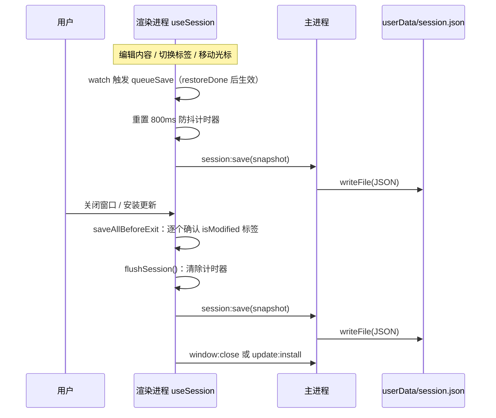
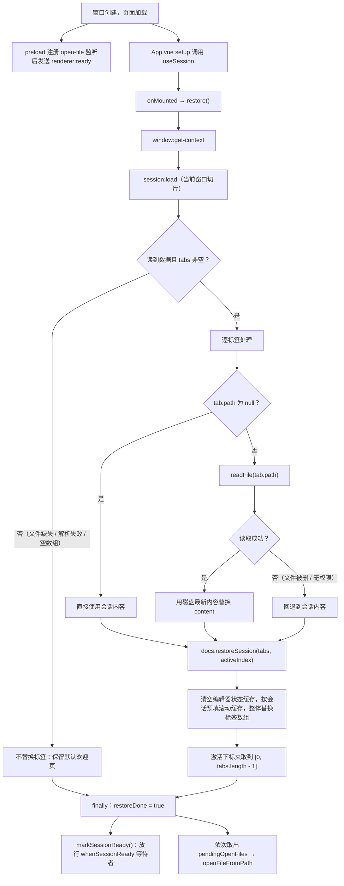
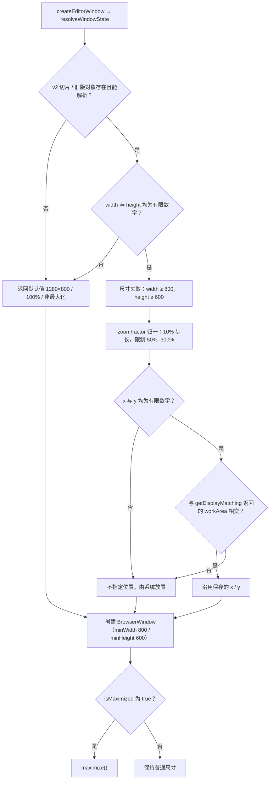
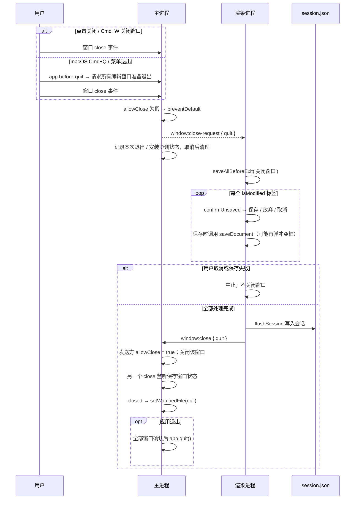
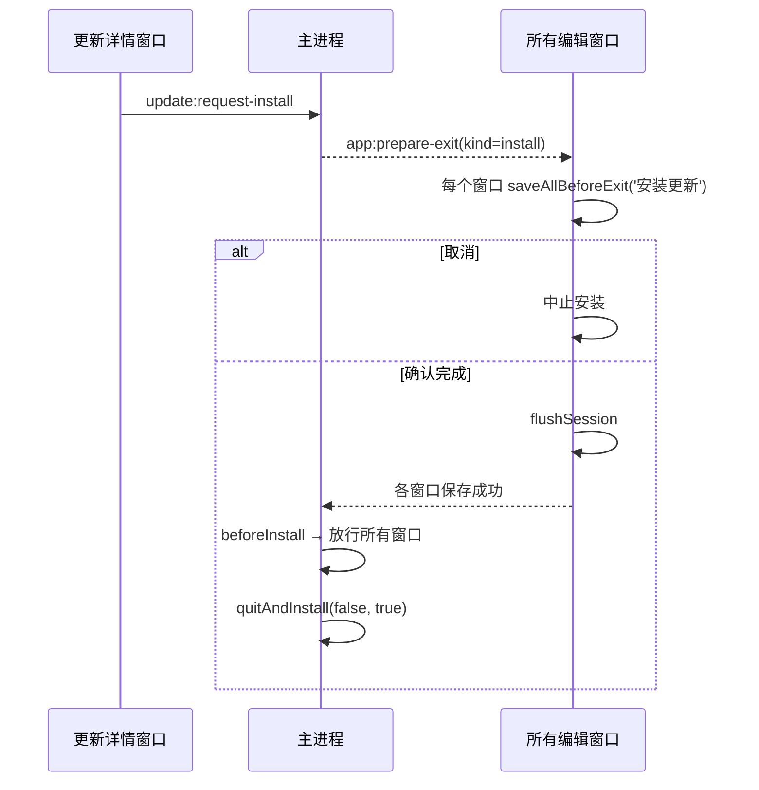

# 会话恢复与窗口状态

> **文档定位**：本文描述 MarkIt 关闭后再次启动（含自动更新重启）时如何恢复上次打开的标签页、编辑历史与窗口几何状态，以及整窗缩放、单实例转发、关闭守卫这些与「窗口生命周期」相关的机制。会话数据存于 `userData/session.json`，编辑历史侧车存于 `userData/editor-history.json`，窗口状态存于 `userData/window-state.json`；主题等应用级偏好走 `localStorage` 的 `markit-*` 键，布局模式与大纲显隐随标签保存。
>
> 涉及代码：[`useSession.ts`](../../src/renderer/src/composables/useSession.ts)、[`session-ready.ts`](../../src/renderer/src/composables/session-ready.ts)、[`session-types.ts`](../../src/shared/session-types.ts)、[`documents.ts`](../../src/renderer/src/stores/documents.ts)、[`src/main/index.ts`](../../src/main/index.ts)、[`App.vue`](../../src/renderer/src/App.vue)。
>
> **开发模式隔离**：`app.isPackaged === false` 时主进程把 `userData` 切换到 `mark-it-dev` 目录，调试实例与正式版互不共享单实例锁、会话与窗口状态，可以同时运行。
>
> **多窗口基线**：会话与窗口状态均按 `windowId` 保存为 v2 结构，旧版单窗口文件自动迁移；完整窗口角色与标签迁移见[多窗口架构](./多窗口架构.md)。

## 1. 会话目标

- **退出后恢复**：用户关闭窗口再打开，上次的标签页、未保存内容、光标位置、编辑区与预览区滚动位置、激活项都应还原。
- **自动更新重启后恢复**：`electron-updater` 安装新版本会退出并重启应用，重启后同样恢复，避免更新打断写作。
- **不意外覆盖用户操作**：启动时用户可能立刻打开文件，恢复逻辑必须与这些操作串行，不能把刚打开的文档冲掉。

## 2. 数据结构

类型定义在 [`src/shared/session-types.ts`](../../src/shared/session-types.ts)，主进程与渲染进程共用（纯类型，无运行时依赖）。渲染进程仍按单个窗口读写 `SessionData`，主进程聚合为 `SessionFile`：

```ts
interface SessionTab {
  historyId?: string // 与 editor-history.json 对应的稳定历史 ID
  path: string | null // 文件路径；从未保存过的新建文档为 null
  name: string // 标签显示名（未保存文档为 untitled.md / untitled-2.md 等）
  content: string // 保存时刻的编辑器内容（含未保存修改，统一 LF）
  isModified: boolean // 保存时刻的修改标记
  cursorLine: number // 1 基行号
  cursorCol: number // 1 基列号
  eol?: '\n' | '\r\n' // 原文件换行符；旧会话缺失时按 LF
  bom?: boolean // 原文件是否带 UTF-8 BOM；旧会话按 false
  layoutMode?: LayoutMode // 标签布局模式；旧会话 / 非法值按 markit-layout 兜底
  outlineVisible?: boolean // 标签大纲显隐；旧会话 / 非法值按 markit-show-outline 兜底
  scrollAnchor?: number // 编辑区顶部可见行在文档中的偏移；旧会话 / 非法值按 0
  scrollTop?: number // 编辑区像素滚动位置，anchor 不可用时兜底；旧会话按 0
  previewScrollTop?: number // 预览区像素滚动位置，锚点不可用时的兜底；旧会话按 0
  previewScrollAnchor?: number // 预览区顶部可见的 .preview-content 直接子元素下标；旧会话缺失
  previewScrollOffset?: number // 预览区视口顶部相对锚点元素顶部的偏移（像素，可为负）；旧会话按 0
}

interface SessionData {
  tabs: SessionTab[]
  activeIndex: number // 激活标签在 tabs 中的下标
}

interface SessionWindow extends SessionData {
  id: string
}

interface SessionFile {
  version: 2
  windows: SessionWindow[]
  lastFocusedWindowId?: string
}
```

补充说明：

- `activeIndex` 由 `docs.docs.findIndex(doc => doc.id === activeId)` 得到，`findIndex` 返回 `-1` 时取 `0`（`Math.max(..., 0)`）。
- 滚动位置字段（`scrollAnchor` / `scrollTop` / `previewScrollTop` / `previewScrollAnchor` / `previewScrollOffset`）与光标一样属于「标签运行期状态」，写入前会先由渲染进程把当前活跃标签的真实滚动位置刷进 `documents` store 的非响应式 Map，再从 Map 取值序列化（见第 3.3 节）。旧会话缺少这些字段时按 0 处理，恢复后从顶部开始；缺少 `previewScrollAnchor` 时预览区退回按 `previewScrollTop` 像素恢复。
- 会话是「快照」而非「日志」：每次写入都完整序列化全部标签，不做增量合并。
- 主进程按 IPC 发送方更新对应窗口切片，防抖聚合后通过临时文件 + rename 原子写入 `session.json`。写入失败会记录 `console.error`；渲染进程的 `session:save` 返回 `false` 时在状态栏显示「会话保存失败」。
- 主进程用 `parseSessionFile` 校验 v2 窗口集合，用 `parseSessionData` 校验渲染进程回写的窗口切片。损坏窗口被丢弃；至少保留一个合法窗口时继续启动，全部损坏时创建欢迎窗口。

## 3. 会话保存时机

[`useSession.ts`](../../src/renderer/src/composables/useSession.ts) 是模块级单例（重复调用返回同一实例，避免 HMR 或重复初始化重复注册监听）。

### 3.1 编辑 / 激活变化的 800ms 防抖

- 两个 `watch` 触发 `queueSave()`：
  1. 标签数组投影 `[id, path, name, content, isModified, cursorLine, cursorCol, layoutMode, outlineVisible]`；
  2. `docs.activeId`。
- `queueSave()` 先清除上一个计时器，再设 800ms 定时器；到点执行 `session:save`。连续输入时只在停顿 800ms 后写一次。
- `restoreDone` 为假时 `queueSave()` 直接返回：恢复过程中的状态变化不写入，避免用「恢复前的空标签」覆盖已有会话。

### 3.2 关闭窗口 / 安装更新前立即写入

`flush()` 的行为：

1. `restoreDone` 为假时直接返回（此时没有可写的稳定状态）；
2. 清除防抖计时器；
3. 立即 `await save()`。

调用点有两处，都在 [`App.vue`](../../src/renderer/src/App.vue) 的 `saveAllBeforeExit()` 末尾：

| 触发     | 调用链                                                                                                                                                    |
| -------- | --------------------------------------------------------------------------------------------------------------------------------------------------------- |
| 窗口关闭 | 主进程 `close` 守卫 → `window:close-request` → `saveAllBeforeExit('关闭窗口')` → `flushSession()`                                                         |
| 更新安装 | 工具窗口 / 编辑窗口 `requestInstall` → 主进程 `app:prepare-exit(kind=install)` → 所有编辑窗口执行 `saveAllBeforeExit('安装更新')` → 各自 `flushSession()` |
| 应用退出 | 主进程 `before-quit` → `app:prepare-exit(kind=quit)` → 所有编辑窗口保存并回报                                                                             |

`flushSession()` 是导出的便捷函数：`useSession` 尚未初始化时返回 `Promise.resolve()`，否则调用单例的 `flush()`。



### 3.3 滚动位置的实时采集

滚动位置存在非响应式 Map 中，平时只在「切换标签前 / 组件卸载前」写入。为让退出时拿到**当前活跃标签**的最新位置，[`session-scroll.ts`](../../src/renderer/src/composables/session-scroll.ts) 提供采集器注册表：

- [`MarkdownEditor.vue`](../../src/renderer/src/components/editor/MarkdownEditor.vue) 挂载时注册 `saveScroll`（读取 `scrollDOM.scrollTop` 并换算顶部可见行的文档偏移），卸载时注销；
- [`MarkdownPreview.vue`](../../src/renderer/src/components/preview/MarkdownPreview.vue) 挂载时注册 `savePreviewScroll`（读取预览容器 `scrollTop`，同时换算顶部可见的渲染块下标与块内偏移），卸载时注销；
- [`useSession.ts`](../../src/renderer/src/composables/useSession.ts) 的 `snapshot()` 在序列化前调用 `captureScrollPositions(activeId)`，让所有已注册采集器先写回 Map，再按标签读取并填入 `scrollAnchor` / `scrollTop` / `previewScrollTop` / `previewScrollAnchor` / `previewScrollOffset`。

采集器与组件同生命周期：切到「仅编辑 / 仅预览」布局时对应组件卸载并自动注销，写入的只是仍然存在的那个滚动容器，不会读到已脱离 DOM 的 0。

## 4. 会话恢复算法

### 4.1 恢复流程



关键点：

- **磁盘优先**：应用关闭期间文件可能被其他程序修改，恢复时对每个有 `path` 的标签调用 `window.api.readFile()`，成功则用磁盘内容，失败才回退会话内容。因此「关闭前未保存的修改」会被磁盘版本覆盖——这正是「文件标签以磁盘为准」的取舍；未保存内容只对没有路径的新建文档完整保留。磁盘内容经 `decodeText()` 归一为 LF，并把磁盘当前的行尾 / BOM 一并写回标签，后续保存按该策略还原。
- **按窗口切片恢复**：每个渲染进程先用 `window:get-context` 获取稳定窗口 ID，再由 `session:load` 和 `history:load` 只读取自己的标签与历史切片。`docs.restoreSession(tabs, activeIndex, serializedStates?)` 清空非响应式缓存后整体替换当前窗口的标签，并按 `historyId` 注入持久化或迁移来的序列化历史。
- **滚动恢复**：编辑区走 `MarkdownEditor.vue` 的 `restoreScroll`——`scrollAnchor > 0` 时按文档偏移调用 `EditorView.scrollIntoView(anchor, { y: 'start' })`，偏移会先夹取到当前文档长度（会话之后文件可能被外部改短，越界偏移会让 CodeMirror 抛错）；没有锚点时退回像素 `scrollTop`。预览区按**内容锚点**恢复——`previewScrollAnchor` 是顶部可见的 `.preview-content` 直接子元素下标，`previewScrollOffset` 是视口顶部相对该元素顶部的像素偏移，恢复时通过元素的实时位置反算 `scrollTop`，因此 Mermaid / 图片 / 表格异步渲染改变高度后仍落在同一段内容上；旧会话没有锚点时才退回 `previewScrollTop` 像素位置（浏览器会把越界值夹到可滚动范围）。旧会话没有这些字段或值为 0 时从顶部开始，与改造前一致。
- **索引夹取**：`Math.min(Math.max(Math.floor(activeIndex) || 0, 0), restored.length - 1)`。非法值（`NaN`、负数、超出范围）都会落到合法下标；`tabs` 非空保证至少有一个标签可激活。
- **修改标记沿用会话**：`doc.isModified = tab.isModified`。若会话里标记为已修改，恢复出的标签仍显示修改点；此时 `diskContent` 等于恢复出的内容，直接保存会走「磁盘 == 本地 → 只同步快照」分支，不会写盘（见 [文件与冲突处理 · 冲突判定矩阵](./文件与冲突处理.md)）。
- **光标恢复**：`restoreSession` 清掉了 `EditorState` 缓存，标签首次激活时 [`MarkdownEditor.vue`](../../src/renderer/src/components/editor/MarkdownEditor.vue) 会用 `doc.cursorLine` / `doc.cursorCol` 调用 `createState()`，经 `cursorOffset()` 换算成文档偏移并设置选区。1 基行列在换算时会夹取到合法范围。
- **布局与大纲显隐恢复**：`SessionTab.layoutMode` / `outlineVisible` 合法时直接作为标签状态；缺失（旧会话）或非法时分别读取 `markit-layout` / `markit-show-outline` 兜底。激活标签决定恢复后的界面形态，其余标签在切换时生效，详见[按标签布局模式](../编辑与预览/按标签布局模式.md)。
- **失败兜底**：`session:load` 返回 `null`、JSON 解析失败、结构校验不通过（`tabs` 不是数组或为空）时，都不替换标签，保留 `documents` store 初始化时的欢迎页；`restoreSession` 内部还会对每个 tab 的字段再做一次兜底，避免主进程校验被绕过时崩溃。`finally` 仍会置 `restoreDone` 并放行等待者，绝不能因为恢复失败让应用卡在「永远没就绪」。

### 4.2 恢复后的文件监听

恢复动作发生在 `onMounted`，而 [`useFileWatcher.ts`](../../src/renderer/src/composables/useFileWatcher.ts) 的 `watch(activeDoc.path, { immediate: true })` 已在 `setup` 阶段注册：标签被整体替换后 `activeDoc.path` 从 `null` 变为恢复文件的路径，监听自动触发——主进程开始监视该文件，并补读一次磁盘。若补读结果与恢复时读到的内容一致，`watchedContent` 比较会直接吞掉这次事件，不产生多余刷新。

## 5. 恢复期间打开文件的竞态处理

启动阶段存在两层排队，分别对应两个不同的「未就绪」窗口：

| 层         | 位置                | 未就绪条件                                      | 缓存结构           | 放行时机                 |
| ---------- | ------------------- | ----------------------------------------------- | ------------------ | ------------------------ |
| 主进程层   | `src/main/index.ts` | 渲染进程监听尚未注册（`rendererReady = false`） | `pendingFilePaths` | 收到 `renderer:ready`    |
| 渲染进程层 | `useSession.ts`     | 会话恢复尚未完成（`restoreDone = false`）       | `pendingOpenFiles` | `restore()` 的 `finally` |

- 主进程层解决「首次双击文件时页面还没加载完，IPC 发出去会丢失」；详见 [文件与冲突处理 · renderer:ready 排队机制](./文件与冲突处理.md)。
- 渲染进程层解决「恢复会用会话内容整体替换标签，刚打开的文件会被覆盖」：`window.api.onOpenFile` 的回调在 `restoreDone` 为假时把结果压入 `pendingOpenFiles`，恢复完成后再按到达顺序调用 `file.openFileFromPath()`。
- **`whenSessionReady()`**（[`session-ready.ts`](../../src/renderer/src/composables/session-ready.ts)）是给「应用内主动打开」用的就绪信号：
  - `markSessionReady()` 在恢复的 `finally` 中调用一次，resolve 全局 Promise；
  - `whenSessionReady()` 返回同一个 Promise，已 resolve 后再 await 立即继续；
  - 使用方：`useFile.openFile()`（Ctrl+O 对话框，读完文件后等待）与 `useFile.openManual()`（打开内置使用手册，等待后再查找/新建）。
- 不等待的路径：`openFileFromPath()` 本身不 await，因为它只由上述两层排队在恢复完成后调用。
- 因此「启动瞬间双击文件」与「启动后立刻 Ctrl+O」都不会与恢复互相覆盖，最终标签集合是「会话标签 + 新打开的文件」。

## 6. 会话不包含什么

| 不保存的内容                       | 原因                             | 现状                                                                   |
| ---------------------------------- | -------------------------------- | ---------------------------------------------------------------------- |
| 撤销 / 重做历史                    | `EditorState` 体积大且不可序列化 | `restoreSession` 清空 `editorStates`；恢复后每个标签从当前内容新建状态 |
| 未保存文档的磁盘路径               | 新建文档本就没有路径             | `path` 为 `null`，但**内容会保存**，重启后作为未命名标签恢复           |
| 窗口尺寸、位置、最大化、缩放       | 与文档无关，且需在主进程可用     | 存在 `window-state.json`（见第 7、8 节）                               |
| 主题、大纲宽度、分栏比例、预览宽度 | 用户偏好，与具体文档无关         | `localStorage` 的 `markit-*` 键                                        |
| 每个标签的布局模式、大纲显隐       | 与具体文档的编辑 / 阅读意图相关  | `SessionTab.layoutMode` / `outlineVisible`，写入 `session.json`        |
| 更新状态、文件监听目标、对话框状态 | 运行期瞬时状态                   | 每次启动重新建立                                                       |

## 7. 窗口状态（`window-state.json` v2）

实现位于 [`src/main/index.ts`](../../src/main/index.ts) 与纯函数模块 [`window-state-store.ts`](../../src/main/window-state-store.ts)。文件结构为 `{ version: 2, windows: Record<windowId, WindowState>, lastFocusedWindowId? }`；旧版单窗口对象迁移给启动时恢复的第一个窗口。

### 7.1 字段与默认值

| 字段          | 类型      | 默认值  | 说明                                        |
| ------------- | --------- | ------- | ------------------------------------------- |
| `width`       | `number`  | `1280`  | 普通（非最大化）宽度，读取时下限 800        |
| `height`      | `number`  | `800`   | 普通高度，读取时下限 600                    |
| `x`           | `number?` | 无      | 窗口左上角横坐标；缺失时交给系统默认放置    |
| `y`           | `number?` | 无      | 窗口左上角纵坐标；与 `x` 同时有效才使用     |
| `isMaximized` | `boolean` | `false` | 上次退出时是否最大化                        |
| `zoomFactor`  | `number`  | `1`     | 整窗缩放比例，归一到 10% 步长并限制在 0.5–3 |

### 7.2 读取与校验



要点：

- **显示器拔插校验**：保存的坐标可能落在已断开的显示器上。读取时用 `screen.getDisplayMatching({x, y, width, height}).workArea` 取最匹配显示器的可用区域，只有窗口矩形与 `workArea` 真正相交（四条边都满足重叠）才沿用坐标，否则丢弃 `x` / `y`。
- **尺寸下限双重保障**：读取时夹取到 800×600，创建窗口时再设 `minWidth: 800` / `minHeight: 600`。用户手动缩小也突破不了该下限，写入的值自然合规。
- **非法字段不导致崩溃**：任何解析异常都被 `catch` 捕获，退回默认值并记录 `console.error`。

### 7.3 保存

- **按窗口保存 `normalBounds`**：每个上下文只写自己的 `windowId` 切片，最大化时仍保存还原尺寸与 `isMaximized`。
- **500ms 防抖**：各窗口的 `resize` / `move` 独立防抖，连续拖动只更新该窗口切片。
- **关闭时兜底保存**：窗口 `close` 监听立即写入当前窗口几何。
- **缩放变化也触发保存**：`applyZoomFactor(context)` 同时更新该窗口的 `zoomFactor`。
- 主进程防抖聚合全部切片后原子写入 `window-state.json`。

## 8. 整窗缩放

缩放不是 CSS 或页面级 transform，而是主进程对 `webContents` 设置 `zoomFactor`，整个页面（含编辑器、预览、对话框）一起缩放。

| 项目           | 取值 / 行为                                                                                                                                     |
| -------------- | ----------------------------------------------------------------------------------------------------------------------------------------------- |
| 范围           | 50% – 300%（`MIN_ZOOM_FACTOR = 0.5`、`MAX_ZOOM_FACTOR = 3`）                                                                                    |
| 步长           | 10%（`ZOOM_STEP = 0.1`）；`normalizeZoomFactor()` 用 `Math.round(value * 10) / 10` 归一到 10% 网格                                              |
| 快捷键         | `Ctrl/Cmd + =` 或 `Ctrl/Cmd + +` 放大；`Ctrl/Cmd + -` 或 `Ctrl/Cmd + _` 缩小；`Ctrl/Cmd + 0`（不带 Shift）恢复 100%                             |
| macOS          | 使用 `Cmd`；Windows / Linux 使用 `Ctrl`                                                                                                         |
| 拦截位置       | `webContents.on('before-input-event')`：先于页面与菜单快捷键到达，`preventDefault` 后由主进程处理，页面收不到该按键                             |
| 主进程为准     | 每个编辑窗口上下文中的 `zoomFactor` 是该窗口的唯一事实来源                                                                                      |
| 状态广播       | 每次应用后发送 `window:zoom-changed`                                                                                                            |
| 持久化         | 写入当前窗口在 `window-state.json` 中的 `zoomFactor`，与其他窗口切片并列保存                                                                    |
| 页面重载后恢复 | `did-finish-load` 中重新设置该上下文保存的缩放并再次广播（重载会把 `webContents` 的缩放重置为 100%）                                            |
| 状态栏展示     | [`StatusBar.vue`](../../src/renderer/src/components/layout/StatusBar.vue) 仅在 `zoomPercent !== 100` 时显示「缩放 N%」，提示 `Ctrl/Cmd + 0` 可恢复 |

渲染进程侧（[`useWindowZoom.ts`](../../src/renderer/src/composables/useWindowZoom.ts)）只做展示：挂载时订阅 `onZoomChange` 并用 `getZoom()` 取初值，写入 `app.zoomFactor`（`zoomPercent` 为其四舍五入百分比）。渲染进程不维护也不设置缩放，避免与主进程状态分叉。

同一套 `before-input-event` 还承担另一项 macOS 专属职责：拦截 `Cmd+W`（系统菜单默认会关闭窗口并吞掉渲染进程的 keydown），改为发送 `shortcut:close-tab`，由 [`App.vue`](../../src/renderer/src/App.vue) 调用 `file.closeTab()` 关闭当前标签页。

## 9. 单实例与平台生命周期

### 9.1 单实例锁与文件转发

- 启动时 `app.requestSingleInstanceLock()`；未拿到锁的实例直接 `app.quit()`，不再创建窗口。
- 已有实例监听 `second-instance`：解析新实例 `argv` 中的文件路径 → 选择最后聚焦的编辑窗口（没有则创建）→ 还原 / 聚焦 → 把文件排入该窗口。
- 转发路径不受「新实例已退出」影响：路径已随事件传入已有实例；若渲染进程尚未就绪，仍会进入 `pendingFilePaths` 排队。

### 9.2 macOS `activate`

`app.on('activate')`：编辑窗口注册表为空时按保留的会话切片重新创建窗口。macOS 用户关闭最后一个窗口后应用仍驻留 Dock，点击图标会恢复保留的窗口会话。

### 9.3 `window-all-closed`

- Windows / Linux：所有窗口关闭后 `app.quit()`。
- macOS：不退出（保持 Dock 图标与菜单），等待 `activate` 重新开窗。

### 9.4 窗口销毁后的清理

每个编辑窗口 `closed` 时取消自己的文件监视、清理上下文和定时器；仍有其他编辑窗口时同步删除该窗口的会话与几何切片。

## 10. 关闭守卫

关闭守卫的目标：**任何会导致应用退出的路径，都必须先让用户处理未保存内容并写一次会话**。

| 组成                             | 位置                                                                 | 作用                                                                                   |
| -------------------------------- | -------------------------------------------------------------------- | -------------------------------------------------------------------------------------- |
| `allowClose`                     | 每个编辑窗口上下文                                                   | 单窗口放行开关；为假时该窗口的 `close` 事件被拦截                                      |
| 退出 / 安装协调                  | 主进程 `app:prepare-exit`                                            | 汇总所有编辑窗口的保存结果，任一取消则中止                                             |
| `window:close-request`           | 主进程 → 渲染进程                                                    | 请求渲染进程执行保存流程，载荷 `{ quit: boolean }`                                     |
| `saveAllBeforeExit(actionLabel)` | [`useExitGuard.ts`](../../src/renderer/src/composables/useExitGuard.ts) | 逐个确认 `isModified` 标签 → `flushSession()` → 返回是否可继续；关闭窗口与安装更新共用 |
| `window:close` IPC               | 渲染进程 → 主进程                                                    | 只置发送方窗口的 `allowClose = true` 并关闭该窗口                                      |
| `beforeInstall`                  | [`updater.ts`](../../src/main/updater.ts)                               | 安装前置 `allowClose = true`，避免安装器被关闭守卫卡住                                 |

完整时序（关闭窗口 / 退出应用）：



更新安装路径（差异只在于最后一步）：



注意事项：

- **关闭最后一个标签也走放行路径**：`closeTab` / `closeTabs` 在标签清空后调用 `window.api.close()`，此时每个标签已在关闭前单独确认，因此不再触发「保存全部」；`window:close` 会把 `allowClose` 置真。若无标签且无修改，等价于直接关窗。
- **主进程有两个 `close` 监听**：一个保存窗口状态（无条件执行），一个做关闭守卫。二者互不干扰，但改动时不要合并，否则守卫 `preventDefault` 会让状态保存的时机语义变得含糊。
- **`allowClose` 按窗口复位**：`createEditorWindow()` 为每个新窗口建立独立关闭守卫。macOS 关闭窗口后进程仍驻留，Dock 重新开窗时必须重新走确认。
- **不要在守卫之外 `destroy()` 窗口**：绕过 `close` 事件会跳过未保存确认与会话写入，直接丢数据。

## 11. 高风险改动检查清单

会话恢复与窗口状态在 [`rules/testing.md`](../../rules/testing.md) 中属于高风险区域，改动后至少验证：

- [ ] 打开 3 个文件 + 1 个未命名文档并各自输入内容，分别把编辑区与预览区滚到不同位置 → 关闭窗口 → 重启，确认标签顺序、激活项、未命名文档内容、光标位置、两个滚动位置都恢复。
- [ ] 两个标签分别设置不同布局与大纲显隐 → 来回切换确认界面跟随当前标签 → 退出重启，确认两项状态都恢复。
- [ ] 关闭窗口时对某个标签选「取消」，确认窗口不关闭、其余标签不被关闭。
- [ ] macOS：关闭窗口 → 从 Dock 重新打开 → 修改文档 → 关闭，必须重新弹出未保存确认。
- [ ] macOS：`Cmd+Q` → 选择保存 → 应用退出；选择取消 → 应用保持运行且文档不丢。
- [ ] 修改文件后直接退出（不保存）→ 重启，确认文件标签显示磁盘版本（会话内容不覆盖磁盘）。
- [ ] 关闭期间删除某个会话文件 → 重启，确认该标签回退到会话内容而不是崩溃。
- [ ] 把 `session.json` 手工改坏（截断、`tabs` 改成字符串、单个 tab 缺 `content`）→ 重启，确认应用正常启动、不崩溃，损坏部分按默认值兜底。
- [ ] 把 `session.json` 所在目录设为只读（或磁盘写满）→ 触发一次保存，确认状态栏出现「会话保存失败」；恢复可写后再次保存，提示消失。
- [ ] 启动瞬间双击一个 `.md` 文件，确认会话标签与新文件同时存在，且新文件为激活标签。
- [ ] 拖动窗口、最大化后退出 → 重启，确认普通尺寸与最大化状态都正确；拔掉副屏后重启，确认窗口不会出现在屏幕外。
- [ ] 缩放到 150% 后刷新页面（`Ctrl+R` 会触发刷新逻辑，另可用开发工具重载），确认缩放保持 150%。
- [ ] 缩放到上限 / 下限，确认停在 300% / 50%，状态栏百分比正确。
- [ ] 二次启动转发：应用已运行时双击文件，确认已有窗口前置并打开该文件。
- [ ] 更新安装流程：任一窗口点安装 → 所有编辑窗口逐标签确认 → 任一取消时安装中止。
- [ ] 多窗口重启：打开两个窗口并各自修改标签 → 退出重启，确认两个窗口、标签与几何全部恢复。

## 12. 相关文件

| 文件                                                                                                                | 职责                                                                                 |
| ------------------------------------------------------------------------------------------------------------------- | ------------------------------------------------------------------------------------ |
| [`src/renderer/src/composables/useSession.ts`](../../src/renderer/src/composables/useSession.ts)                       | 会话快照、800ms 防抖、恢复、`flush`、`pendingOpenFiles`                              |
| [`src/renderer/src/composables/session-scroll.ts`](../../src/renderer/src/composables/session-scroll.ts)               | 写入会话前采集编辑区 / 预览区的实时滚动位置                                          |
| [`src/renderer/src/composables/session-ready.ts`](../../src/renderer/src/composables/session-ready.ts)                 | `whenSessionReady` / `markSessionReady` 就绪信号                                     |
| [`src/shared/session-types.ts`](../../src/shared/session-types.ts)                                                     | `SessionData` / `SessionTab` / `SessionFile` 跨进程类型                              |
| [`src/renderer/src/stores/documents.ts`](../../src/renderer/src/stores/documents.ts)                                   | `restoreSession` 整体替换、索引夹取、缓存清理                                        |
| [`src/renderer/src/components/editor/MarkdownEditor.vue`](../../src/renderer/src/components/editor/MarkdownEditor.vue) | 光标恢复（`cursorOffset`）、内容最小化替换                                           |
| [`src/renderer/src/App.vue`](../../src/renderer/src/App.vue)                                                           | `saveAllBeforeExit`、`window:close-request`、`app:prepare-exit`                      |
| [`src/renderer/src/composables/useWindowZoom.ts`](../../src/renderer/src/composables/useWindowZoom.ts)                 | 把主进程缩放比例同步到 store                                                         |
| [`src/renderer/src/components/layout/StatusBar.vue`](../../src/renderer/src/components/layout/StatusBar.vue)           | 状态栏缩放百分比展示                                                                 |
| [`src/main/index.ts`](../../src/main/index.ts)                                                                         | 会话 IPC、窗口状态读写、缩放拦截、单实例、关闭守卫、`activate` / `window-all-closed` |
| [`src/main/updater.ts`](../../src/main/updater.ts)                                                                     | 更新状态广播、安装入口协调、`beforeInstall`                                          |
| [`src/preload/index.ts`](../../src/preload/index.ts)                                                                   | `session` / `update` / 窗口能力暴露                                                  |
| [`rules/testing.md`](../../rules/testing.md)                                                                           | 会话恢复与窗口相关的最低验证要求                                                     |
