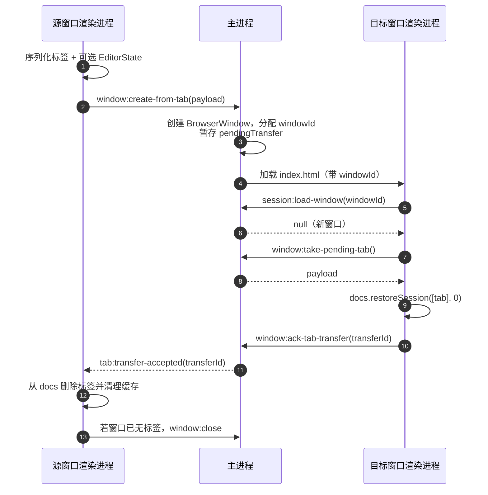

# 多窗口改造决策记录

> **实施状态：已落地。** 当前实现与接口以 [多窗口架构](./多窗口架构.md) 为准；本文保留改造前的评估、方案比较和最终决策，不再作为开发契约。

> 文档定位：记录「多窗口 + 拖出标签创建新窗口」改造时的评估、方案比较、关键取舍与最终落地结论。当前行为和接口契约以 [多窗口架构](./多窗口架构.md) 为准。
> 标签拖拽排序见 [标签拖拽排序](./标签拖拽排序.md)。
> 本文保留历史决策背景，方便后续维护者理解为什么选择当前架构；表中的 IPC 名称、建议和阶段划分不代表新的开发契约。

## 1. 结论

需求本身可行，但要拆成两个风险级别不同的部分：

| 需求               | 性质           | 建议                                              |
| ------------------ | -------------- | ------------------------------------------------- |
| 标签拖拽排序       | 渲染层局部改动 | 已单独实施，见 [标签拖拽排序](./标签拖拽排序.md) |
| 拖出标签创建新窗口 | 架构级改造     | 不能当成“加一个拖拽手势”，必须先完成多窗口基建    |

真正的成本不在拖拽 UI，而在四件事：

1. 主进程所有 `mainWindow` 单例语义改成**编辑窗口注册表**；
2. `session.json` 从「单份标签快照」改成**多窗口切片 + 窗口几何**，并由主进程统一持有；
3. 关闭、退出、更新安装从「一个窗口确认」改成**多窗口协调**；
4. 文件监听、整窗缩放、对话框、光标推送、外部打开文件全部按窗口路由。

粗略估计：**10–15 人日**，风险主要集中在会话迁移、跨窗口退出/更新协调、文件监听路由。

---

## 2. 现状的单窗口假设

| 位置                                                                        | 现状                                   | 多窗口下的问题                                           |
| --------------------------------------------------------------------------- | -------------------------------------- | -------------------------------------------------------- |
| [`src/main/index.ts`](../../src/main/index.ts) 的 `mainWindow`              | 全局单窗口                             | 所有窗口事件、IPC、对话框都指向同一个窗口                |
| `isMainWindowSender`                                                        | 只认主窗口                             | 新增窗口会被当成“非主窗口”，窗口控制、更新安装会被拒绝   |
| `watchedFilePath` / `watchedContent` / `watchSeq`                           | 全局单监视目标                         | 两个窗口切换标签会互相抢监视目标，外部变更也可能推错窗口 |
| `currentZoomFactor`                                                         | 全局单缩放                             | 一个窗口缩放会改另一个窗口，`get-zoom` 也只认主窗口      |
| `allowClose` / `pendingQuit`                                                | 全局单关闭守卫                         | 一个窗口确认关闭会放行所有窗口；多窗口退出无法协调       |
| `session.json`                                                              | 单个会话文件                           | 每个窗口都读写同一份会话，必须改成按窗口切片             |
| `window-state.json`                                                         | 单个窗口几何                           | 多窗口几何信息会互相覆盖                                 |
| 对话框父窗口 `mainWindow!`                                                  | 固定主窗口                             | 从其他窗口打开文件/保存/导出 PDF 会挂到错误窗口          |
| 光标定时器                                                                  | 只推 `mainWindow`                      | 其他窗口的滚动条悬停自愈失效                             |
| `second-instance`                                                           | 只聚焦 `mainWindow`                    | 多窗口时应聚焦最后活跃窗口，文件也应打开到该窗口         |
| [`src/main/updater.ts`](../../src/main/updater.ts) 的 `getMainWindow()`     | 更新安装只转交主窗口                   | 其他窗口的未保存内容不会被确认                           |
| `update:install`                                                            | 只接受主窗口                           | 多窗口下需要主进程统一协调，而不是某个窗口直接安装       |
| [`useSession.ts`](../../src/renderer/src/composables/useSession.ts)         | 渲染层单例会话                         | 每个窗口都会把整份会话当成自己的，恢复/保存会互相覆盖    |
| [`useFileWatcher.ts`](../../src/renderer/src/composables/useFileWatcher.ts) | 每个渲染进程一个监视目标               | 本身可保留，但主进程必须按 `webContents.id` 区分         |
| [`app.ts`](../../src/renderer/src/stores/app.ts)                            | `markit-*` 写 localStorage             | localStorage 同源共享，但其他窗口不会自动更新响应式状态  |
| [`documents.ts`](../../src/renderer/src/stores/documents.ts)                | `EditorState` / 滚动位置在非响应式 Map | 窗口内排序可保留；跨窗口迁移需要单独处理撤销历史         |

---

## 3. 目标架构

### 3.1 主进程：编辑窗口注册表

建议新增 `src/main/window-manager.ts`（或先在 `index.ts` 内抽分），核心结构：

```ts
interface EditorWindowContext {
  id: string // 稳定 windowId，随会话持久化
  win: BrowserWindow
  rendererReady: boolean
  pendingFilePaths: string[]
  watchedFilePath: string | null
  watchedContent: string | null
  watchSeq: number
  externalChangeTimer: NodeJS.Timeout | null
  zoomFactor: number
  allowClose: boolean
  pendingTransfer: TabTransferPayload | null
}

const editorWindows = new Map<number, EditorWindowContext>() // key: webContents.id
let lastFocusedEditorWindowId: string | null = null
```

关键规则：

1. 所有窗口能力都通过 `BrowserWindow.fromWebContents(event.sender)` 找上下文，不再用 `mainWindow`。
2. `isEditorWindowSender(event)` 替代 `isMainWindowSender`，更新窗口仍然不被当成编辑窗口。
3. 所有 `dialog.showOpenDialog` / `showSaveDialog` 的父窗口改为**发起请求的窗口**。
4. 缩放、全屏、关闭守卫、文件监视、光标推送全部按窗口独立。
5. `createEditorWindow(options)` 作为唯一窗口工厂，统一处理 `frame` / `titleBarOverlay` / `vibrancy` / preload / `before-input-event` / `will-navigate`。
6. 窗口创建时传入或通过 IPC 返回 `windowId`，渲染进程据此读写自己的会话切片。

### 3.2 状态归属

| 状态                                                       | 归属               | 说明                                                       |
| ---------------------------------------------------------- | ------------------ | ---------------------------------------------------------- |
| 主题、预览样式、大纲显隐/宽度、分栏比例、预览宽度          | 全局               | 继续用 `markit-*`，增加 `storage` 事件同步到其他窗口       |
| 标签布局模式                                               | 每个标签           | 拖出时随标签迁移                                           |
| 内容、光标、滚动位置、EOL/BOM、`isModified`、`diskContent` | 每个标签           | 随会话/迁移载荷走                                          |
| `EditorState` / 撤销历史                                   | 每个标签（逻辑上） | 可通过 CodeMirror 序列化跨窗口迁移，见第 8 节              |
| 整窗缩放                                                   | 每个窗口           | 持久化到窗口状态                                           |
| 窗口几何、最大化                                           | 每个窗口           | 按 `windowId` 持久化                                       |
| 文件监视目标                                               | 每个窗口           | 主进程按窗口维护                                           |
| 关闭守卫                                                   | 每个窗口           | 退出时由主进程统一协调                                     |
| 会话标签切片                                               | 每个窗口           | 主进程聚合成一份 `session.json`                            |
| 更新状态                                                   | 全局广播           | 现有 `update:state` 可继续用                               |
| 对话框、PDF 导出                                           | 每个窗口           | 父窗口按 sender                                            |
| 设置窗口                                                   | 全局单实例         | 不属于编辑器窗口注册表；所有编辑窗口打开时聚焦同一工具窗口 |

注意：`localStorage` 同源共享，新窗口会读到当前值；但**已打开的其他窗口不会自动更新**，需要监听 `storage` 事件或在主进程广播设置变更。主题、大纲、分栏、预览宽度建议全局同步；布局模式是标签级的，不要跨窗口同步。

### 3.3 会话模型 v2

这是整个改造的核心。建议**主进程持有会话**，因为应用启动时必须先知道“要创建几个窗口”，才能创建窗口；如果继续由渲染进程持有，启动时只能先建一个窗口再让渲染进程请求更多窗口，会出现闪烁和竞态。

建议结构：

```ts
interface SessionFile {
  version: 2
  windows: SessionWindow[]
  lastFocusedWindowId?: string
}

interface SessionWindow {
  id: string
  tabs: SessionTab[]
  activeIndex: number
}

interface SessionTab {
  // 现有字段保持不变
  path: string | null
  name: string
  content: string
  isModified: boolean
  cursorLine: number
  cursorCol: number
  eol?: '\n' | '\r\n'
  bom?: boolean
  layoutMode?: LayoutMode
  scrollAnchor?: number
  scrollTop?: number
  previewScrollTop?: number
  previewScrollAnchor?: number
  previewScrollOffset?: number
  // 新增：拖出后仍能正确判断磁盘冲突
  diskContent?: string
}
```

保存/恢复流程：

1. 主进程启动时先读 `session.json`，校验并迁移 v1 单窗口结构。
2. 按 `windows` 数量创建编辑窗口，每个窗口带自己的 `windowId`。
3. 渲染进程调用 `session:load-window(windowId)` 只拿自己的切片，不再读整份会话。
4. 渲染进程编辑时调用 `session:save-window({ windowId, tabs, activeIndex })`，主进程更新内存中的切片并防抖合并写盘。
5. 主进程负责原子写（临时文件 + rename），避免多窗口并发写坏文件。
6. 旧 `session.json`（只有 `tabs` / `activeIndex`）迁移为一个窗口；旧 `window-state.json` 迁移给第一个窗口。
7. 窗口几何建议单独放 `windows-state.json`，按 `windowId` 存 `{ width, height, x, y, isMaximized, zoomFactor }`，避免和体积较大的会话内容混在一起频繁写盘。

关闭策略：

- 用户主动关闭某个窗口，且还有其他编辑窗口：删除该窗口的会话切片和窗口几何，下次启动不再恢复它。
- 关闭的是最后一个窗口，或应用退出：**保留**切片，支持下次启动 / macOS Dock 重新打开时恢复。
- 应用崩溃：接受最后一次防抖写入的会话，不额外做日志回放。

---

## 4. 拖出标签创建新窗口

### 4.1 判定区

建议先明确判定区：**指针释放位置在源窗口之外**才创建新窗口；在窗口内但不在标签条上释放则回弹。

如果按字面“标题栏之外”包括编辑区/预览区，误触概率会比较高，建议作为可配置或后续版本。该点属于未决事项，见第 6 节。

### 4.2 迁移载荷

```ts
interface TabTransferPayload {
  transferId: string
  tab: SessionTab // 含 content、path、isModified、cursor、scroll、layoutMode、eol/bom
  diskContent?: string // 用于目标窗口的冲突判断
  sourceWindowId: string
  screenX: number
  screenY: number
  editorStateJson?: unknown // 可选：CodeMirror EditorState（含撤销历史）
}
```

### 4.3 握手流程



关键规则：

- 目标窗口 **ack 之前，源窗口不得删除标签**；目标窗口加载失败或超时（建议 5s）时，主进程销毁目标窗口并通知源窗口保留标签。
- 源窗口在握手期间建议短暂禁止关闭，或由主进程保留载荷直到目标 ack，避免两个窗口都丢失。
- 目标窗口启动时先读自己的会话切片；新 `windowId` 没有切片，返回 `null`，再消费 `pendingTransfer`，避免默认欢迎页残留。
- 主进程可以在 ack 时事务性地把标签从源切片移到目标切片，减少崩溃时同时丢失或重复的窗口期。

### 4.4 边界情况

| 场景                     | 处理                                                                                |
| ------------------------ | ----------------------------------------------------------------------------------- |
| 目标窗口加载失败 / 超时  | 主进程销毁目标窗口并通知源窗口，源标签**不删除**                                    |
| 源窗口在握手期间被关闭   | 建议短暂禁用源窗口关闭，或主进程保留载荷直到目标 ack                                |
| 拖出的是激活标签         | 源窗口删除后自动激活相邻标签                                                        |
| 拖出的是非激活标签       | 源窗口保持原激活标签                                                                |
| 拖出最后一个标签         | 目标窗口创建成功后，源窗口关闭                                                      |
| 拖到屏幕外 / 任务栏      | 按 `screen.getDisplayNearestPoint` 的工作区夹取新窗口位置                           |
| 源窗口最大化 / 全屏      | 新窗口用普通尺寸，不继承最大化/全屏                                                 |
| 同一文件已存在于其他窗口 | 建议允许跨窗口副本，复用现有冲突检测；或常规打开去重、拖出视为显式移动              |
| 撤销历史                 | 可通过 `EditorState` 序列化迁移，见第 8 节；失败时回退为从当前内容重建              |
| 未保存文档的表格列宽     | 目前按 `untitled:${doc.id}` 存在内存里，迁移后会丢；影响很小，可后续按文档 uid 处理 |

---

## 5. 同步适配清单

### 5.1 主进程

| 改动                 | 说明                                                                                                                                                 |
| -------------------- | ---------------------------------------------------------------------------------------------------------------------------------------------------- |
| 窗口注册表与窗口工厂 | 替换 `mainWindow` 单例；统一创建参数；按 `webContents.id` 查上下文                                                                                   |
| 所有对话框父窗口     | `dialog.showOpenDialog` / `showSaveDialog` 使用 `BrowserWindow.fromWebContents(event.sender)`                                                        |
| 按窗口缩放           | `currentZoomFactor` 移入窗口上下文；`window:get-zoom`、`window:zoom-changed`、`did-finish-load` 都按 sender/目标窗口。**后续变更**：v1.6 起发现 Chromium 缩放按 origin 生效，同源窗口无法各自保持比例，已改为全应用唯一值，见[会话恢复与窗口状态 §8](./会话恢复与窗口状态.md#8-全局缩放) |
| 按窗口文件监视       | `file:watch` 用 `event.sender.id` 找上下文；`file:external-change` 只发给该窗口；`file:save` 同步所有监视同一路径的窗口的 `watchedContent`，避免回环 |
| 按窗口关闭守卫       | `allowClose` 移入上下文；`window:close` 只关闭发送方窗口                                                                                             |
| 退出协调器           | `before-quit` 先 `preventDefault`，向所有编辑窗口发送 `app:prepare-quit`，全部 ack 后再真正 `app.quit()`；任一取消则中止并保留窗口                   |
| 更新安装协调         | 更新窗口请求安装时，不再只转交主窗口；由主进程依次/并行通知所有编辑窗口保存，全部完成后再 `beforeInstall` + `quitAndInstall`                         |
| 会话聚合             | `session:save-window` / `session:load-window` 按窗口切片；主进程防抖、校验、原子写                                                                   |
| 窗口状态聚合         | `windows-state.json` 按 `windowId` 存几何和缩放；旧 `window-state.json` 迁移                                                                         |
| 单实例转发           | `second-instance` 聚焦最后活跃编辑窗口；没有窗口时创建并排队文件                                                                                     |
| macOS `activate`     | 用编辑窗口注册表判断，而不是 `BrowserWindow.getAllWindows().length`                                                                                  |
| 光标推送             | 发给当前聚焦编辑窗口，或遍历所有可见编辑窗口；坐标按各自 contentBounds/zoom 换算                                                                     |
| 打开文件排队         | `pendingFilePaths` / `rendererReady` 移入窗口上下文；启动期的全局队列再分发给目标窗口                                                                |
| 新 IPC 的输入校验    | 迁移载荷、会话切片、`transferId` 都要做类型/大小校验，只接受可信 sender                                                                              |
| `window-all-closed`  | 多窗口下确认“所有编辑窗口关闭”才退出；更新窗口/隐藏 PDF 窗口不要误判                                                                                 |

### 5.2 preload / 类型契约

新增或调整（必须三处同步：主进程 `registerHandle` / `registerOn` → preload → [`src/preload/index.d.ts`](../../src/preload/index.d.ts)）：

- `window:get-context` 或 `windowId` 暴露（推荐 preload 直接暴露 `windowId`，避免每次启动多一次 round trip）
- `window:create-from-tab`
- `window:take-pending-tab`
- `window:ack-tab-transfer`
- `window:get-cursor`（拖拽结束位置兜底）
- `app:prepare-quit` / `app:prepare-quit-result` / `app:prepare-quit-cancelled`
- `session:load-window` / `session:save-window`
- 可选的 `window:focus-tab`（跨窗口打开同一文件时聚焦已有窗口/标签）

### 5.3 渲染进程

| 文件                                                                                    | 改动                                                                                                                                  |
| --------------------------------------------------------------------------------------- | ------------------------------------------------------------------------------------------------------------------------------------- |
| [`documents.ts`](../../src/renderer/src/stores/documents.ts)                            | 增加 `moveDocument`、`insertTransferredTab` / `removeTransferredTab`；序列化时带上 `diskContent`；迁移时清理 `EditorState` / 滚动缓存 |
| [`useSession.ts`](../../src/renderer/src/composables/useSession.ts)                     | 从“整份会话”改成“当前窗口切片”；支持启动时消费 `pendingTransfer`；保存时带 `windowId`；不再让新窗口误恢复别人的标签                   |
| [`App.vue`](../../src/renderer/src/App.vue)                                             | 处理 `app:prepare-quit`；更新安装不再由单窗口直接 `update.install()`，改为主进程协调                                                  |
| [`TabBar.vue`](../../src/renderer/src/components/layout/TabBar.vue)                     | 在已实现的排序基础上增加拖出判定、拖拽 ghost、右键菜单「在新窗口中打开」                                                              |
| [`useFile.ts`](../../src/renderer/src/composables/useFile.ts)                           | 关闭最后一个标签后的窗口关闭逻辑；拖出后的标签移除；可选：跨窗口打开同一文件时聚焦已有窗口                                            |
| [`useFileWatcher.ts`](../../src/renderer/src/composables/useFileWatcher.ts)             | 逻辑基本不变，但依赖主进程按窗口路由；确认同一文件在两个窗口打开时的冲突语义                                                          |
| [`app.ts`](../../src/renderer/src/stores/app.ts)                                        | 增加 `storage` 事件同步主题、大纲、分栏、预览宽度；`markit-layout` 只作为新标签兜底，不要同步其他窗口的当前标签布局                   |
| [`useWindowZoom.ts`](../../src/renderer/src/composables/useWindowZoom.ts)               | 依赖主进程按 sender 返回缩放；状态栏各自显示                                                                                          |
| [`style.ts`](../../src/renderer/src/stores/style.ts)                                    | 预览样式目前只在内存；多窗口下要么接受每窗口独立，要么持久化并同步。需要明确决策                                                      |
| [`StatusBar.vue`](../../src/renderer/src/components/layout/StatusBar.vue)               | 会话保存失败提示按窗口显示；主进程聚合写失败时要能通知到窗口                                                                          |
| [`useKeyboardShortcuts.ts`](../../src/renderer/src/composables/useKeyboardShortcuts.ts) | 可选增加「新建窗口」快捷键；标签排序后 Ctrl+1..9 语义保持按数组顺序                                                                   |
| [`welcome.md`](../../src/renderer/src/assets/welcome.md)                                | 多窗口落地后增加拖出新建窗口、跨窗口限制等说明；本次只补充标签排序                                                                    |

### 5.4 文档与测试

- 正式契约已拆分到 [多窗口架构](./多窗口架构.md)，并同步更新 `docs/架构与契约/架构总览.md`、`docs/架构与契约/IPC接口与进程契约.md`、`docs/文件与窗口/会话恢复与窗口状态.md`、`docs/架构与契约/状态与数据模型.md`、`docs/文件与窗口/文件与冲突处理.md`、`docs/更新与发布/自动更新.md`、`docs/架构与契约/技术决策与已知限制.md`。
- 单元测试：会话 v1→v2 迁移、迁移载荷归一化、退出协调状态机、`moveItem` 之外的排序辅助逻辑。
- e2e：右键「在新窗口中打开」、两个窗口的会话恢复；拖出到窗口外建议手工验证。
- 手工验证：Windows/macOS 下拖出/拖回、拖出最后一个标签、最大化/全屏拖出、两个窗口同时改不同文件、同一文件两个窗口的冲突、两个窗口各自缩放、多窗口未保存退出/更新安装。

---

## 6. 当时待决问题与最终结论

| 编号 | 当时的问题                                                                     | 最终结论                                                                                                             |
| ---- | ------------------------------------------------------------------------------ | -------------------------------------------------------------------------------------------------------------------- |
| O-1  | 拖出判定：释放点在「窗口外」还是「标题栏外」也新建？                           | 仅标签标题栏下缘 28px 吸附区保持排序；拖到工具栏、编辑区、预览区或其他窗口外区域均可创建新窗口；命中其他编辑窗口则迁入 |
| O-2  | 同一文件跨窗口：允许副本，还是常规打开时聚焦已有窗口/标签？                    | 常规打开跨窗口去重并聚焦已有标签；显式迁移仍允许移动标签，但目标窗口已打开同一路径时拒绝，避免目标端重复              |
| O-3  | 设置作用域如何划分？                                                           | 主题、预览样式、大纲、分栏、预览宽度全局同步；标签布局按标签保存；缩放与窗口几何按窗口保存                            |
| O-4  | 退出时恢复所有窗口，还是只恢复最后活跃窗口？                                   | 恢复所有合法窗口切片，启动恢复上限为 8 个；不提供窗口数量上限 UI                                                     |
| O-5  | 多窗口都有未保存内容时，退出/更新确认如何处理？                                | 主进程统一协调所有编辑窗口；任一窗口取消或保存失败，退出/安装中止                                                    |
| O-6  | 是否支持拖到另一个 MarkIt 窗口？                                               | 支持拖入已有编辑窗口；离开所有编辑窗口后创建新窗口；应用内使用自定义 ghost，不依赖原生 HTML5 拖放                    |
| O-7  | 是否接受拖出时丢失撤销历史？                                                   | 序列化受限的 CodeMirror `EditorState`；超过 4 MiB 或恢复失败时只迁移文档内容并从当前内容重建历史                    |
| O-8  | 预览样式 / 自定义 CSS 是否跨窗口共享？                                         | 共享；通过 `markit-preview-style`、`markit-custom-styles` 与 `storage` 事件同步                                       |

---

## 7. 实施过程回顾

| 阶段 | 内容                                                                                                      | 结果                                                             |
| ---- | --------------------------------------------------------------------------------------------------------- | ---------------------------------------------------------------- |
| 1    | 标签拖拽排序                                                                                              | 已完成，见 [标签拖拽排序](./标签拖拽排序.md)                     |
| 2    | 多窗口基建：窗口注册表、按窗口 IPC/对话框/缩放/监视、会话 v2、窗口状态 v2，先用右键「在新窗口中打开」验证 | 已完成；形成当前 [多窗口架构](./多窗口架构.md) 契约              |
| 3    | 拖出新建窗口：拖拽手势 + transfer 握手 + 失败回滚 + 源窗口关闭                                            | 已完成；包含拖入已有窗口、目标高亮和自定义拖拽 ghost              |
| 4    | 跨窗口协调：设置 `storage` 同步、退出/更新多窗口协调、同文件策略、文档与手册                              | 已完成；覆盖未保存退出、更新安装、撤销历史迁移和跨窗口同文件规则 |

实施时按风险拆分推进：排序先落地，多窗口基建单独评审，拖出与跨窗口协调继续分阶段验证。

---

## 8. 关于“每个 tab 一个渲染进程”

### 8.1 结论

技术上可行，但**不建议为了撤销历史迁移而改成 per-tab renderer process**。CodeMirror 6 支持序列化 `EditorState`（含 `historyField` 的 undo/redo 栈），随标签迁移即可，成本远低于 per-tab 进程。

### 8.2 方案 A：序列化 EditorState（推荐）

项目当前依赖：

- `codemirror ^6.0.2`
- 实际安装 `@codemirror/state@6.7.0`、`@codemirror/commands@6.10.4`
- `npm ls` 显示 `@codemirror/state` 是 deduped 的，不存在多实例导致 `instanceof` 失效的问题

[`MarkdownEditor.vue`](../../src/renderer/src/components/editor/MarkdownEditor.vue) 的 `buildExtensions()` 已包含 `history()`，可以直接复用：

```ts
import { historyField } from '@codemirror/commands'
import { EditorState } from '@codemirror/state'

const STATE_FIELDS = { history: historyField }

// 源窗口：活跃标签取 live view.state；非活跃标签取 editorStates 缓存
const json = state.toJSON(STATE_FIELDS)

// 目标窗口：同一个 fields 对象 + 同样的 extensions（必须含 history()）
const restored = EditorState.fromJSON(json, { extensions: buildExtensions(isDark) }, STATE_FIELDS)
```

注意事项：

- `STATE_FIELDS` 必须是同一个对象/同名 `StateField`；目标端 `buildExtensions` 必须包含 `history()`。
- `fromJSON` 要 try/catch，失败回退到现有 `createState(content, isDark, cursor)`。
- 只序列化 doc / selection / history；折叠状态、滚动位置、主题不在其中（滚动/光标已有字段，主题由目标窗口重建）。
- `HistEvent.toJSON` 不包含 effects（`fromJSON` 用空数组），文本 undo/redo 没问题；如果未来 history 里放了自定义 effect，需要单独评估。
- 历史 JSON 可能较大（长会话可能几 MB），给迁移载荷设上限（例如 4MB），超过则放弃历史、只带内容；不要默认把历史写进 `session.json`，否则会话文件会膨胀。
- 目标端需要能复用 `buildExtensions` / `createState`，建议把这两个函数从 `MarkdownEditor.vue` 抽到 `utils/editor-state.ts`，新建文件按规则加头部注释。

建议先做 **0.5–1 天 spike**：编辑 → 拖出 → 在新窗口 Ctrl+Z / Ctrl+Y → 切暗色主题 → 多选区 → 大历史，确认行为符合预期。

### 8.3 方案 B：per-tab renderer process

实现路径：

- `WebContentsView` + `BaseWindow` / `BrowserWindow.contentView`。
- shell（标题栏、标签条、工具栏、状态栏）一个 `WebContentsView`；每个 tab 一个 `WebContentsView`。
- 跨窗口迁移：`sourceWin.contentView.removeChildView(view)` → `targetWin.contentView.addChildView(view)`。

社区有类似 `TabPresenter` 的实现，但要注意：

- Electron **没有官方的跨窗口 reparent 保证**；需要自己 spike 验证是否 reload、平台是否一致。
- `BaseWindow` **不会自动销毁子 WebContents**，不显式清理会造成 renderer 进程泄漏。
- `WebContentsView` 用 `setBounds` 手动布局，不是 CSS 流式布局；编辑区、预览区、大纲、分栏、状态栏的尺寸都要自己同步。
- 默认白底，需要显式设置透明背景。
- `<webview>` 标签不推荐，安全/生命周期/性能问题更多。

代价对比：

| 维度          | per-tab renderer 的影响                                                             |
| ------------- | ----------------------------------------------------------------------------------- |
| 架构          | shell 与 tab 拆成独立 renderer；Pinia 状态、IPC、preload 都要重新划分               |
| 布局          | 所有区域用 bounds 手动计算；窗口 resize、大纲宽度、分栏比例都要同步                 |
| 焦点 / 快捷键 | 每个 view 有自己的 keydown；Ctrl+W / Ctrl+S 等要在主进程或各 tab 重复处理           |
| 拖拽          | HTML5 DnD 不能跨 WebContents；拖出/拖入要主进程光标轮询协调                         |
| 主题 / 设置   | 要广播到所有 view；`storage` 事件不再够用                                           |
| 缩放          | 每个 webContents 单独设置，快捷键和状态栏要聚合                                     |
| 内存          | 每个 tab 一套 Vue + CodeMirror + markdown-it + CSS，几十 MB/tab；20 个标签可能 1GB+ |
| 启动          | N 个标签 = N 个 renderer，恢复明显变慢                                              |
| 会话          | 每个 tab 的状态、窗口组合关系都要单独管理                                           |
| 测试          | e2e 从「一个页面」变成「多个 WebContents」，难度显著上升                            |
| 收益          | tab 崩溃隔离、强隔离、live reparent 保留全部 JS 状态                                |

per-tab renderer 只解决**运行期跨窗口移动**；应用重启后撤销历史仍然没有，除非同样做 `EditorState` 序列化。因此它不是方案 A 的替代品，只是把「live 状态保留」做得更彻底。

只有产品方向变成“每个 tab 承载不可信内容、需要强沙箱/崩溃隔离”或“单个 tab 是复杂应用”时，才建议把 per-tab renderer 作为独立架构项目评估。

---

## 9. 当时的测试与文档要求

- 多窗口改造涉及主进程 / 窗口管理 / IPC / 文件读写 / 自动更新，属于 [`rules/testing.md`](../../rules/testing.md) 的高风险区域，必须 `npm run dev` 实际启动验证，并在交付说明中写清验证方式。
- 会话 v2、窗口状态 v2 是持久化格式变更，必须有迁移测试和回退策略；损坏的会话文件不能让应用启动崩溃。
- 新增 IPC 必须三处同步；新增业务源码文件需要头部注释。
- 内置用户手册 [`welcome.md`](../../src/renderer/src/assets/welcome.md) 在多窗口能力落地后补充：拖出新建窗口、跨窗口打开同一文件的规则、拖出后撤销历史的行为等。
- 发版更新说明按 [`docs/更新与发布/github-release.md`](../更新与发布/github-release.md) 第 3.1 节提炼，不写技术实现细节。

---

## 10. 参考

- [Electron BaseWindow 文档](https://www.electronjs.org/docs/latest/api/base-window)
- [CodeMirror 讨论：setHistory / clearHistory 与 EditorState 序列化](https://discuss.codemirror.net/t/editor-sethistory-clearhistory-equivalent-in-codemirror-6/6291/4)
- [CodeMirror 讨论：historyField 的序列化](https://discuss.codemirror.net/t/cannot-get-history-depth-and-serialized-historyfield/5597/2)
- [DeepChat TabPresenter & WebContentsView 的跨窗口 tab 实现](https://deepwiki.com/ThinkInAIXYZ/deepchat/4.2-provider-implementations-and-message-formatting#1)
