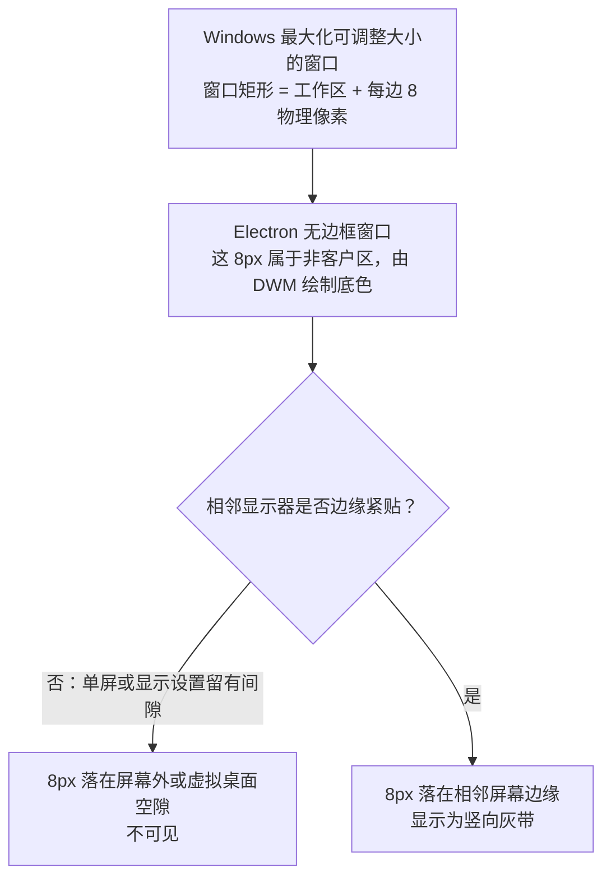

# 最大化窗口跨屏溢出问题说明

> **文档状态：已诊断，未改代码。** 本文记录「MarkIt 在 Windows 多显示器环境中最大化后，相邻屏幕出现竖向灰带」的现象、实测证据、根因定位与处理建议。
>
> - 诊断日期：2026-11-25
> - 涉及版本：MarkIt 1.6.0-beta.16（Electron 39.8.10）
> - 复现环境：Windows 11 10.0.26300；左屏 3200×2000 @200%，右屏 2560×1440 @100%，两屏左右边缘紧贴
> - 结论：**不是 MarkIt 的业务缺陷，也不是 Windows 多显示器的缺陷**；属于 Electron 无边框窗口在 Windows 上最大化的框架行为，已登记为已知限制 [L27](../架构与契约/技术决策与已知限制.md#34-窗口ipc-与生命周期)

## 1. 问题现象

MarkIt 在左侧高 DPI 屏幕上最大化后，右侧相邻屏幕的最左边缘出现一条竖向灰带：

- 宽度固定为 **8 物理像素**，颜色为单一底色（本次环境为 `RGB(211,211,211)`），不随页面内容变化
- 从屏幕顶端开始，向下延伸到**窗口矩形的底边**（约 y=1356），并非贯穿整块屏幕
- 只在两屏边缘紧贴、且最大化窗口位于边界一侧时出现；单屏环境不可见
- 重复最大化后宽度保持 8px；看起来像窗口「溢出」到了隔壁屏幕

## 2. 复现条件

| 条件           | 说明                                                                                        |
| -------------- | ------------------------------------------------------------------------------------------- |
| 操作系统       | Windows 10 / 11（本次为 Windows 11 10.0.26300）                                             |
| 窗口形态       | `frame: false` + `titleBarStyle: 'hidden'` + `titleBarOverlay`（MarkIt 编辑窗口的现有配置） |
| 窗口可调整大小 | `resizable` 为默认的 `true`，保留系统 resize border                                         |
| 显示器排列     | 两块显示器在虚拟桌面中**边缘紧贴**，没有间隙                                                |
| 触发动作       | 在靠近屏幕边界的显示器上最大化窗口                                                          |
| 缩放组合       | 任意；高 DPI 屏与 100% 屏组合下均能复现                                                     |

该现象与文档内容、预览主题、标签数量、窗口状态持久化无关，任何采用同类窗口配置的 Electron 应用都可出现。

**平台范围：仅 Windows。** macOS 的最大化走 `NSWindow` 的 zoom，窗口 frame 被限制在屏幕 `visibleFrame` 内，不存在 Windows 这种「窗口矩形大于屏幕」的约定；且 MarkIt 在 macOS 上不使用 `frame: false`（只有 `titleBarStyle: 'hidden'` + `trafficLightPosition`），因此不会出现同一条 8px 灰带。该判断基于平台窗口模型与现有窗口配置，**未在 macOS 实机复测**；Linux 未验证。

## 3. 排查过程与实测数据

排查顺序：先读取运行中窗口的 Win32 几何，再对右侧截图做像素测量，最后用与 MarkIt 相同配置的最小 Electron 窗口交叉验证。

### 3.1 运行中窗口的 Win32 几何

使用 `GetWindowRect`（DPI-aware 进程）读取 MarkIt 主窗口，单位为物理像素：

| 边界 | 窗口矩形 | 显示器工作区 `rcWork` | 差值   |
| ---- | -------- | --------------------- | ------ |
| 左   | -3208    | -3200                 | **-8** |
| 上   | -564     | -556                  | **-8** |
| 右   | 8        | 0                     | **+8** |
| 下   | 1356     | 1348                  | **+8** |

窗口尺寸 3216×1920，工作区 3200×1904；`DwmGetWindowAttribute(DWMWA_EXTENDED_FRAME_BOUNDS)` 返回的可见窗口框正好等于工作区 `(-3200,-556) – (0,1348)`。

关键补充：**`BrowserWindow.getContentBounds()` 精确等于工作区**（DIP 为 `(-1600,-278) 1600×952`）。也就是说，MarkIt 的页面内容没有溢出，溢出的是窗口的非客户区。

### 3.2 截图像素级测量

对右侧屏幕的截图（2559×1440）逐像素扫描：

- 左边缘 x=0–7 恒为同一种灰色 `(211,211,211)`，第 8 像素起是桌面壁纸，宽度正好 8px
- 灰带的纵向结束位置约为 y=1355，与 3.1 中窗口底边 1356 **精确吻合**
- 左屏截图的最右侧像素是页面内容（白色 `#FFF`），不是灰色，进一步说明灰带不属于页面内容

### 3.3 最小复现（Electron 39.8.10）

用与 MarkIt 相同的窗口参数新建一个最小窗口，分别在 100% 主屏和 200% 副屏上最大化：

| 显示器          | 工作区（DIP）            | 最大化后窗口 bounds（DIP） | 每边溢出 | 换算为物理像素 |
| --------------- | ------------------------ | -------------------------- | -------- | -------------- |
| 2560×1440 @100% | `(0, 0) 2560×1392`       | `(-8, -8) 2576×1408`       | 8 DIP    | 8px            |
| 1600×1000 @200% | `(-1600, -278) 1600×952` | `(-1604, -282) 1608×960`   | 4 DIP    | **8px**        |

补充验证：

1. `frame: false`、仅 `titleBarStyle: 'hidden'`、`titleBarOverlay`、`thickFrame: false` 等各种窗口样式变体，最大化后都是每边 **8 物理像素**外扩
2. 系统默认带边框的窗口同样外扩 8px，只是这 8px 在普通窗口上属于系统窗口边框
3. 最大化后调用 `setBounds()` / `setResizable()` 都无法把窗口收回工作区（Windows 不接受最大化状态下的位置修正）
4. 把窗口 `backgroundColor` 设为品红后复现，灰带**没有变成品红**，说明该区域由 DWM 绘制，不是应用背景色或页面内容

### 3.4 几何关系

## 4. 根因

1. Windows 最大化一个**可调整大小**的窗口时，窗口外框会比显示器工作区每边大 8 物理像素。这是系统约定：把不可见的 resize border 推到屏幕外，让客户区正好铺满工作区。默认带边框的普通窗口同样如此，只是那 8px 是系统窗口边框，最大化时基本不可见。
2. Electron 无边框窗口为了保留拖拽边缘缩放能力，同样保留了可调整大小边框，因此最大化后也带这 8px 外扩。页面内容区（client area）精确等于工作区，不会画到这 8px 里。
3. 这 8px 属于非客户区，由 DWM 用窗口底色绘制。底色跟随窗口的原生主题（MarkIt 会通过 `window:set-native-theme` 把主题同步给 `nativeTheme`），与应用页面内容、预览主题无关。
4. 单屏时这 8px 全部在屏幕外；当相邻显示器边缘紧贴时，右侧的 8px 就落在隔壁屏幕上，形成灰带。8px 是物理像素，不随 DPI 缩放放大（200% 屏上对应 4 DIP）。

## 5. 定位结论

| 判断对象                     | 结论                                                                                            |
| ---------------------------- | ----------------------------------------------------------------------------------------------- |
| MarkIt 布局 / CSS / 预览渲染 | 不是。页面内容区精确等于工作区，灰带不是页面内容                                                |
| MarkIt 窗口状态保存 / 恢复   | 不是。`window-state.json` 只保存普通尺寸、位置与最大化标志，与最大化时的外扩无关                |
| Windows 多显示器 / DPI 感知  | 不是。单屏同样外扩 8px，只是被屏幕边缘裁掉                                                      |
| Electron 无边框窗口实现      | **是**。属于 Electron/Chromium 在 Windows 上的既有行为；Electron 未暴露关闭该不可见边框的配置项 |

## 6. 影响评估

| 维度     | 评估                                                                                         |
| -------- | -------------------------------------------------------------------------------------------- |
| 功能     | 无影响。窗口、标签、编辑、预览、导出、更新均正常                                             |
| 性能     | 无影响                                                                                       |
| 数据     | 无影响                                                                                       |
| 视觉     | 仅在「双屏紧贴 + 边界屏最大化」时出现 8px 灰带；颜色跟随窗口原生主题，浅色为浅灰，深色为深灰 |
| 用户感知 | 低但可见，容易被误认为窗口溢出或渲染错误；不影响任何操作                                     |

## 7. 处理方案

| 方案                                | 做法                                                                                           | 代价 / 风险                                                                                                                              | 结论               |
| ----------------------------------- | ---------------------------------------------------------------------------------------------- | ---------------------------------------------------------------------------------------------------------------------------------------- | ------------------ |
| A. 记录为已知限制                   | 不改窗口实现，本文与 [L27](../架构与契约/技术决策与已知限制.md#34-窗口ipc-与生命周期) 作为结论 | 无                                                                                                                                       | **推荐，当前采用** |
| B. 自绘最大化                       | 用自绘窗口按钮替换 `titleBarOverlay`，最大化改为 `setBounds(workArea)` 并自维护状态            | 失去系统 Snap、`Win+↑`、双击标题栏的原生语义；且只能覆盖自绘按钮触发的最大化，系统快捷键仍会走原生路径；改动面大，需要单独设计文档与回归 | 暂不采用           |
| C. 原生模块 hook `WM_GETMINMAXINFO` | 在窗口过程里把最大化尺寸限制为工作区                                                           | 引入 C++ 原生 addon、`electron-rebuild` 与三平台构建链，显著增加构建与维护成本                                                           | 暂不采用           |
| D. 用户侧规避                       | 在显示设置中把两屏拉开 ≥8px，或避免在边界屏最大化                                              | 只缓解单个用户环境，不是产品修复；拉开间隙的效果未在本文环境实测                                                                         | 可选说明           |

选择 B 或 C 时，必须先按项目规则单独补设计文档，再改代码；不得为了消除这条 8px 灰带顺手调整窗口样式或 `setBounds` 调用链。

## 8. 后续建议

1. 在手工验证矩阵中增加一条双屏高 DPI 验收项：两屏紧贴、在边界屏最大化，确认现象与本文一致；若后续实施方案 B/C，再按对应设计文档补充回归。
2. 不建议为本问题编写 e2e：它依赖真实多显示器、混合 DPI 与 Windows 窗口管理器几何，CI 无法稳定复现。
3. 用户反馈「窗口溢出到副屏」时，直接引用本文与 L27，不按布局或窗口状态 bug 处理。

## 9. 复现与测量方法（附录）

1. **读取窗口几何**：PowerShell 调用 `user32!GetWindowRect` 与 `dwmapi!DwmGetWindowAttribute`；进程必须先声明 per-monitor DPI awareness（`SetProcessDpiAwarenessContext(-4)`），否则坐标会被系统按调用方 DPI 虚拟化。
2. **像素测量**：对相邻屏幕截图按行扫描，记录左侧连续同色区域的宽度与纵向范围，与窗口矩形的右边界、下边界对照。
3. **最小复现**：新建与 MarkIt 同参数的 `BrowserWindow`，在目标显示器上 `maximize()`，读取 `getBounds()` 与 `getContentBounds()`；对照 `screen.getDisplayMatching()` 的 `workArea` 计算每边差值。

## 10. 相关文件

| 文件                                                      | 关系                                                                                              |
| --------------------------------------------------------- | ------------------------------------------------------------------------------------------------- |
| [窗口放置与单实例规则](./窗口放置与单实例规则.md)         | 多显示器窗口放置与混合缩放校正；本文是其已知行为补充                                              |
| [技术决策与已知限制](../架构与契约/技术决策与已知限制.md) | L27 登记位置                                                                                      |
| [主题样式与布局](../编辑与预览/主题样式与布局.md)         | 编辑窗口 `frame` / `titleBarStyle` / `titleBarOverlay` 配置说明                                   |
| [测试与质量保障](../工程与质量/测试与质量保障.md)         | 双屏高 DPI 手工验证的执行位置                                                                     |
| [`src/main/index.ts`](../../src/main/index.ts)            | `createEditorWindow()` 的窗口参数（`frame: false`、`titleBarStyle: 'hidden'`、`titleBarOverlay`） |
