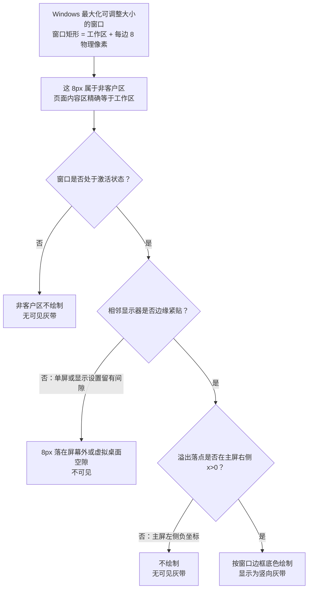

# 最大化窗口跨屏溢出问题说明

> **文档状态：已诊断，未改代码。2026-11-25 三次实测修正（含方向性）。** 本文记录「MarkIt 在 Windows 多显示器环境中最大化后，相邻屏幕出现竖向灰带」的现象、实测证据、根因定位与处理结论。
>
> - 诊断日期：2026-11-25
> - 涉及版本：MarkIt 1.6.0-beta.16（Electron 39.8.10）
> - 复现环境：Windows 11 10.0.26300；200% 屏与 100% 屏左右紧贴，分别测试过两种左右排列
> - 结论：**不是 MarkIt 的业务缺陷，也不是 Windows 多显示器的缺陷**；属于 Electron/Chromium 在 Windows 上对**激活窗口非客户区**的绘制行为，**与窗口是否无边框、两侧 DPI 均无直接关系**；是否可见取决于溢出落点是否位于主屏右侧（正坐标）。已登记为已知限制 [L27](../架构与契约/技术决策与已知限制.md#34-窗口ipc-与生命周期)

## 1. 问题现象

MarkIt 在某块屏幕上最大化后，相邻屏幕的边缘出现一条竖向灰带：

- 宽度固定为 **8 物理像素**，颜色为单一底色，不随页面内容变化
- **只在窗口处于激活状态时出现**；窗口失焦后消失，重新激活又出现
- 从屏幕顶端开始，向下延伸到**窗口矩形的底边**（约 y=1356），并非贯穿整块屏幕
- 只在两屏边缘紧贴、且最大化窗口位于边界一侧时出现；单屏环境不可见
- **只在溢出落点位于主屏右侧（正坐标）时绘制**；落在主屏左侧（负坐标）时不绘制（见 3.4）
- 重复最大化后宽度保持 8px；看起来像窗口「溢出」到了隔壁屏幕

## 2. 复现条件

| 条件           | 说明                                                                               |
| -------------- | ---------------------------------------------------------------------------------- |
| 操作系统       | Windows 10 / 11（本次为 Windows 11 10.0.26300）                                    |
| 窗口形态       | **任意不透明、可调整大小的 Electron 窗口**：无边框、隐藏标题栏、原生标题栏均可复现 |
| 窗口可调整大小 | `resizable` 为默认的 `true`，保留系统 resize border                                |
| 窗口状态       | **窗口必须处于激活状态**；失焦后灰带消失                                           |
| 显示器排列     | 两块显示器在虚拟桌面中**边缘紧贴**，没有间隙                                       |
| 溢出落点       | **只有落在主屏右侧（x>0）的溢出才绘制**；落在主屏左侧（x<0）时不绘制               |
| 触发动作       | 在靠近屏幕边界的显示器上最大化窗口                                                 |
| 缩放组合       | 任意；高 DPI 屏与 100% 屏组合、交换左右布局后均复现，与 DPI 无直接关系             |

该现象与文档内容、预览主题、标签数量、窗口状态持久化、`frame` / `titleBarStyle` 配置均无关。

**平台范围：仅 Windows。** macOS 的最大化走 `NSWindow` 的 zoom，窗口 frame 被限制在屏幕 `visibleFrame` 内，不会产生 Windows 这种「窗口矩形大于屏幕」的 8px 外扩，因此不会出现同一条灰带。该判断基于平台窗口模型，**未在 macOS 实机复测**；Linux 未验证。

## 3. 排查过程与实测数据

排查顺序：先读取运行中窗口的 Win32 几何，再对相邻屏幕做像素测量，最后用最小 Electron 窗口覆盖不同窗口配置与两种左右布局，在**激活状态**下交叉验证。

### 3.1 运行中窗口的 Win32 几何

使用 `GetWindowRect`（DPI-aware 进程）读取 MarkIt 主窗口，单位为物理像素：

| 边界 | 窗口矩形 | 显示器工作区 `rcWork` | 差值   |
| ---- | -------- | --------------------- | ------ |
| 左   | -3208    | -3200                 | **-8** |
| 上   | -564     | -556                  | **-8** |
| 右   | 8        | 0                     | **+8** |
| 下   | 1356     | 1348                  | **+8** |

窗口尺寸 3216×1920，工作区 3200×1904；`DwmGetWindowAttribute(DWMWA_EXTENDED_FRAME_BOUNDS)` 返回的可见窗口框正好等于工作区 `(-3200,-556) – (0,1348)`。

关键补充：**`BrowserWindow.getContentBounds()` 精确等于工作区**（DIP 为 `(-1600,-278) 1600×952`）。也就是说，MarkIt 的页面内容没有溢出，溢出的是窗口的非客户区。

### 3.2 截图像素级测量

在窗口激活状态下，对相邻屏幕的截图逐像素扫描：

- 左边缘 x=0–7 恒为同一种灰色 `(211,211,211)`，第 8 像素起是桌面壁纸，宽度正好 8px
- 灰带的纵向结束位置约为 y=1355，与 3.1 中窗口底边 1356 **精确吻合**
- 左屏截图的最右侧像素是页面内容（白色 `#FFF`），不是灰色，进一步说明灰带不属于页面内容
- 同一窗口失焦后，左边缘与背景完全一致，灰带消失

### 3.3 最小复现与窗口配置对照（Electron 39.8.10）

先用与 MarkIt 相同的窗口参数新建最小窗口，验证最大化后的窗口几何：

| 显示器          | 工作区（DIP）            | 最大化后窗口 bounds（DIP） | 每边溢出 | 换算为物理像素 |
| --------------- | ------------------------ | -------------------------- | -------- | -------------- |
| 2560×1440 @100% | `(0, 0) 2560×1392`       | `(-8, -8) 2576×1408`       | 8 DIP    | 8px            |
| 1600×1000 @200% | `(-1600, -278) 1600×952` | `(-1604, -282) 1608×960`   | 4 DIP    | **8px**        |

再用不抢焦点的桌面捕获，在窗口**真正激活**时对比不同窗口配置（浅色主题）：

| 窗口配置                              | 相邻屏边缘 8px  | 灰带   |
| ------------------------------------- | --------------- | ------ |
| `frame: false` + acrylic              | `(211,211,211)` | 有     |
| `frame: false` 无 acrylic             | `(243,243,243)` | 有     |
| 隐藏标题栏（`frame: true`）+ acrylic  | `(211,211,211)` | 有     |
| 隐藏标题栏（`frame: true`）无 acrylic | `(243,243,243)` | 有     |
| 原生标题栏（默认边框）                | `(243,243,243)` | 有     |
| `titleBarStyle: 'hidden'` 无 overlay  | `(243,243,243)` | 有     |
| `thickFrame: false`                   | `(243,243,243)` | 有     |
| `transparent: true`                   | 与背景一致      | **无** |

补充结论：

1. **灰带与 `frame` 配置无关**：去掉 `frame: false`（改成原生边框或隐藏标题栏）并不能消除，本次试验已实测无效并撤销。
2. **只在激活时绘制**：同一配置失焦后灰带消失；早期在非激活状态下截到的「无灰带」是假阴性。
3. **颜色跟随原生主题与窗口材质**：无 acrylic 时为 Win11 浅色标题栏底色 `(243,243,243)`，acrylic 混色后为 `(211,211,211)`；不是应用页面内容。
4. **透明窗口没有灰带**：`transparent: true` 时窗口 bounds 精确等于工作区（没有 8px 外扩），但透明窗口会失去原生 resize（以及阴影、acrylic），不作为产品方案。
5. 最大化后调用 `setBounds()` / `setResizable()` 都无法把窗口收回工作区（Windows 不接受最大化状态下的位置修正）。

### 3.4 方向性：交换左右布局

把两块屏的左右排列交换后再测（100% 主屏在左、200% 屏在右）：

| 布局                                     | 窗口最大化在 | 最大化 bounds（DIP）     | 溢出落点          | 相邻屏边缘 |
| ---------------------------------------- | ------------ | ------------------------ | ----------------- | ---------- |
| 200% 在左 `(-1600)`，100% 主屏在右 `(0)` | 100% 右屏    | `(-8, -8) 2576×1408`     | **x<0**（主屏左） | **无**     |
| 200% 在左 `(-1600)`，100% 主屏在右 `(0)` | 200% 左屏    | `(-1604, -282) 1608×960` | x>0               | 8px，`211` |
| 100% 主屏在左 `(0)`，200% 在右 `(+2560)` | 100% 左屏    | `(-8, -8) 2576×1408`     | x>0               | 8px，`211` |
| 100% 主屏在左 `(0)`，200% 在右 `(+2560)` | 200% 右屏    | `(2556, -198) 1608×961`  | x>0（2556）       | 8px，`211` |

结论：

1. **决定因素是溢出落点的虚拟坐标符号**：落在主屏左侧（x<0）不绘制，落在主屏右侧（x>0）绘制。交换布局后四个方向中所有 x>0 的溢出都可见，唯一的 x<0 溢出不可见。
2. **与两侧 DPI 无直接关系**：交换后 200% 目标屏位于正坐标侧，同样出现 8px 灰带，推翻了「只朝低 DPI 方向漏」的猜测。
3. 最可能的机制是 DWM/Chromium 在绘制窗口非客户区溢出时，把主屏原点（x=0）当成裁剪边界，负坐标一侧被裁掉。
4. 已测两种布局；要完全隔离主屏特殊位置的影响，还需要第三种布局（例如把 200% 屏设为唯一主屏、把 100% 屏放在其左侧负坐标），本文未做该项实测。

### 3.5 绘制条件

## 4. 根因

1. Windows 最大化一个**可调整大小**的窗口时，窗口外框会比显示器工作区每边大 8 物理像素。这是系统约定：把不可见的 resize border 推到屏幕外，让客户区正好铺满工作区。
2. 这 8px 属于非客户区；Electron 窗口（无边框、隐藏标题栏、原生标题栏都一样）的页面内容区精确等于工作区，不会画到这 8px 里。
3. **窗口激活时**，Electron/Chromium 会把这部分非客户区按窗口边框底色绘制出来；底色跟随窗口原生主题（MarkIt 会通过 `window:set-native-theme` 同步 `nativeTheme`）与窗口材质（acrylic 与否）。窗口失焦后该区域不再绘制。
4. **是否可见还取决于溢出落点**：实测溢出到主屏左侧（负坐标）不绘制，溢出到主屏右侧（正坐标）绘制；这与两侧 DPI 无关（200% 目标屏位于正坐标侧时同样绘制）。最可能的原因是非客户区绘制在虚拟桌面原点（x=0）处被裁剪。
5. 单屏时这 8px 全部在屏幕外；相邻显示器边缘紧贴时才会落到隔壁屏幕上。8px 是物理像素，不随 DPI 缩放放大（200% 屏上对应 4 DIP）。
6. 这不是 `frame: false` 独有的问题：原生标题栏、隐藏标题栏、`thickFrame: false` 在激活状态下都有同样的 8px 灰带。唯一没有灰带的 `transparent: true` 会失去原生 resize，不可取。

## 5. 定位结论

| 判断对象                     | 结论                                                                                                |
| ---------------------------- | --------------------------------------------------------------------------------------------------- |
| MarkIt 布局 / CSS / 预览渲染 | 不是。页面内容区精确等于工作区，灰带不是页面内容                                                    |
| MarkIt 窗口状态保存 / 恢复   | 不是。`window-state.json` 只保存普通尺寸、位置与最大化标志，与最大化时的外扩无关                    |
| Windows 多显示器 / DPI 感知  | 不是。单屏同样外扩 8px，只是被屏幕边缘裁掉；交换左右布局后溢出方向会变化，与 DPI 组合无直接关系     |
| 窗口是否无边框               | 不是。原生标题栏、隐藏标题栏、无边框均复现；改窗口边框形态无效                                      |
| 溢出方向 / 虚拟坐标          | **决定是否可见**。实测落点 x<0 不绘制，x>0 绘制                                                     |
| Electron/Chromium 窗口绘制   | **是**。激活状态下把最大化窗口的非客户区溢出面按窗口边框底色绘制；Electron 未暴露关闭该行为的配置项 |

## 6. 影响评估

| 维度     | 评估                                                                                                       |
| -------- | ---------------------------------------------------------------------------------------------------------- |
| 功能     | 无影响。窗口、标签、编辑、预览、导出、更新均正常                                                           |
| 性能     | 无影响                                                                                                     |
| 数据     | 无影响                                                                                                     |
| 视觉     | 仅在「双屏紧贴 + 边界屏最大化 + 窗口激活 + 溢出落点在主屏右侧」时出现 8px 灰带；颜色跟随原生主题与窗口材质 |
| 用户感知 | 低但可见，容易被误认为窗口溢出或渲染错误；窗口失焦后消失，不影响任何操作                                   |

## 7. 处理方案

| 方案                                                | 做法                                                                                           | 代价 / 风险                                                                                                                            | 结论                                   |
| --------------------------------------------------- | ---------------------------------------------------------------------------------------------- | -------------------------------------------------------------------------------------------------------------------------------------- | -------------------------------------- |
| A. 记录为已知限制                                   | 不改窗口实现，本文与 [L27](../架构与契约/技术决策与已知限制.md#34-窗口ipc-与生命周期) 作为结论 | 无                                                                                                                                     | **采用**                               |
| B. 改有边框 / 隐藏标题栏                            | 去掉 `frame: false`，保留 `titleBarStyle: 'hidden'` + `titleBarOverlay`                        | 已实测无效：激活状态下 8px 灰带仍在；同时改变所有 Windows 用户的窗口外观                                                               | 不采用（已验证）                       |
| C. 自绘最大化                                       | 用自绘窗口按钮替换 `titleBarOverlay`，最大化改为 `setBounds(workArea)` 并自维护状态            | 失去系统 Snap、`Win+↑`、双击标题栏的原生语义；只能覆盖自绘按钮触发的最大化，系统快捷键仍会走原生路径；改动面大，需要单独设计文档与回归 | 暂不采用                               |
| D. 原生模块 hook `WM_NCCALCSIZE`/`WM_GETMINMAXINFO` | 在窗口过程里按 Chromium / Windows Terminal 的做法把客户区夹到工作区，或限制最大化尺寸          | 引入 C++ 原生 addon、`electron-rebuild` 与三平台构建链，显著增加构建与维护成本                                                         | 唯一保留原生 resize 的真修法，暂不采用 |
| E. 透明窗口                                         | `transparent: true`                                                                            | 灰带消失，但窗口 bounds 精确等于工作区，失去原生 resize，同时失去阴影与 acrylic                                                        | 不推荐                                 |
| F. 用户侧规避                                       | 在显示设置中把两屏拉开 ≥8px，或避免在边界屏最大化                                              | 只缓解单个用户环境，不是产品修复；调整左右排列只能改变哪一侧可见，不能根治；效果未在本文环境实测                                       | 可选说明                               |

不要再通过调整 `frame` / `titleBarStyle` / `thickFrame` 来规避（方案 B 已实测无效）。方案 C / D 必须先按项目规则单独补设计文档，再改代码。

## 8. 后续建议

1. 在手工验证矩阵中增加一条双屏高 DPI 验收项：两屏紧贴、分别测试两种左右排列与两个最大化方向，确认现象与本文一致；若后续实施方案 C / D，再按对应设计文档补充回归。
2. 不建议为本问题编写 e2e：它依赖真实多显示器、混合 DPI、窗口激活状态、显示布局方向与 Windows 窗口管理器绘制，CI 无法稳定复现。
3. 用户反馈「窗口溢出到副屏」时，直接引用本文与 L27，不按布局、窗口状态、`frame` 配置或 DPI bug 处理。

## 9. 复现与测量方法（附录）

1. **读取窗口几何**：PowerShell 调用 `user32!GetWindowRect` 与 `dwmapi!DwmGetWindowAttribute`；进程必须先声明 per-monitor DPI awareness（`SetProcessDpiAwarenessContext(-4)`），否则坐标会被系统按调用方 DPI 虚拟化。
2. **像素测量**：**必须在窗口处于激活状态时截图**，否则会得到「无灰带」的假阴性。建议使用 Electron `desktopCapturer` 等不抢焦点的方式，或在截图脚本中确认前台窗口。
3. **方向性验证**：交换两块屏的左右排列，分别在每个方向的显示器上最大化并截取相邻屏边缘；比对溢出落点的虚拟坐标符号。
4. **最小复现**：新建与 MarkIt 同参数的 `BrowserWindow`，在目标显示器上 `maximize()`、`focus()` 后读取 `getBounds()` 与 `getContentBounds()`；对照 `screen.getDisplayMatching()` 的 `workArea` 计算每边差值，并截取相邻屏幕边缘像素。

## 10. 相关文件

| 文件                                                      | 关系                                                                           |
| --------------------------------------------------------- | ------------------------------------------------------------------------------ |
| [窗口放置与单实例规则](./窗口放置与单实例规则.md)         | 多显示器窗口放置与混合缩放校正；本文是其已知行为补充                           |
| [技术决策与已知限制](../架构与契约/技术决策与已知限制.md) | L27 登记位置                                                                   |
| [主题样式与布局](../编辑与预览/主题样式与布局.md)         | 编辑窗口 `frame` / `titleBarStyle` / `titleBarOverlay` 配置说明                |
| [测试与质量保障](../工程与质量/测试与质量保障.md)         | 双屏高 DPI 手工验证的执行位置                                                  |
| [`src/main/index.ts`](../../src/main/index.ts)            | `createEditorWindow()` 的窗口参数（当前为无边框；本文结论与 `frame` 配置无关） |
