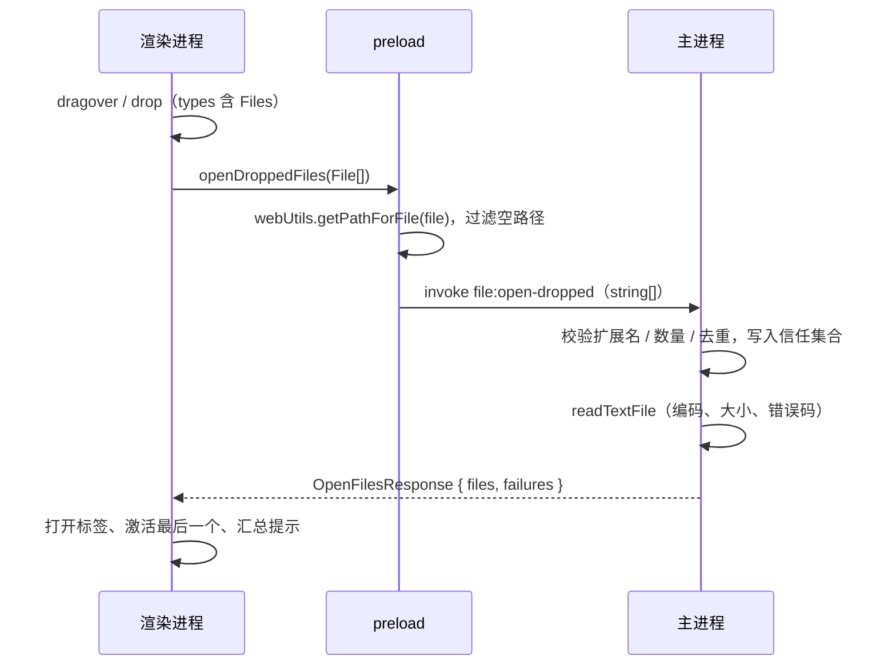

# 最近打开与拖拽打开

> 文档定位：UX-01（最近打开文件）与 UX-02（拖拽打开文件）的设计、数据契约与验收口径。
> 关联文档：[文件与冲突处理](./文件与冲突处理.md)、[会话恢复与窗口状态](./会话恢复与窗口状态.md)、[IPC 接口与进程契约](../架构与契约/IPC接口与进程契约.md)、[渲染安全与内容沙箱](../架构与契约/渲染安全与内容沙箱.md)、[公开发布整改计划](../工程与质量/公开发布整改计划.md)。

## 1. 背景与目标

公开用户第一次打开 MarkIt 时，最常见的行为是「继续上次没写完的文章」或「把一个.md 文件拖进来」。当前版本两条路径都不顺畅：

1. 应用不记忆任何打开历史，每次都要走系统对话框；上次会话的标签页虽然会恢复，但用户在欢迎页想重新打开某个已关闭的历史文件时没有入口。
2. 打开文件只能通过工具栏按钮、右键菜单或命令行，把文件拖进窗口没有任何反应。

本项目标：

- 持久化最近打开的文件，在标题栏「标签总览」下拉中与当前标签并列展示，并支持一键清除；
- 允许把 `.md` / `.markdown` / `.txt` 文件拖入任意编辑窗口打开；
- 两条路径都遵守已有的路径信任模型（SEC-09），不把渲染进程变成任意文件读取通道。

## 2. 范围

**包含**

- 主进程维护的最近打开列表（持久化、上限、去重、缺失标记、清除）
- 标题栏标签总览下拉：当前标签与最近打开文件两组列表（后者排除当前窗口中已打开的文件）
- 文件拖拽落点识别、扩展名过滤、逐文件打开与失败汇总
- 多窗口之间最近打开列表同步

**不包含**

- 「最近打开」进入系统文件管理器 / 系统跳转列表 / macOS Dock 最近文档
- 拖拽标签跨窗口迁移（已有实现，见[标签拖拽排序](./标签拖拽排序.md)）
- 拖拽文件夹批量导入、拖拽图片插入正文

## 3. 最近打开

### 3.1 存储与数据结构

最近打开列表由**主进程**统一维护，写在 `userData/recent-files.json`，与 `session.json`、`window-state.json` 同级。原因是：列表天然跨窗口共享，且只有主进程知道哪些路径是用户真实打开过的。

```json
{
  "version": 1,
  "files": [
    { "path": "D:\\notes\\roadmap.md", "name": "roadmap.md", "openedAt": 1763443200000 }
  ]
}
```

| 字段       | 说明                                                         |
| ---------- | ------------------------------------------------------------ |
| `version`  | 固定 `1`；缺少或不为 1 时整体丢弃，回落空列表                |
| `path`     | 文件绝对路径（原样保存，比较时归一化）                       |
| `name`     | 展示名，取 `basename`；缺失时由路径重建                      |
| `openedAt` | 最近一次打开的毫秒时间戳；缺失或非有限数按 `0` 处理并排后   |

规则：

1. **上限 20 条**，最新的在最前；超出时丢弃最旧的。
2. **去重**按路径归一化比较（Windows 忽略大小写、统一正斜杠），重复打开只更新 `openedAt` 并移到最前。
3. 只接受文档扩展名（`md` / `markdown` / `txt`），其余条目在加载时丢弃，避免损坏的侧车文件变成任意路径清单。
4. 文件缺失**不自动删除**：列表接口会为条目补充 `missing: true`，界面显示为不可用样式；用户仍可清除记录，文件恢复后下次刷新即重新可用（网络盘 / 移动盘临时不可用不会被误删）。

### 3.2 记录时机

只有**用户主动打开成功**或**选择了新保存路径**时才写入列表：

| 入口                                    | 是否记录 | 说明                                                       |
| --------------------------------------- | -------- | ---------------------------------------------------------- |
| 打开对话框（`dialog:openFiles`）        | 是       | 每个读取成功的文件都记录                                   |
| 拖拽打开（`file:open-dropped`）         | 是       | 同上                                                       |
| 命令行 / 二次启动 / macOS `open-file`   | 是       | `openFileAtPath` 读取成功后记录                            |
| 从「最近打开」再次打开（`recent:open`） | 是       | 刷新 `openedAt` 与排序                                     |
| 另存为路径选择（`dialog:savePath`）     | 是       | 用户显式选择的新路径                                       |
| 会话恢复（`session.json`）              | 仅补齐   | 仅当 `recent-files.json` 不存在时，把缺失路径追加到末尾（`openedAt = 0`）；用于升级后首次启动，不覆盖「清除记录」 |
| 普通保存 / 自动保存                     | 否       | 频繁写盘不应反复改写侧车文件；已打开文件本就在列表中       |

写盘使用与 session 相同的原子写（临时文件 + rename）与 300 ms 合并，写失败只记日志，不影响打开操作。

**标签打开时间**是渲染进程的运行期状态：`DocumentTab.openedAt` 在标签创建时写入 `Date.now()`，用于标签总览里的「n 分钟前」。它不写入 `session.json`，会话恢复出的标签按恢复时刻计时；重新打开已在标签中的文件不会刷新该值（仍以标签首次创建为准）。

### 3.3 安全约束

1. **打开最近文件时只接受列表内的路径**：`recent:open` 先按归一化路径在列表内查找，命中后才写入信任集合并调用 `readTextFile`。渲染进程不能借这个接口读取列表外的任意路径。
2. 拖拽路径由 preload 调用 `webUtils.getPathForFile(file)` 得到。渲染进程无法伪造 `File` 对象对应的真实磁盘路径（伪造对象的返回值为空串），因此「拖拽打开」不能作为任意路径读取通道；主进程仍会再次校验扩展名、数量与重复项。
3. 列表接口返回的 `missing` 只是展示信息，不构成信任；真正读取仍走信任集合与大小 / 编码校验。

### 3.4 界面：标题栏标签总览

原工具栏时钟按钮与欢迎页浮层不再使用；最近打开与当前标签统一收进**标题栏标签总览下拉**，入口固定在标签栏最左侧（第一个标签之前），始终可见，不依赖欢迎态。

| 入口       | 位置                     | 行为                                                                                       |
| ---------- | ------------------------ | ------------------------------------------------------------------------------------------ |
| 标签总览   | 标签栏最左侧的列表按钮   | 点击展开下拉弹窗；再次点击、点击外部、Esc、窗口失焦或尺寸变化时关闭                        |

弹窗内容分两组，自上而下：

| 分组           | 数据来源                                                       | 每项内容                                   | 点击行为                                             |
| -------------- | -------------------------------------------------------------- | ------------------------------------------ | ---------------------------------------------------- |
| 当前标签       | `docs.docs`，按标签栏顺序                                      | 标题 + 路径（无路径显示「未保存」）+ 打开时间 | 激活对应标签并关闭弹窗；当前激活项高亮               |
| 最近打开的文件 | `recent.entries` 中排除当前窗口所有 `DocumentTab.path` 后的前 10 条 | 标题 + 所在目录 + 最近打开时间            | 调用 `recent:open` 打开；该项随即从本组移入「当前标签」 |

规则：

1. 「最近打开的文件」只排除**当前窗口**已打开的路径；文件在其他窗口打开时仍会列出，点击后由主进程聚焦对应窗口。路径比较沿用归一化规则（Windows 忽略大小写、统一正斜杠）。
2. 当前标签组中，输入过内容但未保存的标签标注「未保存」蓝色圆点；磁盘文件缺失的标签显示「文件不存在」，仍可点击激活。
3. 第二组中缺失文件显示为禁用样式并标注「文件不存在」，点击不触发读取。
4. 主进程最近列表非空时，「最近打开的文件」组标题右侧提供「清除记录」（即使该组因全部已打开而为空）；它只清空主进程的最近列表，不影响已打开的标签；立即生效并持久化，不做二次确认。
5. 两组均为空时显示各自的空状态文案；「当前标签」在编辑窗口中至少有欢迎页或手册标签，实际不会为空。
6. 时间文案：小于 1 分钟为「刚刚」，之后依次为「n 分钟前」「n 小时前」「n 天前」；超过 7 天显示具体日期；`openedAt = 0`（登录后由会话补齐的历史项）显示「较早」。打开弹窗期间每 30 秒刷新一次相对时间。
7. 列表变化通过 `recent:changed` 广播到全部编辑窗口，各窗口的 Pinia `recent` store 重新拉取；弹窗打开时直接反映最新数据。

## 4. 拖拽打开

### 4.1 交互

1. 拖入系统文件（`DataTransfer.types` 包含 `Files`）时，窗口显示「松开以打开文件」覆盖层；离开窗口或放下后消失。
2. 放下后只保留扩展名合法的文件，最多 20 个；同一路径只打开一次。
3. 每个文件按「打开对话框」相同的路径处理：已在其他窗口打开的文件切到那个窗口；其余在本窗口开标签，最后一个成为激活标签。
4. 读取失败与打开对话框一致，汇总弹出失败原因；非 UTF-8 / 大文件提示沿用现有 `notices`。
5. 拖入非文档文件（如 `.png`、文件夹）时静默忽略；一次拖拽中没有任何合法文档时不产生任何窗口变化。

内部标签拖拽使用 Pointer Events，不产生 `DataTransfer`，因此与文件拖拽互不干扰。

### 4.2 进程边界



## 5. IPC 契约

| 通道名               | 方向       | preload 方法                        | 参数                     | 返回值                       | 说明                                                                                     |
| -------------------- | ---------- | ----------------------------------- | ------------------------ | ---------------------------- | ---------------------------------------------------------------------------------------- |
| `recent:list`        | R→M invoke | `recent.list()`                     | 无                       | `Promise<RecentFileEntry[]>` | 补充 `missing`；编辑窗口可调用                                                            |
| `recent:open`        | R→M invoke | `recent.open(path)`                 | `path: string`           | `Promise<RecentOpenResult>`  | 仅列表内路径；`status` 为 `opened` / `focused`（已在其他窗口打开）/ `failed`              |
| `recent:clear`       | R→M invoke | `recent.clear()`                    | 无                       | `Promise<boolean>`           | 清空并持久化                                                                             |
| `file:open-dropped`  | R→M invoke | `openDroppedFiles(files: File[])`   | `paths: string[]`        | `Promise<OpenFilesResponse>` | preload 负责 `File → path` 转换；主进程再次校验                                          |
| `recent:changed`     | M→R send   | `recent.onChanged(cb)`              | 无                       | 取消函数                     | 列表变化后广播给全部编辑窗口                                                             |

共享类型集中在 `src/shared/recent-types.ts`（纯类型）：

```ts
export interface RecentFileEntry {
  path: string
  name: string
  openedAt: number
  missing: boolean
}

export type RecentOpenResult =
  | { status: 'opened'; file: FileReadResult }
  | { status: 'focused' }
  | { status: 'failed'; path: string; error: FileIoError }
```

## 6. 验收与手工验证

| 编号  | 场景                                   | 预期                                                                 |
| ----- | -------------------------------------- | -------------------------------------------------------------------- |
| MV-80 | 打开 3 个文件后重启                   | 标签总览「当前标签」按标签栏顺序列出 3 条并显示相对打开时间；「最近打开的文件」不重复列出这 3 个 |
| MV-81 | 关闭其中一个标签后打开标签总览         | 该文件从「当前标签」消失并出现在「最近打开的文件」；点击重新打开后回到当前标签组，不新建重复标签 |
| MV-82 | 删除其中一个磁盘文件后打开应用         | 当前标签显示「文件不存在」；关闭后在最近组为禁用样式；清除记录后消失 |
| MV-83 | 在窗口 A 打开文件                      | 窗口 B 的标签总览「最近打开的文件」同步出现该文件（B 未打开时）      |
| MV-84 | 把 2 个 `.md` 拖入窗口                 | 依次打开两个标签，最后一个是激活标签；无多余空白标签                 |
| MV-85 | 拖入 `.png` / 文件夹                   | 无任何变化，不弹错误                                                 |
| MV-86 | 拖入非 UTF-8 文件                      | 只读打开并显示编码提示                                               |
| MV-87 | 拖拽标签跨窗口后，再拖文件进窗口       | 两条路径互不干扰，标签迁移行为不变                                   |

自动化：`npm test` 覆盖最近列表的解析 / 去重 / 上限、相对时间格式化与拖拽路径过滤；`e2e/recent-autosave.spec.ts` 覆盖标签总览的两组展示、已打开标签的排除与清除后重启；真实拖拽（MV-84 ~ MV-87）按 [测试与质量保障](../工程与质量/测试与质量保障.md) 手工验证。
