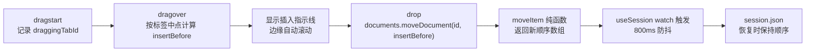

# 标签拖拽排序

> 文档定位：描述标签页拖拽调整顺序的交互规则、数据流、边界情况与测试要求。
> 本文描述**窗口内排序**；拖出标签创建新窗口已经实现，其迁移握手、失败回滚与源标签删除规则见[多窗口架构](./多窗口架构.md)。

## 1. 目标与范围

### 1.1 目标

- 用户可以按住标签页左右拖动，调整标签在标签条中的顺序。
- 调整后的顺序随会话保存，下次启动时恢复。
- 排序只改变标签数组顺序，不改变文档内容、光标、撤销历史、布局模式或滚动位置。
- 不打断当前编辑：被拖拽的标签保持原来的激活状态，其他标签状态不变。

### 1.2 不在本阶段范围

- 将标签拖到另一个已存在的 MarkIt 窗口：迁入该窗口并通过目标窗口确认后删除源标签。
- 拖到所有编辑窗口之外：创建新窗口。
- 拖动经过另一个编辑窗口时，目标窗口显示高亮与“松开移动”提示；提示由主进程轮询系统光标广播，覆盖层不接收鼠标事件。
- 标题栏下缘设有 28px 纵向吸附区；鼠标仅轻微下移时仍按标签条排序，ghost 吸附在标题栏，拖出吸附区后才进入跨窗口/新建窗口模式，防止排序误操作变成新建窗口。
- 标签分组、固定标签、标签栏溢出菜单等扩展能力。

## 2. 交互规则

| 操作                            | 结果                                 |
| ------------------------------- | ------------------------------------ |
| 在标签条内拖动并释放            | 按插入指示线调整顺序                 |
| 拖动后释放到标签条之外          | 不改变顺序，标签回到原位             |
| 拖动到标签自身位置或相邻间隙    | 视为无变化，不显示插入指示线         |
| 拖动到标签条左右边缘            | 自动横向滚动，便于移动到被遮挡的标签 |
| 在关闭按钮 / 新建按钮上按下拖动 | 不启动标签拖拽                       |
| 拖拽结束后立即点击标签          | 本次点击被抑制，避免误激活           |
| 拖动非激活标签                  | 不切换激活标签；原激活标签保持不变   |
| 拖动激活标签                    | 仍保持激活，顺序变化后滚动到可见区域 |

补充约定：

- 插入位置按标签矩形的**水平中点**判断：指针位于某个标签中点左侧则插入到它之前，否则继续向后判断。
- 插入指示线只在“移动后顺序确实会变化”的间隙显示，避免拖动到原位时出现误导。
- 标签顺序变化后，`Ctrl + Tab` / `Ctrl + Shift + Tab` 的循环顺序、`Ctrl + 1` ~ `Ctrl + 9` 的直达顺序都以新顺序为准。
- 标签条横向溢出时，拖拽靠近左右边缘会自动滚动；滚动过程中插入位置会重新计算。

## 3. 实现

### 3.1 数据流



### 3.2 纯函数

新增 [`src/renderer/src/utils/tab-order.ts`](../../src/renderer/src/utils/tab-order.ts)，提供两个无副作用函数：

- `moveItem(items, fromIndex, insertBefore)`：把 `fromIndex` 的元素移动到移动前数组的 `insertBefore` 间隙；`insertBefore` 取值 `0..items.length`，函数内部会把下标夹取到合法范围，并处理“移除源元素后目标间隙前移一位”的情况。
- `findInsertBefore(rects, pointerX, draggingIndex)`：按标签矩形中点返回插入间隙；被拖拽标签自身不参与中点比较，指针落在其区域时返回不会改变顺序的间隙。

两个函数都有同目录的 `tab-order.spec.ts` 覆盖前移、后移、末尾、原地、越界、空数组、不可变性和拖拽自身区域等分支。

### 3.3 store

[`src/renderer/src/stores/documents.ts`](../../src/renderer/src/stores/documents.ts) 增加：

```ts
function moveDocument(id: string, insertBefore: number): void
```

实现要点：

- 通过 `id` 查找当前下标，避免使用拖拽开始时的旧下标。
- 调用 `moveItem` 得到新数组；如果顺序没有变化则不重新赋值，避免触发无意义的会话保存。
- 不修改 `activeId`，不清理 `EditorState`、滚动位置或预览滚动位置缓存。
- 不修改任何文档内容字段，`isModified` 保持原值。

### 3.4 组件

[`src/renderer/src/components/layout/TabBar.vue`](../../src/renderer/src/components/layout/TabBar.vue) 使用 `pointerdown` + pointer capture，避免 HTML5 拖放离开窗口后由系统显示禁止光标：

- 每个 `.tab` 在 `pointerdown` 时记录指针与标签 id；移动超过 5px 后进入拖拽，并通过 `window.api.startTabDrag(name, theme)` 通知主进程。
- 源窗口内由 `pointermove` 更新插入位置；指针靠近标签条左右边缘时用 `requestAnimationFrame` 持续滚动。
- 拖拽中的每次 `pointermove` 还会发送无载荷的 `window.api.notifyTabDragMove()`，由主进程读取系统光标并移动悬浮提示；事件断流超过 50ms 时，主进程的 16ms 兜底定时器接管，避免提示窗僵在原位。
- 插入间隙通过 `drop-before` / `drop-after` 伪元素绘制 2px 指示线，源标签同时降低透明度。
- 悬浮提示由主进程的透明置顶小窗口绘制，包含文件图标与标签标题；窗口在 `ready-to-show` 后才显示，位置未变化时跳过移动，不会在拖出源窗口后被裁切，也不会在拖拽开始时闪现空白帧。
- `pointerup` / `pointercancel` 时先 `window.api.endTabDrag()` 销毁悬浮提示，再执行排序、迁入已有窗口或创建新窗口。
- 拖拽结束后用时间戳抑制紧随其后的 `click`，避免拖拽被误判为激活标签。
- 从关闭按钮起手时不进入拖拽，避免误移动标签。

### 3.5 顺序持久化

[`src/renderer/src/composables/useSession.ts`](../../src/renderer/src/composables/useSession.ts) 已经监听 `docs.docs.map(...)` 投影，数组顺序变化会触发 800ms 防抖保存；无需新增持久化字段。恢复时 `restoreSession` 按会话中的 `tabs` 数组顺序重建标签，因此顺序自然恢复。

## 4. 边界与兼容

| 场景                        | 行为                                                      |
| --------------------------- | --------------------------------------------------------- |
| 只有一个标签                | 拖拽不会改变顺序，不显示指示线                            |
| 标签条未溢出                | 自动滚动逻辑不生效                                        |
| 标签条已溢出                | 拖到边缘持续滚动，插入位置随滚动更新                      |
| 拖拽期间打开文件 / 关闭标签 | 通过 `id` 重新查找下标；找不到时按无变化处理              |
| 拖拽期间会话防抖保存        | 只在 `drop` 后改变数组顺序，拖拽过程不写入会话            |
| 浅色主题                    | 指示线使用蓝色，与深色主题共用同一几何样式                |
| 外部文件拖入标签条          | 不满足 `draggingTabId` 条件，忽略，不阻止窗口原有导航防护 |

## 5. 测试

### 5.1 单元测试

`tab-order.spec.ts` 覆盖：

- 向前移动、向后移动、移动到末尾；
- 目标间隙与源位置相同或相邻时保持原顺序；
- 源下标非法、目标间隙越界、空数组；
- 不修改原数组；
- `findInsertBefore` 的指针位于最前、相邻中点、末尾、被拖拽标签自身区域和其左侧的情况。

### 5.2 手工验证

- 打开 3 个以上文件，拖动第一个到最后一个之后，确认顺序变化且激活标签不变。
- 拖动激活标签，确认顺序变化后仍为激活状态，并自动滚到可见区域。
- 拖动标签到标签条外释放，确认顺序不变。
- 标签条溢出时拖到左右边缘，确认自动滚动并能插入到被遮挡位置。
- 排序后重启应用，确认顺序恢复。
- 浅色 / 深色主题下检查插入指示线可见。

### 5.3 e2e

在 [`e2e/app.spec.ts`](../../e2e/app.spec.ts) 中增加标签拖拽排序用例：启动两个文件，拖动第一个标签到第二个标签之后，确认 DOM 顺序变化；等待会话防抖写入后重启，确认顺序仍保持。e2e 依赖 `npm run build` 产物，产物不存在时按现有约定跳过。
