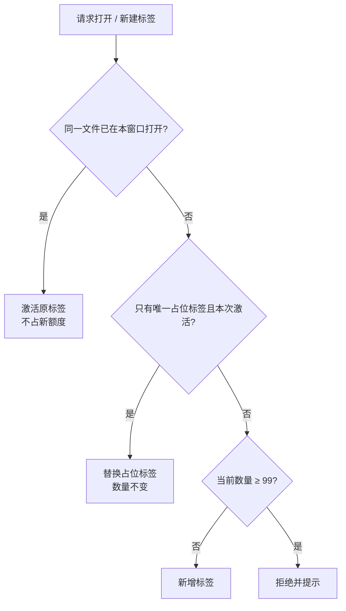

# 标签页展示与数量上限

> 文档定位：标签栏的视觉规则（图标、宽度压缩、icon-only、悬停关闭）与单窗口标签数量上限（99 个）的设计、契约与验收口径。
> 关联文档：[标签拖拽排序](./标签拖拽排序.md)、[多窗口架构](./多窗口架构.md)、[会话恢复与窗口状态](./会话恢复与窗口状态.md)、[最近打开与拖拽打开](./最近打开与拖拽打开.md)、[状态与数据模型](../架构与契约/状态与数据模型.md)。

## 1. 背景与目标

标签栏此前是固定的 100–200 px 宽度，带文件名与关闭按钮；标签较多时只能横向滚动，既看不到有多少标签，也难以快速识别内容。同时没有任何数量约束，命令行 / 拖拽批量打开可能把窗口塞入过多标签，拖慢会话保存与启动恢复。

本次目标：

- 每个标签带固定图标，Markdown 文件用文件名首字符作为图标，一眼区分标签；
- 标签默认等宽，数量增加时同步压缩；压到只能容纳图标时进入纯图标模式并横向滚动；
- 纯图标模式下悬停激活标签用关闭按钮替换图标，保留关闭入口；未激活标签悬停仍显示图标，点击即切换到该标签；
- 单窗口最多同时打开 99 个标签，超限不再新建标签，并用一次性弹窗说明。

## 2. 展示规则

### 2.1 标签图标

| 标签类型                                | 图标                                         |
| --------------------------------------- | -------------------------------------------- |
| 有路径的文档                            | 文件名去掉扩展名后的第一个有效字符           |
| 自动命名的空白文档（`untitled.md` 等）  | 通用文档图标                                 |
| 其它无路径标签（如内置使用手册）        | 文件名第一个有效字符                         |

首字符规则由纯函数 [`tabIconLetter`](../../src/renderer/src/utils/tab-icon.ts) 提供：

1. 去掉最后一个扩展名（`设计文档.md` → `设计文档`）；以点开头的隐藏文件名保留点后的内容；
2. 按 Unicode 字素（`Intl.Segmenter`）取第一个非空白、非标点的字符，支持中文与组合 emoji；
3. 拉丁字母转为大写；
4. 没有可用字符时回退为 `?`。

自动命名的空白文档判定由 `isUntitledName` 提供：文件名匹配 `untitled.md` / `untitled-N.md`（不区分大小写）。这类标签数量可控（`newFile` 会复用未修改的空白标签），使用统一文档图标避免多个「U」难以区分。

图标常显，位于标签名称左侧；纯图标模式下居中展示。

### 2.2 宽度阶梯与压缩

标签栏宽度分为三个阶段：

| 阶段       | 触发条件                                   | 表现                                         |
| ---------- | ------------------------------------------ | -------------------------------------------- |
| 舒适宽度   | 可用空间充足                               | 每个标签等宽，最大 200 px，显示图标 + 名称   |
| 等比压缩   | 标签总宽超过可用空间                       | 所有标签同步收缩（等宽），名称先省略号截断   |
| 纯图标模式 | 标签宽度 ≤ 72 px（内容区 ≤ 60 px）         | 隐藏名称、只展示图标；标签最小宽度 46 px     |
| 横向滚动   | 可用空间不足以容纳全部标签的最小宽度       | 标签条横向滚动，激活标签自动滚入可视区       |

实现要点：

- 标签使用相同的 `flex-basis` 与 `flex-shrink`，保证压缩时严格等宽；最小宽度 46 px 是「图标 + 左右内边距」的下限；
- 标签栏收缩到最小宽度后溢出，由标签条自身滚动承担；滚轮纵向滚动翻动标签条的既有交互保留；
- 「新建」按钮位于滚动区之外，不随标签滚动消失；拖拽吸附区与自动滚动逻辑覆盖整个标签条（含新建按钮）。

### 2.3 纯图标模式与悬停关闭

纯图标模式下，标签只显示图标。悬停行为参考 Chrome，按是否激活区分：

| 标签状态   | 悬停表现                                       | 点击结果               |
| ---------- | ---------------------------------------------- | ---------------------- |
| 激活标签   | 图标淡出、同一位置显示关闭按钮，移出后恢复图标 | 关闭按钮关闭该标签     |
| 未激活标签 | 保持显示图标，不显示关闭按钮                   | 切换到该标签           |

未激活标签不显示关闭按钮，是因为纯图标模式下关闭按钮正好覆盖在图标中央，悬停即出现会让「点击图标切换标签」与「点击关闭」共用同一落点，切换时极易误关。需要关闭未激活标签时，可先切换过去，或用中键 / 右键菜单关闭。

隐藏状态的关闭按钮不接收指针事件（`pointer-events: none`），保证未激活标签的图标区域点击始终命中切换；显示后才可点击。键盘聚焦（`:focus-visible`）时仍会显示并可用关闭按钮，不牺牲可访问性。

宽标签模式下仍是「悬停标签即显示关闭按钮」，激活标签不常显关闭按钮。关闭按钮的点击、拖拽排除、中键关闭等既有行为不变。

### 2.4 状态角标

未保存修改与文件缺失不再占用标签内的横向空间，统一叠加在图标上：

| 状态       | 位置           | 颜色 / 文案                        |
| ---------- | -------------- | ---------------------------------- |
| 未保存修改 | 图标右下角圆点 | 品牌蓝，`tabs.unsaved` 提示        |
| 文件缺失   | 图标右上角 `!` | 琥珀色，`tabs.missing` 提示        |

两种角标同时存在时互不遮挡；纯图标模式下角标同样可见。

## 3. 数量上限

### 3.1 上限口径

- 单窗口最多同时打开 **99 个标签**，固定值，不提供设置项、不写入 `localStorage`；
- 上限按编辑窗口独立计算：每个编辑窗口有自己的 `documents` store，互不影响；
- 上限不写入会话，也不进入 `session.json`。

### 3.2 判定顺序

新增标签前必须按以下顺序判断，顺序错误会产生误报：

1. **已打开文件优先复用**：激活原标签，不新建，也不受上限影响；
2. **占位标签替换**：仅一个未修改的空白标签时，打开文件直接替换它，数量不变；
3. **其余情况才校验上限**：达到 99 个后拒绝新增。

### 3.3 各入口行为

| 入口                                   | 达到上限时                                                   |
| -------------------------------------- | ------------------------------------------------------------ |
| 新建标签（`Ctrl+N`）                   | 不新建，弹窗提示                                             |
| 打开对话框 / 拖拽文件 / 最近打开       | 可打开的文件照常打开；被拒绝的文件计数后汇总弹窗一次         |
| 命令行 / 右键「用 MarkIt 打开」        | 不打开，弹窗提示                                             |
| 预览区 Ctrl + 单击本地文档链接         | 不打开（后台标签语义），弹窗提示                             |
| 内置使用手册（工具栏入口）             | 已有手册标签时直接激活；需要新建且已满时弹窗提示             |
| 另一窗口迁入标签（右键 / 拖拽）        | 目标窗口拒绝迁移并保留源标签，目标窗口弹窗提示               |
| 创建新编辑窗口                         | 新窗口只有迁移或初始标签，不受源窗口数量影响                 |
| 会话恢复                               | 按上限截断，恢复前 99 个并弹窗提示一次（仅当会话超出）       |

补充规则：

- 会话文件可被旧版本或手工修改写入超过 99 个标签，恢复时截断而不能假设合法；
- 上限调低不存在（固定 99），因此不存在「已超过上限后如何处理存量」的问题；会话截断是唯一裁减场景；
- 迁移失败按[多窗口架构](./多窗口架构.md) 7.2 的失败规则处理，源标签在目标确认前不删除。

### 3.4 超限提示

统一使用一个信息弹窗（沿用文件失败提示的对话框），不逐个文件弹出：

| 场景             | 文案要点                                             |
| ---------------- | ---------------------------------------------------- |
| 单个操作被拒绝   | 「当前窗口最多同时打开 99 个标签页」                 |
| 批量打开部分拒绝 | 「本次有 N 个文件未打开」                            |
| 跨窗口迁移被拒   | 「目标窗口标签页已达上限，标签未移动」               |
| 会话恢复截断     | 「会话包含 N 个标签页，已恢复前 99 个」              |

## 4. 数据模型与契约

| 项                          | 位置                                         | 说明                                                     |
| --------------------------- | -------------------------------------------- | -------------------------------------------------------- |
| `MAX_TABS_PER_WINDOW`       | `src/renderer/src/utils/tab-limit.ts`        | 固定常量 `99`，不持久化                                  |
| `remainingTabSlots(count)`  | 同上                                         | 纯函数，返回 `max(0, 99 - count)`，用于判定与测试        |
| `addDocument` / `openPathDocument` / `newDocument` / `insertSessionTab` | `stores/documents.ts` | 达到上限返回 `null`；调用方必须处理                      |
| `restoreSession`            | `stores/documents.ts`                        | 返回 `{ restored, trimmed, total }`，用于截断提示        |

约束：

1. 上限判断只在 `documents` store 内实现一次，`useFile` 等调用方不重复实现计数逻辑，避免入口新增时漏判；
2. 被拒绝的打开操作不得留下半成品标签、不得激活不存在的标签；
3. 上限与展示规则均为运行期行为，不新增 `localStorage` 键、不改变 `session.json` 结构；
4. 图标与上限判断均为纯函数，放在 `utils/` 并配 `*.spec.ts`。

## 5. 边界与兼容

- 标签数量上限与拖拽排序、右键菜单批量关闭、标签总览、`Ctrl+1`~`Ctrl+9` 互不冲突；
- 批量关闭标签后释放额度，可立即继续打开；
- 标签宽度压缩只改变布局，不影响拖拽插入位置计算（按实际 DOM 矩形计算）；
- 设置窗口不提供上限配置；修改上限必须改代码并更新本文档；
- 纯图标模式依赖容器查询（Chromium 142 已支持），不引入 JS 尺寸测量。

## 6. 测试与验收

自动化：

- `utils/tab-icon.spec.ts`：中文、拉丁字母大写、组合 emoji、隐藏文件、无扩展名、空名称、`untitled` 判定；
- `utils/tab-limit.spec.ts`：0 / 98 / 99 / 100 的额度边界；
- `npm run lint`、`npm run typecheck`、`npm test` 全量通过（涉及 `utils/**`）。

手工 / e2e：

| 场景                             | 验证要点                                                     |
| -------------------------------- | ------------------------------------------------------------ |
| 1 / 3 / 5 个标签                 | 等宽、不超过 200 px、图标与名称正常                          |
| 逐步打开到超出可用宽度           | 标签同步变窄、名称截断；≤72 px 时只剩图标                    |
| 继续打开到最小宽度               | 标签条横向滚动，激活标签自动滚入；滚轮可翻动                 |
| 纯图标模式悬停                   | 激活标签悬停时图标被关闭按钮替换，移出恢复；未激活标签悬停仍是图标，点击切换不误关 |
| 未保存 / 文件缺失                | 图标角标可见，提示文案正确                                   |
| 打开到第 99 个标签               | 成功打开；再打开/新建时弹窗提示，数量保持 99                 |
| 一次拖入大量文件                 | 接受至 99 个，其余汇总提示一次                               |
| 迁移标签到已满窗口               | 目标窗口拒绝并提示，源标签保留                               |
| 会话包含超过 99 个标签           | 恢复前 99 个，弹窗提示一次                                   |
