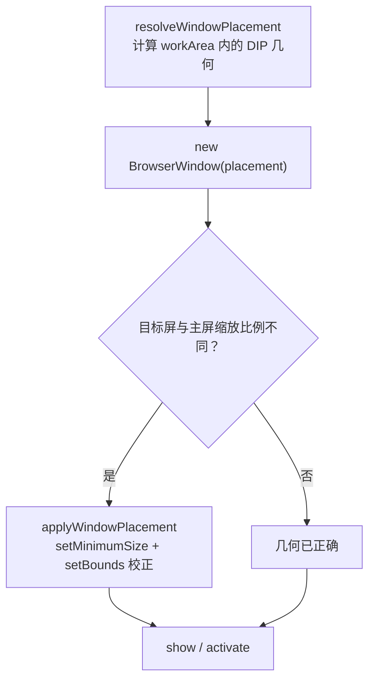
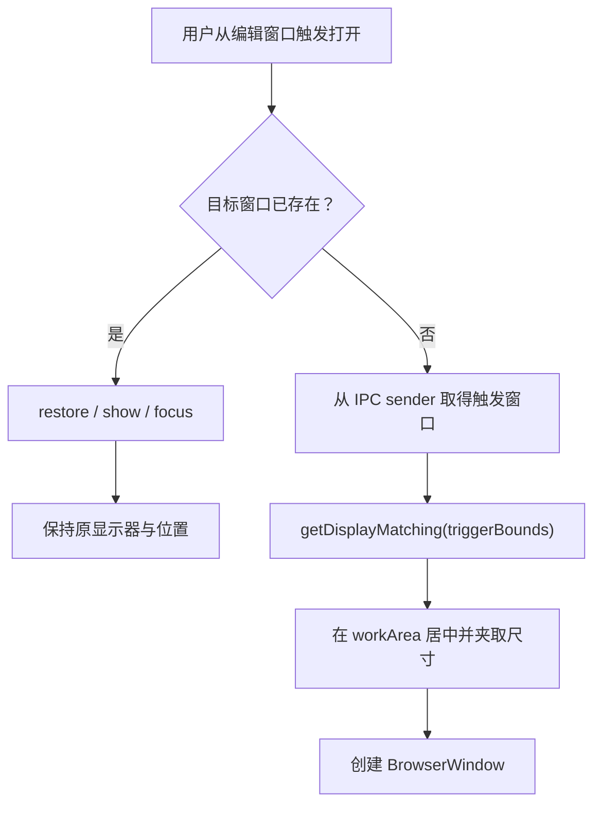

# 窗口放置与单实例规则

> **规则状态：已实施。** 本文定义 MarkIt 所有用户可见 `BrowserWindow` 的显示器归属、重复打开与激活规则。编辑窗口、设置窗口与更新详情窗口已在 2026-11-11 按本规则完成修正。
>
> 本文是新增窗口的强制设计检查项。任何新增独立窗口、导出选项窗口、预览窗口或工具窗口，都必须先说明其窗口作用域与放置来源，再进入实现。

## 1. 核心规则

### 1.1 触发窗口

“触发窗口”是用户执行打开动作时所在的窗口：

1. 由 IPC 发起时，优先使用 `BrowserWindow.fromWebContents(event.sender)`；编辑窗口也可通过发送方对应的窗口上下文取得。
2. 由鼠标拖拽创建窗口时，使用光标释放点所在显示器。
3. 由外部文件关联、命令行或系统事件发起、且没有明确窗口时，退回到最后聚焦的编辑窗口；仍不存在时使用主显示器。
4. 不使用 `BrowserWindow.getFocusedWindow()` 代替明确的 IPC 发送方，避免焦点切换竞态把窗口放到错误显示器。

### 1.2 创建规则

当目标窗口尚未创建时：

1. 使用 `screen.getDisplayMatching(triggerWindow.getBounds())` 确定触发窗口所在显示器。
2. 在该显示器 `workArea` 内居中放置新窗口，不能只设置 `center: true` 而省略 `x` / `y`。
3. 宽高与最小尺寸必须夹取到 `workArea` 内，避免小屏或缩放比例下越界。
4. 工具窗口的临时位置不写入全局持久化状态；关闭后再次打开必须按本次触发窗口重新计算。
5. **混合缩放校正**：当触发显示器与主显示器的 `scaleFactor` 不同时，Electron 会按主屏比例二次换算 `BrowserWindow` 构造参数中的宽高，窗口实际尺寸被成倍放大（可能超过整块屏幕）。因此窗口创建后必须调用 `applyWindowPlacement()`，用目标显示器的 DIP 几何再执行一次 `setMinimumSize()` + `setBounds()`；只在构造函数里传 `width` / `height` / `x` / `y` 不足以保证尺寸正确。

### 1.3 已存在窗口规则

当同一作用域的目标窗口已经打开时：

1. 不创建第二个窗口。
2. 最小化时先 `restore()`，然后 `show()`、`focus()`。
3. 不把已有窗口移动到本次触发窗口所在显示器。
4. 不因重复触发而改变窗口尺寸、位置、最大化状态或当前页面状态。

已有窗口“只激活、不迁移”是有意设计：同一个全局工具窗口在不同编辑窗口之间共享状态，重复打开表示切换焦点，不表示把窗口搬到另一块屏幕。

### 1.4 不使用父子窗口模拟

除确需系统模态语义外，不使用 `parent` 或 `modal` 实现显示器归属：

- 父子关系会改变最小化、关闭、层级和焦点生命周期。
- 设置窗口、更新窗口等全局工具窗口不得绑定到某一个编辑窗口。
- 显示器归属只是创建时的几何计算，不是生命周期绑定。

## 2. 窗口分类

| 窗口类型 | 示例 | 实例作用域 | 放置规则 | 重复打开 |
| --- | --- | --- | --- | --- |
| 编辑窗口 | 主编辑器、新建编辑窗口 | 可多实例 | 跟随触发编辑窗口所在显示器；拖拽创建时跟随光标 | 每次动作创建所需编辑窗口 |
| 全局工具窗口 | 设置、更新详情 | 全局单实例 | 首次创建跟随触发窗口显示器 | 恢复并聚焦已有窗口，不移动 |
| 页内对话框 | PDF 导出选项、确认框、搜索 HUD | 随宿主页面 | 天然位于当前编辑窗口，不单独计算显示器 | 由页面状态控制，不创建 `BrowserWindow` |
| 文档级预览/选项窗口 | 未来可能的图片导出选项窗口 | 待设计 | 若独立创建，首次跟随触发编辑窗口显示器 | 是否单实例必须按文档或编辑器作用域明确 |
| 系统对话框 | 打开、保存、错误提示 | 由系统管理 | 必须传入发起请求的父窗口 | 由系统行为处理 |
| 拖拽悬浮窗口 | 标签拖拽 ghost | 运行期临时 | 跟随鼠标所在显示器 | 不适用 |
| 隐藏渲染窗口 | PDF `printToPDF`、图片截图 | 任务级临时 | 不面向用户，不参与显示器归属规则 | 每个任务独立创建并销毁 |

判断标准是“用户是否能看到并操作该窗口”。隐藏渲染窗口和页面内元素不因使用 `BrowserWindow` 或 `Teleport` 而自动获得全局工具窗口语义。

## 3. 导出相关窗口

导出能力可能同时包含选项界面、保存对话框和隐藏渲染窗口，三者必须分开设计。

### 3.1 当前 PDF 导出

`PdfExportDialog.vue` 使用页面内 `Teleport` 覆盖层，不是独立 `BrowserWindow`：

- 它天然显示在发起导出的编辑窗口内。
- 不创建全局单例，也不参与跨显示器窗口放置。
- 后续若改为独立导出选项窗口，必须完整适用本文第 1、2 节规则。

PDF 打印使用隐藏 `BrowserWindow`，用户不可见，不要求跟随显示器；其临时窗口仍必须在 `finally` 中销毁。

### 3.2 当前图片导出与后续扩展

当前图片导出从工具栏直接进入系统保存对话框，没有独立选项窗口：

- 保存对话框必须继续以发起导出的编辑窗口作为父窗口。
- 隐藏截图窗口不进入窗口放置规则。
- 若后续增加图片宽度、倍率、格式、主题等选项，优先使用当前编辑窗口内的页内对话框；该形态不需要额外显示器逻辑。
- 若后续将图片导出选项、导出预览或进度详情做成独立 `BrowserWindow`，首次创建必须跟随触发编辑窗口所在显示器。
- 独立导出窗口若声明为全局单实例，重复打开必须只激活已有窗口；若声明为每个编辑窗口或每个文档各一个，必须在对应功能文档中明确唯一键和关闭后的回收规则。

### 3.3 新增窗口前的必答项

新增导出或其他功能窗口时，设计稿必须回答：

1. 这是页内对话框、系统对话框、独立工具窗口，还是隐藏任务窗口？
2. 窗口作用域是全局单例、每个编辑窗口单例、每个文档单例，还是允许无限多实例？
3. 首次打开从哪里取得触发窗口或光标锚点？
4. 已存在时是激活已有窗口，还是允许再开一个？理由是什么？
5. 已有窗口被从另一显示器触发时，是否保持原位置？
6. 窗口关闭后是否保存位置？若保存，是否会破坏“下次跟随最新触发窗口”的规则？

## 4. 当前实现状态

| 场景 | 当前状态 | 目标 |
| --- | --- | --- |
| 从编辑窗口新建编辑窗口 | 已按源窗口显示器计算位置 | 保持 |
| 标签拖拽创建编辑窗口 | 已按光标所在显示器计算位置 | 保持 |
| 从编辑窗口打开设置窗口 | 首次跟随触发窗口显示器；已有窗口只聚焦、不移动 | 保持 |
| 从编辑窗口打开更新详情窗口 | 首次跟随触发窗口显示器；已有窗口只聚焦、不移动 | 保持 |
| 混合缩放显示器下的用户可见窗口尺寸 | 编辑窗口、设置窗口与更新窗口创建后统一执行 `applyWindowPlacement()` 校正，尺寸不再被二次放大 | 保持 |
| PDF 导出选项 | 页内对话框，随当前编辑窗口显示 | 保持；若独立化则适用本规则 |
| 图片导出 | 直接打开保存对话框，无独立选项窗口 | 保持父窗口；后续独立窗口适用本规则 |
| PDF / 图片隐藏渲染窗口 | 不面向用户，结束即销毁 | 保持 |

## 5. 推荐实现接缝

后续代码实现应集中处理，而不是在每处重复编写显示器判断：

1. 在主进程提供统一的窗口定位工具，输入触发 `BrowserWindow` 与目标尺寸，输出经过 `workArea` 夹取的 `x` / `y` / `width` / `height`。
2. 设置窗口与更新窗口的 `open...Window()` 接收可空的触发窗口参数。
3. IPC 处理函数从 `event.sender` 取得触发窗口并传入；不在渲染进程传递屏幕坐标。
4. 单实例窗口使用同一“已有则恢复并聚焦”函数，避免不同窗口出现细微行为差异。
5. 新增独立窗口时必须复用统一工具，并避免无 `x` / `y` 的 `center: true` 用法。
6. 窗口创建后立即调用 `applyWindowPlacement()` 应用几何；不要只在构造函数里传尺寸，混合缩放显示器下会失效。

## 6. 验证要求

### 6.1 自动化

窗口几何纯函数必须有单元测试，至少覆盖：

- 副显示器坐标为正数和负数时的居中计算。
- 工作区小于窗口目标尺寸时的夹取。
- 多显示器边界重叠时的可预测结果。

E2E 在检测到至少两块显示器时增加实际窗口断言；单显示器环境允许跳过，但不能删除手工验证要求。

### 6.2 双显示器手工验证

1. 编辑窗口只在副屏时打开设置窗口，设置窗口必须出现在副屏。
2. 两块显示器缩放比例不同（如 100% + 200%）时，设置窗口的实际尺寸必须保持在 1040×720 的 DIP 目标内，不得放大到超过副屏工作区。
3. 关闭设置窗口，把编辑窗口移到主屏后再次打开，设置窗口必须出现在主屏。
4. 设置窗口已打开时，从另一显示器触发打开：窗口数量不变，已有窗口被激活且不移动。
5. 更新详情窗口重复第 1～4 步，行为必须一致。
6. 从副屏按 `Ctrl/Cmd+Shift+N` 新建编辑窗口，新窗口必须出现在副屏。
7. 拖拽标签到副屏空白区域释放，新窗口必须出现在光标附近。
8. 后续图片导出若新增独立选项窗口，重复第 1～4 步。
9. 新增任何独立窗口时，将本清单作为功能验收的一部分。
