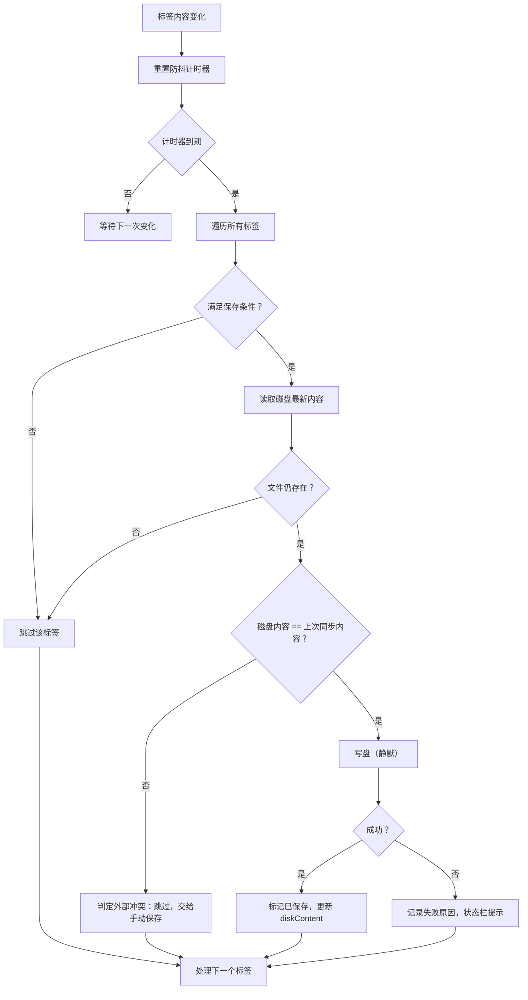

# 自动保存与草稿恢复

> 文档定位：UX-03（自动保存 / 草稿恢复）的设计、状态机、冲突处理与验收口径。
> 关联文档：[会话恢复与窗口状态](./会话恢复与窗口状态.md)、[文件与冲突处理](./文件与冲突处理.md)、[状态与数据模型](../架构与契约/状态与数据模型.md)、[公开发布整改计划](../工程与质量/公开发布整改计划.md)。

## 1. 背景与现状

MarkIt 在退出应用、安装更新以及窗口关闭时会确认并保存文档；运行期间只有用户按 `Ctrl+S` 才写盘。一旦应用崩溃、系统断电或误触关闭，磁盘上的文件可能落后几分钟的输入。

草稿恢复目前已经存在：`useSession` 在标签内容 / 激活项变化后以 800 ms 防抖把**全部标签内容**（含未保存的未命名文档）写入 `userData/session.json`，主进程再以 300 ms 合并原子写盘。重启后按磁盘优先、会话兜底恢复标签与未保存内容。因此崩溃最多丢失约 1 秒内的输入。

本项新增的是**可选自动保存**：在用户停止输入一段时间后主动写盘，让「磁盘文件」本身保持最新，而不是只在下次启动时看到草稿。

## 2. 范围

**包含**

- 设置页「编辑器」中的自动保存间隔选择（默认关闭）
- 活跃内容变化后的防抖自动写盘
- 外部冲突、文件删除、只读、写入失败时的保守处理
- 状态栏的自动保存失败提示

**不包含**

- 把未命名文档自动落盘为真实文件（未命名文档仍依赖会话草稿恢复）
- 版本历史 / 本地快照 / 回收站
- 云端同步或协作场景的并发合并

## 3. 设置项

| 项目     | 内容                                                                 |
| -------- | -------------------------------------------------------------------- |
| 存储键   | `markit-auto-save-interval`（`markit-` 前缀属于品牌不变量）           |
| 取值     | `0` / `2` / `5` / `10`，单位为秒；`0` 表示关闭，**默认关闭**          |
| 读取校验 | `Number()` 后必须是允许集合中的值，否则回退 `0`                       |
| 跨窗口   | 所有编辑窗口与设置窗口通过 `storage` 事件同步，无需重启               |
| 界面     | 设置页「编辑器 → 自动保存」，四段式选择：关闭 / 2 秒 / 5 秒 / 10 秒  |

间隔语义：**停止输入后的静默时长**。任意标签内容变化都会重置计时器；计时器到期时统一处理当前所有符合条件的标签。

## 4. 保存条件

一个标签参与自动保存，必须同时满足：

1. 已有磁盘路径（`path !== null`）；
2. 有未保存修改（`isModified === true`）；
3. 不是只读（`readOnly === false`，即编码可安全写回）；
4. 磁盘文件未被外部删除（`missing === false`）；
5. 当前没有正在进行的导出 / 更新安装等全局阻塞操作。

不满足时静默跳过，不产生任何提示。大文件降级模式（`large` / `plain`）**不影响**自动保存——这两种模式只关闭预览等辅助能力，编辑与保存始终保留。

## 5. 保存流程

关键点：

1. **先读后写**：自动保存不会绕过 `diskContent` 冲突判断。若磁盘内容已不等于上次同步内容（外部编辑器修改过），本次自动保存跳过该标签，不覆盖、不弹窗，等待用户手动保存时走现有冲突确认流程。
2. **写入使用保存时的内容快照**：`markSaved` 接受本次实际写入的内容；如果写盘期间用户继续输入，标签保持 `isModified = true`，`diskContent` 指向真实写入版本，不会出现「已保存却丢了新输入」的假状态。
3. **失败不弹模态框**：自动保存可能周期性失败（磁盘满、只读目录），弹窗会打断输入。失败只设置状态栏提示「自动保存失败」，悬停显示路径与原因；下一次成功的自动保存或手动保存后自动清除。
4. **串行执行**：一次周期内按标签顺序写入，期间新的内容变化会重置计时器，不会并发写同一文件。
5. **与手动保存的关系**：手动保存仍可随时执行；自动保存只是额外写盘，不改变保存按钮、关闭确认与退出确认的语义。

## 6. 状态与数据

| 状态                          | 位置              | 说明                                                        |
| ----------------------------- | ----------------- | ----------------------------------------------------------- |
| `markit-auto-save-interval`   | localStorage      | 自动保存间隔（秒），`0` 为关闭                              |
| `autoSaveInterval`            | `stores/app.ts`   | 响应式间隔值；设置窗口修改后其他窗口通过 `storage` 同步     |
| `autoSaveFailure`             | `stores/app.ts`   | `{ path, reason } \| null`；状态栏据此显示失败提示          |
| `diskContent`                 | `stores/documents.ts` | 自动保存成功后更新为本次写入的内容                      |

`DocumentTab` 不新增字段：自动保存的可判定条件全部来自现有 `path` / `isModified` / `readOnly` / `missing`。

## 7. 草稿恢复（既有能力）

| 场景                         | 机制                                             | 丢失窗口 |
| ---------------------------- | ------------------------------------------------ | -------- |
| 正常退出 / 安装更新          | 退出前逐个窗口 `flush` 会话与编辑历史            | 0        |
| 崩溃 / 断电                  | 800 ms 防抖会话快照 + 300 ms 合并写盘            | ≈1 秒    |
| 未命名文档                   | 会话快照保存正文与 `isModified`，重启后恢复为草稿 | ≈1 秒    |
| 超过会话正文阈值的大文件     | `excludedFromSession` 只保存路径，重启后重新读盘  | 0（依赖磁盘） |

自动保存与草稿恢复互补：自动保存让**有路径的文档**在运行期间持续落盘；草稿恢复保证**未保存内容**在重启后仍然可见。

## 8. 验收与手工验证

| 编号  | 场景                                         | 预期                                                                 |
| ----- | -------------------------------------------- | -------------------------------------------------------------------- |
| MV-88 | 设置自动保存为 2 秒，输入后停手               | 约 2 秒后磁盘文件更新，标签未保存圆点消失，无提示                    |
| MV-89 | 自动保存开启时用外部编辑器修改同一文件后再输入 | 自动保存跳过该标签；手动保存时弹出冲突确认，未发生静默覆盖           |
| MV-90 | 自动保存期间删除磁盘文件                      | 该标签不被重建；标签保持缺失标记，手动保存时可重建                   |
| MV-91 | 把文件设为只读后输入                           | 自动保存跳过，标签保持未保存状态                                     |
| MV-92 | 模拟磁盘满 / 只读目录                         | 状态栏出现「自动保存失败」，悬停含路径与原因；恢复后提示消失         |
| MV-93 | 自动保存开启时切换标签继续输入                 | 计时器按最新输入重置，两个标签的修改都被写盘                         |
| MV-94 | 关闭自动保存                                 | 输入后停手不再写盘，行为与改造前一致                                 |
| MV-95 | 自动保存写入过程中继续输入                     | 不出现「已保存」误判：继续输入的内容仍显示未保存，最终再写一次        |

自动化：`npm test` 覆盖间隔取值归一化与自动保存条件判定；`e2e/recent-autosave.spec.ts` 覆盖设置 2 秒后输入停手写盘与设置持久化；冲突、删除、只读与失败分支（MV-89 ~ MV-95）按 [测试与质量保障](../工程与质量/测试与质量保障.md) 手工验证。
