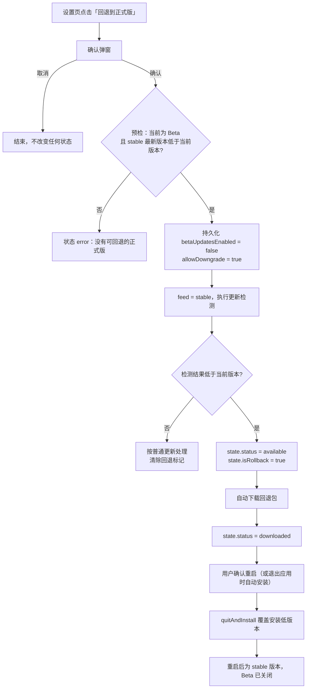

# Beta 版本回退到正式版

> 文档定位：说明已开启 Beta 更新的用户如何主动回退到正式版，以及客户端状态、IPC 契约、持久化兼容、平台边界与验证要求。运行时总览见 [自动更新](./自动更新.md)，通道规则见 [发版通道](./发版通道.md)。
> **当前状态：已实施。** 状态字段、IPC、设置页入口、主进程回退流程、文案与测试矩阵均已落地。
> 路线边界：[rules/release.md](../../rules/release.md) 第 4.3 条禁止的是常驻「降级通道」（自动、常驻、可被任意触发的降级路径）。本功能只在用户明确确认后执行一次目标固定的回退，不构成降级通道。

## 1. 背景

Beta 通道用于小范围验证新功能。用户开启「接收 Beta 版更新」后，可能装到一个不稳定的 beta，例如启动崩溃、核心编辑功能不可用、更新流程自身失效等。

实施前，客户端的处理方式是「等下一个正式版」：

| 场景                                                | 实施前行为                                               | 实施前用户可用的手段                              |
| --------------------------------------------------- | -------------------------------------------------------- | ------------------------------------------------- |
| 运行 `1.6.0-beta.4`，stable 最新为 `1.5.0`          | 关闭 Beta 开关不会降级；检查更新只接受大于当前版本的候选 | 手动下载 `1.5.0` 安装包覆盖安装，并关闭 Beta 开关 |
| 运行 `1.6.0-beta.4`，stable 已发布 `1.6.0`          | 正常升级到 `1.6.0`                                       | 等待 / 主动检查更新                               |
| 运行 `1.6.0-beta.4`，beta 通道又发布 `1.6.0-beta.5` | 升级到 `1.6.0-beta.5`                                    | 无回退能力                                        |

也就是说，实施前**用户唯一可靠的退路是手动安装上一个正式版**。这对普通用户门槛偏高。

本功能解决第一种场景：给 Beta 用户一个**显式、一次性、用户主动触发**的回退入口，而不是引入常驻的降级通道。

## 2. 可行性结论

**技术上可行。** `electron-updater` 本身就提供了降级开关：

- 当前安装的 `electron-updater` 为 `6.8.9`，`AppUpdater.allowDowngrade` 默认 `false`，置为 `true` 后 `isUpdateAvailable()` 会在「远端版本低于当前版本」时返回 `true`；
- 官方类型注释明确写着该开关的用途是「beta 用户想回到 stable 通道」；
- Windows NSIS 与 Linux AppImage 的安装器没有硬性拒绝低版本覆盖安装的逻辑，降级由 electron-updater 的版本判断控制；
- macOS 当前未配置签名与公证，Squirrel.Mac 自动更新本身不可用，回退也只能手动安装。

真正的缺口不在更新库，而在客户端逻辑与产品规则。实施前的差距与当前落地结果如下：

| 环节     | 实施前                                                                                                   | 已落地                                                                     |
| -------- | -------------------------------------------------------------------------------------------------------- | -------------------------------------------------------------------------- |
| 候选选择 | [`update-channel.ts`](../../src/main/update-channel.ts) 的 `selectUpdateCandidate` 只接受大于当前版本的候选 | 回退流程绕过候选选择，直接检查 stable 通道                                 |
| 降级开关 | [`updater.ts`](../../src/main/updater.ts) 从未设置 `allowDowngrade`                                         | 回退期间临时置 `true`，结束后复位                                          |
| 状态模型 | 只有「更新」语义                                                                                         | 增加「回退」标记，用于文案与交互                                           |
| UI       | 设置页只有 Beta 开关                                                                                     | 增加「回退到正式版」入口与确认                                             |
| 规则     | [rules/release.md](../../rules/release.md) 4.3 禁止**降级通道**（自动 / 常驻 / 可选择）                     | 已补充边界说明：用户主动的一次性回退不属于降级通道，禁止常驻降级的立场不变 |

## 3. 目标与非目标

### 3.1 目标

1. 运行 Beta 版本的用户可以在设置页**主动**回退到 stable 通道当前最新版本。
2. 回退后自动关闭 Beta 开关，避免下一次检测立刻把用户推回 beta。
3. 回退复用现有的下载、进度、未保存内容确认、重启安装流程，不新增第二套安装链路。
4. 回退是**一次性**的，不改变周期检测、自动更新和版本发布规则。
5. 失败可重试，且不会让客户端进入持续降级状态。

### 3.2 非目标

1. **不是常驻降级通道**：不提供「自动跟随 stable 回退」「关闭 Beta 即降级」。
2. **不支持任意版本选择**：只能回退到 stable 通道当前最新版本，不能指定 `1.5.0` 等历史版本。
3. **不支持 beta → 旧 beta**：beta 之间的回退仍通过发布新的 `beta.N` 修复。
4. **不替代手动安装包**：回退目标包不可用、网络受限或平台不支持时，仍以手动安装为兜底。
5. **不修改发版版本号规则**：严格单序列、beta base 规则保持不变。

## 4. 方案总览

### 4.1 核心原则

1. **用户主动**：只能由用户在设置页点击并二次确认后触发，周期检测永远不会自行降级。
2. **一次性**：只对本次回退生效；进入下载或安装后不再需要额外状态持久化，安装重启后模块状态归零。
3. **目标固定**：回退目标恒为 stable 通道当前 `latest.yml` 指向的版本，必须严格低于当前版本。
4. **回退即退出 Beta**：开始回退前把 `betaUpdatesEnabled` 持久化为 `false`。
5. **复用状态机**：沿用 `checking / available / downloading / downloaded / error`，只增加一个 `isRollback` 标记。

### 4.2 整体流程



### 4.3 与现有能力的边界

| 能力               | 回退流程中的行为                                                               |
| ------------------ | ------------------------------------------------------------------------------ |
| 双通道候选选择     | **不使用**。回退直接读 stable，绕过 `selectUpdateCandidate` 的「只升不降」过滤 |
| Beta 开关          | 回退开始时自动关闭；回退失败也保持关闭，用户可重新开启                         |
| 强制更新 `[force]` | 回退不受 `[force]` 影响：`forceUpdate` 置 `false`，允许用户稍后处理            |
| 周期检测           | 回退流程进行中跳过周期检测；已下载后按现有规则不打断                           |
| 更新提示卡片       | 文案改为「可回退到正式版」，允许跳过                                           |
| 更新详情窗口       | 文案改为「回退」，安装请求由主进程统一协调所有编辑窗口                         |
| 发版工具链         | 不需要新增通道或版本；stable 通道已保存上一个正式版                            |

## 5. 详细设计

### 5.1 预检纯函数

在 [`src/main/update-channel.ts`](../../src/main/update-channel.ts) 增加纯函数，便于单元测试：

```ts
/**
 * 是否允许回退：当前必须是预发布版本，且 stable 版本严格低于当前版本。
 * stable 版本缺失、非法或高于当前版本时返回 false。
 */
export function isRollbackTarget(currentVersion: string, stableVersion: string | null): boolean {
  if (!stableVersion || !parseVersion(stableVersion)) return false
  if (!isPrerelease(currentVersion)) return false
  return compareVersions(stableVersion, currentVersion) < 0
}
```

配套在 `src/main/update-channel.spec.ts` 增加用例（见第 10 节）。

### 5.2 主进程状态与流程

在 [`src/main/updater.ts`](../../src/main/updater.ts) 增加两个模块级标记：

```ts
/** 本次检测由回退请求发起，update-available 据此标注回退并自动下载 */
let rollbackPending = false
/** 回退流程进行中：阻止周期检测、手动检测与 Beta 开关干扰 */
let rollbacking = false
```

新增入口 `rollbackToStable()`，由 IPC 调用：

1. **状态守卫**：`disabled`（开发模式）、`checking`、`downloading`、`downloaded` 直接返回当前状态；`available` 允许覆盖，`idle` / `not-available` / `error` 允许发起。
2. **通道预检**：调用现有 `peekChannel('stable')` 读取 stable 元数据。
   - 不可达：置 `error`，文案「无法获取正式版信息」；
   - 404 或版本为空：置 `error`，文案「正式版通道暂无可用版本」；
   - 版本不低于当前：置 `error`，文案「正式版版本不低于当前版本，请直接检查更新」。
3. **退出 Beta**：若 `betaUpdatesEnabled` 为 `true`，将其置为 `false` 并写入 `update-preference.json`，然后广播状态。
4. **进入回退模式**：`rollbackPending = true`、`rollbacking = true`，`autoUpdater.allowDowngrade = true`。
5. **执行检测**：先 `setFeed('stable')`，再调用 `autoUpdater.checkForUpdates()`。
   - 可以复用现有 `checkForUpdates()` 的单通道分支，但必须保证 `channelsToCheck()` 此时只返回 `stable`；
   - 不要复用 `update:check` 的公开入口，避免渲染层在回退期间再次触发普通检测。
6. **结果处理**：
   - `update-available`：再次校验 `isRollbackTarget(currentVersion, info.version)`；成立则写入 `isRollback: true`、`latestChannel: 'stable'`、`forceUpdate: false`，并立即调用 `downloadUpdate()`；不成立则按普通更新处理并清除回退标记。
   - `update-not-available` / `error`：清除 `rollbackPending`、`rollbacking`，复位 `allowDowngrade = false`。
   - `update-downloaded`：保留 `isRollback`，等待用户重启安装。
   - 安装失败：沿用现有 `onInstallFailed` 与 `error` 状态，同时复位 `allowDowngrade`。
7. **兜底清理**：`checkForUpdates()` 内部对 404 有单独的 `catch` 分支，可能不触发 `update-not-available` 事件；`rollbackToStable()` 在检测调用结束后要检查最终状态，若为 `not-available` / `error`，同样清理 `rollbackPending`、`rollbacking` 并复位 `allowDowngrade`。
8. **收尾**：无论成功失败，`allowDowngrade` 都不能长期保持 `true`。建议在 `update-not-available`、`error`、安装失败三处统一复位；成功安装会退出应用，无需复位。

`rollbacking` 的清理时机：

| 事件                          | `rollbacking`               | `allowDowngrade` |
| ----------------------------- | --------------------------- | ---------------- |
| 开始回退                      | `true`                      | `true`           |
| `update-available` 且目标成立 | 保持 `true`                 | 保持 `true`      |
| `update-not-available`        | `false`                     | `false`          |
| 检测 / 下载 `error`           | `false`                     | `false`          |
| `update-downloaded`           | 保持 `true`（阻止其他检测） | 保持 `true`      |
| 安装失败                      | `false`                     | `false`          |
| 安装成功                      | 应用退出，无需处理          | —                |

### 5.3 状态模型与 IPC 契约

#### 5.3.1 `UpdateState` 新增字段

在 [`src/shared/update-types.ts`](../../src/shared/update-types.ts) 增加：

| 字段         | 类型              | 说明                                                                      |
| ------------ | ----------------- | ------------------------------------------------------------------------- |
| `isRollback` | `boolean`（可选） | 本次检测 / 可用 / 下载中 / 已下载或可重试错误属于回退流程；普通更新时为空 |

`latestVersion` 仍表示目标版本，`currentVersion` 仍是回退前版本，`latestChannel` 固定为 `stable`。

`isRollback` 的生命周期必须收敛：只在回退流程的 `checking / available / downloading / downloaded / error` 中为 `true`；任何普通检测、Beta 开关切换、回退结束或安装失败后的重新检测，都必须显式清空，避免把下一个普通更新误标成回退。

#### 5.3.2 新增 IPC

| 通道                        | 方向   | 参数 | 返回          | 说明                                           |
| --------------------------- | ------ | ---- | ------------- | ---------------------------------------------- |
| `update:rollback-to-stable` | invoke | 无   | `UpdateState` | 校验并启动一次性回退；允许编辑窗口与设置窗口调用 |

三处同步：

1. 主进程 [`updater.ts`](../../src/main/updater.ts) 使用 `registerHandle` 注册，校验 `event.sender` 来自编辑窗口注册表或设置窗口；
2. preload [`src/preload/index.ts`](../../src/preload/index.ts) 暴露 `rollbackToStable()`；
3. [`src/preload/index.d.ts`](../../src/preload/index.d.ts) 的 `ExposedAPI` 补类型。

**不接受任何参数**：目标版本、feed URL 都不能由渲染进程传入，避免把更新通道变成任意下载入口。

#### 5.3.3 渲染层 store

[`src/renderer/src/stores/update.ts`](../../src/renderer/src/stores/update.ts) 增加：

- `rollbackToStable()`：清空 `dismissedVersion`，调用 IPC 并 `apply()` 返回状态；`error` 状态下的「重试回退」也统一调用它，重新走预检与检测，避免依赖可能不存在的 `updateInfo`；
- `canRollback` 计算属性：`currentChannel === 'beta'` 且状态不在 `disabled / checking / downloading / downloaded`；
- 回退进行中禁用普通「检查更新」与 Beta 开关，渲染层以主进程返回的状态为准；主进程的 `rollbacking` 守卫是最终防线。

### 5.4 UI 设计

#### 5.4.1 设置窗口「更新」分类

在版本号与更新按钮旁增加「回退到正式版」入口：

| 条件                                         | 展示                                                                                    |
| -------------------------------------------- | --------------------------------------------------------------------------------------- |
| `currentChannel !== 'beta'`                  | 不展示                                                                                  |
| `currentChannel === 'beta'` 且无进行中的下载 | 展示按钮「回退到正式版」                                                                |
| `checking / downloading / downloaded`        | 按钮禁用，状态文案说明当前进度                                                          |
| 回退进行中                                   | 状态文案：「正在查找可回退的正式版…」/「正在下载回退版本 N%」/「vX 已下载，重启后回退」 |
| 回退失败                                     | 沿用 `error` 状态，按钮恢复可点击，文案「重试回退」                                     |

确认弹窗复用 [`ConfirmDialog.vue`](../../src/renderer/src/components/common/ConfirmDialog.vue) 的交互与视觉，文案建议：

> 标题：回退到正式版
> 内容：将关闭 Beta 更新并安装 stable 通道的最新正式版。当前 Beta 版本为 vX，回退后不会自动回到 Beta。是否继续？

按钮语义映射：确认 → `discard`（执行回退），取消 → `cancel`。如果认为复用未保存确认弹窗的语义不合适，可以在 `common/` 新增一个轻量确认组件；具体在实现时决定。

Beta 开关下方的说明文案需要同步修改，明确「关闭开关不会自动降级；如需退出 Beta，可使用『回退到正式版』」。

#### 5.4.2 更新提示卡片与更新详情窗口

| 位置         | 普通更新      | 回退                                                |
| ------------ | ------------- | --------------------------------------------------- |
| 提示卡片标题 | 发现新版本 vX | 可回退到正式版 vX                                   |
| 提示卡片按钮 | 跳过 / 查看   | 跳过 / 查看                                         |
| 强制更新徽标 | 重要          | 不展示                                              |
| 详情窗口标题 | 发现新版本 vX | 回退到正式版 vX                                     |
| 详情窗口说明 | 更新内容      | 更新内容 + 「回退后当前 Beta 版本的新功能将不可用」 |
| 下载按钮     | 下载更新      | 下载回退版本                                        |
| 安装按钮     | 立即重启安装  | 立即重启回退                                        |

#### 5.4.3 安装前处理

沿用现有未保存内容确认与会话落盘流程，只把操作标签从「安装更新」改为「回退到正式版」：

1. 设置页确认回退后自动打开更新详情窗口，不在此页展示下载进度或安装按钮；
2. 更新详情窗口请求安装：主进程协调所有编辑窗口执行 `saveAllBeforeExit('回退到正式版')` → `flushSession()`，再统一安装；
3. 主进程 `beforeInstall` 放行关闭守卫，`quitAndInstall(false, true)` 不变。

### 5.5 持久化与数据兼容

回退会让**旧版本读取新版写入的数据**，这是本方案最大的非更新库风险。

| 数据                     | 兼容性                                                                                | 处理                                                                         |
| ------------------------ | ------------------------------------------------------------------------------------- | ---------------------------------------------------------------------------- |
| Markdown 文档            | 不受影响                                                                              | 无                                                                           |
| `session.json`           | `parseSessionData` 会丢弃未知字段，不会崩溃；但新增字段（如新的滚动锚点）会在旧版丢失 | 回退前确认本次 beta 没有引入不可逆的会话格式变更；新增字段保持「旧版可忽略」 |
| `window-state.json`      | 旧版按已知字段读取                                                                    | 同上                                                                         |
| `update-preference.json` | 只有 `betaUpdatesEnabled` 布尔值                                                      | 新旧版本互认                                                                 |
| `markit-*` localStorage  | 旧版忽略未知键；已有键的语义不能改变                                                  | Beta 期间不得改变既有键的含义                                                |
| 更新缓存                 | electron-updater 按版本缓存，回退包是新的下载目标                                     | 无需清理；如遇异常按现有缓存排查流程处理                                     |

建议把「Beta 期间不得引入旧正式版无法安全读取的持久化格式」写入发版规则，作为 Beta 线的约束，而不是回退时临时判断。

### 5.6 Beta 开关与回退的交互

| 操作                   | 行为                                                  |
| ---------------------- | ----------------------------------------------------- |
| 回退开始时开关为开     | 自动置为关并持久化，广播新状态                        |
| 回退开始时开关已关     | 保持关闭；回退流程不依赖开关                          |
| 回退进行中用户点击开关 | 主进程忽略或直接返回当前状态，不打断回退              |
| 回退失败后             | 开关保持关闭；用户可重新开启 Beta，也可重试回退       |
| 回退成功重启后         | 开关保持关闭；周期检测按 stable 执行                  |
| 回退后重新开启 Beta    | 下一次检测会重新提供高于当前版本的 beta，属于预期行为 |

### 5.7 安全约束

1. `update:rollback-to-stable` **不接收目标版本或 URL**，feed 只使用固定的 `FEED_URLS.stable`。
2. 回退检测与下载由设置页发起；更新窗口通过 `update:request-install` 入口请求安装，不直接调用底层安装。
3. 不通过渲染进程拼接下载地址，不读取任意本地文件。
4. 回退包仍由 electron-updater 现有的 `sha512` 校验与 apphub 平台提供，安全边界与普通更新一致。
5. 不新增持久化密钥或凭据。

## 6. 边界与异常

| 场景                     | 预期行为                                                                                                      |
| ------------------------ | ------------------------------------------------------------------------------------------------------------- |
| 当前不是 Beta 版本       | 不展示入口；直接调用 IPC 返回错误「当前不是 Beta 版本」                                                       |
| stable 通道 404 / 无版本 | 返回错误「正式版通道暂无可用版本」，不进入下载                                                                |
| stable 版本等于当前版本  | 视为不可回退；提示已是最新正式版                                                                              |
| stable 版本高于当前版本  | 提示直接检查更新，走普通升级                                                                                  |
| stable 元数据不可达      | 预检失败，尚未关闭 Beta；10 秒超时后返回错误，开关保持原状，可重试                                            |
| 正在检测                 | 返回当前状态，不并发发起回退                                                                                  |
| 正在下载普通更新         | 拒绝回退，提示等待下载完成                                                                                    |
| 已有下载完成的更新       | 拒绝回退。已下载的更新无法取消，退出应用时仍会安装；需先处理该更新（见未决事项 O-3）                          |
| 回退检测期间用户退出应用 | `autoUpdater.autoInstallOnAppQuit` 只对已下载更新生效；未下载完成不会安装                                     |
| 回退包下载失败           | 进入 `error`，保持 `isRollback`；「重试回退」重新执行预检与检测                                               |
| 安装启动失败             | 沿用现有 `onInstallFailed`：撤销关闭放行、状态置 `error`、复位 `allowDowngrade`                               |
| 用户下载完成后改变主意   | 确认后即自动下载，下载完成后无法取消；与普通更新一致，退出应用时会安装。如需保留 Beta，只能在确认弹窗阶段取消 |
| 回退后会话恢复           | 旧版读取新会话时忽略未知字段，不崩溃；新增字段可能丢失                                                        |
| macOS                    | 未签名/未公证，自动更新不可用；建议隐藏入口或改为「手动下载正式版」说明                                       |
| 便携版 / 解压版          | 依赖现有的自动更新可用性判断；不可用时按手动安装处理                                                          |

## 7. 平台支持

| 平台              | 自动回退       | 说明                                                                        |
| ----------------- | -------------- | --------------------------------------------------------------------------- |
| Windows（NSIS）   | 支持           | `allowDowngrade` 生效；必须在打包产物上实测低版本覆盖安装与 blockmap 下载   |
| Linux（AppImage） | 支持           | 与现有自动更新一致；deb/rpm 仍手动安装                                      |
| macOS             | 不支持自动回退 | 当前未配置签名与公证，Squirrel.Mac 不执行自动更新；入口应隐藏或提示手动安装 |

## 8. 规则与文档改动

本方案与 4.3 的「不得提供降级通道」不是同一路线，不构成规则冲突：

- **降级通道**：自动、常驻、可被任意触发的降级路径。例如关闭 Beta 后自动降级、提供可选择的旧版本列表、周期检测自动回退到低版本。
- **用户主动一次性回退**：用户明确点击并二次确认、目标固定为 stable 当前版本、失败可重试、不保留降级状态。

两者在产品意图上相反：前者让客户端可能被动变旧，后者只在用户明确要求时执行一次。

### 8.1 规则边界说明（已落地）

4.3 第 3 条已补充边界说明，同时保留禁止常驻降级通道的立场：

> 关闭 Beta 只停止接收 beta，**不得自动降级**已安装的 beta；不得提供降级通道。用户主动发起的一次性回退到 stable 通道当前最新版本不属于降级通道，回退后必须关闭 Beta 开关。

回退能力涉及主进程与 IPC，已按 [testing.md](../../rules/testing.md) 纳入打包产物手工验证，并同步 `docs/更新与发布/自动更新.md`、`docs/更新与发布/发版通道.md`、`docs/架构与契约/状态与数据模型.md`。

### 8.2 文档同步清单

| 文档                                                | 改动                                                                      |
| --------------------------------------------------- | ------------------------------------------------------------------------- |
| [自动更新](./自动更新.md)                           | 状态机增加 `isRollback` 分支、回退时序、`allowDowngrade` 生命周期、IPC 表 |
| [发版通道](./发版通道.md)                           | 4.3 边界行为改为「可主动回退」；新增回退条件、目标版本与失败处理          |
| [状态与数据模型](../架构与契约/状态与数据模型.md)               | `UpdateState` 新字段、`update-preference.json` 的写入时机                 |
| [IPC 接口与进程契约](../架构与契约/IPC接口与进程契约.md)        | 新增 `update:rollback-to-stable`                                          |
| [技术决策与已知限制](../架构与契约/技术决策与已知限制.md)       | 记录「只允许主动一次性回退」的决策与平台限制                              |
| [测试与质量保障](../工程与质量/测试与质量保障.md)               | 增加回退手工验证矩阵                                                      |
| [welcome.md](../../src/renderer/src/assets/welcome.md) | 增加「如何退出 Beta / 回退到正式版」条目                                  |
| [文档中心](../README.md)                             | 移出计划功能目录并更新索引                                                |

## 9. 实施记录

| 阶段 | 内容                                                 | 当前状态                                                       |
| ---- | ---------------------------------------------------- | -------------------------------------------------------------- |
| 0    | 澄清 `rules/release.md` 4.3 的路线边界，确认未决事项 | 已完成                                                         |
| 1    | `isRollbackTarget` / 状态守卫纯函数 + 单测           | 已完成，`npm test` 通过                                        |
| 2    | 主进程回退流程、状态字段、IPC 三处同步               | 已完成，`npm run typecheck` 通过                               |
| 3    | 设置页入口、确认弹窗、提示卡片与详情窗口文案         | 已完成，lint / typecheck / build 通过                          |
| 4    | 正式文档、计划功能文档迁移                           | 已完成                                                         |
| 5    | 打包产物跨版本安装实测                               | 需在可安装低版本 stable 与更高 beta 的发布环境按第 10.2 节执行 |

## 10. 测试计划

### 10.1 单元测试

在 `src/main/update-channel.spec.ts` 增加 `isRollbackTarget` 用例：

1. Beta 版本 + 更低的 stable → `true`；
2. Beta 版本 + 相同 stable → `false`；
3. Beta 版本 + 更高的 stable → `false`；
4. 当前为正式版 + 更低的 stable → `false`；
5. `stableVersion` 为 `null` / 非法版本 → `false`；
6. 当前版本非法 → `false`（视为不可回退）。

状态守卫已抽为 `isRollbackStartAllowed`，覆盖 `disabled / checking / downloading / downloaded` 拒绝，以及 `idle / not-available / error / available` 允许的用例。

### 10.2 打包产物手工验证

自动更新只在打包产物中生效，必须用 `npm run build:unpack` 或安装包验证：

1. 安装 stable 版本（例如 `1.5.0`），确认版本号；
2. 手动安装更高的 beta（例如 `1.6.0-beta.4`），开启 Beta 开关；
3. 点击「回退到正式版」→ 确认弹窗 → 观察检测、下载进度与状态文案；
4. 下载完成后重启安装，确认版本回到 `1.5.0`；
5. 确认 `userData/update-preference.json` 中 `betaUpdatesEnabled` 为 `false`；
6. 重启后检查更新，应显示「已是最新版本」，不提示降级；
7. 打开若干文档，确认会话、光标、滚动位置、未保存内容确认流程正常；
8. 回退过程中在多个编辑窗口修改文档，确认安装前所有窗口都会收到未保存确认；
9. 断网后点击回退，确认进入 `error` 且可重试，`allowDowngrade` 已复位（可通过再次普通检查验证）；
10. 在已有下载完成更新的情况下点击回退，确认被拒绝并给出明确提示。

### 10.3 回归清单

- `npm run lint`、`npm run typecheck`、`npm test` 全部通过；
- 普通 stable 更新、Beta 更新、强制更新、关闭 Beta 不降级、周期检测行为不变；
- 更新窗口与所有编辑窗口的安装协调不受影响；
- `src/preload/**`、`src/shared/**`、`src/renderer/src/utils/**` 如被改动，执行全量检查（见 [testing.md](../../rules/testing.md) 第 5 节）。

## 11. 已确定决策

| 编号 | 问题                                                 | 决策                                                                   | 影响                     |
| ---- | ---------------------------------------------------- | ---------------------------------------------------------------------- | ------------------------ |
| O-1  | 是否在点击前展示可回退的具体版本号？                 | 按钮写「回退到正式版」，确认后再预检并展示实际目标版本；不新增预取 IPC | 减少网络请求与契约复杂度 |
| O-2  | 确认后自动下载，还是再点一次「下载」？               | 确认后自动下载，下载进度仍完整展示                                     | 交互步数                 |
| O-3  | 已有下载完成的更新时如何处理回退？                   | 一期拒绝并提示；后续评估清理 updater 缓存或提供「取消已下载更新」      | 边界体验                 |
| O-4  | macOS 是否展示入口？                                 | 隐藏自动回退入口；直接调用 IPC 返回仅支持手动安装的提示                | 平台一致性               |
| O-5  | 回退失败后是否恢复原来的 Beta 开关状态？             | 预检失败保持原状；进入下载后失败保持关闭，用户可重新开启或重试         | 用户预期                 |
| O-6  | 更新详情窗口是否也提供回退入口？                     | 发起入口只在设置页；详情窗口只调整回退状态文案与安装按钮               | 实现范围                 |
| O-7  | 是否支持 beta → 旧 beta 回退？                       | 不做；通过发布新的 beta 修复                                           | 版本规则                 |
| O-8  | 回退下载完成后是否仍保留 `autoInstallOnAppQuit`？    | 保持现状，与普通更新一致；在确认弹窗中明确「下载后退出应用也会安装」   | 行为一致性               |
| O-9  | 是否允许在 `available`（普通更新提示）状态直接回退？ | 允许覆盖，回退优先；`forceUpdate` 标记不生效                           | 状态冲突                 |

## 12. 相关文件

| 文件                                                                                                            | 作用                                               |
| --------------------------------------------------------------------------------------------------------------- | -------------------------------------------------- |
| [`src/main/updater.ts`](../../src/main/updater.ts)                                                                 | 回退入口、状态守卫、`allowDowngrade` 生命周期、IPC |
| [`src/main/update-channel.ts`](../../src/main/update-channel.ts)                                                   | `isRollbackTarget` 纯函数与版本比较                |
| [`src/shared/update-types.ts`](../../src/shared/update-types.ts)                                                   | `UpdateState.isRollback`                           |
| [`src/preload/index.ts`](../../src/preload/index.ts) / [`src/preload/index.d.ts`](../../src/preload/index.d.ts)       | `window.api.update.rollbackToStable()`             |
| [`src/renderer/src/stores/update.ts`](../../src/renderer/src/stores/update.ts)                                     | 回退操作与按钮状态                                 |
| [`src/renderer/src/settings/SettingsWindow.vue`](../../src/renderer/src/settings/SettingsWindow.vue)               | 设置窗口回退入口与确认                             |
| [`src/renderer/src/components/update/UpdateNotice.vue`](../../src/renderer/src/components/update/UpdateNotice.vue) | 编辑窗口提示卡片文案                               |
| [`src/renderer/src/update/UpdateWindow.vue`](../../src/renderer/src/update/UpdateWindow.vue)                       | 更新详情窗口回退文案                               |
| [`docs/更新与发布/自动更新.md`](./自动更新.md)                                                                             | 实施后承接状态机与运行机制                         |
| [`docs/更新与发布/发版通道.md`](./发版通道.md)                                                                             | 实施后承接 Beta 开关与回退边界                     |
| [`rules/release.md`](../../rules/release.md)                                                                       | 第 4.3 条补充「降级通道」与「主动回退」的边界说明  |
