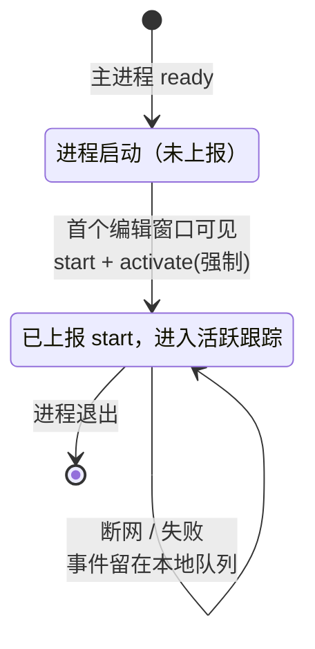
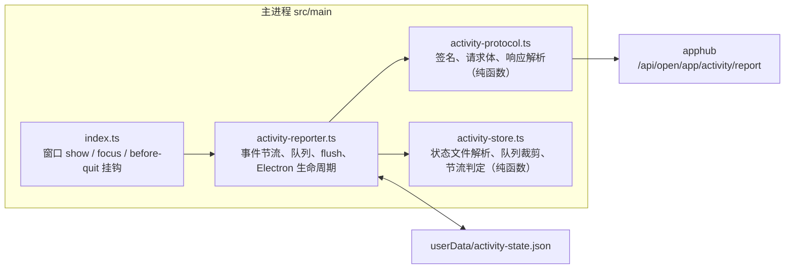

# 应用活跃度上报

> 文档定位：说明 MarkIt 按 apphub《应用活跃度接入手册》上报设备活跃度的口径、事件时机、主进程实现、持久化格式、密钥注入与失败重试。面向维护主进程与发版流程的开发者。
> 平台侧统计口径与服务端实现见 apphub 的《应用活跃度统计设计》；客户端协议以《应用活跃度接入手册》为准。
> 相关文档：[自动更新](./自动更新.md)、[构建与发布](./构建与发布.md)、[状态与数据模型](../架构与契约/状态与数据模型.md)。

## 1. 背景与口径

MarkIt 需要向 apphub 上报「有人在用」这一事实，用于设备日活（DAU）与新增设备统计。

| 口径     | MarkIt 的处理                                                                  |
| -------- | ------------------------------------------------------------------------------ |
| 设备活跃 | 只在窗口获得焦点时上报 `activate`；开机自启、后台常驻、托盘静默不产生活跃      |
| 会员活跃 | **不适用**：MarkIt 没有会员 / 登录体系，不携带 `Authorization`，平台按匿名入库 |
| 新增设备 | 无需专门上报；首次 `activate` 由平台自动建档                                   |

因此客户端只发送 `start` / `activate` / `stop` 三类事件，响应中的 `memberResolved` 恒为 `false`。界面与文档不得宣称「会员 DAU」口径。

## 2. 协议摘要

| 项       | 值                                                                                                         |
| -------- | ---------------------------------------------------------------------------------------------------------- |
| 服务基址 | `https://appcenter.witice.top`                                                                             |
| 上报端点 | `POST /api/open/app/activity/report`                                                                       |
| appKey   | `ah_q100pquj6kxxj9at`（与自动更新同一应用，可随客户端公开）                                                |
| 签名     | `HMAC-SHA256(METHOD + "\n" + path + "\n" + body + "\n" + timestamp + "\n" + noncestr, appSecret)` 小写 hex |
| 签名头   | `X-App-Key`、`sign`、`timestamp`、`noncestr`                                                               |
| 设备头   | `X-Device-Id`，与请求体 `deviceId` 完全一致                                                                |
| 请求体   | `application/json`，`deviceId` / `platform` / `arch` / `clientVersion` / `events`                          |

请求体示例：

```json
{
  "deviceId": "3f1c2a9e-8b7d-4c6a-9e2f-1a2b3c4d5e6f",
  "platform": "windows",
  "arch": "x64",
  "clientVersion": "1.6.0-beta.12",
  "events": [
    { "type": "start", "occurredAt": "2026-11-13T01:12:03.000Z" },
    { "type": "activate", "occurredAt": "2026-11-13T01:12:05.000Z" }
  ]
}
```

约束：`events` 每批 1–50 条；事件时间超出 7 天回补窗口或超前服务器时间 5 分钟会被静默丢弃（响应 `ignored` 计数），客户端不需要重试。

## 3. 事件时机



| 事件               | 触发点                                      | 约定                                                                                               |
| ------------------ | ------------------------------------------- | -------------------------------------------------------------------------------------------------- |
| `start`            | 首个编辑窗口 `ready-to-show` 并 `show()` 后 | 每个进程只发一次；托盘 / 后台启动不发送                                                            |
| `activate`         | 任一应用窗口获得焦点                        | 距上次 `activate` 不足 1 小时则跳过；冷启动首次可见、跨天补偿、登录成功（MarkIt 无登录）时强制发送 |
| `activate`（跨天） | 每分钟检查本地日期                          | 窗口仍聚焦且日期变化时强制发送一条，覆盖「通宵前台使用」                                           |
| `stop`             | `app.on('before-quit')`                     | 正常退出尝试发送；同一进程 60 秒内去重。强杀 / 崩溃无法保证，事件已落盘，下次启动补报              |

补充规则：

1. **只认窗口激活**：`app.on('browser-window-focus')` 统一处理编辑窗口、设置窗口与更新窗口；后台定时任务不触发上报。
2. **节流持久化**：`lastActivateAt` 写入本地状态文件，重启后仍按 1 小时节流；冷启动的首次 `activate` 属于强制发送，不受节流影响。
3. **发送不阻塞使用**：事件先入本地队列并异步刷新，网络失败不提示用户、不影响编辑与保存。

## 4. 客户端实现



### 4.1 模块职责

| 文件                                                                   | 职责                                                                                                |
| ---------------------------------------------------------------------- | --------------------------------------------------------------------------------------------------- |
| [`src/main/activity-reporter.ts`](../../src/main/activity-reporter.ts) | 初始化、生命周期挂钩、节流、离线队列、批量刷新、429 / 4xx 处理、状态落盘                            |
| [`src/main/activity-protocol.ts`](../../src/main/activity-protocol.ts) | 签名头、请求体构造、平台 / 架构映射、响应与错误解析（纯函数，可单测）                               |
| [`src/main/activity-store.ts`](../../src/main/activity-store.ts)       | 状态文件解析与序列化、`deviceId` 校验、队列 7 天 / 200 条裁剪、节流与日期辅助函数（纯函数，可单测） |
| [`src/main/apphub-config.ts`](../../src/main/apphub-config.ts)         | apphub 基址与 appKey 的单一来源，更新与活跃度上报共用                                               |

渲染进程不参与上报，也不新增 IPC：所有事件都发生在主进程窗口生命周期上。

### 4.2 设备标识

- 首次启动用 `crypto.randomUUID()` 生成 UUID v4，写入 `activity-state.json` 的 `deviceId` 字段并持久化。
- 只接受 1–64 位 `A-Z a-z 0-9 . _ -`；文件损坏或字段非法时重新生成。
- 语义是「安装实例」：重装或清空应用数据会生成新 ID，平台视为新设备。这是平台已知偏差，客户端不做机器指纹兜底。

### 4.3 平台与架构

| 运行环境                    | 上报值                              |
| --------------------------- | ----------------------------------- |
| `win32`                     | `platform: windows`                 |
| `darwin`                    | `platform: macos`                   |
| `linux`                     | `platform: linux`                   |
| 其他                        | 不上报（MarkIt 只发布三平台）       |
| `x64` / `arm64` / `ia32` 等 | 直接取 `process.arch`，不超过 16 位 |

`clientVersion` 取 `app.getVersion()`，即 `package.json` 的版本号（如 `1.6.0-beta.12`），符合 semver。

## 5. 持久化

文件：`app.getPath('userData')/activity-state.json`（开发模式位于 `mark-it-dev` 子目录）。

```json
{
  "version": 1,
  "deviceId": "3f1c2a9e-8b7d-4c6a-9e2f-1a2b3c4d5e6f",
  "lastActivateAt": 1762996325000,
  "activeDay": "2026-11-13",
  "queue": [
    { "type": "start", "occurredAt": "2026-11-13T01:12:03.000Z" },
    { "type": "activate", "occurredAt": "2026-11-13T01:12:05.000Z" }
  ]
}
```

| 字段             | 说明                                                 |
| ---------------- | ---------------------------------------------------- |
| `version`        | 状态文件版本，当前 `1`；不匹配时按空状态重建         |
| `deviceId`       | 安装实例标识                                         |
| `lastActivateAt` | 上次 `activate` 的毫秒时间戳，用于 1 小时节流        |
| `activeDay`      | 上次计入活跃的本地日期（`YYYY-MM-DD`），用于跨天补偿 |
| `queue`          | 待上报事件，最多 200 条，只保留 7 天内的事件         |

写入策略：

1. 启动时同步读取一次；之后每次入队 / 出队异步原子写入（临时文件 + 重命名）。
2. `stop` 入队时同步写入，保证进程立即退出也能在下次启动补报。
3. 文件不存在、JSON 损坏或版本不符时重建；单个事件非法只丢该事件，不清空整个队列。

## 6. 密钥与构建注入

appSecret 是应用级签名密钥，平台允许公开客户端将其编译进二进制。MarkIt 仓库是公开仓库，因此**不把密钥写入源码**，改为构建时注入：

| 环节            | 做法                                                                                                                         |
| --------------- | ---------------------------------------------------------------------------------------------------------------------------- |
| 源码            | 不出现密钥；`activity-reporter.ts` 读取编译期常量 `__MARKIT_APPHUB_APP_SECRET__`                                             |
| 构建            | [`electron.vite.config.ts`](../../electron.vite.config.ts) 的 `main.define` 用环境变量 `MARKIT_APPHUB_APP_SECRET` 替换该常量 |
| 正式发布        | GitHub Actions 从仓库 Secret `APPHUB_APP_SECRET` 注入                                                                        |
| 本地构建 / 调试 | 设置同名环境变量即可；不设置则上报功能自动禁用                                                                               |

行为约定：

1. 打包版缺少密钥时上报功能整体禁用，只输出一次 `console.warn`，不影响编辑、保存与更新。
2. 开发模式下即使配置了密钥也默认不上报，避免开发使用污染正式统计；需要联调时设置 `MARKIT_ACTIVITY_REPORT=force`。
3. 联调或私有化部署可设置 `MARKIT_ACTIVITY_BASE_URL` 覆盖服务基址（不含 `/api`），默认使用线上 `https://appcenter.witice.top`。
4. 平台重置 Secret 后旧客户端签名全部 401，但更新检测豁免签名，客户端仍能检查更新；发布内嵌新密钥的版本即完成切换（与平台 D22 / D23 一致）。

## 7. 失败与重试

| 情况                           | 处理                                                                      |
| ------------------------------ | ------------------------------------------------------------------------- |
| 网络错误 / 超时                | 保留队列，5 分钟后重试；退出时事件已落盘，下次启动继续                    |
| HTTP 429                       | 30–60 秒随机退避后重试，不立即重发                                        |
| HTTP 400 / 401                 | 确定性失败，丢弃当前批（最多 50 条），记录一次 `console.warn`，不循环重试 |
| `code = 700300003`（应用停用） | 停止本次进程后续上报，不重试                                              |
| `ignored > 0`                  | 平台已静默丢弃超窗事件，客户端正常出队                                    |
| 队列超过 200 条 / 超过 7 天    | 入队时裁剪，优先保留最新事件                                              |

刷新时机：

1. 入队后 3 秒防抖刷新；
2. 队列达到 10 条立即刷新；
3. 应用启动时若存在历史队列，立即补报；
4. 退出时尝试刷新一次。

每批最多 50 条，串行发送；同一进程同时只允许一个 flush 在运行。

## 8. 隐私

- 只上报随机生成的 `deviceId`、平台 / 架构 / 客户端版本与三类事件时间。
- 不采集机器码、MAC、硬盘序列号、文件路径、窗口标题、文档内容，也不保存 IP。
- 不发送 `Authorization`，不关联任何账号。
- 不提供界面开关（产品决策）：上报内容为最小化设备活跃事实；内置手册在「常见问题」中说明该行为与范围。

## 9. 验证清单

| 验收项                                      | 验证方式                                                       |
| ------------------------------------------- | -------------------------------------------------------------- |
| 首次启动生成 `deviceId` 并持久化，重启不变  | 查看 `userData/activity-state.json`，重启比对                  |
| 冷启动可见时发出 `start` + `activate`       | `MARKIT_ACTIVITY_REPORT=force npm run dev`，观察队列与网络请求 |
| 单纯后台启动不发送                          | 窗口未 `show()` 前无 `start` / `activate`                      |
| 1 小时内反复切窗只发一条 `activate`         | 多次切换窗口后检查队列条数                                     |
| 窗口常开跨过 00:00 后补发 `activate`        | 修改系统时间或使用短周期联调；平台上看到次日活跃               |
| 断网期间事件进入队列，恢复后 ≤ 50 条/批补报 | 断开网络后切窗，恢复网络等待重试                               |
| 退出时发出 `stop`；强杀后下次启动补报       | 正常退出观察请求；强杀后重启检查队列被清空                     |
| `X-Device-Id` 与 body `deviceId` 一致       | 抓包或日志核对                                                 |
| 429 退避、400 / 401 不循环重试              | 单元测试 + 本地 mock 响应                                      |

自动化覆盖：

- `activity-store.spec.ts`：`deviceId` 校验、状态文件容错、队列裁剪、节流与跨天判定；
- `activity-protocol.spec.ts`：签名固定向量、平台 / 架构映射、响应与错误解析。

跨进程真实网络请求无法在 Vitest 中稳定复现，按上表在 `npm run dev` 下人工验证；正式密钥只存在于 CI Secret，本地联调需自行设置环境变量。

## 10. 已知限制

1. **无会员口径**：MarkIt 没有登录，平台会员 DAU 不适用；后续接入会员体系时需要在登录成功后强制补发 `activate` 并携带 `Authorization`。
2. **`stop` 是尽力而为**：`before-quit` 后进程可能立即结束，未发出的 `stop` 依赖下次启动补报；这不影响日活（日活只看 `activate`）。
3. **强杀 / 崩溃不产生 `stop`**：当天已有 `activate` 时不影响统计。
4. **不合并同日事件**：平台对合并与未合并两种形态结果一致，客户端保持逐事件上报，便于排障。
5. **开发模式默认关闭**：只有 `MARKIT_ACTIVITY_REPORT=force` 时联调上报，避免污染正式数据。
