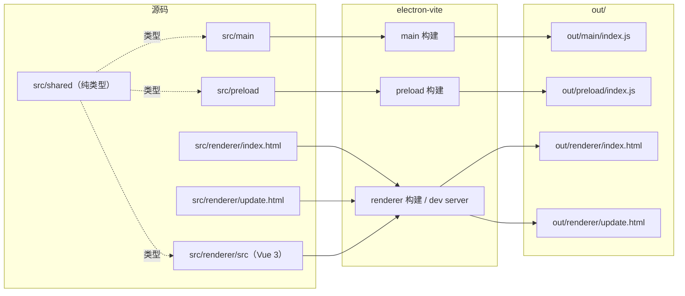
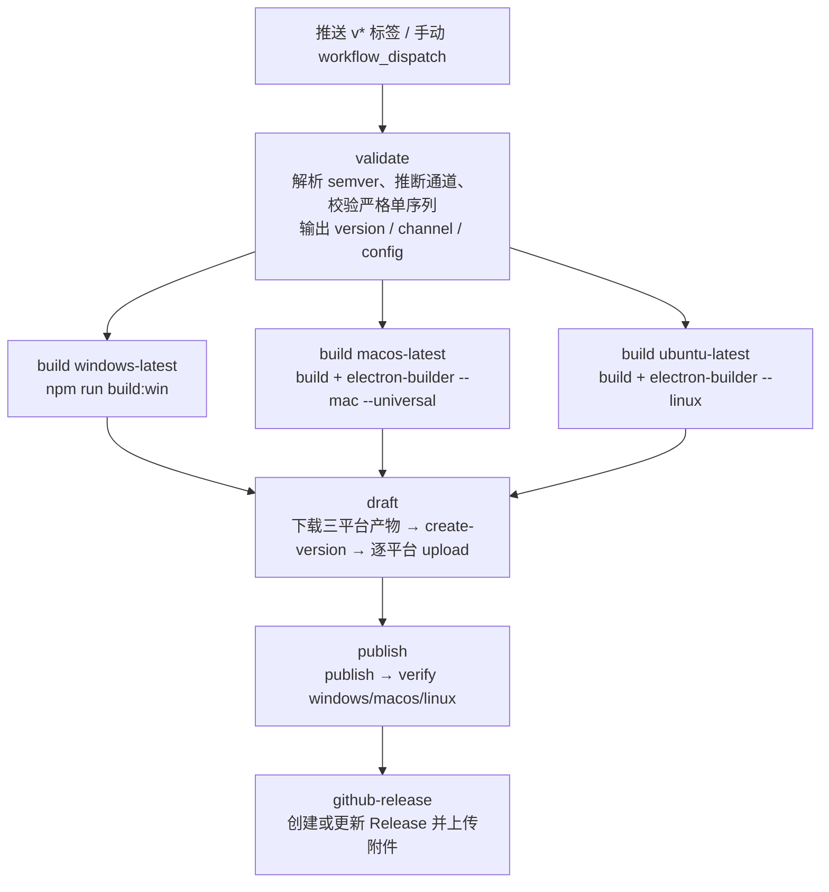

# 构建与发布

> 文档定位：说明 MarkIt 1.5.0 的本地构建、打包配置、产物命名、图标与签名辅助脚本、GitHub Actions 发版流水线以及 apphub 发布命令。面向需要构建安装包或执行发版的维护者。完整发版步骤与错误码见 [`docs/github-release.md`](./github-release.md)，自动更新运行时机制见 [`docs/自动更新.md`](./自动更新.md)。

## 1. 环境要求

| 项目       | 要求                                     | 来源                                                                                                                     |
| ---------- | ---------------------------------------- | ------------------------------------------------------------------------------------------------------------------------ |
| Node.js    | `>= 22`                                  | [`README.md`](../README.md)、[`.github/workflows/release.yml`](../.github/workflows/release.yml) 的 `NODE_VERSION: '22'` |
| npm        | `>= 9`                                   | [`README.md`](../README.md)                                                                                              |
| 包管理器   | 仅 npm（使用 `package-lock.json`）       | 仓库约定                                                                                                                 |
| 主要运行时 | Electron 39、Vue 3、TypeScript 5.9       | [`package.json`](../package.json)                                                                                        |
| 构建工具   | `electron-vite` 5、`electron-builder` 26 | [`package.json`](../package.json)                                                                                        |

平台提示：

- Windows 生成 NSIS 安装包；macOS 生成 dmg + zip；Linux 生成 AppImage + deb。
- 当前未配置代码签名与 Apple 公证，macOS 产物会被 Gatekeeper 拦截；Windows 可能出现 SmartScreen 提示。
- CI 在三个原生 runner 上分别构建，避免跨平台打包限制。

## 2. 常用命令

命令定义见 [`package.json`](../package.json) 的 `scripts`。

| 命令                     | 作用                                                                | 产物 / 结果                                                                                                                 |
| ------------------------ | ------------------------------------------------------------------- | --------------------------------------------------------------------------------------------------------------------------- |
| `npm install`            | 安装依赖，并自动执行 `postinstall`                                  | `node_modules/`                                                                                                             |
| `npm run dev`            | `electron-vite dev` 启动开发模式，主进程 / preload / 渲染进程热更新 | 主进程与 preload 构建到 `out/`，renderer 使用 Vite dev server；不生成安装包                                                 |
| `npm run build`          | 先 `typecheck`（主进程 + 渲染进程），再 `electron-vite build`       | `out/main/index.js`、`out/preload/index.js`、`out/renderer/index.html`、`out/renderer/update.html` 及静态资源；不生成安装包 |
| `npm run start`          | `electron-vite preview`，用已构建的 `out/` 启动应用                 | 预览窗口                                                                                                                    |
| `npm run lint`           | `eslint --cache .`，含 Prettier 一致性检查                          | 退出码；缓存 `.eslintcache`                                                                                                 |
| `npm test`               | `vitest run`，运行纯函数单元测试                                    | 测试结果；CI 的 `test` job 在构建前执行                                                                                     |
| `npm run format`         | `prettier --write .`                                                | 就地格式化源码与配置                                                                                                        |
| `npm run typecheck`      | 依次执行 `typecheck:node` 与 `typecheck:web`                        | 双 tsconfig 类型检查结果                                                                                                    |
| `npm run typecheck:node` | `tsc --noEmit -p tsconfig.node.json --composite false`              | 检查 `src/main`、`src/preload`、`electron.vite.config.*`                                                                    |
| `npm run typecheck:web`  | `vue-tsc --noEmit -p tsconfig.web.json --composite false`           | 检查 `src/renderer` 与 preload 的 `.d.ts`                                                                                   |
| `npm run build:win`      | `npm run build` + `electron-builder --win`                          | `dist/` 下 NSIS 安装包、blockmap、`dist/win-unpacked/`                                                                      |
| `npm run build:mac`      | `npm run build` + `electron-builder --mac`                          | `dist/` 下 dmg、zip 与对应 unpacked 目录                                                                                    |
| `npm run build:linux`    | `npm run build` + `electron-builder --linux`                        | `dist/` 下 AppImage、deb 与对应 unpacked 目录                                                                               |
| `npm run build:unpack`   | `npm run build` + `electron-builder --dir`                          | 仅生成未打包目录（如 `dist/win-unpacked/`），便于本地验证                                                                   |
| `npm run postinstall`    | `electron-builder install-app-deps`                                 | 安装 / 重建原生依赖；`npm install` 后自动执行                                                                               |

说明：

1. 质量门槛为 `lint` + `typecheck` + `npm test` + 必要的 `npm run dev` 手工验证；发版 workflow 的 `test` job 会先跑单元测试，e2e 需本地构建后执行，详见 [`rules/testing.md`](../rules/testing.md)。
2. `npm run build` 只产出 `out/`，不会生成安装包；需要安装包必须执行 `build:win` / `build:mac` / `build:linux`。
3. `electron-builder.yml` 设置了 `npmRebuild: false`，打包阶段不再重建原生依赖，原生依赖由 `postinstall` 的 `install-app-deps` 准备。

## 3. 构建架构

[`electron.vite.config.ts`](../electron.vite.config.ts) 将工程拆成三段构建：

| 段         | 入口                                                  | 输出                                                         |
| ---------- | ----------------------------------------------------- | ------------------------------------------------------------ |
| `main`     | `src/main/index.ts`                                   | `out/main/index.js`                                          |
| `preload`  | `src/preload/index.ts`                                | `out/preload/index.js`                                       |
| `renderer` | `src/renderer/index.html`、`src/renderer/update.html` | `out/renderer/index.html`、`out/renderer/update.html` 与资源 |

关键点：

- `renderer.build.rollupOptions.input` 显式声明两个 HTML 入口：`index`（主编辑器）与 `update`（独立更新详情窗口）。
- 路径别名 `@renderer` 指向 `src/renderer/src`，供渲染进程源码引用。
- `package.json` 的 `main` 为 `./out/main/index.js`，Electron 启动时加载该文件。
- `src/shared/` 只存放跨进程纯类型，编译后不产生独立运行时入口。
- 渲染进程禁止 `import 'electron'`，所有主进程能力通过 preload 暴露。



## 4. 打包配置

配置见 [`electron-builder.yml`](../electron-builder.yml)。

### 4.1 基础信息

| 配置                         | 值                            | 说明                                     |
| ---------------------------- | ----------------------------- | ---------------------------------------- |
| `appId`                      | `com.harley.markit`           | 安装 / 升级识别；不得随意修改            |
| `productName`                | `Mark It`                     | 安装包、可执行文件、快捷方式、卸载项名称 |
| `copyright`                  | `Copyright © 2026 witice.top` | 安装包元信息                             |
| `directories.buildResources` | `build`                       | 图标与 entitlements 从 `build/` 读取     |
| `afterSign`                  | `./scripts/after-sign.cjs`    | Windows 版本信息资源后处理               |
| `npmRebuild`                 | `false`                       | 打包阶段不重建原生依赖                   |

### 4.2 文件收录与排除

`files` 在 electron-builder 默认规则上追加排除项：

| 排除项                                                                                                         | 原因                                                |
| -------------------------------------------------------------------------------------------------------------- | --------------------------------------------------- |
| `!**/.vscode/*`、`!**/.github/*`                                                                               | 开发与 CI 配置                                      |
| `!src/*`                                                                                                       | 源码不进入安装包，只收录 `out/`                     |
| `!.apphub-release*.json`                                                                                       | **发版配置可能含账号 / 签名密钥，绝不能打进安装包** |
| `!scripts`、`!scripts/**`                                                                                      | 发版 CLI 与构建脚本                                 |
| `!docs`、`!docs/**`                                                                                            | 设计与发版文档                                      |
| `!rules`、`!rules/**`、`!CLAUDE.md`、`!AGENTS.md`                                                              | AI 协作规则与说明，仓库内使用且可能引用发版配置名   |
| `!electron.vite.config.{js,ts,mjs,cjs}`                                                                        | 构建配置                                            |
| `!{.eslintcache,eslint.config.mjs,.prettierignore,.prettierrc.yaml,dev-app-update.yml,CHANGELOG.md,README.md}` | 开发期文件                                          |
| `!{.env,.env.*,.npmrc,pnpm-lock.yaml}`                                                                         | 环境变量与 npm 配置                                 |
| `!{tsconfig.json,tsconfig.node.json,tsconfig.web.json}`                                                        | TypeScript 配置                                     |

`asarUnpack` 为 `resources/**`，将运行时图标等资源解包到 `app.asar.unpacked`，保证主进程能以真实文件路径访问。

### 4.3 Windows

| 配置                                      | 值                                                 |
| ----------------------------------------- | -------------------------------------------------- |
| `win.executableName`                      | `Mark It`                                          |
| `fileAssociations`                        | `.md`、`.markdown`，`role: Editor`                 |
| `nsis.artifactName`                       | `${name}-${version}-setup.${ext}`                  |
| `nsis.shortcutName`                       | `${productName}`                                   |
| `nsis.uninstallDisplayName`               | `${productName}`                                   |
| `nsis.oneClick`                           | `false`（交互式安装向导）                          |
| `nsis.allowToChangeInstallationDirectory` | `true`（允许选择安装路径）                         |
| `nsis.allowElevation`                     | `true`（「为所有用户安装」时提权）                 |
| `nsis.createDesktopShortcut`              | `false`（由 `build/installer.nsh` 按用户勾选创建） |
| `nsis.createStartMenuShortcut`            | `false`（同上）                                    |
| `nsis.include`                            | `installer.nsh`（自定义向导页面与快捷方式逻辑）    |
| `nsis.language`                           | `2052`（中文简体）                                 |
| `nsis.installerLanguages`                 | `zh_CN`                                            |

安装向导的页面流程、快捷方式在各安装 / 升级场景下的行为与自定义脚本实现见 [Windows 安装向导](./Windows安装向导.md)。

### 4.4 macOS

| 配置                      | 值                                               |
| ------------------------- | ------------------------------------------------ |
| `mac.target`              | `dmg`、`zip`                                     |
| `mac.artifactName`        | `${name}-${version}-${arch}.${ext}`              |
| `mac.entitlementsInherit` | `build/entitlements.mac.plist`                   |
| `mac.extendInfo`          | 摄像头 / 麦克风 / 文稿 / 下载目录用途说明        |
| `mac.notarize`            | `false`（当前未配置 Apple Developer 证书与公证） |
| `dmg.artifactName`        | `${name}-${version}.${ext}`                      |

dmg 用于首次安装，zip 用于自动更新（Squirrel.Mac 只接受 zip）。

### 4.5 Linux

| 配置                    | 值                          |
| ----------------------- | --------------------------- |
| `linux.target`          | `AppImage`、`deb`           |
| `linux.maintainer`      | `witice.top`                |
| `linux.category`        | `Utility`                   |
| `appImage.artifactName` | `${name}-${version}.${ext}` |

`snap` 未纳入默认 target：GitHub 托管 runner 没有 snapcraft；如需 snap 必须在本地单独构建。Linux 自动更新仅支持 AppImage，deb 供手动安装。

### 4.6 发布端点与下载镜像

```yaml
publish:
  provider: generic
  url: https://appcenter.witice.top/api/update/ah_q100pquj6kxxj9at/stable/electron

electronDownload:
  mirror: https://npmmirror.com/mirrors/electron/
```

- `publish` 会在打包产物中生成 `resources/app-update.yml`，供 electron-updater 读取；运行时 `src/main/updater.ts` 会按用户偏好与候选结果重设 feed（`stable` / `beta`），因此这里的值只作为默认兜底。
- appKey 可公开分发；发版签名密钥不可进入客户端。
- `electronDownload.mirror` 仅影响 Electron 二进制下载，不改变客户端运行时更新地址。

## 5. 产物命名

`${name}` 来自 [`package.json`](../package.json) 的 `name`（`mark-it`），`${version}` 为当前版本，`${productName}` 为 `Mark It`。以下示例按版本 `1.5.0` 展示。

| 平台    | Target        | 命名模板                            | 示例                                                                                                    |
| ------- | ------------- | ----------------------------------- | ------------------------------------------------------------------------------------------------------- |
| Windows | NSIS          | `${name}-${version}-setup.${ext}`   | `mark-it-1.5.0-setup.exe`                                                                               |
| Windows | NSIS 差分     | 同名 + `.blockmap`                  | `mark-it-1.5.0-setup.exe.blockmap`                                                                      |
| macOS   | dmg           | `${name}-${version}.${ext}`         | `mark-it-1.5.0.dmg`                                                                                     |
| macOS   | zip           | `${name}-${version}-${arch}.${ext}` | 本地 `mark-it-1.5.0-x64.zip` / `mark-it-1.5.0-arm64.zip`；CI universal 为 `mark-it-1.5.0-universal.zip` |
| macOS   | zip 差分      | 同名 + `.blockmap`                  | `mark-it-1.5.0-universal.zip.blockmap`                                                                  |
| Linux   | AppImage      | `${name}-${version}.${ext}`         | `mark-it-1.5.0.AppImage`                                                                                |
| Linux   | AppImage 差分 | 同名 + `.blockmap`                  | `mark-it-1.5.0.AppImage.blockmap`                                                                       |
| Linux   | deb           | electron-builder 默认（未覆盖）     | 形如 `mark-it_1.5.0_amd64.deb`                                                                          |

补充：

- 本地打包还会生成 `dist/latest.yml`（Windows 更新元数据）与 `dist/win-unpacked/` 等未打包目录。
- CI 上传到 apphub 时只上传 Windows exe + blockmap、macOS universal zip + blockmap、Linux AppImage + blockmap；dmg、deb 仅进入 GitHub Release 附件。更新端点所需的 `latest.yml` 由 apphub 更新端点提供。
- 可执行文件名为 `Mark It.exe`，安装包文件名使用 npm 包名 `mark-it`，两者不要混淆。

## 6. 图标与签名脚本

### 6.1 图标资源

| 位置                           | 内容                               | 用途                                                       |
| ------------------------------ | ---------------------------------- | ---------------------------------------------------------- |
| `build/icon.png`               | 552×552 PNG，logo 居中并留透明边距 | electron-builder 生成各平台图标的基础                      |
| `build/icon.ico`               | Windows 图标                       | NSIS / exe                                                 |
| `build/icon.icns`              | macOS 图标                         | dmg / app                                                  |
| `build/icon-full.png`          | 满铺原图备份                       | 调整边距比例时从它重新生成                                 |
| `build/entitlements.mac.plist` | macOS entitlements                 | `mac.entitlementsInherit`                                  |
| `resources/icon.png`           | 运行时图标                         | 主进程 `import icon from '../../resources/icon.png?asset'` |

### 6.2 `scripts/pad-icon.cjs`

```
node scripts/pad-icon.cjs [scale]
```

- `scale` 默认 `0.8`，表示 logo 占 552px 画布的比例，四周留 `(1 - scale) / 2` 透明边距；更松用 `0.72`，更紧用 `0.88`。
- 首次运行时把现有 `build/icon.png` 备份为 `build/icon-full.png`，之后都从满铺原图重新生成。
- 输出 `build/icon.png`、`build/icon.ico`、`build/icon.icns`，并校验四角 alpha 为 0。
- 替换图标时保持文件名与尺寸规格不变，不手工二进制替换 `.ico` / `.icns`。

### 6.3 `scripts/after-sign.cjs`

- 作为 electron-builder 的 `afterSign` 钩子，仅处理 `win32`。
- electron-builder 沿用 `electron.exe` 的 `en-US` 版本资源；脚本用 `resedit` 保留原有版本字段，覆盖 `FileDescription`、`CompanyName`、`LegalCopyright`，并把版本信息语言整体迁移到简体中文（`lang: 0x0804`、`codepage: 1200`）。
- 当前未启用代码签名。**若将来启用 Windows 代码签名，该钩子必须改为签名前执行**，否则签名后改写 exe 资源会使签名失效。

## 7. CI 发版

Workflow 文件：[`.github/workflows/release.yml`](../.github/workflows/release.yml)。

### 7.1 触发方式

| 方式                     | 版本号来源       | 说明                                                                                      |
| ------------------------ | ---------------- | ----------------------------------------------------------------------------------------- |
| 推送 `v*` 标签           | 标签名去掉 `v`   | 自动生成更新说明；仅适用于说明无需人工整理的内部版本，如 `v1.5.0`                         |
| 手动 `workflow_dispatch` | `inputs.version` | 推荐方式：可传入按 [发版说明 3.1](./github-release.md#31-更新说明撰写规则) 提炼的更新说明 |

通道由版本号自动推断：含 `-` 的版本（只允许 `-beta.N`）走 `beta` 通道，否则走 `stable` 通道。通道决定使用的发版配置、更新说明的收集起点与 GitHub Release 的 prerelease 标记，不需要额外参数。版本号必须满足严格单序列，规则见 [发版通道与 Beta 更新](./发版通道.md)。

手动参数：

| 参数      | 必填         | 说明                                                                                                                |
| --------- | ------------ | ------------------------------------------------------------------------------------------------------------------- |
| `version` | 手动触发时是 | semver，如 `1.5.0`；标签触发时取标签名去掉 `v`                                                                      |
| `notes`   | 否           | 更新说明；留空则自动生成，自动结果仅作素材，发布前须按 [发版说明 3.1](./github-release.md#31-更新说明撰写规则) 提炼 |
| `force`   | 否           | `true` 时在版本上标记强制更新                                                                                       |
| `replace` | 否           | `true` 时替换已存在的平台包，用于重跑同一版本                                                                       |

### 7.2 流水线



### 7.3 各阶段职责

| 阶段             | Runner                                              | 依赖                           | 主要动作                                                                                                                                        | 超时    |
| ---------------- | --------------------------------------------------- | ------------------------------ | ----------------------------------------------------------------------------------------------------------------------------------------------- | ------- |
| `validate`       | `ubuntu-latest`                                     | —                              | 解析版本号；校验 semver 与严格单序列；推断通道并输出 `version` / `channel` / `config`                                                           | 5 分钟  |
| `build`          | `windows-latest` / `macos-latest` / `ubuntu-latest` | `validate`                     | `npm ci` → `npm version <version> --no-git-tag-version --allow-same-version` → 平台构建 → 校验 `app.asar` 不含发版凭据 → 上传 workflow artifact | 60 分钟 |
| `draft`          | `ubuntu-latest`                                     | `validate`、`build`            | 下载全部产物；生成更新说明；`create-version` 建草稿；逐平台 `upload`（macOS 只传 zip、Linux 只传 AppImage）                                     | 30 分钟 |
| `publish`        | `ubuntu-latest`                                     | `validate`、`draft`            | `publish` 发布；对 `windows x64`、`macos universal`、`linux x64` 逐个 `verify`                                                                  | 15 分钟 |
| `github-release` | `ubuntu-latest`                                     | `validate`、`draft`、`publish` | 复用 `draft` 生成的说明，创建或更新 `vX.Y.Z` GitHub Release，上传全部产物                                                                       | 15 分钟 |

其他行为：

- 顶层 `permissions: contents: read`；只有 `github-release` job 申请 `contents: write`。
- `concurrency.group` 为 `release-${{ inputs.version || github.ref_name }}`，`cancel-in-progress: false`，同一版本不会并发互踩。
- `build` 使用 `fail-fast: false`，某个平台失败不会取消其他平台，便于一次看到全部问题。
- `draft` / `publish` 按 `validate.channel` 选择发版配置：stable 用 `.apphub-release.ci.json`，beta 用 `.apphub-release.beta.ci.json`。
- 更新说明从**上一个同通道 tag** 开始收集（`scripts/release/channel-state.mjs`）；stable 的收集范围因此自然覆盖其间所有 beta 提交。
- `build` 设置 `CSC_IDENTITY_AUTO_DISCOVERY: 'false'`，避免 electron-builder 自动发现本机证书并尝试签名。
- 构建后执行凭据扫描：在 `dist` 中查找 `app.asar`，若包含 `apphub-release` 或 `signSecret` 立即失败，阻断上传。
- workflow artifact 保留 14 天；GitHub Release 附件是长期分发产物。
- 发布没有人工审批门：草稿上传完成后立即对客户端可见。

### 7.4 Secrets

| Secret               | 用途            |
| -------------------- | --------------- |
| `APPHUB_USERNAME`    | apphub 发版账号 |
| `APPHUB_PASSWORD`    | apphub 发版密码 |
| `APPHUB_SIGN_SECRET` | 请求签名密钥    |

Secrets 只在 workflow 运行时注入，不写入仓库文件。`github-release` 使用内置 `GITHUB_TOKEN`（`GH_TOKEN: ${{ github.token }}`），不需要额外 Secrets。

### 7.5 产物上传约定

| 平台            | 构建命令                                                  | 上传到 apphub                   | 上传到 GitHub Release                    |
| --------------- | --------------------------------------------------------- | ------------------------------- | ---------------------------------------- |
| Windows x64     | `npm run build:win`                                       | `*-setup.exe` + `.blockmap`     | 同左                                     |
| macOS universal | `npm run build && npx electron-builder --mac --universal` | `*-universal.zip` + `.blockmap` | `.dmg` + `*-universal.zip` + `.blockmap` |
| Linux x64       | `npm run build && npx electron-builder --linux`           | `*.AppImage` + `.blockmap`      | `*.AppImage` + `.blockmap` + `*.deb`     |

`github-release` 的 Release 说明复用 `draft` 阶段生成的更新说明，避免两处口径不一致；版本号含 `-`（如 `1.6.0-beta.1`）时标记为 prerelease，不会被当作 latest。Release 已存在时刷新说明并用 `--clobber` 覆盖同名附件；手动触发且尚无 tag 时，会在当次运行的提交上补建 tag。

## 8. 本地发版

CLI：[`scripts/release/apphub.mjs`](../scripts/release/apphub.mjs)，零依赖，Node 直接执行。默认读取仓库根目录的 `.apphub-release.json`，可用 `--config` 指定其他文件。

### 8.1 两种配置文件的区别

| 文件                                                              | 是否提交        | 内容                                                                             | 用途               |
| ----------------------------------------------------------------- | --------------- | -------------------------------------------------------------------------------- | ------------------ |
| `.apphub-release.json`                                            | 否（gitignore） | `baseUrl`、`appKey`、`channel`，以及本地 `credentials`（账号 / 密码 / 签名密钥） | 本地发版（stable） |
| [`.apphub-release.ci.json`](../.apphub-release.ci.json)           | 是              | 仅 `baseUrl`、`appKey`、`channel: stable`，不含任何凭据                          | CI 发 stable       |
| [`.apphub-release.beta.ci.json`](../.apphub-release.beta.ci.json) | 是              | 仅 `baseUrl`、`appKey`、`channel: beta`，不含任何凭据                            | CI 发 beta         |

本地发 beta 时，复制 `.apphub-release.json` 并改 `channel` 为 `beta`（含凭据，仍然不要提交），或直接用 `--channel` 参数——注意 `upload` 子命令只读配置里的 channel，不支持 `--channel`，因此本地 beta 发版必须使用 beta 配置文件。

凭据解析顺序：环境变量 `APPHUB_USERNAME` / `APPHUB_PASSWORD` / `APPHUB_SIGN_SECRET` 优先，配置文件 `credentials` 节兜底。使用 `.apphub-release.ci.json` 时必须通过环境变量提供凭据。不要把任何真实密钥写入仓库、文档或安装包。

### 8.2 命令接口

| 命令             | 作用                                             | 主要参数                                                                 |
| ---------------- | ------------------------------------------------ | ------------------------------------------------------------------------ |
| `status`         | 登录并展示应用 / 通道 / 各通道最新版本           | —                                                                        |
| `create-version` | 建草稿版本；同版本 draft 幂等复用                | `--version`、`--title`、`--notes`、`--force`、`--channel`                |
| `upload`         | 单包上传全链：哈希 → STS → OSS 直传 → 登记包记录 | `--version`、`--platform`、`--arch`、`--file`、`--blockmap`、`--replace` |
| `publish`        | 发布版本，客户端立即可见                         | `--version`、`--channel`                                                 |
| `verify`         | 调更新检测开放 API，断言版本已可见               | `--expect`、`--platform`、`--arch`、`--current`、`--channel`             |
| `update-version` | 维护标题 / 更新说明 / 强制标记                   | `--version`、`--title`、`--notes`、`--force`、`--channel`                |
| `offline`        | 下线已发布版本（终态）                           | `--version`、`--channel`                                                 |
| `remove-package` | 删除版本下的包记录；已发布包删除即撤回该平台分发 | `--version`、`--platform`、`--arch`、`--channel`                         |
| `delete-version` | 删除草稿版本（连带清理包与 OSS 对象）            | `--version`、`--channel`                                                 |

说明：

- `verify` 走开放 API，免登录、免凭据；其他命令需要先具备发版凭据并登录。
- `upload` 的 `--platform` 取 `windows` / `macos` / `linux` / `android`；桌面端 `--arch` 取 `x64` / `arm64` / `universal`。
- `--replace` 仅影响新下载 / 新安装，已安装客户端按版本号判断，不会重新下载。
- `offline` 与 `remove-package` 是终态或高风险操作，执行前确认。

### 8.3 推荐步骤

本地发版的完整步骤、命令示例与注意事项见 [`docs/github-release.md`](./github-release.md) 第 3、4、8 节。最短路径为：

```
status → build:win → create-version → upload → publish → verify
```

macOS / Linux 本地构建分别使用 `npm run build:mac`、`npm run build:linux`，上传参数按第 5 节产物约定替换。

## 9. 环境变量与镜像

| 名称                               | 位置                                              | 作用                                                                                           |
| ---------------------------------- | ------------------------------------------------- | ---------------------------------------------------------------------------------------------- |
| `electron_mirror`                  | [`.npmrc`](../.npmrc)                             | Electron 二进制下载镜像：`https://npmmirror.com/mirrors/electron/`                             |
| `electron_builder_binaries_mirror` | [`.npmrc`](../.npmrc)                             | electron-builder 二进制依赖镜像：`https://npmmirror.com/mirrors/electron-builder-binaries/`    |
| `electronDownload.mirror`          | [`electron-builder.yml`](../electron-builder.yml) | 打包阶段 Electron 下载镜像，与 `.npmrc` 保持一致                                               |
| `NODE_VERSION`                     | [`release.yml`](../.github/workflows/release.yml) | CI Node 版本，固定 `22`                                                                        |
| `CONFIG`                           | [`release.yml`](../.github/workflows/release.yml) | CI 使用的发版配置：stable 为 `.apphub-release.ci.json`，beta 为 `.apphub-release.beta.ci.json` |
| `CSC_IDENTITY_AUTO_DISCOVERY`      | [`release.yml`](../.github/workflows/release.yml) | 设为 `false`，避免自动发现证书并签名                                                           |
| `APPHUB_USERNAME`                  | 本地 / CI                                         | apphub 账号；优先于配置文件                                                                    |
| `APPHUB_PASSWORD`                  | 本地 / CI                                         | apphub 密码；优先于配置文件                                                                    |
| `APPHUB_SIGN_SECRET`               | 本地 / CI                                         | 请求签名密钥；优先于配置文件                                                                   |
| `ELECTRON_RENDERER_URL`            | `electron-vite dev` 自动注入                      | 开发模式渲染地址；主进程与更新窗口据此加载 dev server，不要手工写死                            |
| `GH_TOKEN`                         | `github-release` job                              | GitHub Release 创建与附件上传                                                                  |

镜像只解决下载速度问题，不改变客户端的更新端点；客户端更新地址始终由 `publish.url` / `FEED_URL` 决定。

## 10. 常见构建 / 发布失败排查

| 现象                                    | 可能原因                                  | 处理                                                                      |
| --------------------------------------- | ----------------------------------------- | ------------------------------------------------------------------------- |
| `npm run build` 在 typecheck 阶段失败   | 主进程或渲染进程类型错误                  | 分别运行 `typecheck:node` / `typecheck:web` 定位                          |
| Electron 下载超时                       | 网络无法访问默认源                        | 确认 `.npmrc` 与 `electronDownload.mirror` 生效，必要时清理 npm 缓存      |
| electron-builder 二进制下载失败         | 镜像不可达或缓存损坏                      | 检查 `electron_builder_binaries_mirror`，清理 electron-builder 缓存后重试 |
| Windows 安装包被杀软 / SmartScreen 拦截 | 未配置代码签名                            | 属预期；正式分发可配置签名证书                                            |
| macOS 应用被 Gatekeeper 拦截            | 未签名、`notarize: false`                 | 需 Apple Developer 证书与公证；当前只能手动放行                           |
| `after-sign` 改写后签名失效             | 钩子在签名后执行                          | 启用签名时把版本资源改写移到签名前                                        |
| 发布报 `401 签名校验失败`               | `APPHUB_SIGN_SECRET` 缺失或错误           | 核对 CI Secrets / 本地配置                                                |
| 发布报 `401` 且重登仍失败               | 账号或权限问题                            | 核对 `APPHUB_USERNAME` / `APPHUB_PASSWORD`                                |
| `300300002`                             | 版本号非 semver                           | 修正版本号后重跑                                                          |
| `300300003`                             | 通道内版本号重复                          | 草稿会自动复用；已发布则递增版本号                                        |
| `300400002`                             | 平台 / 架构槽位重复                       | 重跑时勾选 `replace`                                                      |
| `300400003`                             | 框架产物缺失或 `latest.yml` 不一致        | 检查 electron sha512 与 `latest.yml`                                      |
| `300400007`                             | `--replace` 指向的槽位不存在              | 去掉 `replace`，按新增包重传                                              |
| CI 提示 `app.asar` 含发版凭据           | `files` 排除失效或新增了未排除的密钥文件  | 把文件加入 `files` 排除，或放进已排除目录                                 |
| `upload-artifact` 找不到文件            | 构建命令失败或路径与产物命名不符          | 查看 matrix job 日志与 `dist/` 实际文件名                                 |
| GitHub Release 创建失败                 | 缺少 `contents: write` 或 `GH_TOKEN` 无效 | 检查 job 权限与仓库 Actions 设置                                          |
| Linux 构建要求 snapcraft                | 仍在使用 snap target                      | 默认 target 已移除 snap；本地如需 snap 单独构建                           |

完整错误码表与平台限制见 [`docs/github-release.md`](./github-release.md) 第 10、11 节。

## 11. 相关文件

| 文件                                                                        | 作用                                                                 |
| --------------------------------------------------------------------------- | -------------------------------------------------------------------- |
| [`package.json`](../package.json)                                           | 版本号、npm scripts、依赖                                            |
| [`electron.vite.config.ts`](../electron.vite.config.ts)                     | main / preload / renderer 三段构建、两个 HTML 入口、`@renderer` 别名 |
| [`electron-builder.yml`](../electron-builder.yml)                           | appId、productName、文件排除、三平台 target、NSIS、publish、镜像     |
| [`dev-app-update.yml`](../dev-app-update.yml)                               | 开发期更新配置与缓存目录                                             |
| [`.github/workflows/release.yml`](../.github/workflows/release.yml)         | 三平台构建、apphub 草稿上传、发布验证、GitHub Release 同步           |
| [`scripts/release/apphub.mjs`](../scripts/release/apphub.mjs)               | apphub 发版 CLI                                                      |
| [`scripts/release/channel-state.mjs`](../scripts/release/channel-state.mjs) | 双通道发版节点查询、版本校验与建议                                   |
| [`.apphub-release.ci.json`](../.apphub-release.ci.json)                     | CI 使用的 stable 无凭据配置                                          |
| [`.apphub-release.beta.ci.json`](../.apphub-release.beta.ci.json)           | CI 使用的 beta 无凭据配置                                            |
| `.apphub-release.json`                                                      | 本地发版凭据（gitignore，不提交）                                    |
| [`scripts/pad-icon.cjs`](../scripts/pad-icon.cjs)                           | 图标透明边距处理与 ico / icns 重新生成                               |
| [`scripts/after-sign.cjs`](../scripts/after-sign.cjs)                       | Windows 可执行文件版本信息语言与字段修正                             |
| [`build/installer.nsh`](../build/installer.nsh)                             | Windows 安装向导自定义页面与快捷方式逻辑                             |
| [`build/entitlements.mac.plist`](../build/entitlements.mac.plist)           | macOS entitlements                                                   |
| [`resources/icon.png`](../resources/icon.png)                               | 运行时图标                                                           |
| [`.npmrc`](../.npmrc)                                                       | Electron 与 electron-builder 二进制镜像                              |
| [`docs/github-release.md`](./github-release.md)                             | 完整发版步骤、Secrets、错误码与运维命令                              |
| [`docs/自动更新.md`](./自动更新.md)                                         | 客户端更新通道、状态机与两个窗口协作                                 |
| [`docs/发版通道.md`](./发版通道.md)                                         | 双通道版本规则、发版节点记录与 Beta 开关语义                         |
