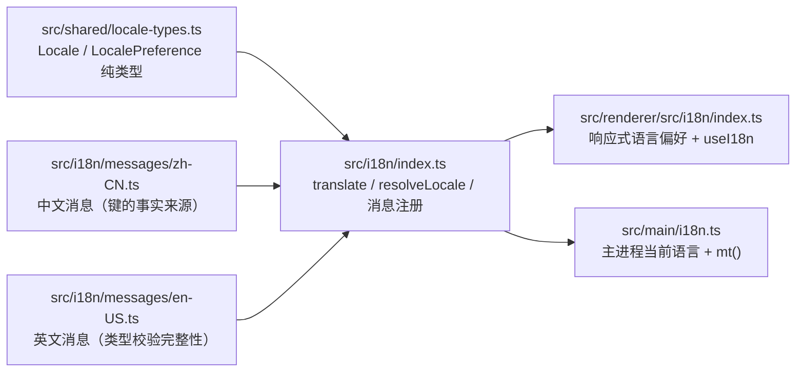

# 国际化与文案

> **文档定位**：MarkIt 的界面语言模型、消息目录组织、跨进程同步与文案约定。面向新增界面文案、排查「切换语言后部分窗口没变」类问题的维护者。
> 本文对应公开发布整改项 **UX-08**（明确 i18n 策略）。当前支持 **简体中文（`zh-CN`）** 与 **英文（`en-US`）** 两种界面语言。

## 1. 背景与目标

UX-08 要求在产品公开前明确文案策略，避免公开后再整体改写文案结构。MarkIt 选择**引入 i18n**，而不是限定仅中文：

1. 界面文案、原生对话框、错误提示、内置使用手册都支持中英文切换。
2. 语言选择跟随系统，也可在设置页显式指定；显式选择跨重启、跨窗口保持。
3. 文案通过统一的消息目录维护，新增语言只需增加一份字典，不改组件结构。
4. 不引入第三方 i18n 运行时：消息目录是纯数据，翻译函数是可单测的纯函数，主进程与渲染进程共用同一份字典。

非目标：RTL 布局、三种及以上语言、按语言格式化日期 / 数字 / 复数规则的完整 ICU 支持。需要时再扩展，不改变现有键名与调用方式。

## 2. 语言模型

### 2.1 类型与选项

| 类型               | 取值                 | 说明                                              |
| ------------------ | -------------------- | ------------------------------------------------- |
| `Locale`           | `'zh-CN' \| 'en-US'` | 实际生效的界面语言                                |
| `LocalePreference` | `'system' \| Locale` | 用户在设置页的选择；`system` 表示跟随操作系统语言 |

`Locale` 与 `LocalePreference` 是跨进程纯类型，定义在 [`src/shared/locale-types.ts`](../../src/shared/locale-types.ts)。

### 2.2 默认值与持久化

1. 持久化键：`markit-locale`，值为 `system` / `zh-CN` / `en-US`。
2. 键不存在或值非法时按 `system` 处理。
3. `system` 的解析规则：读取 `navigator.language`（渲染进程）或 `app.getLocale()`（主进程），以 `zh` 开头取 `zh-CN`，以 `en` 开头取 `en-US`，其余回退 `en-US`。
4. 语言偏好属于应用级全局设置：设置窗口修改后，所有编辑窗口与更新窗口通过 `storage` 事件立即同步；同时经 IPC 把解析后的 `Locale` 告知主进程。
5. 更新详情窗口只读该键，不提供修改入口。

### 2.3 生效范围与边界

| 范围                                     | 是否随语言切换     | 说明                                                                                          |
| ---------------------------------------- | ------------------ | --------------------------------------------------------------------------------------------- |
| 工具栏、状态栏、标签栏、设置页、更新窗口 | 立即               | 响应式文案                                                                                    |
| 标题栏 / 任务栏窗口标题、`<html lang>`   | 立即               | 各窗口监听语言变化后写 `document.title` 与 `documentElement.lang`                             |
| 原生打开 / 保存对话框、错误框、诊断日志  | 下一次调用主进程时 | 主进程持有最近一次同步的语言                                                                  |
| 已打开的文档内容（含内置手册标签）       | 不改变             | 文档是用户内容；切换语言后重新打开手册会得到对应语言版本                                      |
| 已产生的错误信息                         | 不追溯翻译         | 主进程写入 `UpdateState.error` 时已按当时语言生成                                             |
| 系统 / Node 技术错误原文                 | 不翻译             | 作为详情追加在本地化提示之后                                                                  |
| 系统对话框的系统按钮                     | 不随应用切换       | 「取消 / 保存」等按钮由操作系统绘制并跟随系统语言；应用控制的标题、筛选项与错误框正文仍本地化 |
| 日志、代码注释、测试用例名               | 不翻译             | 日志固定英文，注释与文档固定中文                                                              |

## 3. 消息目录

### 3.1 目录结构



- `src/i18n/` 是**跨进程纯数据与纯函数**模块，不引用 Electron、Vue、Node 或浏览器 API，因此可以同时被主进程与渲染进程打包。
- `src/shared/` 继续保持「纯类型」定位，只放 `Locale` 类型，不放字典。
- 渲染进程入口 [`src/renderer/src/i18n/index.ts`](../../src/renderer/src/i18n/index.ts) 负责 localStorage、`navigator.language`、`storage` 事件与 Vue 响应式；这是唯一接触浏览器的 i18n 模块。
- 主进程入口 [`src/main/i18n.ts`](../../src/main/i18n.ts) 持有当前生效语言，供 `dialog`、错误框、诊断日志与更新状态使用。

### 3.2 键名规范

1. 键为**扁平的点分小写字符串**，按领域前缀分组：`common.`、`file.`、`settings.`、`update.`、`export.`、`main.`、`manual.` 等。
2. 中文字典 `zh-CN.ts` 是键名的唯一事实来源；英文字典用 `Record<MessageKey, string>` 声明，缺键或多键都会在 `npm run typecheck` 阶段报错。
3. 键名描述**语义**，不描述位置（用 `toolbar.exportPdf` 而不是 `toolbar.button5`），也不包含品牌名。
4. 同一文案在多个位置复用时提取为 `common.*`；仅一个位置使用的文案保留在所属领域，避免过度抽象。
5. 不在组件内拼接可翻译句子；含变量的句子整体作为一条消息，用占位符表达。

### 3.3 插值与复数

```ts
translate('en-US', 'status.words', { count: 12 }) // "Words: 12"
translate('zh-CN', 'file.moreFailures', { count: 3 }) // "另有 3 个文件未能打开。"
```

- 占位符格式为 `{name}`；未提供的占位符原样保留，便于开发期发现遗漏。
- 英文需要区分单复数时，消息值用 `单数|复数` 两段表示；`translate` 在 `params.count === 1` 时取第一段，否则取第二段。中文可以只写一段（不出现 `|`）。
- 不引入 ICU MessageFormat；当前文案用「Words: {count}」「{count} more file(s)」等句式即可覆盖。

## 4. 渲染进程

### 4.1 响应式语言偏好

[`src/renderer/src/i18n/index.ts`](../../src/renderer/src/i18n/index.ts) 在模块级维护 `LocalePreference` 的 `ref`：

- 初始化时读取 `markit-locale`；不存在则 `system`。
- 计算属性 `locale` 按偏好解析 `navigator.language`。
- `setLocalePreference(next)` 写入 localStorage、更新 `ref`、调用 `window.api.setLocale(locale)`。
- 监听 `storage` 事件：任一窗口修改键后，其他窗口更新偏好并向主进程同步。
- `useI18n()` 返回 `{ locale, preference, t, setLocalePreference }`；`t(key, params)` 读取 `locale.value`，因此模板与 `computed` 会自动重渲染。
- 组件在 `script setup` 中直接使用 `const { t } = useI18n()`；模板写 `{{ t('...') }}`，属性写 `:title="t('...')"`。

### 4.2 非组件模块

`stores/`、`composables/` 与 `utils/` 中需要生成用户可见文案时：

- store / composable 可以直接调用 `t()`（模块级函数，读取当前语言）。
- `utils/` 中的纯函数**不直接读取语言**，而是由调用方把 `locale` 或已翻译的标签作为参数传入，保持纯函数可测（例如 `describeFileError(error, locale)`、`renderFrontmatterTable(entries, locale)`）。
- 错误结构仍以错误码跨进程传递；渲染进程按码翻译，不翻译主进程返回的技术 `message`。

### 4.3 模板与 DOM 生成

- 模板内不保留硬编码中文 / 英文界面文案。
- 通过 `document.createElement` 动态生成的控件（Mermaid 工具栏、表格列宽手柄）在创建时调用 `t()`；语言切换后，这些控件在下一次预览重渲染时更新。
- `document.title` 与 `document.documentElement.lang` 在窗口根组件中监听 `locale` 并同步。

## 5. 主进程

### 5.1 语言同步

新增 IPC 通道 `app:set-locale`：

| 项      | 内容                                                             |
| ------- | ---------------------------------------------------------------- |
| 方向    | 渲染进程 → 主进程（`invoke`）                                    |
| preload | `window.api.setLocale(locale: Locale): Promise<boolean>`         |
| 主进程  | 校验发送方为编辑 / 设置 / 更新窗口；校验 `locale` 合法后写入内存 |
| 返回值  | 合法且已更新返回 `true`，否则 `false`                            |

主进程不单独持久化语言：渲染进程的 `markit-locale` 是唯一事实来源，每个窗口加载时都会同步一次。应用启动早期（渲染进程尚未同步）使用 `app.getLocale()` 解析出的系统语言作为兜底。

### 5.2 主进程文案

[`src/main/i18n.ts`](../../src/main/i18n.ts) 提供 `mt(key, params)`，覆盖：

- 原生错误框 / 消息框：崩溃提示、导出失败、渲染进程退出；
- 原生保存对话框标题与筛选项名称；
- 导出进度阶段（通过 `ExportProgress.stage` 推送给渲染进程）；
- 自动更新的用户可见错误与「退出应用 / 安装更新」动作标签；
- VSCode 集成的用户可见失败原因；
- 诊断日志导出的标题与字段；
- 标签拖拽悬浮提示中的「窗口 N / 未命名标签」。

日志正文、技术异常原文与 `Failed to ...` 调试日志保持英文，不进入消息目录。

### 5.3 窗口标题

`BrowserWindow` 创建时使用 `mt('window.settingsTitle')` / `mt('window.updateTitle')`；窗口页面加载后由渲染进程写 `document.title`，语言切换时立即更新，任务栏与窗口切换器随之变化。

## 6. 内置使用手册

1. 中文手册保留在 [`src/renderer/src/assets/welcome.md`](../../src/renderer/src/assets/welcome.md)；英文手册为 `src/renderer/src/assets/welcome.en-US.md`。
2. 启动欢迎页与工具栏「使用手册」按当前 `locale` 选择文件与标签名（`使用手册.md` / `User Manual.md`）。
3. 手册是文档内容，不随语言切换实时替换已打开的标签；用户重新点击「使用手册」时会得到当前语言版本。
4. 两份手册的内容结构、章节顺序与 Mermaid 示例保持一致；修改一份功能说明时必须同步另一份。

## 7. 设置界面

设置窗口「外观」页新增「界面语言」区块，使用与设置页主题一致的**自绘下拉列表**呈现（原生 `<select>` 的弹层字体与主题不受控，统一使用应用字体与配色）：

| 选项     | 值       | 说明                                  |
| -------- | -------- | ------------------------------------- |
| 跟随系统 | `system` | 根据操作系统语言在中文 / 英文之间选择 |
| 简体中文 | `zh-CN`  | 固定中文                              |
| English  | `en-US`  | 固定英文                              |

下拉选项由 `SUPPORTED_LOCALES` + `LOCALE_LABEL_KEYS` 生成，而不是在模板里写死按钮；后续新增语言只需扩展语言类型、消息目录与标签映射，设置页自动出现新选项。下拉支持键盘聚焦、`aria-expanded` / `aria-selected`，点击外部或按 `Esc` 收起。

设置搜索索引同时包含中英文关键词，便于任一种语言下检索。语言切换立即生效并同步到所有窗口，无需重启。

## 8. 测试与验收

1. `src/i18n/index.spec.ts` 覆盖：`resolveLocale` 的区域匹配与回退、占位符替换、缺失占位符保留、单复数选择、英文字典键完整性（类型系统兜底，用例防止运行时结构被绕过）。
2. `npm run typecheck` 保证英文字典覆盖全部中文键。
3. 手工验证：
   - 设置页切换中文 / 英文，编辑窗口、设置窗口、更新窗口的可见文案立即变化；
   - 重启后语言保持；
   - 系统语言为英文时首次启动显示英文；
   - 原生打开 / 保存对话框、导出失败提示、更新错误提示使用当前语言；
   - 英文下工具栏、状态栏、设置页无截断或溢出；
   - 工具栏「使用手册」在两种语言下打开对应手册。
4. e2e 通过启动参数 `--lang=zh-CN` 固定语言，避免 CI 系统语言导致断言不稳定；`e2e/i18n.spec.ts` 覆盖设置页切换英文、跨窗口同步、重启后保持与英文手册打开。

## 9. 迁移范围与后续扩展

| 范围                                                 | 本轮处理         |
| ---------------------------------------------------- | ---------------- |
| 渲染进程组件 / store / composable / 用户可见工具函数 | 全部迁移         |
| 主进程原生日志之外的用户可见文案                     | 全部迁移         |
| 内置使用手册                                         | 中英文两份       |
| 日志、注释、提交信息、文档                           | 不迁移           |
| 第三方错误原文                                       | 保留原文作为详情 |

新增语言时：

1. 在 `src/shared/locale-types.ts` 扩展 `Locale`；
2. 新增 `src/i18n/messages/<locale>.ts` 并在 `src/i18n/index.ts` 注册；
3. 设置页语言选项增加对应条目；
4. 补充该语言的使用手册；
5. 运行 `npm run typecheck`、`npm test`，并做一次全窗口手工检查。
