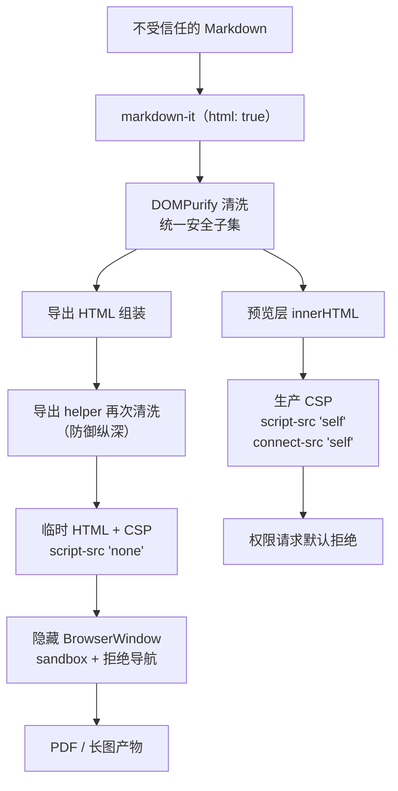

# 渲染安全与内容沙箱

> 文档定位：定义「打开不受信任的 Markdown」时的安全边界，覆盖渲染内容清洗、CSP、权限策略、窗口沙箱与导出窗口隔离。是 [公开发布整改计划](../工程与质量/公开发布整改计划.md) 中 SEC-01 ~ SEC-08 的设计依据。
> 代码基线：`1.6.0-beta.13`，`develop` 分支，设计日期 2026-11-16。
> 关联文档：[编辑器与预览](../编辑与预览/编辑器与预览.md)、[Mermaid 图表与导出](../编辑与预览/Mermaid图表与导出.md)、[PDF 导出](../导出/PDF导出.md)、[图片导出](../导出/图片导出.md)、[IPC 接口与进程契约](../架构与契约/IPC接口与进程契约.md)。

## 1. 背景与威胁模型

MarkIt 支持在 Markdown 中直接书写 HTML，并在预览中按 HTML 渲染。内测阶段文档来源可信，这个设计没有暴露问题；公开发布后，用户会打开同事、客户或互联网上发来的 `.md`，文档作者变成**不受信任的输入方**。

需要保护的资产：

| 资产           | 说明                                                  |
| -------------- | ----------------------------------------------------- |
| 本地文件       | preload 暴露的 `file:read` / `file:save` 接受任意路径 |
| 应用持久化数据 | `userData/session.json`、编辑历史、更新偏好           |
| 系统持久化能力 | 可写入启动目录、用户脚本目录等位置                    |
| 网络身份       | 预览默认加载远程图片，可暴露 IP 与打开行为            |

威胁模型：攻击者能控制一份 Markdown 的内容，并诱导用户用 MarkIt 打开它；不能直接控制用户机器，也不能伪造安装包。

## 2. 现状问题

| 编号   | 问题                                                        | 位置                                                                                       |
| ------ | ----------------------------------------------------------- | ------------------------------------------------------------------------------------------ |
| SEC-01 | `html: true` + `innerHTML`，渲染结果无任何清洗              | `utils/markdown.ts`、`components/preview/MarkdownPreview.vue`                              |
| SEC-02 | 导出 HTML 先在渲染进程 `innerHTML` 组装，再写入临时文件加载 | `utils/export-markdown.ts`、`composables/usePdfExport.ts`、`composables/useImageExport.ts` |
| SEC-03 | Mermaid `securityLevel: 'loose'`，SVG 直接注入 DOM          | `utils/diagram-theme.ts`、`utils/diagram-renderer.ts`                                      |
| SEC-04 | 三个入口 HTML 均无 CSP                                      | `src/renderer/index.html`、`settings.html`、`update.html`                                  |
| SEC-05 | 未设置权限处理器，Electron 默认放行权限请求                 | `src/main/index.ts`                                                                        |
| SEC-06 | 设置窗缺少 `will-navigate`，更新窗两者都没有                | `src/main/settings-window.ts`、`src/main/updater.ts`                                       |
| SEC-07 | `markit-file://` 带 `bypassCSP` / `supportFetchAPI`         | `src/main/index.ts`                                                                        |
| SEC-08 | 编辑 / 设置 / 更新 / PDF 窗口为 `sandbox: false`            | `src/main/index.ts`、`src/main/settings-window.ts`、`src/main/updater.ts`                  |

实际攻击路径不止预览一处：`export-markdown.ts` 会在**编辑窗口内**把待导出的 HTML 赋给 `innerHTML`，因此导出流程同样能把事件属性带进主渲染进程；写临时文件后 `loadFile` 还会真正执行 `<script>`。

## 3. 设计目标与非目标

**目标**

1. 不受信任的 Markdown 不能执行脚本、事件属性、`javascript:` 链接、表单提交或框架嵌套。
2. 即使清洗被绕过，CSP 与权限策略仍能阻止远程脚本、数据外传与系统权限申请。
3. 三处输出管线（预览、PDF、长图）使用同一套清洗规则，不出现「预览安全、导出不安全」。
4. 不破坏现有能力：内嵌 HTML（`<kbd>`、`<mark>`）、任务列表、本地图片、标题锚点、Mermaid、表格列宽。

**非目标**

- 不禁止内嵌 HTML（产品明确支持），而是保留安全子集。
- 不实现完整的内容沙箱（如独立 renderer 进程或 iframe 隔离），本批以清洗 + CSP + 窗口加固为边界。
- 不改变 `markit-file://` 的图片扩展名白名单，也不扩大为任意文件读取。

## 4. 纵深防御



四层边界：

1. **内容层**：DOMPurify 只保留安全标签、属性与协议。
2. **文档层**：生产 CSP 限制脚本来源、连接目标与框架嵌套。
3. **窗口层**：所有窗口 `sandbox`、拒绝导航与新窗口、导出窗口独立隔离。
4. **能力层**：权限请求默认拒绝；主进程文件能力后续按路径收敛（SEC-09）。

## 5. 内容清洗

### 5.1 模块与调用点

新增 `src/renderer/src/utils/sanitize.ts`，导出：

| 导出                             | 用途                        | 调用点                                                             |
| -------------------------------- | --------------------------- | ------------------------------------------------------------------ |
| `sanitizeMarkdownHtml`           | 清洗 Markdown 渲染结果      | `MarkdownPreview.previewHtmlFor`、`renderMermaidDiagramsForExport` |
| `EXPORT_CONTENT_SECURITY_POLICY` | 导出 HTML 使用的 CSP 字符串 | `usePdfExport`、`useImageExport` 的模板                            |

`renderMermaidDiagramsForExport` 是 PDF 与长图共用的出口，在它内部清洗可以保证两条导出管线不会漏掉；预览则在 `previewHtmlFor` 的缓存写入前清洗，保证缓存里只有安全 HTML。

### 5.2 规则

| 维度     | 规则                                                                                                                                      |
| -------- | ----------------------------------------------------------------------------------------------------------------------------------------- |
| 标签     | 保留 DOMPurify 默认安全集合；额外禁止 `style`、`iframe`、`frame`、`object`、`embed`、`link`、`meta`、`base`、`form`、`textarea`、`select` |
| 属性     | 默认允许 `class`、`id`、`data-*`、`aria-*`、`style`；事件属性与 `srcdoc` 由 DOMPurify 自动移除                                            |
| 链接协议 | `http` / `https` / `mailto` / `tel` / `file` / `markit-file` / 相对路径 / `data:image/*`                                                  |
| 任务列表 | 保留 `input[type=checkbox][disabled]`，避免任务清单失效                                                                                   |
| 标题锚点 | 保留 `id="heading-N"`，大纲与页内跳转依赖                                                                                                 |
| 本地图片 | 保留 `markit-file://local/?p=...`，否则相对路径图片全部失效                                                                               |
| 内嵌 SVG | 交给 DOMPurify 的 SVG 规则处理，移除脚本与事件属性                                                                                        |

`style` 属性仍允许，因为部分文档用它做排版；这留下「用 CSS 遮挡界面做钓鱼」的残余风险，见第 9 节。

### 5.3 为什么不在 markdown-it 插件层清洗

`html: true` 的原始 HTML 分散在 `html_block` / `html_inline` token 中，插件层只能逐个 token 处理，还要覆盖 frontmatter 表格、TOC 等后拼接内容。在最终 HTML 出口统一次清洗更不容易漏，也和「预览与导出共用一套规则」的要求一致。

## 6. CSP

### 6.1 注入方式

在 `electron.vite.config.ts` 的 renderer 配置里增加一个 `apply: 'build'` 的 Vite 插件，通过 `transformIndexHtml` 向三个入口的 `<head>` 注入 CSP。开发模式不注入，避免 Vite HMR 的 WebSocket 与内联样式被拦截。

生产 CSP 基线：

```text
default-src 'none';
script-src 'self';
style-src 'self' 'unsafe-inline';
img-src 'self' data: blob: file: markit-file: https: http:;
font-src 'self' data:;
media-src 'self' markit-file: data: blob:;
connect-src 'self';
worker-src 'self' blob:;
object-src 'none';
frame-src 'none';
base-uri 'none';
form-action 'none'
```

关键取舍：

- `style-src 'unsafe-inline'`：预览主题通过动态创建 `<style>` 注入，组件也有内联样式，无法去掉。
- `img-src` 保留 `http:` / `https:`：Markdown 的远程图片是现有能力，预览按既有行为直接加载；经评估不提供「不加载远程图片」开关（2026-11-17 决策，见[公开发布整改计划](../工程与质量/公开发布整改计划.md) UX-04）。
- `connect-src 'self'`：渲染进程不需要外部 fetch；即使出现 XSS，也无法把读到的内容直接外传。
- `script-src 'self'`：打包产物只有本地 module script，没有内联脚本。

### 6.2 导出 HTML 的 CSP

PDF 与长图导出在渲染进程生成完整 HTML，不经过 Vite 入口，因此在模板 `<head>` 中直接写入：

```text
default-src 'none';
script-src 'none';
style-src 'unsafe-inline';
img-src file: data: markit-file: https: http:;
font-src data:;
object-src 'none';
frame-src 'none'
```

`script-src 'none'` 不影响主进程通过 `webContents.executeJavaScript` 等待图片与字体：该 API 由主进程注入，不经过页面脚本加载流程。实施后需用 PDF 导出用例回归确认。

## 7. 窗口与协议加固

| 对象             | 调整                                                                                        |
| ---------------- | ------------------------------------------------------------------------------------------- |
| 编辑窗口         | `sandbox: true`；保留现有 `will-navigate` / `setWindowOpenHandler`                          |
| 设置窗口         | `sandbox: true`；新增 `will-navigate`，非应用页面阻止                                       |
| 更新窗口         | `sandbox: true`；新增 `will-navigate` 与 `setWindowOpenHandler`                             |
| PDF 导出窗口     | `sandbox: true`、`contextIsolation: true`、`nodeIntegration: false`；拒绝导航与新窗口       |
| 长图导出窗口     | 已是 sandbox；补充拒绝导航与新窗口                                                          |
| `markit-file://` | 移除 `bypassCSP` 与 `supportFetchAPI`，保留 `standard` / `secure` / `stream` 与扩展名白名单 |
| 默认会话权限     | `setPermissionRequestHandler` 与 `setPermissionCheckHandler` 一律拒绝                       |

`ipc-guard` 的来源校验保持不变；`sandbox` 只影响渲染进程的 Node 能力，不改变 IPC 白名单。

## 8. Mermaid

`securityLevel` 从 `'loose'` 改为 `'strict'`。strict 会转义标签文本并禁用 `click` 回调，覆盖「图表源码注入 HTML」的路径；`htmlLabels: false` 保持现状。

本批不额外接入 SVG 清洗，原因：

1. Mermaid strict 内部已经使用 DOMPurify 清洗输出；
2. 二次清洗可能移除 Mermaid 依赖的 SVG 结构或样式，导致图表降级，需要单独回归全部图表类型；
3. 如果后续需要作为防御纵深，应新增独立的 SVG 清洗函数，并在完成全部图表类型回归后再接入。

## 9. 残余风险

| 风险                                | 说明                                               | 后续处理                          |
| ----------------------------------- | -------------------------------------------------- | --------------------------------- |
| `style` 属性可用于遮挡界面做钓鱼    | 清洗后没有脚本，但 CSS 可以覆盖 UI；不影响文件读写 | 评估是否禁止 `style` 属性         |
| 远程图片暴露 IP 与打开行为          | `img-src` 允许 http/https                          | 已接受：不提供开关，见 UX-04 决策 |
| `markit-file://` 可读取任意图片路径 | 已知设计边界（L7），只读且限图片扩展名             | 需要时增加「仅文档目录」可选策略  |
| 主进程文件读写仍接受任意路径        | 清洗与 CSP 是主要防线；SEC-09 做路径收敛           | 批次 2                            |
| 活跃度上报的 HMAC secret 可被提取   | 客户端密钥天然可提取，不构成安全边界               | REL-05 在隐私说明中明确           |

## 10. 验收标准

### 10.1 自动化

1. `sanitize.spec.ts` 覆盖：`<script>`、``、`<svg onload>`、`javascript:` 链接、`<iframe>`、`<form>` 清洗后不可执行。
2. 覆盖保留项：`<kbd>`、`<mark>`、任务列表 checkbox、`heading-N` id、`markit-file:` 图片、`data:image` 图片。
3. `npm run lint`、`npm run typecheck`、`npm test` 通过。

### 10.2 手工

| 编号  | 场景                           | 预期                                                       |
| ----- | ------------------------------ | ---------------------------------------------------------- |
| MS-01 | 打开含 `` 的文档  | 预览正常显示图片占位，控制台无脚本执行，网络面板无外发请求 |
| MS-02 | 打开含 `<script>` / `<iframe>` | 脚本与框架不出现，正文其余内容正常                         |
| MS-03 | 导出同一份恶意文档 PDF / 长图  | 不执行脚本，产物可正常打开                                 |
| MS-04 | 打开内置使用手册               | 全部图表、表格、任务列表、本地图片、页内锚点正常           |
| MS-05 | 检查打包产物 HTML              | 三个入口均含 CSP meta，应用启动无 CSP 报错                 |
| MS-06 | 在预览中触发外链               | 仍由系统浏览器打开，主窗口不被导航走                       |
| MS-07 | 设置 / 更新窗口打开外链        | 窗口保持在应用页面，不跳转                                 |

## 11. 不变量

1. 新增任何 Markdown 渲染出口，必须先经过 `sanitizeMarkdownHtml`；预览与导出共用规则，不得只修一条管线。
2. `markit-file://` 只用于预览图片，扩展名白名单不得放宽。
3. 生产 CSP 不得加入 `script-src 'unsafe-inline'` / `'unsafe-eval'`；如需内联脚本，改用构建期 hash。
4. 新增窗口必须显式声明 `sandbox`、`contextIsolation`、`nodeIntegration`，并补齐导航与新窗口兜底。
5. 权限处理器不得整体改为放行；新增能力必须逐项列入白名单。
