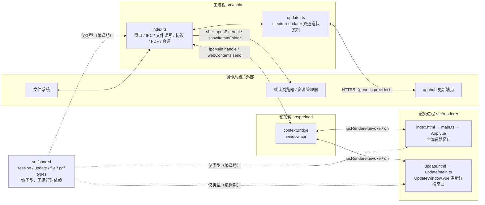
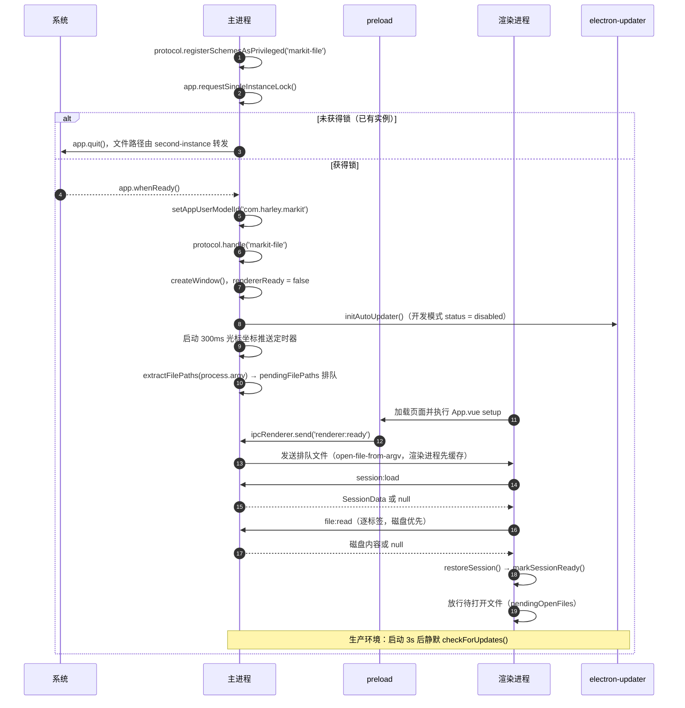
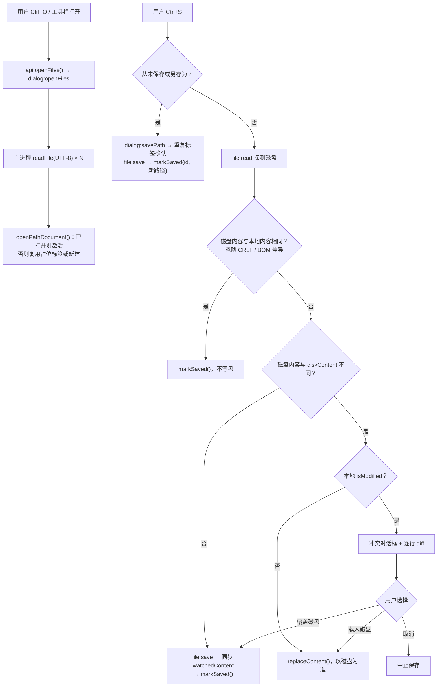
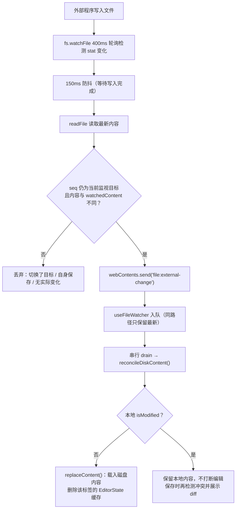
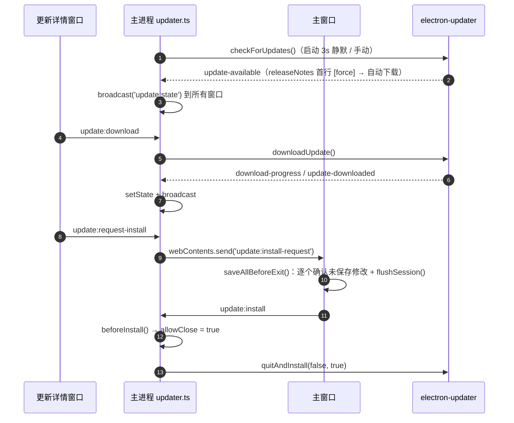

# MarkIt 架构总览

> 文档定位：面向接手本仓库的开发者的整体架构说明，覆盖进程边界、模块职责、构建链路、启动时序与关键数据流。
> 适用读者：需要新增功能、修改 IPC、排查跨进程问题或进行代码评审的开发者。
> 代码基线：MarkIt v1.5.0，`develop` 分支，文档基线同步 2026-11-10。文中结论均以源码为准，接口细节见 [IPC 接口与进程契约](./IPC接口与进程契约.md)。

## 1. 产品定位与能力边界

### 1.1 定位

MarkIt 是一款**本地优先**的 Markdown 桌面编辑器：以单个文件为操作单位，编辑、实时预览、图表渲染与 PDF 导出全部在本机完成，不依赖账号、云端或网络服务（自动更新除外）。工程是**单包 npm 工程**，构建工具为 `electron-vite`，技术底座为 Electron + Vue 3 + TypeScript。

### 1.2 能力清单

| 能力域      | 已实现能力                                                                                       | 主要入口                                                                                                                                                        |
| ----------- | ------------------------------------------------------------------------------------------------ | --------------------------------------------------------------------------------------------------------------------------------------------------------------- |
| 编辑        | CodeMirror 6 语法高亮、行号、代码折叠、多光标、格式化工具栏、全局快捷键                          | [`MarkdownEditor.vue`](../src/renderer/src/components/editor/MarkdownEditor.vue)                                                                                |
| 文件        | `.md` / `.markdown` / `.txt`，UTF-8 读写，多选打开，保存 / 另存为 / 刷新、资源管理器定位         | [`useFile.ts`](../src/renderer/src/composables/useFile.ts)、[`src/main/index.ts`](../src/main/index.ts)                                                         |
| 多标签      | 每个标签独立内容、光标、撤销历史、编辑区与预览区滚动位置、布局模式；拖拽排序、批量关闭与右键菜单 | [`documents.ts`](../src/renderer/src/stores/documents.ts)、[`TabBar.vue`](../src/renderer/src/components/layout/TabBar.vue)、[标签拖拽排序](./标签拖拽排序.md)  |
| 实时预览    | markdown-it 渲染、frontmatter 表格化、标题锚点、相对路径图片、链接分流                           | [`MarkdownPreview.vue`](../src/renderer/src/components/preview/MarkdownPreview.vue)                                                                             |
| Mermaid     | 多图表类型识别、缩放、弹窗预览、SVG / PNG 下载、失败回退代码块                                   | [`mermaid.ts`](../src/renderer/src/utils/mermaid.ts)、[`diagram-export.ts`](../src/renderer/src/utils/diagram-export.ts)                                        |
| 大纲        | 按标题层级生成树、点击跳转（预览锚点或编辑器行号）                                               | [`useOutline.ts`](../src/renderer/src/composables/useOutline.ts)、[`OutlinePanel.vue`](../src/renderer/src/components/outline/OutlinePanel.vue)                 |
| 主题        | 浅色 / 深色 / 跟随系统；四套内置预览样式（各含亮暗两版）；运行期导入自定义 CSS                   | [`app.ts`](../src/renderer/src/stores/app.ts)、[`style.ts`](../src/renderer/src/stores/style.ts)                                                                |
| PDF         | A4 / Letter、打印背景、frontmatter、Mermaid SVG                                                  | [`usePdfExport.ts`](../src/renderer/src/composables/usePdfExport.ts)                                                                                            |
| 文件监听    | 仅监视当前活跃标签；外部修改自动同步；保存时检测冲突并展示逐行差异                               | [`useFileWatcher.ts`](../src/renderer/src/composables/useFileWatcher.ts)、[`text-diff.ts`](../src/renderer/src/utils/text-diff.ts)                              |
| 会话恢复    | 标签顺序、路径、内容、激活项、光标；磁盘优先、读不到回退会话内容                                 | [`useSession.ts`](../src/renderer/src/composables/useSession.ts)、[`session-types.ts`](../src/shared/session-types.ts)                                          |
| 自动更新    | apphub generic provider、stable / beta 双通道、启动静默检测、进度、强制更新、独立更新详情窗口    | [`updater.ts`](../src/main/updater.ts)、[`update-channel.ts`](../src/main/update-channel.ts)、[`UpdateWindow.vue`](../src/renderer/src/update/UpdateWindow.vue) |
| VSCode 集成 | 检测 Stable / Insiders、安装或移除扩展、资源管理器右键打开 Markdown、多选与单实例转发            | [`vscode-integration.ts`](../src/main/vscode-integration.ts)、[VSCode 资源管理器集成](./VSCode资源管理器集成.md)                                                |
| 窗口        | 无边框 / 毛玻璃、窗口状态记忆、整窗缩放、VS Code 风格滚动条                                      | [`src/main/index.ts`](../src/main/index.ts)、[`useScrollbarState.ts`](../src/renderer/src/composables/useScrollbarState.ts)                                     |

### 1.3 明确不在范围内

- **无云端能力**：没有账号、同步、协作、遥测与崩溃上报；除自动更新检查外不发起网络请求。
- **无工作区概念**：不维护目录树、文件索引、全局搜索或 Git 集成，一次只处理用户显式打开的文件。
- **无插件体系**：没有插件市场或第三方扩展点；自定义预览 CSS 只在当前运行期生效。
- **非所见即所得**：编辑区只编辑 Markdown 源文本，预览区只读渲染，不支持在预览中直接编辑。
- **只处理 UTF-8 文本**：不做编码嗅探与转换；图片仅通过只读协议展示，不编辑二进制文件。
- **工程边界**：单包 npm（非 monorepo），已引入 Vitest（纯函数）与 Playwright（Electron e2e），但没有 git 钩子；质量门槛为 `lint` / `typecheck` / `npm test` 与手工验证。

## 2. 技术栈

版本取自 [`package.json`](../package.json)（应用版本 `1.5.0`）。

| 技术                   | 版本                                                                                                                             | 用途                                             | 落地位置                                                                                         |
| ---------------------- | -------------------------------------------------------------------------------------------------------------------------------- | ------------------------------------------------ | ------------------------------------------------------------------------------------------------ |
| Electron               | `^39.2.6`                                                                                                                        | 桌面运行时、主进程能力、`printToPDF`             | `src/main`、`src/preload`                                                                        |
| Vue                    | `^3.5.25`                                                                                                                        | 渲染层组件与组合式 API                           | `src/renderer/src/**/*.vue`                                                                      |
| Pinia                  | `^3.0.4`                                                                                                                         | 渲染进程状态管理                                 | `src/renderer/src/stores`                                                                        |
| CodeMirror             | `codemirror ^6.0.2`、`@codemirror/lang-markdown ^6.5.0`、`@codemirror/language-data ^6.5.2`、`@codemirror/theme-one-dark ^6.1.3` | 编辑引擎、Markdown 高亮、代码块语言、深色主题    | [`MarkdownEditor.vue`](../src/renderer/src/components/editor/MarkdownEditor.vue)                 |
| markdown-it            | `^15.0.3`                                                                                                                        | Markdown → HTML（预览与 PDF 各一条管线）         | [`markdown.ts`](../src/renderer/src/utils/markdown.ts)、`MarkdownPreview.vue`、`usePdfExport.ts` |
| markdown-it-task-lists | `^2.1.1`                                                                                                                         | GitHub 规范的任务列表（`contains-task-list` 等） | [`markdown.ts`](../src/renderer/src/utils/markdown.ts)                                           |
| highlight.js           | `^11.12.0`                                                                                                                       | 预览与 PDF 的代码块语法高亮（common 语言集）     | [`markdown.ts`](../src/renderer/src/utils/markdown.ts)                                           |
| Mermaid                | `^11.15.0`                                                                                                                       | 图表渲染（动态 `import()`）                      | [`mermaid.ts`](../src/renderer/src/utils/mermaid.ts) 等                                          |
| electron-vite          | `^5.0.0`（Vite `^7.2.6`）                                                                                                        | 三段构建、开发服务器、多页入口                   | [`electron.vite.config.ts`](../electron.vite.config.ts)                                          |
| electron-builder       | `^26.0.12`                                                                                                                       | 三平台打包与产物元信息                           | [`electron-builder.yml`](../electron-builder.yml)                                                |
| electron-updater       | `^6.3.9`                                                                                                                         | 自动更新（generic provider）                     | [`updater.ts`](../src/main/updater.ts)                                                           |
| TypeScript             | `^5.9.3`（`vue-tsc ^3.1.6`）                                                                                                     | 类型检查（node / web 双配置）                    | `tsconfig*.json`                                                                                 |
| ESLint / Prettier      | `^9.39.1` / `^3.7.4`                                                                                                             | 静态检查与格式化                                 | [`eslint.config.mjs`](../eslint.config.mjs)、[`.prettierrc.yaml`](../.prettierrc.yaml)           |

## 3. 进程模型

MarkIt 使用 Electron 标准三层结构，另有一个**仅存在于编译期**的共享类型目录。

### 3.1 边界规则

1. **主进程独占 Node / Electron 能力**：文件读写、对话框、窗口、协议、自动更新、PDF 打印均只在 `src/main` 实现。
2. **渲染进程是纯 Web 环境**：禁止 `import ... from 'electron'`（已核实 `src/renderer` 下 0 处），只能调用 preload 暴露的 `window.api`；不暴露通用 `ipcRenderer` / `process`。
3. **新增 IPC 必须三处同步**：主进程 `registerHandle` / `registerOn`（[`ipc-guard.ts`](../src/main/ipc-guard.ts) 校验调用来源）→ preload `ipcRenderer.invoke` / `send` → [`src/preload/index.d.ts`](../src/preload/index.d.ts) 的类型声明。`ExposedAPI = typeof api` 是唯一契约来源。
4. **`src/shared` 只放纯类型**：`session-types.ts`、`update-types.ts`、`file-types.ts`、`pdf-types.ts`、`integration-types.ts` 不含任何运行时依赖，供主进程与渲染进程共同 `import type`。
5. **preload 关闭沙箱**：两个窗口的 `webPreferences` 都是 `sandbox: false`，preload 依赖 `process.platform`、`process.contextIsolated` 与 `ipcRenderer`；这不是开放 `nodeIntegration`，渲染进程仍无 Node 全局。
6. **外部导航一律离开主窗口**：`setWindowOpenHandler` 与 `will-navigate` 双重兜底，只允许 `http/https/mailto` 交给系统，`file:` 定位到资源管理器，其余协议忽略。

### 3.2 窗口清单

| 窗口         | 创建位置                                                                | 加载页面                  | 规格                        | 备注                                                                              |
| ------------ | ----------------------------------------------------------------------- | ------------------------- | --------------------------- | --------------------------------------------------------------------------------- |
| 主编辑器窗口 | `createWindow()`（[`src/main/index.ts`](../src/main/index.ts)）         | `index.html`              | 默认 1280×800，最小 800×600 | 无边框（macOS 用 hidden titleBar + 交通灯），Windows/Linux 使用 `titleBarOverlay` |
| 更新详情窗口 | `openUpdateWindow()`（[`src/main/updater.ts`](../src/main/updater.ts)） | `update.html`             | 560×680，最小 460×520       | 单实例，重复打开时聚焦已有窗口；独立 Pinia 实例                                   |
| PDF 隐藏窗口 | `export:pdf` handler                                                    | 临时 HTML 文件 `loadFile` | 800×1100，`show: false`     | 无 preload，只用于 `printToPDF`，用完即关并删除临时文件                           |

## 4. 模块职责

### 4.1 主进程 `src/main`

| 文件                                                         | 职责                                                                                                                                                                              |
| ------------------------------------------------------------ | --------------------------------------------------------------------------------------------------------------------------------------------------------------------------------- |
| [`index.ts`](../src/main/index.ts)                           | 单实例锁与 argv 文件转发；窗口创建 / 关闭守卫 / 窗口状态持久化；`markit-file` 协议；文件打开 / 保存 / 监视 / 定位；会话读写；PDF 导出；整窗缩放；300ms 光标坐标推送；外部链接分流 |
| [`vscode-integration.ts`](../src/main/vscode-integration.ts) | VSCode Stable / Insiders 路径检测、扩展安装 / 卸载、启动配置同步；检测与版本选择逻辑可脱离 Electron 单测                                                                          |
| [`updater.ts`](../src/main/updater.ts)                       | `electron-updater` 初始化、双通道 feed 选择、Beta 偏好持久化、状态机与广播、更新详情窗口、安装请求转交、强制更新标记解析                                                          |
| [`update-channel.ts`](../src/main/update-channel.ts)         | 通道元数据文件名、版本解析与比较、候选通道选择（纯函数，配套单元测试）                                                                                                            |

关键模块级状态：`mainWindow`、`pendingFilePaths`（待放行文件）、`rendererReady`、`allowClose`、`pendingQuit`（本次关闭来自退出应用）、`watchedFilePath` / `watchedContent` / `watchSeq`、`currentZoomFactor`、`saveStateTimer`。

### 4.2 预加载 `src/preload`

| 文件                                      | 职责                                                                                                                                                                      |
| ----------------------------------------- | ------------------------------------------------------------------------------------------------------------------------------------------------------------------------- |
| [`index.ts`](../src/preload/index.ts)     | 组装 `api` 对象（文件、窗口、链接、图片保存、PDF、会话、更新、光标），`contextBridge.exposeInMainWorld` 暴露 `window.api`；`onOpenFile` 在注册监听后发送 `renderer:ready` |
| [`index.d.ts`](../src/preload/index.d.ts) | 扩展 `Window` 接口，声明 `window.api: ExposedAPI`                                                                                                                         |

注意：多数 `onXxx` 订阅函数**没有返回取消函数**，只有 `onExternalFileChange` 返回 `off`；重复挂载可能叠加监听。

### 4.3 共享类型 `src/shared`

| 文件                                                         | 职责                                                                                                   |
| ------------------------------------------------------------ | ------------------------------------------------------------------------------------------------------ |
| [`session-types.ts`](../src/shared/session-types.ts)         | `SessionTab`（路径、名称、内容、修改标记、光标行列、行尾与 BOM）、`SessionData`（标签数组 + 激活下标） |
| [`update-types.ts`](../src/shared/update-types.ts)           | `UpdateStatus` 状态联合、`UpdateChannel`、`UpdateProgress`、`UpdateState`（含通道与 Beta 开关）        |
| [`file-types.ts`](../src/shared/file-types.ts)               | `FileReadResult`：`path` + `content`                                                                   |
| [`pdf-types.ts`](../src/shared/pdf-types.ts)                 | `PdfPageSize`、`PdfMargin`、`PdfExportOptions`                                                         |
| [`integration-types.ts`](../src/shared/integration-types.ts) | VSCode 安装状态、集成操作结果与启动配置结构                                                            |

### 4.4 渲染进程 `src/renderer/src`

**组件（按领域分目录）**

| 目录                  | 关键文件                                                                                       | 职责                                                        |
| --------------------- | ---------------------------------------------------------------------------------------------- | ----------------------------------------------------------- |
| `components/layout`   | `AppLayout.vue`、`TitleBar.vue`、`TabBar.vue`、`Toolbar.vue`、`StatusBar.vue`、`SplitPane.vue` | 整体骨架、标题栏与标签、文件/布局工具栏、状态栏、可拖拽分栏 |
| `components/editor`   | `MarkdownEditor.vue`、`EditorPane.vue`、`EditorToolbar.vue`                                    | CodeMirror 视图与状态缓存、编辑区容器、格式化按钮           |
| `components/preview`  | `MarkdownPreview.vue`、`DiagramPreviewModal.vue`                                               | Markdown 渲染、Mermaid 包装与渲染调度、图表弹窗             |
| `components/outline`  | `OutlinePanel.vue`                                                                             | 大纲树、点击跳转、宽度拖拽                                  |
| `components/settings` | `SettingsDialog.vue`                                                                           | 主题、预览样式、自定义 CSS、更新检查                        |
| `components/export`   | `PdfExportDialog.vue`                                                                          | 纸张、页边距、页码、目录选项与导出加载态                    |
| `components/update`   | `UpdateNotice.vue`                                                                             | 主窗口内的更新提示卡片                                      |
| `components/common`   | `ConfirmDialog.vue`                                                                            | 未保存确认、冲突差异展示                                    |

**组合式函数 `composables/`**

| 文件                      | 职责                                                                                                      |
| ------------------------- | --------------------------------------------------------------------------------------------------------- |
| `useFile.ts`              | 打开 / 保存 / 另存为 / 关闭 / 刷新；保存前磁盘探测与冲突协调；`reconcileDiskContent` 统一外部变更语义     |
| `useFileWatcher.ts`       | 活跃标签路径变化时向主进程注册监视；外部事件入队、串行 `drain`；切换标签补读磁盘；generation 丢弃过期读取 |
| `useSession.ts`           | 会话快照、800ms 防抖保存、启动恢复（磁盘优先）、`flush` 强制落盘                                          |
| `session-ready.ts`        | 模块级 Promise，标记 / 等待会话恢复完成，避免启动期打开的文件被恢复结果覆盖                               |
| `usePdfExport.ts`         | 组装自包含 HTML、渲染 Mermaid 为 SVG、调用 `export:pdf`                                                   |
| `useScrollSync.ts`        | 模块级 registry + 实例级注册 / 注销，按比例双向同步滚动                                                   |
| `useScrollbarState.ts`    | 滚动条悬停 / 滚动高亮，消费主进程 `cursor-pos` 兜底                                                       |
| `useOutline.ts`           | frontmatter 之后的标题提取、层级树构建、随内容 / 标签更新                                                 |
| `useKeyboardShortcuts.ts` | 全局快捷键分发（文件、标签、布局、格式、导出、设置）                                                      |
| `useFormatActions.ts`     | 基于 `EditorView` 的包裹 / 前缀 / 模板类格式操作                                                          |
| `useConfirmUnsaved.ts`    | 确认对话框状态与请求队列，支持逐行 diff                                                                   |
| `useWindowZoom.ts`        | 订阅主进程缩放变化并同步到 app store 供状态栏显示                                                         |

**状态 `stores/`**

| 文件           | 职责                                                                                                                                            |
| -------------- | ----------------------------------------------------------------------------------------------------------------------------------------------- |
| `documents.ts` | 唯一事实来源：标签数组、激活 id、`diskContent`、光标、字数、大纲；非响应式 `Map` 保存 `EditorState`、编辑区滚动锚点、预览区滚动锚点（像素兜底） |
| `editor.ts`    | 当前激活标签的计算视图（内容 / 光标 / 字数 / 大纲）+ `shallowRef<EditorView>`，不持有文档状态                                                   |
| `app.ts`       | 主题、布局模式、大纲显隐与宽度、分栏比例、预览宽度、缩放显示、对话框开关；`markit-*` 键持久化到 localStorage                                    |
| `style.ts`     | 四套内置预览样式（亮 / 暗成对）+ 运行期自定义样式；当前样式 id 仅内存                                                                           |
| `update.ts`    | 镜像主进程 `UpdateState`、提示卡片显隐、跳过版本（仅内存）                                                                                      |

**工具 `utils/`**

| 文件                | 职责                                                                                                    |
| ------------------- | ------------------------------------------------------------------------------------------------------- |
| `frontmatter.ts`    | YAML 子集解析（键值、引号、多行块、缩进续行）、剥离正文、渲染属性表格                                   |
| `markdown.ts`       | 共享渲染器工厂：统一 markdown-it 选项并安装 GitHub 任务列表扩展，预览 / PDF 共用                        |
| `local-image.ts`    | `file://` / 绝对路径 / 相对路径归一化，生成 `markit-file://local/?p=...`，安装 markdown-it 图片规则     |
| `mermaid.ts`        | 语言标记白名单（含 `-beta` / `-v2` / C4 系列）、收集代码块、错误信息压缩                                |
| `diagram-export.ts` | SVG 序列化、2 倍画布转 PNG、经 `dialog:saveImage` 保存                                                  |
| `text-diff.ts`      | 行级 LCS diff（上限 400 万单元格）、3 行上下文折叠                                                      |
| `headings.ts`       | 基于 markdown-it 的标题解析（ATX / Setext / 代码块排除）与 `heading-N` 锚点注入，预览 / 大纲 / PDF 共用 |
| `text-encoding.ts`  | 换行符与 UTF-8 BOM 的检测、LF 归一与写盘还原                                                            |
| `path.ts`           | 跨平台路径归一化与 `samePath`（仅 Windows 大小写不敏感）                                                |

**其余目录**

| 目录              | 内容与职责                                                                                                                |
| ----------------- | ------------------------------------------------------------------------------------------------------------------------- |
| `styles/preview/` | 8 个 CSS：`github` / `dark` / `academic` / `minimal` 各一套深色与 `*-light` 浅色，经 `?raw` 导入 `style.ts`               |
| `types/`          | `LayoutMode`、`ThemeMode`、`PreviewWidthMode`、`HeadingItem`、`PreviewStyle`；`PdfExportOptions` 从 `src/shared` 重新导出 |
| `update/`         | 独立窗口入口 `main.ts` 与 `UpdateWindow.vue`（更新说明、进度、下载 / 安装 / 关闭）                                        |
| `assets/`         | `welcome.md`，作为首个标签与内置使用手册内容                                                                              |

## 5. 两个渲染入口与引导链路

`electron.vite.config.ts` 的 `renderer.build.rollupOptions.input` 显式声明了两个 HTML 入口，因此这是**多页构建**，不是单页路由。

### 5.1 主窗口：`index.html`

- `src/renderer/index.html` 通过 `<script type="module" src="/src/main.ts">` 引导。
- `main.ts` 执行 `createApp(App).use(createPinia()).mount('#app')`。
- `App.vue` 的 setup 阶段完成：
  - 顶层组合式函数：`useOutline` / `useKeyboardShortcuts` / `useScrollbarState` / `useWindowZoom` / `useFileWatcher` / `useSession` / `update.init()`。
  - 监听 `window:close-request` → `saveAllBeforeExit()` → `window.api.close()`。
  - 监听 `update:install-request` → `saveAllBeforeExit()` → `update.install()`。
- 模板由 `AppLayout` + `ConfirmDialog` + `UpdateNotice` 组成。
- `AppLayout` 内部：`TitleBar`（内含 `TabBar`）/ `Toolbar` / `OutlinePanel` / `SplitPane`（`EditorPane` + `MarkdownPreview`）或单栏编辑器 / 预览 / `StatusBar` / `PdfExportDialog` / `SettingsDialog`。

`App.vue` 是主窗口的**生命周期协调者**：会话恢复、文件监听注册、关闭前保存、更新安装前保存都在这里串起来。

### 5.2 更新详情窗口：`update.html`

- `src/renderer/update.html` 通过 `<script type="module" src="/src/update/main.ts">` 引导。
- `update/main.ts` 执行 `createApp(UpdateWindow).use(createPinia()).mount('#app')`。
- `UpdateWindow.vue` 的职责：
  - `update.init()`：订阅 `update:state` 并读取当前状态。
  - 主题：`localStorage('markit-theme')` + 系统媒体查询 + `storage` 事件。
  - 下载：`window.api.update.download()`。
  - 安装：`window.api.update.requestInstall()`，转交主窗口处理未保存内容。
  - 关闭：`window.api.update.closeWindow()`。

两个窗口各有独立 Pinia，不共享内存状态；唯一的状态同步通道是主进程 `update:state` 广播（主题则通过 localStorage 的 `storage` 事件同步）。

### 5.3 两个入口的差异

| 维度      | 主窗口                             | 更新详情窗口                           |
| --------- | ---------------------------------- | -------------------------------------- |
| 入口 HTML | `src/renderer/index.html`          | `src/renderer/update.html`             |
| 挂载组件  | `App.vue`                          | `update/UpdateWindow.vue`              |
| 预加载    | 同一个 `src/preload/index.ts`      | 同一个 preload                         |
| 状态      | 文档 / 编辑器 / 应用 / 样式 / 更新 | 只使用更新 store                       |
| 安装动作  | 处理未保存内容后真正退出安装       | 只发起请求，不直接安装                 |
| 开发 URL  | `${ELECTRON_RENDERER_URL}`         | `${ELECTRON_RENDERER_URL}/update.html` |
| 生产文件  | `out/renderer/index.html`          | `out/renderer/update.html`             |

## 6. 构建与运行链路

### 6.1 electron-vite 三段构建

| 段       | 配置                                                     | 入口                                                  | 产物                                                                           |
| -------- | -------------------------------------------------------- | ----------------------------------------------------- | ------------------------------------------------------------------------------ |
| main     | `main: {}`（使用默认约定）                               | `src/main/index.ts`                                   | `out/main/index.js`                                                            |
| preload  | `preload: {}`（使用默认约定）                            | `src/preload/index.ts`                                | `out/preload/index.js`                                                         |
| renderer | Vue 插件、`@renderer` / `@resources` 别名、双 HTML input | `src/renderer/index.html`、`src/renderer/update.html` | `out/renderer/index.html`、`out/renderer/update.html`、`out/renderer/assets/*` |

开发模式下，主进程通过 `process.env.ELECTRON_RENDERER_URL` 加载 Vite 开发服务器；生产模式通过 `loadFile(join(__dirname, '../renderer/index.html'))` 加载本地文件。`package.json` 的 `main` 指向 `./out/main/index.js`。

### 6.2 常用命令

| 命令                                              | 行为                                                                        |
| ------------------------------------------------- | --------------------------------------------------------------------------- |
| `npm run dev`                                     | `electron-vite dev`，主进程 / preload / 渲染进程热更新                      |
| `npm run build`                                   | `typecheck`（node + web 双 tsconfig）后 `electron-vite build`，不生成安装包 |
| `npm run build:win` / `build:mac` / `build:linux` | 构建后调用 `electron-builder` 生成对应平台安装包                            |
| `npm run build:unpack`                            | 只生成未打包目录，便于本地验证                                              |
| `npm start`                                       | `electron-vite preview`，预览已构建产物                                     |
| `npm run lint`                                    | ESLint（`--cache`，含 Prettier 一致性）                                     |
| `npm run typecheck`                               | `tsc -p tsconfig.node.json` + `vue-tsc -p tsconfig.web.json`                |
| `npm test` / `npm run test:e2e`                   | Vitest 纯函数测试 / Playwright Electron e2e（e2e 需先构建）                 |
| `npm run format`                                  | Prettier 写入                                                               |

### 6.3 类型检查边界

- [`tsconfig.node.json`](../tsconfig.node.json)：`electron.vite.config.*`、`src/main/**/*`、`src/preload/**/*`。
- [`tsconfig.web.json`](../tsconfig.web.json)：`src/renderer/src/**/*`、`src/preload/*.d.ts`，并为 `@renderer/*` 配置路径映射。
- 根 [`tsconfig.json`](../tsconfig.json) 只做 project references，不直接编译文件。

### 6.4 打包配置

[`electron-builder.yml`](../electron-builder.yml) 的要点：

- `appId: com.harley.markit`、`productName: Mark It`、`copyright: Copyright © 2026 witice.top` 属于品牌不变量，不得顺手修改。
- 排除 `src`、`docs`、`scripts`、`.github`、`.apphub-release*.json`、各类配置文件与 `pnpm-lock.yaml`；`resources/**` 通过 `asarUnpack` 解包。
- 文件关联 `.md` / `.markdown`（`role: Editor`），支撑双击与「使用 MarkIt 打开」。
- Windows 产出 NSIS；macOS 产出 `dmg` + `zip`（zip 供自动更新）；Linux 产出 `AppImage` + `deb`。
- `publish` 为 generic provider，指向 apphub；发版流程见 [GitHub Actions 发版说明](./github-release.md)。

## 7. 启动时序

主进程在模块加载阶段就注册协议方案（必须早于 `app ready`），随后才进入单实例判断与窗口创建。

### 7.1 时序中的关键设计

1. **`renderer:ready` 而不是 `did-finish-load`**：`did-finish-load` 触发时 `webContents.isLoading()` 仍可能为 `true`，直接发送会丢失；`preload` 在 `onOpenFile` 注册监听后才上报就绪。`did-start-loading` 会把 `rendererReady` 重置为 `false`，页面重载后重新握手。
2. **文件排队**：首次启动的 argv 文件、启动期间 `second-instance` 转发的文件、以及异步读取期间发生重载的文件，统一进入 `pendingFilePaths`，由 `renderer:ready` 一次性放行。
3. **会话恢复是第二道闸门**：渲染进程收到 `open-file-from-argv` 时若恢复尚未完成，会先存入 `pendingOpenFiles`；`restore()` 结束后再统一打开，避免刚打开的文件被恢复结果整体替换。
4. **更新检测延迟 3 秒**：避免与首屏渲染、文件读取抢资源；开发模式不检测，状态直接为 `disabled`。

### 7.2 关闭与退出

主窗口 `close` 事件在 `allowClose !== true` 时一律 `preventDefault()`，并发送 `window:close-request { quit }`。渲染进程逐个确认所有已修改标签（保存 / 放弃 / 取消），保存会话后调用 `window.api.close(quit)`；主进程收到 `window:close` 后置 `allowClose = true` 再关闭窗口。macOS 上 `Cmd+Q` / 菜单退出会先触发 `app.on('before-quit')` 置 `pendingQuit`，保存完成后再继续 `app.quit()`，不会停留在后台。关闭最后一个标签页走同一出口。安装更新时由 `beforeInstall()` 提前放行关闭守卫，避免安装器被拦截。`allowClose` / `pendingQuit` 在 `createWindow()` 中复位，Dock 重新开窗后仍会触发未保存确认。

## 8. 关键跨进程数据流

### 8.1 打开与保存文件

### 8.2 外部文件变更

主进程同一时刻只监视**当前活跃标签**对应的文件；切换标签时旧目标注销、新目标注册，并由渲染进程补读一次磁盘。

### 8.3 自动更新安装

### 8.4 会话恢复

1. `useSession()` 在 `App.vue` setup 阶段注册 `onOpenFile` 监听（preload 随即发送 `renderer:ready`）。
2. `onMounted` 调用 `session:load`；对每个有路径的标签调用 `file:read`，成功则以磁盘内容覆盖会话内容，失败保留会话内容。
3. `documents.restoreSession()` 清空 `EditorState` / 滚动缓存，整体替换标签并还原激活下标。
4. `markSessionReady()` 放行 `whenSessionReady()` 的等待者；随后打开 `pendingOpenFiles`。
5. 编辑期间以 800ms 防抖写回 `session.json`；关闭窗口、安装更新前调用 `flushSession()` 强制落盘。

### 8.5 PDF 导出

1. `PdfExportDialog` 收集 `pageSize` / `margin` / `showPageNumbers` / `showToc` / `showFrontmatter` / `fileName` / `sourcePath`，`AppLayout` 调用 `usePdfExport().exportPdf(options)`；确认后对话框立即关闭，导出进度由状态栏的 `pdfExportStatus` 展示（导出中 / 成功 / 失败）。
2. 渲染进程用 `createMarkdownRenderer()` 创建的独立实例渲染 frontmatter 表格与正文（含 GitHub 任务列表），安装同一套本地图片规则与 `heading-N` 锚点；`showToc` 为真时用 `parseHeadings` 生成目录，`showFrontmatter` 为真时输出「文档信息」表格；把 Mermaid 代码块渲染为 SVG并内联，拼成带固定 CSS 的自包含 HTML。
3. `window.api.exportPdf(html, options)` → 主进程先弹保存对话框（`defaultPath` 由 `fileName` 与文档目录 `sourcePath` 组合），校验 HTML 体积（> 64MB 明确提示），写入临时文件后由隐藏 `BrowserWindow` `loadFile`。
4. 主进程等待所有 `` 的 `load` / `error`、`document.fonts.ready` 与两帧布局（1500ms 兜底），然后 `printToPDF({ pageSize, margins, displayHeaderFooter, footerTemplate, printBackground: true })`，写盘并返回路径；`finally` 销毁隐藏窗口并删除临时文件。
5. 页边距映射为 0.4 / 0.65 / 0.9 英寸（Electron `printToPDF.margins` 按英寸处理），页码通过页脚模板输出；Mermaid 失败可见降级，分页通过 `break-inside` / `thead` / `tr` 规则约束，剩余限制见 [技术决策与已知限制](./技术决策与已知限制.md)。

## 9. 目录结构与命名约定

### 9.1 顶层目录

| 目录 / 文件      | 职责                                                  |
| ---------------- | ----------------------------------------------------- |
| `src/main/`      | 主进程：窗口、生命周期、文件、协议、PDF、自动更新     |
| `src/preload/`   | `contextBridge` 白名单 API 与类型声明                 |
| `src/shared/`    | 跨进程纯类型，禁止运行时依赖                          |
| `src/renderer/`  | 两个 HTML 入口与 Vue 渲染进程                         |
| `resources/`     | 运行时资源：图标与 VSCode 扩展源码，`asarUnpack` 解包 |
| `build/`         | 安装包图标与签名相关资源                              |
| `scripts/`       | 一次性构建 / 发版脚本，不打进安装包                   |
| `docs/`          | 设计与发版文档，不打进安装包                          |
| `rules/`         | AI 与协作规则                                         |
| `out/` / `dist/` | 构建产物 / 安装包产物（均被 gitignore）               |

### 9.2 命名约定

| 对象                     | 风格                              | 示例                                              |
| ------------------------ | --------------------------------- | ------------------------------------------------- |
| 变量、函数、参数         | camelCase                         | `openFile`、`currentZoomFactor`                   |
| 类、接口、类型、Vue 组件 | PascalCase                        | `SessionData`、`MarkdownPreview`                  |
| 常量                     | UPPER_SNAKE_CASE                  | `LOCAL_FILE_SCHEME`、`MERMAID_LANGUAGES`          |
| Vue 组件文件             | PascalCase，按领域分目录          | `components/editor/EditorToolbar.vue`             |
| Composable               | `useXxx.ts`（camelCase）          | `useFile.ts`、`useScrollSync.ts`                  |
| 工具、store 等非组件 ts  | kebab-case                        | `text-diff.ts`、`local-image.ts`                  |
| 入口文件                 | `index.ts` / `main.ts`            | `src/main/index.ts`、`src/renderer/src/main.ts`   |
| IPC 通道                 | `模块:动作`                       | `file:read`、`window:get-zoom`、`update:download` |
| localStorage 键          | `markit-` 前缀，集中在 store 读写 | `markit-theme`、`markit-layout`                   |
| 自定义协议               | `markit-file://`                  | 仅用于预览图片                                    |

### 9.3 代码风格基线

- Prettier：无分号、单引号、2 空格、`printWidth: 100`、无尾逗号；UTF-8、LF、文件末尾空行。
- 新增业务源码文件首行携带 `作者 / 创建 / 描述` 头部注释；存量文件不强制回补。
- 日志只用 `console.error` / `console.warn`，文案为简短英文；禁止遗留 `console.log`。
- 注释、文档、界面文案使用中文；界面与文档中的品牌名统一写 **MarkIt**，安装包产品名保持 `Mark It`。
- 渲染进程不直接操作 DOM 绕过状态；编辑器 / 预览等必须操作 DOM 的场景通过 `ref` + 显式初始化函数封装。

## 10. 相关文档

| 文档                                           | 内容                                                 |
| ---------------------------------------------- | ---------------------------------------------------- |
| [文档中心](./README.md)                        | 全部工程文档的地图与按角色阅读路径                   |
| [IPC 接口与进程契约](./IPC接口与进程契约.md)   | 全部 IPC 通道、参数与返回值、事件方向、三处同步清单  |
| [状态与数据模型](./状态与数据模型.md)          | Pinia、非响应式 `Map`、localStorage 与 userData 文件 |
| [文件与冲突处理](./文件与冲突处理.md)          | 打开 / 保存 / 监听 / 冲突矩阵与关闭流程              |
| [自动更新](./自动更新.md)                      | 更新状态机、apphub 通道与双窗口安装协作              |
| [PDF 导出](./PDF导出.md)                       | PDF 管线、打印流程与当前限制                         |
| [技术决策与已知限制](./技术决策与已知限制.md)  | D1–D13 决策记录、已核实的限制与改进建议              |
| [GitHub Actions 发版说明](./github-release.md) | 三平台并行构建、apphub 上传发布、GitHub Release 同步 |
| [README](../README.md)                         | 用户视角的功能说明与快速开始                         |
| [CLAUDE.md](../CLAUDE.md)                      | 仓库协作约定与常用命令                               |
| [rules/base.md](../rules/base.md)              | 最高优先级工作规则（文档先行、完成定义、提交规范）   |
