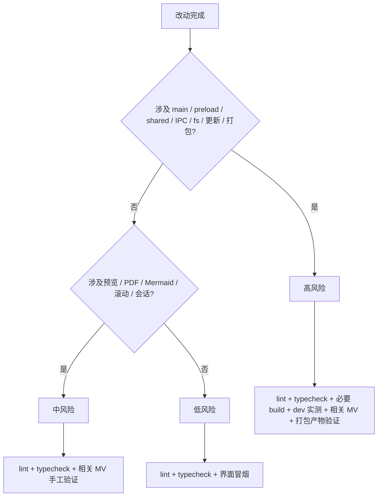

# 测试与质量保障

> 本文说明 MarkIt 当前的质量保障方式、自动化测试分工、手工验证矩阵与发版前回归清单。
> 质量由 `lint` + `typecheck` + 单元测试 + 构建 + 手工验证共同守护；强制规则见 [rules/testing.md](../rules/testing.md) 与 [rules/base.md](../rules/base.md)。开发流程见 [开发指南](./开发指南.md)。

## 1. 当前状态

截至 2026-11-10，仓库的实际状态如下：

| 项目         | 状态                            | 说明                                                                                                                      |
| ------------ | ------------------------------- | ------------------------------------------------------------------------------------------------------------------------- |
| 测试框架     | Vitest + Playwright             | `vitest`、`@playwright/test` 位于 devDependencies；配置见 `vitest.config.ts` / `playwright.config.ts`                     |
| 测试文件     | 16 个 Vitest 文件 / 141 用例    | `src/main/*.spec.ts`、`src/renderer/src/utils/*.spec.ts`；`e2e/app.spec.ts`、`e2e/search.spec.ts`（需先 `npm run build`） |
| 测试命令     | `npm test` / `npm run test:e2e` | `test` 运行 Vitest；`test:e2e` 运行 Playwright Electron 用例                                                              |
| git 钩子     | **无**                          | 没有 husky / lefthook / commit-msg，提交前检查需自行执行                                                                  |
| CI 测试任务  | 单元测试                        | [.github/workflows/release.yml](../.github/workflows/release.yml) 的 `test` job 在构建前运行 `npm test`                   |
| 现有质量手段 | 静态检查 + 测试 + 手工验证      | `npm run lint`、`npm run typecheck`、`npm test`、`npm run build`，以及本文第 6 节矩阵                                     |

e2e 依赖构建产物与真实 Electron 窗口，不放入发版 CI（避免无头环境与平台差异导致随机失败）；发版前由执行者本地运行。2026-11-10 复核：`npm test` 的 16 个文件 / 141 个用例全部通过，`npm run typecheck` 通过。git 钩子仍未配置，DoD 中的命令需自行执行。

## 2. 质量门槛

### 2.1 必跑命令

| 改动范围                                                                  | 必跑                                            | 补充要求                                                        |
| ------------------------------------------------------------------------- | ----------------------------------------------- | --------------------------------------------------------------- |
| 任意源码                                                                  | `npm run lint`、`npm run typecheck`、`npm test` | 提交前执行；仓库没有钩子兜底                                    |
| 修改 `utils/**` 纯函数                                                    | 上述 + 对应 `*.spec.ts`                         | 先补回归用例，再改实现                                          |
| `src/preload/**`、`src/shared/**`、`src/renderer/src/utils/**`            | **全量** lint + typecheck                       | 底座改动影响面大，不能只跑当前文件或单个 tsconfig               |
| `electron.vite.config.ts`、`electron-builder.yml`、`.github/workflows/**` | 上述 + `npm run build`                          | 打包 / 构建配置变更必须实际构建；涉及平台产物时跑对应 `build:*` |
| `src/main/**`、窗口管理、IPC、文件读写、自动更新                          | 上述 + `npm run dev` 实测                       | 交付说明中写清验证方式与覆盖的 MV 编号                          |
| 预览 / PDF / Mermaid / 滚动同步 / 会话                                    | 上述 + 对应手工矩阵                             | 至少覆盖第 6 节中相关分组                                       |
| 纯文档                                                                    | 无强制命令                                      | 检查相对链接、Markdown 表格与 Mermaid 代码块可渲染              |

### 2.2 格式与静态检查

1. `npm run lint` 执行 ESLint；配置通过 `eslint-config-prettier` 关闭与 Prettier 冲突的规则，不负责自动排版。
2. 提交前执行 `npm run format`，避免把格式化差异混进功能提交。
3. `npm run build` 已包含 `typecheck`，但日常开发仍建议单独跑 `typecheck`，定位更快。
4. `npm test` 运行 Vitest 纯函数用例（`vitest run`，一次性退出）；`npm run test:watch` 用于开发期监听。
5. 不要为了让检查通过而关闭规则；确需例外时在最小范围加注释说明原因。

## 3. 风险驱动的测试理念

1. **测试的存在理由是守护风险**，不是凑文件结构。不要为每个源码文件机械配一个 spec。
2. 每个用例都应能回答「它防的是哪个未来错误」；答不上来的用例应删除。
3. 类型系统能保证的（字段形态、参数传递）不重复用单测守护。
4. 优先守护**契约与边界**，而不是实现细节。例如：

| 用例方向                         | 防的未来错误                                 |
| -------------------------------- | -------------------------------------------- |
| 非图片扩展名被协议拒绝           | 防止 Markdown 内容把应用变成任意文件读取通道 |
| CRLF 与 LF 视为相同内容          | 防止仅换行符不同就误报文件冲突               |
| 本地有修改时不自动覆盖           | 防止外部变更吞掉用户未保存内容               |
| diff 正确标注磁盘 / 本地两侧     | 防止用户在冲突弹窗里选错方向、覆盖错误版本   |
| frontmatter 不进入正文解析       | 防止 YAML 被当成标题 / 正文渲染              |
| Mermaid 语言标记大小写与后缀兼容 | 防止图表退化成代码块                         |
| 会话 `activeIndex` 越界收敛      | 防止恢复时崩溃或激活错误标签                 |
| Windows 路径大小写 / 斜杠归一    | 防止同一文件被重复打开或监听失效             |

5. 当前阶段不要求为新功能配套单元测试，但高风险改动必须按第 6 节实际运行验证，并留下记录。

## 4. 风险分级与验证路径

判定原则：

1. 只要跨越进程边界、读写磁盘、改动窗口生命周期或更新流程，一律按高风险处理。
2. 预览与 PDF 是两条独立管线，改动其中一条也要验证另一条。
3. 只改文案 / 样式且不涉及持久化键时可按低风险处理，但仍要确认深色 / 浅色两种主题。

## 5. 高风险模块表

| 模块               | 主要文件                                                                                    | 风险点                                                     | 最低验证      |
| ------------------ | ------------------------------------------------------------------------------------------- | ---------------------------------------------------------- | ------------- |
| 文件读写与编码     | `src/main/index.ts`、`useFile.ts`                                                           | 读错编码、保存覆盖、另存为路径错误                         | MV-01～MV-04  |
| 文件监听与冲突     | `useFileWatcher.ts`、`useFile.ts`、`utils/text-diff.ts`                                     | 外部修改丢失、冲突误报 / 漏报、错选覆盖方向                | MV-05～MV-12  |
| 会话恢复           | `useSession.ts`、`src/shared/session-types.ts`、主进程 `session:*`                          | 标签 / 光标 / 未保存内容丢失，损坏会话导致启动失败         | MV-13～MV-15  |
| 滚动同步与布局     | `useScrollSync.ts`、`SplitPane.vue`、`MarkdownEditor.vue`、`MarkdownPreview.vue`            | 切换布局后永久失去联动、滚动位置串档                       | MV-16～MV-17  |
| Mermaid 与图表导出 | `utils/mermaid.ts`、`utils/diagram-export.ts`、`MarkdownPreview.vue`                        | 图表不渲染、缩放失效、导出空白                             | MV-18～MV-22  |
| PDF 导出           | `usePdfExport.ts`、`PdfExportDialog.vue`、主进程 `export:pdf`                               | 内容缺失、图片空白、分页异常                               | MV-23～MV-25  |
| 自动更新与回退     | `src/main/updater.ts`、`src/main/update-channel.ts`、`stores/update.ts`、`UpdateWindow.vue` | 状态不渲染、安装卡住、强制更新或降级条件错误、通道选择错误 | MV-26～MV-27C |
| 本地图片协议       | 主进程 `markit-file://`、`utils/local-image.ts`                                             | 图片不显示、白名单被放宽导致任意文件读取                   | MV-28～MV-29  |
| 多标签与关闭守卫   | `useFile.ts`、`App.vue`、主进程 `close` 事件                                                | 未保存内容丢失、窗口关不掉 / 直接销毁                      | MV-30～MV-33  |
| 单实例与文件关联   | 主进程 `second-instance` / argv、`electron-builder.yml`                                     | 二次启动开新窗口、文件没转发、关联失效                     | MV-34～MV-36  |
| VSCode 资源管理器  | `vscode-integration.ts`、`resources/vscode-extension/**`、设置页组件                        | 检测/安装状态不一致、右键打不开、误删扩展                  | MV-43～MV-47  |
| Windows 安装向导   | `electron-builder.yml`、`build/installer.nsh`                                               | 无法选择路径 / 快捷方式、静默升级覆盖用户选择、卸载残留    | MV-39～MV-42  |
| 主题与预览样式     | `stores/app.ts`、`stores/style.ts`、`styles/preview/**`                                     | 主题不同步、样式缺失、持久化丢失                           | MV-37～MV-38  |

## 6. 手工验证矩阵

使用说明：

1. 在系统临时目录创建 `markit-verify/`（例如 `D:\tmp\markit-verify`），所有测试文件放这里，**不要写入仓库**。
2. 默认在 `npm run dev` 下执行；标注「打包」的项需要 `npm run build:unpack` 或安装包。
3. 每项完成后在验证记录中登记（模板见第 10 节），失败时记录复现步骤与日志。
4. MV 编号用于回归清单和提交说明引用。

### 6.1 文件读写与编码

| ID    | 验证项                     | 操作步骤                                                                                                                    | 预期结果                                                                                                                                                                |
| ----- | -------------------------- | --------------------------------------------------------------------------------------------------------------------------- | ----------------------------------------------------------------------------------------------------------------------------------------------------------------------- |
| MV-01 | 打开中文 UTF-8 / CRLF 文件 | 准备 `中文-CRLF.md`：UTF-8 编码、CRLF 换行，包含中文标题、列表、代码块；启动 `npm run dev`，`Ctrl+O` 选择该文件；编辑后保存 | 标签名正确，中文无乱码，预览标题 / 列表 / 代码块正常，状态栏行列号与字数合理，不弹外部修改提示；保存后文件仍为 CRLF，不出现整文件行尾 diff；带 BOM 的文件保存后仍带 BOM |
| MV-02 | 保存已有文件               | 修改内容后按 `Ctrl+S`；观察磁盘文件内容与修改时间                                                                           | 直接写盘、无对话框；标签未保存圆点消失；再次 `Ctrl+S` 不产生冲突提示                                                                                                    |
| MV-03 | 另存为                     | 按 `Ctrl+Shift+S`，保存到 `D:\tmp\markit-verify\另存 为.md`（含中文与空格）；再修改并 `Ctrl+S`                              | 保存对话框默认 `.md`；标签名与路径更新；后续保存写入新路径；原文件内容不变                                                                                              |
| MV-04 | 多选打开与重复打开         | `Ctrl+O` 一次选择 2～3 个文件；随后再次打开其中一个已打开文件                                                               | 每个文件一个标签，最后选中的新文件激活；重复打开只激活已有标签，不新增重复标签                                                                                          |

### 6.2 文件监听与冲突

| ID    | 验证项                | 操作步骤                                                                                                                                | 预期结果                                                                                                                   |
| ----- | --------------------- | --------------------------------------------------------------------------------------------------------------------------------------- | -------------------------------------------------------------------------------------------------------------------------- |
| MV-05 | 外部修改且本地无修改  | 打开 `demo.md`，用其他编辑器或命令追加一行并保存；等待约 1 秒                                                                           | 编辑器与预览自动更新；无弹窗；标签不出现未保存圆点；字数更新                                                               |
| MV-06 | 外部修改且本地有修改  | 在编辑器内改第 1 行但不保存；外部追加第 10 行并保存；等待约 1 秒                                                                        | 本地第 1 行修改保留，不弹窗；外部第 10 行暂不合并，等待保存时处理                                                          |
| MV-07 | 保存时冲突弹窗与 diff | 接 MV-06 按 `Ctrl+S`；观察冲突弹窗                                                                                                      | 弹出「文件冲突」；差异面板图例为「− 磁盘上的内容」「+ 本地未保存的内容」；两侧差异正确；选择「取消」不写盘，标签仍为已修改 |
| MV-08 | 冲突时覆盖磁盘        | 重新制造 MV-07 冲突，选择「覆盖磁盘」                                                                                                   | 本地内容写入磁盘，外部修改被覆盖；标签未保存圆点消失；用外部编辑器确认磁盘内容                                             |
| MV-09 | 冲突时载入磁盘        | 重新制造 MV-07 冲突，选择「载入磁盘」                                                                                                   | 编辑器与预览变为磁盘版本，本地修改被放弃；标签未保存圆点消失；磁盘文件未被应用写入                                         |
| MV-10 | F5 手动刷新           | 按 `F5`（开发模式下可再测 `Ctrl+R`），分别验证三种情况：a) 磁盘无变化且本地有修改；b) 磁盘有变化且本地有修改；c) 磁盘有变化且本地无修改 | a) 提示「磁盘上的文件没有变化」，可选择保存覆盖或放弃修改；b) 立即弹出冲突弹窗；c) 直接载入磁盘内容，不弹窗                |
| MV-11 | 非活跃标签切换补读    | 打开 A、B 两个文件，激活 B；在外部修改 A；切回 A                                                                                        | 切回时主动读取磁盘；A 本地无修改则显示最新内容；A 本地有修改则保留本地内容，不覆盖                                         |
| MV-12 | 外部删除当前文件      | 在文件管理器中删除当前活跃文件；等待；按 `F5`；再按 `Ctrl+S`                                                                            | 应用不崩溃、编辑器保留现有内容、无错误弹窗；`F5` 读不到文件时不处理；`Ctrl+S` 在原路径重新创建文件                         |

### 6.3 会话恢复

| ID    | 验证项                          | 操作步骤                                                                                                                                    | 预期结果                                                                                                                          |
| ----- | ------------------------------- | ------------------------------------------------------------------------------------------------------------------------------------------- | --------------------------------------------------------------------------------------------------------------------------------- |
| MV-13 | 多标签 + 未保存新文档恢复       | 打开 2 个文件；新建标签并输入内容（不保存）；把光标放到中间某行；关闭窗口并按提示处理未保存项（新文档可选「放弃修改」）；重新 `npm run dev` | 标签顺序、激活标签、光标行列恢复；未保存新文档内容完整恢复并保持未保存标记；文件类标签以磁盘最新内容为准                          |
| MV-14 | 文件类标签以磁盘为准 / 删除兜底 | 打开文件并保存后退出；外部修改该文件；重启确认内容为磁盘最新版；再次退出并删除该文件；重启                                                  | 第一次恢复显示磁盘最新内容；文件被删除后恢复会话中保存的内容，应用不崩溃；保存可在原路径重建文件                                  |
| MV-15 | 会话 / 窗口状态损坏兜底         | 退出应用，备份后把 `session.json` 改成非法 JSON（如 `{invalid`），把 `window-state.json` 改成非法内容；重启                                 | 应用正常启动并显示欢迎页；主进程记录 `Failed to load session` / `Failed to load window state`；窗口回落默认尺寸；不出现白屏或崩溃 |

### 6.4 滚动同步与布局

| ID     | 验证项               | 操作步骤                                                                                                                    | 预期结果                                                                                                                                  |
| ------ | -------------------- | --------------------------------------------------------------------------------------------------------------------------- | ----------------------------------------------------------------------------------------------------------------------------------------- |
| MV-16  | 四种布局双向滚动     | 用 `Ctrl+\` 依次切换 `edit-left`、`edit-right`、`edit-only`、`preview-only`；每种布局都先把编辑区滚到中部，再滚预览区到中部 | 双栏模式下编辑区与预览区按比例双向联动、无来回抖动；仅编辑 / 仅预览模式滚动正常；切回双栏后联动仍有效，不出现永久失效                     |
| MV-17  | 切换标签保留滚动位置 | 准备两个长文档（含 Mermaid / 图片 / 宽表格），分别把编辑区和预览区滚到不同位置；来回切换标签 3 次以上                       | 每个标签的编辑区与预览区滚动位置独立保留；多次来回切换后位置保持稳定，不出现逐次向后 / 向前偏移；新文档从顶部开始，不沿用上一个文档的偏移 |
| MV-17A | 布局按标签保存       | 打开两个文档，分别设为「仅预览」「左编辑右预览」；来回切换标签；新建标签；退出重启后再次切换标签                            | 每个标签保持自己的布局与工具栏选中态；新标签继承当前布局；重启后各标签布局恢复；旧会话 / 非法值回退到 `markit-layout`                     |
| MV-17B | 重启恢复滚动位置     | 打开长文档，把编辑区与预览区滚到不同位置；退出重启；再切到另一个标签后切回                                                  | 两个区域恢复到退出前的位置（编辑区允许一行左右误差）；旧会话缺少滚动字段时从顶部开始；文件被外部改短时不报错、位置夹取到文档末尾          |

### 6.5 Mermaid

| ID    | 验证项               | 操作步骤                                                                                                                           | 预期结果                                                                                                              |
| ----- | -------------------- | ---------------------------------------------------------------------------------------------------------------------------------- | --------------------------------------------------------------------------------------------------------------------- |
| MV-18 | 多语言标记与失败提示 | 在文档中写 `flowchart TD`、`sequenceDiagram`、`xychart-beta`、`C4Context`、大写 `FLOWCHART` 各一个；再写一个语法错误的 `flowchart` | 有效图表全部渲染；错误块保留原始代码，并在下方显示「图表渲染失败（语言标记）：原因」，悬浮可看完整错误                |
| MV-19 | 内联缩放与自动适应   | 悬停图表工具栏，点击 `−` / 百分比 / `＋`；按住 `Ctrl/Cmd` 滚轮；调整窗口宽度或侧栏宽度                                             | 缩放范围 25%～400%；点击百分比恢复 100%；手动缩放后不再自动适应；未手动缩放时随容器变化重新适应，尽量不出现多余滚动条 |
| MV-20 | 弹窗预览             | 点击图表工具栏的预览图标，或双击图表；在弹窗内滚动、缩放、点「适应」；按 `Esc` 或点击遮罩关闭                                      | 弹窗显示完整图表；缩放 / 滚动 / 适应可用；`Esc`、遮罩、关闭按钮都能关闭；关闭后主预览不受影响                         |
| MV-21 | SVG 导出             | 在图表工具栏点击 `SVG`，选择保存路径；用浏览器或图片查看器打开                                                                     | 保存对话框默认 `.svg`；文件可正常打开，图形完整，不带有预览用的 `max-width` 限制                                      |
| MV-22 | PNG 导出             | 点击 `PNG`，保存并打开；分别在深色 / 浅色主题下导出                                                                                | PNG 可正常打开，按 2 倍分辨率导出，背景与当前主题匹配，无透明黑底或裁切                                               |

### 6.6 PDF 导出

| ID     | 验证项             | 操作步骤                                                                                                        | 预期结果                                                                                                                                  |
| ------ | ------------------ | --------------------------------------------------------------------------------------------------------------- | ----------------------------------------------------------------------------------------------------------------------------------------- |
| MV-23  | A4 导出内容完整性  | 准备含 frontmatter、H1/H2、表格、本地图片、Mermaid、代码块、两页以上长文的文档；`Ctrl+P` 选择 A4 导出；打开 PDF | frontmatter 显示为「文档信息」表格；图片、Mermaid、表格、代码块完整；分页正常、无整页空白；中文不乱码                                     |
| MV-23A | 边距 / 页码 / 目录 | 分别用窄 / 标准 / 宽导出，对比正文到纸张边缘的距离；勾选 / 取消页码；勾选 / 取消目录并点击目录条目              | 三档边距有可测量差异；勾选后每页页脚显示「当前页 / 总页数」，取消后无页脚且不遮挡正文；勾选后首屏为目录并在目录后分页，条目可跳到对应标题 |
| MV-24  | Letter 导出        | 同一文档选择 Letter 导出并打开                                                                                  | 页面尺寸为 Letter；内容不被裁切；图片与图表仍完整                                                                                         |
| MV-25  | 取消保存对话框     | 打开导出对话框后点击导出，在系统保存对话框中取消；导出期间观察按钮                                              | 不生成文件；应用不报错；导出对话框保持打开，可再次导出；导出期间按钮禁用并显示「导出中…」，重复点击不叠加保存对话框                       |
| MV-25A | 默认文件名         | 当前文档为 `示例.md` 时打开导出对话框并确认保存对话框                                                           | 默认文件名为 `示例.pdf`；含非法字符的文档名被清洗，仍可正常保存                                                                           |

### 6.7 自动更新

| ID     | 验证项               | 操作步骤                                                                                                                                                                                                                | 预期结果                                                                                                                                                                                                                         |
| ------ | -------------------- | ----------------------------------------------------------------------------------------------------------------------------------------------------------------------------------------------------------------------- | -------------------------------------------------------------------------------------------------------------------------------------------------------------------------------------------------------------------------------- |
| MV-26  | dev 下更新状态       | `npm run dev`；`Ctrl+,` 打开设置页，查看「关于」区域                                                                                                                                                                    | 显示版本号与「开发模式，不检测更新」；检查按钮禁用；不发起网络检测                                                                                                                                                               |
| MV-27  | 打包产物更新状态渲染 | `npm run build:unpack`，启动 `dist/win-unpacked/Mark It.exe`（其他平台对应目录）；设置页点击检查更新                                                                                                                    | 状态能从 `checking` 进入 `not-available` / `available` / `downloading` / `error` 并正确渲染文案；无网络时显示 `error` 也可接受，但不得崩溃；强制更新会自动下载，属预期，验证后不要继续安装                                       |
| MV-27A | 周期检测             | 以 `MARKIT_UPDATE_CHECK_INTERVAL_MS=10000` 启动打包产物，保持设置页打开观察约 30 秒                                                                                                                                     | 每隔约 10 秒出现一次 `checking`，不出现并发检查；`checking` / `downloading` 状态下不重复触发；应用退出后定时器停止                                                                                                               |
| MV-27B | Beta 通道开关        | 打包产物设置页开启「接收 Beta 版更新」，重启后再次打开设置；再关闭开关                                                                                                                                                  | 开关状态持久化；beta 版本的更新提示与详情窗口带 `Beta` 徽标；关闭后只提示正式版；关闭时若当前为 beta 版本不提示降级，等待下一个正式版归队                                                                                        |
| MV-27C | Beta 主动回退        | 安装更低的 stable，再覆盖安装更高 beta 并开启 Beta；设置页点击「回退到正式版」并确认，观察检测、下载与重启安装；检查 `userData/update-preference.json`。再分别测试取消确认、断网、已有下载完成更新与回退后重新开启 Beta | 仅在确认后开始；目标为 stable 当前最新版本且严格低于当前 Beta；下载并重启后回到正式版；Beta 持久化为关闭；取消不改状态；断网进入可重试错误且 Beta 仍关闭；已有下载完成更新时拒绝回退；重新开启 Beta 后只提供高于当前版本的新版本 |

### 6.8 本地图片协议

| ID    | 验证项                     | 操作步骤                                                                                                                                                               | 预期结果                                                                                                                                          |
| ----- | -------------------------- | ---------------------------------------------------------------------------------------------------------------------------------------------------------------------- | ------------------------------------------------------------------------------------------------------------------------------------------------- |
| MV-28 | 相对 / 绝对 / file:// 图片 | 准备 `img/图 1.png`，在文档中分别写 ``、绝对路径、`file:///D:/.../图%201.png`；切换标签后再切回                                                    | 三种写法都能显示；DevTools Network 中请求为 `markit-file://local/?p=...`；切换标签后图片仍正常显示，内嵌 HTML 的 `` 会按当前文档目录重新解析 |
| MV-29 | 非图片扩展名被拒绝         | 写 ``；在 DevTools Console 执行 `await fetch('markit-file://local/?p=' + encodeURIComponent('D:/tmp/markit-verify/secret.txt')).then(r => r.status)` | 图片不显示；请求返回 `415`；页面无法读到文本内容；白名单外的扩展名不得被放宽                                                                      |

### 6.9 多标签与窗口关闭

| ID    | 验证项           | 操作步骤                                                                                                 | 预期结果                                                                                         |
| ----- | ---------------- | -------------------------------------------------------------------------------------------------------- | ------------------------------------------------------------------------------------------------ |
| MV-30 | 单标签关闭三选一 | 修改当前标签后按 `Ctrl+W`；分别验证保存 / 放弃 / 取消                                                    | 保存后写盘并关闭；放弃后不写盘并关闭；取消后标签保留、内容不变                                   |
| MV-31 | 批量关闭逐个确认 | 打开多个标签并制造多个未保存修改；右键标签选择「关闭其他 / 关闭左侧 / 关闭右侧」；在中途某个确认框点取消 | 逐个弹出确认；取消后停止关闭，后续标签保持打开；已关闭标签的未保存内容按用户选择处理，不静默丢失 |
| MV-32 | 窗口关闭守卫     | 多个未保存标签时点击窗口关闭按钮；先点取消，再重新关闭并选择保存 / 放弃                                  | 取消时窗口不关闭、内容保留；确认后逐个处理未保存项并正常退出；不得绕过守卫直接销毁窗口           |
| MV-33 | 关闭最后一个标签 | 逐个关闭所有标签（最后一个未保存时分别测试保存 / 放弃 / 取消）                                           | 最后一个标签关闭后主窗口随之关闭；取消时窗口保留；不出现无标签可用但窗口仍在的僵死状态           |

### 6.10 单实例与文件关联

| ID    | 验证项         | 操作步骤                                                                                               | 预期结果                                                                                                             |
| ----- | -------------- | ------------------------------------------------------------------------------------------------------ | -------------------------------------------------------------------------------------------------------------------- |
| MV-34 | 单实例二次启动 | 启动打包产物；再次启动同一程序，并通过第二次启动传入一个 `.md` 文件                                    | 不出现第二个窗口 / 进程；已有窗口恢复并聚焦；文件在已有窗口打开                                                      |
| MV-35 | 命令行参数打开 | 打包产物执行 `& "Mark It.exe" "D:\tmp\markit-verify\a.md" "D:\tmp\markit-verify\b.md"`（Windows 示例） | 两个文件按顺序打开，最后一个为激活标签；重复启动时文件转发给已有实例                                                 |
| MV-36 | 文件关联       | 安装 NSIS 安装包；在资源管理器中双击 `.md`，或右键「打开方式」选择 MarkIt；再双击第二个文件            | 文件在 MarkIt 中打开；第二个文件转发给已运行实例；安装包卸载后关联清理。未打包目录不会注册关联，此项必须用安装包验证 |

### 6.11 主题与预览样式

| ID    | 验证项                   | 操作步骤                                                                                                 | 预期结果                                                                                                                                                                                                                                   |
| ----- | ------------------------ | -------------------------------------------------------------------------------------------------------- | ------------------------------------------------------------------------------------------------------------------------------------------------------------------------------------------------------------------------------------------ |
| MV-37 | 主题三态与系统跟随       | 在设置页或工具栏切换「跟随系统 / 浅色 / 深色」；在跟随系统模式下修改操作系统主题；重启应用               | 界面、编辑器、预览、Mermaid 工具栏同步切换；系统主题变化时实时跟随；重启后主题保持（`markit-theme`）                                                                                                                                       |
| MV-38 | 四套预览样式与自定义 CSS | 在设置页依次切换 GitHub / Dark / Academic / Minimal，深色与浅色各看一次；导入一份本地 CSS 后选择它；重启 | 四套样式的标题、正文、链接、代码块、表格、引用、frontmatter 表格与 Mermaid 工具栏均正常；自定义 CSS 生效；重启后当前样式与自定义 CSS 均保持（`markit-preview-style` / `markit-custom-styles`）；导入超过 200,000 字符的 CSS 会被拒绝并提示 |

### 6.12 VSCode 资源管理器集成

| ID    | 验证项               | 操作步骤                                                                                                                                          | 预期结果                                                                                                                                                   |
| ----- | -------------------- | ------------------------------------------------------------------------------------------------------------------------------------------------- | ---------------------------------------------------------------------------------------------------------------------------------------------------------- |
| MV-43 | 检测与安装           | 使用 Windows 未打包目录和安装包分别打开设置；安装包中打开「编辑器集成」，再重启 VSCode                                                            | 开发模式禁用；安装包检测 Stable / Insiders；安装后扩展目录出现且 VSCode 重启后显示菜单项                                                                   |
| MV-44 | 右键打开与多选       | 从 VSCode 资源管理器右键一个 `.md`，再同时选中两个 `.md` / `.markdown` 并点击「使用 MarkIt 打开」；覆盖扩展宿主带 `ELECTRON_RUN_AS_NODE=1` 的环境 | 首次点击启动 MarkIt 并打开文件；多选按顺序打开全部文件，最后一个为激活标签；非 Markdown 不显示菜单项；不得出现 Markdown 被当作 JavaScript 的 `SyntaxError` |
| MV-45 | 已运行实例与路径修复 | MarkIt 已运行时再次右键打开；移动打包产物后重启 MarkIt，再从 VSCode 菜单打开                                                                      | 不产生第二个窗口，已有窗口聚焦并打开新标签；移动后的路径经启动配置恢复可用                                                                                 |
| MV-46 | 卸载与外部卸载同步   | 设置页关闭开关并重启 VSCode；再重新安装后从 VSCode 扩展面板手动卸载，重新打开 MarkIt 设置                                                         | 关闭后扩展目录与菜单消失；VSCode 手动卸载后设置页恢复「未安装」，不持久化错误的已安装状态                                                                  |
| MV-47 | 不支持场景           | 检查 Flatpak VSCode、Remote / WSL / SSH 工作区与 macOS DMG translocation                                                                          | Flatpak / translocation 显示原因且不写入配置；远端资源不显示菜单项；不得尝试启动宿主进程                                                                   |

> VSCode 依赖本机安装与重启，不加入 Playwright e2e。路径检测、版本选择与安全目录名校验由 Vitest 覆盖；平台差异保留手工验证。

### 6.12.1 独立设置窗口

| ID    | 验证项             | 操作步骤                                                                     | 预期结果                                                                                               |
| ----- | ------------------ | ---------------------------------------------------------------------------- | ------------------------------------------------------------------------------------------------------ |
| MV-48 | 独立窗口与重复打开 | 主窗口点击设置按钮；再按 `Ctrl+,`；关闭主窗口                                | 只创建一个设置窗口；重复打开时恢复并聚焦；系统最小化 / 最大化 / 关闭按钮可用；页面内没有自定义关闭按钮 |
| MV-49 | 设置跨窗口同步     | 在设置窗口切换主题、预览样式、预览宽度并导入 CSS；回到主窗口查看编辑器与预览 | 主窗口即时同步主题、预览样式和宽度；导入与删除自定义样式一致；重启后保持                               |
| MV-50 | 设置窗口更新转交   | 在设置窗口检查更新；有多标签未保存修改时点击重启安装                         | 主窗口逐个确认全部未保存标签；取消任一标签则安装中止；设置窗口不能绕过该流程                           |
| MV-51 | 窄窗口布局         | 将设置窗口缩到最小尺寸并使用顶部横向分类                                     | 标题栏系统按钮不与内容重叠；分类可横向滚动；内容区独立滚动且无横向溢出                                 |

### 6.13 Windows 安装向导

| ID    | 验证项             | 操作步骤                                                                                              | 预期结果                                                                           |
| ----- | ------------------ | ----------------------------------------------------------------------------------------------------- | ---------------------------------------------------------------------------------- |
| MV-39 | 交互安装与路径选择 | 运行 `mark-it-<版本>-setup.exe`，在安装范围页选「仅为我」，目录页改为 `D:\tmp\MarkItInstall`          | 不触发 UAC；安装到指定目录；安装后应用可启动；快捷方式按勾选创建                   |
| MV-40 | 快捷方式勾选       | 分别测试全勾选、只勾开始菜单、全不勾选三种组合，每次安装后检查桌面与开始菜单                          | 实际创建的快捷方式与勾选完全一致；全不勾选时仍可从安装目录启动，卸载无残留         |
| MV-41 | 静默升级保持状态   | 安装时只勾开始菜单；执行新版本 `setup.exe /S`；手动删除开始菜单快捷方式后再执行一次 `/S`              | 首次静默升级不新增桌面快捷方式；手动删除后再次静默升级不会重新创建被删除的快捷方式 |
| MV-42 | 卸载清理           | 安装后执行卸载（分别保留与删除快捷方式两种前置状态），检查桌面、开始菜单、安装目录与 `%APPDATA%` 配置 | 快捷方式被清理，安装目录无残留；用户数据目录按既有规则保留                         |

## 7. 每次发版前的回归清单

发版前至少完成以下检查（勾选后随发布记录归档）：

- [ ] `npm run lint` 通过
- [ ] `npm run typecheck` 通过
- [ ] `npm test` 通过（纯函数回归）
- [ ] `npm run build` 后 `npm run test:e2e` 通过（启动 + PDF 导出冒烟，本地执行）
- [ ] `npm run build:win` / `build:mac` / `build:linux` 对应目标平台构建通过
- [ ] MV-01、MV-02、MV-03：打开中文 / CRLF 文件、保存、另存为
- [ ] MV-05、MV-07、MV-08、MV-09：外部修改自动刷新、冲突弹窗与两种处理方向
- [ ] MV-10、MV-11、MV-12：F5 刷新、非活跃标签补读、外部删除兜底
- [ ] MV-13、MV-14：多标签会话恢复、文件删除后的会话兜底
- [ ] MV-16、MV-17、MV-17B：四种布局双向滚动、切换标签与重启后保留滚动位置（e2e 已覆盖重启恢复与来回切标签不偏移）
- [ ] MV-18、MV-19、MV-21、MV-22：Mermaid 渲染、缩放、SVG / PNG 导出
- [ ] MV-23、MV-24：A4 / Letter PDF 内容完整、分页正常
- [ ] MV-28、MV-29：本地图片显示、非图片扩展名被拒绝
- [ ] MV-30、MV-31、MV-32、MV-33：单标签 / 批量关闭、窗口关闭守卫、最后一个标签
- [ ] MV-37、MV-38：主题与四套预览样式
- [ ] MV-34、MV-35、MV-36：单实例、命令行打开、文件关联（至少 Windows 安装包）
- [ ] MV-43、MV-44、MV-45、MV-46：VSCode 检测安装、右键打开、多选、单实例转发与卸载同步（至少 Windows 打包产物）
- [ ] MV-39、MV-40、MV-41、MV-42：安装向导路径选择、快捷方式勾选、静默升级、卸载清理（至少 Windows 安装包）
- [ ] MV-27、MV-27A、MV-27B：打包产物检查更新状态可渲染（不执行真实安装）、周期检测、Beta 开关
- [ ] 检查 `app.asar` 不含 `docs/`、`scripts/`、`rules/`、`CLAUDE.md`、`AGENTS.md`、`.apphub-release*.json`
- [ ] 版本号、更新说明、apphub 渠道与 `release.yml` 参数核对无误
- [ ] 已填写第 10 节验证记录

## 8. 缺陷回归原则

1. **能在纯函数层复现的缺陷，先补回归用例**：如 `text-diff.ts`、`mermaid.ts`、`local-image.ts`、`frontmatter.ts`。直接补同目录的 `*.spec.ts` 并执行 `npm test`；无法在纯函数层复现的 Electron 集成问题，保留手工 MV 项，条件允许时补 `e2e/` 用例。
2. 修复缺陷时先定位根因，再决定改哪一层；不要用「多等一会儿」「多刷新一次」掩盖监听、竞态或会话恢复问题。
3. 回归用例应守护**行为契约**，而不是复制实现。例如冲突场景应断言「本地有修改时不被自动覆盖」，而不是断言某个内部函数被调用。
4. 行为被删除或重构后，失去守护对象的用例应删除或改写为新的契约，不要保留形式化断言凑绿。
5. 修复涉及 Electron 集成（窗口、协议、对话框、更新）且无法在纯函数层复现时，保留手工 MV 项；引入 Playwright 后补 e2e 用例。

## 9. 自动化测试分工（Vitest / Playwright）

### 9.1 单元测试：Vitest

选择 Vitest 的原因：与现有 Vite / electron-vite 构建链一致，无需额外的 transform 配置。当前 16 个测试文件覆盖 `text-diff`、`text-encoding`、`frontmatter`、`mermaid`、`local-image`、`path`、`headings`、`markdown`、`link-title`、`layout-mode`、`table-resize`、`tab-order`、`pdf-name`、`search`、`update-channel`、`session-store`；后续按下列优先级补充：

| 优先级 | 被测对象                                                              | 必须守护的契约                                                                             |
| ------ | --------------------------------------------------------------------- | ------------------------------------------------------------------------------------------ |
| P0     | 主进程图片扩展名白名单判断（抽出为纯函数后）/ `markit-file://` 处理器 | 非图片扩展名必须拒绝（415）；不得放宽为任意文件读取                                        |
| P0     | `useFile.ts` 的保存与冲突判定（抽为纯函数后）                         | CRLF 与 LF 视为相同；本地无修改时以磁盘为准；本地有修改时不被自动覆盖；覆盖 / 载入方向正确 |
| P0     | `utils/text-diff.ts`                                                  | add / remove / context / gap 标注正确；CRLF 归一；大文件退化路径不崩溃                     |
| P0     | `utils/frontmatter.ts`                                                | BOM、缺失结束分隔线、`\|` / `>` 块、缩进续行、`bodyStartLine` 换算                         |
| P0     | `utils/mermaid.ts`                                                    | 大小写、`-beta` / `-v2` 后缀、C4 系列、未知语言不误判                                      |
| P0     | 路径归一（`samePath`、`local-image` 的 `normalizePath`）              | Windows 大小写 / 斜杠、盘符、UNC、`.` / `..` 消除                                          |
| P1     | `documents.ts` 的 `restoreSession` / `cycleDocument`                  | `activeIndex` 越界收敛、空会话返回 false、光标行列钳制                                     |
| P1     | `normalizeZoomFactor`（主进程，抽为纯函数后）                         | 0.5～3 范围、10% 步长、NaN 回落 1                                                          |
| P1     | `utils/local-image.ts` 的 `resolveImageSrc` / `resolveLocalPath`      | http / data / 锚点原样；相对路径按文档目录；`file://` 转换；Windows 盘符不当作协议         |

要求：

1. 纯函数先从耦合文件中抽出再测，不在测试里复制实现。
2. 只 mock 边界（`fs`、`electron` 模块、`ipcRenderer`），不 mock 被测对象的内部实现。
3. 防御性兜底分支（错误回退、空值、越界）也要有用例。
4. 测试文件与源码同目录，命名 `*.spec.ts`；用例名用中文描述行为；从 `vitest` 显式导入 `describe` / `it` / `expect` / `vi`。

### 9.2 端到端测试：Playwright（Electron）

当前已落地 `e2e/app.spec.ts`、`e2e/search.spec.ts`：

1. 启动构建产物并断言主窗口可见；
2. 布局模式按标签独立保存并在重启后恢复；
3. 重启后恢复编辑区与预览区的滚动位置（含旧会话字段兜底）；
4. 长文档来回切标签时滚动位置不累积偏移（分栏、仅编辑、仅预览三种布局的恢复路径可由实现覆盖，用例本身固定分栏）；
5. 打开含表格 / 正常 Mermaid / 错误 Mermaid 的临时文档，通过 `app.evaluate` 替换主进程 `dialog.showSaveDialog`，点击导出并校验产物以 `%PDF-` 开头；同时覆盖 Mermaid 失败降级、字体 / 布局等待与临时文件加载；
6. 标签页拖拽排序并在重启后保持顺序；
7. 搜索与替换：编辑区匹配计数与装饰、循环导航 HUD、全部替换、仅预览布局下的 `CSS.highlights` 高亮与关闭清理（`e2e/search.spec.ts`）。

执行前需先 `npm run build`；构建产物不存在时用例自动跳过。每个用例使用独立 `--user-data-dir`，避免与用户正在运行的应用抢单实例锁；`playwright.config.ts` 固定 `workers: 1`。后续优先补充：

1. 打开多个文件、标签切换、保存与另存为。
2. 外部修改文件后的被动刷新、保存冲突弹窗与两种处理方向。
3. 退出重启后的会话恢复（多标签 + 未保存新文档）。
4. 主题切换、预览样式切换。
5. PDF 导出：在测试中通过 `electronApp.evaluate` 替换 `dialog.showSaveDialog`，返回临时目录路径，校验产物存在且非空；不为此在生产代码加测试分支。
6. 更新提示窗口：优先通过主进程状态注入或本地 mock feed 验证 UI；依赖真实网络 / apphub 的用例在探测失败时**自动跳过**，不能让 CI 随机红。

要求：

1. 临时文件与目录放系统临时目录，不写入仓库。
2. 原生对话框、系统文件管理器等难以稳定自动化的能力，保留手工 MV 项，不要为了自动化在生产代码里加 `if (isTest)`。
3. 测试文件放 `e2e/`，从 `@playwright/test` 显式导入 `test` / `expect`。
4. 每个用例只覆盖一条用户可见路径，避免一个用例串完整个应用导致失败定位困难。

### 9.3 不污染业务代码

1. 不得在 `src/` 中添加演示入口、调试端点、测试专用 IPC 或 `if (isTest)` 分支。
2. 测试专用代码只存在于测试文件 / `e2e/` / 测试配置中。
3. 需要测试接缝时，优先抽取纯函数或依赖注入；不要为测试改变生产行为。
4. 框架变更时同步更新 [rules/testing.md](../rules/testing.md)、本文与 CI workflow（当前 `release.yml` 的 `test` job 已运行 `npm test`），不要让文档停留在「未来计划」。

## 10. 验证记录模板

每次高风险改动或发版前，按下面模板记录（可放在发布 PR 描述、提交说明或团队验证表中）：

| 日期       | 分支 / 提交           | 改动摘要           | 验证项（MV 编号）          | 结果 | 环境 / 备注                                                     |
| ---------- | --------------------- | ------------------ | -------------------------- | ---- | --------------------------------------------------------------- |
| 2026-11-04 | `develop` @ `abc1234` | 文件冲突 diff 展示 | MV-06、MV-07、MV-08、MV-09 | 通过 | Windows 11 / Node 22 / Electron 39；冲突弹窗与覆盖 / 载入均正常 |
|            |                       |                    |                            |      |                                                                 |

记录要求：

1. 「验证项」写 MV 编号，便于追溯；没有对应 MV 的新场景先补进第 6 节。
2. 「结果」只写通过 / 失败 / 跳过；失败时附复现步骤、日志路径或截图路径。
3. 「环境」至少写操作系统、Node 版本、是否打包产物；跨平台改动分别记录。
4. 发版前的回归清单勾选结果与本表一并归档。

## 11. 相关文件

| 文件                                                                                                | 作用                                                 |
| --------------------------------------------------------------------------------------------------- | ---------------------------------------------------- |
| [rules/testing.md](../rules/testing.md)                                                             | 测试策略的规则来源：当前阶段、风险区域、未来框架分工 |
| [rules/base.md](../rules/base.md)                                                                   | 完成定义（DoD）、文档先行、提交规范                  |
| [开发指南](./开发指南.md)                                                                           | 环境、命令、目录、开发任务手册与常见坑               |
| [github-release.md](./github-release.md)                                                            | 三平台发版流程与产物约定                             |
| [.github/workflows/release.yml](../.github/workflows/release.yml)                                   | 三平台构建、apphub 发布、GitHub Release 同步         |
| [src/renderer/src/composables/useFile.ts](../src/renderer/src/composables/useFile.ts)               | 保存、冲突判定、刷新                                 |
| [src/renderer/src/composables/useFileWatcher.ts](../src/renderer/src/composables/useFileWatcher.ts) | 文件监听与非活跃标签补读                             |
| [src/renderer/src/composables/useSession.ts](../src/renderer/src/composables/useSession.ts)         | 会话保存与恢复                                       |
| [src/renderer/src/composables/usePdfExport.ts](../src/renderer/src/composables/usePdfExport.ts)     | PDF 管线                                             |
| [src/renderer/src/utils/text-diff.ts](../src/renderer/src/utils/text-diff.ts)                       | 冲突差异计算                                         |
| [src/renderer/src/utils/mermaid.ts](../src/renderer/src/utils/mermaid.ts)                           | Mermaid 语言标记识别                                 |
| [src/renderer/src/utils/local-image.ts](../src/renderer/src/utils/local-image.ts)                   | 本地图片路径解析与 `markit-file://`                  |
| [src/renderer/src/utils/frontmatter.ts](../src/renderer/src/utils/frontmatter.ts)                   | frontmatter 解析与表格渲染                           |
| [src/main/index.ts](../src/main/index.ts)                                                           | 文件 IPC、监听、协议、PDF、会话、窗口守卫            |
| [src/main/updater.ts](../src/main/updater.ts)                                                       | 自动更新状态与安装流程                               |
| [electron-builder.yml](../electron-builder.yml)                                                     | 文件关联、平台产物、安装包行为                       |
