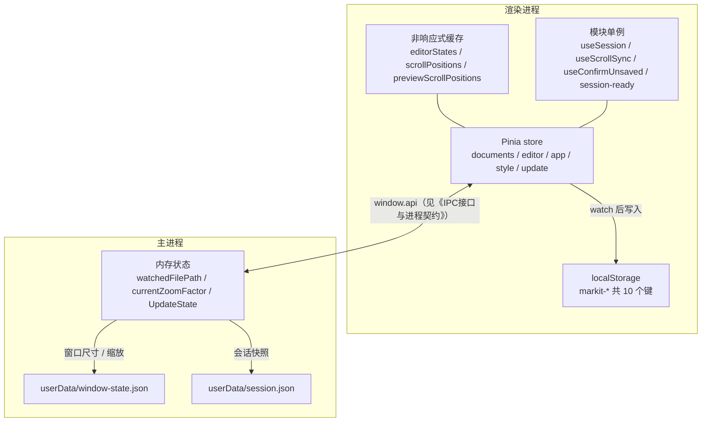
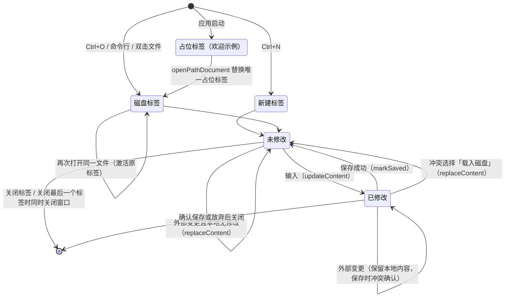
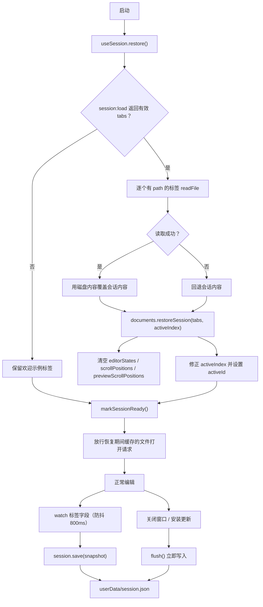

# 状态与数据模型

> **文档定位**：MarkIt（v1.5.0，2026-11-10 基线同步）渲染进程状态分层、Pinia store、标签数据模型、持久化键与主进程落盘文件的完整说明。面向新增状态、排查「切换标签后内容/滚动错乱」「重启后数据丢失」类问题的维护者。
> 本文以代码为准，字段名、默认值与范围逐字核对自源码；实现变动时请同步更新本文。

## 1. 状态分层

MarkIt 的状态刻意分成五层，各自承担不同生命周期，**不要跨层搬运**：

| 层                     | 位置                                                                              | 生命周期                     | 承载内容                                                                                             |
| ---------------------- | --------------------------------------------------------------------------------- | ---------------------------- | ---------------------------------------------------------------------------------------------------- |
| Pinia store            | [`src/renderer/src/stores`](../src/renderer/src/stores)                           | 渲染进程运行期               | 标签列表、当前标签、主题/布局、预览样式、表格列宽、更新状态镜像                                      |
| 非响应式 Map           | [`src/renderer/src/stores/documents.ts`](../src/renderer/src/stores/documents.ts) | 渲染进程运行期（按标签增删） | CodeMirror `EditorState`、编辑区滚动位置、预览区滚动位置                                             |
| localStorage           | 渲染进程（`markit-*` 前缀）                                                       | 跨会话                       | 主题、布局、大纲显隐/宽度、分栏比例、预览宽度、表格列宽                                              |
| 主进程 `userData` 文件 | 主进程                                                                            | 跨会话 / 跨安装更新          | `window-state.json`（窗口与缩放）、`session.json`（标签快照）、`update-preference.json`（Beta 开关） |
| 模块级单例             | composables / utils                                                               | 渲染进程运行期（HMR 保持）   | 会话 flush 句柄、滚动同步注册表、确认对话框队列、就绪 Promise                                        |



设计约束：

1. 文档内容、修改标记、光标、字数、大纲**只能**落在 `documents` store；`editor` store 只是当前标签的计算视图。
2. 体积大、不可序列化、与渲染无关的对象**不能**进 `ref` / Pinia，否则会被 Vue 深度代理、被 devtools 序列化、被会话快照误存。
3. 应用级偏好走 `markit-*` 键，且**集中**在对应的 Pinia store 中读写（主题、布局等在 `app`，预览样式在 `style`，表格列宽在 `table-widths`），不在组件里散落 `localStorage.setItem`；**按标签**的状态（内容、光标、布局模式等）落在 `documents` 的 `DocumentTab` 上，需要跨重启时随 `session.json` 保存（见[按标签布局模式](./按标签布局模式.md)）。

## 2. Pinia store 明细

所有 store 均为 `defineStore(..., () => { ... })` 的组合式写法，在 [`src/renderer/src/main.ts`](../src/renderer/src/main.ts) 中通过 `createPinia()` 注册。更新详情窗口是**独立页面与独立 Pinia 实例**，不共享主窗口状态。

### 2.1 `documents` —— 唯一事实来源

文件：[`src/renderer/src/stores/documents.ts`](../src/renderer/src/stores/documents.ts)

| 类别     | 名称                     | 类型                                 | 说明                                                 |
| -------- | ------------------------ | ------------------------------------ | ---------------------------------------------------- |
| state    | `docs`                   | `Ref<DocumentTab[]>`                 | 标签栏顺序；启动时先放入欢迎示例标签                 |
| state    | `activeId`               | `Ref<string>`                        | 当前激活标签 id；关闭最后一个标签后置 `''`           |
| computed | `activeDoc`              | `DocumentTab \| null`                | `docs.find(d => d.id === activeId)`，找不到为 `null` |
| 非响应式 | `editorStates`           | `Map<string, EditorState>`           | 见第 4 节                                            |
| 非响应式 | `scrollPositions`        | `Map<string, ScrollPosition>`        | 见第 4 节                                            |
| 非响应式 | `previewScrollPositions` | `Map<string, PreviewScrollPosition>` | 见第 4 节                                            |
| 模块级   | `docSequence`            | `number`                             | 自增 id 计数器，仅进程内有效，不持久化               |

actions：

| 方法                                                    | 行为                                                                                                   |
| ------------------------------------------------------- | ------------------------------------------------------------------------------------------------------ |
| `addDocument(path, content, name?)`                     | 新建 `DocumentTab` 入栈、设为激活、返回该标签                                                          |
| `openPathDocument(filePath, content)`                   | 已打开同名文件则激活原标签；若只有唯一占位标签（`path === null && !isModified`）则先移除再新建         |
| `newDocument(content?, filePath?)`                      | `addDocument` 的语义化封装，默认空内容、无路径                                                         |
| `restoreSession(tabs, activeIndex)`                     | 清空三个非响应式 Map，用会话标签整体替换 `docs`，修正并设置 `activeId`；`tabs` 为空返回 `false`        |
| `getDoc(id)`                                            | 按 id 查找                                                                                             |
| `activateDocument(id)`                                  | id 存在时设为激活                                                                                      |
| `closeDocument(id)`                                     | 移除标签并清理三项缓存；空列表置 `activeId = ''`；关闭激活项时取右邻，末尾回退左邻                     |
| `cycleDocument(delta)`                                  | 在标签间循环切换（Ctrl+Tab / Ctrl+Shift+Tab）                                                          |
| `updateContent(id, content)`                            | 内容真正变化时写入，置 `isModified = true`，重算 `wordCount`                                           |
| `replaceContent(id, content)`                           | 磁盘内容覆盖：同时更新 `content` 与 `diskContent`，清 `isModified`，**删除该标签缓存的 `EditorState`** |
| `setCursor(id, line, col)`                              | 写入 1 基行列                                                                                          |
| `setHeadings(id, headings)`                             | 写入大纲树                                                                                             |
| `setLayoutMode(id, mode)`                               | 写入该标签的布局模式，不影响其他标签                                                                   |
| `markSaved(id, filePath?)`                              | 保存成功：`isModified = false`、`diskContent = content`；传路径时更新 `path` 与 `name`                 |
| `setEditorState` / `getEditorState`                     | 读写 `editorStates`                                                                                    |
| `setScrollPosition` / `getScrollPosition`               | 读写编辑区滚动位置；缺省 `{ top: 0, anchor: 0 }`                                                       |
| `setPreviewScrollPosition` / `getPreviewScrollPosition` | 读写预览区像素滚动位置；缺省 `0`                                                                       |

内部工具：

- `nextDocId()`：`doc-${++docSequence}`，**每次应用启动都从 1 开始**，因此 id 只用于进程内标识，不能存进会话或磁盘。
- `uniqueUntitledName()`：优先 `untitled.md`，重名时递增 `untitled-2.md`、`untitled-3.md`……
- `baseName(path)`：按 `/` 或 `\` 取文件名。
- `normalizePath(path)`：反斜杠转正斜杠，**仅在 Windows 下转小写**（实现在 [`utils/path.ts`](../src/renderer/src/utils/path.ts)）。
- `samePath(a, b)`：与主进程 `sameFilePath` 同一套规则，供文件监听 / 外部变更判断使用，空值按严格相等处理。
- `countWords(text)`：移除所有空白后的字符数（中文按字符计）。
- `isPlaceholderTab(doc)`：`path === null && !isModified`。

持久化：**不直接持久化**。标签快照由 [`useSession`](../src/renderer/src/composables/useSession.ts) 组装成 `SessionData` 后经主进程写入 `session.json`。

### 2.2 `editor` —— 当前标签的计算视图

文件：[`src/renderer/src/stores/editor.ts`](../src/renderer/src/stores/editor.ts)

| 类别     | 名称                       | 类型                             | 说明                                             |
| -------- | -------------------------- | -------------------------------- | ------------------------------------------------ |
| state    | `editorView`               | `shallowRef<EditorView \| null>` | 当前 CodeMirror 实例；组件挂载/卸载/切标签时更新 |
| computed | `content`                  | `string`                         | `documents.activeDoc?.content ?? ''`             |
| computed | `cursorLine` / `cursorCol` | `number`                         | 当前标签光标，缺省 `1`                           |
| computed | `wordCount`                | `number`                         | 当前标签字数，缺省 `0`                           |
| computed | `headings`                 | `HeadingItem[]`                  | 当前标签大纲，缺省 `[]`                          |
| action   | `setCursor(line, col)`     | —                                | 转发到 `documents.setCursor`                     |
| action   | `setHeadings(items)`       | —                                | 转发到 `documents.setHeadings`                   |
| action   | `setEditorView(view)`      | —                                | 记录当前视图，供大纲跳转、格式操作使用           |

约束：该 store **不持有任何文档状态**。新增「按标签保存」的字段必须落到 `documents`，不能加在这里，否则切换标签时会出现「所有标签共用一份值」的错觉。

> 内容与字数的写入统一走 `documents.updateContent`（`setContent` / `setWordCount` 转发接口因无调用方已删除），避免出现绕过 `isModified` 与字数重算的旁路。

### 2.3 `app` —— 主题、布局、缩放与 UI 开关

文件：[`src/renderer/src/stores/app.ts`](../src/renderer/src/stores/app.ts)

| 类别     | 名称                  | 类型 / 默认值                                                    | 持久化键                                                                |
| -------- | --------------------- | ---------------------------------------------------------------- | ----------------------------------------------------------------------- |
| state    | `fallbackLayoutMode`  | `LayoutMode`，默认读 `markit-layout`（非法回退 `'edit-left'`）   | 无激活标签时的兜底值                                                    |
| state    | `themeMode`           | `ThemeMode`，默认 `'system'`                                     | `markit-theme`                                                          |
| state    | `systemIsDark`        | `boolean`，初始化自 `matchMedia('(prefers-color-scheme: dark)')` | 不持久化                                                                |
| state    | `showOutline`         | `boolean`，默认 `true`（仅 `'0'` 视为关闭）                      | `markit-show-outline`                                                   |
| state    | `outlineWidth`        | `number`，默认 `220`，范围 160–500                               | `markit-outline-width`                                                  |
| state    | `splitRatio`          | `number`，默认 `0.5`，范围 0.3–0.7                               | `markit-split-ratio`                                                    |
| state    | `previewWidthMode`    | `'auto' \| 'fixed'`，默认 `'fixed'`                              | `markit-preview-width-mode`                                             |
| state    | `previewWidth`        | `number`，默认 `800`，范围 400–1600                              | `markit-preview-width`                                                  |
| state    | `showPdfDialog`       | `boolean`，默认 `false`                                          | 不持久化                                                                |
| state    | `showSettingsDialog`  | `boolean`，默认 `false`                                          | 不持久化                                                                |
| state    | `pdfExportStatus`     | `PdfExportStatus`，默认 `'idle'`；由 `usePdfExport` 驱动         | 不持久化；状态栏展示「导出中… / 导出成功 / 导出失败」                   |
| state    | `zoomFactor`          | `number`，默认 `1`；由 `useWindowZoom` 从主进程同步              | 主进程 `window-state.json`                                              |
| computed | `fileName`            | `string`                                                         | `activeDoc?.name ?? 'untitled.md'`                                      |
| computed | `filePath`            | `string \| null`                                                 | `activeDoc?.path ?? null`                                               |
| computed | `isModified`          | `boolean`                                                        | `activeDoc?.isModified ?? false`                                        |
| computed | `zoomPercent`         | `number`                                                         | `Math.round(zoomFactor * 100)`                                          |
| computed | `resolvedTheme`       | `'light' \| 'dark'`                                              | `system` 时按 `systemIsDark` 解析                                       |
| computed | `layoutMode`          | `LayoutMode`                                                     | `activeDoc?.layoutMode ?? fallbackLayoutMode`；按标签保存               |
| computed | `isSplitMode`         | `boolean`                                                        | `edit-left` / `edit-right`                                              |
| computed | `showEditor`          | `boolean`                                                        | 非 `preview-only`                                                       |
| computed | `showPreview`         | `boolean`                                                        | 非 `edit-only`                                                          |
| action   | `setLayoutMode(mode)` | —                                                                | 写入当前激活标签（`documents.setLayoutMode`）；无激活标签时只更新兜底值 |
| action   | `cycleLayout()`       | —                                                                | 顺序：`edit-left → edit-right → edit-only → preview-only → edit-left`   |
| action   | `setThemeMode(mode)`  | —                                                                | 直接赋值                                                                |
| action   | `cycleTheme()`        | —                                                                | 顺序：`system → light → dark → system`                                  |
| action   | `toggleOutline()`     | —                                                                | 取反大纲显隐                                                            |

副作用：

- store 创建时注册 `matchMedia` 的 `change` 监听，更新 `systemIsDark`；store 是单例，监听随进程存活，不注销。
- 7 个 `watch` 把上述状态写回 localStorage；写入发生在值变化之后，不做二次校验（读取时才校验/夹取）。
- `splitRatio` 的 0.3–0.7 限制由 [`SplitPane.vue`](../src/renderer/src/components/layout/SplitPane.vue) 拖拽时执行；`outlineWidth` 的 160–500 由 [`OutlinePanel.vue`](../src/renderer/src/components/outline/OutlinePanel.vue) 拖拽时执行；`previewWidth` 由设置面板 `range` 的 `min/max` 约束。如果绕过这些 UI 直接赋值，store 不会夹取。

### 2.4 `style` —— 预览主题样式

文件：[`src/renderer/src/stores/style.ts`](../src/renderer/src/stores/style.ts)

| 类别   | 名称                    | 类型 / 默认值               | 说明                                                    |
| ------ | ----------------------- | --------------------------- | ------------------------------------------------------- |
| state  | `customStyles`          | `PreviewStyle[]`，默认 `[]` | 用户从设置页导入的 CSS                                  |
| state  | `currentStyleId`        | `string`，默认 `'github'`   | 当前选中的样式 id                                       |
| 常量   | `builtinStylesDark`     | `PreviewStyle[]`            | `github` / `dark` / `academic` / `minimal` 四套深色 CSS |
| 常量   | `builtinStylesLight`    | `PreviewStyle[]`            | 同 id 的四套浅色 CSS（`*-light.css`）                   |
| 方法   | `builtinStyles(isDark)` | `PreviewStyle[]`            | 按明暗返回内置列表                                      |
| 方法   | `allStyles(isDark)`     | `PreviewStyle[]`            | 内置 + 自定义                                           |
| 方法   | `currentStyle(isDark)`  | `PreviewStyle`              | 找不到时回退到第一套内置样式                            |
| 方法   | `currentCss(isDark)`    | `string`                    | 当前样式的 CSS 文本                                     |
| action | `setStyle(id)`          | —                           | 切换样式                                                |
| action | `addCustomStyle(style)` | —                           | 追加自定义样式，id 形如 `custom-${Date.now()}`          |
| action | `removeCustomStyle(id)` | —                           | 删除；若删的是当前样式则回退 `'github'`                 |

持久化：当前选择写入 `markit-preview-style`，自定义样式列表写入 `markit-custom-styles`（JSON），重启后恢复。载入时丢弃字段缺失 / 类型不符 / 超过 `MAX_CUSTOM_STYLE_CHARS`（200,000 字符）的条目；写入 `localStorage` 失败只记录 `console.warn`，不影响当前会话。设置页导入 CSS 时先检查体积上限并提示，避免占满配额。

样式来源：内置 CSS 通过 `?raw` 导入 [`src/renderer/src/styles/preview`](../src/renderer/src/styles/preview) 下的成对文件（`xxx.css` 深色 + `xxx-light.css` 浅色）。

### 2.5 `update` —— 主进程更新状态的镜像

文件：[`src/renderer/src/stores/update.ts`](../src/renderer/src/stores/update.ts)

| 类别     | 名称                | 类型 / 默认值                                                                                                                         | 说明                                                                   |
| -------- | ------------------- | ------------------------------------------------------------------------------------------------------------------------------------- | ---------------------------------------------------------------------- |
| state    | `state`             | `UpdateState`，初始 `{ status: 'idle', currentVersion: '', currentChannel: 'stable', betaUpdatesEnabled: false, forceUpdate: false }` | 由主进程推送覆盖；含当前通道、Beta 开关与本次更新的来源通道            |
| state    | `showNotice`        | `boolean`，默认 `false`                                                                                                               | 是否显示右下角更新提示卡片                                             |
| state    | `dismissedVersion`  | `string \| null`，默认 `null`                                                                                                         | 用户点「跳过」的版本，不持久化                                         |
| 局部变量 | `initialized`       | `boolean`                                                                                                                             | 防止重复注册 `onState` 与重复拉取                                      |
| computed | `isBusy`            | `boolean`                                                                                                                             | `checking` 或 `downloading`                                            |
| computed | `hasUpdate`         | `boolean`                                                                                                                             | `available` / `downloading` / `downloaded`                             |
| action   | `apply(next)`       | —                                                                                                                                     | 覆盖 `state`；有新版本且未被跳过时置 `showNotice = true`               |
| action   | `init()`            | —                                                                                                                                     | 注册 `window.api.update.onState`，再 `getState()` 拉取一次；仅执行一次 |
| action   | `check()`           | —                                                                                                                                     | 清除「跳过」记录后调用主进程检测                                       |
| action   | `download()`        | —                                                                                                                                     | 调用主进程下载                                                         |
| action   | `setBetaEnabled(v)` | —                                                                                                                                     | 清除「跳过」记录，调用 `update:set-beta-enabled` 并应用返回状态        |
| action   | `install()`         | —                                                                                                                                     | 调用主进程安装，返回是否受理                                           |
| action   | `openWindow()`      | —                                                                                                                                     | 打开独立更新详情窗口                                                   |
| action   | `requestInstall()`  | —                                                                                                                                     | 更新窗口专用：转交主窗口处理                                           |
| action   | `dismiss()`         | —                                                                                                                                     | 强制更新时忽略；否则记录版本并隐藏提示                                 |

约束：该 store **只是镜像**，不能自行推断状态（例如不能因为调用了 `download()` 就本地置 `downloading`），一切以 `update:state` 广播为准。主窗口与更新详情窗口各自持有一份镜像，通过主进程广播保持一致。

### 2.6 `table-widths` —— 预览表格列宽

文件：[`src/renderer/src/stores/table-widths.ts`](../src/renderer/src/stores/table-widths.ts)

| 类别   | 名称                                | 类型 / 默认值                                 | 说明                           |
| ------ | ----------------------------------- | --------------------------------------------- | ------------------------------ |
| state  | `layouts`                           | `Record<string, Record<string, TableLayout>>` | 默认读 `markit-table-widths`   |
| action | `getLayout(docKey, tableKey)`       | `TableLayout \| null`                         | 未命中返回 `null`              |
| action | `setLayout(docKey, tableKey, next)` | —                                             | 校验后写入并持久化             |
| action | `clearWidths(docKey, tableKey)`     | —                                             | 双击表头手柄恢复自动宽度时删除 |

`TableLayout` 包含 `widths`（各列占表格自身宽度的比例，和为 1）与 `scale`（表格宽度 / 预览内容宽度，默认 1）。

- `docKey`：已保存文档取 `normalizePath(path)`，未保存文档取 `untitled:<标签 id>`；
- `tableKey`：表头文本哈希 + 同名表序号，正文增删不影响，修改表头文字视为另一张表；
- `untitled:` 开头的条目只在内存有效，`persist()` 时过滤，不写入 localStorage；
- 旧版本保存的纯 `number[]` 在载入时迁移为 `{ widths, scale: 1 }`；结构或数值非法的存档条目在载入时丢弃；完整规则见[预览表格列宽调整](./预览表格列宽调整.md)。

### 2.7 `search` —— 搜索与替换

文件：[`src/renderer/src/stores/search.ts`](../src/renderer/src/stores/search.ts)

| 类别     | 名称                          | 类型 / 默认值           | 说明                                             |
| -------- | ----------------------------- | ----------------------- | ------------------------------------------------ |
| state    | `isOpen`                      | `boolean` / `false`     | 搜索面板是否打开                                 |
| state    | `query`                       | `string` / `''`         | 查找文本                                         |
| state    | `replaceText`                 | `string` / `''`         | 替换文本                                         |
| state    | `showReplace`                 | `boolean` / `false`     | 替换行是否展开                                   |
| state    | `caseSensitive`               | `boolean` / `false`     | 是否区分大小写，读 `markit-search-case-sensitive` |
| state    | `total` / `index`             | `number` / `0`、`-1`    | 当前上下文匹配总数与当前项（0 基）               |
| state    | `hudMessage` / `hudVisible`   | `string` / `boolean`    | 循环导航与替换结果的临时提示                     |
| computed | `surface`                     | `'editor' \| 'preview'` | 由 `app.showEditor` 推导搜索上下文               |

搜索状态是**会话级临时状态**：`isOpen`、`query`、`replaceText`、`showReplace`、`total`、`index` 都不进入会话快照，重启后从空查询开始。只有 `caseSensitive` 持久化到 `markit-search-case-sensitive`。

`focusToken` 与 `navToken` 是同步信号而非展示状态：前者让每次 `Ctrl+F` 都把焦点收回输入框，后者让编辑器 / 预览区区分「用户主动导航」与「内容变化导致计数更新」。完整交互与匹配规则见[搜索与替换](./搜索与替换.md)。

## 3. `DocumentTab` 字段

定义于 [`src/renderer/src/stores/documents.ts`](../src/renderer/src/stores/documents.ts)：

| 字段          | 类型             | 说明                                                                             |
| ------------- | ---------------- | -------------------------------------------------------------------------------- |
| `id`          | `string`         | `doc-<n>` 进程内自增；不持久化，重启后重新编号                                   |
| `path`        | `string \| null` | 磁盘绝对路径；新建、欢迎页、内置使用手册为 `null`                                |
| `name`        | `string`         | 标签名；有路径时为文件名，否则为 `untitled.md` / `untitled-N.md` / `使用手册.md` |
| `content`     | `string`         | 编辑器当前内容（**含未保存修改**，统一 LF）                                      |
| `diskContent` | `string`         | 最近一次磁盘同步的内容基线（LF），用于判断磁盘是否真的变化                       |
| `isModified`  | `boolean`        | 是否有未保存修改                                                                 |
| `cursorLine`  | `number`         | 1 基光标行                                                                       |
| `cursorCol`   | `number`         | 1 基光标列                                                                       |
| `wordCount`   | `number`         | 移除空白后的字符数                                                               |
| `headings`    | `HeadingItem[]`  | 标题树，由 `useOutline` 根据 `content` 生成                                      |
| `eol`         | `'\n' \| '\r\n'` | 原文件换行符；保存时按此还原，避免整文件行尾 diff                                |
| `bom`         | `boolean`        | 原文件是否带 UTF-8 BOM；保存时按此还原                                           |
| `layoutMode`  | `LayoutMode`     | 该标签的布局模式；新建标签继承当前激活标签，恢复时取自会话                       |

### 3.1 `diskContent` 的冲突判定语义

`diskContent` 不是「上一次保存的精确快照」，而是**上一次从磁盘载入或写入后认可的内容基线**：

| 时机                         | `content`                          | `diskContent`    | `isModified` |
| ---------------------------- | ---------------------------------- | ---------------- | ------------ |
| `createTab` / 打开文件       | 磁盘内容                           | 同 `content`     | `false`      |
| `updateContent`（用户输入）  | 新内容                             | 不变             | `true`       |
| `markSaved`（保存成功）      | 不变                               | 同步为 `content` | `false`      |
| `replaceContent`（磁盘覆盖） | 磁盘内容                           | 同步为磁盘内容   | `false`      |
| `restoreSession`             | 会话内容（若磁盘可读则用磁盘内容） | 同 `content`     | 取自会话     |

保存与外部变更时的判定顺序（[`useFile.ts`](../src/renderer/src/composables/useFile.ts)）：

1. 先读磁盘；磁盘内容与 `content` 一致（比较时把 CRLF 归一为 `\n`）→ 视为无冲突，`markSaved`。
2. 磁盘内容与 `diskContent` 一致 → 磁盘没有变化，继续正常保存。
3. 磁盘内容与 `diskContent` 不同且 `!isModified` → 本地没有修改，`replaceContent` 载入磁盘版本，**不用过期内容覆盖外部修改**。
4. 磁盘内容与 `diskContent` 不同且 `isModified` → 弹冲突确认：`覆盖磁盘` / `载入磁盘` / `取消`，并展示磁盘版本与本地版本的逐行 diff。
5. 自动刷新（外部变更推送）遇到第 4 种情形时不弹窗，保留本地内容，等保存时再处理。

因此 `diskContent` 的职责是区分「磁盘变了」与「只是本地改了」，缺少它就无法判断保存时是否要覆盖别人的修改。

## 4. 非响应式数据

| 名称                     | 键               | 值                                                | 写入时机                                   | 读取时机                    | 清理时机                                                        |
| ------------------------ | ---------------- | ------------------------------------------------- | ------------------------------------------ | --------------------------- | --------------------------------------------------------------- |
| `editorStates`           | `DocumentTab.id` | CodeMirror `EditorState`                          | 切换标签前、编辑器组件卸载前（仅预览布局） | 初始化编辑器、切换回该标签  | `closeDocument`、`replaceContent`、`restoreSession`（清空全部） |
| `scrollPositions`        | `DocumentTab.id` | `{ top: number; anchor: number }`                 | 切换标签前、组件卸载前、写入会话前采集     | 初始化 / 切换标签后恢复滚动 | `closeDocument`、`restoreSession`（清空后按会话预填）           |
| `previewScrollPositions` | `DocumentTab.id` | `{ top: number; anchor: number; offset: number }` | 切换标签前、预览组件卸载前、写入会话前采集 | 切换标签后、预览挂载后      | `closeDocument`、`restoreSession`（清空后按会话预填）           |

### 4.1 为什么不能放进 Vue 响应式

1. **体积与性能**：`EditorState` 持有完整文档、语法树、折叠与历史记录，放进 `ref` 会被 Vue 递归代理，产生大量无意义的依赖追踪与内存开销。
2. **不可序列化**：CodeMirror 的 state 含类实例与循环结构，进入 Pinia 后会被 devtools 尝试序列化，且无法写入会话快照。
3. **身份与内部实现**：CodeMirror 依赖对象身份与内部字段，被 Proxy 包裹后可能出现比较失败、视图不同步等隐蔽问题。
4. **职责分离**：滚动位置是高频、纯 UI 的临时数据，与「文档是否修改」无关，不应触发组件重渲染。

### 4.2 滚动位置的两个维度

编辑区记录 `top`（像素兜底）与 `anchor`（顶部可见行的文档偏移）。恢复时优先按 `anchor` 调 `EditorView.scrollIntoView`：`setState` 之后 CodeMirror 的高度表是按默认行高估算的，直接写 `scrollTop` 会被二次修正，造成「点击光标落到相邻行」。没有 `anchor` 时才退回像素 `top`。

预览区是共用滚动容器，同样按内容锚点记录：`anchor` 是视口顶部所在的 `.preview-content` 直接子元素下标，`offset` 是视口顶部相对该元素顶部的像素偏移，`top` 仅作兜底。切换标签后 Mermaid / 图片 / 表格列宽会重新异步渲染并改变高度，只按像素恢复会让同一数值落到不同内容上，再经双向联动逐次放大；按锚点恢复则始终落在同一段内容。

切换标签恢复期间，编辑区与预览区都通过 `suspendSync()`（引用计数，返回释放函数）屏蔽双向滚动联动：编辑区覆盖自身 `setState` 与恢复过程，预览区一直持有到异步渲染结束并多等两帧，避免恢复动作自身触发联动。

这两个 Map 同时承担「退出重启后恢复滚动」的数据源：写入会话前，[`session-scroll.ts`](../src/renderer/src/composables/session-scroll.ts) 的采集器会把当前活跃标签的真实位置刷进 Map，`useSession` 再以 `scrollAnchor` / `scrollTop` / `previewScrollTop` / `previewScrollAnchor` / `previewScrollOffset` 五个可选字段写入 `SessionTab`；启动时 `restoreSession` 清空 Map 后按会话预填。字段缺失或非法（负数、非有限数）时按 0 处理，旧会话因此仍从顶部开始。

## 5. localStorage 键

应用级偏好键由 [`src/renderer/src/stores/app.ts`](../src/renderer/src/stores/app.ts) 读写，预览样式与表格列宽分别由 `style`、`table-widths` store 读写（更新详情窗口只读 `markit-theme`）。前缀 `markit-` 属于品牌不变量，不得改名。

| 键                          | 值格式                                                         | 默认值                 | 取值范围                     | 读取校验                                                                                           |
| --------------------------- | -------------------------------------------------------------- | ---------------------- | ---------------------------- | -------------------------------------------------------------------------------------------------- |
| `markit-theme`              | `'light' \| 'dark' \| 'system'`                                | `'system'`             | 三值枚举                     | 非三值一律回退 `'system'`                                                                          |
| `markit-layout`             | `'edit-left' \| 'edit-right' \| 'edit-only' \| 'preview-only'` | `'edit-left'`          | 四值枚举                     | 非四值一律回退 `'edit-left'`；仅作新标签 / 旧会话兜底，实际布局按标签存于 `DocumentTab.layoutMode` |
| `markit-show-outline`       | `'1' \| '0'`                                                   | 显示（键不存在即显示） | 布尔                         | 仅 `'0'` 视为隐藏，其余（含 `null`）视为显示                                                       |
| `markit-outline-width`      | 十进制数字字符串                                               | `220`                  | 160–500                      | `Number()` 后非有限数回退默认，再夹取到范围                                                        |
| `markit-split-ratio`        | 十进制数字字符串（如 `0.5`）                                   | `0.5`                  | 0.3–0.7                      | 同上                                                                                               |
| `markit-preview-width-mode` | `'auto' \| 'fixed'`                                            | `'fixed'`              | 两值枚举                     | 仅 `'auto'` 视为自适应，其余回退 `'fixed'`                                                         |
| `markit-preview-width`      | 十进制数字字符串                                               | `800`                  | 400–1600                     | 非有限数回退默认，再夹取到范围                                                                     |
| `markit-preview-style`      | 样式 id 字符串                                                 | `'github'`             | 已注册样式 id                | 找不到时回退第一套内置样式                                                                         |
| `markit-custom-styles`      | JSON：`PreviewStyle[]`                                         | `'[]'`                 | 字段完整、CSS ≤ 200,000 字符 | 逐项校验，非法条目丢弃                                                                             |
| `markit-table-widths`       | JSON：`{ 文档键: { 表标识: number[] } }`                       | `'{}'`                 | 每项为正的有限数             | 逐层校验结构与数值，非法条目丢弃并归一化；`untitled:` 文档不落盘                                   |
| `markit-search-case-sensitive` | `'1' \| '0'`                                                | `'0'`                  | 布尔                         | 仅 `'1'` 视为区分大小写，其余（含 `null`）按忽略大小写                                             |

补充：

- 读取发生在 store 初始化时，之后由 `watch` 单向写入，不做防抖。
- `splitRatio` / `outlineWidth` / `previewWidth` 的运行时输入限制在组件侧，store 只在读取时夹取（见 2.3）。
- 主进程的 `window-state.json` 与 `session.json` 不使用 localStorage，避免与浏览器存储的生命周期混淆。

## 6. 主进程持久化文件

两个文件都位于 `app.getPath('userData')` 下，由 [`src/main/index.ts`](../src/main/index.ts) 读写。路径在模块加载时计算一次。

开发模式下 `userData` 会被自动切到 `mark-it-dev` 子目录（见主进程入口的 `app.isPackaged` 判断），用于隔离正式版的数据与单实例锁。

### 6.1 `userData/window-state.json`

```json
{
  "width": 1280,
  "height": 800,
  "x": 100,
  "y": 100,
  "isMaximized": false,
  "zoomFactor": 1
}
```

| 字段          | 类型      | 默认值  | 写入来源                   | 读取校验                                                                                |
| ------------- | --------- | ------- | -------------------------- | --------------------------------------------------------------------------------------- |
| `width`       | `number`  | `1280`  | `getNormalBounds().width`  | 必须是有限数字，否则整份回退默认；结果不小于 800                                        |
| `height`      | `number`  | `800`   | `getNormalBounds().height` | 必须是有限数字，否则整份回退默认；结果不小于 600                                        |
| `x`           | `number?` | 无      | `getNormalBounds().x`      | 与 `y` 必须同时为有限数字，且窗口矩形需与某个已连接显示器的 workArea 相交，否则丢弃坐标 |
| `y`           | `number?` | 无      | `getNormalBounds().y`      | 同上                                                                                    |
| `isMaximized` | `boolean` | `false` | `mainWindow.isMaximized()` | 仅严格等于 `true` 时生效                                                                |
| `zoomFactor`  | `number`  | `1`     | 主进程 `currentZoomFactor` | 非有限数回退 1；归一到 10% 步长并夹取到 0.5–3                                           |

写入策略：

- `resize` / `move` 事件触发 500ms 防抖保存。
- 窗口 `close` 时立即保存一次。
- 应用缩放时也会排队保存（缩放比例属于窗口状态的一部分）。
- 最大化时保存 `getNormalBounds()`（还原后的普通尺寸），下次启动再按 `isMaximized` 恢复。
- 读取失败（文件损坏、JSON 非法）记录 `console.error` 并整份回退默认值。

### 6.2 `userData/session.json`

内容即 `SessionData`（[`src/shared/session-types.ts`](../src/shared/session-types.ts)）：

```json
{
  "tabs": [
    {
      "path": "D:/notes/a.md",
      "name": "a.md",
      "content": "# 未保存的修改也会写入",
      "isModified": true,
      "cursorLine": 12,
      "cursorCol": 5
    }
  ],
  "activeIndex": 0
}
```

写入策略（[`useSession.ts`](../src/renderer/src/composables/useSession.ts)）：

1. `watch` 标签的 `id` / `path` / `name` / `content` / `isModified` / `cursorLine` / `cursorCol`，以及 `activeId`。
2. 变化后 800ms 防抖写入；恢复完成前不写（`restoreDone` 门闩），避免用空标签覆盖旧会话。
3. 关闭窗口前、安装更新前调用 `flush()` 立即写入。
4. 会话包含未保存内容与 `isModified`，属于「热退出」策略；恢复后这些标签仍显示为已修改。

读取策略：

1. `session:load` 返回 `null`（文件不存在 / 解析失败）→ 保持现有欢迎标签。
2. `tabs` 非数组或为空 → 不恢复。
3. 对每个有 `path` 的标签再读一次磁盘：成功则以磁盘内容覆盖（关闭期间可能被外部修改），失败则回退会话内容。
4. `restoreSession` 整体替换标签并清空三个非响应式 Map。
5. `activeIndex` 修正：`Math.min(Math.max(Math.floor(activeIndex) || 0, 0), restored.length - 1)`；`NaN` / 负数 / 越界都会落到合法下标。

## 7. shared 类型

### 7.1 会话类型

[`src/shared/session-types.ts`](../src/shared/session-types.ts)：

| 类型          | 字段          | 类型             | 说明                                  |
| ------------- | ------------- | ---------------- | ------------------------------------- |
| `SessionTab`  | `path`        | `string \| null` | 文件路径；从未保存的新建文档为 `null` |
|               | `name`        | `string`         | 标签显示名                            |
|               | `content`     | `string`         | 内容（可为未保存内容）                |
|               | `isModified`  | `boolean`        | 是否未保存                            |
|               | `cursorLine`  | `number`         | 1 基行号                              |
|               | `cursorCol`   | `number`         | 1 基列号                              |
| `SessionData` | `tabs`        | `SessionTab[]`   | 标签顺序即恢复后的标签栏顺序          |
|               | `activeIndex` | `number`         | 激活标签下标                          |

### 7.2 更新类型

[`src/shared/update-types.ts`](../src/shared/update-types.ts)：

| 类型             | 取值 / 字段          | 说明                                                                                 |
| ---------------- | -------------------- | ------------------------------------------------------------------------------------ |
| `UpdateStatus`   | `disabled`           | 开发模式下不检测更新                                                                 |
|                  | `idle`               | 尚未检测                                                                             |
|                  | `checking`           | 检测中（重复调用直接返回）                                                           |
|                  | `available`          | 有新版本，等待下载                                                                   |
|                  | `not-available`      | 已是最新（平台 404 也归入此状态）                                                    |
|                  | `downloading`        | 下载中，`progress` 有值                                                              |
|                  | `downloaded`         | 已下载，可安装                                                                       |
|                  | `error`              | 失败，`error` 有原因                                                                 |
| `UpdateChannel`  | `'stable' \| 'beta'` | 更新通道；版本号含预发布后缀即属于 `beta`                                            |
| `UpdateProgress` | `percent`            | 百分比 0–100                                                                         |
|                  | `bytesPerSecond`     | 当前速度                                                                             |
|                  | `transferred`        | 已传输字节                                                                           |
|                  | `total`              | 总字节                                                                               |
| `UpdateState`    | `status`             | 上述状态                                                                             |
|                  | `currentVersion`     | 当前版本；主进程初始化时取 `app.getVersion()`，开发模式下 `status` 强制为 `disabled` |
|                  | `currentChannel`     | 当前运行版本所属通道，由 `currentVersion` 推导                                       |
|                  | `betaUpdatesEnabled` | 是否接收 Beta 版更新；由主进程从 `update-preference.json` 读取                       |
|                  | `latestVersion?`     | 最新版本                                                                             |
|                  | `latestChannel?`     | 本次提供的更新来自哪个通道（`stable` / `beta`）                                      |
|                  | `notes?`             | 更新说明（已剔除 `[force]`）                                                         |
|                  | `forceUpdate`        | 是否强制更新；为 `true` 时自动开始下载                                               |
|                  | `progress?`          | 下载进度                                                                             |
|                  | `error?`             | 错误信息                                                                             |

## 8. 渲染进程类型

[`src/renderer/src/types/index.ts`](../src/renderer/src/types/index.ts)：

| 类型               | 定义                                                                                            | 使用位置 / 说明                                                                                                    |
| ------------------ | ----------------------------------------------------------------------------------------------- | ------------------------------------------------------------------------------------------------------------------ |
| `LayoutMode`       | `'edit-left' \| 'edit-right' \| 'edit-only' \| 'preview-only'`                                  | `app.layoutMode`；决定 `SplitPane` 左右槽位与是否单栏                                                              |
| `ThemeMode`        | `'light' \| 'dark' \| 'system'`                                                                 | `app.themeMode`；`system` 时按系统偏好解析                                                                         |
| `PreviewWidthMode` | `'auto' \| 'fixed'`                                                                             | `app.previewWidthMode`；`fixed` 时用 `previewWidth` 作为 `max-width`                                               |
| `HeadingItem`      | `id: string`、`level: number`、`text: string`、`line: number`、`children: HeadingItem[]`        | `useOutline` 生成；`id` 为 `heading-N`（按出现顺序），`line` 为含 frontmatter 偏移的 1 基行号，`children` 为标题树 |
| `PreviewStyle`     | `id: string`、`name: string`、`css: string`、`isBuiltin: boolean`                               | 预览主题；内置 4 套 × 明暗两版                                                                                     |
| `PdfExportOptions` | `pageSize`、`margin`、`showPageNumbers`、`showToc`、`showFrontmatter`、`fileName`、`sourcePath` | `PdfExportDialog` 生成，`usePdfExport` 与主进程共用，见下                                                          |

### 8.1 `PdfExportOptions` 字段

选项类型统一在 [`src/shared/pdf-types.ts`](../src/shared/pdf-types.ts)，渲染进程、preload 与主进程共用同一份声明：

| 字段              | 现状                                                                           |
| ----------------- | ------------------------------------------------------------------------------ |
| `pageSize`        | 传给 `printToPDF({ pageSize })`                                                |
| `margin`          | 映射为 `printToPDF.margins`（40 / 64 / 96 像素），模板 `body` 不再设置 padding |
| `showPageNumbers` | 开启 `displayHeaderFooter` 并注入只含页码的页脚模板；关闭时不输出页脚          |
| `showToc`         | 弹窗可勾选；`parseHeadings` 生成目录 HTML 插到正文前，标题带 `heading-N` 锚点  |
| `showFrontmatter` | 弹窗可勾选，默认开启；关闭后不在正文前输出「文档信息」表格                     |
| `fileName`        | 弹窗按当前文档名派生非空 `.pdf` 文件名，主进程清洗非法字符后作为默认文件名     |
| `sourcePath`      | 当前文档磁盘路径；有值时保存对话框默认定位到文档所在目录                       |

修改导出行为时需同时更新：弹窗、`usePdfExport`、共享类型、主进程 handler 与 [PDF 导出](./PDF导出.md)。

## 9. 数据生命周期

### 9.1 单个标签的状态流转



### 9.2 会话快照与恢复



## 10. 数据一致性规则

### 10.1 同一文件不重复开标签

`openPathDocument` 用 `normalizePath` 比较现有标签的 `path`，命中则 `activateDocument(existing.id)` 并直接返回，不再新建。比较规则为「反斜杠转正斜杠，Windows 下再转小写」。

> 平台一致性：渲染进程 `normalizePath` 与主进程 `sameFilePath` 都只在 `win32` 下忽略大小写。Linux 等大小写敏感文件系统上，`A.md` 与 `a.md` 是两个不同文件，标签、监听与冲突判断保持一致。

### 10.2 占位标签替换

仅当同时满足以下条件时才替换，而不是在旁边新建：

- `docs.length === 1`
- `docs[0].path === null`
- `docs[0].isModified === false`

欢迎示例标签与「未输入过内容的空白标签」都满足该条件，因此首次打开文件不会残留一个 untitled 标签。`openManual`（使用手册）与 `newFile` 有各自的复用逻辑：手册按 `name === '使用手册.md'` 去重；新建时空白的未修改标签会被直接复用。

### 10.3 激活标签索引修正

| 场景                               | 规则                                                                                   |
| ---------------------------------- | -------------------------------------------------------------------------------------- |
| 关闭非激活标签                     | `activeId` 不变                                                                        |
| 关闭激活标签且仍有剩余             | 取 `docs[Math.min(关闭下标, 新长度 - 1)]`，即右邻优先，末尾回退左邻                    |
| 关闭最后一个标签                   | `activeId = ''`；`useFile.closeTab` / `closeTabs` 随即调用 `window.close()` 关闭主窗口 |
| 恢复会话                           | `Math.min(Math.max(Math.floor(activeIndex)                                             |     | 0, 0), restored.length - 1)` |
| 批量关闭（关闭其他 / 左侧 / 右侧） | 先把激活标签移到 `keepId`，避免激活项在待关闭标签之间来回跳                            |

### 10.4 `EditorState` 失效时机

| 时机                         | 处理                                                         | 原因                                      |
| ---------------------------- | ------------------------------------------------------------ | ----------------------------------------- |
| 切换标签                     | 保存旧标签 state，恢复新标签 state；找不到缓存时按新内容重建 | 保留撤销历史、选区与折叠状态              |
| 仅预览布局卸载编辑器         | `setEditorState(activeId, view.state)` 缓存                  | 布局切换不丢历史                          |
| `replaceContent`（磁盘覆盖） | 删除该标签缓存                                               | 缓存 state 仍是旧内容，复用会显示过期文本 |
| `restoreSession`             | 清空全部三个 Map                                             | 会话内容整体替换，旧缓存全部失效          |
| `closeDocument`              | 删除该标签三项缓存                                           | 防止 id 复用或内存泄漏                    |
| `markSaved`                  | **不失效**                                                   | 内容未变，只同步 `diskContent` 基线       |
| 主题切换                     | 通过模块级 `Compartment` 重配置，不丢弃 state                | state 可跨主题复用                        |

### 10.5 异步竞争防护

1. `useFileWatcher.watch` 的 `switchSeq`：快速切换标签时，只让最后一次路径切换的异步结果生效。
2. `generations`（每个规范化路径一个代次）：读取开始与收到外部事件都会推进代次，读取完成时代次已变则丢弃结果，避免「激活时读到的旧内容」覆盖刚推送的新内容。
3. 主进程 `watchSeq`：切换监视目标后丢弃旧的 `readFile` 结果。
4. `useFileWatcher.drain`：外部变更串行处理，冲突确认框不会叠加弹出；队列中同一文件只保留最新一条。
5. `session-ready` Promise：打开文件 / 打开手册前等待会话恢复完成，避免被 `restoreSession` 整体替换覆盖；恢复期间到达的命令行文件另存于 `pendingOpenFiles`。
6. `useSession` 模块级单例：HMR 或重复调用不会重复注册监听；未初始化时 `flushSession()` 返回已 resolve 的 Promise。

### 10.6 关闭窗口与会话的先后关系

1. 主进程拦截 `close`，向渲染进程发送 `window:close-request { quit }`，除非 `allowClose === true`；`quit` 表示本次关闭由 `before-quit`（Cmd+Q / 菜单退出）触发。
2. 渲染进程逐个确认所有 `isModified` 标签（`saveAllBeforeExit`），任一取消则中止。
3. 确认完成后 `flushSession()` 立即写入会话，再带着 `quit` 调用 `window:close`。
4. 主进程收到 `window:close` 后置 `allowClose = true`，真正关闭窗口；`quit === true` 时继续 `app.quit()`。`closed` 事件中取消文件监视。
5. 安装更新走同一套确认与 flush（设置页与更新窗口共用 `saveAllBeforeExit`），区别是最后调用 `update:install` 而非 `window:close`。
6. `allowClose` / `pendingQuit` 在 `createWindow()` 中复位，macOS 通过 Dock 重新开窗后仍会触发未保存确认。

## 11. 相关文件

| 文件                                                                                                                    | 职责                                                                                             |
| ----------------------------------------------------------------------------------------------------------------------- | ------------------------------------------------------------------------------------------------ |
| [`src/renderer/src/stores/documents.ts`](../src/renderer/src/stores/documents.ts)                                       | 唯一事实来源：标签、内容基线、光标、字数、大纲、三项非响应式缓存                                 |
| [`src/renderer/src/stores/editor.ts`](../src/renderer/src/stores/editor.ts)                                             | 当前激活标签的计算视图与 `EditorView` 引用                                                       |
| [`src/renderer/src/stores/app.ts`](../src/renderer/src/stores/app.ts)                                                   | 主题、布局、大纲、分栏、预览宽度的状态与 localStorage 读写                                       |
| [`src/renderer/src/stores/style.ts`](../src/renderer/src/stores/style.ts)                                               | 内置 / 自定义预览样式注册表，选择与自定义 CSS 持久化到 `markit-*`                                |
| [`src/renderer/src/stores/table-widths.ts`](../src/renderer/src/stores/table-widths.ts)                                 | 预览表格列宽存档（`markit-table-widths`）                                                        |
| [`src/renderer/src/stores/search.ts`](../src/renderer/src/stores/search.ts)                                             | 搜索面板开关、匹配计数、循环导航与 HUD                                                           |
| [`src/renderer/src/stores/update.ts`](../src/renderer/src/stores/update.ts)                                             | 主进程更新状态的镜像与操作封装                                                                   |
| [`src/renderer/src/composables/useSession.ts`](../src/renderer/src/composables/useSession.ts)                           | 会话快照、800ms 防抖保存、启动恢复、flush                                                        |
| [`src/renderer/src/composables/session-ready.ts`](../src/renderer/src/composables/session-ready.ts)                     | 会话恢复就绪门闩                                                                                 |
| [`src/renderer/src/composables/useFileWatcher.ts`](../src/renderer/src/composables/useFileWatcher.ts)                   | 活跃文件监视切换、代次校验、变更队列                                                             |
| [`src/renderer/src/composables/useFile.ts`](../src/renderer/src/composables/useFile.ts)                                 | 保存冲突判定、`diskContent` 协调、标签关闭                                                       |
| [`src/renderer/src/composables/useOutline.ts`](../src/renderer/src/composables/useOutline.ts)                           | 从内容生成 `HeadingItem` 树                                                                      |
| [`src/renderer/src/composables/useWindowZoom.ts`](../src/renderer/src/composables/useWindowZoom.ts)                     | 把主进程缩放比例同步到 `app.zoomFactor`                                                          |
| [`src/renderer/src/composables/useScrollbarState.ts`](../src/renderer/src/composables/useScrollbarState.ts)             | 滚动条悬停 / 滚动状态（模块级单次安装）                                                          |
| [`src/renderer/src/components/editor/MarkdownEditor.vue`](../src/renderer/src/components/editor/MarkdownEditor.vue)     | `EditorState` 缓存、切换与滚动恢复                                                               |
| [`src/renderer/src/components/preview/MarkdownPreview.vue`](../src/renderer/src/components/preview/MarkdownPreview.vue) | 预览区滚动位置记录与恢复                                                                         |
| [`src/shared/session-types.ts`](../src/shared/session-types.ts)                                                         | `SessionTab`、`SessionData`                                                                      |
| [`src/shared/update-types.ts`](../src/shared/update-types.ts)                                                           | `UpdateStatus`、`UpdateProgress`、`UpdateState`                                                  |
| [`src/renderer/src/types/index.ts`](../src/renderer/src/types/index.ts)                                                 | `LayoutMode`、`ThemeMode`、`PreviewWidthMode`、`HeadingItem`、`PreviewStyle`、`PdfExportOptions` |
| [`src/main/index.ts`](../src/main/index.ts)                                                                             | `window-state.json`、`session.json` 读写与校验                                                   |
| [`rules/branding.md`](../rules/branding.md)                                                                             | `markit-*` 存储键前缀等品牌不变量                                                                |
