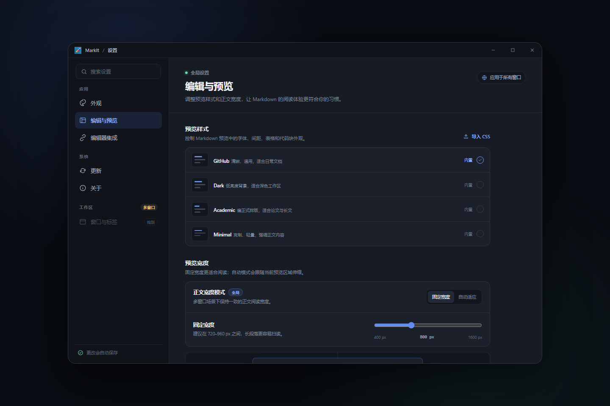
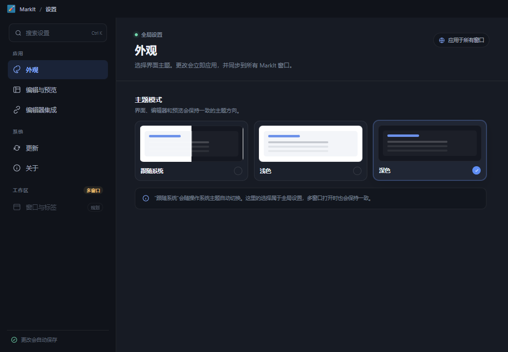
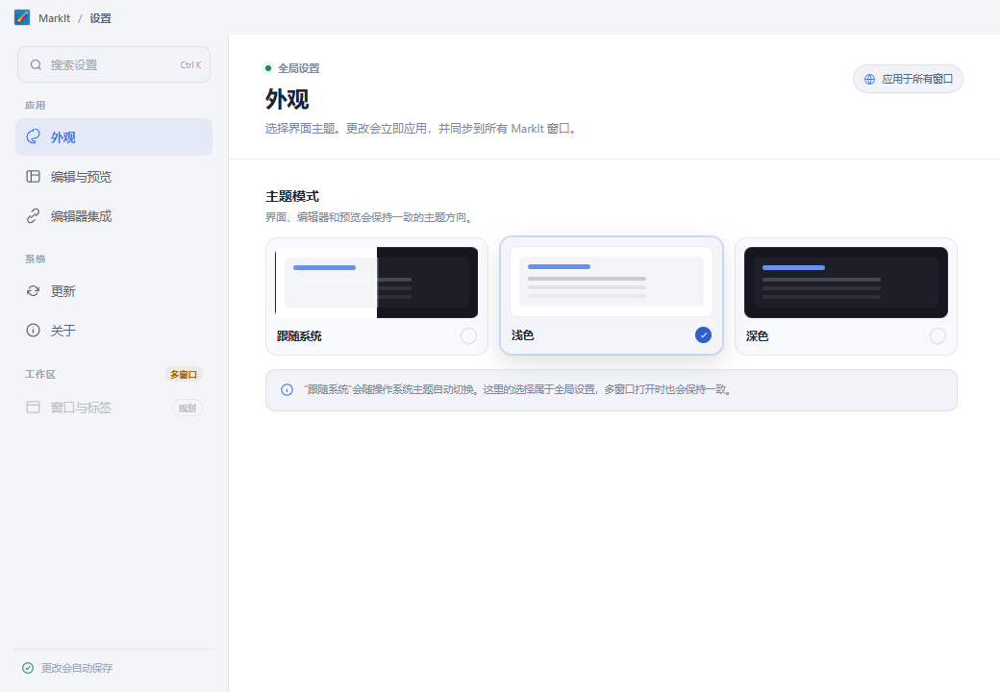
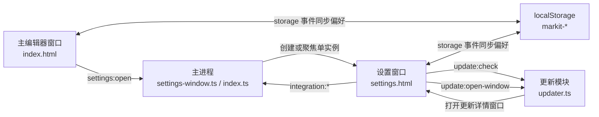
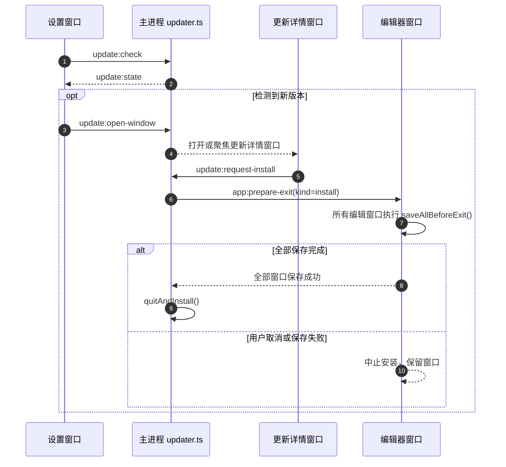

# 独立设置窗口

> **当前状态：已实施。** 本文定义设置页从编辑器内弹窗迁移为全局独立工具窗口的架构、IPC、状态同步与验收边界。设置窗口首次创建会跟随触发编辑窗口所在显示器，已有窗口只激活不移动，完整规则见[窗口放置与单实例规则](./窗口放置与单实例规则.md)。

## 1. 背景

设置项持续增加后，原有 `SettingsDialog.vue` 在单列弹窗内不断向下堆叠，窗口高度和内容可发现性都接近上限。窄窗口下，内容区关闭按钮还会随着分类布局移动，窗口级动作与内容级动作的语义发生混淆。

目标方案：

1. 设置页改为独立 `BrowserWindow`，从主编辑器窗口打开；
2. 使用系统窗口按键，不再由页面绘制关闭按钮；
3. 左侧按领域分类，右侧只展示当前分类内容；
4. 当前设置仍全部是全局设置；
5. 在多编辑窗口场景下保持全局单实例，设置窗口只承载应用级偏好，不提供窗口与标签管理。

## 2. 设计效果

可交互原型：[设置页布局原型.html](./设置页布局原型.html)。

实际运行效果：

## 3. 窗口定义

设置窗口由 [`src/main/settings-window.ts`](../src/main/settings-window.ts) 管理，属于**全局单实例工具窗口**。

| 项目            | 约定                                                                                               |
| --------------- | -------------------------------------------------------------------------------------------------- |
| 入口            | `src/renderer/settings.html`                                                                       |
| 挂载组件        | `src/renderer/src/settings/SettingsWindow.vue`                                                     |
| 默认尺寸        | 1040 × 720                                                                                         |
| 最小尺寸        | 720 × 560                                                                                          |
| 显示时机        | `ready-to-show` 后显示，避免白屏                                                                   |
| 单实例          | 已存在时恢复、显示并聚焦                                                                           |
| 显示器归属      | 首次创建跟随触发编辑窗口所在显示器；已有窗口不从其他显示器迁入                                     |
| Windows / Linux | `frame: false` + `titleBarStyle: 'hidden'` + `titleBarOverlay`，系统绘制最小化 / 最大化 / 关闭按钮 |
| macOS           | `titleBarStyle: 'hidden'`，保留系统交通灯                                                          |
| 标题栏高度      | 36px，与编辑窗口一致                                                                               |
| 关闭行为        | 内容自动保存，无需未保存确认；直接使用系统关闭按钮                                                 |
| 会话恢复        | 不进入编辑器会话，不随编辑器标签恢复                                                               |

设置窗口不是任何编辑器的 `parent` / `modal` 子窗口。仍有一个编辑窗口时，关闭其中一个编辑窗口不会关闭设置窗口；所有编辑窗口关闭后设置窗口才会联动关闭，应用退出时不会留下孤立工具窗口。

## 4. 架构

关键边界：

1. 设置窗口拥有自己的 Pinia 实例，不与编辑窗口共享内存状态。
2. 全局偏好仍以 `markit-*` localStorage 为唯一持久化来源。
3. 所有编辑窗口与设置窗口都通过 `storage` 事件刷新全局偏好内存状态。
4. 设置窗口不能直接保存编辑器文档。设置页的“检查更新”只负责检测并打开更新详情窗口，下载、安装与未保存内容确认都在更新详情窗口及其主进程协调流程中完成。
5. 设置窗口不是编辑器窗口。多窗口模式下仍保持全局单实例，不加入编辑窗口注册表，也不参与标签迁移。

## 5. 页面结构

左侧分类：

| 分类       | 内容                                           |
| ---------- | ---------------------------------------------- |
| 外观       | 跟随系统 / 浅色 / 深色                         |
| 编辑与预览 | 预览样式、导入 CSS、预览宽度                   |
| 编辑器集成 | VS Code Stable / Insiders                      |
| 更新       | Beta 通道、当前版本、检查更新入口、回退        |
| 关于       | 产品信息、版本、更新通道、项目链接             |

设置页只保留应用、系统两组分类，不再提供“窗口与标签”页面、侧栏底部的保存提示或内容区顶部的作用域标识。

设置搜索框按分类和设置项名称筛选；当前只负责跳转到对应分类，不改变设置值。

## 6. IPC

### 6.1 新增

| 通道            | 方向       | preload           | 返回               | 说明                                     |
| --------------- | ---------- | ----------------- | ------------------ | ---------------------------------------- |
| `settings:open` | R→M invoke | `settings.open()` | `Promise<boolean>` | 只接受编辑器窗口调用；打开或聚焦设置窗口 |

### 6.2 调用来源调整

| 通道                           | 调整                                                         |
| ------------------------------ | ------------------------------------------------------------ |
| `window:set-native-theme`      | 允许任意编辑窗口与设置窗口调用，继续只影响全局 `nativeTheme` |
| `integration:detect-vscode`    | 允许设置窗口调用                                             |
| `integration:install-vscode`   | 允许设置窗口调用                                             |
| `integration:uninstall-vscode` | 允许设置窗口调用                                             |
| `update:rollback-to-stable`    | 允许编辑窗口与设置窗口调用；回退不触碰编辑器文档             |
| `update:check`                 | 允许设置窗口发起版本检测                                     |
| `update:open-window`           | 允许设置窗口在发现新版本后打开或聚焦全局更新详情窗口         |
| `update:request-install`       | 设置窗口不再调用；安装只从更新详情窗口或编辑窗口发起         |

`window:close`、`window:get-zoom`、`window:is-fullscreen` 等窗口能力只接受编辑窗口调用，并按 IPC 发送方定位具体窗口。

## 7. 更新检查与安装流程

设置窗口不展示下载进度，也不直接发起安装。用户在设置页点击“检查更新”后，如有新版本则自动打开更新详情窗口；后续下载和安装入口集中在更新详情窗口。安装由主进程统一协调，不能绕过任何编辑窗口的未保存确认。

## 8. 跨窗口同步

### 8.1 `app` store

监听 `storage` 事件并重新读取以下键：

- `markit-theme`
- `markit-show-outline`
- `markit-outline-width`
- `markit-split-ratio`
- `markit-preview-width-mode`
- `markit-preview-width`

`markit-layout` 与 `markit-show-outline` 的实际状态分别按标签存于 `DocumentTab.layoutMode` / `outlineVisible`，不参与全局同步。重新读取 `markit-show-outline` 只更新新标签、旧会话与无激活标签时使用的兜底值。

### 8.2 `style` store

监听以下键：

- `markit-preview-style`
- `markit-custom-styles`

设置窗口写入后，所有编辑窗口刷新当前预览样式和自定义样式列表。

## 9. 多窗口协作

1. 设置窗口保持全局单实例，不进入编辑窗口注册表。
2. `settings:open` 接受任意编辑窗口，打开或聚焦同一个全局设置窗口。
3. 偏好仍由 `storage` 事件同步；编辑器窗口注册表、标签迁移、退出与安装协调由主进程负责。完整契约见[多窗口架构](./多窗口架构.md)。
4. 从编辑窗口打开设置时，主进程必须以该 IPC 发送方作为触发窗口；已有设置窗口时只恢复并聚焦，不移动窗口。
5. 新建编辑窗口只从编辑窗口的快捷键或标签菜单发起，设置窗口不再提供新建窗口入口。

## 10. 验证

### 10.1 自动化

- `npm run lint`
- `npm run typecheck`
- `npm test`
- `npm run build`

### 10.2 开发模式手工验证

1. 任一编辑窗口点击工具栏设置按钮，出现独立设置窗口。
2. 使用 `Ctrl+,` 再次打开时，不创建第二个设置窗口，只聚焦已有窗口。
3. 系统最小化 / 最大化 / 关闭按钮可用，页面内没有自定义关闭按钮。
4. 设置窗口缩到最小尺寸，导航、内容区和标题栏不重叠。
5. 切换深浅主题，所有编辑窗口与设置窗口同步变化。
6. 切换预览样式、导入 CSS、调整预览宽度，所有编辑窗口预览同步更新。
7. 编辑器集成能检测、安装和卸载 VS Code 扩展。
8. 更新检查发现新版本时自动打开更新详情窗口，设置页不显示下载进度与更新说明；Beta 开关与回退确认正常。
9. 关闭一个编辑窗口时设置窗口保持；关闭最后一个编辑窗口后设置窗口一并关闭。
10. 双显示器环境：编辑窗口只在副屏时首次打开设置窗口，设置窗口出现在副屏；关闭后从主屏打开，设置窗口出现在主屏。
11. 双显示器环境：设置窗口已打开时从另一块屏幕再次触发，只激活已有窗口，不新增且不移动。

### 10.3 本次实施结果

| 检查项              | 结果                                         |
| ------------------- | -------------------------------------------- |
| `npm run lint`      | 通过（仓库既有格式化 warning 不影响退出码）  |
| `npm run typecheck` | 通过                                         |
| `npm test`          | 26 个测试文件、208 条用例通过                |
| `npm run build`     | 通过，产出 `out/renderer/settings.html`      |
| `npm run test:e2e`  | 19 条 Playwright Electron 用例全部通过       |
| `npm run dev`       | 主进程、preload 与三页 Vite 开发服务正常启动 |

## 11. 相关文件

| 文件                                                                                                                          | 职责                                                      |
| ----------------------------------------------------------------------------------------------------------------------------- | --------------------------------------------------------- |
| [`src/main/settings-window.ts`](../src/main/settings-window.ts)                                                               | 设置窗口创建、单实例与聚焦                                |
| [`src/main/index.ts`](../src/main/index.ts)                                                                                   | `settings:open`、任意编辑窗口来源校验、最后窗口关闭时联动 |
| [`src/main/updater.ts`](../src/main/updater.ts)                                                                               | 允许设置窗口回退，并通过主进程协调所有编辑窗口安装        |
| [`src/preload/index.ts`](../src/preload/index.ts)                                                                             | 暴露 `window.api.settings.open()`                         |
| [`src/renderer/settings.html`](../src/renderer/settings.html)                                                                 | 设置窗口 HTML 入口                                        |
| [`src/renderer/src/settings/SettingsWindow.vue`](../src/renderer/src/settings/SettingsWindow.vue)                             | 独立设置窗口页面                                          |
| [`src/renderer/src/components/settings/VSCodeIntegration.vue`](../src/renderer/src/components/settings/VSCodeIntegration.vue) | VS Code 集成设置区块                                      |
| [`src/renderer/src/stores/app.ts`](../src/renderer/src/stores/app.ts)                                                         | 全局偏好持久化与 `storage` 同步                           |
| [`src/renderer/src/stores/style.ts`](../src/renderer/src/stores/style.ts)                                                     | 预览样式持久化与 `storage` 同步                           |
| [`docs/窗口放置与单实例规则.md`](./窗口放置与单实例规则.md)                                                                   | 多显示器放置、全局单实例与新增窗口检查清单                |
