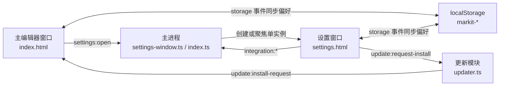
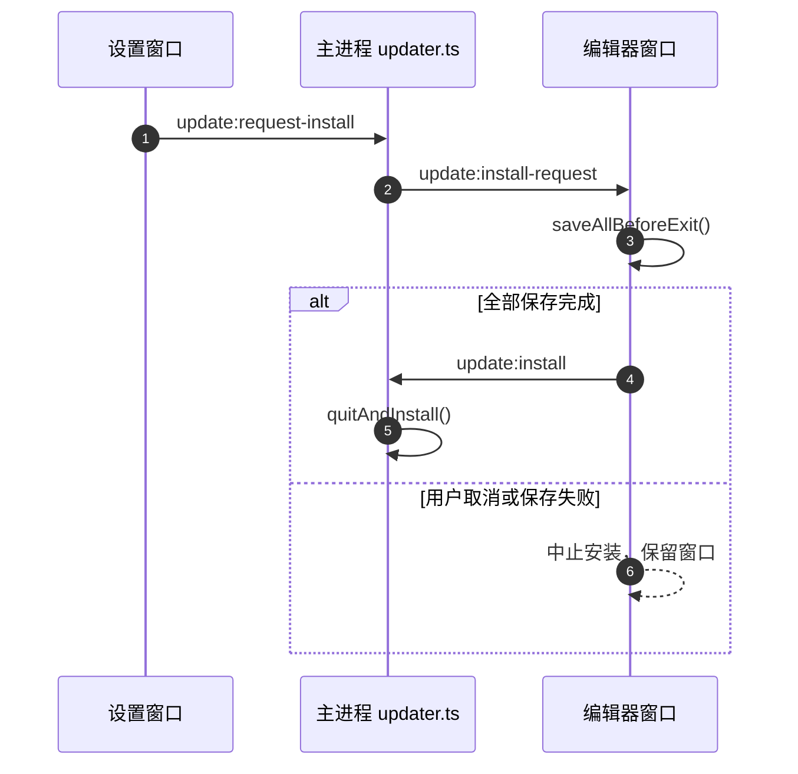

# 独立设置窗口

> **当前状态：已实施。** 本文定义设置页从主窗口弹窗迁移为独立工具窗口的架构、IPC、状态同步与验收边界。

## 1. 背景

设置项持续增加后，原有 `SettingsDialog.vue` 在单列弹窗内不断向下堆叠，窗口高度和内容可发现性都接近上限。窄窗口下，内容区关闭按钮还会随着分类布局移动，窗口级动作与内容级动作的语义发生混淆。

目标方案：

1. 设置页改为独立 `BrowserWindow`，从主编辑器窗口打开；
2. 使用系统窗口按键，不再由页面绘制关闭按钮；
3. 左侧按领域分类，右侧只展示当前分类内容；
4. 当前设置仍全部是全局设置；
5. 为后续多窗口、按窗口或按标签设置预留分类与作用域表达，但本期不实现多窗口。

## 2. 设计效果

可交互原型：[设置页布局原型.html](./设置页布局原型.html)。

实际运行效果：

## 3. 窗口定义

设置窗口由 [`src/main/settings-window.ts`](../src/main/settings-window.ts) 管理，属于**全局单实例工具窗口**。

| 项目            | 约定                                                                                               |
| --------------- | -------------------------------------------------------------------------------------------------- |
| 入口            | `src/renderer/settings.html`                                                                       |
| 挂载组件        | `src/renderer/src/settings/SettingsWindow.vue`                                                     |
| 默认尺寸        | 1040 × 720                                                                                         |
| 最小尺寸        | 720 × 560                                                                                          |
| 显示时机        | `ready-to-show` 后显示，避免白屏                                                                   |
| 单实例          | 已存在时恢复、显示并聚焦                                                                           |
| Windows / Linux | `frame: false` + `titleBarStyle: 'hidden'` + `titleBarOverlay`，系统绘制最小化 / 最大化 / 关闭按钮 |
| macOS           | `titleBarStyle: 'hidden'`，保留系统交通灯                                                          |
| 标题栏高度      | 36px，与主窗口一致                                                                                 |
| 关闭行为        | 内容自动保存，无需未保存确认；直接使用系统关闭按钮                                                 |
| 会话恢复        | 不进入编辑器会话，不随编辑器标签恢复                                                               |

设置窗口不是主编辑器的 `parent` / `modal` 子窗口。主窗口关闭后，设置窗口一并关闭；应用退出时也不会留下孤立设置窗口。

## 4. 架构

关键边界：

1. 设置窗口拥有自己的 Pinia 实例，不与主窗口共享内存状态。
2. 全局偏好仍以 `markit-*` localStorage 为唯一持久化来源。
3. 已打开窗口通过 `storage` 事件刷新内存状态；本期单主窗口场景不引入主进程设置广播。
4. 设置窗口不能直接保存编辑器文档。更新安装必须走 `update:request-install`，由编辑器窗口确认所有未保存标签并保存会话。
5. 设置窗口不是编辑器窗口。未来多窗口改造时，它仍应保持全局单实例，不能加入编辑窗口注册表，也不参与标签迁移。

## 5. 页面结构

左侧分类：

| 分类       | 内容                                           |
| ---------- | ---------------------------------------------- |
| 外观       | 跟随系统 / 浅色 / 深色                         |
| 编辑与预览 | 预览样式、导入 CSS、预览宽度                   |
| 编辑器集成 | VS Code Stable / Insiders                      |
| 更新       | Beta 通道、版本状态、检查 / 下载 / 安装 / 回退 |
| 关于       | 产品信息、版本、更新通道、项目链接             |

工作区分组展示禁用的「窗口与标签」占位项，并标注多窗口规划。该占位项不接收点击，不持久化，也不代表本期能力。

内容区顶部展示「全局设置 / 应用于所有窗口」。未来增加按窗口或按标签设置时，只扩展作用域标识与分类，不改变窗口骨架。

设置搜索框按分类和设置项名称筛选；当前只负责跳转到对应分类，不改变设置值。

## 6. IPC

### 6.1 新增

| 通道            | 方向       | preload           | 返回               | 说明                                     |
| --------------- | ---------- | ----------------- | ------------------ | ---------------------------------------- |
| `settings:open` | R→M invoke | `settings.open()` | `Promise<boolean>` | 只接受编辑器窗口调用；打开或聚焦设置窗口 |

### 6.2 调用来源调整

| 通道                           | 调整                                                     |
| ------------------------------ | -------------------------------------------------------- |
| `window:set-native-theme`      | 允许主窗口与设置窗口调用，继续只影响全局 `nativeTheme`   |
| `integration:detect-vscode`    | 允许设置窗口调用                                         |
| `integration:install-vscode`   | 允许设置窗口调用                                         |
| `integration:uninstall-vscode` | 允许设置窗口调用                                         |
| `update:rollback-to-stable`    | 允许设置窗口直接调用；回退不触碰编辑器文档               |
| `update:request-install`       | 设置窗口按现有转交流程请求主窗口安装；不新增直接安装通道 |

`window:close`、`window:get-zoom`、`window:is-fullscreen` 等主编辑器窗口能力仍只接受主窗口调用。

## 7. 更新安装流程

设置窗口只负责展示状态和发起请求，不遍历文档，不调用 `saveAllBeforeExit()`，也不直接调用 `update:install`。

## 8. 跨窗口同步

### 8.1 `app` store

监听 `storage` 事件并重新读取以下键：

- `markit-theme`
- `markit-show-outline`
- `markit-outline-width`
- `markit-split-ratio`
- `markit-preview-width-mode`
- `markit-preview-width`

`markit-layout` 仍按标签维护，不参与全局同步。

### 8.2 `style` store

监听以下键：

- `markit-preview-style`
- `markit-custom-styles`

设置窗口写入后，主窗口刷新当前预览样式和自定义样式列表。

## 9. 多窗口改造预留

1. 设置窗口保持全局单实例，不进入编辑窗口注册表。
2. `settings:open` 当前由主窗口实现 `isEditorWindowSender` 判断；未来多窗口时只替换为注册表查询。
3. 页面顶部作用域标识已独立，未来可承载“当前窗口”或“当前标签”。
4. 左侧已有独立的“工作区”分组，可增加窗口、标签、拖出策略等分类。
5. 本期使用 `storage` 事件完成单主窗口同步；多窗口落地后可将同一偏好模型改由主进程广播，页面结构不需要重做。

## 10. 验证

### 10.1 自动化

- `npm run lint`
- `npm run typecheck`
- `npm test`
- `npm run build`

### 10.2 开发模式手工验证

1. 主窗口点击工具栏设置按钮，出现独立设置窗口。
2. 使用 `Ctrl+,` 再次打开时，不创建第二个设置窗口，只聚焦已有窗口。
3. 系统最小化 / 最大化 / 关闭按钮可用，页面内没有自定义关闭按钮。
4. 设置窗口缩到最小尺寸，导航、内容区和标题栏不重叠。
5. 切换深浅主题，主窗口与设置窗口同步变化。
6. 切换预览样式、导入 CSS、调整预览宽度，主窗口预览同步更新。
7. 编辑器集成能检测、安装和卸载 VS Code 扩展。
8. 更新检查、Beta 开关、回退确认正常；安装请求由主窗口处理未保存文档。
9. 关闭主窗口时设置窗口一并关闭，不留下孤立窗口。

### 10.3 本次实施结果

| 检查项              | 结果                                         |
| ------------------- | -------------------------------------------- |
| `npm run lint`      | 通过（仓库既有格式化 warning 不影响退出码）  |
| `npm run typecheck` | 通过                                         |
| `npm test`          | 18 个测试文件、166 条用例通过                |
| `npm run build`     | 通过，产出 `out/renderer/settings.html`      |
| `npm run test:e2e`  | 8 条 Playwright Electron 用例全部通过        |
| `npm run dev`       | 主进程、preload 与三页 Vite 开发服务正常启动 |

## 11. 相关文件

| 文件                                                                                                                          | 职责                                            |
| ----------------------------------------------------------------------------------------------------------------------------- | ----------------------------------------------- |
| [`src/main/settings-window.ts`](../src/main/settings-window.ts)                                                               | 设置窗口创建、单实例与聚焦                      |
| [`src/main/index.ts`](../src/main/index.ts)                                                                                   | `settings:open`、调用来源校验、主窗口关闭时联动 |
| [`src/main/updater.ts`](../src/main/updater.ts)                                                                               | 允许设置窗口回退，并继续通过安装请求转交主窗口  |
| [`src/preload/index.ts`](../src/preload/index.ts)                                                                             | 暴露 `window.api.settings.open()`               |
| [`src/renderer/settings.html`](../src/renderer/settings.html)                                                                 | 设置窗口 HTML 入口                              |
| [`src/renderer/src/settings/SettingsWindow.vue`](../src/renderer/src/settings/SettingsWindow.vue)                             | 独立设置窗口页面                                |
| [`src/renderer/src/components/settings/VSCodeIntegration.vue`](../src/renderer/src/components/settings/VSCodeIntegration.vue) | VS Code 集成设置区块                            |
| [`src/renderer/src/stores/app.ts`](../src/renderer/src/stores/app.ts)                                                         | 全局偏好持久化与 `storage` 同步                 |
| [`src/renderer/src/stores/style.ts`](../src/renderer/src/stores/style.ts)                                                     | 预览样式持久化与 `storage` 同步                 |
