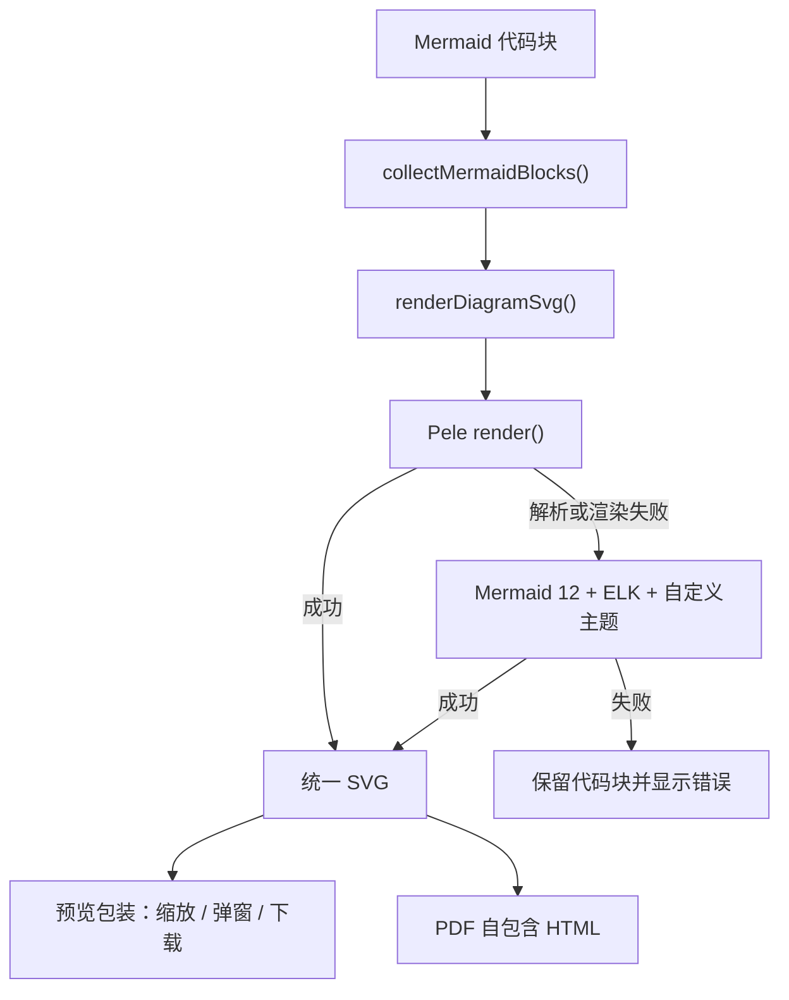
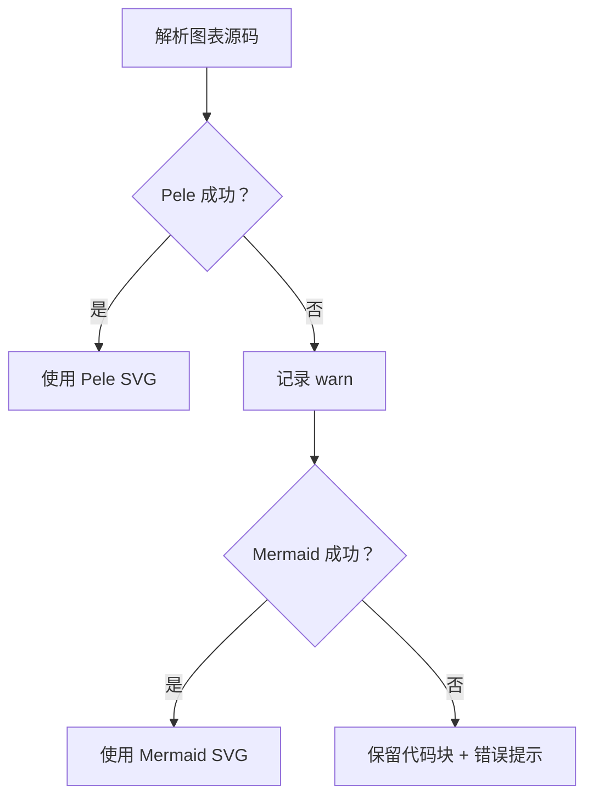

# 图表渲染升级方案

> **文档定位**：说明 MarkIt 从“直接展示 Mermaid 默认主题”升级为“统一视觉、Pele 首选、Mermaid 回退”的设计。本文先于实现落地，实施完成后以源码为准同步。
>
> **当前状态**：阶段 1、阶段 2 已实施；阶段 3 仅进入后续规划，不在本次实现范围。
>
> **实施验证（2026-11-10）**：流程图、时序图、状态图、ER、饼图、XY、雷达图 7 类示例均由 Pele 成功渲染；深浅主题切换后全部重绘；PDF e2e 通过。

## 1. 背景

当前预览与 PDF 各自直接调用 Mermaid，并使用 `theme: 'default' / 'dark'`：

- 流程图主要使用 Dagre 布局，复杂分支容易出现层级松散和连线交叉。
- 流程图、时序图、状态图、ER 图、饼图、雷达图、XY 图等各自使用 Mermaid 默认视觉，缺少统一的系列色、字号、边框和留白。
- 页面内图表统一限制为 `70vh` 高，并同时按宽高缩小；纵向大图会被压成很小的整图。
- 预览与 PDF 分别维护渲染配置，后续主题和降级策略容易漂移。

Codex 桌面端的公开资料没有给出渲染器参数，但其安装包中的前端实现表明它采用两层策略：优先使用 Pele 重新解析和排版，失败或不适用时回退到经过定制配置的 Mermaid + ELK。本方案采用相同架构，但只实现阶段 1、阶段 2；阶段 3 写入后续规划。

## 2. 目标与非目标

### 2.1 目标

1. 将 Mermaid 升级到 12.x，并启用 ELK、Neo look 与自定义主题。
2. 引入 MIT 许可的 Pele，作为所有内置 Mermaid 图表类型的首选 SVG 渲染器。
3. Pele 无法解析或渲染时自动回退 Mermaid，不阻断整篇文档。
4. 预览与 PDF 共用同一渲染入口和主题 token，避免两套配置漂移。
5. 流程图、时序图、状态图、ER 图、饼图、雷达图、XY 图、桑基图、时间线、思维导图、C4、架构图、看板等共享同一套字体、系列色、边框和留白。
6. 保持现有 SVG 尺寸读取、缩放、弹窗、SVG/PNG 下载和错误提示能力。
7. 移除按高度强制压缩图表的行为，改为只按宽度适应；大图通过页面滚动或弹窗查看。

### 2.2 非目标

1. 本次不把 Mermaid 判断节点重绘为 Codex 同款虚线卡片。
2. 本次不把边标签统一改成胶囊节点。
3. 本次不实现 Mermaid AST 重写、自定义布局渲染器或图源自动修复。
4. 本次不引入用户可见的“切换渲染器”设置；Pele 首选与 Mermaid 回退由系统自动决定。
5. 本次不改变 Markdown 图片、链接分流、PDF 打印和图表导出 IPC 契约。

## 3. 总体架构



新增共享模块 `src/renderer/src/utils/diagram-renderer.ts`，对上层暴露单一异步接口。调用方不直接依赖 Pele 或 Mermaid 的初始化细节。

```ts
interface DiagramRenderOptions {
  diagramId: string
  theme: DiagramThemeTokens
  fontFamily: string
  fontSize?: number
}

interface DiagramRenderResult {
  svg: string
  engine: 'pele' | 'mermaid'
  diagramType?: string
}

function renderDiagramSvg(
  source: string,
  options: DiagramRenderOptions
): Promise<DiagramRenderResult>
```

## 4. 阶段 1：Mermaid 12 与统一主题

### 4.1 版本与配置

- `mermaid` 从 11.x 升级到 `^12.3.0`。
- 使用 `theme: 'base'`、`look: 'neo'`、`layout: 'elk'`。
- 保留 `htmlLabels: false`，继续使用 SVG `<text>`，保证 PNG、SVG、PDF 导出稳定。
- 为所有内置图表设置 `useMaxWidth: false`，由 MarkIt 包装层统一控制视口尺寸。
- 保留 `securityLevel: 'loose'`，维持当前图表链接和 HTML 标签兼容行为；链接点击仍由预览层统一分流。

### 4.2 主题 token

新增 `src/renderer/src/utils/diagram-theme.ts`，提供深色、浅色两套纯数据 token：

| token | 用途 |
| --- | --- |
| `background` | 图表画布与边标签底色 |
| `foreground` | 节点正文与标题 |
| `muted` | 次要标签、图例说明 |
| `line` | 连线、箭头和坐标轴 |
| `surface` | 普通节点填充 |
| `surfaceAlt` | 子图、表头和分区填充 |
| `border` | 节点、子图、表格边框 |
| `accent` | 主强调色 |
| `critical` | 错误、高风险、关键任务 |
| `series` | 饼图、雷达图、桑基图、时间线等系列色 |

主题 token 是唯一视觉事实来源：

- Mermaid 通过 `themeVariables` 和 `themeCSS` 消费。
- Pele 通过 `--pele-*` CSS 变量消费。
- 预览卡片背景、PNG 导出背景和弹窗背景也使用 `background`。

### 4.3 Mermaid themeCSS

阶段 1 仅做统一的“视觉基础”，不改图形语义：

- 节点文字使用 600 字重。
- 边标签使用 600 字重和更紧凑的字距。
- 普通矩形节点增加圆角。
- 节点、连线和边标签边框统一 1px。
- 边标签背景增加圆角和低对比描边。

判断节点仍由 Mermaid 按 `{}` 画出菱形。判断节点改为虚线卡片属于阶段 3。

## 5. 阶段 2：Pele 首选与 Mermaid 回退

### 5.1 依赖

- 新增 `pele@^1.13.0`。
- Pele 使用 MIT 许可，与本项目兼容。
- 使用动态 `import('pele')`，只在文档首次出现图表时加载。

### 5.2 首选渲染

每个图表块按以下顺序处理：

1. 等待字体准备完成。
2. 调用 Pele `render()`。
3. Pele 成功时直接使用返回的 SVG。
4. Pele 抛错时记录 `console.warn`，转入 Mermaid 回退。
5. Mermaid 也失败时由预览层保留原代码块并显示错误提示。

Pele 渲染参数：

| 参数 | 值 | 原因 |
| --- | --- | --- |
| `responsive` | `false` | 由 MarkIt 包装层统一读取 viewBox 并适应宽度 |
| `autoDirection` | `false` | 避免容器宽度变化导致图表方向跳变 |
| `links` | `true` | 保留图表内链接，点击仍走预览链接分流 |
| `linkSchemes` | `http` / `https` / `mailto` | 拒绝危险协议 |
| `linkRel` | `noopener noreferrer` | 外链安全 |
| `images` | `false` | 图表内嵌图片不纳入本次范围 |
| `fontFamily` | 预览正文字体 | 保证中文测宽与排版一致 |
| `limit` / `outputLimit` / `maxEdges` | Pele 默认上限 | 防止异常输入造成过量输出 |

### 5.3 主题注入

Pele SVG 使用 CSS 变量，不把颜色直接写死。包装层在 `.mermaid-canvas` 上设置：

```text
--pele-bg
--pele-fg
--pele-muted
--pele-line
--pele-surface
--pele-surface-alt
--pele-border
--pele-accent
--pele-critical
--pele-font
--pele-font-mono
--pele-radius
--pele-series-1 ... --pele-series-8
```

主题或预览样式变化时重新渲染图表，确保 Mermaid 回退路径与 Pele 路径同步。

### 5.4 Mermaid 回退

回退配置由共享模块集中管理：

- Mermaid 模块和配置按主题签名缓存。
- Mermaid 初始化与渲染通过模块级 Promise 链串行化，避免预览与 PDF 并发时争用全局状态。
- 每次回退都使用唯一图表 ID，避免 Shadow DOM 或重复渲染 ID 冲突。
- 错误对象继续交给现有 `formatMermaidError()` 压缩展示。

### 5.5 预览与 PDF 同步

预览和 PDF 都只调用 `renderDiagramSvg()`，不再分别调用 `mermaid.initialize()`。

- 预览使用当前 app 主题 token。
- PDF 固定使用浅色 token，并等待字体和布局完成后打印。
- 任一路径采用 Pele 时，Pele 外层容器携带同一组 CSS 变量，保证生成的 SVG 在预览和 PDF 中颜色一致。

## 6. 尺寸与交互

### 6.1 新行为

- 图表宽度只按容器宽度适应，不再按 `70vh` 高度缩小。
- 纵向长图保持自然字号，由整个预览页滚动查看。
- 宽图仍会在达到 `MIN_FIT_SCALE` 后出现横向滚动。
- 弹窗、按钮缩放、Ctrl/Cmd + 滚轮、双击预览保持不变。

### 6.2 原因

同一张纵向流程图按高度适应时，会同时缩小文字、节点和线宽，导致“整图看似完整但不可读”。只按宽度适应用户阅读更接近原始图表编辑器，也更接近 Pele 自身的尺寸模型。

## 7. 错误、回退与安全



安全与稳定性约束：

1. 图表内 Javascript 回调不执行。
2. 图表外链仅接受明确协议，其他协议忽略。
3. 图表内嵌图片在本次不启用；Markdown 普通图片链路不受影响。
4. Pele 与 Mermaid 均只在渲染进程工作，不新增 IPC。
5. SVG 下载和 PNG 导出继续使用现有 `diagram-export.ts`。
6. 单块失败不影响同文档其他图表和正文。

## 8. 后续阶段 3：语义重绘

阶段 3 的目标是进一步接近 Codex 截图中的“语义化图表”，单独排期，不与本次实现混在一起：

1. 解析 Mermaid AST，而不是使用正则替换源码。
2. 将判断节点从菱形映射为圆角虚线卡片，保留原始判断语义。
3. 将边标签从普通文字重绘为胶囊或小型标签节点。
4. 计算新的节点边界、连线交点和布局间距，避免只改外观造成连线错位。
5. 为源文件中含括号、竖线和复杂 HTML 的标签增加安全修复与回退。
6. 增加 AST 变换单元测试，覆盖判断、子图、双向边、循环和样式类。

推荐参考实现：

- Pele 的自定义解析、布局与 SVG 图元系统。
- Mermaid 12 的 ELK 布局配置。
- Codex 前端“先改节点形状，再交给布局渲染器”的处理顺序。

## 9. 测试与验收

自动化：

- `npm run lint`
- `npm run typecheck`
- `npm test`
- `npm run build`

单元测试重点：

- 深色 / 浅色 token 均为完整、合法、系列色数量正确。
- Mermaid 配置固定包含 `layout: 'elk'`、`look: 'neo'`、`htmlLabels: false` 和各族图表 `useMaxWidth: false`。
- 主题变化时 Mermaid 配置签名变化，避免沿用旧主题。

手工验证：

1. 打开使用手册，依次检查流程图、时序图、状态图、ER 图、甘特图、饼图、XY 图、桑基图、雷达图、矩形树图、需求图、架构图、看板和 C4。
2. 深色 / 浅色各切换一次，确认所有图表同步换色。
3. 验证一张宽图和一张纵向长图：宽图可横向滚动，长图保持字号并随页面纵向滚动。
4. 验证缩放、Ctrl/Cmd + 滚轮、双击弹窗、SVG / PNG 下载。
5. 构造 Pele 不支持的语法，确认自动回退 Mermaid；再构造 Mermaid 错误语法，确认保留代码块和错误提示。
6. 导出 A4 PDF，确认图表颜色、尺寸和分页正常。

## 10. 涉及文件

| 文件 | 计划改动 |
| --- | --- |
| `package.json` / `package-lock.json` | 升级 Mermaid，新增 Pele |
| `src/renderer/src/utils/diagram-theme.ts` | 新增图表主题 token 与 Mermaid 配置构造 |
| `src/renderer/src/utils/diagram-renderer.ts` | 新增 Pele 首选、Mermaid 回退的统一入口 |
| `src/renderer/src/utils/diagram-theme.spec.ts` | 主题与配置回归测试 |
| `src/renderer/src/components/preview/MarkdownPreview.vue` | 接入共享渲染器、主题变量、宽度适应 |
| `src/renderer/src/composables/usePdfExport.ts` | PDF 改用共享渲染器 |
| `src/renderer/src/App.vue` | 移除 70vh 高度限制，更新图表容器样式 |
| `docs/编辑与预览/Mermaid图表与导出.md` | 实施后同步渲染链路与错误行为 |
| `docs/导出/PDF导出.md` | 实施后同步 PDF Mermaid 管线 |
| `docs/架构与契约/技术决策与已知限制.md` | 增加渲染器选择与后续阶段记录 |
| `docs/工程与质量/测试与质量保障.md` | 增加图表多类型与主题验证项 |
| `src/renderer/src/assets/welcome.md` | 更新用户可见的图表显示与缩放说明 |
