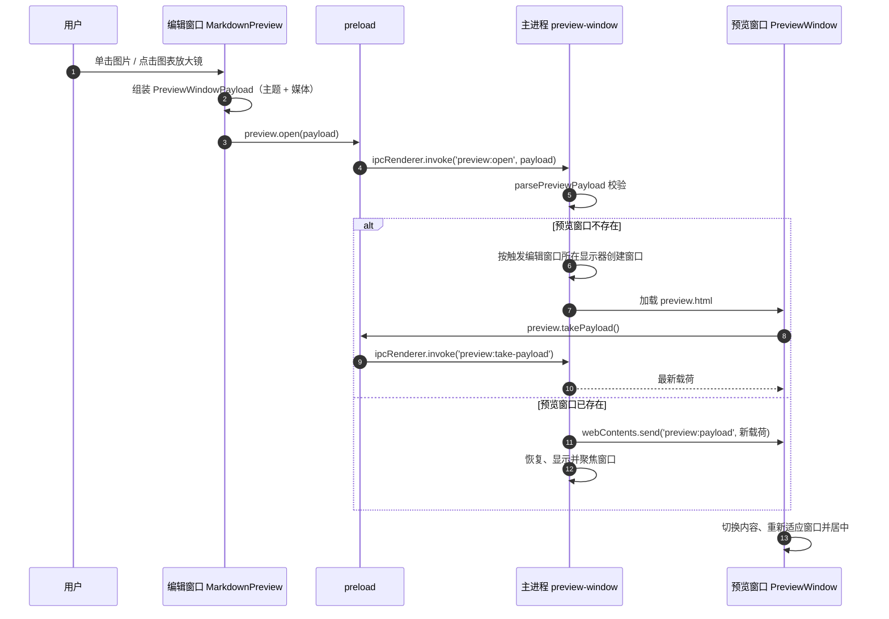
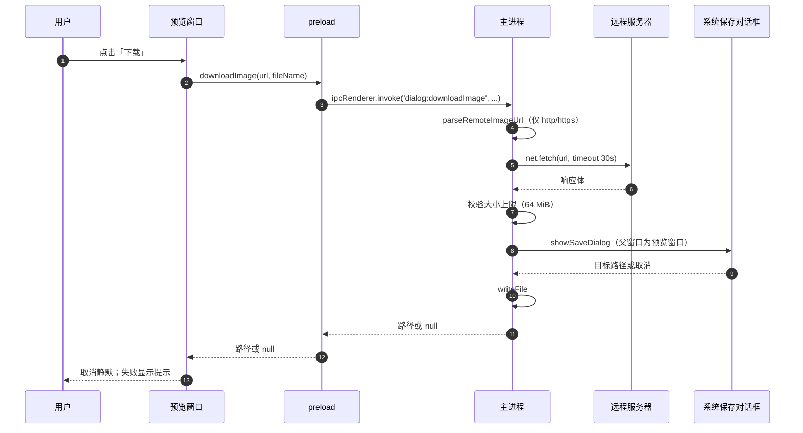

# 大图预览与图片操作

本文描述 MarkIt 的**独立大图预览窗口**：它同时承载 Mermaid 图表与文档内图片，覆盖窗口角色、打开链路、视图层级、缩放模型、图片保存 / 下载能力与安全边界。图表本身的识别、渲染与导出链路见 [Mermaid 图表与导出](./Mermaid图表与导出.md)，本地图片地址解析见 [编辑器与预览](./编辑器与预览.md) 第 9 节。

相关实现主要分布在 `src/main/preview-window.ts`、`src/main/preview-payload.ts`、`src/renderer/src/preview/`、`src/renderer/src/utils/media-preview.ts` 与 `src/renderer/src/utils/local-image.ts`。

## 1. 设计目标

1. **预览必须是独立窗口**：不再使用页内遮罩。页内遮罩无法覆盖编辑窗口的自定义标题栏与状态栏，且内容层的关闭按钮会被系统窗口控制按钮遮挡，点击会误关应用窗口。
2. **图表与图片共用一套查看体验**：缩放范围、步进、适应窗口、滚轮锚点、Esc 关闭保持一致。
3. **缩放围绕用户注意力**：滚轮缩放以鼠标位置为锚点；按钮与百分比以视口中心为锚点，图片不会因为原本居中而在放大后跳到左上角。
4. **图片可带走**：本地图片支持「打开目录」与「另存为」，远程图片支持下载到本地。
5. **窗口能力受控**：主进程校验来源与载荷；远程下载由主进程发起；预览窗口不拥有文档、不进入编辑器会话。

## 2. 窗口角色

| 项         | 规则                                                                   |
| ---------- | ---------------------------------------------------------------------- |
| 窗口类型   | 全局单实例工具窗口，不进入编辑器窗口注册表，不参与会话恢复与标签迁移   |
| 实例规则   | 同一时刻最多一个预览窗口；重复打开只替换内容、恢复并聚焦，不新建窗口   |
| 首次放置   | 跟随触发编辑窗口所在显示器居中创建，尺寸 `1120 × 780`，最小 `420 × 320` |
| 已有窗口   | 保持在原显示器与原尺寸，不因再次打开而移动或改变大小                   |
| 生命周期   | 所有编辑窗口关闭后与设置 / 更新窗口一同关闭；应用退出时自然关闭         |
| 窗口控制   | 使用系统窗口控制（Windows / Linux 标题栏 overlay，macOS 交通灯）；内容区不再自绘窗口关闭区域 |
| 主题       | 打开时把编辑窗口的深浅主题快照传给预览窗口；预览期间切换主题不会重绘已打开内容，重新打开后生效 |

## 3. 打开链路



载荷是纯类型（[src/shared/preview-types.ts](../../src/shared/preview-types.ts)）：

```ts
interface PreviewWindowPayload {
  theme: 'light' | 'dark'
  media:
    | { kind: 'diagram'; svgXml: string; width: number; height: number; background: string }
    | {
        kind: 'image'
        src: string
        width: number
        height: number
        background: string
        fileName: string
        localPath: string | null
        remote: boolean
      }
}
```

主进程 `parsePreviewPayload()` 逐项校验类型、尺寸与长度上限；不合法载荷直接拒绝，不创建窗口。

## 4. 视图层级

```text
BrowserWindow（系统标题栏 / overlay 控制）
└─ .preview-window
   ├─ header（36px，drag region）
   │  ├─ 标题：图表预览 / 图片预览 · 文件名
   │  └─ actions（no-drag）：− / 百分比 / ＋ / 适应 / 保存类操作 / ✕
   ├─ .preview-viewport（flex: 1，overflow: auto）
   │  └─ stage（min-width/height = 100%，图片按缩放后尺寸居中）
   └─ .preview-hint（26px）：操作提示或错误信息
```

- Windows / Linux 的 header 右侧预留 `148px` 给系统窗口控制按钮；macOS 左侧预留 `88px` 给交通灯。内容区的 `✕` 位于预留区之前，不会与系统按钮重叠。
- 关闭方式：header 的 `✕`、系统窗口控制按钮、`Esc`。三种方式都只关闭预览窗口，不会关闭编辑窗口或退出应用。
- 舞台尺寸为 `max(视口尺寸, 图片缩放后尺寸 + 2 × 24px)`，图片在舞台内居中。图片小于视口时保持居中；放大后舞台随之变大，滚动条可以覆盖整张图；不需要在「居中」与「左上对齐」之间切换布局。
- 图片以缩放后的显式像素尺寸渲染，SVG 图片放大后由浏览器重新栅格化，不会因位图放大而模糊。

## 5. 缩放模型

### 5.1 常量

| 项       | 值     |
| -------- | ------ |
| 最小缩放 | `0.25` |
| 最大缩放 | `4`    |
| 步进     | `1.25` |
| 舞台留白 | `24px`（每侧） |

### 5.2 锚点语义

| 操作                       | 锚点                       | 是否退出自动适应     |
| -------------------------- | -------------------------- | -------------------- |
| `−` / `＋` 按钮            | 视口中心                   | 是                   |
| 点击百分比标签（恢复 100%） | 视口中心                   | 是                   |
| `Ctrl` / `Cmd` + 滚轮      | 鼠标在视口中的位置         | 是                   |
| 「适应」按钮               | 视口中心（缩放后重新居中） | 否，重新进入自动适应 |
| 窗口尺寸变化               | 视口中心（仅自动适应模式） | —                    |

### 5.3 计算公式

设图片原始宽高为 `W × H`，缩放为 `s`，视口尺寸为 `VW × VH`，舞台留白为 `P`：

```text
scaledW  = W × s
stageW   = max(VW, scaledW + 2P)
offsetX  = (stageW - scaledW) / 2          // 图片左边缘在舞台内的位置
contentX = (scrollLeft + pointerX - offsetX) / s
```

缩放前后保持 `contentX` / `contentY` 不变，再回填滚动位置：

```text
newScrollLeft = contentX × newScale + newOffsetX - pointerX
```

所有滚动结果都夹到 `[0, stage - viewport]`。纯函数实现在 [media-preview.ts](../../src/renderer/src/utils/media-preview.ts)，由 `media-preview.spec.ts` 覆盖。

### 5.4 自动适应与窗口尺寸

1. 打开或替换内容时先置 `scale = 1`，再按 `min(1, (VW - 2P) / W, (VH - 2P) / H)` 适应窗口；小图保持 100%，不放大。
2. 适应后滚动位置居中。
3. 用户一旦通过按钮、百分比或滚轮缩放，`autoFit = false`，后续窗口尺寸变化不再覆盖用户选择。
4. `autoFit = true` 时，`ResizeObserver` 监听视口尺寸；调整预览窗口大小或最大化后重新适应并居中。
5. 计算结果低于 25% 时按 25% 处理，剩余部分通过滚动查看。

## 6. 图片操作

### 6.1 来源分类

| 来源                   | 判定                          | 显示操作               |
| ---------------------- | ----------------------------- | ---------------------- |
| 本地图片               | `markit-file://` 或 `file://` | 打开目录、另存为       |
| 远程图片               | `http:` / `https:`            | 下载                   |
| `data:` 图片           | `data:image/*`                | 另存为                 |
| `blob:` 图片           | 编辑窗口内转换后传入          | 另存为                 |

- 本地路径由 `local-image.ts` 的 `localPathFromImageSrc()` 从 `markit-file://…?p=` 或 `file://` 解析得到。
- 默认文件名取地址中去掉查询串后的文件名；`data:` 地址按 MIME 推断扩展名；无法推断时使用 `image-<时间戳>.png`。文件名中的路径分隔符与控制字符会被剔除。
- `blob:` 地址只在创建它的渲染进程内有效，编辑窗口在发送载荷前先读取为 `data:` URL。

### 6.2 三种落盘方式

| 操作      | 触发条件          | 渲染进程调用                   | 主进程行为                                                     |
| --------- | ----------------- | ------------------------------ | -------------------------------------------------------------- |
| 打开目录  | 本地图片          | `window.api.showItemInFolder`  | 文件存在则定位；被删除则打开父目录                             |
| 另存为    | 本地图片          | `window.api.saveImageFromPath` | 校验源文件为图片且存在，弹出保存对话框后 `copyFile`            |
| 下载      | 远程图片          | `window.api.downloadImage`     | 校验 `http(s)`，由主进程 `net.fetch` 拉取，限制体积后写盘       |
| 另存为    | `data:` 图片      | `window.api.saveImage`         | 渲染进程先取字节，再由主进程弹保存对话框写盘                   |
| SVG / PNG | 图表              | `window.api.saveImage`         | 与 [Mermaid 图表与导出](./Mermaid图表与导出.md) 第 7 节一致    |

保存对话框的父窗口可以是编辑窗口或预览窗口：主进程按发送方选择 `windowForSender()` 或 `previewWindowForSender()`，保证对话框挂在发起操作的窗口上。

用户取消保存时返回 `null`，渲染进程静默返回；真实异常（网络失败、写盘失败、源文件缺失）在底部提示区显示可读错误，同时写入 `console.error`。

### 6.3 远程下载时序



远程下载由主进程发起，原因：渲染进程直接 `fetch` 远程图片会受 CORS 限制，大量站点不允许跨域读取字节。该通道只向用户选择的位置写盘，不把响应内容回传给渲染进程。

## 7. 与页内预览的差异

| 维度       | 旧页内遮罩                                   | 当前独立窗口                                   |
| ---------- | -------------------------------------------- | ---------------------------------------------- |
| 视图层级   | Teleport 到 body 的 fixed 遮罩               | 独立 BrowserWindow，拥有自己的标题栏与窗口控制 |
| 标题栏冲突 | 遮罩盖住编辑窗口标题栏 / 状态栏，关闭按钮与系统按钮重叠 | 系统窗口控制与内容区分离，不再重叠             |
| 窗口尺寸   | 受编辑窗口可视区域限制                       | 可独立调整、最大化，记忆在本次窗口生命内       |
| 重复打开   | 单实例遮罩                                   | 全局单实例窗口；重复打开替换内容并聚焦         |
| 内容载体   | 图表 Blob URL，图片直接使用原地址            | 图表 Blob URL，图片使用可用地址（blob 预先转换） |
| 缩放       | 显式像素尺寸 + 舞台最小尺寸                  | 相同                                           |
| 关闭       | `✕` / `Esc` / 遮罩（后两者在层级冲突下不可靠） | `✕` / 系统关闭按钮 / `Esc`，只关闭预览窗口     |

## 8. 失败与边界

| 场景                            | 表现                                                                 |
| ------------------------------- | -------------------------------------------------------------------- |
| 载荷字段缺失或类型不正确        | 主进程拒绝打开并返回 `false`，调试日志记录原因                       |
| SVG 文本或图片地址超过长度上限  | 拒绝打开，避免超大 IPC 载荷                                          |
| 图片加载失败                    | 预览窗口显示破图；编辑窗口点击时仍不打开未加载完成的图片             |
| 远程下载网络失败 / 超时         | 底部提示「下载失败」，`console.error` 记录原始错误                   |
| 远程文件超过 64 MiB             | 主进程拒绝写入并抛错，渲染进程按失败提示处理                         |
| 非 `http(s)` 地址               | 主进程返回 `null`，不发起请求                                        |
| 本地源文件已被删除              | 另存为返回 `null`；打开目录回退到父目录，父目录不存在则无操作        |
| 用户取消保存                    | 静默返回，不改变预览窗口状态                                         |
| 图片尺寸缺失（`0 × 0`）         | 使用 `800 × 600` 兜底，保证舞台与缩放可计算                          |
| 预览窗口已关闭时更新载荷        | 主进程按新请求重新创建窗口并载入最新载荷                             |
| 预览期间编辑窗口切换主题        | 已打开内容保持打开时的主题快照；重新打开后使用新主题                 |
| 编辑窗口全部关闭                | 预览窗口与设置 / 更新窗口一同关闭                                    |

## 9. 安全边界

1. 预览窗口只加载应用自身的 `preview.html`；拒绝新窗口与外部导航。
2. 主进程只接受编辑窗口发起的 `preview:open`，且通过 `parsePreviewPayload()` 校验载荷。
3. 主进程只接受 `http:` / `https:` 的远程图片地址；`file:`、`data:`、`javascript:` 等协议一律拒绝下载。
4. 下载体积上限 64 MiB，超限直接失败，不写入磁盘。
5. 响应内容不返回渲染进程，只写入用户在保存对话框中选择的路径。
6. 另存为只接受图片扩展名白名单（`png|jpe?g|gif|webp|bmp|svg|avif|ico|tiff?`）且要求源文件存在。
7. 该能力由用户显式点击触发，不随文档渲染自动发起。

残余风险与后续策略记录在 [渲染安全与内容沙箱](../架构与契约/渲染安全与内容沙箱.md) 第 9 节。

## 10. 相关文件

| 文件                                                                                                                             | 职责                                                       |
| -------------------------------------------------------------------------------------------------------------------------------- | ---------------------------------------------------------- |
| [src/main/preview-window.ts](../../src/main/preview-window.ts)                                                                   | 预览窗口单实例创建、放置、载荷分发与关闭                   |
| [src/main/preview-payload.ts](../../src/main/preview-payload.ts)                                                                 | 预览载荷校验与长度上限                                     |
| [src/shared/preview-types.ts](../../src/shared/preview-types.ts)                                                                 | 跨进程预览载荷类型                                         |
| [src/renderer/preview.html](../../src/renderer/preview.html)                                                                     | 预览窗口 HTML 入口                                         |
| [src/renderer/src/preview/PreviewWindow.vue](../../src/renderer/src/preview/PreviewWindow.vue)                                   | 预览窗口视图、缩放、适应与保存 / 下载操作                  |
| [src/renderer/src/utils/media-preview.ts](../../src/renderer/src/utils/media-preview.ts)                                         | 缩放几何、文件名与来源分类纯函数                           |
| [src/renderer/src/utils/media-preview.spec.ts](../../src/renderer/src/utils/media-preview.spec.ts)                               | 锚点缩放、适应比例与文件名用例                             |
| [src/renderer/src/components/preview/MarkdownPreview.vue](../../src/renderer/src/components/preview/MarkdownPreview.vue)         | 图片单击 / 图表放大镜入口，组装并发送预览载荷              |
| [src/renderer/src/utils/local-image.ts](../../src/renderer/src/utils/local-image.ts)                                             | 本地图片地址解析、`markit-file://` 路径提取                |
| [src/main/image-download.ts](../../src/main/image-download.ts)                                                                   | 远程地址校验、扩展名推断与体积常量                         |
| [src/main/index.ts](../../src/main/index.ts)                                                                                     | 预览 IPC、`dialog:downloadImage`、`dialog:saveImageFromPath` |
| [src/preload/index.ts](../../src/preload/index.ts)                                                                               | 预览窗口与图片操作 API 暴露                                |
| [src/shared/image-types.ts](../../src/shared/image-types.ts)                                                                     | `ImageFileExtension` 共享类型                              |
