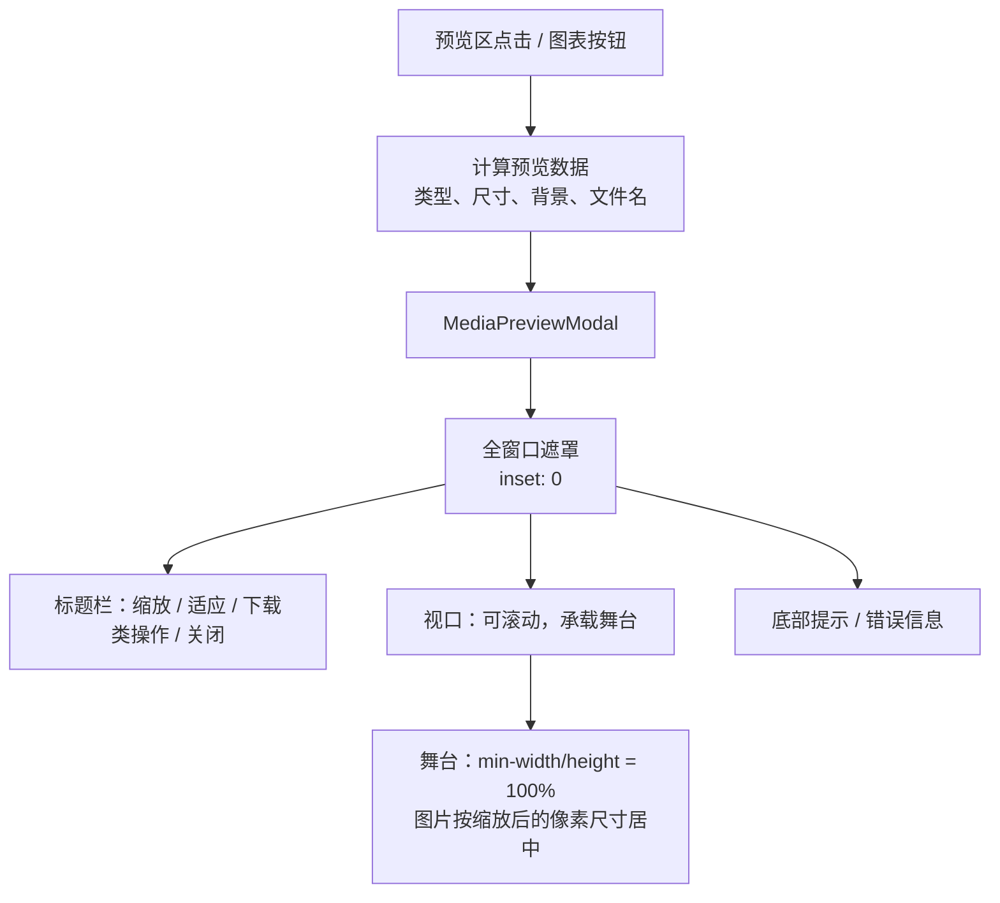
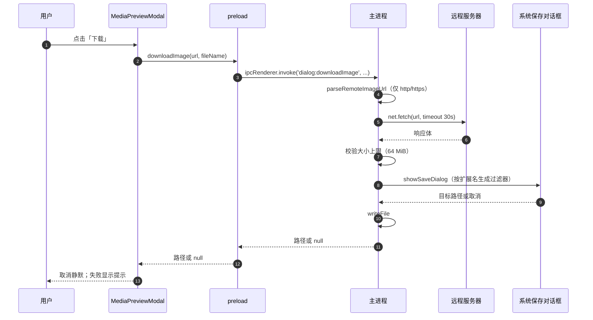

# 大图预览与图片操作

本文描述 MarkIt 预览区的**大图预览窗口**：它同时承载 Mermaid 图表与文档内图片，覆盖打开入口、全窗口布局、缩放模型、图片保存 / 下载能力与安全边界。图表本身的识别、渲染与导出链路见 [Mermaid 图表与导出](./Mermaid图表与导出.md)，本地图片地址解析见 [编辑器与预览](./编辑器与预览.md) 第 9 节。

相关实现主要分布在 `src/renderer/src/components/preview/`、`src/renderer/src/utils/media-preview.ts`、`src/renderer/src/utils/local-image.ts` 与 `src/main/image-download.ts`。

## 1. 设计目标

1. **大图必须真的更大**：预览窗口覆盖整个应用窗口，窗口内可用面积不再被固定尺寸（旧实现为 `min(1200px, 94vw) × min(820px, 88vh)`）限制；进入全屏后窗口随之铺满屏幕。
2. **图表与图片共用一套查看体验**：缩放范围、步进、适应窗口、滚轮锚点、Esc 关闭保持一致，避免两套交互并存。
3. **缩放围绕用户注意力**：滚轮缩放始终以鼠标位置为锚点；按钮与百分比以视口中心为锚点，图片不会因为原本居中而在放大后跳到左上角。
4. **图片可带走**：本地图片支持「打开目录」与「另存为」，远程图片支持下载到本地，不要求在 Markdown 外手动处理。
5. **能力仍然受控**：远程下载由主进程发起并落盘，渲染进程只传 URL 与文件名；不允许借预览窗口读取或写入任意内容。

## 2. 入口与内容形态

| 内容          | 打开方式                                                                 | 传入预览的数据                                                                 |
| ------------- | ------------------------------------------------------------------------ | ------------------------------------------------------------------------------ |
| Mermaid 图表  | 图表工具栏的放大镜按钮；或双击图表本体                                   | 序列化后的 SVG 文本、原始宽高、当前主题背景色                                  |
| 本地图片      | 单击预览中的图片                                                         | 已解析的 `markit-file://` 地址、绝对路径、原始宽高、主题背景色                 |
| 远程图片      | 单击预览中的图片                                                         | `http(s)` 地址、原始宽高、主题背景色                                           |
| `data:` / `blob:` 图片 | 单击预览中的图片                                                | 原始地址、原始宽高、主题背景色                                                 |

约束：

- 图片位于 `<a>` 内时，点击优先执行链接分流（见 [编辑器与预览](./编辑器与预览.md) 第 7.6 节），不打开大图预览。
- 尚未加载完成或已损坏的图片（`complete === false` 或 `naturalWidth === 0`）不响应点击。
- 图表沿用原有入口，不新增单击行为，避免与图表内的文字选择冲突。

## 3. 窗口与布局



- 遮罩 `position: fixed; inset: 0`，不再保留外边距、圆角与模糊背景；窗口本身占用 100% 宽高。
- 标题栏与底部提示固定高度，视口 `flex: 1; overflow: auto`，所有剩余空间都交给内容。
- 舞台（stage）的尺寸为 `max(视口尺寸, 图片缩放后尺寸 + 2 × 24px)`，图片在舞台内居中。这样：
  - 图片小于视口时保持居中，不会被 flex 居中裁掉左侧；
  - 图片放大后舞台随之变大，滚动条从左上角开始覆盖整张图；
  - 不需要在「居中」与「左上对齐」之间切换布局，缩放时不会出现跳动。
- 图片以缩放后的显式像素尺寸渲染（`width = 原宽 × scale`），SVG 图片在放大后由浏览器重新栅格化，不会因位图放大而模糊。
- 关闭方式：标题栏 `✕`、`Esc`。全窗口遮罩不再响应「点击空白处关闭」，避免缩放到边缘时误触。

## 4. 缩放模型

### 4.1 常量

| 项     | 值    |
| ------ | ----- |
| 最小缩放 | `0.25` |
| 最大缩放 | `4`    |
| 步进     | `1.25` |
| 舞台留白 | `24px`（每侧） |

### 4.2 锚点语义

| 操作                       | 锚点                         | 是否退出自动适应 |
| -------------------------- | ---------------------------- | ---------------- |
| `−` / `＋` 按钮            | 视口中心                     | 是               |
| 点击百分比标签（恢复 100%） | 视口中心                     | 是               |
| `Ctrl` / `Cmd` + 滚轮      | 鼠标在视口中的位置           | 是               |
| 「适应」按钮               | 视口中心（缩放后重新居中）   | 否，重新进入自动适应 |
| 窗口尺寸变化（含全屏切换） | 视口中心（仅自动适应模式）   | —                |

### 4.3 计算公式

设图片原始宽高为 `W × H`，缩放为 `s`，视口尺寸为 `VW × VH`，舞台留白为 `P`：

```text
scaledW = W × s
stageW  = max(VW, scaledW + 2P)
offsetX = (stageW - scaledW) / 2          // 图片左边缘在舞台内的位置
contentX = (scrollLeft + pointerX - offsetX) / s
```

缩放前后保持 `contentX` / `contentY` 不变，再回填滚动位置：

```text
newScrollLeft = contentX × newScale + newOffsetX - pointerX
```

所有滚动结果都夹到 `[0, stage - viewport]`，避免负值或越界。纯函数实现在 [media-preview.ts](../../src/renderer/src/utils/media-preview.ts)，由 `media-preview.spec.ts` 覆盖。

### 4.4 自动适应与重排

1. 打开预览时先置 `scale = 1`，再按 `min(1, (VW - 2P) / W, (VH - 2P) / H)` 适应窗口；小图保持 100%，不放大。
2. 适应后滚动位置居中。
3. 用户一旦通过按钮、百分比或滚轮缩放，`autoFit = false`，后续窗口尺寸变化不再覆盖用户选择。
4. `autoFit = true` 时，`ResizeObserver` 监听视口尺寸；窗口缩放或进入 / 退出全屏后重新适应并居中，解决「全屏后预览仍按小尺寸显示」的问题。
5. 以下计算结果低于 25% 时按 25% 处理，剩余部分通过滚动查看。

## 5. 图片操作

### 5.1 来源分类

| 来源                         | 判定                          | 显示操作                         |
| ---------------------------- | ----------------------------- | -------------------------------- |
| 本地图片                     | `markit-file://` 或 `file://` | 打开目录、另存为                 |
| 远程图片                     | `http:` / `https:`            | 下载                             |
| `data:` / `blob:` 图片       | 其他可加载地址                | 另存为                           |

- 本地路径由 `local-image.ts` 的 `localPathFromImageSrc()` 从 `markit-file://…?p=` 或 `file://` 解析得到。
- 默认文件名取地址中去掉查询串后的文件名；`data:` 地址按 MIME 推断扩展名；无法推断时使用 `image-<时间戳>.png`。文件名中的路径分隔符与控制字符会被剔除。
- 标题栏显示「图片预览」与文件名；图片地址作为 `` 的 `alt` 之外的辅助信息不写入界面。

### 5.2 三种落盘方式

| 操作     | 触发条件         | 渲染进程调用                     | 主进程行为                                                         |
| -------- | ---------------- | -------------------------------- | ------------------------------------------------------------------ |
| 打开目录 | 本地图片         | `window.api.showItemInFolder`    | 文件存在则定位；被删除则打开父目录                                 |
| 另存为   | 本地图片         | `window.api.saveImageFromPath`   | 校验源文件为图片且存在，弹出保存对话框后 `copyFile`                |
| 下载     | 远程图片         | `window.api.downloadImage`       | 校验 `http(s)`，由主进程 `net.fetch` 拉取，限制体积后写盘           |
| 另存为   | `data:` / `blob:` | `window.api.saveImage`           | 渲染进程先 `fetch` 取得字节，再由主进程弹保存对话框写盘            |
| SVG / PNG | 图表            | `window.api.saveImage`           | 与 [Mermaid 图表与导出](./Mermaid图表与导出.md) 第 7 节一致        |

用户取消保存时主进程返回 `null`，渲染进程静默返回；真实异常（网络失败、写盘失败、源文件缺失）在底部提示区显示可读错误，同时写入 `console.error`。

### 5.3 远程下载时序



远程下载由主进程发起，原因：渲染进程直接 `fetch` 远程图片会受 CORS 限制，大量站点不允许跨域读取字节。该通道只向用户选择的位置写盘，不把响应内容回传给渲染进程。

## 6. 与旧实现的差异

| 维度     | 旧实现（仅图表）                         | 当前实现（图表 + 图片）                       |
| -------- | ---------------------------------------- | --------------------------------------------- |
| 窗口尺寸 | `min(1200px, 94vw) × min(820px, 88vh)`   | 覆盖整个应用窗口                              |
| 内容载体 | 序列化 SVG 的 Blob URL                   | 图表为 Blob URL，图片直接使用原地址           |
| 缩放实现 | CSS `zoom` + flex 居中 / 溢出时切换对齐  | 显式像素尺寸 + 舞台最小尺寸，无对齐切换       |
| 滚轮锚点 | 以鼠标为锚点，但未扣除居中偏移，实际会漂移 | 按 4.3 的公式扣除舞台偏移                     |
| 按钮锚点 | 左上角                                   | 视口中心                                      |
| 尺寸变化 | 不重新适应                               | 自动适应模式下重新适应并居中                  |
| 下载     | SVG / PNG                                | 图表 SVG/PNG；本地图片另存为/打开目录；远程下载 |
| 关闭     | 遮罩空白、`✕`、`Esc`                     | `✕`、`Esc`（全窗口后遮罩不可点击）             |

## 7. 失败与边界

| 场景                         | 表现                                                          |
| ---------------------------- | ------------------------------------------------------------- |
| 图片加载失败                 | 预览区仍显示破图；点击不打开预览                              |
| 远程下载网络失败 / 超时      | 底部提示「下载失败」，`console.error` 记录原始错误            |
| 远程文件超过 64 MiB          | 主进程拒绝写入并抛错，渲染进程按失败提示处理                  |
| 非 `http(s)` 地址            | 主进程返回 `null`，不发起请求                                 |
| 本地源文件已被删除           | 另存为返回 `null`；打开目录回退到父目录，父目录不存在则无操作 |
| 用户取消保存                 | 静默返回，不改变预览窗口状态                                  |
| 图片尺寸缺失（`0 × 0`）      | 使用 `800 × 600` 兜底，保证舞台与缩放可计算                   |
| `data:` 图片体积过大         | 渲染进程 `fetch` 失败或主进程写盘失败时显示提示               |
| 极小图片放大                 | 最大 400%；继续滚动不再放大                                   |
| 极大图片缩到 25% 仍超出视口  | 保留滚动条查看，不继续缩小                                    |

## 8. 安全边界

1. 主进程只接受 `http:` / `https:` 的远程图片地址；`file:`、`data:`、`javascript:` 等协议一律拒绝。
2. 下载体积上限 64 MiB，超限直接失败，不写入磁盘。
3. 响应内容不返回渲染进程，只写入用户在保存对话框中选择的路径。
4. 另存为只接受图片扩展名白名单（`png|jpe?g|gif|webp|bmp|svg|avif|ico|tiff?`）且要求源文件存在。
5. 该能力由用户显式点击触发，不随文档渲染自动发起。

残余风险与后续策略记录在 [渲染安全与内容沙箱](../架构与契约/渲染安全与内容沙箱.md) 第 9 节。

## 9. 相关文件

| 文件                                                                                                                             | 职责                                                       |
| -------------------------------------------------------------------------------------------------------------------------------- | ---------------------------------------------------------- |
| [src/renderer/src/components/preview/MediaPreviewModal.vue](../../src/renderer/src/components/preview/MediaPreviewModal.vue)     | 全窗口预览、缩放、适应、图片与图表操作                     |
| [src/renderer/src/utils/media-preview.ts](../../src/renderer/src/utils/media-preview.ts)                                         | 缩放几何、文件名与来源分类的纯函数                         |
| [src/renderer/src/utils/media-preview.spec.ts](../../src/renderer/src/utils/media-preview.spec.ts)                               | 锚点缩放、适应比例与文件名用例                             |
| [src/renderer/src/components/preview/MarkdownPreview.vue](../../src/renderer/src/components/preview/MarkdownPreview.vue)         | 打开图表 / 图片预览、传递尺寸与本地路径                    |
| [src/renderer/src/utils/local-image.ts](../../src/renderer/src/utils/local-image.ts)                                             | 本地图片地址解析、`markit-file://` 路径提取                |
| [src/main/image-download.ts](../../src/main/image-download.ts)                                                                   | 远程地址校验、扩展名推断与体积常量                         |
| [src/main/index.ts](../../src/main/index.ts)                                                                                     | `dialog:downloadImage`、`dialog:saveImageFromPath` 处理    |
| [src/preload/index.ts](../../src/preload/index.ts)                                                                               | `downloadImage`、`saveImageFromPath` 暴露                  |
| [src/shared/image-types.ts](../../src/shared/image-types.ts)                                                                     | `ImageFileExtension` 共享类型                              |
