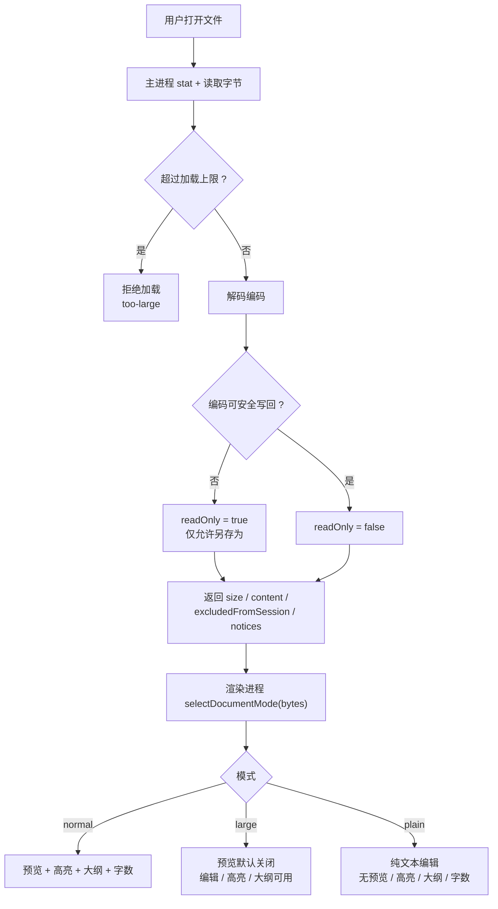

# 大文件能力降级方案（基于阈值）

> **状态：已实现（2026-11-17），阈值仍为暂定初值。** `readOnly` 已收敛为编码语义，大文件按阈值关闭预览、语法高亮、大纲、字数与导出默认入口；加载上限提升到 50 MiB。`PREVIEW_DEGRADE_BYTES` / `PLAIN_TEXT_BYTES` 尚未按第 9 节完成实测校准，发布前必须回写。
> 文档定位：定义 MarkIt 对超大文档的分级降级策略——用什么判定、各档关闭哪些能力、读写权限如何保持自洽、与预览 Worker 方案如何衔接。
> 关联文档：[编辑器与预览](./编辑器与预览.md)（7.8 渲染性能）、[文件与冲突处理](../文件与窗口/文件与冲突处理.md)、[预览渲染后续优化计划](../计划功能/预览渲染后续优化计划.md)、[预览渲染 Worker 超时终止方案](../计划功能/预览渲染Worker超时终止方案.md)。

## 1. 背景

> 本节记录实施前的现状与问题，用于解释设计取舍；当前行为以第 3～7 节与[文件与冲突处理](../文件与窗口/文件与冲突处理.md)第 1.2 节为准。

### 1.1 实施前现状（2026-11-16）

| 阈值     | 当前行为                                 | 代码位置                                                                      |
| -------- | ---------------------------------------- | ----------------------------------------------------------------------------- |
| ≤ 5 MiB  | 正常打开、可编辑、正文进入会话快照       | `FILE_SIZE_WARN_BYTES`                                                        |
| > 5 MiB  | 只读打开；编辑器不可输入；不写入会话正文 | [file-io.ts](../../src/main/file-io.ts) 的 `readOnly` / `excludedFromSession` |
| > 10 MiB | 拒绝打开                                 | `FILE_SIZE_MAX_BYTES`                                                         |

`readOnly` 目前由「编码不可写」与「超过 5 MiB」共同决定（`notices.length > 0`），渲染层把它当作统一的「不可编辑」信号使用。

### 1.2 问题

**只读没有命中真正的瓶颈。** 大文件的成本在 Markdown 全文解析、DOMPurify 清洗、`innerHTML` 与布局，以及大纲 / 字数等全文扫描；`file:save` 写入 10–20 MiB 通常只是毫秒级。禁止编辑既没有阻止打开时的渲染卡顿，又剥夺了用户修改文件的能力。

**读写判定不对称。** 读取有 10 MiB 上限，[writeTextFile](../../src/main/file-io.ts) 没有任何大小校验，[documents.ts](../../src/renderer/src/stores/documents.ts) 的 `markSaved` 还会把 `readOnly` 重置为 `false`。结果是应用能写出自己下次打不开的文件：4 MiB 文档编辑到 12 MiB 可以保存，重启后被拒绝打开。

**边界是断崖且不可覆盖。** 5 MiB + 1 字节从完全可编辑变成只读，10 MiB + 1 字节从可读变成拒绝，用户没有任何显式确认或临时放行的入口。

### 1.3 参考数据

用项目自带 markdown-it 对 5 MiB 典型中文语料（段落、列表、行内代码）做 Node 侧实测：`md.render` 约 0.9 秒，产出约 7.3 MB HTML。这还不包含 DOMPurify 清洗、DOM 插入、样式重算、布局与 Mermaid 渲染。结论是**渲染与 DOM 才是主成本，写入不是**。

VS Code 的大文件优化也是这个思路：超过阈值后关闭 tokenization、语言功能与部分编辑器特性，但文件始终可编辑、可保存。

## 2. 目标与非目标

**目标**

1. `readOnly` 只由「编码能否安全写回」决定；UTF-8 文件无论多大都允许编辑与保存。
2. 大小只决定**能力降级**：预览、语法高亮、大纲、字数、导出与是否进入会话正文。
3. 用确定性阈值避免「第一次打开就卡死」，不依赖事后超时兜底。
4. 降级对用户可见、可解释，并允许用户显式覆盖。
5. 阈值按进程职责集中定义（加载上限在主进程、展示阈值在渲染进程同一模块），可单元测试，并可用基准测试校准。

**非目标**

- 增量渲染、预览虚拟滚动、Worker 渲染与超时终止：分别见 [预览渲染后续优化计划](../计划功能/预览渲染后续优化计划.md) 与 [预览渲染 Worker 超时终止方案](../计划功能/预览渲染Worker超时终止方案.md)。
- 改变 Markdown 渲染语义、导出产物样式或文件监听口径。
- 为超大文档提供分块读取 / 分页查看。

## 3. 核心原则

| 编号 | 原则                 | 含义                                                   |
| ---- | -------------------- | ------------------------------------------------------ |
| P1   | 编码决定写权限       | 非 UTF-8 只读，只允许「另存为」；UTF-8 永远可写        |
| P2   | 大小不限制写入       | `file:save` 不因文件大小拒绝；写入只受磁盘错误影响     |
| P3   | 大小只做能力降级     | 预览、高亮、大纲、字数、导出、会话正文按阈值关闭       |
| P4   | 加载上限只做内存兜底 | 超过加载上限才拒绝打开，且阈值应远高于渲染阈值         |
| P5   | 降级必须可见         | 用户能看到当前模式与原因，并能显式请求恢复被关闭的能力 |

## 4. 模式与阈值

### 4.1 模式定义

| 模式     | 判定                           | 定位                                   |
| -------- | ------------------------------ | -------------------------------------- |
| `normal` | 未超过预览阈值                 | 全部能力可用                           |
| `large`  | 超过预览阈值、未超过纯文本阈值 | 预览默认关闭，编辑与保存正常           |
| `plain`  | 超过纯文本阈值                 | 纯文本编辑，关闭预览、高亮、大纲与字数 |
| 无法加载 | 超过加载上限                   | 拒绝打开并提示，不再标记为「只读」     |

### 4.2 阈值

以下为**暂定初值**，必须按第 9 节的方法实测后校准，不得直接作为最终值发布。

| 常量                    | 初值   | 作用                 | 校准目标                            |
| ----------------------- | ------ | -------------------- | ----------------------------------- |
| `PREVIEW_DEGRADE_BYTES` | 1 MiB  | 超过后预览默认关闭   | 单次预览同步阻塞 ≤ 150ms            |
| `PLAIN_TEXT_BYTES`      | 5 MiB  | 超过后进入纯文本模式 | 按键到画面更新 p95 ≤ 50ms           |
| `LOAD_MAX_BYTES`        | 50 MiB | 超过后拒绝加载       | 加载 + 编辑状态初始化不触发内存告警 |

阈值归属：

- `PREVIEW_DEGRADE_BYTES` / `PLAIN_TEXT_BYTES` 属于**渲染进程的展示策略**，放在 `src/renderer/src/utils/document-mode.ts`；
- `LOAD_MAX_BYTES` 属于**主进程加载边界**，留在 `src/main/file-io.ts`；
- 会话排除阈值（当前 5 MiB）属于持久化策略，继续由主进程返回 `excludedFromSession`，渲染进程不复制常量。

### 4.3 判定函数

```ts
type DocumentMode = 'normal' | 'large' | 'plain'

interface DocumentModeInput {
  /** 文件字节数；未保存文档取 UTF-8 编码后的字节数 */
  bytes: number
  /** 可选的复杂度信号，首版不启用 */
  mermaidCount?: number
}

function selectDocumentMode(input: DocumentModeInput): DocumentMode
```

- 纯函数、无 i18n 与 Electron 依赖，同目录补 `document-mode.spec.ts`；
- 首版只按字节数判定；第二版再评估「字节数 + 图表数 / 表格数加权」的复杂度模型；
- 模式在打开时确定并写入标签；内容增长跨过阈值时的行为见 6.2 与开放问题 D3。

## 5. 能力矩阵

| 能力                | `normal` | `large`            | `plain`              |
| ------------------- | -------- | ------------------ | -------------------- |
| 编辑与保存          | 开       | 开                 | 开                   |
| Markdown 预览       | 开       | 默认关，可手动渲染 | 关                   |
| CodeMirror 语法高亮 | 开       | 开                 | 关                   |
| 大纲                | 开       | 开                 | 关                   |
| 字数统计            | 实时     | 实时或降频         | 关（显示「—」）      |
| 编辑区搜索          | 开       | 开                 | 开                   |
| 预览区搜索          | 开       | 预览关闭时不可用   | 不可用               |
| 滚动同步            | 开       | 预览关闭时暂停     | 暂停                 |
| 会话正文            | 写入     | 按会话阈值决定     | 不写入               |
| PDF / 长图导出      | 开       | 需确认耗时         | 默认禁用，可显式覆盖 |
| 非 UTF-8 只读       | 编码决定 | 编码决定           | 编码决定             |

导出入口单独处理的原因：PDF 与长图会重新构建完整 HTML 并在隐藏窗口渲染，成本和预览同源；大文件模式下不加限制会把卡顿转移到导出流程。

会话正文仍按主进程返回的 `excludedFromSession` 决定（当前 5 MiB）：1–5 MiB 的 `large` 标签会正常写入会话，超过 5 MiB 后不写入正文。`plain` 因阈值高于 5 MiB 而不写入。

## 6. 数据流与实现落点



### 6.1 主进程

1. [file-io.ts](../../src/main/file-io.ts)：
   - `readOnly` 改为 `!decoded.writable`，删除 `large-file` 对只读的影响；
   - `FILE_SIZE_MAX_BYTES` 重命名/语义收敛为**加载上限**（`LOAD_MAX_BYTES`），只用于内存兜底；
   - `FILE_SIZE_WARN_BYTES` 继续服务 `excludedFromSession`，不再参与只读判定；
   - `writeTextFile` **不新增**大小校验，保持 P2。
2. `FileReadResult` 继续返回 `size`、`readOnly`、`encoding`、`excludedFromSession`、`notices`；`notices` 中的 `large-file` 保留，用于提示与展示策略，不再表示只读。
3. 越界读取仍以实际读到的字节数复核，防止读取期间文件增长绕过上限。

### 6.2 渲染进程

1. **状态**：[documents.ts](../../src/renderer/src/stores/documents.ts) 的标签增加 `size` 与 `mode`（或由 `size` 计算）。`readOnly` 只表示编码原因；`excludedFromSession` 只表示会话策略，两者不得复用。
2. **内容增长**：打开时按文件字节数判定。编辑过程中内容跨过 `PREVIEW_DEGRADE_BYTES` 时，自动暂停预览并显示提示（避免下一次渲染卡死）；跨过 `PLAIN_TEXT_BYTES` 时只提示「建议切换纯文本模式」，由用户确认后切换，避免编辑中高亮 / 大纲突然消失。
3. **编辑器**：[MarkdownEditor.vue](../../src/renderer/src/components/editor/MarkdownEditor.vue) 增加模式 Compartment：
   - `normal` / `large`：保留 `markdown()` 语言、`syntaxHighlighting()` 与现有扩展；
   - `plain`：移除 Markdown 语言、语法高亮与 Markdown 相关扩展，保留基础编辑、历史、行号、搜索；`EditorView.editable` 保持 `true`。
4. **预览**：[MarkdownPreview.vue](../../src/renderer/src/components/preview/MarkdownPreview.vue) 在创建 / 填充预览层之前检查模式：
   - `large` 且未手动覆盖：不创建预览层，渲染占位与「仍要渲染预览」按钮；
   - `plain`：不提供默认入口，只允许显式覆盖；
   - 手动覆盖按标签记录在本次会话内，不写入磁盘、不跨重启保留。
5. **大纲 / 字数**：[useOutline.ts](../../src/renderer/src/composables/useOutline.ts) 在 `plain` 下跳过解析；[documents.ts](../../src/renderer/src/stores/documents.ts) 的 `updateContent` 在 `plain` 下跳过 `countWords`，避免每次按键全文扫描。
6. **搜索 / 滚动**：预览关闭时，搜索只作用于编辑器；`useScrollSync` 暂停。
7. **导出**：`usePdfExport` / `useImageExport` 在 `large` 下弹出耗时确认，在 `plain` 下默认拒绝并提示原因，用户显式确认后才继续。

### 6.3 用户可见文案

新增 i18n 键（中英文成对）：

| 场景                         | 建议键                                                |
| ---------------------------- | ----------------------------------------------------- |
| 大文件模式提示               | `file.mode.large`                                     |
| 纯文本模式提示               | `file.mode.plain`                                     |
| 预览已暂停 / 手动渲染        | `preview.pausedLargeFile` / `preview.renderAnyway`    |
| 自动暂停预览（编辑中跨阈值） | `preview.pausedAfterGrowth`                           |
| 切换纯文本模式确认           | `file.mode.switchToPlain`                             |
| 导出耗时确认 / 禁用          | `export.largeFileConfirm` / `export.plainFileBlocked` |

文案必须说明「文件不会因大小被设为只读；关闭的是预览与语言功能」。

## 7. 会话与恢复

- `excludedFromSession` 继续按大小排除正文，避免 800ms 防抖把 5–10 MiB 正文反复写入 `session.json`。
- **代价**：大文件一旦可编辑，排除正文意味着崩溃 / 强制退出会丢失未保存修改。实施时必须二选一并写入文档与手册。
- 恢复时不能沿用旧会话里「因大小而置为只读」的标记：按磁盘重新读取后，`readOnly` 只由编码决定，模式按当前大小重新判定。
- 非 UTF-8 标签的 `readOnly` 语义不变。

| 方案           | 行为                                          | 取舍                                             |
| -------------- | --------------------------------------------- | ------------------------------------------------ |
| S1（建议首版） | 大文件不写正文快照，恢复时重新读盘            | 实现简单；崩溃丢失未保存内容，需在模式提示中明示 |
| S2             | 大文件降低快照频率（空闲 3–5 秒或仅关闭时写） | 保留一定恢复能力；仍需评估序列化成本与退出阻塞   |

## 8. 用户交互

1. 标签栏或状态栏显示当前模式：`大文件` / `纯文本模式`，悬停或点击查看原因。
2. `large` 模式下预览区显示占位卡片，提供「仍要渲染预览」；点击后先提示预计耗时，再执行渲染。
3. `plain` 模式下状态栏显示「纯文本模式」，并提供「恢复 Markdown 模式」入口；恢复前提示可能卡顿。
4. 用户覆盖只在当前标签的当前会话生效；重启后按阈值重新判定。
5. 首次进入降级模式时给一次性提示，不做持续弹窗。

## 9. 阈值校准

1. 准备四类样例：纯段落、表格密集、代码块密集、Mermaid 密集；每类生成 0.5 / 1 / 2 / 5 / 10 MiB。
2. 使用 CDP `Tracing`（`devtools.timeline,blink,v8`）记录：`md.render`、DOMPurify、`innerHTML`、`UpdateLayoutTree`、`Layout`、首帧时间。
3. 每个样例重复 3 次取中位数；另记录 CodeMirror 按键到画面更新的 p95、内存占用。
4. 先把 `PREVIEW_DEGRADE_BYTES` 校准到「预览同步阻塞 ≤ 150ms」，再把 `PLAIN_TEXT_BYTES` 校准到「编辑按键 p95 ≤ 50ms」。
5. 校准结果写回本文与实现常量；文档中的初值只是占位，不代表已验收。

## 10. 迁移与兼容

1. 旧会话中 `readOnly: true` 的超大 UTF-8 标签：恢复时按磁盘结果重算，清除大小导致的只读。
2. `FileReadResult` / `SessionTab` 字段保持兼容；`SessionTab` 新增可选的 `size`，旧会话缺失时按磁盘读取结果或正文 UTF-8 字节数兜底；`mode` 不持久化，恢复时按大小重新判定。
3. 用户手册 `welcome.md` / `welcome.en-US.md` 同步改写「大文件只读」为「大文件降级」。
4. 发版说明按「用户可感知变化」撰写，不再出现「避免保存时损坏原文件」与大小的混写；大小降级的原因是性能与会话体积。

## 11. 测试与验收

**单元测试**

- `document-mode.spec.ts`：阈值边界（等于、+1 字节）、模式判定、可选的复杂度信号；
- `file-io.spec.ts`：大文件 `readOnly === false`、`excludedFromSession === true`、超过加载上限返回 `too-large`、写入不因大小失败；
- `file-encoding.spec.ts`：非 UTF-8 仍 `readOnly === true`。

**e2e / 手工**

- 打开 6 MiB UTF-8 文件：可编辑、可保存、预览默认关闭、可手动渲染，重启后仍可打开；
- 编辑到 12 MiB 保存后重启：文件可正常打开（纯文本模式），不出现「写得进、打不开」；
- 非 UTF-8 文件：行为与现在一致，只读 + 另存为；
- 大文件下字数、大纲、搜索、导出入口行为符合能力矩阵；
- 会话快照不包含大文件正文；恢复后重新读盘。

## 12. 实施步骤与工作量

| 阶段 | 内容                                           | 状态           | 产出                                        |
| ---- | ---------------------------------------------- | -------------- | ------------------------------------------- |
| 0    | 基准测试，校准三个阈值                         | **待执行**     | 校准报告，回写本文                          |
| 1    | 抽出 `selectDocumentMode` 与常量，补单元测试   | 已完成         | `document-mode.ts` + spec                   |
| 2    | 主进程 `readOnly` 语义收敛，删除写入侧大小耦合 | 已完成         | `file-io.ts`、`file-types.ts`、spec         |
| 3    | 编辑器模式 Compartment、预览占位与手动渲染     | 已完成         | `MarkdownEditor.vue`、`MarkdownPreview.vue` |
| 4    | 大纲 / 字数 / 搜索 / 滚动 / 导出 / 会话联动    | 已完成         | 各 composable 与 store                      |
| 5    | i18n、手册、功能文档、验收矩阵                 | 已完成         | 文档、`large-file.spec.ts` 与验收矩阵       |

**工作量评估：M（约 3–5 个开发日，不含阈值基准测试与人工回归）。**

### 12.1 实现落点（2026-11-17）

| 位置                                                                                                                     | 职责                                                                                       |
| ------------------------------------------------------------------------------------------------------------------------ | ------------------------------------------------------------------------------------------ |
| [`utils/document-mode.ts`](../../src/renderer/src/utils/document-mode.ts)                                                | 模式类型、两个展示阈值、`utf8ByteLength`、`selectDocumentMode` 与边界单测                  |
| [`main/file-io.ts`](../../src/main/file-io.ts)                                                                           | `LOAD_MAX_BYTES = 50 MiB`；`readOnly = !decoded.writable`；5 MiB 只用于会话排除            |
| [`stores/documents.ts`](../../src/renderer/src/stores/documents.ts)                                                      | 标签 `size` / `mode` / `previewOverride` / `previewAutoPaused` / `plainSuggested` 与状态迁移 |
| [`MarkdownEditor.vue`](../../src/renderer/src/components/editor/MarkdownEditor.vue)                                      | `modeCompartment`：纯文本模式移除 Markdown 语言、折叠、缩进与括号匹配                      |
| [`MarkdownPreview.vue`](../../src/renderer/src/components/preview/MarkdownPreview.vue)                                   | 预览暂停占位、「仍要渲染预览」、内容增长自动暂停与恢复                                     |
| [`useOutline.ts`](../../src/renderer/src/composables/useOutline.ts)                                                      | 纯文本模式跳过标题解析；模式恢复时强制重新解析                                             |
| [`useDocumentMode.ts`](../../src/renderer/src/composables/useDocumentMode.ts)                                            | 编辑中跨过纯文本阈值时的一次性确认提示                                                     |
| [`useExportGuard.ts`](../../src/renderer/src/composables/useExportGuard.ts)                                              | `large` 导出耗时确认；`plain` 默认拒绝并允许显式覆盖                                       |
| [`StatusBar.vue`](../../src/renderer/src/components/layout/StatusBar.vue)                                                | 模式标签、纯文本模式字数显示「字数已关闭」与「恢复 Markdown」入口                          |
| [`useSession.ts`](../../src/renderer/src/composables/useSession.ts) / [`session-types.ts`](../../src/shared/session-types.ts) | 快照记录 `size`；恢复时按磁盘大小重算模式，只读只随编码                     |

## 13. 开放问题

| 编号 | 问题                         | 当前建议                                         |
| ---- | ---------------------------- | ------------------------------------------------ |
| D1   | `large` 模式是否保留代码高亮 | 保留；高亮按视口增量，成本低于预览 DOM           |
| D2   | 大文件可编辑后的会话策略     | 已采用 S1（不写正文、恢复时重新读盘）；后续评估 S2 |
| D3   | 编辑中跨阈值是否自动降级     | 跨预览阈值自动暂停预览；跨纯文本阈值需用户确认   |
| D4   | `plain` 模式是否允许导出     | 默认禁用，允许用户显式覆盖                       |
| D5   | 是否引入复杂度信号           | 首版只用字节；基准显示图表密集文档偏差明显时再加 |

## 14. 相关文档

- [编辑器与预览](./编辑器与预览.md)（7.8 渲染性能与多层预览）
- [文件与冲突处理](../文件与窗口/文件与冲突处理.md)（第 1.2 节当前大小策略）
- [会话恢复与窗口状态](../文件与窗口/会话恢复与窗口状态.md)（大文件不写正文）
- [预览渲染后续优化计划](../计划功能/预览渲染后续优化计划.md)
- [预览渲染 Worker 超时终止方案](../计划功能/预览渲染Worker超时终止方案.md)
- [测试与质量保障](../工程与质量/测试与质量保障.md)
