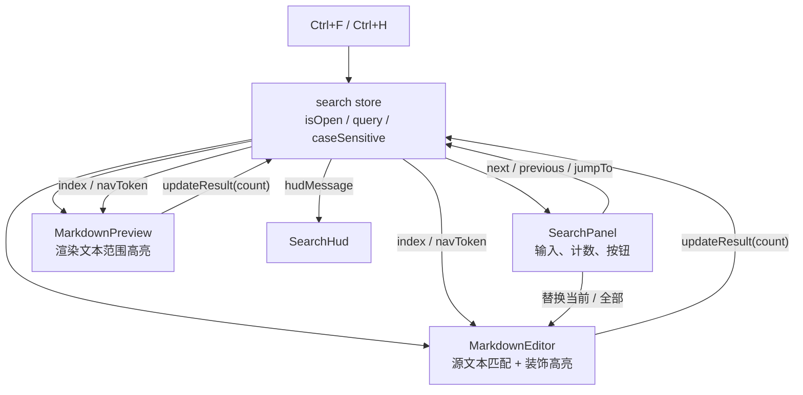
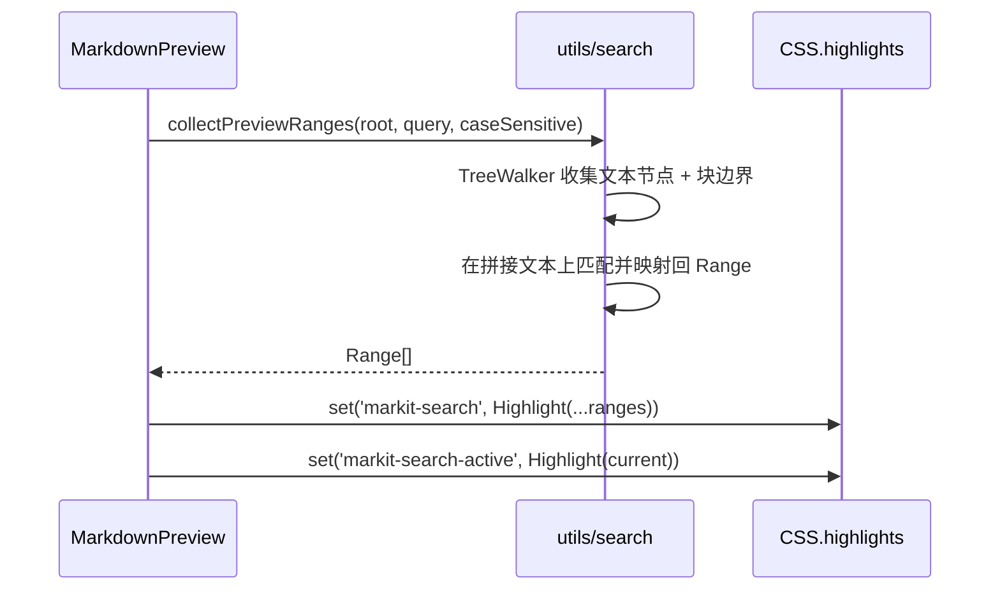

# 搜索与替换

> 文档定位：描述 MarkIt 文档内搜索与替换的交互规则、匹配口径、编辑器 / 预览区两条高亮链路、状态模型与边界情况。
> 搜索是**视图层能力**，不修改文档格式，也不写入文件；只有用户主动执行「替换」时才改动 `DocumentTab.content`。
>
> - 适用版本：`1.5.0`
> - 最后核对：2026-11-09
> - 相关文档：[编辑器与预览](./编辑器与预览.md)、[状态与数据模型](../架构与契约/状态与数据模型.md)、[主题样式与布局](./主题样式与布局.md)、[测试与质量保障](../工程与质量/测试与质量保障.md)

## 1. 目标与范围

### 1.1 目标

1. `Ctrl + F` 打开搜索面板，输入文本后即时定位当前文档中的匹配项；
2. 暂时只支持**文本精确匹配**（按字面量匹配，不解析正则、不支持整词 / 模糊匹配），英文可通过 `Aa` 开关选择是否区分大小写；
3. 纯编辑、编辑 + 预览布局下在**编辑区**搜索；分栏时预览区同步高亮所有对应文字；
4. 仅预览布局下在**预览区**搜索，匹配用户看到的渲染结果；
5. `Enter` / `Shift + Enter` 或 `F3` / `Shift + F3` 快速切换下一个 / 上一个，到达首尾时自动循环，并弹出 HUD 提示；
6. 提供「替换当前项」与「全部替换」，替换作用于 Markdown 源文本；
7. 面板关闭后不遗留高亮，不改变文档的滚动锚点与未保存状态判定。

### 1.2 不在本阶段范围

- 正则表达式、整词匹配、多行匹配；
- 跨标签页搜索、按文件名搜索、搜索历史；
- 在仅预览布局下替换（渲染结果没有可靠的源文本偏移映射）；
- 搜索匹配项的独立列表 / 结果面板；
- 自定义快捷键与快捷键冲突设置。

## 2. 交互设计

### 2.1 搜索上下文

| 布局                            | 搜索位置 | 高亮位置                     | 替换 | 导航                     |
| ------------------------------- | -------- | ---------------------------- | ---- | ------------------------ |
| 仅编辑 `edit-only`              | 编辑区   | 编辑区                       | 可用 | 编辑区滚动并选中匹配项   |
| 左编辑 / 右编辑（分栏）         | 编辑区   | 编辑区 + 预览区（全部匹配）  | 可用 | 编辑区滚动并选中匹配项   |
| 仅预览 `preview-only`           | 预览区   | 预览区（全部 + 当前项）      | 不可 | 预览区滚动到当前匹配项   |

上下文由 `app.showEditor` 推导：能编辑时永远以源文本为准，不能编辑时才退化为预览文本搜索。

### 2.2 快捷键

| 快捷键               | 作用                                     | 生效条件           |
| -------------------- | ---------------------------------------- | ------------------ |
| `Ctrl/Cmd + F`       | 打开搜索；已打开时重新聚焦并全选查询框   | 全局               |
| `Ctrl/Cmd + H`       | 打开搜索并展开替换行                     | 编辑上下文         |
| `Enter`              | 下一个匹配项                             | 查询框聚焦         |
| `Shift + Enter`      | 上一个匹配项                             | 查询框聚焦         |
| `Enter`（替换框）    | 替换当前项                               | 替换框聚焦         |
| `F3`                 | 下一个匹配项                             | 搜索面板打开时全局 |
| `Shift + F3`         | 上一个匹配项                             | 搜索面板打开时全局 |
| `Esc`                | 关闭搜索面板并清除高亮                   | 搜索面板 / 编辑区  |

`Ctrl/Cmd + F` 打开时若编辑器或预览区存在单行选中文本（长度 ≤ 200），自动填入查询框。标签切换只匹配 `Ctrl`、不匹配 `Cmd` 的既有规则不受影响（见[编辑器与预览](./编辑器与预览.md) 5.2）。

### 2.3 面板

```text
┌──────────────────────────────────────────────┐
│ [ 查找…                    ] 1/12  Aa  替换 ↑ ↓ × │
│ [ 替换为…                  ] 替换  全部          │
└──────────────────────────────────────────────┘
```

- 面板浮在当前搜索上下文所在区域右上角：编辑上下文浮在编辑区，仅预览上下文浮在预览区；
- 第二行「替换」默认收起，通过 `Ctrl+H` 或面板上的「替换」按钮展开；
- 仅预览布局不显示替换入口，也不显示替换行；
- 匹配计数显示 `当前项/总数`；查询为空时不显示，查询非空且无结果时显示「无结果」；
- 输入框失焦不影响匹配，点击面板按钮不会抢走输入框的焦点。

### 2.4 循环导航与 HUD

`next()` 在最后一项继续向后时回到第 1 项，`previous()` 在第 1 项继续向前时跳到末项。

| 场景                       | HUD 文案                 |
| -------------------------- | ------------------------ |
| 末项之后继续「下一个」     | 已到达末尾，已循环到开头 |
| 首项之前继续「上一个」     | 已到达开头，已循环到末尾 |
| 没有匹配项时触发导航       | 没有匹配项               |
| 全部替换完成               | 已替换 N 处              |

HUD 位于内容区顶部居中，1.6 秒后自动淡出；同一个 HUD 被重复触发时重新计时。

## 3. 架构与数据流



两条高亮链路互不依赖：

- **编辑区**：对 `EditorState.doc` 做纯文本匹配，用 CodeMirror `StateField` + `Decoration.mark` 渲染全部匹配与当前项；
- **预览区**：对渲染后的 DOM 文本节点建立偏移映射，用 **CSS Custom Highlight API** 注册 `Range`，不改写 `v-html` 生成的 DOM。

### 3.1 `search` store

文件：[`src/renderer/src/stores/search.ts`](../../src/renderer/src/stores/search.ts)

| 类别     | 名称                    | 类型 / 默认值           | 说明                                             |
| -------- | ----------------------- | ----------------------- | ------------------------------------------------ |
| state    | `isOpen`                | `boolean` / `false`     | 面板是否打开                                     |
| state    | `query`                 | `string` / `''`         | 查找文本                                         |
| state    | `replaceText`           | `string` / `''`         | 替换文本                                         |
| state    | `showReplace`           | `boolean` / `false`     | 替换行是否展开                                   |
| state    | `caseSensitive`         | `boolean` / `false`     | 是否区分大小写，读 `markit-search-case-sensitive` |
| state    | `total`                 | `number` / `0`          | 当前上下文匹配总数                               |
| state    | `index`                 | `number` / `-1`         | 当前项（0 基），无匹配时为 `-1`                  |
| state    | `focusToken`            | `number`                | 每次打开递增，面板据此聚焦输入框                 |
| state    | `navToken`              | `number`                | 每次主动导航递增，编辑器 / 预览据此滚动到当前项  |
| state    | `hudMessage`            | `string` / `''`         | HUD 文案                                         |
| state    | `hudVisible`            | `boolean` / `false`     | HUD 是否显示                                     |
| computed | `surface`               | `'editor' \| 'preview'` | 由 `app.showEditor` 推导搜索上下文               |
| action   | `open(withReplace)`     | —                       | 打开面板；编辑上下文可同时展开替换行             |
| action   | `close()`               | —                       | 关闭面板并清空计数与 HUD                         |
| action   | `updateResult(count, reset)` | —                  | 更新总数；`reset` 时回到第 1 项，否则夹取当前项  |
| action   | `next()` / `previous()` | —                       | 循环导航，越界时触发 HUD                         |
| action   | `jumpTo(index)`         | —                       | 替换后定位到下一个匹配项，并递增 `navToken`      |
| action   | `toggleCaseSensitive()` | —                       | 切换大小写并持久化                               |
| action   | `toggleReplace()`       | —                       | 编辑上下文展开 / 收起替换行                      |
| action   | `showHud(message)`      | —                       | 显示 1.6 秒的临时提示                            |

`navToken` 与 `focusToken` 不进入模板渲染，只作为「用户主动导航 / 打开」的同步信号：组件通过 `watch` 区分「用户按了下一个」与「内容变化导致计数更新」，避免在用户编辑正文时强制把选区拉回匹配项。

### 3.2 匹配工具

文件：[`src/renderer/src/utils/search.ts`](../../src/renderer/src/utils/search.ts)

| 函数                                        | 作用                                                         |
| ------------------------------------------- | ------------------------------------------------------------ |
| `escapeRegExp(text)`                        | 转义正则元字符，保证查询按字面量匹配                         |
| `findTextMatches(text, query, caseSensitive)` | 返回 `{ from, to }[]`，保持文档顺序，最多 `SEARCH_MATCH_LIMIT` 项 |
| `collectPreviewRanges(root, query, caseSensitive)` | 把预览 DOM 的文本节点拼成可检索文本，返回 `Range[]`      |

## 4. 匹配规则

1. 查询为空 → 0 个匹配，不产生任何高亮；
2. 查询按**字面子串**匹配，`.`、`*`、`(`、`[` 等字符不做正则解释；
3. 大小写：`Aa` 关闭（默认）时使用正则 `i` 标志，英文不区分大小写；开启后区分；
4. 匹配位置以**原字符串下标**为准（使用 `RegExp.exec` 的 `index`，不做 `toLowerCase()` 后的长度假设），因此 Unicode 字符不会错位；
5. 单个文档最多定位 `SEARCH_MATCH_LIMIT = 2000` 处匹配。超出部分不再标注，计数也只到 2000，避免在超长文档里为常见单字符生成过多装饰 / `Range` 拖慢输入；
6. 编辑区匹配 `DocumentTab.content`（LF 归一化后的源文本），包含 Markdown 标记与行内语法；
7. 预览区匹配**渲染后的可见文本**，不同文本节点会先拼接成一条文本流，因此 `**Hello** world` 可以匹配 `Hello world`；
8. 预览区在块级元素（段落、列表项、标题、表格单元格、代码块等）边界插入虚拟换行，避免把上一段结尾与下一段开头拼成假匹配；
9. 预览区跳过 `script` / `style` / `textarea` 以及 SVG（Mermaid 图表）内的文本。

## 5. 编辑区高亮

编辑器侧新增项目内的 CodeMirror 装饰扩展（不引入 `@codemirror/search`）：

- `utils/editor-search.ts` 定义 `StateEffect<DecorationSet>` 与 `StateField<DecorationSet>`，并将字段通过 `EditorView.decorations.from(field)` 提供给视图；
- 全部匹配使用 `markit-search-match` 装饰类，当前项使用 `markit-search-match-active`；
- 当文档被编辑（`tr.docChanged`）时，字段先用 `map(tr.changes)` 平移旧装饰，随后由组件在内容 watcher 中重新计算并派发新的装饰集，避免装饰位置漂移；
- 导航时通过 `view.dispatch({ selection, effects: EditorView.scrollIntoView(..., { y: 'center' }) })` 选中当前项并居中滚动；
- 查询变化时以 `y: 'nearest'` 滚动到首项，尽量减少对编辑区视野的扰动；
- 正文编辑导致匹配集合变化时**只更新装饰**，不改写选区、不滚动，保证搜索面板打开时仍可正常输入。

颜色：深色主题使用半透明琥珀色，浅色主题加深背景以提高对比度；当前项比普通匹配更醒目。样式定义在 `MarkdownEditor.vue` 的 scoped 样式中。

## 6. 预览区高亮

预览内容由 `v-html` 生成，并在每次编辑后整体替换。若用包裹 `<mark>` 的方式高亮，需要先拆掉旧标记，还必须避开 Vue 对 `innerHTML` 的管理，容易与表格列宽、Mermaid 替换互相干扰。因此采用 **CSS Custom Highlight API**：



- `Range` 完全只读，不修改 DOM 结构，渲染后不需要清理旧节点；
- 页面级样式通过 `::highlight(markit-search)` 与 `::highlight(markit-search-active)` 定义，跟随深浅主题；
- 搜索关闭、查询清空或预览组件卸载时删除这两个注册项；
- 每次 Mermaid / 图片 / 表格列宽完成异步渲染后，重新收集一次范围，保证高亮对应用户当前看到的内容；
- 仅预览上下文下按 `navToken` 把当前 `Range` 的包围盒滚动到预览容器中部；分栏上下文只高亮、不滚动，避免与 `useScrollSync` 的双向联动打架。

## 7. 替换

替换只在编辑上下文可用，作用于 Markdown 源文本：

| 操作       | 行为                                                                 |
| ---------- | -------------------------------------------------------------------- |
| 替换当前项 | 用替换文本覆盖当前匹配，选区移到替换文本之后，并自动跳到下一个匹配项 |
| 全部替换   | 一次性派发所有匹配的替换（`changes` 数组，按源位置升序），HUD 提示数量 |
| 替换文本   | 按字面量插入，不解析 `$1` 等捕获组语法                               |

替换后 `DocumentTab.content` 由既有 `updateListener` 正常更新，文档被标记为已修改；撤销 / 重做沿用 CodeMirror `history()`，一次「全部替换」是一条可撤销的编辑事务。

仅预览布局没有源文本与渲染文本之间的可靠偏移映射，因此不提供替换入口；需要修改内容时切回编辑布局。

## 8. 持久化

| 键                             | 值格式        | 默认值  | 说明                                 |
| ------------------------------ | ------------- | ------- | ------------------------------------ |
| `markit-search-case-sensitive` | `'1' \| '0'`  | `'0'`   | `'1'` 表示区分大小写；其余值按忽略处理 |

查询文本、替换文本、面板展开状态与当前索引**都不持久化**：它们属于当前会话的临时交互状态，重启后从空查询开始。

## 9. 已知限制

1. 只有精确子串匹配，没有正则、整词与跨行（查询框本身也是单行输入）匹配；
2. 预览区按可见文本匹配，块级元素之间的内容不会被拼接；跨块短语（如标题末尾 + 段落开头）不会命中；
3. 预览区的 Mermaid SVG 文本、图片 `alt`、CSS 生成内容不参与匹配；
4. 单个文档最多定位 2000 处匹配，超出部分不标注、不可导航；
5. 仅预览布局不支持替换；
6. 分栏时预览区只同步高亮，不跟随当前项滚动；滚动联动仍由 `useScrollSync` 负责；
7. 预览区高亮依赖 Chromium 的 CSS Custom Highlight API（Electron 39 已内置），不提供降级方案。

## 10. 测试与验证

### 10.1 单元测试

[`src/renderer/src/utils/search.spec.ts`](../../src/renderer/src/utils/search.spec.ts) 覆盖：

- 普通子串、多次出现、相邻匹配；
- 大小写开关；
- 正则元字符按字面量处理；
- 空查询；
- 匹配数量上限。

### 10.2 手工验证

1. 编辑布局：`Ctrl+F` 输入关键词，确认全部匹配高亮、计数正确；`Enter` / `Shift+Enter` / `F3` 循环导航，首尾越界出现 HUD；
2. 分栏布局：确认预览区同步高亮同一关键词，且预览滚动不被搜索打断；
3. 仅预览布局：确认搜索面板浮在预览区、替换入口隐藏，导航时预览滚动到当前项；
4. 展开替换行，验证「替换当前项」与「全部替换」，替换后保存并确认磁盘内容正确；
5. 搜索面板打开时在正文继续输入，确认不会强制跳回匹配项；
6. 切换标签、切换布局、关闭搜索，确认高亮与 HUD 均正确清理；
7. 深浅主题各检查一次高亮对比度。

## 11. 相关文件

| 文件                                                                                                                  | 职责                                                 |
| --------------------------------------------------------------------------------------------------------------------- | ---------------------------------------------------- |
| [src/renderer/src/stores/search.ts](../../src/renderer/src/stores/search.ts)                                             | 搜索面板开关、查询、计数、循环导航与 HUD              |
| [src/renderer/src/utils/search.ts](../../src/renderer/src/utils/search.ts)                                               | 字面量匹配、预览文本映射与 `Range` 生成              |
| [src/renderer/src/utils/search.spec.ts](../../src/renderer/src/utils/search.spec.ts)                                     | 匹配规则单元测试                                     |
| [src/renderer/src/utils/editor-search.ts](../../src/renderer/src/utils/editor-search.ts)                                 | CodeMirror 搜索装饰 StateField 与派发辅助            |
| [src/renderer/src/components/common/SearchPanel.vue](../../src/renderer/src/components/common/SearchPanel.vue)           | 搜索 / 替换面板                                      |
| [src/renderer/src/components/common/SearchHud.vue](../../src/renderer/src/components/common/SearchHud.vue)               | 循环导航与替换结果提示                               |
| [src/renderer/src/components/editor/MarkdownEditor.vue](../../src/renderer/src/components/editor/MarkdownEditor.vue)     | 编辑区匹配、装饰与导航                               |
| [src/renderer/src/components/preview/MarkdownPreview.vue](../../src/renderer/src/components/preview/MarkdownPreview.vue) | 预览区文本范围收集、`CSS.highlights` 注册与滚动      |
| [src/renderer/src/composables/useKeyboardShortcuts.ts](../../src/renderer/src/composables/useKeyboardShortcuts.ts)       | `Ctrl+F` / `Ctrl+H` / `F3` / `Esc` 全局快捷键        |
| [src/renderer/src/components/layout/AppLayout.vue](../../src/renderer/src/components/layout/AppLayout.vue)               | 挂载搜索 HUD                                         |
