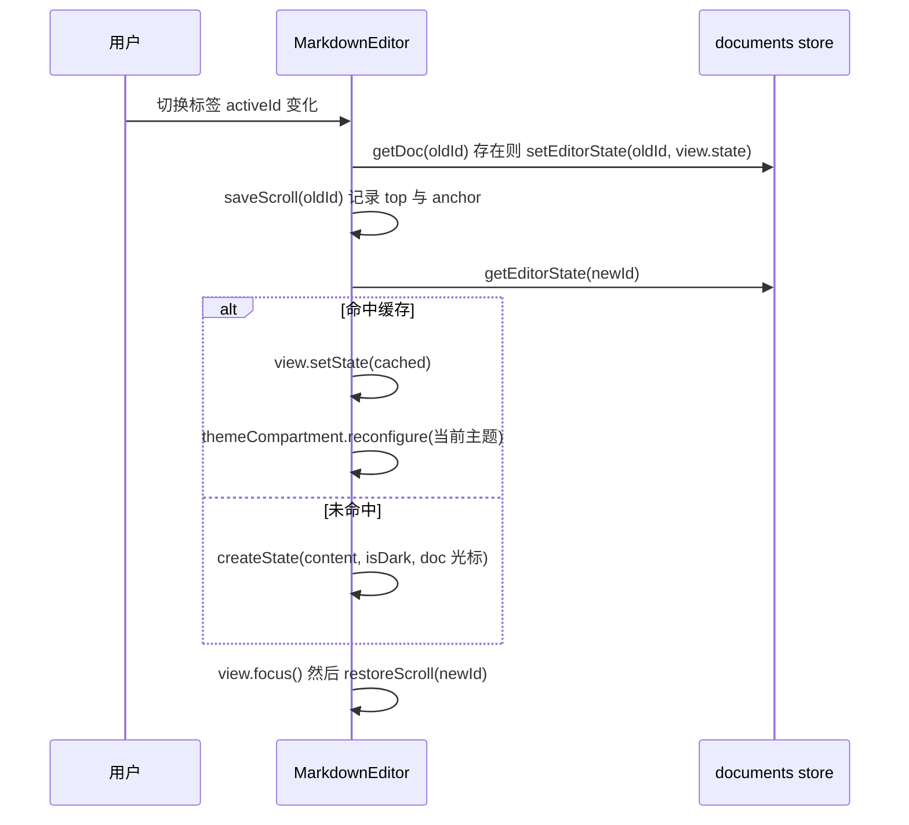
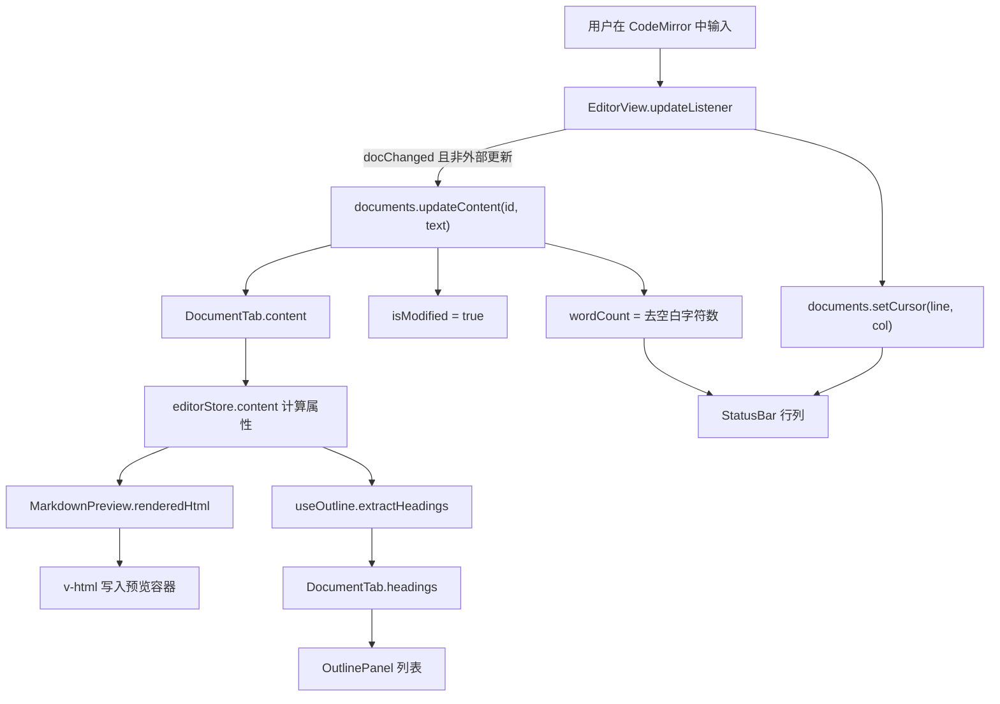
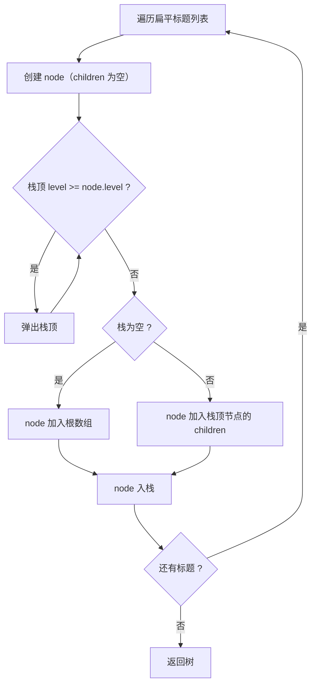
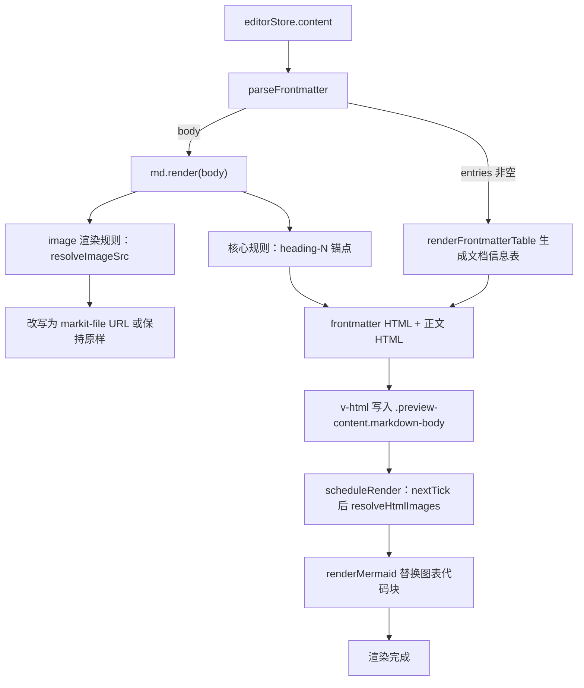
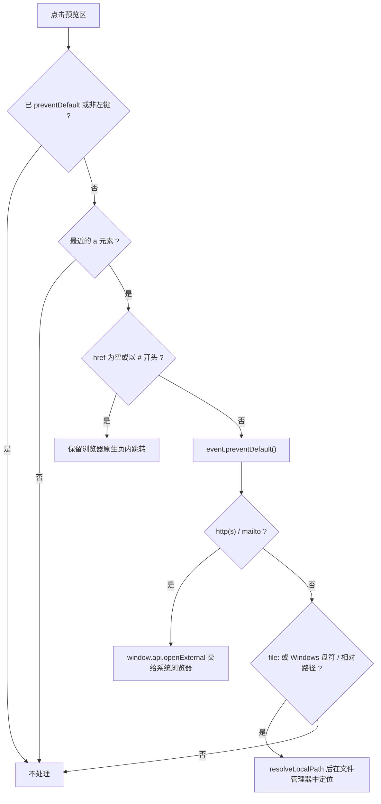

# 编辑器与预览

> 本文描述 MarkIt 编辑区的 CodeMirror 6 集成、编辑内容到预览的数据流、格式化工具栏、快捷键、大纲解析、markdown-it 预览管线、frontmatter 子集、本地图片解析、表格列宽拖动与滚动同步。内容以当前代码为准，不描述尚未实现的能力。
>
> - 适用版本：`1.5.0`
> - 最后核对：2026-11-06
> - 相关文档：[文档中心](./README.md)、[主题样式与布局](./主题样式与布局.md)

## 1. 组件结构

编辑区与预览区是两个独立组件，由 [AppLayout.vue](../src/renderer/src/components/layout/AppLayout.vue) 按布局模式挂载：

| 组件              | 位置                                                                              | 职责                                                                 |
| ----------------- | --------------------------------------------------------------------------------- | -------------------------------------------------------------------- |
| `EditorPane`      | [EditorPane.vue](../src/renderer/src/components/editor/EditorPane.vue)            | 纵向排列工具栏与编辑区，`min-width: 0` 防止分栏时撑破容器            |
| `EditorToolbar`   | [EditorToolbar.vue](../src/renderer/src/components/editor/EditorToolbar.vue)      | 34px 高的格式化按钮条，按钮直接调用 `applyFormatAction`              |
| `MarkdownEditor`  | [MarkdownEditor.vue](../src/renderer/src/components/editor/MarkdownEditor.vue)    | 创建并持有唯一的 `EditorView`，负责状态缓存、滚动恢复、主题重配置    |
| `MarkdownPreview` | [MarkdownPreview.vue](../src/renderer/src/components/preview/MarkdownPreview.vue) | markdown-it 渲染、frontmatter 表格、本地图片、链接分流、Mermaid 挂载 |
| `SearchPanel`     | [SearchPanel.vue](../src/renderer/src/components/common/SearchPanel.vue)          | 浮动搜索 / 替换面板；编辑区与仅预览布局各挂载一处                    |
| `SearchHud`       | [SearchHud.vue](../src/renderer/src/components/common/SearchHud.vue)              | 循环导航与替换结果的临时提示，挂在内容区顶部                          |

`MarkdownPreview` 不依赖编辑器实例，只读取 `editorStore.content`；因此「仅预览」布局下编辑区卸载后预览仍可正常工作。

## 2. CodeMirror 6 集成

### 2.1 扩展清单

扩展在 `buildExtensions(isDark)` 中一次性组装（[MarkdownEditor.vue](../src/renderer/src/components/editor/MarkdownEditor.vue)），顺序即下表的注册顺序：

| 扩展                                                                            | 来源包                                                    | 作用                                                       |
| ------------------------------------------------------------------------------- | --------------------------------------------------------- | ---------------------------------------------------------- |
| `lineNumbers()`                                                                 | `@codemirror/view`                                        | 行号栏                                                     |
| `highlightActiveLineGutter()`                                                   | `@codemirror/view`                                        | 高亮当前行对应的行号                                       |
| `highlightActiveLine()`                                                         | `@codemirror/view`                                        | 高亮当前行背景                                             |
| `history()`                                                                     | `@codemirror/commands`                                    | 撤销 / 重做历史                                            |
| `foldGutter()`                                                                  | `@codemirror/language`                                    | 代码块折叠标记，折叠槽默认 `opacity: 0.3`                  |
| `drawSelection()`                                                               | `@codemirror/view`                                        | 自绘选区与光标，跨平台外观一致                             |
| `EditorState.allowMultipleSelections.of(true)`                                  | `@codemirror/state`                                       | 允许多选区 / 多光标                                        |
| `indentOnInput()`                                                               | `@codemirror/language`                                    | 输入时按语法自动缩进                                       |
| `bracketMatching()`                                                             | `@codemirror/language`                                    | 括号匹配高亮                                               |
| `rectangularSelection()`                                                        | `@codemirror/view`                                        | 矩形（列）选择                                             |
| `syntaxHighlighting(defaultHighlightStyle, { fallback: true })`                 | `@codemirror/language`                                    | 兜底高亮，被主题高亮覆盖时让位                             |
| `markdown({ base: markdownLanguage, codeLanguages: languages })`                | `@codemirror/lang-markdown` + `@codemirror/language-data` | Markdown 语法解析；围栏代码块按 `languages` 注册的语言高亮 |
| `themeCompartment.of(getThemeExtensions(isDark))`                               | 项目内                                                    | 深浅色主题（见 2.2）                                       |
| `keymap.of([...defaultKeymap, ...historyKeymap, ...foldKeymap, indentWithTab])` | `@codemirror/commands`                                    | 默认编辑键位、撤销、折叠、Tab 缩进                         |
| `blockTextDrag`                                                                 | 项目内 `domEventHandlers`                                 | 禁止拖动选中文本（见 2.5）                                 |
| `updateListener`                                                                | 项目内                                                    | 内容与光标同步（见 2.4）                                   |

> 仓库未引入 `@codemirror/search`、`@codemirror/autocomplete`、lint 扩展。查找替换由项目内的 [`utils/editor-search.ts`](../src/renderer/src/utils/editor-search.ts) 自建装饰实现（见[搜索与替换](./搜索与替换.md)），没有使用 CodeMirror 官方搜索面板；补全与语法诊断仍不可用。

### 2.2 主题与语法高亮

- `themeCompartment` 定义在**模块级**而不是组件内。`EditorState` 会被缓存并在组件重新挂载后复用，只有共享同一个 `Compartment` 实例，后续 `reconfigure` 才能作用到缓存状态上。
- 深色：`oneDark` + 自定义 `markitDark` 高亮 + `darkEditorTheme`。
- 浅色：`markitLight` 高亮 + `lightEditorTheme`（不叠加 `oneDark`）。
- 自定义高亮覆盖标题（h1–h6，带字号）、粗体、斜体、删除线、链接、URL、等宽代码、引用、`meta` 与 `processingInstruction`。
- 编辑器主题统一设置 `height: 100%`、`fontSize: 14px`、等宽字体 `JetBrains Mono / Fira Code / Consolas`，滚动容器为 `.cm-scroller`（`overflow: auto`），与全窗滚动条样式共用。
- `watch(() => appStore.resolvedTheme)` 在主题变化时 `reconfigure` 当前视图。

### 2.3 每个标签的 EditorState 保存与恢复

`EditorState` 体积大且不可序列化，存放在 documents store 的非响应式 `Map<string, EditorState>` 中（[documents.ts](../src/renderer/src/stores/documents.ts)），不进入 `ref`。



关键行为：

1. 标签切换的 `watch` 使用 `{ flush: 'sync' }`，先缓存旧标签再恢复新标签。
2. 缓存状态可能是在另一套主题下创建的，恢复后必须重配置主题。
3. 恢复缓存状态保留了该标签的撤销历史、选区与折叠状态；`replaceContent`（磁盘刷新、载入文件）会主动 `editorStates.delete(id)`，避免重新激活时显示过期文本。
4. 组件卸载（切到「仅预览」布局）前调用 `onBeforeUnmount` 保存滚动位置，`onUnmounted` 中把 `view.state` 缓存后 `destroy`，并注销 `editorStore.editorView`。
5. 光标位置按「行 / 列」保存在 `DocumentTab.cursorLine / cursorCol`（1 基），恢复时由 `cursorOffset()` 换算为文档偏移。
6. 跨窗口迁移时用 `editor-state-transfer.ts` 序列化 `EditorState`（含 `historyField`）；目标首次激活时恢复，内容不一致或 JSON 损坏则按当前内容重建。历史载荷上限 4 MiB，不写入会话文件。

### 2.4 内容同步与 updateListener

`updateListener` 每次更新都会：

1. 取 `docs.activeId`，没有激活标签直接返回；
2. 若 `docChanged` 且不处于外部更新（`isExternalUpdate === false`），调用 `docs.updateContent(id, state.doc.toString())`；
3. 无论是否改文档，都用 `selection.main.head` 计算行列并调用 `docs.setCursor`。

内容与字数由 documents store 统一维护：

- `updateContent` 内容有变化时写 `content`、置 `isModified = true`、重算 `wordCount`；
- `wordCount` 为 `text.replace(/\s/g, '').length`，即**去掉所有空白后的字符数**，包含 Markdown 标记符号。

反向同步（store → 编辑器）：

- `watch(() => docs.activeDoc?.content)` 监听外部替换（磁盘被动刷新、载入文件）；
- 差异通过 `replaceDocContent` 只替换公共前缀 / 后缀之间的片段，避免全量替换把光标推到文档末尾；
- 替换前后用 `isExternalUpdate` 包住，防止 `updateListener` 把程序化修改当成用户输入再次写回 store。

### 2.5 滚动位置恢复

- 保存：`saveScroll` 读取 `scrollDOM.scrollTop`，并以 `lineBlockAtHeight(top + 8).from` 记录顶部可见行的文档偏移作为 `anchor`。
- 恢复：`anchor > 0` 时用 `EditorView.scrollIntoView(anchor, { y: 'start' })`；否则用像素 `top`；都没有则显式滚到偏移 0。
- 必须按文档位置而非像素恢复：`setState` 后 CodeMirror 的行高表是估算值，直接写 `scrollTop` 会被二次修正，造成光标落错行。
- 窗口重新可见 / 获得焦点、以及挂载后的首帧 `requestAnimationFrame` 都会 `requestMeasure()` 复测，修正隐藏期间失效的行高缓存。
- 退出重启：滚动位置随会话保存（编辑区 `scrollAnchor` / `scrollTop`；预览区 `previewScrollAnchor` / `previewScrollOffset`，像素 `previewScrollTop` 兜底），写入前由 [`session-scroll.ts`](../src/renderer/src/composables/session-scroll.ts) 的采集器把当前活跃标签的实时位置刷回 Map；恢复时 `restoreSession` 预填 Map，组件挂载 / 切换标签后走同一套 `restoreScroll`。`anchor` 恢复前会夹取到当前文档长度，避免会话之后文件被改短导致越界。

### 2.6 禁止拖动选中文本

`blockTextDrag` 拦截 `dragstart`：未按 Ctrl / Cmd 时 `preventDefault`。原因是 CodeMirror 默认允许拖放选中文本，鼠标从已有选区起手拖选会把整段文本搬到落点，表现为「文字被拖动换位、代码块被重排」。按住 Ctrl / Cmd 拖动仍可复制。

## 3. 编辑器与 store 的数据流



补充说明：

- `stores/editor.ts` 不持有文档状态，只把 `activeDoc` 的字段包装成计算属性；写入仍落到 documents store。
- `MarkdownPreview` 的 `renderedHtml` 依赖 `editorStore.content`，因此每次输入都会触发预览重算（防抖由 Vue 的批量更新与 Mermaid 的串行调度间接完成，没有额外的时间防抖）。
- 预览滚动位置与编辑器滚动位置分别存放在 `previewScrollPositions`（内容锚点 + 像素兜底）与 `scrollPositions`（像素 + anchor）两个 Map 中，互不覆盖。

## 4. 格式化工具栏动作

动作定义在 [useFormatActions.ts](../src/renderer/src/composables/useFormatActions.ts)，按 `FormatAction` 的四种字段执行：

```ts
export interface FormatAction {
  wrap?: [string, string]
  prefix?: string
  template?: string
  linePrefix?: string
}
```

### 4.1 动作表

| 动作 key        | 插入规则     | 具体内容                         | 工具栏入口           | 快捷键           |
| --------------- | ------------ | -------------------------------- | -------------------- | ---------------- |
| `bold`          | `wrap`       | `**` … `**`                      | 加粗按钮             | Ctrl/Cmd+B       |
| `italic`        | `wrap`       | `*` … `*`                        | 斜体按钮             | Ctrl/Cmd+I       |
| `strikethrough` | `wrap`       | `~~` … `~~`                      | 删除线按钮           | 无               |
| `h1`            | `linePrefix` | `# `                             | 无（仅 API）         | 无               |
| `h2`            | `linePrefix` | `## `                            | 标题按钮（显示 `H`） | 无               |
| `h3`            | `linePrefix` | `### `                           | 无（仅 API）         | 无               |
| `link`          | `wrap`       | `[` … `](url)`                   | 链接按钮             | Ctrl/Cmd+K       |
| `image`         | `template`   | ``                    | 图片按钮             | 无               |
| `code`          | `wrap`       | `` ` `` … `` ` ``                | 无（仅 API）         | 无               |
| `codeblock`     | `template`   | 三反引号空代码块（中间保留空行） | 代码块按钮           | Ctrl/Cmd+Shift+K |
| `quote`         | `linePrefix` | `> `                             | 引用按钮             | 无               |
| `ul`            | `linePrefix` | `- `                             | 无序列表按钮         | 无               |
| `ol`            | `linePrefix` | `1. `                            | 无（仅 API）         | 无               |
| `task`          | `linePrefix` | `- [ ] `                         | 任务列表按钮         | 无               |

`FormatAction` 中的 `prefix` 字段当前没有动作使用，`applyFormatAction` 也不处理它。

### 4.2 插入规则语义

1. **wrap**：在选区起点插入前缀、终点插入后缀，并把选区扩展为包住原内容（`range.extend(from + before.length, to + after.length)`），便于连续输入。
2. **linePrefix**：取选区起点所在行；若该行已以同样前缀开头则删除前缀，否则在行首插入。即同一动作是**可切换**的。
3. **template**：用固定模板整体替换每个选区内容；`image` 与 `codeblock` 用它，不做智能占位选择。
4. `view` 为 `null`（未挂载编辑器）或动作无上述字段时返回 `false`，不抛错。

### 4.3 多选区行为

`wrap` 与 `linePrefix` 都通过 `state.changeByRange` 实现，每个选区**独立**应用自己的改动：

- 多光标加粗会给每个选区各自加一对 `**`；
- 多行 / 多选区加列表前缀时，每个选区起点所在行各加一次；
- `template` 同样是每个选区替换一次（多选区会插入多份相同模板）；
- `linePrefix` 的判定是「该行是否以该前缀开头」，不解析嵌套层级，因此对已有更深缩进的列表不会智能对齐。

## 5. 快捷键

### 5.1 分工

| 层           | 位置                                                                                                                             | 负责                                         |
| ------------ | -------------------------------------------------------------------------------------------------------------------------------- | -------------------------------------------- |
| 渲染进程全局 | [useKeyboardShortcuts.ts](../src/renderer/src/composables/useKeyboardShortcuts.ts)，在 `App.vue` 中安装，监听 `document.keydown` | 文件、标签、视图、格式化的应用级快捷键       |
| 主进程       | [src/main/index.ts](../src/main/index.ts) 的 `webContents.on('before-input-event')`                                              | macOS `Cmd+W` 拦截转交、整窗缩放             |
| 编辑器内部   | CodeMirror `keymap`                                                                                                              | Tab 缩进、撤销重做、折叠、选区编辑等编辑行为 |

分工原因：`before-input-event` 先于页面和菜单快捷键到达，能拦住会被 macOS 默认菜单吞掉的 `Cmd+W`；整窗缩放必须由主进程调用 `webContents.setZoomFactor`，渲染进程无法直接改窗口缩放。

### 5.2 应用级快捷键

`isCtrl(e)` 等价于 `e.ctrlKey || e.metaKey`，即 Windows/Linux 用 Ctrl、macOS 用 Cmd。

| 快捷键           | 作用                              |
| ---------------- | --------------------------------- |
| Ctrl/Cmd+N       | 新建标签页                        |
| Ctrl/Cmd+Shift+N | 新建编辑窗口                      |
| Ctrl/Cmd+O       | 打开文件（支持多选）              |
| Ctrl/Cmd+W       | 关闭当前标签页（未保存先确认）    |
| Ctrl+Tab         | 下一个标签页                      |
| Ctrl+Shift+Tab   | 上一个标签页                      |
| Ctrl/Cmd+1…9     | 跳到第 N 个标签页（不存在则忽略） |
| Ctrl/Cmd+S       | 保存                              |
| Ctrl/Cmd+Shift+S | 另存为                            |
| F5               | 重新读取磁盘文件                  |
| Ctrl/Cmd+R       | 重新读取磁盘文件（与 F5 等价）    |
| Ctrl/Cmd+P       | 打开 PDF 导出对话框               |
| Ctrl/Cmd+,       | 打开 / 关闭设置                   |
| Ctrl/Cmd+Shift+O | 显示 / 隐藏大纲面板               |
| Ctrl/Cmd+\       | 循环切换布局模式                  |
| Ctrl/Cmd+B       | 加粗                              |
| Ctrl/Cmd+I       | 斜体                              |
| Ctrl/Cmd+K       | 插入链接                          |
| Ctrl/Cmd+Shift+K | 插入代码块                        |
| Ctrl/Cmd+F       | 打开搜索 / 重新聚焦查询框         |
| Ctrl/Cmd+H       | 打开搜索并展开替换行              |
| F3 / Shift+F3    | 搜索面板打开时：下一个 / 上一个   |
| Esc              | 搜索面板打开时关闭并清除高亮      |

注意：

- 标签切换只匹配 `e.ctrlKey`，**故意不匹配 `metaKey`**：macOS 的 `Cmd+Tab` 是系统应用切换器，不能被应用拦截。
- `Ctrl/Cmd+1…9` 只跳到已存在的标签，没有「第 N 个不存在就新建」的行为。
- 数字键、字母键的判断使用 `e.key` 的小写形式；`Shift` 组合（如 `Ctrl+Shift+S`）判断的是大写字符。

### 5.3 主进程拦截

| 快捷键                   | 平台     | 作用                                                                                            |
| ------------------------ | -------- | ----------------------------------------------------------------------------------------------- |
| Cmd+W                    | 仅 macOS | 拦截默认菜单的关闭窗口，`preventDefault` 后通过 `shortcut:close-tab` 通知渲染进程关闭当前标签页 |
| Ctrl/Cmd+= 或 Ctrl/Cmd++ | 全平台   | 放大 10%（`ZOOM_STEP = 0.1`）                                                                   |
| Ctrl/Cmd+- 或 Ctrl/Cmd+_ | 全平台   | 缩小 10%                                                                                        |
| Ctrl/Cmd+0               | 全平台   | 恢复 100%                                                                                       |

缩放键要求「平台修饰键按下且未按 Alt」；`0` 在按下 Shift 时不匹配。主进程侧范围限制与持久化见[主题样式与布局](./主题样式与布局.md)的缩放一节。

### 5.4 CodeMirror 内置键位（节选）

| 快捷键                                        | 作用                                  |
| --------------------------------------------- | ------------------------------------- |
| Tab / Shift+Tab                               | 缩进 / 反缩进（`indentWithTab`）      |
| Ctrl/Cmd+Z                                    | 撤销（`historyKeymap`）               |
| Ctrl/Cmd+Shift+Z（Windows/Linux 也可 Ctrl+Y） | 重做（`historyKeymap`）               |
| Ctrl+Shift+[ / ]（macOS 为 Cmd+Alt+[ / ]）    | 折叠 / 展开当前代码块（`foldKeymap`） |
| Ctrl+Alt+[ / ]                                | 全部折叠 / 展开（`foldKeymap`）       |

正文编辑（移动、选择、删除、复制粘贴等）由 `defaultKeymap` 提供；`allowMultipleSelections` 与 `rectangularSelection` 让多光标和列选择可用，但**没有**为「添加下一个相同选区」绑定额外快捷键。

### 5.5 macOS 差异汇总

1. `Cmd+W` 由主进程拦截并回推，避免默认菜单直接关窗。
2. `Cmd+Tab` 保留给系统，应用只响应 `Ctrl+Tab`。
3. 应用级快捷键统一接受 `metaKey`，界面上标注为 Ctrl 的提示在 macOS 上实际按 Cmd。
4. 折叠键位在 macOS 使用 Cmd+Alt 组合（CodeMirror `foldKeymap` 的平台映射）。

### 5.6 搜索与替换

搜索的完整交互、匹配口径与两条高亮链路见[搜索与替换](./搜索与替换.md)。与本节相关的约定：

- 搜索快捷键在渲染进程 `useKeyboardShortcuts` 中处理，与文件 / 标签快捷键同层；
- 编辑上下文搜索源文本，分栏时预览区只同步高亮；仅预览上下文搜索渲染后的可见文本；
- 编辑区高亮使用项目内 `StateField` 装饰，不引入 `@codemirror/search`。

## 6. 大纲

### 6.1 标题解析规则

大纲与预览共用 [`utils/headings.ts`](../src/renderer/src/utils/headings.ts)，不再各自维护一套正则：

1. `parseFrontmatter` 先拆出 `body` 与 `bodyStartLine`，frontmatter 内的 `#` 注释不会被当成标题；
2. `parseHeadings(body)` 用 markdown-it 解析正文，只遍历顶层的 `heading_open` token；
3. **ATX（`#`）与 Setext（`===` / `---`）标题都被识别**；围栏代码块（``` / ~~~）与缩进代码块由 markdown-it 自行排除；
4. 标题文本取自 `inline` token 的文本子节点（`text`、`code_inline`、`image`），忽略强调、链接等标记；
5. `id` 按出现顺序生成 `heading-N`，与预览锚点规则完全一致；
6. 行号取 `token.map[0] + 1 + bodyStartLine`，即**原文档的 1 基行号**（补上 frontmatter 占用的行数），供仅编辑模式下滚动 CodeMirror 使用。

`useOutline`（[useOutline.ts](../src/renderer/src/composables/useOutline.ts)）在 `[activeId, editorStore.content]` 变化时（`immediate: true`）调用 `parseHeadings`，再用 6.2 的栈算法建树，并把结果写回当前标签的 `headings`。

### 6.2 buildTree 栈算法



要点：用 `>=` 弹出，保证同级标题不会互相嵌套；跳级（如 h1 直接到 h3）时 h3 成为 h1 的子节点；`id` 在扁平化之前就已确定，树形结构不影响锚点顺序。

### 6.3 点击跳转与预览滚动

`OutlinePanel`（[OutlinePanel.vue](../src/renderer/src/components/outline/OutlinePanel.vue)）先把树 `flattenHeadings` 成按文档顺序的列表，再做两路跳转：

1. `document.getElementById(h.id)` 命中（预览已渲染）：`scrollIntoView({ behavior: 'smooth', block: 'start' })`；
2. 未命中（仅编辑布局，预览未挂载）：用 `editorStore.editorView` 把编辑器滚到 `h.line` 对应行首，行号会先 `Math.min(h.line, doc.lines)` 夹取。

预览侧与大纲共用 `installHeadingAnchors` / `parseHeadings`，两者都按**顶层 `heading_open` token 的出现顺序**赋值 `heading-N`，因此 Setext 与 ATX 混排时条目与锚点一一对应。缩进级别只影响列表左侧留白 `(level - 1) * 16 + 12`。

### 6.4 已知限制

- 原始 HTML 块中的 `<h1>`～`<h6>` 不经过 markdown-it 的 heading token，因此不会进入大纲，也没有 `heading-N` 锚点（预览渲染的原始 HTML 同样不会注入）。
- 标题文本取自行内 token 的纯文本拼接，不含链接目标或图片 alt 之外的富文本结构。
- 与 markdown-it 的解析结果保持一致：若同一文档中 preview 与 outline 使用相同的 `body`，则顺序不会错位；渲染配置（`typographer` / `linkify`）不影响标题 token 顺序。

## 7. 预览管线

### 7.1 渲染器配置

`MarkdownPreview` 在模块初始化时通过共享工厂创建实例（[markdown.ts](../src/renderer/src/utils/markdown.ts)）：

```ts
const md = createMarkdownRenderer({ typographer: true })
```

工厂内部固定以下选项：

| 选项          | 值     | 效果                                                                    |
| ------------- | ------ | ----------------------------------------------------------------------- |
| `html`        | `true` | 允许原始 HTML 直出（随后由 `resolveHtmlImages` 统一改写其中的相对图片） |
| `linkify`     | `true` | 自动把裸 URL 转成链接                                                   |
| `typographer` | 参数   | 排版替换（引号、破折号等）；预览为 `true`，PDF 为 `false`               |
| `breaks`      | `true` | 单个换行渲染为 `<br>`                                                   |

工厂还会安装 `markdown-it-task-lists`，把 `- [ ]` / `- [x]` 渲染成 GitHub 规范的任务列表：

```html
<ul class="contains-task-list">
  <li class="task-list-item">
    <input class="task-list-item-checkbox" disabled="" type="checkbox" />
    待办
  </li>
</ul>
```

工厂还通过 `highlight.js/lib/common` 对已知语言做语法高亮：语言标记命中时输出 `hljs-*` 标记（如 `hljs-keyword`、`hljs-string`），未知语言（包括 `mermaid`、`flowchart` 等图表标记）返回空串，由 markdown-it 按纯文本转义，因此不会影响 Mermaid 识别。高亮配色由 App.vue 的全局变量 `--hljs-*` 提供，内置主题与导入的 CSS 都可以覆盖。

markdown-it 默认已支持表格、删除线与链接自动识别，因此无需额外的 GFM 插件。同一工厂也用于 PDF 导出，保证两条管线的清单结构与高亮标记一致；PDF 模板内置了一套浅色高亮配色。

markdown-it 15 依赖的 linkify-it 6 默认关闭裸域名识别（`fuzzyLink`），工厂在创建实例后显式调用 `md.linkify.set({ fuzzyLink: true })`，保持 `www.example.com` / `example.com` 的自动链接行为。该约定由 `markdown.spec.ts` 的用例守护。

预览在此基础上还安装了三条定制规则：

1. `installLocalImageRule(md, () => documentsStore.activeDoc?.path)`：改写图片 `src`；
2. `installHeadingAnchors(md)`：给顶层标题加 `heading-N`（与大纲、PDF 共用同一实现）；
3. `installLinkTitles(md)`：给链接补 `title`，悬停时显示完整地址（仅预览安装，PDF 不需要悬停提示）。

### 7.2 渲染流程



`renderedHtml` 是 `computed`，内容变化后触发 `scheduleRender`：

- `renderToken` 递增，`await nextTick()` 后把任务挂到 `renderChain` 串行执行；
- 执行前比对 token，已有更新内容时丢弃本次，避免旧渲染覆盖新内容；
- 先 `resolveHtmlImages()` 处理内嵌 HTML 的 ``，再 `renderMermaid()`；
- 异常统一 `console.error('Mermaid render failed:', err)`，不阻断预览。

### 7.3 frontmatter 渲染为文档信息表

frontmatter 不再以 YAML 文本或代码块出现，而是替换为预览顶部的表格：

- `parseFrontmatter` 返回 `entries` 与去掉 frontmatter 的 `body`；
- `entries.length > 0` 时 `renderFrontmatterTable(entries)` 生成 `<div class="frontmatter-block">`、标题「文档信息」、两列表格（属性 / 值）；
- 键值均经过 `escapeHtml`（`& < > " '`），值列 `white-space: pre-wrap` 保留块标量换行；
- 表格样式定义在 [App.vue](../src/renderer/src/App.vue) 的全局 `<style>` 中（`.preview-content .frontmatter-table`），不随预览主题切换。

### 7.4 标题锚点

`installHeadingAnchors(md)`（[utils/headings.ts](../src/renderer/src/utils/headings.ts)）遍历 `state.tokens`，对每个 `heading_open` 依次 `attrSet('id', 'heading-' + index)`。该 id 是**渲染顺序序号**，不是标题文本的 slug，因此：

- 同名标题也能各自定位；
- 标题增删会导致其后所有锚点 id 变化，但大纲与预览在同一次渲染中重新生成，二者仍保持一致；
- 用户手写 HTML 中的 `id` 不受影响。

### 7.5 图片

两条路径：

1. Markdown 语法 ``：由 `installLocalImageRule` 安装的 `image` 渲染规则在渲染时解析 `src`；
2. 原始 HTML ``：`v-html` 渲染后由 `resolveHtmlImages()` 遍历 `.preview-content img`，把首次见到的原始地址记到 `img.dataset.markitSrc`，再改写 `src`；切换标签 / 另存为导致文档目录变化时会按原始地址重新解析。

`markit-file:` 开头的地址直接跳过，避免二次编码。解析规则见第 9 节。

### 7.6 链接分流

点击事件绑定在 `.preview-content` 上，`handlePreviewLinkClick` 的处理顺序：



判定细节：

- 外部链接正则 `^(?:https?|mailto):`，大小写不敏感；
- `LINK_SCHEME` 用于识别其它协议（`ftp:`、`tel:`、`javascript:` 等），一律**忽略**，避免主窗口被导航走；
- `WINDOWS_DRIVE_PATH = /^[a-zA-Z]:[\\/]/` 把 `D:\docs\a.md` 从「协议」中排除，按本地路径处理；
- 本地路径解析失败（无文档路径、无法归一化）时不做任何操作；
- `file://` 链接由 `resolveLocalPath` 转成系统路径后同样交给「在文件夹中显示」。

链接的悬停提示：`installLinkTitles` 给渲染出的链接补 `title` 属性，鼠标悬停时显示完整地址。链接自带的说明（`[文本](地址 "说明")`）会保留，并与地址用换行分隔；页内锚点（`#xxx`）不补提示。该属性只影响悬停提示，不改变链接点击分流。

### 7.7 表格列宽拖动

预览表格支持在表头右边界拖动调整列宽，完整设计见[预览表格列宽调整](./预览表格列宽调整.md)。与预览管线相关的约定：

- 列宽是纯视图状态，保存在 `markit-table-widths`，**不写回 Markdown**；
- `scheduleRender` 在 `resolveHtmlImages()` 之后、`renderMermaid()` 之前调用 `usePreviewTableResize().apply()`，按「文档键 + 表头哈希 + 同名表序号」重新应用列宽；
- 未调整过、存档缺失或列数变化的表格保持主题原有的 `table-layout: auto`；
- frontmatter 表格与含合并表头（`colspan` / `rowspan`）的表格不注入拖拽手柄；
- 切换标签、另存为导致文档路径变化时，路径监听器会重新应用新文档的存档；
- PDF 导出不读取该存档，仍使用默认列宽。

## 8. frontmatter 支持的子集

解析器在 [frontmatter.ts](../src/renderer/src/utils/frontmatter.ts)，只实现预览展示所需的最小 YAML 子集，**不是完整 YAML**：

| 语法                       | 行为                                                    |
| -------------------------- | ------------------------------------------------------- |
| 首行 `---`（允许前后空白） | 视为 frontmatter 开始；文件头 BOM 会先被去掉            |
| 结束行 `---` 或 `...`      | 视为结束；找不到结束行则整篇按正文处理                  |
| 顶层 `key: value`          | 在**第一个** `:` 处分割；`:` 前必须有内容，否则该行忽略 |
| 单 / 双引号包裹的值        | 去掉首尾同类引号，内部不转义                            |
| `\|`、`\|-`、`\|+`         | 字面块：后续缩进行以 `\n` 拼接，保留换行                |
| `>`、`>-`、`>+`            | 折叠块：后续缩进行以空格拼接                            |
| 缩进续行                   | 去掉前导空白后追加到当前键；无块标记时用 `\n` 连接      |
| 顶格 `#` 注释行            | 跳过；缩进的 `#` 视为值内容                             |
| 空行                       | 跳过                                                    |

不支持：嵌套映射 / 序列的语义解析（嵌套内容按原样多行展示）、锚点与别名、多文档、类型转换（数字 / 布尔 / 日期一律按字符串显示）、行内注释剥离、带冒号的引号键的精确切分、`|` / `>` 的缩进量判定。目标只是「在预览中呈现为可读表格」。

## 9. 本地图片与 markit-file 协议

### 9.1 resolveImageSrc 规则

`resolveImageSrc(src, documentPath)`（[local-image.ts](../src/renderer/src/utils/local-image.ts)）：

| 输入                                                 | 返回                         | 说明                                    |
| ---------------------------------------------------- | ---------------------------- | --------------------------------------- |
| 空字符串、`#...`                                     | `null`                       | 保持原样，不处理                        |
| `data:`                                              | `null`                       | 交给 Chromium                           |
| `file://...`                                         | `markit-file://local/?p=...` | `fileUrlToPath` 兼容 Windows 盘符与 UNC |
| 其他协议（`http:`、`https:`、`blob:`、`//host/...`） | `null`                       | 网络图片原样加载；Windows 盘符不算协议  |
| 绝对路径（`D:\...`、`/...`、`\...`）                 | `markit-file://...`          | 先归一化分隔符与 `.` / `..`             |
| 相对路径且有文档路径                                 | `markit-file://...`          | 拼到文档所在目录后归一化                |
| 相对路径但文档未保存                                 | `null`                       | 没有基准目录，保持原样                  |

`src` 会先做一次 `decodeURIComponent`（失败则原样使用），避免 `%20` 等编码影响路径拼接。

### 9.2 URL 结构与主进程校验

```text
markit-file://local/?p=<encodeURIComponent(绝对路径)>
```

- 主进程在 `app.whenReady` 后用 `protocol.handle('markit-file', ...)` 处理；
- 取查询参数 `p`，缺失返回 400；
- 扩展名白名单 `\.(?:png|jpe?g|gif|webp|bmp|svg|avif|ico|tiff?)$`（大小写不敏感），不匹配返回 415；
- 通过 `net.fetch(pathToFileURL(filePath))` 读取，异常返回 404。

> 白名单是安全边界：该协议只用于预览图片，**不得**放宽为任意文件读取通道（见 `rules/code-style.md` 第 7 节）。

### 9.3 resolveLocalPath

供「在文件夹中显示」使用：

1. 空值或 `#` 开头 → `null`；
2. `file://` → 直接转系统路径；
3. 其它地址先去掉 `?query` 与 `#anchor` 再解码；
4. 外部协议 → `null`；
5. 绝对路径 → 归一化；相对路径 → 基于文档目录拼接；
6. 没有文档路径 → `null`。

## 10. 滚动同步

实现在 [useScrollSync.ts](../src/renderer/src/composables/useScrollSync.ts)。

### 10.1 模块级 registry 与实例级登记

```ts
const scrollRegistry = {
  editorView: null as EditorView | null,
  previewEl: null as HTMLElement | null,
  isSyncing: false,
  suspendCount: 0
}
```

- registry 是**模块级单例**，所有组件共享一份；
- `useScrollSync()` 的每次调用各自持有 `registeredView` / `registeredPreview`，注销时只移除自己注册的元素，并且只有「全局登记仍指向自己」时才清空全局字段。

这样处理是因为布局切换时新旧实例的挂载 / 卸载顺序不固定（预览还要等异步渲染后才注册），无条件清空全局登记会把另一个实例刚注册的元素一并清掉，导致之后永久失去联动。

### 10.2 比例同步与 isSyncing

- 编辑器滚动：`ratio = editor.scrollTop / (scrollHeight - clientHeight)`，写入 `preview.scrollTop = ratio * previewMax`；
- 预览滚动：反向同理，写入 `editorDOM.scrollTop`；
- `maxScroll <= 0`（容器不可滚动）时直接复位 `isSyncing` 返回，避免除零；
- 执行前若 `isSyncing` 为真则忽略，防止 A→B→A 的回环；
- 写入后 `requestAnimationFrame(() => { isSyncing = false })`，因为程序化滚动触发的 `scroll` 事件在本帧后续派发，rAF 时解除即可覆盖。

### 10.3 suspendSync 的用途

`useScrollSync()` 暴露 `suspendSync(): () => void`，按引用计数屏蔽双向联动，返回幂等的释放函数。切换标签时两个滚动容器都会由代码写入位置，恢复自身写入的滚动会触发 `scroll` 事件；若不屏蔽，会把另一侧刚恢复好的位置按比例反向覆盖。

- 编辑区在切换标签的 `watch` 中获取释放函数，覆盖 `setState`、聚焦与 `restoreScroll`，跨两帧后释放；
- 预览区在 `activeId` 变化后同步获取，持续到 `nextTick`、异步渲染（Mermaid / 图片 / 表格列宽）完成并再次对齐位置，再等两帧后释放；
- 之所以不能按固定帧数计时：预览重排会持续改变高度并触发 `scroll` 事件，一旦过早释放，这些事件会按新旧高度比例反复改写两侧位置，表现为来回切标签时内容逐次偏移。

预览位置本身也改为按内容锚点恢复（见第 2.5 节），像素值只作旧会话兜底。

监听使用 `{ passive: true }`，不阻塞滚动。

## 11. 预览宽度

- 模式：`app.previewWidthMode` 为 `fixed`（固定宽度）或 `auto`（随容器自适应），默认 `fixed`；
- 固定宽度：`contentStyle.maxWidth = previewWidth + 'px'`，`.preview-content` 通过 `margin: 0 auto` 居中；
- 自适应：`maxWidth: 'none'`，铺满预览容器（容器自身仍有 `32px 40px` 内边距）；
- 范围 400–1600，步长 20，默认 800，读取时 `loadClampedNumber` 夹取；
- 持久化键：`markit-preview-width-mode`、`markit-preview-width`（写入发生在 [stores/app.ts](../src/renderer/src/stores/app.ts) 的 `watch` 中）；
- 设置入口在「设置 → 预览宽度」，固定宽度时显示 range 滑块与当前像素值。

## 12. 状态栏

[StatusBar.vue](../src/renderer/src/components/layout/StatusBar.vue) 高 26px，左侧 / 右侧分组：

| 位置 | 内容                                                        | 数据来源                                                    |
| ---- | ----------------------------------------------------------- | ----------------------------------------------------------- |
| 左   | 当前文件名（无标签时为 `untitled.md`）                      | `app.fileName` ← `activeDoc.name`                           |
| 左   | `行 N, 列 M`                                                | `editorStore.cursorLine / cursorCol` ← `DocumentTab`        |
| 右   | `N 字`                                                      | `editorStore.wordCount`，去空白字符数                       |
| 右   | `UTF-8`                                                     | 固定文案，不做编码探测                                      |
| 右   | 布局名称（左编辑 右预览 / 左预览 右编辑 / 仅编辑 / 仅预览） | `app.layoutMode` 映射                                       |
| 右   | `缩放 N%`                                                   | 仅当 `zoomPercent !== 100` 时显示，悬停提示 Ctrl/Cmd+0 恢复 |

## 13. 相关文件

| 文件                                                                                                                  | 说明                                            |
| --------------------------------------------------------------------------------------------------------------------- | ----------------------------------------------- |
| [src/renderer/src/components/editor/MarkdownEditor.vue](../src/renderer/src/components/editor/MarkdownEditor.vue)     | CodeMirror 视图、扩展、主题、状态缓存、滚动恢复 |
| [src/renderer/src/components/editor/EditorToolbar.vue](../src/renderer/src/components/editor/EditorToolbar.vue)       | 格式化按钮条                                    |
| [src/renderer/src/components/editor/EditorPane.vue](../src/renderer/src/components/editor/EditorPane.vue)             | 工具栏 + 编辑区组合                             |
| [src/renderer/src/components/preview/MarkdownPreview.vue](../src/renderer/src/components/preview/MarkdownPreview.vue) | 预览管线、链接分流、图片兜底、滚动记录          |
| [src/renderer/src/composables/usePreviewTableResize.ts](../src/renderer/src/composables/usePreviewTableResize.ts)     | 表格列宽拖动与渲染后恢复                        |
| [src/renderer/src/utils/table-resize.ts](../src/renderer/src/utils/table-resize.ts)                                   | 列宽比例计算、表标识哈希、存档校验              |
| [src/renderer/src/stores/table-widths.ts](../src/renderer/src/stores/table-widths.ts)                                 | `markit-table-widths` 读写                      |
| [src/renderer/src/components/outline/OutlinePanel.vue](../src/renderer/src/components/outline/OutlinePanel.vue)       | 大纲列表、点击跳转、宽度拖拽                    |
| [src/renderer/src/composables/useOutline.ts](../src/renderer/src/composables/useOutline.ts)                           | 标题提取与树构建                                |
| [src/renderer/src/composables/useScrollSync.ts](../src/renderer/src/composables/useScrollSync.ts)                     | 编辑区 / 预览区滚动联动                         |
| [src/renderer/src/composables/useFormatActions.ts](../src/renderer/src/composables/useFormatActions.ts)               | 格式化动作定义与执行                            |
| [src/renderer/src/composables/useKeyboardShortcuts.ts](../src/renderer/src/composables/useKeyboardShortcuts.ts)       | 应用级快捷键（含搜索 / 替换）                   |
| [src/renderer/src/stores/search.ts](../src/renderer/src/stores/search.ts)                                             | 搜索状态、匹配计数、循环导航与 HUD              |
| [src/renderer/src/utils/search.ts](../src/renderer/src/utils/search.ts)                                               | 字面量匹配与预览文本范围生成                    |
| [src/renderer/src/utils/editor-search.ts](../src/renderer/src/utils/editor-search.ts)                                 | 编辑区搜索装饰 StateField                       |
| [src/renderer/src/components/common/SearchPanel.vue](../src/renderer/src/components/common/SearchPanel.vue)           | 搜索 / 替换面板                                 |
| [src/renderer/src/utils/frontmatter.ts](../src/renderer/src/utils/frontmatter.ts)                                     | frontmatter 解析与表格渲染                      |
| [src/renderer/src/utils/local-image.ts](../src/renderer/src/utils/local-image.ts)                                     | 图片 / 链接路径解析与 markdown-it 规则          |
| [src/renderer/src/utils/mermaid.ts](../src/renderer/src/utils/mermaid.ts)                                             | Mermaid 语言识别与代码块收集                    |
| [src/renderer/src/stores/documents.ts](../src/renderer/src/stores/documents.ts)                                       | 文档状态与非响应式缓存 Map                      |
| [src/renderer/src/stores/editor.ts](../src/renderer/src/stores/editor.ts)                                             | 当前标签的只读视图                              |
| [src/main/index.ts](../src/main/index.ts)                                                                             | `markit-file` 协议、快捷键拦截、缩放            |
